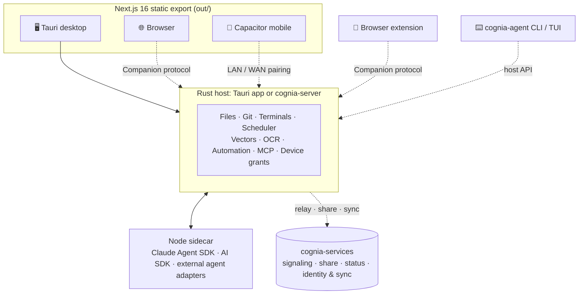

<p align="center">
  
</p>

<h3 align="center">One AI workspace for agents, code, knowledge, and automation<br>on desktop, browser, mobile, and the terminal.</h3>

<p align="center">
  <a href="./LICENSE"></a>
  
  
  
  
  
  
  
</p>

<p align="center">
  <b>English</b> · <a href="./README_zh.md">简体中文</a>
  <br>
  <a href="#highlights">Highlights</a> ·
  <a href="#quick-start">Quick start</a> ·
  <a href="#architecture">Architecture</a> ·
  <a href="#development">Development</a> ·
  <a href="#documentation">Documentation</a>
</p>

---

**Cognia** brings conversations, project files, terminals, browsers, artifacts, and agent runs into one workbench. Use the built-in multi-provider agent, or bring the coding agents you already use, such as Claude Code, Codex, Gemini CLI, OpenCode, and Pi.

The desktop app runs a local **Rust host** and a **Node agent sidecar**. Browsers and phones pair with a host to use its files, tools, and agents. The standalone **`cognia-agent`** CLI runs the same agents in a terminal, with no window needed.

> [!WARNING]
> **Cognia is under heavy refactoring.** APIs, data schemas, and features can change or break without notice, and availability is not guaranteed. If you depend on it, pin a commit you have verified.

## Highlights

<table>
  <tr>
    <td width="50%"></td>
    <td width="50%">
      <h3>🧠 Agents that know your work</h3>
      <ul>
        <li>Pick an agent per conversation: built-in, external CLI, or a paired host's.</li>
        <li>Bind a chat to a workspace. Files, Git, terminals, and previews sit beside it.</li>
        <li>Carry knowledge forward with long-term memory, project knowledge, imported histories, and an Employee Digital Twin.</li>
      </ul>
    </td>
  </tr>
  <tr>
    <td width="50%">
      <h3>🧩 Teams, workflows, and automation</h3>
      <ul>
        <li>Run Squads of agents with task boards, approvals, and runs you can resume.</li>
        <li>Connect steps in a visual workflow editor. Trigger them from schedules, webhooks, chat, or messages.</li>
        <li>Let agents drive a desktop through Computer Use or a sandbox, with review and audit.</li>
      </ul>
    </td>
    <td width="50%"></td>
  </tr>
  <tr>
    <td width="50%"></td>
    <td width="50%">
      <h3>🔗 Every device and channel</h3>
      <ul>
        <li>Pair phones and browsers with a desktop or headless host over LAN or WAN.</li>
        <li>Answer Telegram, Slack, Lark, WeCom, and 7 more platforms from one inbox.</li>
        <li>Extend with plugins, skills, MCP servers, themes, and the browser extension.</li>
      </ul>
    </td>
  </tr>
</table>

<sub>The illustrations are concept art drawn from Cognia's original artwork. They are not product screenshots.</sub>

### Capabilities

| Area                        | What you get                                                                                                                                                                                                                                                                                                       |
| --------------------------- | ------------------------------------------------------------------------------------------------------------------------------------------------------------------------------------------------------------------------------------------------------------------------------------------------------------------ |
| **Agent runtimes**          | A built-in agent on the Claude Agent SDK or the AI SDK, depending on the provider. External agents: Claude Code, Codex, Gemini CLI, OpenCode, Pi, Aider, Crush, Continue, Codebuff, Rovo, and OpenClaude. Protocols: ACP and A2A. DeepSeek Harness is experimental. Best-of-N runs one task across several agents. |
| **Project workbench**       | Workspace files and source control, including stacked PRs and a queue for reviewing agent changesets. Also an integrated terminal, a Monaco or code-server editor, an embedded Chromium browser, and a tabbed chat dock.                                                                                           |
| **Outputs**                 | Artifacts and Canvas, adaptive A2UI surfaces, and a Files library to keep, trash, and share results. Public share links are end-to-end encrypted.                                                                                                                                                                  |
| **Orchestration**           | Squads (Agent Team), a plan execution hub, `/goal`, background project coordinators, issues and delivery cycles. Runs are durable and recover from interruption.                                                                                                                                                   |
| **Automation**              | Visual workflows, a scheduler, bots, and event triggers from webhooks and connectors.                                                                                                                                                                                                                              |
| **Knowledge**               | Long-term memory, RAG over project knowledge, Employee Digital Twin, web search and reader, OCR, and ⌘K global search. Session import covers Claude Code, Codex, Cursor, Gemini CLI, OpenCode, Pi, and more.                                                                                                       |
| **Messaging**               | Telegram, Discord, Slack, Lark, OneBot, WeCom, DingTalk, Matrix, QQ, WeChat OA, and personal WeChat. They share a unified inbox, quiet hours, circuit breakers, and rich A2UI cards.                                                                                                                               |
| **Extensibility**           | Plugins in JavaScript, Python, or WASM, plus compatible VS Code extensions. Cogpacks bundle plugin sets, and Pi packages and other plugin formats can be converted. Skills, slash commands, hooks, and MCP. A Prompt Center and evidence-based config governance.                                                  |
| **Safety**                  | Permission rules, a PII redaction gate on model calls, and outbound action authorization (shadow mode by default). Docker and remote sandboxes with snapshots. Computer Use requires human review and keeps audit records.                                                                                         |
| **Devices & collaboration** | Device pairing and grants, WebRTC relay, always-on headless hosts, remote desktop, and shared conversations. Encrypted account sync is experimental.                                                                                                                                                               |
| **Desktop extras**          | Tray glance panel, desktop pet, selection toolbar, and voice / TTS.                                                                                                                                                                                                                                                |

What is available depends on the host's capabilities, device grants, and plugin compatibility. For entry points and limits, read the [subsystem docs](./docs/content/docs/en/subsystems/).

### Clients

| Client                                 | Where it runs            | Notes                                                                                                    |
| -------------------------------------- | ------------------------ | -------------------------------------------------------------------------------------------------------- |
| 🖥️ **Desktop**                         | macOS · Windows · Linux  | Full local host: Rust core and Node sidecar                                                              |
| 🗄️ **Headless host** (`cognia-server`) | Servers, always-on boxes | The host without a window; paired clients connect to it                                                  |
| 🌐 **Browser**                         | Any modern browser       | Standalone with your own provider keys, or paired with a host                                            |
| 📱 **Mobile**                          | iOS · Android            | Capacitor app; pairs with a host over LAN or WAN                                                         |
| ⌨️ **CLI / TUI** (`cognia-agent`)      | Terminal                 | Interactive chat, one-shot runs, JSON/JSONL output, host API calls ([guide](./cli/README.md))            |
| 🧭 **Browser extension**               | Chrome · Edge            | Sends pages or selections to your host ([repo](https://github.com/cognia-labs/cognia-browser-extension)) |

## Quick start

### Requirements

| Target                    | Needs                                                                                                                                         |
| ------------------------- | --------------------------------------------------------------------------------------------------------------------------------------------- |
| Frontend and CLI          | Node.js ≥ 26, pnpm 11.18.0 (pinned in `package.json`)                                                                                         |
| Desktop and headless host | The above, Rust (toolchain pinned in `rust-toolchain.toml`, MSRV 1.96), and the [Tauri prerequisites](https://tauri.app/start/prerequisites/) |
| iOS                       | Xcode 26+, CocoaPods                                                                                                                          |
| Android                   | JDK 21, Android SDK (Android Studio can manage both)                                                                                          |
| Optional                  | Docker for local sandboxes; external agents installed and signed in; TURN for WebRTC relay                                                    |

### Install

```bash
git clone https://github.com/cognia-labs/cognia
cd cognia
pnpm install
pnpm sidecars:install
```

### Launch

| I want to…                                   | Run                                                 |
| -------------------------------------------- | --------------------------------------------------- |
| Use the desktop app                          | `pnpm tauri dev`                                    |
| Work on the UI in a browser (no native host) | `pnpm dev` → <http://localhost:3000>                |
| Use the browser with a local headless host   | `pnpm dev:web-headless`                             |
| Chat in the terminal                         | `pnpm cli:dev chat`                                 |
| Build for iOS                                | `pnpm mobile:sync:ios`, then `pnpm mobile:open:ios` |
| Develop on an Android device                 | `pnpm mobile:dev:android`                           |
| Build an Android debug APK                   | `pnpm mobile:build:android`                         |

The first desktop or headless launch compiles the Rust host and downloads tools, so expect it to take a while. `dev:web-headless` limits paired clients to this checkout by default; pass `--workspaces-dir PATH` to allow another directory. See also the [mobile guide](./mobile/README.md).

### First run

1. **Onboard.** Add provider credentials and a default model, or pick an external agent you have already signed in to. Desktop onboarding can find existing configuration and import the histories you choose.
2. **Pick a mode** (browser and mobile). Standalone mode uses your own keys and is limited by CORS and tool support. Host mode needs a paired host.
3. **Pair and grant.** Pair through the device flow, then grant only what the task needs. Chat grants and Agent Control grants are separate.
4. **Choose a workspace and agent**, and enable the plugins, skills, MCP servers, or connectors you need. Discovering an extension does not give it permission to run.

<details>
<summary><b>Optional: fail-closed agent proxy (macOS)</b></summary>

`pnpm agent:proxy` launches a CLI agent under Seatbelt. The agent and every child process can reach only one local HTTP proxy port:

```bash
AGENT_PROXY_URL=http://127.0.0.1:7890 pnpm agent:proxy -- claude
AGENT_PROXY_URL=http://127.0.0.1:7890 pnpm agent:proxy --check
```

The launcher sets `HTTP_PROXY`, `HTTPS_PROXY`, and `ALL_PROXY` in both cases and clears `NO_PROXY`. It checks the CONNECT tunnel and confirms that other local ports are blocked. It rejects SOCKS and remote proxies. Set `AGENT_PROXY_CHECK_TARGET=host:port` to change the preflight target.

</details>

## Architecture



- **One frontend, three shells.** One static export, built per target, serves the browser, Tauri, and Capacitor. There is no runtime `app/api/`; anything that needs a server lives in the Rust host.
- **Rust host.** The logic lives in layered crates under [`crates/`](./crates/). [`src-tauri/`](./src-tauri/) only assembles the desktop app. `cognia-server` runs the same host without a window.
- **Agent sidecar.** Strict TypeScript that Node runs without a build step ([`sidecar/`](./sidecar/)). It runs the built-in agent and adapts external ones; stdio agents start on the selected host.
- **Data.** Clients keep local data and host mirrors in Dexie (IndexedDB). Hosts keep SQLite, sqlite-vec vectors, and durable run state.

Related repositories:

| Repository                                                                                      | Contents                                                                                                                                                                    |
| ----------------------------------------------------------------------------------------------- | --------------------------------------------------------------------------------------------------------------------------------------------------------------------------- |
| [cognia-labs/cognia-services](https://github.com/cognia-labs/cognia-services)                   | Signaling, share links, status page, identity and sync, updates, diagnostics, and their wire contracts. This repo pins one revision in `integrations/cognia-services.json`. |
| [cognia-labs/cognia-website](https://github.com/cognia-labs/cognia-website)                     | Marketing website                                                                                                                                                           |
| [cognia-labs/cognia-browser-extension](https://github.com/cognia-labs/cognia-browser-extension) | Chrome / Edge companion extension                                                                                                                                           |

Major decisions are recorded as [ADRs](./docs/content/docs/en/adr/). An ADR explains why a choice was made; for current behavior, read the subsystem docs and check the code and tests.

## Development

Run everything from the repository root, one frontend launch path at a time.

| Task             | Commands                                                                                                 |
| ---------------- | -------------------------------------------------------------------------------------------------------- |
| App              | `pnpm dev` · `pnpm build` · `pnpm lint` · `pnpm format` · `pnpm typecheck`                               |
| Unit tests       | `pnpm test` · `pnpm test:changed` · `pnpm test -- path/to/file.test.ts`                                  |
| E2E (Playwright) | `pnpm test:e2e` · `pnpm test:e2e:changed` · `pnpm test:e2e:mobile` · `pnpm test:e2e:tauri`               |
| Desktop          | `pnpm tauri dev` · `pnpm tauri build` · `pnpm tauri info`                                                |
| Headless hosts   | `pnpm dev:headless` · `pnpm dev:web-headless` · `pnpm dev:workspace-runtime`                             |
| CLI              | `pnpm cli:dev chat` · `pnpm cli:build` · `pnpm cli:test`                                                 |
| Sidecar          | `pnpm sidecars:install` · `pnpm sidecar:test` · `pnpm sidecar:typecheck`                                 |
| Mobile           | `pnpm mobile:sync:ios` · `pnpm mobile:sync:android` · `pnpm mobile:deploy`                               |
| Docs (port 3001) | `pnpm docs:dev` · `pnpm docs:build`                                                                      |
| Gates            | `pnpm audit:colocated-tests` · `pnpm lint:i18n` · `pnpm i18n:build:check` · `pnpm cognia-services:check` |

[`package.json`](./package.json) has the full list.

- **Tests** sit next to their source as `*.test.ts(x)`. Rust tests are in-file `#[cfg(test)]` modules. The sidecar uses Node's built-in test runner. Coverage runs only on request (`pnpm test:coverage`).
- **i18n.** Every user-facing string goes through `next-intl`. Add keys to both `i18n/messages/en/**` and `i18n/messages/zh-CN/**`, then run `pnpm i18n:build`. The aggregated `en.json` and `zh-CN.json` are generated; never edit them.
- **Commits.** Husky runs lint-staged (ESLint and Prettier) and commitlint (Conventional Commits). Never bypass hooks with `--no-verify`. User-facing changes need a changeset (`pnpm changeset`).
- **Builds.** `pnpm build` writes the static export to `out/`, and `pnpm tauri build` produces the desktop installers. Mobile apps are signed in Xcode or Android Studio. Desktop OCR defaults to `ocr-paddle`. Other backends are Cargo features, and Apple Vision is built in on macOS.

The full rules (reuse before writing, no stubs, co-located tests, and the shared-tree git rules) are in [`CLAUDE.md`](./CLAUDE.md) and [`docs/development/WORKFLOW.md`](./docs/development/WORKFLOW.md).

<details>
<summary><b>Project layout</b></summary>

```text
cognia/
├── app/                 Next.js App Router routes (static export)
├── components/          React UI (ui/ = shadcn, ai-elements/ = vendored)
├── hooks/ lib/ stores/  Hooks, business logic, Zustand stores
├── types/               Shared types
├── i18n/                next-intl config and split message sources (en, zh-CN)
├── packages/            Workspace packages: agents, plugin SDK, providers, memory, TTS…
├── crates/              Rust crates: host services, protocols, security, runtimes
├── src-tauri/           Tauri 2 desktop shell
├── sidecar/             Node agent and extension hosts (separate lockfile)
├── cli/                 cognia-agent terminal / headless agent
├── mobile/              Capacitor 8 shell
├── plugins/ skills/     First-party plugins and bundled skills
├── services/            Workspace browser runtime bundled with the desktop
├── deploy/              Docker, Compose, Kubernetes, runner deployment
├── docs/                Fumadocs site, ADRs, development guides
├── tests/e2e/           Playwright suites
└── scripts/             Build, gate, and release tooling
```

The [directory guide](./docs/README.md) says where new files belong.

</details>

<details>
<summary><b>Configuration</b></summary>

- **Environment.** Run `cp .env.example .env.local`. `NEXT_PUBLIC_*` values reach the browser, and `lib/env.ts` validates required values on first access. Never commit `.env.local`.
- **Shared conversations** need a deployed collaboration service, a build with `NEXT_PUBLIC_SHARED_CHAT_ENABLED=true`, and the local shared-chat preference turned on.
- **Desktop.** [`src-tauri/tauri.conf.json`](./src-tauri/tauri.conf.json) sets the app ID (`com.cognia.desktop`), the `cognia://` deep link, the CSP, and the bundled sidecar resources.
- **Path aliases.** `@/*` maps to the repo root and `@cognia/*` to `packages/*/src`.

</details>

<details>
<summary><b>Troubleshooting</b></summary>

| Symptom                                           | Try                                                                                                                    |
| ------------------------------------------------- | ---------------------------------------------------------------------------------------------------------------------- |
| Port 3000 is in use                               | Stop the other process if that is safe, or run `pnpm dev --port 3002`                                                  |
| Tauri build fails                                 | Run `pnpm tauri info` and check the platform prerequisites                                                             |
| Module not found                                  | Run `pnpm install --frozen-lockfile` from the root, and `pnpm sidecars:install` for the sidecar                        |
| `Cannot find module 'collections/server'` in docs | Run `pnpm docs:dev` once to generate `docs/.source/`                                                                   |
| i18n check fails                                  | Run `pnpm i18n:build`, then fix the reported key gap. Don't reset the baseline to hide it                              |
| Monaco assets missing                             | Run `pnpm monaco:copy` (`predev` and `prebuild` also run it)                                                           |
| Browser or phone can't send, or asks to pair      | Check the selected host, the pairing, and the chat grant. `pnpm dev` starts only the UI                                |
| External agent won't start                        | Check the agent's install, version, and sign-in on the execution host. Paired clients also need an Agent Control grant |
| Plugin found but can't be enabled                 | Read the compatibility and permission diagnostics. Native plugins need a host                                          |
| Android fast deploy rejects assets                | Run `pnpm mobile:build:android` again before deploying                                                                 |

</details>

## Contributing

1. Read [`CONTRIBUTING.md`](./CONTRIBUTING.md) and the working rules in [`CLAUDE.md`](./CLAUDE.md).
2. Create a branch named `<type>/<short-kebab>`, for example `feat/connector-wecom`.
3. Keep the change focused and update its co-located tests. Add a changeset for user-facing changes.
4. Run `pnpm lint`, `pnpm typecheck`, `pnpm test:changed`, and any relevant E2E suite.
5. Open a PR with a Conventional Commit title, and link the relevant ADRs and how you verified the change.

## Documentation

| Topic                  | Where                                                                                                                                                       |
| ---------------------- | ----------------------------------------------------------------------------------------------------------------------------------------------------------- |
| Getting started        | [`docs/content/docs/en/getting-started.mdx`](./docs/content/docs/en/getting-started.mdx)                                                                    |
| Subsystems             | [`docs/content/docs/en/subsystems/`](./docs/content/docs/en/subsystems/)                                                                                    |
| Architecture decisions | [`docs/content/docs/en/adr/`](./docs/content/docs/en/adr/) (rendered at <http://localhost:3001> after `pnpm docs:dev`)                                      |
| Agent execution        | [Unified agent execution](./docs/content/docs/en/subsystems/unified-agent-execution/) · [Agent packages](./docs/content/docs/en/subsystems/agent-packages/) |
| Plugins                | [Plugin system](./docs/content/docs/en/subsystems/plugin-system/) · [Plugin SDK](./packages/plugin-sdk/)                                                    |
| Clients                | [CLI](./cli/README.md) · [Mobile](./mobile/README.md)                                                                                                       |
| Development            | [Workflow](./docs/development/WORKFLOW.md) · [Testing](./docs/development/TESTING.md) · [CI/CD](./docs/development/CI_CD.md)                                |

## License and support

Cognia is licensed under [AGPL-3.0-or-later](./LICENSE).

Report bugs, with steps to reproduce, in the [issue tracker](https://github.com/cognia-labs/cognia/issues). Report security issues as described in [`SECURITY.md`](./SECURITY.md).
