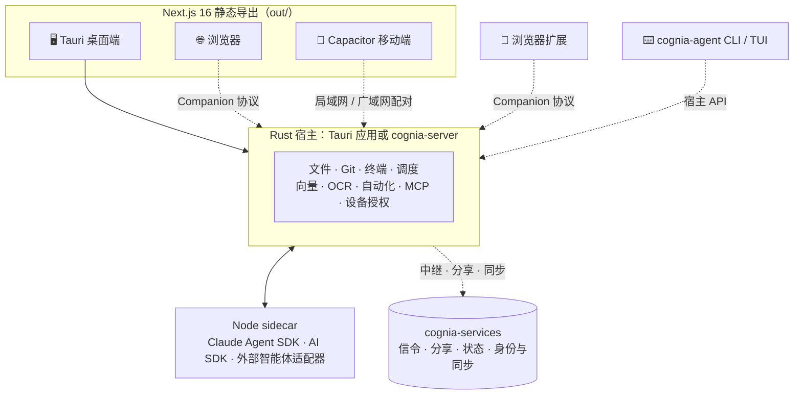

<p align="center">
  
</p>

<h3 align="center">一个工作空间，承载智能体、代码、知识与自动化<br>覆盖桌面、浏览器、移动端与终端。</h3>

<p align="center">
  <a href="./LICENSE"></a>
  
  
  
  
  
  
  
</p>

<p align="center">
  <a href="./README.md">English</a> · <b>简体中文</b>
  <br>
  <a href="#核心亮点">核心亮点</a> ·
  <a href="#快速开始">快速开始</a> ·
  <a href="#架构">架构</a> ·
  <a href="#开发">开发</a> ·
  <a href="#文档">文档</a>
</p>

---

**Cognia** 把对话、项目文件、终端、浏览器、产物和智能体执行放进同一个工作台。你可以使用内置的多提供商智能体，也可以接入已在使用的编程智能体，例如 Claude Code、Codex、Gemini CLI、OpenCode 和 Pi。

桌面端在本机运行 **Rust 宿主**与 **Node 智能体 sidecar**；浏览器和手机与宿主配对后，即可使用宿主上的文件、工具和智能体。独立的 **`cognia-agent`** CLI 在终端中运行同样的智能体，无需打开窗口。

> [!WARNING]
> **项目正在进行大规模重构。** API、数据结构和功能可能随时变更或失效，现阶段不保证可用性。如需依赖 Cognia，请固定到你验证过的提交。

## 核心亮点

<table>
  <tr>
    <td width="50%"></td>
    <td width="50%">
      <h3>🧠 了解你工作的智能体</h3>
      <ul>
        <li>每个对话可单独选择智能体：内置、外部 CLI 或配对宿主上的智能体。</li>
        <li>将对话绑定到工作区，文件、Git、终端与预览就在旁边。</li>
        <li>通过长期记忆、项目知识、导入的历史会话与员工数字分身延续上下文。</li>
      </ul>
    </td>
  </tr>
  <tr>
    <td width="50%">
      <h3>🧩 团队、工作流与自动化</h3>
      <ul>
        <li>用 Squads 组织多智能体协作，配有任务看板、审批，执行中断后可恢复。</li>
        <li>在可视化编辑器中连接执行步骤，由定时、Webhook、对话或消息触发。</li>
        <li>通过 Computer Use 或沙盒让智能体操作桌面，全程可审批、可审计。</li>
      </ul>
    </td>
    <td width="50%"></td>
  </tr>
  <tr>
    <td width="50%"></td>
    <td width="50%">
      <h3>🔗 连接每台设备与每个渠道</h3>
      <ul>
        <li>手机和浏览器可通过局域网或广域网与桌面或 headless 宿主配对。</li>
        <li>在统一收件箱中回复 Telegram、Slack、飞书、企业微信等 11 个平台的消息。</li>
        <li>用插件、技能、MCP 服务、主题和浏览器扩展扩展能力。</li>
      </ul>
    </td>
  </tr>
</table>

<sub>插图为基于 Cognia 原有美术创作的概念图，并非产品截图。</sub>

### 能力一览

| 领域             | 内容                                                                                                                                                                                                                                                         |
| ---------------- | ------------------------------------------------------------------------------------------------------------------------------------------------------------------------------------------------------------------------------------------------------------ |
| **智能体运行时** | 内置智能体按提供商使用 Claude Agent SDK 或 AI SDK。外部智能体：Claude Code、Codex、Gemini CLI、OpenCode、Pi、Aider、Crush、Continue、Codebuff、Rovo、OpenClaude。协议接入：ACP、A2A。DeepSeek Harness 为实验功能。Best-of-N 可让多个智能体并行处理同一任务。 |
| **项目工作台**   | 工作区文件与源码管理，包括堆叠 PR，以及审阅智能体变更集的集成队列。此外还有集成终端、Monaco 或 code-server 编辑器、内嵌 Chromium 浏览器和标签式对话侧栏。                                                                                                    |
| **产出**         | Artifacts 与 Canvas、自适应 A2UI 界面，以及用于保留、回收和分享结果的文件库。公开分享链接端到端加密。                                                                                                                                                        |
| **编排**         | Squads（Agent Team）、计划执行中心、`/goal`、后台项目协调器、问题与交付周期。执行记录持久保存，可从中断处恢复。                                                                                                                                              |
| **自动化**       | 可视化工作流、调度器、Bot，以及来自 Webhook 和连接器的事件触发。                                                                                                                                                                                             |
| **知识**         | 长期记忆、项目知识 RAG、员工数字分身、网页搜索与阅读、OCR、⌘K 全局搜索。可导入 Claude Code、Codex、Cursor、Gemini CLI、OpenCode、Pi 等来源的会话历史。                                                                                                       |
| **消息**         | Telegram、Discord、Slack、飞书、OneBot、企业微信、钉钉、Matrix、QQ、微信公众号与个人微信。共享统一收件箱、静默时段、熔断与 A2UI 富卡片。                                                                                                                     |
| **扩展**         | JavaScript、Python、WASM 插件与兼容的 VS Code 扩展；用 Cogpack 打包插件组合；支持转换 Pi 包等多种插件格式。另有技能、斜杠命令、Hooks 与 MCP，以及提示词中心和基于证据的配置治理。                                                                            |
| **安全**         | 权限规则、模型调用前的 PII 脱敏门禁，以及外发操作授权（默认影子模式）。支持快照的 Docker 与远程沙盒。Computer Use 需人工审批并保留审计记录。                                                                                                                 |
| **设备与协作**   | 设备配对与授权、WebRTC 中继、常驻 headless 宿主、远程桌面与共享对话。加密账号同步为实验功能。                                                                                                                                                                |
| **桌面增强**     | 托盘速览面板、桌面宠物、划词工具栏、语音与 TTS。                                                                                                                                                                                                             |

实际可用的能力取决于宿主能力、设备授权和插件兼容性。实现入口与边界见[子系统文档](./docs/content/docs/zh/subsystems/)。

### 客户端

| 客户端                                  | 运行环境                | 说明                                                                                          |
| --------------------------------------- | ----------------------- | --------------------------------------------------------------------------------------------- |
| 🖥️ **桌面端**                           | macOS · Windows · Linux | 完整的本地宿主：Rust 核心与 Node sidecar                                                      |
| 🗄️ **Headless 宿主**（`cognia-server`） | 服务器、常驻主机        | 无窗口的宿主，供配对客户端连接                                                                |
| 🌐 **浏览器**                           | 主流现代浏览器          | 独立模式使用自己的提供商密钥，或与宿主配对                                                    |
| 📱 **移动端**                           | iOS · Android           | Capacitor 应用，通过局域网或广域网与宿主配对                                                  |
| ⌨️ **CLI / TUI**（`cognia-agent`）      | 终端                    | 交互式对话、单次执行、JSON/JSONL 输出、宿主 API 调用（[说明](./cli/README.md)）               |
| 🧭 **浏览器扩展**                       | Chrome · Edge           | 将网页或选中文本发送到宿主（[仓库](https://github.com/cognia-labs/cognia-browser-extension)） |

## 快速开始

### 环境要求

| 目标                   | 需要                                                                                                                             |
| ---------------------- | -------------------------------------------------------------------------------------------------------------------------------- |
| 前端与 CLI             | Node.js ≥ 26、pnpm 11.18.0（版本固定在 `package.json`）                                                                          |
| 桌面端与 headless 宿主 | 上述工具、Rust（工具链固定在 `rust-toolchain.toml`，最低支持 1.96）以及 [Tauri 前置要求](https://tauri.app/start/prerequisites/) |
| iOS                    | Xcode 26+、CocoaPods                                                                                                             |
| Android                | JDK 21、Android SDK（可由 Android Studio 统一管理）                                                                              |
| 可选                   | Docker 用于本地沙盒；外部智能体需已安装并登录；WebRTC 中继需要 TURN                                                              |

### 安装

```bash
git clone https://github.com/cognia-labs/cognia
cd cognia
pnpm install
pnpm sidecars:install
```

### 启动

| 我想要…                            | 运行                                                |
| ---------------------------------- | --------------------------------------------------- |
| 使用桌面应用                       | `pnpm tauri dev`                                    |
| 在浏览器中开发界面（不含原生宿主） | `pnpm dev` → <http://localhost:3000>                |
| 浏览器连接本机 headless 宿主       | `pnpm dev:web-headless`                             |
| 在终端中对话                       | `pnpm cli:dev chat`                                 |
| 构建 iOS 应用                      | `pnpm mobile:sync:ios`，然后 `pnpm mobile:open:ios` |
| 在 Android 真机上开发              | `pnpm mobile:dev:android`                           |
| 构建 Android 调试 APK              | `pnpm mobile:build:android`                         |

首次启动桌面端或 headless 宿主时需要编译 Rust 宿主并下载工具，耗时较长。`dev:web-headless` 默认只允许配对客户端访问本仓库目录；如需其他目录，传入 `--workspaces-dir PATH`。另见[移动端说明](./mobile/README.md)。

### 首次使用

1. **完成引导。** 添加提供商凭据和默认模型，或选择已登录的外部智能体。桌面端引导可识别已有配置，并导入你选中的历史会话。
2. **选择模式**（浏览器与移动端）。独立模式使用你自己的密钥，受 CORS 与工具兼容性限制；宿主模式需要已配对的宿主。
3. **配对并授权。** 通过设备流程配对，只授予任务需要的权限。聊天授权与 Agent Control 授权分开管理。
4. **选择工作区与智能体**，再启用需要的插件、技能、MCP 服务或连接器。扩展被发现并不等于获得了执行权限。

<details>
<summary><b>可选：macOS 强制代理（fail-closed）</b></summary>

`pnpm agent:proxy` 在 Seatbelt 中启动 CLI 智能体，该智能体及其所有子进程只能访问一个本地 HTTP 代理端口：

```bash
AGENT_PROXY_URL=http://127.0.0.1:7890 pnpm agent:proxy -- claude
AGENT_PROXY_URL=http://127.0.0.1:7890 pnpm agent:proxy --check
```

启动器会同时设置大小写形式的 `HTTP_PROXY`、`HTTPS_PROXY`、`ALL_PROXY`，并清空 `NO_PROXY`；它会校验 CONNECT 隧道，确认其他本地端口已被阻断，并拒绝 SOCKS 与远程代理。用 `AGENT_PROXY_CHECK_TARGET=host:port` 修改预检目标。

</details>

## 架构



- **一套前端，三种外壳。** 同一份静态导出按目标分别构建，供浏览器、Tauri 和 Capacitor 使用。运行时没有 `app/api/`，需要服务端的能力都在 Rust 宿主中。
- **Rust 宿主。** 逻辑分层放在 [`crates/`](./crates/)；[`src-tauri/`](./src-tauri/) 只负责组装桌面应用。`cognia-server` 以无窗口方式运行同一宿主。
- **智能体 sidecar。** 由 Node 直接运行的严格 TypeScript，无需构建步骤（[`sidecar/`](./sidecar/)）。它运行内置智能体并适配外部智能体；stdio 类智能体在所选宿主上启动。
- **数据。** 客户端用 Dexie（IndexedDB）保存本地数据与宿主镜像；宿主保存 SQLite、sqlite-vec 向量和持久化执行状态。

相关仓库：

| 仓库                                                                                            | 内容                                                                                                                            |
| ----------------------------------------------------------------------------------------------- | ------------------------------------------------------------------------------------------------------------------------------- |
| [cognia-labs/cognia-services](https://github.com/cognia-labs/cognia-services)                   | 信令、分享链接、状态页、身份与同步、更新、诊断服务及其协议契约。本仓库在 `integrations/cognia-services.json` 中固定其一个版本。 |
| [cognia-labs/cognia-website](https://github.com/cognia-labs/cognia-website)                     | 产品官网                                                                                                                        |
| [cognia-labs/cognia-browser-extension](https://github.com/cognia-labs/cognia-browser-extension) | Chrome / Edge 伴侣扩展                                                                                                          |

重大决策记录在 [ADR](./docs/content/docs/zh/adr/) 中。ADR 解释为什么做出某个选择；了解当前行为请阅读子系统文档，并以代码和测试为准。

## 开发

所有命令都在仓库根目录运行，每次只使用一种前端启动方式。

| 任务                | 命令                                                                                                     |
| ------------------- | -------------------------------------------------------------------------------------------------------- |
| 应用                | `pnpm dev` · `pnpm build` · `pnpm lint` · `pnpm format` · `pnpm typecheck`                               |
| 单元测试            | `pnpm test` · `pnpm test:changed` · `pnpm test -- path/to/file.test.ts`                                  |
| E2E（Playwright）   | `pnpm test:e2e` · `pnpm test:e2e:changed` · `pnpm test:e2e:mobile` · `pnpm test:e2e:tauri`               |
| 桌面端              | `pnpm tauri dev` · `pnpm tauri build` · `pnpm tauri info`                                                |
| Headless 宿主       | `pnpm dev:headless` · `pnpm dev:web-headless` · `pnpm dev:workspace-runtime`                             |
| CLI                 | `pnpm cli:dev chat` · `pnpm cli:build` · `pnpm cli:test`                                                 |
| Sidecar             | `pnpm sidecars:install` · `pnpm sidecar:test` · `pnpm sidecar:typecheck`                                 |
| 移动端              | `pnpm mobile:sync:ios` · `pnpm mobile:sync:android` · `pnpm mobile:deploy`                               |
| 文档站（端口 3001） | `pnpm docs:dev` · `pnpm docs:build`                                                                      |
| 门禁检查            | `pnpm audit:colocated-tests` · `pnpm lint:i18n` · `pnpm i18n:build:check` · `pnpm cognia-services:check` |

完整脚本见 [`package.json`](./package.json)。

- **测试**：`*.test.ts(x)` 与源码放在一起；Rust 测试写在文件内的 `#[cfg(test)]` 模块中；sidecar 使用 Node 内置测试运行器。覆盖率检查只在明确要求时运行（`pnpm test:coverage`）。
- **国际化**：所有用户可见文本都通过 `next-intl` 处理。在 `i18n/messages/en/**` 与 `i18n/messages/zh-CN/**` 中同时添加键，再运行 `pnpm i18n:build`。汇总生成的 `en.json` 与 `zh-CN.json` 不要手动编辑。
- **提交**：Husky 会运行 lint-staged（ESLint + Prettier）和 commitlint（Conventional Commits），禁止用 `--no-verify` 绕过。面向用户的改动需要添加 changeset（`pnpm changeset`）。
- **构建**：`pnpm build` 将静态导出写入 `out/`，`pnpm tauri build` 生成桌面安装包；移动端在 Xcode 或 Android Studio 中签名。桌面 OCR 默认使用 `ocr-paddle`，其他后端通过 Cargo 特性启用，macOS 自带 Apple Vision。

完整规则（先复用再新增、禁止留桩、测试同位放置、共享工作树的 Git 规则）见 [`CLAUDE.md`](./CLAUDE.md) 与 [`docs/development/WORKFLOW.md`](./docs/development/WORKFLOW.md)。

<details>
<summary><b>项目结构</b></summary>

```text
cognia/
├── app/                 Next.js App Router 路由（静态导出）
├── components/          React 界面（ui/ = shadcn，ai-elements/ = 内嵌）
├── hooks/ lib/ stores/  Hook、业务逻辑、Zustand 状态
├── types/               共享类型
├── i18n/                next-intl 配置与拆分的文案源（en、zh-CN）
├── packages/            工作区包：智能体、插件 SDK、提供商、记忆、TTS…
├── crates/              Rust crate：宿主服务、协议、安全、运行时
├── src-tauri/           Tauri 2 桌面外壳
├── sidecar/             Node 智能体与扩展宿主（独立 lockfile）
├── cli/                 cognia-agent 终端 / headless 智能体
├── mobile/              Capacitor 8 外壳
├── plugins/ skills/     第一方插件与内置技能
├── services/            随桌面端打包的工作区浏览器运行时
├── deploy/              Docker、Compose、Kubernetes、runner 部署
├── docs/                Fumadocs 文档站、ADR、开发指南
├── tests/e2e/           Playwright 测试套件
└── scripts/             构建、门禁与发布工具
```

新文件应放在哪里，见[目录指南](./docs/README.md)。

</details>

<details>
<summary><b>配置</b></summary>

- **环境变量**：运行 `cp .env.example .env.local`。`NEXT_PUBLIC_*` 变量会暴露给浏览器，`lib/env.ts` 在首次访问时校验必需值。不要提交 `.env.local`。
- **共享对话**：需要部署协作服务，构建时设置 `NEXT_PUBLIC_SHARED_CHAT_ENABLED=true`，并开启本机的共享对话设置。
- **桌面端**：[`src-tauri/tauri.conf.json`](./src-tauri/tauri.conf.json) 定义应用标识（`com.cognia.desktop`）、`cognia://` 深链、CSP 以及随包附带的 sidecar 资源。
- **路径别名**：`@/*` 指向仓库根目录，`@cognia/*` 指向 `packages/*/src`。

</details>

<details>
<summary><b>故障排除</b></summary>

| 现象                                               | 处理                                                                                    |
| -------------------------------------------------- | --------------------------------------------------------------------------------------- |
| 端口 3000 被占用                                   | 确认可以安全停止后关闭占用进程，或运行 `pnpm dev --port 3002`                           |
| Tauri 构建失败                                     | 运行 `pnpm tauri info`，检查平台前置要求                                                |
| 找不到模块                                         | 在根目录运行 `pnpm install --frozen-lockfile`；sidecar 依赖运行 `pnpm sidecars:install` |
| 文档提示 `Cannot find module 'collections/server'` | 先运行一次 `pnpm docs:dev` 生成 `docs/.source/`                                         |
| i18n 检查失败                                      | 运行 `pnpm i18n:build`，再修复报告的键缺失；不要为消除报错而重置基线                    |
| 缺少 Monaco 资源                                   | 运行 `pnpm monaco:copy`（`predev`、`prebuild` 也会执行）                                |
| 浏览器或手机无法发送，或提示配对                   | 检查所选宿主、配对状态与聊天授权；`pnpm dev` 只启动界面                                 |
| 外部智能体无法启动                                 | 检查执行宿主上智能体的安装、版本与登录状态；配对客户端还需 Agent Control 授权           |
| 插件已发现但无法启用                               | 查看兼容性与权限诊断；原生插件需要宿主                                                  |
| Android 快速部署拒绝资源                           | 重新运行 `pnpm mobile:build:android` 后再部署                                           |

</details>

## 参与贡献

1. 阅读 [`CONTRIBUTING.md`](./CONTRIBUTING.md) 与 [`CLAUDE.md`](./CLAUDE.md) 中的工作规则。
2. 创建 `<type>/<short-kebab>` 格式的分支，例如 `feat/connector-wecom`。
3. 保持改动聚焦，同步更新同位测试；面向用户的改动需添加 changeset。
4. 运行 `pnpm lint`、`pnpm typecheck`、`pnpm test:changed` 以及相关的 E2E 套件。
5. 使用 Conventional Commits 格式的标题提交 PR，并附上相关 ADR 和验证方式。

## 文档

| 主题         | 位置                                                                                                                                         |
| ------------ | -------------------------------------------------------------------------------------------------------------------------------------------- |
| 入门         | [`docs/content/docs/zh/getting-started.mdx`](./docs/content/docs/zh/getting-started.mdx)                                                     |
| 子系统       | [`docs/content/docs/zh/subsystems/`](./docs/content/docs/zh/subsystems/)                                                                     |
| 架构决策记录 | [`docs/content/docs/zh/adr/`](./docs/content/docs/zh/adr/)（运行 `pnpm docs:dev` 后访问 <http://localhost:3001>）                            |
| 智能体执行   | [统一智能体执行](./docs/content/docs/zh/subsystems/unified-agent-execution/) · [智能体包](./docs/content/docs/zh/subsystems/agent-packages/) |
| 插件         | [插件系统](./docs/content/docs/zh/subsystems/plugin-system/) · [插件 SDK](./packages/plugin-sdk/)                                            |
| 客户端       | [CLI](./cli/README.md) · [移动端](./mobile/README.md)                                                                                        |
| 开发         | [开发流程](./docs/development/WORKFLOW.md) · [测试](./docs/development/TESTING.md) · [CI/CD](./docs/development/CI_CD.md)                    |

## 许可证与支持

Cognia 采用 [AGPL-3.0-or-later](./LICENSE) 许可证。

问题请附复现步骤提交到 [Issue 跟踪器](https://github.com/cognia-labs/cognia/issues)；安全问题请按 [`SECURITY.md`](./SECURITY.md) 报告。
