# Long-term Memory

The memory subsystem retains durable facts about the user and their active workspaces across conversations, governed by immutable source evidence, per-caller namespace grants, and personal-visibility rules.

<Status variant="beta" />

<TLDR>
  Six Dexie tables (`memories`, `memoryEvidence`, `memoryJobs`, `memoryAuditEvents`,
  `memoryOperations`, and `projectMiningRuns`) back three memory types (`semantic`, `episodic`,
  `procedural`) across four scopes (`global`, `workspace`, `character`, `agent`). The **write path**
  enqueues durable checkpointed jobs (`enqueueTurnMemory`, `scheduleMemoryMaintenance`,
  `tickActiveWorkspaceBackfills`) drained under leased fencing epochs by `startMemoryJobWorker`;
  extraction throws `MemoryExtractionError` so transient provider/parse failures retry with backoff
  while commit-time `withMemoryJobWrite` fences stale or cancelled sources. The **read path**
  (`applyMemoryContext` + `applyProjectContinuityContext`) runs BM25 + optional vector fusion,
  corroboration-aware scoring, and procedural assembly without breaking a chat turn when retrieval
  degrades.
</TLDR>

<StatGrid>
  <Stat label="Memory types" value="3" hint="semantic · episodic · procedural" />
  <Stat label="Scopes" value="4" hint="global · workspace · character · agent" />
  <Stat label="Dexie tables" value="6" hint="memories + evidence, jobs, audit, ops, mining runs" />
  <Stat label="Consolidation ops" value="6" hint="ADD · UPDATE · DELETE · NOOP · CONFLICT · QUARANTINE" />
  <Stat label="Default top-K" value="8" hint="DEFAULT_MEMORY_CONFIG, memory.ts" />
</StatGrid>

## Data Model

`packages/memory/src/types/memory.ts` (re-exported at `types/memory/memory.ts`) defines the `Memory` entity:

| Field group | Fields | Notes |
| --- | --- | --- |
| Identity | `id`, `scope` (`global` \| `workspace` \| `character` \| `agent`), `projectId?`, `characterId?`, `agentId?`, `branch?`, `pathPattern?`, `type` | Narrower scopes override broader ones on collision; `agent` is private to the same `agentId` |
| Content & revisions | `text` (redacted, self-contained), `key?`, `tags`, `revisionOf?`, `revisionReason?`, `compactedAt?`, `observedAt?` | Edits and cold sweeps preserve prior text as `revisionOf` snapshots queryable via `asOf` |
| Ranking & belief | `importance` (1..10), `lastAccessedAt`, `accessCount`, `beliefInputs?`, `validatedAt?` | Drive Generative-Agents recency, corroboration boost, and daily claim rechecks |
| Governance | `status` (`active` \| `invalidated`), `evidenceState` (`legacy` \| `supported`), `reviewStatus` (`unreviewed` \| `verified` \| `conflict`), `trustState?`, `contaminationState`, `sensitivity` | Unreviewed external/attachment claims stay quarantined until explicitly reviewed |
| Provenance | `provenance` (`user` \| `explicit` \| `inbound` \| `system` \| `external`), `sourceSessionId?`, `sourceMessageId?` | Only `user`/`explicit` may become active `procedural` instructions |

`MemoryConfig` on `AppSettings.memory` controls global learning (`enabled`, `learnFromChats`, `autoExtract`, `scopeDefault`, `disableLearningOnExternalContext`, `allowSensitiveTopics`), project context (`mineProjectContext`, `enableProjectContinuity`, `projectRecallTopK`, `projectRecallTokenBudget`, plus per-workspace `ProjectMemoryPolicy.isolationMode` `"inherit" | "project-only"`), retrieval (`useMemory`, `hybridEnabled`, `embeddingSource` `"twin" | "custom"`, `embedding`, `vectorStore`, `allowCloudEmbedding`, `enableQueryExpansion`, `llmRerank`, `sessionRecallRouting`, `beliefRankingWeight`, `retrievalTopK`, `relevanceFloor`, `recallTokenBudget`), lifecycle (`maxActivePerScope`, `maxIdleDays`, `decayHalfLifeDays`, `accessReinforcementWeight`, `compactColdEpisodic`, `dedupColdClusters`, `coldRetentionThreshold`), and privacy (`temporary`, `principalGrants`). Per-session `session.memoryUse` and `session.memoryLearn` override the global defaults while respecting `Character.memoryPolicy` and workspace `project-only` isolation ceilings (`lib/memory/agent-policy.ts`).

## Two Paths

```mermaid
flowchart TB
  subgraph WRITE["WRITE — durable leased queue (enqueue-turn-memory.ts + job-worker.ts)"]
    ENQ["enqueueTurnMemory / scheduleMemoryMaintenance"]
    JOB["memoryJobs (leased + fencingEpoch)"]
    EXT["extractMemories / distillEpisodes / extractProjectClaims"]
    CON["consolidate (ADD/UPDATE/DELETE/NOOP/CONFLICT/QUARANTINE)"]
    FENCE["withMemoryJobWrite (claim + source-hash CAS + atomic evidence)"]
  end
  subgraph READ["READ — prompt contribution (lib/memory/context.ts)"]
    APPLY["applyMemoryContext + applyProjectContinuityContext"]
    VIS["withPersonalMemoryVisibility (commitMarks deferred)"]
    RET["retrieveMemories (BM25 + vector RRF + optional LLM rerank)"]
    SCORE["scoreMemories + assembleProceduralBlock"]
    MARK["markInjectedMemories + SourcesPart citations"]
  end

  ENQ --> JOB --> EXT --> CON --> FENCE
  APPLY --> VIS --> RET --> SCORE --> MARK
```

## The Durable Write Path

Post-turn hooks (`enqueueTurnMemory` in `lib/memory/lifecycle/enqueue-turn-memory.ts` and `scheduleMemoryMaintenance` in `lib/memory/lifecycle/maintenance.ts`) never run model extraction fire-and-forget inline. Instead, they persist deduplicated `MemoryJob` rows (`turn-extraction`, `session-distill`, `project-mining`, `project-claim-revalidate`, `vector-reconcile`, `memory-lifecycle-sweep`) pinned to a message-id `MemoryJobCheckpoint`.

`startMemoryJobWorker` (`lib/memory/lifecycle/job-worker.ts`) drains the queue with lease heartbeats and `fencingEpoch` checks, and autonomously steps confirmed workspace history backfills (`tickActiveWorkspaceBackfills` in `lib/memory/backfill/backfill-service.ts`, woken immediately via `nudgeMemoryJobWorker`).

1. **Source resolution & policy**: `loadJobContext` resolves the checkpointed transcript window, records each source message's content/mark hash, withholds personal messages, and evaluates `resolveAgentMemoryPolicy` (`canAutoLearn` for turn extraction; `canLearnSession` for episodic distillation and project mining).
2. **Extraction & retry**: `extractMemories` (`packages/memory/src/extract/extractor.ts`) and `extractProjectClaims` throw `MemoryExtractionError` on provider or JSON parse failure so `drainMemoryJobs` schedules exponential backoff (`retry_wait` up to `maxAttempts`) instead of caching an empty result.
3. **Six-operation consolidation**: `consolidate` (`packages/memory/src/consolidate/consolidator.ts`) resolves candidates to `ADD`, `UPDATE`, `DELETE`, `NOOP` (corroboration), `CONFLICT` (competing claims surfaced for user resolution), or `QUARANTINE` (fail-closed draft when project-claim judgment or attachment provenance requires review).
4. **Transactional commit fence**: Every canonical mutation and its `memoryEvidence` + `memoryAuditEvents` rows commit inside `withMemoryJobWrite` (`lib/db/memory-governance.ts`), which verifies the job lease/epoch, active `projectMiningRuns` status, session namespace, source message presence, and exact source-content hashes (`source_changed`). Cold-memory sweeps (`processLifecycleSweep`) re-verify version, text, namespace, and `pinned` inside a Dexie transaction so concurrent user edits are never overwritten.

## The Read Path & Provenance Boundaries

At send time, `lib/memory/context.ts` runs personal recall (`applyMemoryContext`) and workspace continuity (`applyProjectContinuityContext`) as fail-open prompt contributions:

- **Deferred personal-mark propagation**: `withPersonalMemoryVisibility` (`lib/memory/runtime/build-deps.ts`) evaluates local BM25/vector candidates with `commitMarks: false` so unchosen private candidates do not taint the run; `markInjectedMemories` commits personal provenance marks only for memories actually injected into the prompt, returned to a tool/workflow, or sent to an outbound LLM reranker.
- **Paired-device visibility**: Direct Companion reads (`memory_list`, `memory_search`) and incremental/cold `memories` sync (`lib/memory/sync/memory-sync.ts`) enforce both `principalGrants` namespace intersections and `pairedReader` (`owner` vs `member`) personal-memory filtering.
- **Synchronous evidence & deletion closure**: Deleting or editing cited messages synchronously revokes `memoryEvidence` and immediately invalidates project claims whose remaining support drops below threshold (`revokeMemoryEvidenceForMessages`). Hard-deleting a memory (`hardDeleteMemory` / `clear` in `lib/db/memories.ts`) atomically deletes revision snapshots, evidence, vectors, sync tombstones, and scrubs persisted `SourcesPart` excerpts on historical assistant messages while rendering a localized deleted placeholder in chat (`components/chat/message-parts/sources-part.tsx`).

## Backend & Degraded Recall

Memory supports either **sharing Digital Twin's backend** (`embeddingSource: "twin"`, resolved via `tryBuildTwinDeps` in `lib/twin/runtime/build-deps.ts` without booting Twin sync workers) or configuring a **dedicated memory embedding & vector backend** (`embeddingSource: "custom"`, `embedding`, and `vectorStore` in Settings → Memory → Retrieval). Embeddings run only when a vector store is configured and either `allowCloudEmbedding` is enabled or the provider is local (`transformersjs`); otherwise recall runs BM25-only and surfaces the exact reason in `MemoryRetrievalChip` and `RetrievalModeAlert`.

For workspace-bound conversations with project continuity enabled, `project_history_search` (`lib/memory/project-history-tool.ts`) provides multi-session diversified recall, decomposed/synonym-expanded fallback across older chats, and `pagination.nextBefore` cursors for deep history recovery. `/memory` also includes a scoped **Export & Import** wizard (`components/memory/memory-portability-dialog.tsx`) with duplicate/conflict/PII/sensitivity preview, and `@cognia/memory/eval/e2e-memory-eval` exercises extraction, knowledge updates, multi-session & temporal reasoning, abstention, and provenance/sensitivity quarantine end to end.

## Next

<Cards>
  <Card title="Long-term Memory Subsystem" href="../../subsystems/long-term-memory" description="Module layout, governance tables, external APIs, and paired mutation receipts." />
  <Card title="Build-options pipeline" href="./build-options" description="How memory and project continuity join the system-prompt sections." />
  <Card title="Employee Digital Twin" href="../../subsystems/employee-twin" description="The shared embedding and vector-store infrastructure memory reuses." />
</Cards>
