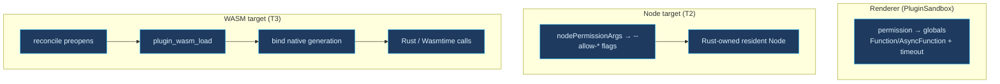

# Plugin isolation

<Status variant="beta" />

<TLDR>
  Three layers confine plugin code. `lib/plugin/core/sandbox.ts:PluginSandbox` is the shipped
  renderer-side isolation: it maps each `PluginPermission` to a concrete allowed global, wraps
  `console` / `setTimeout` / `fetch` / `localStorage`, and runs plugin code through a `Function` /
  `AsyncFunction` with explicit args and a timeout. **T2** (`launchPluginJs.ts`) translates a
  manifest's permissions into Node 26.3.1+ `--permission` flags for re-execing Node-target plugins.
  **T3** is the native Rust/Wasmtime host. T2 is reached through `PluginLoader`/`PluginManager` for
  Node-target frontend plugins; T3 reconciles manifest preopens before native load and binds the
  returned runtime generation into every tool and workflow node.
</TLDR>

## Renderer isolation — `PluginSandbox`

`PluginSandbox` is constructed with the plugin id, its `PluginPermission[]`, and optional
timeout/memory caps. It derives an allow-set and a set of sandboxed globals once, in the constructor.

### Permission → API mapping

A base set of safe globals is always allowed; permissions widen the set:

```ts title="lib/plugin/core/sandbox.ts:75-103 (permission-gated APIs)"
for (const permission of permissions) {
  switch (permission) {
    case "network:fetch":
      allowed.add("fetch"); allowed.add("Headers"); allowed.add("Request"); allowed.add("Response")
      break
    case "network:websocket":
      allowed.add("WebSocket")
      break
    case "clipboard:read":
    case "clipboard:write":
      allowed.add("navigator.clipboard")
      break
    case "notification":
      allowed.add("Notification")
      break
    case "database:read":
    case "database:write":
      allowed.add("indexedDB")
      break
  }
}
```

The sandboxed globals are real wrappers, not the raw browser APIs:

- **console** — prefixed with `[Plugin:<id>]` and routed to the plugin logger (`sandbox.ts:137-149`).
- **setTimeout** — clamped to the configured max (default 30 s) (`sandbox.ts:151-158`).
- **setInterval** — floored at 100 ms to prevent CPU abuse (`sandbox.ts:160-167`).
- **fetch** — stamps an `X-Plugin-Id` header on every request (`sandbox.ts:169-185`).
- **localStorage** — namespaced to `plugin:<id>:` with per-key read/write permission checks
  (`sandbox.ts:187-214`).

### Code execution

Plugin code runs through a `Function` (or `AsyncFunction`) built with explicit argument names so the
plugin can only see the globals it was granted — no ambient scope:

```ts title="lib/plugin/core/sandbox.ts:223-241 (sync execute)"
execute<T>(code: string, context: Record<string, unknown> = {}): T {
  const safeContext = { ...this.sandboxedGlobals, ...context }
  const argNames = Object.keys(safeContext)
  const argValues = Object.values(safeContext)
  try {
    const fn = new Function(...argNames, `"use strict"; return (${code})`)
    return fn(...argValues) as T
  } catch (error) {
    throw new Error(`Plugin sandbox execution error: ${error}`)
  }
}
```

`executeAsync` (`sandbox.ts:246-273`) adds a `Promise.race` against an "Execution timeout" reject.
`executeCode(language, code)` (`sandbox.ts:301-318`) requires the `sandbox:web-execute` permission and
delegates to the web sandbox service — which is a stub today (see [microVM & Web](./microvm-and-web)).

<Callout type="info">
  `PluginSandbox` is a **soft** isolation layer: `Function`-based evaluation, permission-gated
  globals, namespaced storage. It is the in-renderer line of defence and composes with T1 — even if a
  plugin spawns a shell, the SDK builtin `Bash` is denied in sandbox-enabled sessions and the call
  routes through the `sandbox_*` tools.
</Callout>

## T2 — Resident Node `--permission` host

`lib/plugin/launcher/launchPluginJs.ts` translates a permission scope into Node 26.3.1+ `--allow-*` flags
for re-execing a plugin's JS entry. Empty lists OMIT the flag (fail-safe deny), never `*`.

```ts title="lib/plugin/launcher/launchPluginJs.ts"
nodePermissionArgs({
  permissions: ["filesystem:read"],
  readPaths: ["/plugins/example"],
  writePaths: [],
  netHosts: [],
  allowedSubprocesses: [],
})
// ["--permission", "--allow-fs-read=/plugins/example"]
```

`buildLaunchArgv(entryPath, scope, extraArgs)` describes the permission flags; Rust resolves the
verified bundled runtime and owns the process. `deriveScopeFromManifest` omits filesystem grants
without concrete paths. `PluginLoader` selects this path only for frontend manifests declaring
`engines.node` or `runtimeCompatibility.tauri.entrypoint === "node"`. Ordinary frontend imports
continue running in their existing realm.

Each generation uses one resident child for activation, callbacks and deactivation. The child retains
its definition, hooks and closure state. Piped stdin/stdout carry newline-delimited JSON; console
output goes to stderr. A per-process token distinguishes accidental stdout from prefixed bridge
frames. It is not a security boundary against plugin code, which can already issue any context call
its permissions allow. Stray text before a valid frame is discarded, and the 2 MiB stray-output
budget resets after each valid frame. Frames are limited to 2 MiB, callback arguments to 64 KiB,
and exchanges to 32 frames and 2 MiB total with a maximum one-second poll.

The existing `plugin_invoke_js_callback` command accepts `callbackId: "$exchange"` with
`args: { frames, waitMs }` and returns `{ frames }`, over both Tauri and companion RPC. Every
exchange carries the generation and revalidates it after acquiring the action gate. Stop retires
the generation before killing the child and clears retirement on every stop exit, including errors
or cancellation. Termination errors release the reservation so relaunch can recover. A cancelled,
failed or timed-out pipe write poisons the transport and kills that generation; a partial frame is
never followed by another write. Final frames are delivered before a terminal read error is reported
on the next exchange. `plugin_deactivate_js` starts the resident definition's deactivation; exchanges
continue serving nested context calls until it finishes. A native five-second deadline kills the
child even if the renderer or Headless owner never sends stop.

Context methods send requests to the real renderer/Headless `PluginContext`, await its method and
return a promise of the real result. Plugin callbacks remain in the child and cross as references;
functions returned by callbacks receive new references without re-running activation or a factory.
`pluginId`, `pluginPath`, manifest, actual config and capabilities are launch snapshots. Configuration
reads, permission checks and i18n translation/formatting run locally from configuration, grant and
locale/message snapshots. Methods returning disposers/handles provide an immediate child handle;
calling it or its methods targets the real host handle by registration-call id. The host disposes
remaining handles on deactivation, stop, transport failure or activation rollback. Secret-reference
brands and escaped plain objects are preserved in both directions; unsafe paths and cycles are refused.

Activation resolves only after the child has resolved `activate()` and all its host calls have
settled. A rejected host call fails activation and kills the child through rollback. Activation has
a 30-second budget, callback/host requests a 120-second budget, and deactivation/handle disposal a
five-second budget before forced termination. An asynchronous hung request does not serialize other
callbacks behind it. Cancellation of a Host operation does not currently propagate an AbortSignal
into the child.

<Callout type="info">
  Node's permission model confines the entry process. Shell-like work and network egress that needs
  host allowlist enforcement must go through brokered host APIs; the Node launcher never emits `*`,
  never emits unsupported `--allow-net`, and never widens subprocess access into
  `--allow-child-process`.
</Callout>

The permission review UI projects this boundary truthfully. Scoped filesystem grants are available.
`network:fetch`, `network:upload`, `network:websocket`, `shell:execute`, and `process:spawn` remain
visible for manifest compatibility, but their grant/tier controls are disabled with the missing
broker reason instead of appearing successfully enforced.

## T3 — Wasmtime / WASI runtime

`PluginManager.preloadWasmComponent()` reconciles `manifest.wasm.fs.preopens` with the durable
ledger before `plugin_wasm_load`: stale ledger preopens are denied with a warning, newly declared
manifest preopens are not granted automatically, and only the intersection is passed to the host.
The old `localStorage` ledger remains as a one-time migration fallback into the `wasmGrantLedger`
Dexie table.

`PluginLoader` stores the generation returned by `plugin_wasm_load`. `PluginManager` refuses
activation when that generation is missing and passes it into `buildWasmToolDefinitions` and
`buildWasmNodeDefs`. Every execute call therefore names the exact loaded generation; the native host
rejects stale activate/call/deactivate/unload requests. The unused browser-side WASM runtime and its
unimplemented JCO path were removed, leaving Rust/Wasmtime as the single production authority.



## Tests

`lib/plugin/core/sandbox.test.ts` (permission mapping, clamping, namespaced storage, execution),
`lib/plugin/launcher/launchPluginJs.test.ts` (flag construction, omit-on-empty), and
`wasm-loader.test.ts` + `manager.test.ts` + native Wasmtime tests (generation binding and stale
generation rejection).

## Next

<Cards>
  <Card title="microVM & Web" href="./microvm-and-web" description="The web code-exec stub PluginSandbox.executeCode reaches" />
  <Card title="Execution overview" href="./execution-overview" description="How T1–T5 compose" />
  <Card title="Plugin System" href="../plugin-system" description="The wider plugin runtime + permissions" />
</Cards>
