# 长期记忆

记忆子系统在跨会话对话中保留关于用户及当前工作区的耐久事实，并受不可变来源证据、调用方命名空间授权与个人数据可见性规则共同治理。

<Status variant="beta" />

<TLDR>
  六张 Dexie 表（`memories`、`memoryEvidence`、`memoryJobs`、`memoryAuditEvents`、
  `memoryOperations`、`projectMiningRuns`）承载三种记忆类型（`semantic`、`episodic`、
  `procedural`）与四个作用域（`global`、`workspace`、`character`、`agent`）。**写路径**通过
  `enqueueTurnMemory`、`scheduleMemoryMaintenance` 与 `tickActiveWorkspaceBackfills` 入队带检查点的
  持久化任务，由 `startMemoryJobWorker` 在租约与 `fencingEpoch` 保护下消费；抽取失败抛出
  `MemoryExtractionError` 进入指数退避重试，提交阶段通过 `withMemoryJobWrite` 校验租约与源消息哈希。
  **读路径**（`applyMemoryContext` + `applyProjectContinuityContext`）执行 BM25 + 可选向量融合、
  佐证加权评分与程序性指令装配，且在检索降级时对聊天主链保持 fail-open。
</TLDR>

<StatGrid>
  <Stat label="记忆类型" value="3" hint="semantic · episodic · procedural" />
  <Stat label="作用域" value="4" hint="global · workspace · character · agent" />
  <Stat label="Dexie 表" value="6" hint="memories + 证据、任务、审计、幂等回执、回填运行" />
  <Stat label="整合操作" value="6" hint="ADD · UPDATE · DELETE · NOOP · CONFLICT · QUARANTINE" />
  <Stat label="默认 top-K" value="8" hint="DEFAULT_MEMORY_CONFIG, memory.ts" />
</StatGrid>

## 数据模型

`packages/memory/src/types/memory.ts`（由 `types/memory/memory.ts` 转导出）定义了 `Memory` 实体：

| 字段组 | 字段 | 说明 |
| --- | --- | --- |
| 身份与命名空间 | `id`、`scope`（`global` \| `workspace` \| `character` \| `agent`）、`projectId?`、`characterId?`、`agentId?`、`branch?`、`pathPattern?`、`type` | 更窄作用域在同键冲突时优先；`agent` 为同 `agentId` 私有命名空间 |
| 内容与修订历史 | `text`（脱敏且自洽）、`key?`、`tags`、`revisionOf?`、`revisionReason?`、`compactedAt?`、`observedAt?` | 编辑与冷记忆压缩会保留 `revisionOf` 历史快照，支持 `asOf` 时点回溯 |
| 排序与佐证 | `importance`（1..10）、`lastAccessedAt`、`accessCount`、`beliefInputs?`、`validatedAt?` | 驱动新近度衰减、跨会话佐证加权与每日校验游标推进 |
| 治理状态 | `status`（`active` \| `invalidated`）、`evidenceState`（`legacy` \| `supported`）、`reviewStatus`（`unreviewed` \| `verified` \| `conflict`）、`trustState?`、`contaminationState`、`sensitivity` | 外部上下文或附件派生的候选默认保持隔离待审，直至显式审核 |
| 来源边界 | `provenance`（`user` \| `explicit` \| `inbound` \| `system` \| `external`）、`sourceSessionId?`、`sourceMessageId?` | 仅 `user` / `explicit` 可成为直接生效的 `procedural` 指令 |

`AppSettings.memory` 中的 `MemoryConfig` 统一管理全局学习（`enabled`、`learnFromChats`、`autoExtract`、`scopeDefault`、`disableLearningOnExternalContext`、`allowSensitiveTopics`）、项目上下文（`mineProjectContext`、`enableProjectContinuity`、`projectRecallTopK`、`projectRecallTokenBudget`，以及工作区级 `ProjectMemoryPolicy.isolationMode` `"inherit" | "project-only"`）、检索（`useMemory`、`hybridEnabled`、`embeddingSource` `"twin" | "custom"`、`embedding`、`vectorStore`、`allowCloudEmbedding`、`enableQueryExpansion`、`llmRerank`、`sessionRecallRouting`、`beliefRankingWeight`、`retrievalTopK`、`relevanceFloor`、`recallTokenBudget`）、生命周期（`maxActivePerScope`、`maxIdleDays`、`decayHalfLifeDays`、`accessReinforcementWeight`、`compactColdEpisodic`、`dedupColdClusters`、`coldRetentionThreshold`）及隐私授权（`temporary`、`principalGrants`）。单会话 `session.memoryUse` 与 `session.memoryLearn` 可独立覆盖全局默认值，并同时受 `Character.memoryPolicy` 与工作区 `project-only` 隔离策略上限约束（`lib/memory/agent-policy.ts`）。

## 两条路径

```mermaid
flowchart TB
  subgraph WRITE["写路径 —— 租约式持久任务队列（enqueue-turn-memory.ts + job-worker.ts）"]
    ENQ["enqueueTurnMemory / scheduleMemoryMaintenance"]
    JOB["memoryJobs（租约心跳 + fencingEpoch）"]
    EXT["extractMemories / distillEpisodes / extractProjectClaims"]
    CON["consolidate（ADD/UPDATE/DELETE/NOOP/CONFLICT/QUARANTINE）"]
    FENCE["withMemoryJobWrite（租约 + 源消息哈希 CAS + 原子证据写入）"]
  end
  subgraph READ["读路径 —— 提示词装配（lib/memory/context.ts）"]
    APPLY["applyMemoryContext + applyProjectContinuityContext"]
    VIS["withPersonalMemoryVisibility（候选阶段延迟打标）"]
    RET["retrieveMemories（BM25 + 向量 RRF + 可选 LLM 重排）"]
    SCORE["scoreMemories + assembleProceduralBlock"]
    MARK["markInjectedMemories + SourcesPart 引用展示"]
  end

  ENQ --> JOB --> EXT --> CON --> FENCE
  APPLY --> VIS --> RET --> SCORE --> MARK
```

## 持久化写路径

回合结束钩子（`lib/memory/lifecycle/enqueue-turn-memory.ts` 中的 `enqueueTurnMemory` 与 `lib/memory/lifecycle/maintenance.ts` 中的 `scheduleMemoryMaintenance`）不再采用旧版内联 fire-and-forget，而是写入带消息 ID 检查点（`MemoryJobCheckpoint`）的 `MemoryJob` 持久队列（涵盖 `turn-extraction`、`session-distill`、`project-mining`、`project-claim-revalidate`、`vector-reconcile`、`memory-lifecycle-sweep` 六种任务）。

`startMemoryJobWorker`（`lib/memory/lifecycle/job-worker.ts`）通过租约心跳与 `fencingEpoch` 串行消费任务，并自主推进已确认的工作区历史回填（`lib/memory/backfill/backfill-service.ts` 中的 `tickActiveWorkspaceBackfills`，确认或恢复时经 `nudgeMemoryJobWorker` 立即唤醒）。

1. **源窗口解析与策略门控**：`loadJobContext` 校验检查点窗口、计算源消息内容与个人标记哈希、过滤受限个人历史，并通过 `resolveAgentMemoryPolicy` 统一判定单会话学习权限（`turn-extraction` 检查 `canAutoLearn`；蒸馏与项目挖掘检查 `canLearnSession`）。
2. **抽取与退避重试**：`extractMemories`（`packages/memory/src/extract/extractor.ts`）与 `extractProjectClaims` 在模型调用或 JSON 解析失败时抛出 `MemoryExtractionError`，由 Worker 排入 `retry_wait` 指数退避重试，避免将瞬时故障误缓存为空结果。
3. **六态整合**：`consolidate`（`packages/memory/src/consolidate/consolidator.ts`）输出 `ADD`、`UPDATE`、`DELETE`、`NOOP`（追加佐证）、`CONFLICT`（保留冲突供用户裁决）或 `QUARANTINE`（项目挖掘裁判失败或外部附件来源时隔离待审）。
4. **提交期事务栅栏**：所有规范记忆写入及其 `memoryEvidence`、`memoryAuditEvents` 均在 `withMemoryJobWrite`（`lib/db/memory-governance.ts`）单事务内原子落盘，提交前核验任务租约、回填运行状态、会话命名空间、源消息存在性及源文本哈希（被改写时以 `source_changed` 跳过）。冷记忆清理（`processLifecycleSweep`）在事务内复核版本、文本、命名空间与置顶状态，绝不覆盖并发用户更正。

## 读路径与隐私边界

发送消息时，`lib/memory/context.ts` 以 fail-open 方式装配个人记忆（`applyMemoryContext`）与项目上下文（`applyProjectContinuityContext`）：

- **延迟个人数据打标**：`withPersonalMemoryVisibility`（`lib/memory/runtime/build-deps.ts`）在读取本地候选池时传入 `commitMarks: false`，避免未命中的私人记忆污染当前运行；仅在记忆真正注入提示词、返回给工具/工作流或外发给重排模型时，才由 `markInjectedMemories` 提交个人来源标记。
- **配对设备可见性隔离**：Companion 直读接口（`memory_list`、`memory_search`）与增量/冷启动 `memories` 同步（`lib/memory/sync/memory-sync.ts`）同时执行设备 `principalGrants` 命名空间交集与 `pairedReader`（`owner` / `member`）个人记忆过滤。
- **同步证据撤销与删除擦除**：删除或编辑被引用消息时同步撤销 `memoryEvidence`，并在支撑不足时立即将对应项目事实置为 `invalidated`（`revokeMemoryEvidenceForMessages`）。硬删除记忆（`hardDeleteMemory` / `clear`）在移除记忆、修订快照、证据、向量与同步墓碑的同时，同步擦除历史回答 `SourcesPart` 中的标题与摘录副本，并在消息引用区展示“记忆已删除”占位及直达检查、内联纠正与归档恢复操作（`components/chat/message-parts/sources-part.tsx`）。

## 检索后端与降级提示

记忆检索既支持**与数字分身共用后端**（`embeddingSource: "twin"`，由 `tryBuildTwinDeps` 按需构建适配器，无需启动 Twin 同步后台），也支持在「设置 → 记忆 → 检索」中配置**记忆独立的向量模型与向量存储后端**（`embeddingSource: "custom"`、`embedding`、`vectorStore`）。仅当向量库可用且（已开启 `allowCloudEmbedding` 或使用本地 `transformersjs`）时才启用混合向量检索；否则自动回退到纯 BM25，并在 `MemoryRetrievalChip` 与 `RetrievalModeAlert` 中如实展示原因。

对开启项目连续性的工作区会话，`project_history_search`（`lib/memory/project-history-tool.ts`）支持跨会话轮询去重、分词/同义词回退检索及 `pagination.nextBefore` 深历史翻页。`/memory` 控制台内置按范围导出与导入审阅向导（`components/memory/memory-portability-dialog.tsx`），并在 `@cognia/memory/eval/e2e-memory-eval` 中提供覆盖抽取、知识更新、跨会话与时序推理、拒答及来源/敏感话题隔离的端到端质量评测套件。

## 下一步

<Cards>
  <Card title="长期记忆子系统" href="../../subsystems/long-term-memory" description="模块分层、治理表结构、外部 API 面与配对幂等回执。" />
  <Card title="Build-options 管线" href="./build-options" description="个人记忆与项目上下文如何拼入系统提示词数组。" />
  <Card title="员工数字分身" href="../../subsystems/employee-twin" description="记忆复用的共享向量库与 embedder 基础设施。" />
</Cards>
