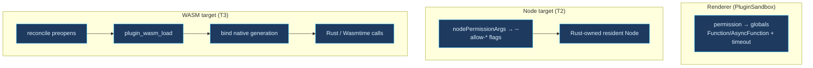

# 插件隔离

<Status variant="beta" />

<TLDR>
  三个层级共同约束插件代码。`lib/plugin/core/sandbox.ts:PluginSandbox` 是已发布的渲染端隔离：它把每个
  `PluginPermission` 映射到具体的允许访问的全局对象，包装 `console` / `setTimeout` / `fetch` /
  `localStorage`，并通过带显式参数和超时的 `Function` / `AsyncFunction` 运行插件代码。**T2**
  （`launchPluginJs.ts`）把 manifest 的权限翻译为 Node 26.3.1+ 的 `--permission` 标志，用于重新执行
  Node 目标插件。**T3** 是原生 Rust/Wasmtime 宿主。T2 已经通过 `PluginLoader` / `PluginManager`
  触达 Node-target frontend 插件；T3 会在原生 load 前对账 manifest preopens，并把宿主返回的
  runtime generation 绑定到每个工具与 workflow node。
</TLDR>

## 渲染端隔离 —— `PluginSandbox`

`PluginSandbox` 构造时需要插件 id、其 `PluginPermission[]`，以及可选的超时/内存上限。它在构造函数中一次性推导出一个 allow-set 和一组沙箱化的全局对象。

### 权限 → API 映射

总是允许一组安全的基础全局对象；权限会扩大该集合：

```ts title="lib/plugin/core/sandbox.ts:75-103 (permission-gated APIs)"
for (const permission of permissions) {
  switch (permission) {
    case "network:fetch":
      allowed.add("fetch"); allowed.add("Headers"); allowed.add("Request"); allowed.add("Response")
      break
    case "network:websocket":
      allowed.add("WebSocket")
      break
    case "clipboard:read":
    case "clipboard:write":
      allowed.add("navigator.clipboard")
      break
    case "notification":
      allowed.add("Notification")
      break
    case "database:read":
    case "database:write":
      allowed.add("indexedDB")
      break
  }
}
```

这些沙箱化的全局对象是真实的包装器，而非原始的浏览器 API：

- **console** —— 以 `[Plugin:<id>]` 为前缀并路由到插件日志器（`sandbox.ts:137-149`）。
- **setTimeout** —— 钳制到配置的上限（默认 30 秒）（`sandbox.ts:151-158`）。
- **setInterval** —— 下限设为 100 ms 以防止 CPU 滥用（`sandbox.ts:160-167`）。
- **fetch** —— 在每个请求上盖上一个 `X-Plugin-Id` 头（`sandbox.ts:169-185`）。
- **localStorage** —— 以 `plugin:<id>:` 作命名空间，并按 key 做读/写权限检查（`sandbox.ts:187-214`）。

### 代码执行

插件代码通过一个以显式参数名构建的 `Function`（或 `AsyncFunction`）运行，使插件只能看到被授予的全局对象 ——没有环境（ambient）作用域：

```ts title="lib/plugin/core/sandbox.ts:223-241 (sync execute)"
execute<T>(code: string, context: Record<string, unknown> = {}): T {
  const safeContext = { ...this.sandboxedGlobals, ...context }
  const argNames = Object.keys(safeContext)
  const argValues = Object.values(safeContext)
  try {
    const fn = new Function(...argNames, `"use strict"; return (${code})`)
    return fn(...argValues) as T
  } catch (error) {
    throw new Error(`Plugin sandbox execution error: ${error}`)
  }
}
```

`executeAsync`（`sandbox.ts:246-273`）增加了一个针对 "Execution timeout" reject 的 `Promise.race`。`executeCode(language, code)`（`sandbox.ts:301-318`）要求 `sandbox:web-execute` 权限，并委托给 Web 沙箱服务 —— 而后者如今是一个 stub（参见 [microVM 与 Web](./microvm-and-web)）。

<Callout type="info">
  `PluginSandbox` 是一个 **软（soft）** 隔离层：基于 `Function` 的求值、权限门控的全局对象、命名空间化的
  存储。它是渲染端内的防线，并与 T1 组合 —— 即便某个插件 spawn 了一个 shell，SDK 内置的 `Bash` 在启用沙箱
  的会话中也会被拒绝，调用会经由 `sandbox_*` 工具路由。
</Callout>

## T2 —— 常驻 Node `--permission` 宿主

`lib/plugin/launcher/launchPluginJs.ts` 把一个权限范围（scope）翻译为 Node 26.3.1+ 的 `--allow-*` 标志，用于重新执行插件的 JS 入口。空列表会 OMIT 该标志（fail-safe 拒绝），绝不使用 `*`。

```ts title="lib/plugin/launcher/launchPluginJs.ts"
nodePermissionArgs({
  permissions: ["filesystem:read"],
  readPaths: ["/plugins/example"],
  writePaths: [],
  netHosts: [],
  allowedSubprocesses: [],
})
// ["--permission", "--allow-fs-read=/plugins/example"]
```

`buildLaunchArgv(entryPath, scope, extraArgs)` 描述权限参数；Rust 解析经过验证的 bundled runtime 并持有子进程。`deriveScopeFromManifest` 会省略没有具体路径的文件系统授权。只有声明 `engines.node` 或 `runtimeCompatibility.tauri.entrypoint === "node"` 的 frontend manifest 才进入这条路径；普通 frontend import 仍在原有 realm 中运行。

每个 generation 只使用一个常驻子进程执行 activate、所有 callback 与 deactivate，保留 definition、hooks 和闭包状态。stdin/stdout 使用带换行分隔的 JSON，console 重定向到 stderr。每个进程的 token 用于区分意外 stdout 与带前缀的 bridge frame；它不是防御插件代码的安全边界，插件本来就可以发出其权限允许的 context 调用。有效 frame 前的杂散文本会被丢弃，2 MiB 杂散输出预算在每个有效 frame 后重置。单个 frame 限制为 2 MiB，callback 参数限制为 64 KiB，每次 exchange 最多 32 个 frame、总计 2 MiB，long-poll 最长一秒。

现有 `plugin_invoke_js_callback` 命令接受 `callbackId: "$exchange"` 和 `args: { frames, waitMs }`，返回 `{ frames }`；Tauri 与 companion RPC 使用相同协议。每次 exchange 都携带 generation，并在取得 action gate 后再次验证。stop 先把 generation 标记为 retiring 并拒绝新动作，在成功、错误或取消退出时清理本次 retiring 标记；kill 失败时释放记录，使重新启动能够恢复。pipe 写入被取消、失败或超时时，transport 会被标记为 poisoned 并终止该 generation，不会在半个 frame 后继续写入。最后一批有效 frame 先交付，终止读取错误在下一次 exchange 返回。`plugin_deactivate_js` 启动常驻 definition 的 deactivate；exchange 会继续服务其中的嵌套 context 调用，直到完成。原生五秒期限到达后会终止子进程，即使 renderer 或 Headless owner 没有发送 stop。

context 方法把请求交给持有真实 `PluginContext` 的 renderer/Headless，等待真实方法完成，向子进程返回真实结果的 promise。插件 callback 留在子进程中，以引用跨进程传递；callback 返回的函数获得新的引用，无需重跑 activate 或 factory。`pluginId`、`pluginPath`、manifest、真实 config 与 capabilities 使用启动快照。配置读取、权限检查、i18n 翻译及格式化使用本地配置、grant、locale/message 快照。返回 disposer/handle 的方法立即提供子进程 handle；调用它或其方法时，通过注册调用 id 转发到真实宿主 handle。deactivate、stop、transport 失败或 activation rollback 都会释放剩余宿主 handle。双向保留 secret-ref brand 与 plain-object 转义，并拒绝不安全路径和循环引用。

只有子进程 `activate()` 完成且其中所有宿主调用都已落定，activation 才算完成。任何宿主调用拒绝都会让 activation 失败并通过 rollback 杀掉子进程。activation 限时 30 秒，callback/host 请求限时 120 秒，deactivate/handle disposal 限时五秒后强制终止。异步挂起的请求不会把其他 callback 串行堵住。Host 操作的取消目前不会把 AbortSignal 传播到子进程。

<Callout type="info">
  Node permission model 只约束入口进程。需要 host allowlist 强制的 shell 类工作与网络访问必须走 brokered
  host API；Node launcher 绝不发出 `*`，绝不发出 unsupported `--allow-net`，也不会把子进程访问放宽为
  `--allow-child-process`。
</Callout>

权限审查 UI 会如实投影这个边界。scoped filesystem grant 可用；`network:fetch`、`network:upload`、`network:websocket`、`shell:execute` 与 `process:spawn` 为兼容 manifest 仍然可见，但 grant/tier 控件会按缺失 broker 原因禁用，不再显示为已成功落实。

## T3 —— Wasmtime / WASI 运行时

`PluginManager.preloadWasmComponent()` 会在 `plugin_wasm_load` 之前把 `manifest.wasm.fs.preopens` 与持久账本对账：过期账本 preopens 带 warning 拒绝，新声明的 manifest preopens 不会自动授权，只有交集会传给 host。旧 `localStorage` 账本只作为一次性迁移 fallback 写入 `wasmGrantLedger` Dexie 表。

`PluginLoader` 保存 `plugin_wasm_load` 返回的 generation。缺失 generation 时，`PluginManager` 拒绝 activation，并把 generation 传入 `buildWasmToolDefinitions` 与 `buildWasmNodeDefs`。因此每次 execute 都点名确切的 loaded generation；原生宿主拒绝陈旧的 activate/call/deactivate/unload。未使用的浏览器 WASM runtime 与未实现的 JCO 路径已移除，Rust/Wasmtime 是唯一生产权威。



## 测试

`lib/plugin/core/sandbox.test.ts`（权限映射、钳制、命名空间化存储、执行）、`lib/plugin/launcher/launchPluginJs.test.ts`（标志构造、空列表省略）、以及 `wasm-loader.test.ts` + `manager.test.ts` + 原生 Wasmtime 测试（generation 绑定与 stale generation 拒绝）。

## 下一步

<Cards>
  <Card title="microVM 与 Web" href="./microvm-and-web" description="PluginSandbox.executeCode 触达的 Web 代码执行 stub" />
  <Card title="执行总览" href="./execution-overview" description="T1–T5 如何组合" />
  <Card title="插件系统" href="../plugin-system" description="更广义的插件运行时 + 权限" />
</Cards>
