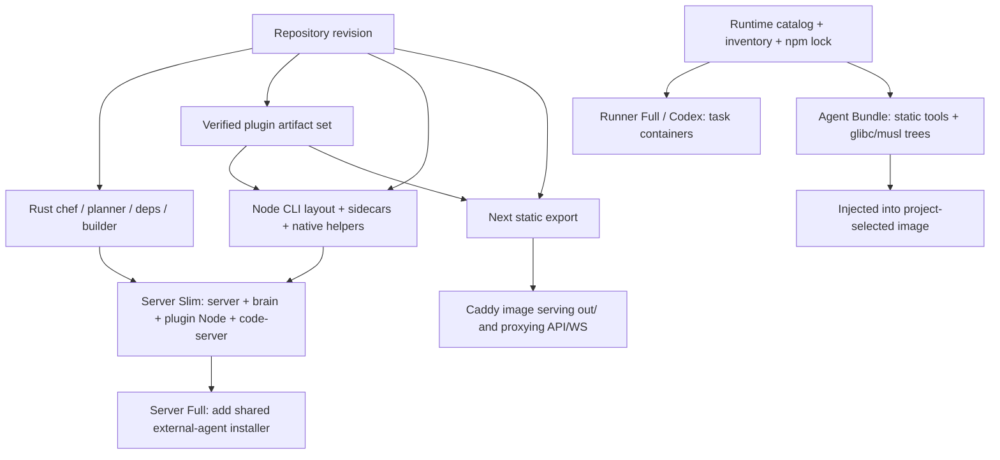

# Evidence ledger: container image assembly audit

- Status: verifying
- Lane: standard
- Created: 2026-11-02
- Updated: 2026-11-10
- Related: ADR-0059, ADR-0183, ADR-0224; local HEAD 2aa72591dc; remote dev 35709cccbddb85321536823c5372b76fb057d82b

The observations and checks dated 2026-11-02 below are historical snapshots. The 2026-11-10 follow-up refreshes current claims; historical CI failures are not evidence of today's registry contents.

## Original request

> 帮我看看这个仓库最新的镜像是怎么拼装的，看看是否存在问题

Follow-up, 2026-11-02: 做一次对抗性审查

Follow-up, 2026-11-10: 帮我看看这个仓库最新的镜像是怎么拼装的，看看是否存在问题，寻找缺口

Follow-up, 2026-11-10: 对这次镜像拼装审查再做一次对抗性审查，确认这些问题是否真实有效，并继续寻找遗漏的缺口。

## Knowledge

| ID  | Statement                                                                                                                                                                                                            | State    | Basis                                                                                                                                                                                                                                                                                                                                                                                          | Depends on |
| --- | -------------------------------------------------------------------------------------------------------------------------------------------------------------------------------------------------------------------- | -------- | ---------------------------------------------------------------------------------------------------------------------------------------------------------------------------------------------------------------------------------------------------------------------------------------------------------------------------------------------------------------------------------------------- | ---------- |
| G1  | Explain assembly and report evidenced defects; no production code changes or publishing.                                                                                                                             | Agreed   | User request, 2026-11-02, Asia/Shanghai.                                                                                                                                                                                                                                                                                                                                                       | -          |
| O1  | Local checkout and remote dev differ materially in image assembly.                                                                                                                                                   | Verified | GitHub ref/contents APIs pinned to remote dev 35709cccbddb85321536823c5372b76fb057d82b; local HEAD 2aa72591dc, 2026-11-02. Snapshots in .cache/image-assembly-audit/remote-*.                                                                                                                                                                                                                  | -          |
| O2  | Remote dev server dependency cooking fails to resolve the patched liteparse crate.                                                                                                                                   | Verified | Compose E2E run 41309471421, matching remote SHA, job 124856636382; error at 2026-11-01T13:09:20Z. Source deps stage has no COPY vendor/liteparse; local commit dd6e08bb1a adds it.                                                                                                                                                                                                            | O1         |
| O3  | Remote web prebuild produces plugin artifacts in an image without Git metadata.                                                                                                                                      | Verified | Remote Dockerfile.web has no external artifact context; .dockerignore excludes .git; producer calls git ls-files and rev-parse. Images PR run 41307353450 job 124850546781 fails with fatal: not a git repository. Local commit f72016f3bf supplies an artifact context instead.                                                                                                               | O1         |
| O4  | Bundle inventory omits 18 runtime IDs present in the canonical catalog.                                                                                                                                              | Verified | validatePins over committed HEAD returns 18 errors; remote dev pins and catalog are byte-identical to HEAD; Images PR bundle job 124850546767 reports the same 18.                                                                                                                                                                                                                             | O1         |
| O5  | Publication uses the repository owner, while deployment defaults retain maxqian888.                                                                                                                                  | Verified | Remote and local images.yml derive owner from GITHUB_REPOSITORY_OWNER; current repo is cognia-labs/cognia; Compose server/web/collab/docker-proxy/workspace-runtime defaults retain ghcr.io/maxqian888.                                                                                                                                                                                        | O1         |
| O6  | Server release tags are pushed without an exact-image boot test in the publishing job.                                                                                                                               | Verified | Remote and local cognia-server-image build/push full and slim directly, then export timings/digests. Runner and bundle promote after smoke. Separate Compose CI does not gate this job or test its exact published digest.                                                                                                                                                                     | O1         |
| O7  | A concurrent local catalog migration is not a complete tracked change yet.                                                                                                                                           | Verified | Both local Dockerfiles COPY packages/agent-codex/catalog-data; git ls-files contains no files under that directory. Fresh-checkout unit test fails. Rust include_str now points there. This is a working-tree finding, not a remote-dev defect.                                                                                                                                                | O1         |
| O8  | Server Full installer output and global Cursor link target differ.                                                                                                                                                   | Verified | runtime-full inherits HOME=/data; installer links /root/.local/bin; official installer fetched 2026-11-02 uses HOME. Remote dev server has the same HOME inheritance and its install-agents.sh is byte-identical to local. Source-level invariant check exits 1, receipt cursor-path-counterexample.json. Conditional on successful vendor install using this path contract; no container run. | O1         |
| C1  | Preserve concurrent changes and write only this audit ledger and ignored evidence.                                                                                                                                   | Observed | concurrent-tree-safety skill; extensive pre-existing modifications, including both Dockerfiles.                                                                                                                                                                                                                                                                                                | -          |
| Q1  | Which digest is the currently published latest image?                                                                                                                                                                | Open     | Package listing returns HTTP 403, missing read:packages; anonymous old server latest-full lookup returns not found, new namespace token lookup returns 403. Neither proves private artifact absence.                                                                                                                                                                                           | -          |
| O9  | Audit baseline is local HEAD 9f40591bc8, remote dev 8c7d787f494941c7613b5b2ef349fdfb25f61d6d; local dev is 47 commits ahead with unrelated dirty files.                                                              | Verified | git rev-parse, git ls-remote origin refs/heads/dev, git status; 2026-11-10.                                                                                                                                                                                                                                                                                                                    | -          |
| O10 | Master bundle-pin validation still reports 18 omitted runtime IDs locally.                                                                                                                                           | Verified | node scripts/build/bundle-agent-versions.mjs check, 2026-11-10; exit 1; .cache/image-assembly-audit/2026-11-10/pin-check.log.                                                                                                                                                                                                                                                                  | O9         |
| O11 | Docker is installed but its daemon is unavailable.                                                                                                                                                                   | Observed | docker info: Cannot connect to the Docker daemon at unix:///var/run/docker.sock; 2026-11-10.                                                                                                                                                                                                                                                                                                   | -          |
| Q2  | Which registry digests and source revisions currently carry latest?                                                                                                                                                  | Open     | Current source and PR runs cannot establish published registry state; 2026-11-10.                                                                                                                                                                                                                                                                                                              | -          |
| O12 | Fourteen key assembly, gate and Compose files are byte-identical to remote dev 8c7d787f; image findings below are not local-only fixes.                                                                              | Verified | .cache/image-assembly-audit/2026-11-10/source-comparison.json; git show of exact remote SHA, 2026-11-10.                                                                                                                                                                                                                                                                                       | O9         |
| O13 | Current focused tests report 95 tests, 91 passed, 4 failed; all four failures derive from the incomplete master inventory. Both static gates exit 0.                                                                 | Verified | .cache/image-assembly-audit/2026-11-10/checks.json and image-tests.log, 2026-11-10.                                                                                                                                                                                                                                                                                                            | O10        |
| O14 | Core deployment defaults still use maxqian888 while publication uses cognia-labs; the deploy gate accepts even a bogus replacement owner.                                                                            | Verified | Compose source and in-memory checkComposeImagesPublished counterexample; counterexamples.json, 2026-11-10.                                                                                                                                                                                                                                                                                     | O12        |
| O15 | Six representative direct assembly inputs match no Images PR path filter.                                                                                                                                            | Verified | Parsed actual YAML and tested paths with node:path.matchesGlob; counterexamples.json; GitHub path-filter reference, 2026-11-10.                                                                                                                                                                                                                                                                | O12        |
| O16 | Host-image gate ignores Full; mutating Full to final USER root and NODE_ENV=development still returns no problems. Explicit Full validation catches ENV but misses final USER.                                       | Verified | In-memory mutations only; runChecks and checkRuntimeStage, counterexamples.json, 2026-11-10.                                                                                                                                                                                                                                                                                                   | O12        |
| O17 | Current registry identity cannot be established with available reads.                                                                                                                                                | Observed | Package API HTTP 404; anonymous buildx manifest inspection HTTP 403; no contents inferred from these access failures, 2026-11-10.                                                                                                                                                                                                                                                              | -          |
| O18 | Latest listed Images PR run failed; its bundle pin gate emits the same 18 omissions. Other Rust errors belong to a dependency-update merge, not a default-dev release.                                               | Verified | Run 42600814607, checkout ed18e5440049222a8dc9d3e2591f077c7a6ec861 merging 15011308 into 8c7d787f; ci-excerpts.json, 2026-11-10.                                                                                                                                                                                                                                                               | O12        |
| O19 | Three former source blockers are repaired in current remote dev: liteparse is copied into deps, plugin artifacts arrive through a named context, and four catalog-data files are tracked.                            | Verified | Current Dockerfiles, action and git ls-files; all corresponding source snapshots match remote dev, 2026-11-10.                                                                                                                                                                                                                                                                                 | O12        |
| O20 | Server and Web still push release tags directly; Server PR builds only check, while Runner/Bundle promote tested digests.                                                                                            | Verified | images.yml jobs and separate compose-e2e workflow compared at remote dev 8c7d787f, 2026-11-10.                                                                                                                                                                                                                                                                                                 | O12        |
| O21 | Concurrent commits advanced local HEAD to 3a0cb885; all 14 audited assembly/gate/Compose inputs remain byte-identical to remote dev 8c7d787f.                                                                        | Verified | .cache/image-assembly-audit/2026-11-10-adversarial/baseline.json; remote ref rechecked, 2026-11-10.                                                                                                                                                                                                                                                                                            | O12        |
| O22 | Independent challenge retains the source observations in F1-F6 but narrows their construction, production-override, publication and optional-feature impact.                                                         | Verified | Fresh-context challenge_image_report, two bounded review rounds, 2026-11-10; reconciliation below.                                                                                                                                                                                                                                                                                             | O21        |
| O23 | Plain Node sidecar bundling relocates CHILD_PATH to an unstaged sibling sandbox-child.ts. The missing path exits 1; separately staging the real child produces IPC ready.                                            | Verified | Persisted adversarial probe and independently rerun bundler fixture on macOS arm64 Node 26.12.1; new-source-comparison.json matches remote dev, 2026-11-10.                                                                                                                                                                                                                                    | O21        |
| O24 | Plain Node sidecar bundling relocates Webclone RUNNER_PATH to /webclone/dist/runner.js, outside the staged brain. Staging the real runner changes missing-module failure to the expected no-network BadJob response. | Verified | Same esbuild settings and real engine entry; persisted probe, 2026-11-10. Bun self-exec and Tauri raw resources are excluded.                                                                                                                                                                                                                                                                  | O21        |
| O25 | Managed source-pin fixtures remain pinned after tracked root manifest/lock/toolchain changes; included guest-source changes are rejected. Current real checkout has no managed release pin.                          | Verified | Persisted isolated Git fixture with positive control; checkPinnedRelease returns absent, 2026-11-10. No guest compiled and no stale published image demonstrated.                                                                                                                                                                                                                              | O21        |
| O26 | Expanded existing checks report 123 tests, 118 passed, 5 failed: 4 inventory failures and 1 undeclared @ai-sdk/provider in the raw-sidecar closure gate.                                                             | Verified | .cache/image-assembly-audit/2026-11-10-adversarial/existing-tests.tap, 2026-11-10. The extra failure is not used as Node image evidence.                                                                                                                                                                                                                                                       | O21        |
| O27 | The current official Cursor installer uses HOME for its install tree and ~/.local/bin links.                                                                                                                         | Verified | Read-only vendor snapshot SHA256 f32ab18113f616745c119cd9fa0ffd0d743bc4ea4ee4aeaa98ac907934d0b568, 2026-11-10. Installer not executed.                                                                                                                                                                                                                                                         | -          |
| C2  | Skip external cross-model CLI review and finish this independent same-model audit.                                                                                                                                   | Observed | User explicitly selected skip in the doubt-driven optional offer, 2026-11-10.                                                                                                                                                                                                                                                                                                                  | -          |

## Problem frame

Audit both the user's current checkout and the current remote default branch (O1), explain stage and deployment composition, and distinguish reproducible failures from verification gaps (O2–O7). Do not equate a successful build, a PR check, a tag name or a local fix with delivery. Actual registry latest identity remains unresolved (Q2). No production implementation, workflow dispatch, registry push, account changes or deployment is authorized by this review (G1, C1).

## Complexity profile

| Dimension    | Rating | Why / what would resolve it                                                                                                       |
| ------------ | ------ | --------------------------------------------------------------------------------------------------------------------------------- |
| scale        | medium | Ten image families; Rust, Node, plugin artifacts and Compose.                                                                     |
| technical    | medium | cargo-chef recipe boundaries, Node layout, glibc/musl bundle.                                                                     |
| coupling     | high   | Runtime catalog/inventory/lock, out-of-tree Rust inputs, plugin identity, service repository revision and publishing namespace.   |
| requirement  | low    | Explain assembly and report issues.                                                                                               |
| verification | high   | CI source/log evidence available; no local Docker daemon and registry manifest access is denied; exact latest remains unresolved. |
| risk         | medium | Incorrect audit could conflate local fixes with delivered builds; no production mutations performed.                              |

## Risks

| ID  | Risk (impact)                                                                               | Severity | Source                                                           | Claim                                                                                        | Refuted by                                                                                                         |
| --- | ------------------------------------------------------------------------------------------- | -------- | ---------------------------------------------------------------- | -------------------------------------------------------------------------------------------- | ------------------------------------------------------------------------------------------------------------------ |
| R1  | Missing build context input prevents assembly.                                              | high     | git history dd6e08bb1a; ADR-0183; FMEA                           | Every stage receives its required source/artifact closure.                                   | Cargo patch resolution or plugin artifact production fails.                                                        |
| R2  | Agent catalog growth blocks otherwise unrelated images.                                     | high     | ADR-0183; canonical pin validator                                | Every catalog runtime is bundled or explicitly unavailable.                                  | validatePins reports missing inventory entries.                                                                    |
| R3  | Unoverridden deployment defaults may consume stale or differently owned images.             | medium   | ADR-0224; publication and Compose source                         | Defaults follow the publishing repository.                                                   | Publisher owner and deployment namespace differ.                                                                   |
| R4  | A release tag points to an image that cannot boot.                                          | high     | ADR-0224; publishing workflow FMEA                               | Released server digests are tested before promotion.                                         | Build/push occurs without boot/readiness checks of that digest.                                                    |
| R5  | Server Full may expose a dangling Cursor command after a successful install.                | medium   | Fresh source reviewer; official vendor installer; path invariant | Installer destination matches the final command link.                                        | HOME-derived destination differs from hard-coded root destination.                                                 |
| R6  | Source, published artifacts and default deployments drift across revisions or repositories. | high     | ADR-0059; ADR-0224; FMEA; current Git provenance                 | The reported assembly is tied to an exact revision and registry digest.                      | A local-only fix is described as released, or default namespace differs from publisher.                            |
| R7  | Image CI omits actual build inputs or checks only part of the final artifact.               | high     | ADR-0183; Dockerfile/workflow closure review                     | Required input changes trigger appropriate final-image validation.                           | An embedded source input is absent from context or trigger paths, or final stages never run on PRs.                |
| R8  | Audit overstates a defect or misses a production-input/provenance dependency.               | medium   | doubt-driven; ADR-0233 source-pin contract; FMEA                 | Every finding has a current counterexample, a scoped impact and compensating-check analysis. | A finding only holds after an impossible mutation, or changed compiled inputs pass the claimed source-drift check. |
| R9  | Single-file bundling loses subprocess runtime entries and rewrites their relative meaning.  | high     | Fresh reviewer; actual Node esbuild fixtures; FMEA               | Every spawned child entry remains separately reachable in the shipped Node layout.           | Actual bundled modules point to absent paths while staged positive controls start the intended entries.            |

## Verification obligations

| ID  | Risk               | Method                                                                                                         | Independence   | Evidence                                                                                                                                                                                                                                               | Coverage                                                                                                                                  | Status  |
| --- | ------------------ | -------------------------------------------------------------------------------------------------------------- | -------------- | ------------------------------------------------------------------------------------------------------------------------------------------------------------------------------------------------------------------------------------------------------ | ----------------------------------------------------------------------------------------------------------------------------------------- | ------- |
| V1  | R1, R2             | Run existing image gates and targeted tests.                                                                   | tool           | Both pnpm audit:deploy-suite and pnpm audit:agent-host-image exit 0. node --test --test-reporter=tap over five relevant files: 95 tests, 90 passed, 5 failed; .cache/image-assembly-audit/tests.tap.                                                   | Current working tree only; four pin-related failures and one untracked COPY input. Gates passing do not discharge observed build defects. | passed  |
| V2  | R1, R2             | Separate committed, concurrent and remote inputs; inspect matching CI logs.                                    | tool           | HEAD-only validatePins returns 18 errors; literal COPY closure has no missing local path but one untracked directory in two Dockerfiles. Remote dev Compose E2E confirms liteparse failure; PR web and bundle logs confirm Git and inventory failures. | Deterministic failure identification, no local full build.                                                                                | passed  |
| V3  | R3, R4             | Compare publisher/defaults and publication ordering.                                                           | tool           | Remote source snapshots and local source confirm O5/O6; current repo Images API reports 0 push and 0 workflow_dispatch runs at inspection. PR checks are not publication evidence.                                                                     | Workflow/default consistency; does not establish registry contents.                                                                       | passed  |
| V4  | R1, R4, R5         | Build and boot exact full/slim/web images.                                                                     | real-env       | docker version reports Cannot connect to the Docker daemon at unix:///var/run/docker.sock.                                                                                                                                                             | Exact local Docker runtime and release digest smoke unavailable.                                                                          | blocked |
| V5  | R3                 | Resolve actual registry latest manifests and config revision.                                                  | real-env       | gh package APIs return HTTP 403 missing read:packages. Anonymous buildx inspect: old namespace not found; new namespace token HTTP 403.                                                                                                                | Cannot identify current published latest or certify its contents.                                                                         | blocked |
| V6  | R1, R2, R3, R4     | Challenge the report independently and hunt unanchored source counterexamples.                                 | fresh-reviewer | challenge_audit found five report corrections; hunt_assembly_failures found Cursor HOME mismatch and server/web partial-publication gap. Findings reconciled below.                                                                                    | Two same-model reviewers; no cross-model review, explicitly declined by user.                                                             | passed  |
| V7  | R5                 | Compare inherited stage environment, official installer destination and command link.                          | tool           | node .cache/image-assembly-audit/cursor-path-check.mjs exits 1: /data/.local/bin/cursor-agent differs from /root/.local/bin/cursor-agent. Official source SHA256 77d44de2cb8d12245077e290870ca4085644c5cfd534ba96334c4d6eeb8f0a7c.                     | Deterministic source-level counterexample; vendor script fetched, never executed; no container acceptance.                                | passed  |
| V8  | R1, R2, R7         | Rerun pin validator, targeted existing tests and static deployment/image gates.                                | tool           | 95 tests: 91 passed, 4 failed from inventory; both static gates exit 0; checks.json.                                                                                                                                                                   | Executed audit checks; does not mean image tests or image readiness passed.                                                               | passed  |
| V9  | R3, R4, R6, R7     | Pin remote source, inspect recent workflow jobs, compare Dockerfile closure and deployment/publication wiring. | tool           | 14 key source files match remote dev 8c7d787f; run 42600814607 logs inspected; counterexamples.json reproduces trigger/namespace/host-gate gaps.                                                                                                       | Current source and PR provenance; no registry readiness claim.                                                                            | passed  |
| V10 | R1, R4, R6, R9     | Inspect registry latest digests and boot final server/web images.                                              | real-env       | Docker daemon unavailable; package API 404 and anonymous GHCR token 403 on 2026-11-10.                                                                                                                                                                 | Exact image acceptance remains unverified.                                                                                                | blocked |
| V11 | R5, R6, R7         | Fresh-context read-only failure hunt followed by independent command/source rechecks.                          | fresh-reviewer | Explorer image_failure_hunt completed; parent independently reran path, namespace and unsafe-Full counterexamples with assertions; counterexamples.json.                                                                                               | Same-model fresh-context review plus tool rechecks; no final-image runtime evidence.                                                      | passed  |
| V12 | R2, R3, R4, R7, R8 | Fresh-context challenge F1-F6 and reconcile each against source and controls.                                  | fresh-reviewer | Two read-only challenge rounds; compensation checks and per-finding reconciliation recorded below.                                                                                                                                                     | Same-model review; cross-model extension declined by user.                                                                                | passed  |
| V13 | R1, R5, R7, R8     | Fresh failure hunt plus persisted source/behavior probes.                                                      | tool           | 8/8 counterexample probes, 0 skipped; actual vendor script read without execution; 123 existing tests: 118 pass, 5 fail with causes recorded.                                                                                                          | Mutations confined to memory or disposable .cache Git/build fixtures; no vendor install or container execution.                           | passed  |
| V14 | R1, R7, R8, R9     | Reproduce missing subprocess entries using actual source and real child/runner positive controls.              | tool           | 8 persisted counterexample probes all reproduce; Code IPC ready and Webclone BadJob controls succeed; parent-bundled-path-receipt.json.                                                                                                                | macOS Node 26/esbuild path and entry behavior; not a Linux image or full production-host run.                                             | passed  |

## Decisions

| ID  | Date       | Decision                                                                                                                                                                                                                               | Action   | Based on                                    | Reversal trigger                                                                                      |
| --- | ---------- | -------------------------------------------------------------------------------------------------------------------------------------------------------------------------------------------------------------------------------------- | -------- | ------------------------------------------- | ----------------------------------------------------------------------------------------------------- |
| D1  | 2026-11-02 | Inspect and reproduce before proposing changes.                                                                                                                                                                                        | diagnose | G1, C1                                      | User requests implementation.                                                                         |
| D2  | 2026-11-02 | Report remote build blockers separately from local fixes and in-progress migration.                                                                                                                                                    | diagnose | O1, O2, O3, O4, O7                          | New remote revision or completed coherent local changes.                                              |
| D3  | 2026-11-02 | Carry registry identity and exact runtime verification as unresolved; do not claim deployability.                                                                                                                                      | stop     | O5, O6, C1                                  | Docker daemon available or registry read access established.                                          |
| D4  | 2026-11-02 | Correct report provenance, narrow deployment scope and add the conditional Cursor path defect.                                                                                                                                         | diagnose | O1, O5, O8                                  | Current installer changes its path contract or runtime overrides HOME.                                |
| D5  | 2026-11-02 | Finish after independent review and correction recheck; user declined cross-model extension.                                                                                                                                           | stop     | G1, C1                                      | New substantive counterexample or implementation request.                                             |
| D6  | 2026-11-10 | Reopen source and CI evidence for the same image-assembly audit; preserve historical results and recheck drift.                                                                                                                        | diagnose | G1, C1, O9                                  | User requests fixes or publication; baseline moves during inspection.                                 |
| D7  | 2026-11-10 | Report the inventory blocker and current deployment/publication/validation gaps; retire repaired historical blockers from the current finding list.                                                                                    | diagnose | O10, O12, O13, O14, O15, O16, O18, O19, O20 | A coherent fix, new remote baseline or exact-image runtime counterevidence.                           |
| D8  | 2026-11-10 | Challenge the report and hunt missed source/runtime/provenance boundaries, then correct the audit only.                                                                                                                                | diagnose | G1, C1, O21                                 | User asks for product fixes or source inputs drift.                                                   |
| D9  | 2026-11-10 | Keep evidenced observations while narrowing their impact; add Node-layout subprocess closure findings and explicitly bounded managed-pin limitation. Do not promote worker-fixture or raw-resource failures into image-runtime claims. | diagnose | O22, O23, O24, O25, O26, O27, C2            | Full-image counterevidence, a different packaging mode or a changed ownership/compatibility contract. |

## Assembly map

This table was recorded on 2026-11-02. The current 2026-11-10 key recipes now match remote dev (O12); the refreshed map and findings appear in the follow-up section below.

| Output                                                       | Assembly                                                                                                                                                             | Runtime / purpose                                                                                                                                                                                                                   |
| ------------------------------------------------------------ | -------------------------------------------------------------------------------------------------------------------------------------------------------------------- | ----------------------------------------------------------------------------------------------------------------------------------------------------------------------------------------------------------------------------------- |
| cognia-server:*-slim                                         | Rust 1.99 trixie chef → planner → deps → release builder; Node 26 trixie brain-builder bundles CLI and sidecars; separate pinned plugin Node and code-server stages. | Node trixie-slim + server/operator/bootstrap binaries + /app/brain + native helpers + VSIX + code-server + sandboxed plugin Node; bubblewrap, uid/gid 10001, persistent /data. Slim still carries the execution brain and sidecars. |
| cognia-server:*-full                                         | Inherits runtime-slim and runs deploy/runner/install-agents.sh.                                                                                                      | Adds preinstalled external agent CLIs; shares Rust/brain layers with slim. Server job builds full first, then slim from shared cache.                                                                                               |
| cognia-web                                                   | Node 26 bookworm builds Next static export out/; Caddy 2.10 receives /srv and Caddyfile.                                                                             | Static UI and same-origin API/WS reverse proxy; NEXT_PUBLIC configuration is baked at build time.                                                                                                                                   |
| cognia-runner                                                | Selected profile prunes the locked agent package closure; full uses compatibility installer.                                                                         | Per-task external agent container; current workflow publishes amd64 only, full/codex profiles. Full retains optional unverified Cursor installer.                                                                                   |
| cognia-agent-bundle                                          | Static musl sandboxd/bootstrap, static Git linked with libcurl, rg, pinned Node and agent distributions, glibc and musl trees, bundle manifest.                      | Injected into a user-selected project image, rather than using the bundle image as the project environment; native amd64 and arm64 smoke before manifest promotion, full/codex variants.                                            |
| cognia-workspace-runtime                                     | Node 26 copied into Playwright 1.63.0 noble; install filtered production workspace dependencies.                                                                     | Browser, file and service runtime for retained workspaces.                                                                                                                                                                          |
| cognia-collab / deploy-agent / ops-controller / docker-proxy | Separate Dockerfiles, mostly Rust multi-stage binaries.                                                                                                              | Collaboration, deployment control and constrained Docker API.                                                                                                                                                                       |
| cognia-managed-desktop                                       | Build static Linux guest guard, stage bounded desktop context, build desktop image.                                                                                  | Managed desktop guest; amd64. Publication alone is not provider qualification.                                                                                                                                                      |

Signaling/share/diagnostics images are owned by cognia-labs/cognia-services. integrations/cognia-services.json pins source revision 487e9f2d617c9d1b9b648ec510cafcf53b962c2c; the root Cargo dependency uses the same revision. Compose deployment layers select services/profiles and production overrides require explicit image references and persistent data/secrets.

Current local HEAD 2aa72591dc includes the artifact-context change introduced by ancestor f72016f3bf: plugin source is excluded by .dockerignore. The composite plugin-artifact-set action produces a verified set outside Docker, then both app images receive it through the plugin-artifacts named context and COGNIA_PLUGIN_ARTIFACTS. Remote dev lacks this change and still attempts production from source inside the build image.

The Images workflow runs on v* tags, workflow_dispatch and selected PR input changes. Actual pushes require a tag push or manual push=true. Server/runner/web and other fast images are currently single native amd64 builds; the agent bundle is explicitly amd64+arm64. Do not infer ARM support for every image from the bundle matrix.

## Findings and recommended next actions

1. **P1 — remote server dependency stage lacks the patched crate.** In remote dev Dockerfile.cognia-server, deps starts FROM chef and copies only config/toolchain/recipe before cargo chef cook. The real vendor/liteparse copied in planner is not inherited. The crate is excluded from the workspace yet required by the root patch. The matching-SHA Compose E2E reports `patch location /work/vendor/liteparse does not contain packages matching liteparse` and exits 101. Local dd6e08bb1a supplies the missing COPY and additional embedded inputs; it is not present on remote dev. Deliver the coherent fix and repeat full image assembly.
2. **P1 — remote plugin production requires Git inside a Git-free context.** Remote Dockerfile.web runs pnpm build; prebuild calls stage-plugin-artifacts, which chooses production from plugins/ when no external set is supplied. The producer needs git ls-files/rev-parse, but .dockerignore removes .git. The CI failure is `fatal: not a git repository`. Server brain assembly also calls the same artifact staging path, though its downstream failure is currently masked by earlier Rust cooking. Local f72016f3bf supplies an external verified artifact set. Deliver and Docker-verify that fix; do not solve this by blindly copying Git history into images.
3. **P1 — 18 catalog runtimes have no bundle accounting.** antigravity-acp, auggie, autohand-code, codebuddy, command-code, kilocode, mistral-vibe, mimo-code, hermes-agent, oh-my-pi, muse, amp, zcode, openclaude, crush, continue-dev, rovo-dev and codebuff are neither bundled nor marked unavailable. This is committed in both local HEAD and remote dev. It blocks bundle pin checks and runner prechecks, including codex-only selection, because the full master inventory is validated first. Add truthful distributions or explicit unavailable reasons, then rerun existing pin/profile tests.
4. **P2 — current publisher and unoverridden default consumers use different owners.** images.yml publishes under cognia-labs for the current repository, while Compose defaults for server/web/collab/docker-proxy/workspace-runtime and some documented runner settings retain maxqian888. A new cognia-labs publication cannot update those defaults. Production overrides require explicit image references, and the deployment driver supplies release image references (driver.rs:291–295), so the mismatch does not establish a production outage. This review also cannot identify old private packages or the current published latest. Align intended default references and validate unoverridden deployment pulls; do not generalize this defect to explicitly configured production releases.
5. **P2 — server/web publication has no exact-digest smoke barrier or common promotion barrier.** Full/slim server and web tags are pushed directly in their build steps; server later steps only export timings and digests. Web and server jobs depend only on vars, so one family may promote tags even when another family fails. The separate Compose lane cannot guarantee this exact built artifact starts successfully. Apply the existing runner/bundle pattern: build by digest, boot/init/readiness and helper checks, then promote tags. This is a verified pipeline gap, not proof that an already-published artifact is broken.
6. **P2 — Server Full Cursor command links to the wrong home.** runtime-slim sets HOME=/data (Dockerfile.cognia-server:394); runtime-full inherits it and switches USER root without resetting HOME (:420–429). The [official installer](https://cursor.com/install) fetched on 2026-11-02 writes under HOME/.local and creates the command in ~/.local/bin, but install-agents.sh:74 hard-codes the global link target as /root/.local/bin/cursor-agent. With the current installer and a successful install, the destination is /data/.local/bin/cursor-agent and the global command points elsewhere; chmod also targets the wrong tree. This counterexample does not depend on /root traversal permissions. It applies to Server Full, not automatically to Runner Full. No exact-image run was performed. Use an image-owned install directory and check the command as final UID 10001.

**Local-only integration note:** the concurrent Codex catalog migration adds packages/agent-codex/catalog-data to Docker COPY and Rust include_str, but its files remain untracked. The fresh-checkout test correctly fails. The directory exists locally, so this is not a current local missing-file failure; completing and reviewing the whole migration is necessary before publishing that change.

## Reproducible evidence

- `pnpm audit:deploy-suite`: exit 0, static suite alignment checks pass.
- `pnpm audit:agent-host-image`: exit 0, static bubblewrap/uid/runtime directory/Pi layout checks pass.
- `node --test --test-reporter=tap scripts/gates/check-deploy-suite.test.mjs scripts/gates/check-agent-host-image.test.mjs scripts/build/agent-image-profiles.test.mjs scripts/build/bundle-agent-versions.test.mjs deploy/runner/install-selected.test.mjs`: 95 tests, 90 passed, 5 failed. Full output: .cache/image-assembly-audit/tests.tap. The four pin-related failures share the omitted-inventory cause; the fifth is the untracked COPY input.
- `node scripts/build/bundle-agent-versions.mjs check`: exit 1 with 18 missing-inventory diagnostics. HEAD-only validatePins independently returns the same 18 errors.
- Literal local COPY closure check: no absent paths; packages/agent-codex/catalog-data is untracked in server and bundle inputs. Summary: .cache/image-assembly-audit/closure.json now contains copyClosure with literal inputs, line numbers, existence and tracking state. It explicitly excludes wildcard inputs, COPY ., named/stage contexts and dockerignore semantics.
- Latest listed Images PR run: [41307353450](https://github.com/cognia-labs/cognia/actions/runs/41307353450), PR head SHA 20ac2e86e58daa73fed2abeda43fdac186e61292; the Docker checkout actually tested PR merge SHA 458d02c306dd67493a4cd54294d89e9a4d5bed9e (ci-web.log:208–211), created 2026-11-01T12:37:09Z. Logs: .cache/image-assembly-audit/ci-server.log, ci-web.log, ci-bundle.log. This PR run is not publication evidence.
- Matching remote-dev Compose E2E run: [41309471421](https://github.com/cognia-labs/cognia/actions/runs/41309471421), Tier 1 services passed, Tier 2 server build failed. Log: .cache/image-assembly-audit/ci-dev-compose-server.log.
- Current repo Images API returned 0 tag-push runs and 0 manual-dispatch runs. A legacy repo manual run [39222381049](https://github.com/MaxQian888/cognia-next/actions/runs/39222381049) succeeded on 2026-10-19, but its publication manifest job was skipped; that run does not establish current published latest.
- [Docker build-context documentation](https://docs.docker.com/build/concepts/context/) confirms context boundaries, .dockerignore filtering and named artifact contexts. This is supporting semantics; repository source and actual CI failures establish the findings.

CodeGraph CLI is installed but the repository is not indexed; literal source search and pinned source reads were sufficient for this audit. No index was created. GitHub tools do not list workflow runs or registry package inventories, so gh read-only APIs supplied those checks. No app source changed, so repository-wide UI lint/type/build checks were not run; they would not substitute for the blocked Docker checks.

## Adversarial reconciliation, 2026-11-02

Claim under examination: the audit identifies the actual assembly contract and actionable defects without conflating current source, CI-tested commits or published artifacts. The report reviewer received only Assembly map, Findings and Reproducible evidence; Decisions and Knowledge were excluded. A separate source reviewer started with the build files and runtime contract without the report. Both reviewers were read-only and used the inherited model. No implementation changes were made.

| Review finding                                                              | Classification     | Reconciliation                                                                                                                                                     |
| --------------------------------------------------------------------------- | ------------------ | ------------------------------------------------------------------------------------------------------------------------------------------------------------------ |
| Bundle does not ship a standalone curl executable.                          | Valid + actionable | Corrected assembly map: static Git links libcurl; only the Git output tree is exported. See build-static-git.sh:54,83–85 and final bundle COPY inventory.          |
| f72016f3bf is an ancestor, not current local HEAD.                          | Valid + actionable | Current HEAD is 2aa72591dc; attributed artifact-context behavior to its introducing ancestor.                                                                      |
| PR metadata head differs from actual Docker checkout.                       | Valid + actionable | Recorded PR head 20ac2e86 and tested merge 458d02c3 separately; remote-dev applicability is supported by explicit source comparison, not assumed from PR metadata. |
| closure.json previously lacked the cited COPY result.                       | Valid + actionable | Persisted actual per-file literal COPY inputs and tracking/existence checks; added explicit exclusions.                                                            |
| Namespace drift was labeled P1 without deployment-outage evidence.          | Valid + actionable | Downgraded finding 4 to P2 and R3 to medium; recorded production override and deploy-driver counterexamples.                                                       |
| Server Full HOME mismatch breaks its successful Cursor-install path.        | Valid + actionable | Added O8, R5, V7 and finding 6. Official installer fetched read-only and hashed; source path equality assertion fails. No vendor script executed.                  |
| Server and web publish independently without common exact-image acceptance. | Valid + actionable | Extended finding 5 to web and partial publication; retained the boundary that no existing deployed artifact failure was demonstrated.                              |

The Cursor counterexample is reproducible with `node .cache/image-assembly-audit/cursor-path-check.mjs` (expected exit 1). Its captured vendor source is cursor-installer.sh; the full assertion output is cursor-path-check.log; cursor-path-counterexample.json records the source digest and both paths. This is a source-level invariant check, not an image execution test. No system HOME was changed and the vendor installer was not run.

Existing liteparse, plugin Git-context and runtime-inventory blockers remain supported. Local fixes do not prove remote delivery, and source/CI failures do not establish the identity or health of an unknown registry latest digest. Concurrent catalog files being untracked remains an integration note, not a new remote defect.

Cross-model extension was offered under doubt-driven and explicitly declined by the user (仅完成当前审查（推荐）). The second bounded report review confirmed that all five report corrections were resolved, checked the Cursor source receipt/hash, and found no new substantive issues. This meets the stop condition; no external coding CLI was invoked. Runtime and registry residuals remain open.

## Residual risks

| ID  | Residual                                                                                                 | From                | Why still open                                                                                                                         | Next action                                                                                                               | Status |
| --- | -------------------------------------------------------------------------------------------------------- | ------------------- | -------------------------------------------------------------------------------------------------------------------------------------- | ------------------------------------------------------------------------------------------------------------------------- | ------ |
| X1  | Full image build, boot and strict sandbox behavior remain unverified locally.                            | V4                  | Docker daemon unavailable.                                                                                                             | Start an authorized Docker environment; build full/slim/web and exercise init/readiness/agent spawn with exact digests.   | open   |
| X2  | Actual latest registry digest and source revision remain unresolved.                                     | V5, Q1              | Missing read:packages; anonymous access inconclusive.                                                                                  | Use registry read access and inspect manifest/config labels; no publishing required.                                      | open   |
| X3  | Historical assembly blockers have mixed follow-up status.                                                | R1, R2, R3, R4, O19 | liteparse, plugin-context and tracked catalog repairs now exist in remote dev; inventory, default-owner and promotion gaps remain.     | Use the 2026-11-10 finding list for remaining fixes; verify exact released digests.                                       | open   |
| X4  | Historical untracked Codex catalog-data input is repaired.                                               | O7, O19             | Four files are tracked in current remote dev; former fresh-checkout input test now passes.                                             | Closed for source closure; runtime acceptance remains X7.                                                                 | closed |
| X5  | Successful Cursor installation has not been exercised in the final image as uid 10001.                   | R5, V4              | Source mismatch is reproduced; Docker daemon unavailable.                                                                              | After a path fix, run successful-install and final-user execution checks in Server Full.                                  | open   |
| X6  | Follow-up source/CI reconciliation, targeted checks and fresh-context failure hunt are complete.         | V8, V9, V11         | Completed 2026-11-10; exact-image runtime acceptance is carried separately as X7.                                                      | Reopen on source or environment drift.                                                                                    | closed |
| X7  | Current registry latest identity and final-image boot remain unverified.                                 | V10, Q2             | Docker daemon unavailable; package API returned 404 and anonymous manifest access returned 403.                                        | Read registry manifests/config labels with authorized access; smoke exact digests on an available Docker host.            | open   |
| X8  | Inventory, namespace, tag promotion, trigger coverage and gate gaps are findings, not fixes.             | R2, R3, R4, R7      | This task authorizes investigation; product behavior is unchanged.                                                                     | Resolve in focused changes and validate exact final digests.                                                              | open   |
| X9  | Adversarial reconciliation and bounded new-gap investigation are complete.                               | V12, V13, V14       | Two reviewer rounds and parent counterexample/control reruns completed; remaining runtime/provenance questions are carried separately. | Reopen on new source or runtime evidence.                                                                                 | closed |
| X10 | New Node-layout subprocess defects have not been repaired or smoke-tested in exact Linux server digests. | R9, V10             | No product fixes; Docker daemon unavailable.                                                                                           | Stage independent child closures and repair URL resolution, then test actual Full/Slim digests under the strict launcher. | open   |
| X11 | Managed pin deliberately hashes a source subset; full compiled-input provenance is not established.      | R8, O25             | Current pin absent; existing design excludes some dependencies; fixture did not compile a guest.                                       | Choose full build provenance or document the narrower compatibility contract and test its boundaries.                     | open   |
| X12 | A code-index worker bundle fixture fails, but full packaged-host consequences remain unverified.         | R9                  | Fixture uses a pure extractor substitute; index-service has concurrent local edits and a serial fallback.                              | Reproduce with the complete packaged sidecar before promoting this candidate to a release defect.                         | open   |

## Outcome

| ID  | Signal                                                                                                                              | How / when measured                                                                                                        | Result                                                                                                                                                                                                   | Status |
| --- | ----------------------------------------------------------------------------------------------------------------------------------- | -------------------------------------------------------------------------------------------------------------------------- | -------------------------------------------------------------------------------------------------------------------------------------------------------------------------------------------------------- | ------ |
| M1  | Explain assembly and identify actionable defects using source and independent checks.                                               | Source snapshots, 95 targeted tests, CI logs and publication review, 2026-11-02.                                           | Six prioritized findings after adversarial corrections, plus a scoped concurrent-work note. Runtime acceptance and actual registry latest remain X1/X2.                                                  | met    |
| M2  | Challenge the report and repair unsupported claims without changing production code.                                                | Two independent read-only reviews, reconciliation and source-path counterexample, 2026-11-02.                              | Five report corrections accepted, publication gap scoped to server/web, one conditional Cursor defect added. Cross-model review declined.                                                                | met    |
| M3  | Explain current assembly and give actionable current defects/gaps without treating historical failures as current release evidence. | 14 pinned source comparisons; 95 tests; latest PR logs; fresh-context failure hunt and parent mutation probes, 2026-11-10. | Audit delivered; one reproducible inventory blocker, four further deployment/publication/validation findings and one conditional Cursor finding. Registry identity and exact-image acceptance remain X7. | met    |
| M4  | Challenge all six current findings, correct overbroad impact and identify omitted assembly gaps.                                    | Two fresh-context reviewers; two bounded challenge rounds; parent controls; 8 persisted probes, 2026-11-10.                | Six source observations retained with narrower scopes; two Node-layout missing-entry defects added; managed-pin limitation and worker candidate carried precisely. User declined cross-model extension.  | met    |

## Follow-up audit, 2026-11-10

Scope: explain the current assembly, reproduce defects and identify gaps. This follow-up changes only the evidence ledger and ignored receipts. It does not fix or publish production artifacts.

### Baseline and meaning of latest

- Current remote default branch: `8c7d787f494941c7613b5b2ef349fdfb25f61d6d`; local HEAD at audit start: `9f40591bc8c785d01137a9a08d512e051d15d27e`.
- Fourteen key files are byte-identical across this checkout and remote dev, including server/web/bundle recipes, inventory/catalog, installer, image workflow, both static gates, Compose defaults and Compose E2E. This does not mean the whole dirty checkout equals the remote revision.
- Images publishes on `v*` tags or manual dispatch with `push=true`; a push to `dev` alone does not publish `latest`. `latest` is a registry tag, not a synonym for repository HEAD.
- Current repository workflow API returned zero tag-push runs and zero manual-dispatch runs. This is workflow-history evidence only, not proof that a package was never published by another path or repository.
- GHCR `cognia-server:latest-full` identity remains unresolved: package API returns 404, anonymous token request returns 403. No published digest, revision, freshness or deployability is inferred.

### Current assembly

Server Full/Slim and Runner are currently amd64 publication jobs; the Agent Bundle builds amd64/arm64 natively and combines their tested digests. Workspace Runtime is a separate Playwright + Node image. Collab, deploy-agent, ops-controller and Docker proxy have separate binary images. Managed Desktop builds its static guest guard and bounded image context. Signaling/share/diagnostics are owned by `cognia-labs/cognia-services`, whose source revision is pinned in `integrations/cognia-services.json`; their registry publication is outside this repository's Images workflow.

### Current findings

| ID  | Priority / certainty                     | Evidence and consequence                                                                                                                                                                                                                                                                                                                                                                   | Next action                                                                                                                                 |
| --- | ---------------------------------------- | ------------------------------------------------------------------------------------------------------------------------------------------------------------------------------------------------------------------------------------------------------------------------------------------------------------------------------------------------------------------------------------------ | ------------------------------------------------------------------------------------------------------------------------------------------- |
| F1  | P1, reproduced build blocker             | Inventory omits 18 catalog runtimes; validator exits 1 and 4 focused tests fail. prepareBundle validates master before selection, blocking final Bundle and selected Runner construction. Full Runner and Server Full use a different installer; Images Full Runner is nevertheless blocked by the shared pre-build test. This is an existing fail-closed check catching an inconsistency. | Bundle supported IDs or mark unavailable with reasons; preserve validation.                                                                 |
| F2  | P2, default configuration drift          | Workflow is configured to publish under the current owner cognia-labs, while unoverridden base/T2/host-updates and K8s examples retain maxqian888. Production Compose requires explicit image values and production K8s transforms names/digests. Actual publication, missing old images or production pull failure is not established.                                                    | Align the intended defaults and validate full references; exclude explicit production overrides from impact claims.                         |
| F3  | P2, release acceptance gap               | Images pushes Server/Web tags without exact-digest runtime smoke and jobs can independently promote. Separate Compose E2E builds and boots Full/Web on its own triggers; it neither gates Images nor tests the promoted digests. Server PR target checks Rust but omits brain/final-runtime assembly. No online mixed-latest or incompatible deployment is demonstrated.                   | Build once, smoke the same digest, then promote; define release-set compatibility before treating independent latest tags as a release set. |
| F4  | P2, Images trigger gap                   | Six direct assembly inputs match no Images PR filter. A normal PR changing only these inputs skips Images; general CI still runs. The local glob counterexample was not a newly opened GitHub PR.                                                                                                                                                                                          | Broaden Images paths or validate assembly-input trigger closure.                                                                            |
| F5  | P2, two demonstrated gate weaknesses     | Deploy gate ignores core-image owners and loads only base/T2 image fields, missing other manifests and runner env references. Host gate checks only Slim; explicit Full USER validation also accepts an inherited earlier uid. ENV parsing itself is last-wins and explicit Full development validation correctly fails. Current Full remains uid 10001/production.                        | Validate full references and shipping targets; resolve final effective USER. Retain existing correct ENV parsing.                           |
| F6  | P2, source mismatch; runtime conditional | Official installer now independently confirms HOME-derived paths. Server Full HOME=/data disagrees with hard-coded /root Cursor link. Successful installation therefore has a wrong global target in a clean image; optional Cursor failure is tolerated. No full installer or image execution was performed.                                                                              | Choose an explicit install prefix, derive the link from it and execute as final uid in the image.                                           |

F4 and F5 were independently identified by the fresh-context reviewer and then reproduced by the parent with assertions. F2/F3/F6 were rechecked against current source. Former 2026-11-02 liteparse/context/untracked-catalog blockers are excluded from today's findings because their source repairs are present in remote dev.

### Verification and limits

- Both `pnpm audit:deploy-suite` and `pnpm audit:agent-host-image`: exit 0.
- Five existing targeted Node test files: **95 tests, 91 passed, 4 failed**, all four failures caused by F1. No test assertions were weakened and no inventory entries were changed.
- Read-only/in-memory counterexamples: six trigger omissions, bogus-owner gate acceptance, unsafe-Full gate acceptance and conditional Cursor path mismatch; all asserted successfully. No production source was mutated by the probes.
- Latest listed [Images PR run 42600814607](https://github.com/cognia-labs/cognia/actions/runs/42600814607), created 2026-11-09, checked merge `ed18e5440049222a8dc9d3e2591f077c7a6ec861`. Bundle and Runner failed inventory checks. Server failed a k8s-openapi 0.29 missing-version-feature build; guest/deploy-agent failed sysinfo 0.40 API compilation. Those latter errors belong to the dependency-update PR and are not reported as default-dev failures.
- Docker daemon unavailable: no local full image build, final-user agent spawn, readiness, volume-persistence or exact digest smoke was performed. No full application lint/typecheck/build was run for this documentation-only audit.
- Receipts: `.cache/image-assembly-audit/2026-11-10/{checks.json,pin-check.log,image-tests.log,source-comparison.json,counterexamples.json,ci-excerpts.json}`. Ignored receipts supplement the persisted findings above; they are not release artifacts.
- The ledger remains `verifying` because registry identity, final-image acceptance and product fixes remain open. Audit completion does not close those obligations or accept their risk on the user's behalf.

Additional reproducibility limit: base images are generally version-tagged rather than digest-pinned, apt packages resolve at build time, and Full permits an unverified optional Cursor installer. Exact CLI versions alone therefore do not establish bit-for-bit rebuild reproducibility. This review did not measure image size, CVE exposure or cold-build performance.

### External semantics consulted

- [GitHub workflow path-filter semantics](https://docs.github.com/en/actions/reference/workflows-and-actions/workflow-syntax#onpushpull_requestpull_request_targetpathspaths-ignore): ordinary PR path filters run only when changed paths match, supporting F4.
- [Docker base-image pinning](https://docs.docker.com/build/building/best-practices/#pin-base-image-versions): version tags may move; digest pinning is needed to fix base-image identity. Repository source and probes, rather than these references alone, establish the findings.

## Adversarial reconciliation, 2026-11-10

This follow-up challenges the audit rather than implementing its proposed fixes. The existing ledger is extended so the reasoning and corrections stay together. The new `2026-11-02-image-assembly-audit.adversarial-probes.mjs` is necessary because prose and ignored receipts cannot independently rerun the counterexamples; it uses actual modules and disposable fixtures, and does not change the product.

### Claim and contract

Claim under challenge: the six reported findings are current, actionable assembly observations with correctly scoped impacts. The report must distinguish configurations from actual registry publication, fail-closed failures from absent checks, mutation survival from a live unsafe runtime, separate CI from exact-digest promotion, and Node layout from Bun/Tauri packaging.

Two fresh-context reviewers received artifacts and contracts without the ledger's Decisions or narrative. One tried to disprove F1-F6; the other hunted failures without reading this audit. A second bounded challenge checked compensation for the newly discovered entries and the managed-pin fixture. The user explicitly declined the optional cross-model extension; no external model CLI was invoked.

### Reconciliation of the six original findings

| Finding | Verdict                                                    | Correction / compensating evidence                                                                                                                                                                                                        |
| ------- | ---------------------------------------------------------- | ----------------------------------------------------------------------------------------------------------------------------------------------------------------------------------------------------------------------------------------- |
| F1      | Valid, narrower construction scope                         | Bundle and selected Runner use prepareBundle. Standalone Full Runner/Server Full use the compatibility installer. Images Full Runner is still blocked by a shared failing pre-build test. The inventory validator catches this correctly. |
| F2      | Valid configuration drift, not proof of deployment failure | Publisher means configured destination under current GitHub owner. Production Compose requires explicit image values, and K8s production overlays transform legacy references. Registry access errors cannot establish package absence.   |
| F3      | Valid publication gap, not absence of all runtime tests    | Compose E2E builds, boots and smokes separate Full/Web artifacts. It is not a dependency of Images and does not establish acceptance of the published digest. Mixed latest is possible from job ordering, not observed online.            |
| F4      | Valid Images trigger gap                                   | General CI still runs on PRs. Matching no Images filter does not imply all validation is absent.                                                                                                                                          |
| F5      | Valid gate gaps, with distinct causes                      | runChecks ignores Full; USER matching accepts any inherited earlier uid. ENV parsing already uses last-wins correctly, so an explicit Full development check does fail. Current Full is correctly configured.                             |
| F6      | Source mismatch strengthened; final runtime conditional    | Current official installer uses HOME-derived paths, supporting the mismatch. Cursor remains optional and no vendor install or final-user container execution was performed.                                                               |

### Newly confirmed Node-layout defects

| Finding                                                       | Trigger and consequence                                                                                                                                                                                                                                                                                                                      | Independent evidence / scope                                                                                                                                                                                                                                         | Next action                                                                                                                        |
| ------------------------------------------------------------- | -------------------------------------------------------------------------------------------------------------------------------------------------------------------------------------------------------------------------------------------------------------------------------------------------------------------------------------------- | -------------------------------------------------------------------------------------------------------------------------------------------------------------------------------------------------------------------------------------------------------------------- | ---------------------------------------------------------------------------------------------------------------------------------- |
| F7 — P1: Code sandbox child is not staged                     | Server's plain Node sidecar is bundled to /app/brain/sidecar/claude-host.mjs. supervisor.ts:20 retains the sibling sandbox-child.ts URL, and the non-standalone branch passes it to Node. The builder stages schema.sql and selected assets, but no child entry. With Code presentation and a valid strict launcher, the child cannot start. | Actual supervisor bundled with target node26; its child was in the module graph but absent as a separate file. Node exits 1 with MODULE_NOT_FOUND. Staging the real child produces IPC ready. Parent independently reproduced. No full Linux image run.              | Build/stage an explicit child entry and its runtime closure; verify the resolved path in the final Node layout and strict sandbox. |
| F8 — P1: Webclone runner path is relocated outside the layout | webclone/run.ts:31-33 retains ../../../../webclone/dist/runner.js. From the bundled location this is /webclone/dist/runner.js. The builder copies webclone npm dependencies, not the executable entry; valid Webclone snapshot/convert calls cannot start the engine.                                                                        | Actual run.ts bundled with the production webclone plugin. Missing path gives MODULE_NOT_FOUND. Separately bundling the real runner at the derived fixture path returns the expected BadJob response for an invalid no-network job. Parent independently reproduced. | Stage a separate runner bundle and resolve it under the shipped layout; smoke real snapshot/convert on the exact image.            |

Both defects affect the Server Full/Slim plain Node brain layout. They must not be generalized to Bun standalone, which self-executes `COGNIA_ROLE=run-code/webclone` (cli/src/cli/entry.ts:44-53), or Tauri raw-resource packaging, which stages the original src and webclone/dist directory trees (tauri.conf.json:64,69-70). Code tool registration also requires a strict sandbox; this is a reachable optional-capability failure, not a claim that server startup or ordinary chat always fails.

The owning sources of F7/F8 and the managed release script match remote dev 8c7d787f; hashes and comparisons are in `new-source-comparison.json`. These findings are not attributed to unrelated concurrent changes.

### Managed-desktop source-pin limitation

F9 — P2 potential drift-gate gap, currently dormant: SOURCE_INPUTS and computeSourceDigest in scripts/build/managed-desktop-release.mjs hash a selected source subset. Root Cargo.toml, Cargo.lock and rust-toolchain.toml are excluded even though the guest uses workspace dependencies (for example uuid.workspace) and Images builds it through the workspace. An isolated tracked Git fixture can change these inputs while checkPinnedRelease still returns pinned; changing an included guest source correctly rejects the same pin.

The probe establishes a hash-scope omission only. It uses placeholder crate sources and a synthetic changed lock and does not prove the revised guest compiles, binary bytes differ, protocol compatibility breaks or a stale image was published. The real checkout returns `state: absent`, so no current managed release is pinned. Existing design explicitly omits cognia-net and ADR-0233 describes the selected source set. A decision is needed between complete build provenance and an explicitly narrower source-compatibility guard; if the latter is intended, absolute statements such as never built from other code should be corrected rather than treating this guard as complete provenance.

### Candidates not promoted to confirmed image defects

- Extraction worker: new Worker(import.meta.url) in extraction-pool.ts becomes the whole bundled host, while pool initialization is lazy. A bounded fixture with a pure extractor substitute fails and an independent worker-entry control succeeds. Full production-sidecar behavior was not reproduced; current index-service also has concurrent edits and a serial fallback. Carried as X12 instead of claiming a confirmed default-dev release failure.
- Missing procps/ps was a static runtime dependency suspicion only; the actual Linux filesystem was not inspected. Not counted as a confirmed defect.
- Expanded existing tests expose an undeclared @ai-sdk/provider import in the raw-sidecar resource gate. APICallError is a real runtime import, but the Node image bundles this dependency. This test failure is recorded without treating it as an additional Node-image failure.

### Reproducible checks and limits

- `node --test docs/evidence/2026-11-02-image-assembly-audit.adversarial-probes.mjs`: **8 counterexamples reproduced, 0 failures, 0 skipped**. Passing these probes confirms the audited failures/gaps, not healthy product behavior. Includes controls demonstrating detection of an invalid image name, Slim ENV regression, included guest-source drift and successful startup of separately staged real children.
- The first probe draft's Slim control accidentally matched a comment before ENV. The control assertion failed. The mutation was corrected to anchor the actual ENV directive; no assertion was removed or relaxed.
- Eight existing relevant test files: **123 tests, 118 passed, 5 failed**. Four failures are F1; the fifth is the raw-sidecar @ai-sdk/provider declaration failure described above. Receipt: `.cache/image-assembly-audit/2026-11-10-adversarial/existing-tests.tap`.
- Source baseline: local HEAD advanced through concurrent unrelated commits to 3a0cb885; audited owning source matches remote dev 8c7d787f. Shared staged files were neither modified nor unstaged.
- Actual installer source read only: [Cursor installer](https://cursor.com/install), snapshot SHA256 `f32ab18113f616745c119cd9fa0ffd0d743bc4ea4ee4aeaa98ac907934d0b568`.
- No product implementation, registry push, deployment or vendor installer execution. Docker daemon and exact-image acceptance remain unresolved. Same-model fresh-context review only, as requested.
