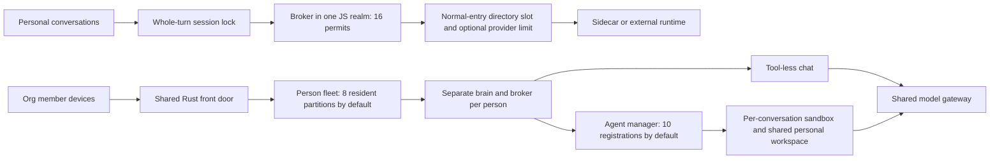

# Evidence ledger: multi-session and multi-user concurrency assessment

- Status: verifying
- Lane: standard
- Created: 2026-11-11
- Updated: 2026-11-13
- Related: ADR-0059, ADR-0149, ADR-0224, ADR-0253; `lib/execution/`; `crates/cognia-server/`

## Original request

> 帮我研究一下现在的体系对多agent并发和管理的性能支持，看看怎么回事，评估一下现在的并发支持

Correction: **多个会话和多用户使用**, rather than children within one Squad. Asked which scenario matters; the user answered **两种都要**: personal multi-conversation use and multiple people sharing one server. Initial Squad exploration stopped at this correction; it produced no product changes.

## Knowledge

| ID  | Statement                                                                                                                                                                                                                                 | State        | Basis                                                                                                                                                                         | Depends on |
| --- | ----------------------------------------------------------------------------------------------------------------------------------------------------------------------------------------------------------------------------------------- | ------------ | ----------------------------------------------------------------------------------------------------------------------------------------------------------------------------- | ---------- |
| G1  | Assess both personal multi-session use and multiple users sharing one cognia-server.                                                                                                                                                      | Agreed       | User correction and scope answer, 2026-11-11.                                                                                                                                 | -          |
| C1  | Research only; preserve concurrent edits; no product fixes, commits, real-provider sends or production load.                                                                                                                              | Verified     | Request scope and shared-tree instructions, 2026-11-11.                                                                                                                       | -          |
| O1  | The default AI-turn pool has 16 permits per ExecutionBroker, which is a JS-realm singleton; person brains are separate processes with their own broker.                                                                                   | Verified     | `lib/execution/broker.ts:62`; `lib/headless/person-agent/index.ts:101`; `lib/headless/runtimes/person-agent.ts`; `crates/cognia-server/src/brain.rs:536`; probes, 2026-11-11. | -          |
| H1  | This request concerns children within a Squad.                                                                                                                                                                                            | Invalidated  | Explicit user correction, 2026-11-11.                                                                                                                                         | -          |
| O2  | The server defaults to 8 resident person partitions, idle timeout 900 seconds; this is not an account-registration limit.                                                                                                                 | Verified     | `crates/cognia-server/src/persons.rs:157`; `admit_locked`, 2026-11-11.                                                                                                        | -          |
| O3  | Foreground normal entry uses whole-turn session locks and string-key directory slots; fallback, optimistic Stop, aliases and separate realms prevent a general full-turn physical-directory guarantee.                                    | Verified     | Current source plus adversarial broker/chat-lease/slot-key probes, 2026-11-12. Broad original guarantee narrowed.                                                             | O1         |
| O4  | Member-agent connections remain idle for 15 minutes. Manager default 10 is a sequential registration refusal threshold, not an atomically reserved concurrent ceiling.                                                                    | Verified     | Production runner and complete addAgent/defaults probes: sequential conversation 11 refused; concurrent registrations reach 16, 2026-11-12.                                   | -          |
| O5  | Member-agent broker requests have no slotKey, while distinct conversations mount the same person's persistent workspace.                                                                                                                  | Verified     | `runner.ts:329`; `person_execution.rs:291`; `person_workspace.rs:65`; two concurrently admitted turns in the composition probe, 2026-11-11.                                   | O1         |
| O6  | The broker accepts a backlog of at least 1,008 queued requests behind 16 running legs; no queue length/deadline policy is configured there.                                                                                               | Verified     | Actual broker source plus bounded 1,024-request probe, 2026-11-11.                                                                                                            | O1         |
| O7  | Gateway concurrency caps default to zero; task-ticket callers share the configured gw:_ gate and a default listener-wide 600 requests per 60-second window. Container and workspace limits also exist.                                    | Verified     | gateway server.rs:1333,1348,3515; types.rs:15,322; sandbox docker.rs:1592; person_workspace.rs:4, 2026-11-12.                                                                 | -          |
| O8  | Several earlier capacity concerns have changed: member turns now hold broker leases; fleet joins occur outside its mutex; DPoP uses per-device quotas; routine SQLite upkeep uses maintain rather than a full rewrite when schemas match. | Verified     | Current owning source; 2026-11-04 investigation used as a discovery pointer only; current-source recheck, 2026-11-11.                                                         | -          |
| Q1  | What sustainable real-provider concurrency, latency and user count can this deployment achieve?                                                                                                                                           | Open         | No agreed deployment sizing, provider quotas, representative dataset or live load run, 2026-11-11.                                                                            | -          |
| Q2  | How often do the two reproduced management gaps affect native member-agent users?                                                                                                                                                         | Open         | Local production-code composition uses injected network, adapter and storage ports; no native deployment replay, 2026-11-11.                                                  | O4, O5     |
| O9  | Concurrent manager registration is not atomic: 16 calls pass a nominal threshold of 10 when preparation awaits together.                                                                                                                  | Verified     | Complete production addAgent method with injected preparation barrier; 16 fulfilled, 0 rejected, 16 registered, 2026-11-12.                                                   | O4         |
| O10 | Provider fallback releases the original permit and slot after replacing it with an exempt leg.                                                                                                                                            | Verified     | Production chat-lease/broker probe: limit=1, fallback leaves permits=0 and slotHolder=null; another same-slot session enters, 2026-11-12.                                     | O1         |
| O11 | Optimistic foreground idle releases the broker slot before executor interrupt is dispatched/acknowledged.                                                                                                                                 | Verified     | Production store watcher probe plus controller.ts:7610,7626 ordering; no native overlapping write, 2026-11-12.                                                                | O1         |
| O12 | A member turn queued for capacity can start after abort returns false and closeAll returns.                                                                                                                                               | Verified     | Production runner/broker: one queued request survives teardown and starts after capacity frees; installed call sites traced, 2026-11-12.                                      | O1         |
| O13 | Two aliases of one physical checkout can acquire distinct slots in the same broker.                                                                                                                                                       | Verified     | realpath-equivalent cwd and cwd+/. with production slot-key/broker both admitted, 2026-11-12.                                                                                 | O1         |
| H2  | Brain eviction may leave retained idle member sandboxes without their JS idle reaper while Host watchdog renewal continues.                                                                                                               | Hypothesized | Supervisor kill, bridge generation invalidation, Host watchdog and same-instance orphan-reaper source traced; native outcome not executed, 2026-11-12.                        | O2, O4     |
| H3  | Cancelled gateway concurrency waiters may leak the waiting counter and exhaust contended queue admission.                                                                                                                                 | Hypothesized | concurrency.rs:125-130 lacks a Drop decrement; ticket boundary cancels handler futures. Rust/native fault injection not run, 2026-11-12.                                      | O7         |
| H4  | Monitor cancellation may miss renderer-local runtime controllers because foreground lease cancellation defaults to sidecar IPC.                                                                                                           | Hypothesized | monitor panel.tsx:129, chat-lease.ts:149, controller.ts:6777,7432; actual UI/provider cancellation not run, 2026-11-12.                                                       | O1         |
| G2  | Assess platform-aware adaptation and self-learning as part of the same concurrency assessment; distinguish current implementation from suggested design.                                                                                  | Agreed       | User follow-up asks whether current platform performance and self-learning were considered, 2026-11-12.                                                                       | G1         |
| O17 | Node performance sampling exposes CPU, RSS/heap and event-loop utilization/delay; the registered headless performance runtime targets brain, and its sampling loop needs an active performance lease.                                     | Verified     | lib/perf/node-host.ts:24,68,303; lib/headless/runtimes/performance-runtime.ts:8, 2026-11-12.                                                                                  | -          |
| O18 | Worker selection compares observed active turns with declared maxActiveTurns and selects least-loaded compatible candidates; generic Host/phone directory rows use activeUnits=0 and maxUnits=Infinity without resource telemetry.        | Verified     | lib/squads/workers/remote-worker-runtime.ts:120,140; lib/placement/select.ts:91; lib/devices/placement-directory.ts:99, 2026-11-12.                                           | -          |
| O19 | Adaptive provider routing uses recent success, latency and decaying errors with fixed weights; current health metrics are in-memory and reset on reload.                                                                                  | Verified     | packages/provider-routing/src/strategies/built-in.ts:138; stores/settings/health-metrics-store.ts:3; provider-telemetry.ts:135; routing initializers traced, 2026-11-12.      | -          |
| O20 | Run retrospectives generate proposals that require review before applying team config, environment, memory or disabled skill drafts.                                                                                                      | Verified     | lib/execution/run-retrospective.ts:73; run-learning-materializer.ts:139,217; context-workbench and durable-operations proposalAction call sites, 2026-11-12.                  | -          |
| O21 | No in-tree production consumer linking platform pressure or learned capacity to ExecutionBroker.setLimit was located in the scoped search.                                                                                                | Observed     | rg over lib/hooks/stores/components/cli/src/packages: broker setLimit declaration plus tests; existing reduceTo callers are budget/deadlock gates, 2026-11-12.                | O1         |
| G3  | Assess how to account for and control resource usage caused by agents and their spawned work.                                                                                                                                             | Agreed       | User follow-up asks how to handle agent-generated performance/resource occupation, 2026-11-12.                                                                                | G1, G2     |
| H5  | Agent execution and its spawned work account for a large part of the user's actual resource usage.                                                                                                                                        | Hypothesized | User observation; no representative running-agent resource trace supplied or captured in this task, 2026-11-12.                                                               | -          |
| O22 | Desktop sampling walks the app process descendants and joins a managed-process aggregator; container/remote agents are explicitly outside that local process registry view.                                                               | Verified     | Source inspection: src-tauri/src/perf/process.rs:167 and process_registry/mod.rs:386; native runtime not exercised, 2026-11-12.                                               | -          |
| O23 | The Node headless performance frame contains its own PID, managed=[], and systemMemory=null; native provider reads process.cpuUsage/process.memoryUsage.                                                                                  | Verified     | lib/perf/node-host.ts:351,369,424; source and existing Node-host suite, 2026-11-12.                                                                                           | O17        |
| G4  | Explain the currently implemented scheduling algorithms and their scopes.                                                                                                                                                                 | Agreed       | User asks how the current scheduling algorithm works, 2026-11-12.                                                                                                             | G1         |
| O24 | Broker admission is a weighted semaphore with FIFO-style queue draining, provider-lane skipping, separate slot queues and a new-request fast path; it is not strict global FIFO.                                                          | Verified     | Current broker.ts:191,257,374,564 and bounded production-code sequence: old heavy/light queued while a new light request runs, 2026-11-12.                                    | O1         |
| O25 | Durable Squad admission uses priority plus waiting-time aging, per-team quotas and a per-coordinator default cap of 8; default aging interval is 30 seconds.                                                                              | Verified     | packages/agent-orchestration/src/fair-scheduler.ts:45; coordinator.ts:361; focused scheduler tests, 2026-11-12.                                                               | -          |
| O26 | Scheduled tasks and workflow work have additional scoped scheduling gates; worker choice and brain residency use separate ordering policies.                                                                                              | Verified     | task-scheduler.ts:3253,3348; concurrency-limit.ts; workflow orchestrator.ts:1031; placement/select.ts:89; server persons.rs:330, 2026-11-12.                                  | -          |
| G5  | Verify the final resource-management plan against the latest implementation.                                                                                                                                                              | Agreed       | User: 根据最新的实现进行校验, 2026-11-13.                                                                                                                                     | G1         |
| O27 | Current production-code probes still reproduce retention refusal, registration overshoot, queued teardown revival, fallback ownership loss and optimistic-idle release.                                                                   | Verified     | Replayed 14 bounded cases at HEAD 6c373e5044 plus current tree, 2026-11-13; external I/O injected, no native/provider capacity proof.                                         | -          |
| O28 | Run/trace capture correlation, lease-driven Node sampling and indexing repairs exist, but no integrated Host resource admission/adaptation/capacity-learning implementation was found.                                                    | Verified     | Current owner/caller searches, focused tests and plan section 19, 2026-11-13; source review is scoped, not a universal absence proof.                                         | -          |

## Problem frame

G1 requires distinguishing saved conversations, queued requests, active AI turns, open agent connections and resident users. Trace current admission and ownership boundaries, test headless behavioral invariants, and identify what a real capacity test must measure. C1 excludes implementation and external load. A new ledger is appropriate because the existing multi-agent convergence ledger concerns Squad orchestration and the Tauri concurrency ledger concerns UI-debug clients. The companion probe is a reproducible assessment artifact, not a new runtime module.

## Complexity profile

| Dimension    | Rating  | Why / what would resolve it                                                                                          |
| ------------ | ------- | -------------------------------------------------------------------------------------------------------------------- |
| scale        | unknown | Sustainable load depends on deployment RAM/CPU, model quotas, workload and stored data.                              |
| technical    | high    | Turn, connection, process, workspace, provider and ingress budgets have different lifetimes.                         |
| coupling     | high    | Foreground chat, brain broker, external manager, Rust fleet, gateway, sandbox and persistence.                       |
| requirement  | low     | Both requested scenarios were explicitly confirmed.                                                                  |
| verification | high    | Local control behavior is reproducible; native isolation, UI performance and real-provider capacity remain separate. |
| risk         | low     | Assessment adds documentation and bounded provider-free probes only.                                                 |

## Risks

| ID  | Risk (impact)                                                                             | Severity | Source                                                 | Claim                                                                     | Refuted by                                                                             |
| --- | ----------------------------------------------------------------------------------------- | -------- | ------------------------------------------------------ | ------------------------------------------------------------------------- | -------------------------------------------------------------------------------------- |
| R1  | A local limit is presented as host-wide capacity or supported users.                      | high     | ATAM workload lens; ADR-0059 process split             | Every quoted number names its owner and resource.                         | A statement treats 16 turns, 10 connections or 8 brains as the same measure.           |
| R2  | Resource lifecycle or shared directories interfere across conversations.                  | high     | ADR-0253 member-agent lifecycle; concurrency checklist | Report tests both retained connections and workspace exclusion.           | Idle agents consume capacity invisibly or concurrent member turns have no common slot. |
| R3  | Synthetic timings are mistaken for real model or UI throughput.                           | high     | ATAM workload lens                                     | Measurements explicitly exclude external execution and rendering.         | A simulated job count is reported as supported real agents/users.                      |
| R4  | Stale investigation findings or unexecuted tests are reported as current failures/passes. | medium   | Git history; shared-tree instructions                  | Recheck owning source and distinguish source review from executed checks. | A repaired issue is repeated without fresh evidence.                                   |
| R5  | Sustained overload accumulates queues and shared resource contention.                     | medium   | Broker source; failure-injection checklist             | Admission caps and backlog bounds are reported separately.                | A running cap is assumed to bound queued memory or wait time.                          |

## Verification obligations

| ID  | Risk           | Method                                                                                                                                                | Independence   | Evidence                                                                                                                                                                                                                            | Coverage                                                                                                                       | Status  |
| --- | -------------- | ----------------------------------------------------------------------------------------------------------------------------------------------------- | -------------- | ----------------------------------------------------------------------------------------------------------------------------------------------------------------------------------------------------------------------------------- | ------------------------------------------------------------------------------------------------------------------------------ | ------- |
| V1  | R1, R4         | Trace both chat launch paths, process boundaries, defaults and relevant ADRs.                                                                         | self           | Source map and capacity table below; source hashes in probe output, 2026-11-11.                                                                                                                                                     | Current checkout; no deployment configuration assertion.                                                                       | passed  |
| V2  | R2, R4         | Run existing focused behavior suites.                                                                                                                 | tool           | Initial assessment: 10 suites / 220 tests passed. Adversarial round: 5 current suites / 125 tests passed; command below. These counts overlap and must not be added as unique coverage.                                             | Headless local behavior only; passing suites miss the counterexamples below.                                                   | passed  |
| V3  | R1, R2, R3, R5 | Execute bounded production-code probes and observer-cost microbenchmark.                                                                              | tool           | Initial nine cases passed; adversarial round expands the same artifact to 14 passing cases that reproduce five additional control-path counterexamples.                                                                             | Actual broker/runner/chat-lease/slot-key/live-frame code plus complete AST-extracted addAgent/defaults; external I/O injected. | passed  |
| V4  | R2, R3         | Real multi-user/native/provider load and real browser render profiling.                                                                               | real-env       | Not run: no provisioned load deployment, representative provider/data/SLO contract or live workload. Native fleet tests were source-reviewed, not executed; a new Rust build was not attempted with only 1.7 GiB available locally. | Sustainable capacity, native data isolation, actual filesystem conflicts and production incident frequency remain unmeasured.  | blocked |
| V5  | R4             | Check artifact syntax, formatting, ledger consistency, final source hashes and path-scoped status.                                                    | tool           | Node syntax, scoped Prettier and ledger checks passed; all 35 captured source hashes match; only the two owned assessment artifacts were edited.                                                                                    | Assessment artifacts and source freshness only.                                                                                | passed  |
| V6  | R1, R2, R4, R5 | Three bounded independent adversarial reviews of the artifact and owning source.                                                                      | fresh-reviewer | Member path, shared Host, and foreground/probe reviewers independently returned substantive counterexamples; reconciliation below. User explicitly skipped cross-model review.                                                      | Same-model independent contexts; no native acceptance.                                                                         | passed  |
| V7  | R2, R4         | Add production-code reproductions for fallback, optimistic Stop, path aliases, manager overshoot and member queued teardown.                          | tool           | Five added cases passed in the 14-case probe artifact; source and actual observations below.                                                                                                                                        | Injected store/IPC/adapter boundaries; no models, sandbox processes, UI clicks or conflicting writes.                          | passed  |
| V8  | R2, R4, R5     | Discriminate idle sandbox ownership after brain eviction, gateway waiter cancellation and runtime-specific monitor cancellation in real/native tests. | real-env       | Not run in this review. Source findings remain conditional; no Rust/native or real-provider result claimed.                                                                                                                         | F11, F13 and F14 effects still need target-runtime acceptance.                                                                 | blocked |
| V9  | R1, R3, R4     | Trace adaptation/learning consumers and run focused existing suites.                                                                                  | tool           | 6 suites / 48 tests passed: placement selection, device directory, workflow editor tier, Node performance host, run-learning materializer, provider routing built-in strategies.                                                    | Local capability/strategy behavior; no adaptive capacity controller or real load acceptance established.                       | passed  |
| V10 | R1, R3, R4     | Trace agent/child process accounting and run focused collector/tree tests.                                                                            | tool           | 2 existing suites / 9 tests passed: lib/perf/process-tree.test.ts and lib/perf/node-host.test.ts.                                                                                                                                   | JS process-tree projection and Node-host behavior; no native process/container resource breakdown or dominant-cost claim.      | passed  |
| V11 | R1, R3, R4     | Trace scheduler owners/order rules and run focused scheduling suites plus a bounded broker ordering probe.                                            | tool           | 3 suites / 35 tests passed: fair-scheduler, scheduler concurrency-limit, workflow run-concurrency-gate. Broker ordering probe observed both old waiters queued while a new request was running.                                     | Local ordering/admission mechanics; no cross-user fairness or resource-load experiment.                                        | passed  |
| V12 | R1, R2, R3, R5 | Replay the original current-code control probes into a new dated output without overwriting prior evidence.                                           | tool           | 14 cases asserted successfully in .cache/multi-session-user-concurrency/2026-11-13/probes.json; lifecycle Jest 5 suites / 125 tests passed.                                                                                         | Bounded control-path observations, including expected defects; no real Agent, process cleanup or load.                         | passed  |
| V13 | R1, R3, R4     | Trace new observability/indexing runtime consumers and run focused existing behavioral checks.                                                        | tool           | Observability Jest 5 suites / 39 passed; sidecar 3 files / 40 passed, 1 skipped, 0 failed; dated logs.                                                                                                                              | Capture identity/sampling/accounting and local index/LSP behavior; Bun worker/native/provider/throughput remain outside scope. | passed  |
| V14 | R4             | Recheck HEAD and 48 critical source hashes, plus documentation formatting, links and ledger.                                                          | tool           | 48 source hashes unchanged during tests; HEAD remains 6c373e5044. Document checks recorded in the dated validation summary.                                                                                                         | Recorded core source files and two owned docs only; does not freeze the whole shared tree.                                     | passed  |

## Decisions

| ID  | Date       | Decision                                                                                                                                                                                                    | Action     | Based on                        | Reversal trigger                                                                                               |
| --- | ---------- | ----------------------------------------------------------------------------------------------------------------------------------------------------------------------------------------------------------- | ---------- | ------------------------------- | -------------------------------------------------------------------------------------------------------------- |
| D1  | 2026-11-11 | Reframe after the user correction; assess personal multi-session and shared-server multi-user usage.                                                                                                        | diagnose   | G1, C1                          | User changes deployment scope.                                                                                 |
| D2  | 2026-11-11 | Test the interaction of idle retention, manager registrations and broker admission using production runner and extracted production manager method with injected external I/O.                              | experiment | C1, O1, O4                      | The real installation overrides the manager limit or evicts idle agents before registration.                   |
| D3  | 2026-11-11 | Report directory exclusion as present in foreground chat and missing from member-agent admission; distinguish reproduced overlapping admission from unobserved file corruption.                             | diagnose   | O3, O5                          | Another owner serializes member workspace operations before execution.                                         |
| D4  | 2026-11-11 | Deliver the source/control-path assessment and carry real capacity as open; do not raise limits or change threading based on synthetic results.                                                             | diagnose   | G1, C1, O1, O2, O7              | A representative real load run identifies the limiting resource.                                               |
| D5  | 2026-11-12 | Re-enter verification after fresh reviewers refuted broad foreground ownership guarantees; narrow O3/O4, add concrete counterexamples, and account for existing shared gateway controls.                    | diagnose   | G1, C1                          | Current source or native evidence refutes an added counterexample.                                             |
| D6  | 2026-11-12 | Complete this bounded independent review and preserve source-only concerns as unverified; do not start product repairs.                                                                                     | diagnose   | G1, C1                          | User authorizes fixes or a native acceptance task.                                                             |
| D7  | 2026-11-12 | Extend the assessment to platform adaptation and learning; reuse existing telemetry/routing/retrospective mechanisms in recommendations without claiming a connected capacity governor or implementing one. | diagnose   | G2, C1, O17, O18, O19, O20, O21 | A current production consumer or measured capacity-learning feedback loop is identified.                       |
| D8  | 2026-11-12 | Treat agent-caused usage as a hypothesis to measure; recommend run-owned subtree/container budgets, pressure-driven idle retention and bounded output handling using current owners.                        | diagnose   | G3, C1, O22, O23                | Representative traces show a different dominant cost or existing end-to-end resource accounting is identified. |
| D9  | 2026-11-12 | Describe the separate scheduling algorithms, defaults and exceptions; do not present local FIFO/aging/least-count/LRU policies as one resource-aware multi-user scheduler.                                  | diagnose   | G4, C1, O24, O25, O26           | Current callers or configuration establish a different shared scheduling scope.                                |
| D10 | 2026-11-13 | Revalidate latest source and existing probes, classify work packages without crediting monitoring as capacity control, and update plan/evidence only.                                                       | diagnose   | G5, C1, O27, O28                | Current source or native acceptance establishes a different implementation boundary.                           |

## Assessment

Both paths have real admission and isolation mechanisms, but the adversarial review found that their ownership does not hold through every lifecycle transition. Personal foreground fallback, optimistic Stop and path aliases undermine an unqualified directory-exclusion guarantee. Shared-server member retention, non-atomic registration, queued teardown and possible brain/sandbox ownership gaps constrain capacity management. Existing shared gateway rate/concurrency controls and per-container resource caps must also be counted. No default number establishes sustainable user capacity.



### Limits and their actual scopes

| Resource                                      | Current default/control                                                        | Meaning and boundary                                                                                                                                                               |
| --------------------------------------------- | ------------------------------------------------------------------------------ | ---------------------------------------------------------------------------------------------------------------------------------------------------------------------------------- |
| Saved conversation count                      | No fixed conversation-count ceiling established by this review                 | Historical rows are not active turns. Storage and list/query behavior need their own measurements.                                                                                 |
| AI-turn permits                               | 16 per broker/JS realm                                                         | Shared with participating background triggers. Continuations may be exempt; 16 is not a count of every running leg.                                                                |
| Same conversation                             | Whole-turn lock; member runner chains turns by session                         | Different conversations can proceed independently. Session Web Locks coordinate supported windows; they do not create a host-wide broker.                                          |
| Foreground coding directory                   | One broker slot per effective directory string/remote environment              | Normal same-key admission queues. Aliases, provider fallback and optimistic Stop are counterexamples to full-turn physical-directory exclusion; maps are also realm-local.         |
| Native sessions on one external configuration | Optional maxConcurrentSessions; absent means unlimited                         | Idle native sessions can be closed by LRU at this configuration limit. This differs from manager registrations.                                                                    |
| Registered external agent instances           | Manager sequential threshold 10                                                | Retained idle conversations consume registrations. Concurrent check-before-await races can register beyond 10; this is not a hard native process cap.                              |
| Resident person brains                        | COGNIA_PERSON_BRAINS_MAX=8; idle=900 seconds                                   | User partitions can be evicted and restarted; more than 8 users can be registered. When every resident partition is busy, another partition can receive 503 person_brain_capacity. |
| Gateway concurrency                           | Defaults 0/unlimited; configured wait 10 seconds, per-gate queue nominally 256 | All route-ticket callers share gw:_ when capped; upstream-key controls are separate. Default listener-wide rate is 600 requests per 60-second window. No per-person fair share.    |
| Bridge connection                             | 128 in-flight requests, 64 outbound frames, 64 MiB queued bytes                | Per bridge connection; these are transport budgets, not user or AI-turn capacity.                                                                                                  |
| Local Docker preparation                      | 4 preparation slots                                                            | Bounds preparation on that driver, not total live agent sandboxes. Remote providers can have their own distinct limits.                                                            |
| Server replication on one volume              | One active server per data volume                                              | The tenant lease deliberately prevents two independent writers; adding replicas on the same volume is not a supported scaling route.                                               |
| Sandbox resources                             | Host-baseline CPU/RAM/PID limits per container                                 | Docker enforces each admitted size class; legacy baseline defaults 2 CPU / 2048 MiB are not a measured deployment sizing recommendation or aggregate reservation.                  |
| Personal workspace                            | Default 5 GiB; checked every 30 seconds                                        | Bind mount has no kernel byte quota; a run may exceed the cap until the next measurement plus kill latency.                                                                        |

Sources: `lib/execution/{broker,types,chat-lease,session-turn-lock,slot-key}.ts`; `stores/chat/chat-store.ts:356,1841`; `hooks/chat/use-claude-chat-controller.ts:2210,3680`; `lib/ai/agent/external/manager.ts:251,3975,4033`; `lib/headless/person-agent/runner.ts`; `crates/cognia-server/src/{persons,tenant_lease}.rs`; `crates/cognia-gateway/src/types.rs:218,322`; `crates/cognia-companion/src/ws_bridge.rs:90`; `crates/cognia-sandbox-pool/src/docker.rs:133`.

### Findings and limits of the evidence

| ID  | Priority                              | Finding                                                                                                          | Evidence and practical implication                                                                                                                                                                                                                                                                                                                                                                                                                 |
| --- | ------------------------------------- | ---------------------------------------------------------------------------------------------------------------- | -------------------------------------------------------------------------------------------------------------------------------------------------------------------------------------------------------------------------------------------------------------------------------------------------------------------------------------------------------------------------------------------------------------------------------------------------- |
| F1  | P1                                    | Idle person-agent conversations can exhaust a sequential connection threshold while turn capacity is free.       | Production runner plus complete addAgent/defaults: finish 10 conversations before their 15-minute idle timers fire; active turns=0, registrations=10; conversation 11 rejects with Maximum connections reached: 10. Simulated removeAgent makes room. F12 shows concurrent registration can overshoot this threshold; native disconnect/kill/lease cleanup is not proved by the injected ports.                                                    |
| F2  | P1                                    | Member-agent conversations lack the common workspace exclusion used by foreground coding chat.                   | Real runner admits two distinct sessions simultaneously, with no slotKey and both agent configs naming /workspace. Host source maps each to `person_workspace_prepare(policy, account, ...)`, with one persistent root per account. Containers isolate people and processes, while two sessions for the same person still share writable files. Overlapping admission is reproduced; actual conflicting writes, corruption or frequency are not.   |
| F3  | P1 before capacity expansion          | Per-brain concurrency does not reserve aggregate Host CPU/RAM; existing shared gateway controls must be counted. | Eight default broker objects admit 128 synthetic legs; this is separate accounting, not real capacity. Gateway already meters a listener-wide default 600 requests/60 seconds; all task-ticket callers share gw:_ when maxConcurrentPerKey is nonzero. Upstream-key caps and per-container CPU/RAM/PID limits also exist. These do not supply fair per-person shares or aggregate Host resource reservations.                                      |
| F4  | P2                                    | Broker backlog has no configured length or admission deadline.                                                   | The actual broker accepts 1,024 distinct requests: 16 running plus 1,008 queued. Native transport limits bound a different layer. Sustained arrival faster than service can accumulate waiters; no OOM or production overload was induced. Foreground composers normally refuse sends at the pool cap, so this backlog observation applies to callers that enqueue through the broker.                                                             |
| F5  | P2                                    | Directory exclusion depends on string identity and realm, not physical directory identity.                       | Production slot-key code admits cwd and cwd+/. as distinct keys in one broker although fs.realpathSync confirms the same directory; two sessions run. Only trailing separators and Windows casing are normalized. Separate realms also have separate broker/slot maps; session Web Locks do not unify different-session directory ownership. No actual conflicting file write was executed.                                                        |
| F6  | Measure first                         | Synchronous work can affect latency; its actual bottleneck rank is unknown.                                      | Server main uses Tokio current_thread; other brains and agents run in separate processes, and async I/O remains concurrent. Each person's SQLite durability uses DatabaseSync and synchronous FULL commits; one person's database work primarily blocks that brain, while host disk is shared. The security store has a shared SQLite mutex. These are candidate contention points, not measured proof that more threads would improve throughput. |
| F7  | Measure first                         | Large backlogs amplify eager monitoring cost.                                                                    | Synchronous snapshot observer microbenchmark below; current execution monitor subscribes through broker.getSnapshot. Actual React scheduling/rendering and real user session sizes were not profiled.                                                                                                                                                                                                                                              |
| F8  | P1; reproduced control path           | Provider fallback loses permit and directory ownership.                                                          | switchChatLeaseProvider acquires an exempt replacement before releasing the original. Production broker/chat-lease probe: limit=1, permits=0 and no slot holder after fallback; another same-slot session enters, running=2. Production routing-fallback.ts:264 calls this path. No actual model/file overlap was executed.                                                                                                                        |
| F9  | P1; reproduced control path           | Optimistic foreground Stop releases resources before executor stop proof.                                        | controller.ts:7610 sets idle before dispatch/await at 7626; chat-lease watcher releases synchronously. Production watcher probe admits a different session in the same slot at this point. The same-session stop fence does not fence a different session. Actual native overlapping execution remains untested.                                                                                                                                   |
| F10 | P1; reproduced control path           | Member queued turns survive abort and closeAll.                                                                  | runner.ts:738 aborts only an already-live turn, :774 acquires without a cancellation signal, :922 closes only current live entries. With 16 synthetic holders, queued abort=false and closeAll leaves the waiter; freeing capacity starts it and creates a live registration. HostState abort and installation teardown call these APIs. Native post-uninstall spawn is not proved.                                                                |
| F11 | P1; source-only risk                  | Fleet eviction can separate an idle sandbox from its brain-owned reaper.                                         | Fleet may evict an idle partition immediately for capacity; supervisor kills the brain, losing its JS idle timer. Host watchdog renewal has no brain-generation test, and same-Host-instance containers are skipped by orphan reaping. Native retained-sandbox outcome still needs cap=1 eviction fault injection.                                                                                                                                 |
| F12 | P1; reproduced control path           | Manager threshold check is not an atomic registration reservation.                                               | manager.ts:2887 checks before awaits at 2891-2893; insertion is at 2961. Complete production method with preparation barrier: threshold=10, concurrent calls=16, fulfilled=16, rejected=0, instances=16. Native frequency is unmeasured; this coexists with F1 sequential refusal.                                                                                                                                                                 |
| F13 | P2; source-only risk                  | Monitor Cancel is not wired to every foreground runtime's cancellation route.                                    | Execution monitor invokes broker.cancel; default chat lease onCancel calls interruptSession/claude_interrupt. BYOK/VSCode renderer controllers and external/gateway branches are dispatched by abortRunningTurn, not this default hook. Broker signal abort alone does not prove those executors stop. Real UI/provider test remains required.                                                                                                     |
| F14 | P2; source-only, nonzero cap required | Cancelled gateway waiters can leak accounting and remove contended waiting capacity.                             | concurrency.rs:125-130 increments before await and decrements only on normal resumption, with no Drop guard. Ticket expiry/revocation can drop handler futures. Repeating 256 pending cancellations while a holder occupies cap=1 can fill the waiter tally; later contended calls reject immediately until gate rebuild/restart. Free-permit fast path is unaffected. Rust fault injection not run.                                               |

The Host also has an account-scoped `person_execution_lock` (`host_surface_gate.rs:287`), used by `rpc/service_plane.rs:498` and purge/lease operations. It fences the RPC's lifecycle operation, not the full agent turn: `send_to_external_agent` awaits the backend send and then returns (`service_plane.rs:1018`), while model execution continues in the child. It does not supply the missing full-turn workspace slot in F2.

### Current protections that must be retained

- Person partitions derive from verified org/user identity, with separate brain data roots and account content keys. Host events and RPC ownership are partition-scoped. This is source evidence of an isolation architecture, not a completed security test of all multi-user surfaces.
- Member agent spawns are constrained by the person process plane and Host policy; private org credentials are replaced with task leases. The person sandbox uses Host-selected isolation and its own personal workspace. Member model/token budgets and workspace byte quotas already exist.
- Member turns now hold broker leases until settlement, and activity reports prevent ordinary LRU eviction of a brain that reports live work. The fleet signals stop while locked and joins outside the lock. Current Rust regression tests describe these invariants but were not run in this audit.
- Bare-broker cancellation removes its queued waiters and keeps a running permit until release. This is not an end-to-end stop guarantee: member queued teardown does not cancel its waiter (F10), foreground optimistic idle releases early (F9), and monitor cancellation is not connected to every runtime controller (F13). Normal directory waiters do not consume permits, and the broker can step over a saturated provider lane.
- Large binary persistence work already has a lazily created worker pool (2–8 by default). Routine SQLite upkeep after 2,000 commits calls maintain when schemas match; the earlier full-data-rewrite concern must not be repeated as the normal current behavior. Synchronous row commits still exist.
- DPoP currently uses a total 131,072 proofs and 16,384 per device, with capacity distinguished from replay. Trusted request-origin handling also exists. The older 4,096-global-DPoP and unconditional shared-proxy-bucket descriptions are stale; this audit did not exercise the deployed proxy.

### Reproducible measurements

Command:

```sh
node docs/evidence/2026-11-11-multi-session-user-concurrency-assessment.probes.mjs
```

Environment: macOS arm64, Apple M4 Pro, Node v26.12.1. Production broker, person runner and live-frame code are transpiled in a VM; the manager composition extracts the complete production addAgent method and default configuration using the TypeScript AST. Logging, adapter connection, storage, gateway and timers are injected ports. No model calls, process launches, database writes or actual filesystem conflicts are executed by the probes. Source SHA-256 values and raw timings are in `.cache/multi-session-user-concurrency/2026-11-11/probes.json`.

The initial nine cases remain, and the adversarial round adds five: concurrent registration overshoot, member queued teardown, provider-fallback ownership loss, optimistic-idle release, and same-physical-directory aliases. All 14 assertions/cases passed. Passing means the recorded observations were reproduced, including undesirable behavior; it does not mean the product defects are fixed. Recovery in the injected manager only proves registration bookkeeping, not native kill, disconnect or gateway-lease cleanup.

Observer-cost microbenchmark submits and immediately settles distinct session leases, with three trials per cell. Approximate ranges from the initial completed runs:

| Submitted requests | No observer  | Observer reads full snapshot on each registry change |
| ------------------ | ------------ | ---------------------------------------------------- |
| 64                 | 0.19–0.28 ms | 2.6–3.3 ms                                           |
| 256                | 0.70–1.00 ms | 38.8–42.9 ms                                         |
| 1,024              | 5.5–6.4 ms   | 614–684 ms                                           |

These are total synthetic control-path times for a burst, not per-request model latency, rendering time, production throughput, CPU sizing or a stable benchmark guarantee. The observer repeatedly rebuilds and sorts the registry snapshot; this is a reason to bound backlogs and profile monitoring, not a claim that 1,024 real users were tested.

Existing suites executed:

```sh
pnpm test -- --runInBand --runTestsByPath lib/execution/broker.test.ts lib/headless/person-agent/runner.test.ts lib/headless/person-chat.test.ts lib/headless/person-agent/process-plane.test.ts
# 4 suites; 93 tests passed
pnpm test -- --runInBand --runTestsByPath lib/execution/session-turn-lock.test.ts lib/execution/chat-lease.test.ts lib/execution/slot-key.test.ts
# 3 suites; 41 tests passed
pnpm test -- --runInBand --runTestsByPath lib/ai/agent/external/manager.test.ts --testNamePattern 'maxConnections|Maximum connections|session limit|session capacity'
# 1 suite; 1 test passed; 310 skipped by the name filter
pnpm test -- --runInBand --runTestsByPath cli/src/serve/persistence/store.test.ts cli/src/serve/persistence/sqlite.test.ts --silent
# 2 suites; 85 tests passed
```

An initial command also named a nonexistent `broker.slot.test.ts`; its three real suites passed, the nonexistent suite returned ENOENT, and the corrected three-path command above passed. Initial probe loading resolved the docs workspace's TypeScript package without its compiler API; the harness now explicitly resolves the root package. Neither setup error is recorded as a product defect.

### Recommended order of work

1. Resolve the ownership and teardown failures F1/F2/F5/F8-F14 before raising concurrency. Start with full-turn resource ownership across fallback and Stop, queued shutdown cancellation and atomic registration. Then address pressure-driven eviction of idle member connections with safe history restoration, and explicit same-person workspace ownership or separate execution roots for simultaneous coding conversations. Preserve intentional parallelism for unrelated workspaces and tool-less chat.
2. Define capacity as layered budgets: Host total active work and memory, per-person shares, provider-key concurrency, and separate active/idle process budgets. Reuse existing broker, gateway and sandbox controls; do not equate token quotas with resource admission.
3. Bound queue length and queue age, expose the wait reason, and make rejection/retry behavior explicit. Keep cancellation and late-completion ownership intact.
4. Measure before changing Tokio workers or moving durability: compare identical workloads and datasets, including cold brain startup, idle churn and storage maintenance. Preserve durable-before-success semantics and the single-active-volume lease.
5. Use the load matrix below to select actual deployment defaults. The current source defaults are not a capacity commitment.

### Capacity acceptance still needed

| Scenario                            | Load matrix                                                                                    | Observe                                                                                                                                         |
| ----------------------------------- | ---------------------------------------------------------------------------------------------- | ----------------------------------------------------------------------------------------------------------------------------------------------- |
| One user, independent chat sessions | 1/4/8/16/32 sessions; no shared directory                                                      | Queue wait, admission/refusal, first-token and completion p50/p95, provider 429, CPU/RSS, event-loop delay.                                     |
| One user, coding sessions           | Same checkout versus separate worktrees; foreground and member-agent paths                     | No overlapping writes to one excluded tree; independent worktrees retain parallelism; cancellation does not affect a different session.         |
| Idle connection churn               | More than 10 completed member-agent conversations within 15 minutes                            | Idle eviction, history restoration, new-session availability, retained process/sandbox count.                                                   |
| Shared server                       | 1/4/8/9/16 users, then 1/4/8 active sessions per user                                          | Cold/warm partition admission, 503 person_brain_capacity, per-user wait/fairness, gateway/key limits, total brain/agent/sandbox memory and CPU. |
| Mixed workload                      | One heavy user plus interactive users; long-running agents plus tool-less chats                | No starvation, bounded queues, failure isolation and prompt cancellation.                                                                       |
| Data and recovery                   | Representative small/large histories, attachments, upkeep, disconnect and brain/server restart | No cross-person events/data, no duplicated effects, durable replies, bounded catch-up and reconnect storms.                                     |

Set SLOs with the deployment owner before the run. No specific user count or machine size is recommended from synthetic probe timings.

## Adversarial review — 2026-11-12

Review contract: assess both user-confirmed modes; quote limits only at their actual ownership scope; distinguish injected control-path reproduction from native behavior and sustainable capacity. The claim being challenged was that the assessment's reported admission, lifecycle and directory protections were sufficiently complete to guide capacity decisions. Incorrect protection claims could lead to unsafe concurrency increases or work on the wrong limiter.

Three independent contexts reviewed bounded artifacts and owning source: member path/lifecycle, shared Rust Host/gateway, and foreground broker/probe behavior. They received artifact plus contract, without the author's Decisions/rationale. The user explicitly selected **skip cross-model review**. One discovery cycle produced substantive issues; reconciliation used current source plus the five additional deterministic reproductions. A second bounded review of the corrected claims and new probe cases found no further material correction, so the review stopped after two cycles. No product repair or external CLI/model call was performed.

| Review item                                 | Classification                         | Reconciliation                                                                                                                                                                           |
| ------------------------------------------- | -------------------------------------- | ---------------------------------------------------------------------------------------------------------------------------------------------------------------------------------------- |
| AR1 Provider-fallback lease replacement     | Valid + actionable                     | Added F8 and production chat-lease/broker reproduction; narrowed the original foreground directory/permit guarantee.                                                                     |
| AR2 Foreground optimistic Stop              | Valid + actionable                     | Added F9; distinguished store status from executor settlement.                                                                                                                           |
| AR3 Same physical directory aliases         | Valid + actionable                     | Expanded F5 beyond cross-realm scope; realpath-equivalent cwd and cwd+/. both admit.                                                                                                     |
| AR4 Monitor cancellation routing            | Valid + actionable                     | Added source-only F13; no real runtime stop claim.                                                                                                                                       |
| AR5 Non-atomic manager registration         | Valid + actionable                     | Added F12 and 16/10 reproduction; changed 10 from an apparent cap to a sequential refusal threshold.                                                                                     |
| AR6 Member queued abort/closeAll            | Valid + actionable                     | Added F10 and post-close start reproduction; native post-uninstall behavior remains unverified.                                                                                          |
| AR7 Simulated manager/process cleanup       | Valid + actionable evidence correction | Explicitly limited F1 recovery to injected registration bookkeeping; retained the original F2 shared-root source boundary.                                                               |
| AR8 Idle sandbox after brain eviction       | Valid + actionable investigation       | Added conditional F11; source traces lack a brain-generation cleanup coupling, but native leakage has not been demonstrated.                                                             |
| AR9 Gateway waiter cancellation             | Valid + actionable investigation       | Added conditional F14 for nonzero caps; no unexecuted Rust test marked passed.                                                                                                           |
| AR10 Existing aggregate gateway protections | Valid + actionable correction          | Added listener-wide 600/60-second rate limit, shared ticket gw:_ concurrency lane, and shared competition effects; retained the narrower absence of aggregate Host CPU/RAM reservations. |
| AR11 Container/workspace resource bounds    | Valid + actionable correction          | Added per-container CPU/RAM/PID limits and periodic 5-GiB workspace quota; no sum-of-limits capacity assertion.                                                                          |

New demonstrated control observations:

| Counterexample                                    | Actual result                                                                             | Evidence boundary                                                |
| ------------------------------------------------- | ----------------------------------------------------------------------------------------- | ---------------------------------------------------------------- |
| Manager preparation barrier with 16 registrations | 16 fulfilled / 0 rejected / 16 instances despite threshold 10                             | Complete extracted production method; no process launch.         |
| Member queue abort and closeAll under full broker | abort=false; waiter remains; one stream starts after capacity frees                       | Real runner and broker, injected external ports.                 |
| Provider fallback at limit 1                      | Replacement exempt; permits=0; slotHolder=null; second same-slot session yields running=2 | Real broker/chat-lease; no model/file writes.                    |
| Foreground streaming then optimistic idle         | Slot and permit released; different same-slot session admitted before any interrupt proof | Real store watcher; controller ordering established from source. |
| Existing checkout versus checkout/.               | Equal realpaths; unequal slot keys; both sessions run                                     | Real slot-key/broker, read-only filesystem identity check.       |

Adversarial test command:

```sh
pnpm test -- --runInBand --runTestsByPath lib/execution/broker.test.ts lib/execution/chat-lease.test.ts lib/execution/slot-key.test.ts lib/headless/person-agent/runner.test.ts lib/execution/session-turn-lock.test.ts --silent
# 5 suites / 125 tests passed. This is a subset overlapping the earlier 220 tests.
node docs/evidence/2026-11-11-multi-session-user-concurrency-assessment.probes.mjs
# 14 cases passed, including five added counterexamples.
```

Raw latest output remains `.cache/multi-session-user-concurrency/2026-11-11/probes.json`; adversarial stdout is `adversarial-probe-run.log` in that directory. The directory retains the original task date across the midnight boundary. This round does not establish actual file corruption, native resource cleanup, real UI cancellation, production incident rates or sustainable capacity. It corrects the earlier assessment's overly broad foreground protection language and omitted gateway controls.

Native discriminating checks remain required: (1) cap=1 person-brain eviction with an idle sandbox and inspection past its idle deadline; (2) pending Rust gateway acquire futures dropped 256 times under a held cap, followed by a fresh waiter; (3) monitor Cancel for each actual foreground runtime; (4) delayed interrupt plus a second conversation in the same physical directory.

## Adaptive capacity and learning follow-up — 2026-11-12

The user's follow-up adds a missing assessment dimension: platform-aware capacity and learning from operating outcomes. The prior rounds established fixed/default limits and lifecycle failures, but did not establish a complete adaptive resource controller. Current source has useful mechanisms in several domains; it does not support treating them as one connected capacity-learning loop.

| Mechanism                 | Current implementation                                                                                                                                                                     | Boundary relevant to concurrent sessions/users                                                                                                                                                                                                                            |
| ------------------------- | ------------------------------------------------------------------------------------------------------------------------------------------------------------------------------------------ | ------------------------------------------------------------------------------------------------------------------------------------------------------------------------------------------------------------------------------------------------------------------------- |
| Performance sensing       | NodePerformanceHost collects CPU, RSS/heap, event-loop utilization and p95 delay; the broader perf subsystem supports captures, comparisons and budget profiles.                           | Node sampling is performance-lease driven; the registered headless performance runtime targets the operator brain. No capacity-control consumer of these samples was found. Person heartbeat RSS/active counts alone do not establish a full per-person resource profile. |
| Worker placement          | selectPlacement orders compatible candidates by activeUnits; remote workers expose activeTurns and declared maxActiveTurns.                                                                | Reactive occupancy-based selection exists. Generic Host/phone candidate projection explicitly lacks load telemetry and uses 0/Infinity. No hardware/workload-based capacity estimator is established by this path.                                                        |
| Provider feedback routing | recordProviderOutcome feeds health/rate/breaker stores; adaptiveSelector ranks success, latency and decaying errors. Store adapters are wired for app and operator headless brain routing. | This adapts provider choice when configured, not Host concurrency or resident brain count. Weights are fixed; the health store is non-persisted. Persisted breaker/spend state elsewhere does not turn these scores into a persistent learned machine-capacity profile.   |
| Budget response           | Squad token-budget critical actions can reduce concurrency to 1 or downshift the model; deadlock/review can reduce it to zero.                                                             | Cost/control-event response, not CPU/memory pressure adaptation. The current ConcurrencyController only reduces within the run; it is not a recovery/raise feedback controller.                                                                                           |
| Local UI degradation      | Workflow editor auto tier responds to node count and reduced-motion preference. Binary prefetch pool is sized from available CPU parallelism at construction.                              | Domain-local heuristics and startup sizing; neither tunes active agent/user admission against live hardware pressure.                                                                                                                                                     |
| Reviewed learning         | Run retrospectives produce approval-required proposals for team config, project environment, memory and disabled skill drafts; UI approval routes to the materializer.                     | Team-config proposals may alter team settings after review, but no outcome-to-capacity-profile learner is established. This is a reviewed improvement workflow, not automatic Host resource tuning or model-weight training.                                              |
| Broker adjustment API     | ExecutionBroker.setLimit can change the pool and drain waiting work.                                                                                                                       | Scoped source search found its declaration and test callers, with no production telemetry/learning consumer. The API alone does not establish an adaptive governor.                                                                                                       |

Wiring references: `lib/headless/runtimes/{performance-runtime,initializers}.ts`; `components/providers/initializers/routing-runtime-initializer.tsx:39`; `lib/claude/{provider-telemetry,routing-runtime-deps}.ts`; `lib/execution/{run-retrospective,run-learning-materializer}.ts`; `components/context-workbench/panels/run-context-panel.tsx:125`; `components/squads/durable-operations.tsx:139`; `lib/devices/placement-directory.ts:99`; `lib/squads/workers/remote-worker-runtime.ts:120`; `lib/workflow/editor/performance-tier.ts:44`; `cli/src/serve/persistence/binary-prefetch.ts:230`.

### Suggested direction, not implemented or accepted as a product design

1. **Platform and executor baseline.** Identify browser, desktop, mobile and headless deployment limits separately. Include effective CPU/memory allocation, isolation backend, local versus remote model execution, and workload class. Begin with a conservative verified envelope; core count alone is not an agent-concurrency estimate.
2. **Fast pressure response.** Feed resource pressure, queue age, interactive latency, actual child/sandbox counts, provider 429/timeouts and configured quotas into a Host-owned admission authority. Reduce new admission quickly under pressure and restore it gradually after stable recovery, with smoothing, hysteresis and cooldown. Apply per-person fair shares alongside aggregate reservations so a high-load user cannot consume every recovered permit. Coordinate slow brain/idle-process residency changes separately from fast turn admission.
3. **Slow capacity learning.** Persist bounded statistical estimates keyed by platform/deployment fingerprint, software/runtime and workload class: per-active/idle process memory, duration/latency distributions, safe concurrency observations, failure rate and sample count/age. Learn small changes within an approved hard envelope; expire or revalidate profiles after material version/hardware changes. Separate provider latency/quota changes from local CPU/memory effects. Existing health metrics and run-learning proposals are reuse points, but do not already supply this function.
4. **Unconditional ownership and policy boundaries.** Learning must not weaken directory ownership, stop-proof requirements, user isolation, grants or hard resource ceilings. Repair the lifecycle failures already identified before permitting automatic expansion; otherwise stale or missing execution accounting teaches an unsafe capacity estimate. Keep shared learning to minimized performance statistics, not cross-user content. Policy changes outside the tuning envelope remain reviewable through existing governance.

Validation should compare fixed conservative control against the candidate adaptive control on the same workloads: device/platform tiers, mixed interactive/background demand, one noisy user, memory/CPU pressure, recovery, provider throttling, idle churn and software-version changes. Measure throughput together with p95 response/queue delay, fairness, peak Host/child memory, error rate and overshoot/oscillation. No gain or safe concurrency number is claimed without that experiment.

Focused existing checks executed:

```sh
pnpm test -- --runInBand --runTestsByPath lib/placement/select.test.ts lib/devices/placement-directory.test.ts lib/workflow/editor/performance-tier.test.ts lib/perf/node-host.test.ts lib/execution/run-learning-materializer.test.ts packages/provider-routing/src/strategies/built-in.test.ts --silent
# 6 suites / 48 tests passed.
```

The runner emitted an existing haste-map naming collision between the real office runtime package and `cli/.cache/plugin-extraction-js/.../runtime/package.json`; all six selected suites nevertheless completed successfully. No unrelated cache was removed. These checks verify the existing pieces, not the missing integrated adaptation or learning controller. Only this assessment was extended; no product implementation or provider/model call was made.

## Agent-generated resource usage follow-up — 2026-11-12

The user's hypothesis H5 is plausible given process retention and spawned work, but no workload trace here establishes its share of actual CPU/RAM/disk use. The appropriate measurement boundary is the agent run plus work it caused, not only the UI process or the number of active turns.

### Current accounting and lifecycle boundaries

- Desktop `ProcessSampler` walks current-process descendants and samples per-PID CPU, RSS and disk I/O. The existing managed-process registry aggregates local external agents, sidecar, terminals, MCP server, plugins, browser, jobs and other subsystem owners. This is an existing reuse point, not a reason to create another competing process registry.
- That registry explicitly omits container/remote agents as local OS processes (`process_registry/mod.rs:386`). PID ancestry also does not establish ownership of work hosted by an independent daemon. Container/provider telemetry and authoritative runtime bindings must supply that part of the account.
- Node headless performance currently emits only its own process row with `managed: []` and `systemMemory: null`; its provider uses `process.cpuUsage()` and `process.memoryUsage()`. Those readings are not the resource total of the brain's remote/Host-managed agents or tool processes.
- Member agent processes are retained for 15 minutes after activity by default. Zero active turns therefore does not mean zero idle-agent memory, native sessions, sandboxes or tool resources. The teardown and ownership concerns above must be resolved before assuming those resources were freed.
- Existing local external-process ownership already uses process groups on Unix; container runs already receive admitted CPU/RAM/PID limits. The sidecar also has session close/drain paths. Reuse these owners for control and verify their completion rather than inferring process exit from an optimistic UI status.
- Streaming already has some control: member reply persistence is rate-limited to roughly once a second and live updates use the shared 100-ms encoder cadence. Other output framing/capture caps exist. Extending resource control requires an inventory of actual boundaries, not a claim that every buffer is currently unlimited.

### Suggested handling, not implemented by this assessment

| Resource source       | Account for                                                                                 | Control direction                                                                                                                                                                                                                            |
| --------------------- | ------------------------------------------------------------------------------------------- | -------------------------------------------------------------------------------------------------------------------------------------------------------------------------------------------------------------------------------------------- |
| Agent runtime         | Dedicated process/container memory, CPU, state, startup and retained-idle cost              | Reserve resources before launch; independently budget active turns and warm idle runtimes.                                                                                                                                                   |
| Agent-spawned tools   | Shell/build/test subprocesses, browsers, MCP/LSP/indexing work and their I/O                | Attribute the owned subtree or sandbox to user/session/run; bound heavy tool classes separately from lightweight model waiting.                                                                                                              |
| Shared infrastructure | Shared sidecar, browser/MCP/plugin services and caches                                      | Mark shared usage explicitly and avoid charging the same process or shared memory to every session. Reuse only within the required identity/workspace/isolation boundary.                                                                    |
| Generated data        | Transcript/context copies, large tool output, screenshots, live buffers, logs and artifacts | Bounded in-memory windows, existing coalescing, paging/backpressure, and storage/retention budgets. Spill full large outputs to owned artifacts with bounded previews and demand retrieval rather than silently discarding required results. |
| Model execution       | Remote API latency/rate/token cost; or local model RAM/VRAM and workers                     | Keep remote-provider quotas distinct from local resource admission; local model capacity needs its own measured resource profile.                                                                                                            |

1. **Establish an owner and an honest resource account.** Map user → session/run → runtime root/container → spawned work, preserving incarnation/generation to handle PID reuse and teardown. Show dedicated, shared and unattributed usage separately. Process RSS sums and container memory metrics have different accounting boundaries; do not double-count a shared service or present missing remote metrics as zero.
2. **Reserve weighted resources before starting work.** Reuse broker/Host admission and runtime owners to reserve estimated memory/CPU or executor capacity by workload class. A model-waiting chat, browser task and build/test task should not be treated as identical one-unit loads. Keep Host headroom and per-user fair shares alongside provider and executor limits. Apply hard limits where the platform/backend can enforce them and expose where control is advisory.
3. **Reclaim idle work under pressure.** Replace reliance on one fixed idle duration with a bounded warm pool per owner and pressure-driven LRU eviction. Preserve durable history/checkpoint/restore contracts, drain queued work deliberately, request graceful stop and verify the owning process/container has stopped before releasing its resource reservation. Do not evict active/approval-pending work based on UI idle alone. Cold-start and restore cost are explicit trade-offs.
4. **Keep generated-data cost bounded.** Keep required full outputs in budgeted owned storage where appropriate while rendering and sending bounded windows. Coalesce high-frequency updates using existing mechanisms and distinguish pipeline backpressure from dropping events that are needed for correctness. Include disk growth and collector overhead in the budget.
5. **Learn resource cost at the workload level.** Extend the proposed capacity profile with per-runtime/tool-class peak memory, CPU/I/O demand, duration, idle footprint, restore cost and sample age. Learn reservation weights and warm-pool policies inside a hard envelope, then assess them by throughput, p95 interaction latency, fairness and OOM/error rate. Increasing a global session count alone is not such a learning policy.

The smallest useful experiment compares the same environment at: idle app with no agents; one idle retained agent; active lightweight chat; build/browser/index workload; mixed concurrent workloads; and confirmed stop/eviction. Record Host totals plus per-run subtree/container peaks and survivors after stop. This distinguishes app overhead, agent runtime retention, tool load and generated-data processing. No dominant-cost percentage, per-agent memory estimate, optimization gain or successful native resource reclamation is claimed in this task.

Executed local checks:

```sh
pnpm test -- --runInBand --runTestsByPath lib/perf/process-tree.test.ts lib/perf/node-host.test.ts --silent
# 2 suites / 9 tests passed.
```

Only the assessment was extended. No agent process, user workload or unrelated service was terminated or reconfigured; no live load or provider run was started.

## Current scheduling algorithms — 2026-11-12

There is no single system-wide scheduling algorithm. The current implementation composes admission gates, per-task queues, dependency scheduling, target selection and residency eviction. These are mostly cooperative/non-preemptive at the application layer: running work releases ownership on completion or explicit lifecycle control, rather than being time-sliced by an Agent CPU scheduler.

| Layer                     | Actual ordering/admission rule                                                                                                                                                                                                                                                                                                                                                                                  | Scope and default                                                                                                                                                                                                                                     |
| ------------------------- | --------------------------------------------------------------------------------------------------------------------------------------------------------------------------------------------------------------------------------------------------------------------------------------------------------------------------------------------------------------------------------------------------------------- | ----------------------------------------------------------------------------------------------------------------------------------------------------------------------------------------------------------------------------------------------------- |
| Conversation/agent broker | Weighted semaphore; weight supplied by caller, default 1. Occupied directory slots wait separately without consuming a shared permit. Queued draining is FIFO-style: insufficient shared permits for the head block later queued requests; a blocked provider lane is stepped over; directory availability is rechecked. Running-session continuations may be exempt.                                           | One broker per JS realm, default 16 ai-turn permits; optional provider limits and string-key slot ownership. New acquisitions have a capacity fast path and can bypass older weighted waiters. This is not strict global FIFO or per-user fair share. |
| Durable Squad children    | Among candidates below their team quota, choose maximum priority + floor(waitMs / agingIntervalMs); ties use earliest enqueue time, then lexicographic job ID.                                                                                                                                                                                                                                                  | One durable coordinator; default globalConcurrency=8 and agingIntervalMs=30000. This governs participating team children, not all Host users. Aging improves waiting-job priority but is not round-robin or resource-based fair sharing.              |
| Scheduled task executions | Time/cron/event occurrence triggering and durable slot claims; apply per-task overlap policy, then the scheduler execution cap. queue-one keeps the newest pending start; queue-all is FIFO with a configured bounded per-task queue; other policies may skip or cancel an earlier execution of that task. On completion, buffered draining considers the finishing task first and then other task-map entries. | Scheduler-owned execution accounting; policy default maxConcurrentExecutions=5. There is no separate global priority/FIFO waiting queue in this layer. Configured policies and timing ownership matter.                                               |
| Workflow execution        | Scan dependency-ready top-level nodes in graph order, launching until the run's concurrency controller is full; wait for in-flight work before scheduling more.                                                                                                                                                                                                                                                 | Per-run maxConcurrency. Nested loop/subgraph work also uses a separate process-wide FIFO gate, default 16. This gate is distinct from the agent broker even though its default number is also 16.                                                     |
| Worker/Host placement     | Filter capability/liveness/capacity-ineligible candidates; sort eligible candidates by raw activeUnits ascending, then candidate ref lexicographically. Workers supply activeTurns and declared maxActiveTurns.                                                                                                                                                                                                 | Least active-task count, not measured CPU/memory availability or predicted task cost. Generic Host/phone directory projections may lack real capacity telemetry, as noted above.                                                                      |
| Person-brain residency    | Keep already-running requested partitions; at capacity evict the least recently active eligible idle partition, respecting request guards/activity checks and pending-stop ownership. If no capacity is available, wait for an in-progress stop/probe or refuse.                                                                                                                                                | Fleet default 8 resident person brains, 900-second idle timeout. LRU is a residency/cache policy, not a user-turn execution algorithm.                                                                                                                |

Main-path sketch: a turn reaches the appropriate session producer, obtains broker admission against its directory/provider/resource constraints, and then runs through the chosen executor. Releasing a lease drains waiting work. Foreground cap checks can refuse before the broker queues. Same-session continuation exemptions and the lifecycle counterexamples in F8/F9/F10 still apply; the ordering rules do not prove full-turn ownership correctness.

Two important details:

- **FIFO describes only part of broker behavior.** A bounded actual-code probe used limit=2, two held permits, an older weight-2 waiter and an older weight-1 waiter. Releasing one holder leaves the queued head unable to fit, so the queue stalls. A newly arriving weight-1 request nevertheless enters through acquire's fast path. Observed output: old-heavy=queued, old-light=queued, new-light=running, permits=2. This demonstrates an ordering exception; no sustained starvation or production workload effect was measured.
- **Weights are not learned resource estimates.** run-and-capture can pass an explicit weight, but the broker does not derive it from CPU, memory, browser/build cost or a platform profile. Likewise, least-count placement does not normalize observed resource cost or implement a per-user fair-share allocation. The prior adaptation/resource-accounting recommendations therefore remain necessary.

Sources: `lib/execution/broker.ts:191,257,354,564`; `lib/execution/types.ts`; `lib/claude/run-and-capture.ts:679`; `packages/agent-orchestration/src/fair-scheduler.ts:45`; `packages/agent-orchestration/src/coordinator.ts:361`; `lib/scheduler/{task-scheduler,concurrency-limit}.ts`; `packages/plugin-contract/src/types/scheduler/index.ts:1208`; `lib/workflow/runtime/{orchestrator,run-concurrency-gate}.ts`; `lib/placement/select.ts:89`; `lib/squads/workers/remote-worker-runtime.ts:120`; `crates/cognia-server/src/persons.rs:330`.

Executed checks:

```sh
pnpm test -- --runInBand --runTestsByPath packages/agent-orchestration/src/fair-scheduler.test.ts lib/scheduler/concurrency-limit.test.ts lib/workflow/runtime/run-concurrency-gate.test.ts --silent
# 3 suites / 35 tests passed.
```

The additional broker ordering probe transpiled the current broker into a VM with only logging substituted, used synthetic leases, and released every lease afterward. No real Agent, timed task or workflow workload was started. No product scheduling policy was changed.

## Final resource-management plan follow-up — 2026-11-12

The user supplied the 1511-line “Cognia 多 Agent 资源管理与单机吞吐优化” v1.0 design and requested an updated final plan. The canonical proposal is [multi-session/user resource management and adaptive concurrency](../plans/2026-11-12-agent-resource-management-and-adaptive-concurrency.md). This authorizes design-artifact updates, not product implementation or native/provider load.

The proposal adopts separate sharing scope, instance mode and lifecycle; startup-only singleflight with independent caller leases; physical versus logical accounting; bounded lazy loading; Host-wide resource admission; and staged resource pools. It preserves existing executor ownership and orders lifecycle repairs and fixed admission before broad sharing, adaptation and statistical learning. Native/black-box external agents have whole-runtime enforcement unless a particular tool surface is interceptable; full tool-level governance is not assumed.

Additional current-source checks found existing reuse points: `lib/mcp/runtime-gateway.ts` already caches connection promises by scope/server/fingerprint and has a default four-connect semaphore plus retry/circuit/capability-cache behavior; `cognia-jobs` already owns supervised jobs and bounded ring/rotating disk output; workspace-runtime already owns browser contexts/control leases and task-workspace owns port leases. The proposal extends these owners rather than replacing them with the attachment's complete new crate/table hierarchy.

Official MCP 2026-07-28 transport documentation confirms removal of protocol sessions. The checked-out manifest still requests SDK `^1.32.1`, the installed SDK's `LATEST_PROTOCOL_VERSION` is `2025-11-25`, and the native HTTP implementation still uses `Mcp-Session-Id`. The plan therefore treats protocol migration as a separate compatibility change. ADR-0248, ADR-0244 and ADR-0255 are explicitly Proposed; their design directions are not reported as shipped behavior. Resource policy does not independently forbid all shared-directory coding.

The proposal defines work packages M0–M7, failure/recovery contracts, validation matrices and proposed performance non-regression budgets. Those budgets are future acceptance criteria, not measurements. Design review and document checks do not close X1/X5/X7/X8 or claim the proposed resource controller is implemented.

A fresh-context review of the extracted lease/accounting/scheduling/persistence contracts found four valid design gaps: duplicate credit from shared aggregate memory samples; the backend-spawn-to-persisted-identity crash window; existing jobs boot reconciliation destroying identity before proof; and parent-retained-memory deadlock on synchronous child admission. The plan now requires non-overlapping reservation roots and observation-credit conservation, discoverable pre-persisted launch tokens, a Host/executor boot barrier preserving unconfirmed work, and dependency-aware delegated budgets or immediate capacity-conflict results. Four corresponding fault cases were added. A second bounded review found no further substantive issue in the revised contracts; cross-model review remained skipped per the user's earlier choice. Current jobs `host.rs:40`, `store.rs:462–472` and `supervisor.rs` spawn-before-journal order were re-read; no native consequence was tested or fixed.

## Latest implementation revalidation — 2026-11-13

The user requested verification against the latest implementation. The current snapshot is HEAD `6c373e5044` plus the shared dirty working tree, compared to original design base `09939f6415`. [Plan section 19](../plans/2026-11-12-agent-resource-management-and-adaptive-concurrency.md#19-最新实现校验观测有所补齐统一资源控制尚未落地) records the work-package matrix, confirmed additions, unchanged blockers and exact evidence boundary.

M1 and M6b have partial implementation: explicit run/trace-to-encrypted-capture links and UI consumers, corrected measured-latency/span accounting, Node observer demand control, index synchronization/path/cache and LSP root/capability fixes. Trace token/USD accounting is not a physical resource-reservation ledger. Node frames still contain own PID only with managed=[] and systemMemory=null, and performance runtime still targets brain rather than all person-brains. Generic Host/phone placement still uses 0/Infinity.

M0 remains incomplete: 14 original bounded production-code observations still reproduce, including default 10 idle registrations refusing conversation 11, 16 concurrent registrations accepted, a queued turn starting after abort/closeAll, fallback reducing permits to zero while another same-slot session starts, and idle-before-interrupt release. Five current lifecycle suites pass 125 tests; passing existing tests is not proof these counterexamples are fixed. Directory-sharing cases are admission observations, not proof of corruption or a requirement to serialize every shared-directory turn.

No equivalent integrated M2 Host CPU/RAM budget and per-user DRR, M4 pressure controller, M5 persistent capacity learner or M7 safe Worker unloading/delegation envelope was found in the checked owner/caller paths. M3 and M6a retain their existing MCP/job-output/browser/port foundations but not the proposed integrated resource lifecycle and pooling acceptance.

Executed commands and artifacts:

- Copied the original probe script to `.cache/multi-session-user-concurrency/2026-11-13/revalidate.probes.mjs`, changing only its output path, then ran it: 14 cases completed. Original 2026-11-11 evidence was preserved.
- `pnpm test -- --runInBand --runTestsByPath lib/execution/broker.test.ts lib/execution/chat-lease.test.ts lib/execution/slot-key.test.ts lib/execution/session-turn-lock.test.ts lib/headless/person-agent/runner.test.ts --silent`: 5 suites / 125 passed.
- `pnpm test -- --runInBand --runTestsByPath lib/perf/execution-correlation.test.ts lib/perf/capture-controller.test.ts lib/perf/node-host.test.ts stores/settings/health-metrics-store.test.ts packages/agent-trace/src/accounting.test.ts --silent`: 5 suites / 39 passed.
- `SIDECAR_TEST_CONCURRENCY=1 node scripts/test/run-sidecar-tests.mjs sidecar/src/services/code-graph/index-service.test.ts sidecar/src/services/code-graph/lazy-resolver.test.ts sidecar/src/services/lsp/resolver.test.ts`: 40 passed / 1 skipped / 0 failed. The skipped test requires actual Bun worker execution; the current runner is Node.
- Logs, current probe JSON and the pre-test 48-file hash manifest are in the new date directory. HEAD and all recorded source hashes remained unchanged through verification.

Only this ledger and the final plan were edited. No full lint/typecheck/build/coverage, Rust/native Tauri, production-provider calls, multi-user service load or 24-hour resource run was performed. X1/X2/X5/X6/X7/X8 remain open; no supported-user count or optimization gain is inferred. The next implementation step remains M0 repairs, followed by completing M1 physical attribution and M2 fixed Host admission.

## Residual risks

| ID  | Residual                                                                                                                           | From           | Why still open                                                                                                          | Next action                                                                                               | Status |
| --- | ---------------------------------------------------------------------------------------------------------------------------------- | -------------- | ----------------------------------------------------------------------------------------------------------------------- | --------------------------------------------------------------------------------------------------------- | ------ |
| X1  | Sustainable real-provider/native capacity and browser rendering performance are unmeasured.                                        | V4, Q1         | No representative deployment/provider/workload/SLO; local source/unit evidence is insufficient.                         | Run the capacity matrix on a provisioned deployment.                                                      | open   |
| X2  | Native occurrence and effects of F1/F2 are not verified.                                                                           | V4, Q2, R2     | Reproduced control paths inject external I/O; no real model, sandbox or conflicting file write.                         | Replay in an isolated native/shared-server fixture; implement only in an authorized repair task.          | open   |
| X3  | Source hardening and partition boundaries are not a complete multi-user security acceptance.                                       | V4, R4         | Rust/native/proxy and all supported runtimes were not exercised.                                                        | Run current fleet, gateway, proxy and cross-person E2E checks on the target build.                        | open   |
| X4  | Final artifact checks completed after adversarial corrections.                                                                     | V5             | Syntax, formatting, ledger and 35 source hashes checked.                                                                | -                                                                                                         | closed |
| X5  | New source-only lifecycle/cancellation findings need native discrimination.                                                        | V8, H2, H3, H4 | Source paths do not prove native sandbox leakage, gateway waiter behavior under cancellation or each UI runtime's stop. | Execute the four native checks in the adversarial review section.                                         | open   |
| X6  | Injected probe cleanup does not establish actual process/lease cleanup.                                                            | V7, R2         | connect/removeAgent/cancel and process-plane ownership are injected ports.                                              | Validate native disconnect, kill and lease retirement in an authorized fixture.                           | open   |
| X7  | Platform-aware concurrency adaptation and persistent capacity learning remain unimplemented/unverified in the assessed call paths. | G2, O21        | Existing sensing, placement and reviewed learning are not a connected resource-control loop.                            | If pursued, agree the tuning envelope and workload/SLO experiment, then implement and measure separately. | open   |
| X8  | The actual share of resource usage caused by agents versus app/runtime/tool/data work is unmeasured.                               | H5, V10        | Collector source and unit checks do not provide a representative running workload trace.                                | Run the staged resource-attribution experiment against an owned deployment/session.                       | open   |

## Outcome

| ID  | Signal                                                                                                                                  | How / when measured                                                                                                  | Result                                                                                                                                                                                       | Status |
| --- | --------------------------------------------------------------------------------------------------------------------------------------- | -------------------------------------------------------------------------------------------------------------------- | -------------------------------------------------------------------------------------------------------------------------------------------------------------------------------------------- | ------ |
| M1  | Both requested usage modes have a current source/control-path assessment with limits, demonstrated gaps and explicit capacity unknowns. | This ledger, companion probes and 220 passing focused tests, 2026-11-11.                                             | Assessment recorded; two concrete control-path gaps reproduced; sustainable user/session capacity remains unmeasured.                                                                        | met    |
| M2  | Adversarial review corrects broad guarantees and exposes omitted control-path failures.                                                 | Three independent reviews; five new reproductions; 125 existing tests, 2026-11-12.                                   | Eight new issues/counterexamples: five locally reproduced, three source-only; three additional evidence/control clarifications recorded. Product fixes and native acceptance remain open.    | met    |
| M3  | Clarify what adaptation/learning exists and what concurrency feedback loop is missing.                                                  | Current source/caller trace and 48 focused tests, 2026-11-12.                                                        | Existing domain-local mechanisms identified; proposed layered capacity adaptation is explicitly unimplemented and unvalidated.                                                               | met    |
| M4  | Explain how agent-generated load should be attributed, budgeted, reclaimed and learned.                                                 | Current collector/owner sources and 9 focused tests, 2026-11-12.                                                     | Accounting gaps and a bounded resource-control approach recorded; no implementation or optimization benefit claimed.                                                                         | met    |
| M5  | Explain current scheduling algorithms without conflating ownership scopes or FIFO/fairness guarantees.                                  | Source trace, 35 scheduling tests and one bounded broker ordering check, 2026-11-12.                                 | Scheduling inventory and ordering exception documented; no resource-adaptive or cross-user fairness guarantee claimed.                                                                       | met    |
| M6  | Incorporate the supplied resource-management design into a source-accurate final plan.                                                  | Full attachment/source comparison, two scoped fresh-context review passes and document checks, 2026-11-12.           | Canonical M0–M7 proposal saved; four design defects reconciled, platform/compatibility/rollback and future acceptance specified. Product implementation and real capacity remain unverified. | met    |
| M7  | Validate the final plan against the latest implementation without overstating completion.                                               | Current source/caller comparison, 14 probes, 164 Jest passes, 40 sidecar passes and source-drift checks, 2026-11-13. | M1/M6b partial progress distinguished from missing Host control; M0 counterexamples still reproduced; current plan matrix and residuals updated. No native capacity claim.                   | met    |
