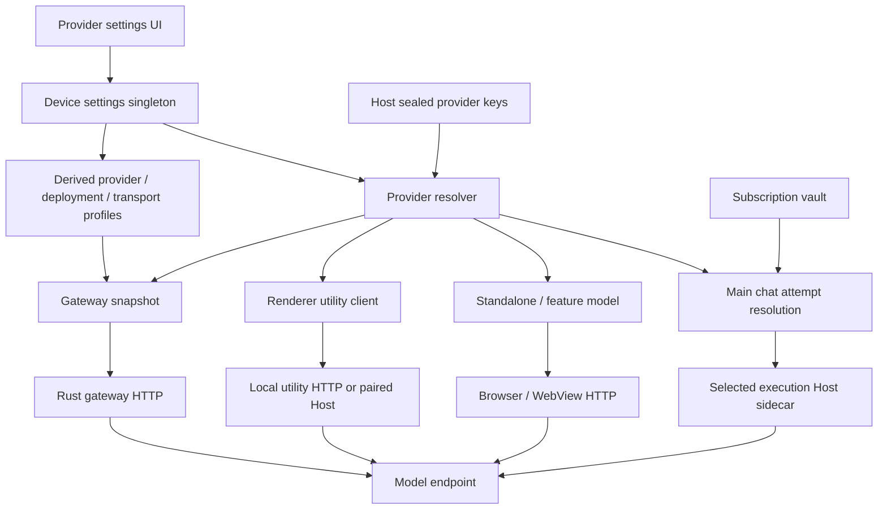

# Evidence ledger: Provider configuration, storage, and execution modes

- Status: verifying
- Lane: deep
- Created: 2026-11-14
- Updated: 2026-11-14
- Related: ADR-0043, ADR-0076, ADR-0090, ADR-0104, ADR-0163

## 审计结论（中文）

当前实现确实存在配置、存储与执行不一致的问题。本次整理了 **15 组缺陷与模式边界，其中 4 组应优先按 P1 处理**。设置界面、连接测试、聊天、辅助模型调用和 Gateway 没有始终使用同一份有效配置；因此会出现“保存了却没带上”“测试通过却无法聊天”“聊天能用但标题或工作流失败”等可解释的现象。

必须分清三个独立维度：**模型服务在哪里、请求由哪个 Host 发起、配置和凭证属于哪个设备/账户/target**。`ollama` 只是 provider ID，不能说明 `localhost` 指的是本机、手机还是远程 Host。

| 编号 | 优先级   | 发现及影响                                                                                                                        | 证据范围                                                                          |
| ---- | -------- | --------------------------------------------------------------------------------------------------------------------------------- | --------------------------------------------------------------------------------- |
| F1   | P1       | 默认排除 API keys 的导出仍保留 OAuth/AWS/OpenRouter 等凭证；包含明文 key 的 `verificationFingerprint` 还能绕过全局脱敏。          | 实际导出函数、synthetic 下载和配置导出复现；完整备份共用脱敏函数为源码链证据。    |
| F2   | P1       | 主 provider key 和 fingerprint 写入普通 Dexie settings；该表被标为 `metadata-only`，账户内容加密 middleware 不保护它。            | 隔离 save/raw IndexedDB 读回，加实际 policy/middleware 分派；未读取真实用户库。   |
| F3   | P1       | 无 key 的本地模型进入 SDK 后仍要求 OpenAI key；如果进程有 `OPENAI_API_KEY`，会被带给本地引擎。                                    | 实际 resolver → sidecar adapter → 已安装 SDK；请求截获后终止。                    |
| F4   | P1       | 衍生 Profile 的协议字段与主设置不一致；Gateway 用衍生 transport 覆盖正确认证，Google/custom Anthropic 可能变成 Bearer。           | 实际衍生与 snapshot merge 复现，Rust 消费链确认；未发实网请求。                   |
| F5   | P2       | 新建 custom provider 时丢弃 dialog 提交的 `customHeaders` 和 experimental SDK 开关；重新编辑却能保留。                            | 实际 create 函数的 upsert 边界复现。                                              |
| F6   | P2       | 本地地址留空会自动补 `/v1`，手填同一个引擎根地址却不会；管理接口成功与推理地址正确不是一回事。                                    | 实际 SDK 请求路径对照。                                                           |
| F7   | P2       | custom dialog 宣称 key 可选，也允许保存；后续启用/测试/runtime guard 却无条件要求 key。                                           | 实际 guards，加 dialog 保存条件确认。                                             |
| F8   | P2       | 辅助模型调用丢 headers/provider identity，Anthropic relay 路径不补 `/v1`；keyless、仅 key pool 的配置与聊天/Gateway 行为不同。    | 实际 utility/feature SDK 请求对照；影响标题、label、goal、部分工作流等调用链。    |
| F9   | P2       | 部分内置测试忽略保存的 endpoint/headers/protocol；配置 Google gateway 仍测试官方地址；Anthropic-wire HTTP 400 可被标为 verified。 | 实际 probe 请求和返回值复现。paired Host 测试是另一条路径。                       |
| F10  | P2       | fingerprint 漏掉 `apiFlavor`、Bedrock region/IAM 等；local 专用面板又不保存 fingerprint，改配置后可能仍显示 verified。            | 指纹/状态复现；旧请求覆盖新配置的竞态为源码证据，未做时序 UI 复现。               |
| F11  | 模式边界 | 本地引擎面板探测客户端/桌面本机，聊天可能由配对或远程 Host 执行；同一 loopback URL 指向不同机器。                                 | 已确认调用来源分裂；未将全部差异判定为路由 bug。                                  |
| F12  | P2       | 通用 local discovery 丢 key/headers；旧模型列表仅凭有时间戳就标 fresh，没有账户/endpoint 绑定和过期判断。                         | 带认证成功与 wrapper 401 对照；极旧时间戳仍 fresh。local 专用面板有正常认证路径。 |
| F13  | P2       | 全局配置导出包含 provider maps，导入却静默过滤；provider 专用导入又丢 headers/flavor/inferenceDefaults，overwrite 可保留旧值。    | 实际导出、校验、导入函数复现。已排除“该全局导入删除目标 key”的错误假设。          |
| F14  | P2       | Profile 衍生 hash 为全局 memo，切换账户/target 数据库后，相同配置可能不再生成新库的 profiles。                                    | 实际 sync 模块与两个隔离 store 复现；未做真实账户切换验收。                       |
| F15  | P2       | Headless external-agent catalog 过滤掉 Google/Gemini，虽然 Gateway/task lease 的可执行协议已包括它们。                            | 实际 catalog 函数对照，加生产调用链确认。                                         |

当前主存储路径是 `Provider UI → useSettingsStore → saveSettings → 当前账户/target 的 Dexie settings singleton`；subscription vault、Host sealed keys、external agent 自己的登录是另外几套凭证来源。**已有 Vault/keyring 不代表主 provider settings 已完成 secret externalization。** ADR-0215 本身仍将 BYOK 移出明文 settings 列为迁移要求。

| 组合                           | 主要行为与问题                                                                                         |
| ------------------------------ | ------------------------------------------------------------------------------------------------------ |
| Desktop + 本机 Host + 云端模型 | 主聊天由本机 sidecar 调用；测试、utility、Gateway 仍有配置投影差异。                                   |
| Desktop + 本机 Host + 本地引擎 | 管理经本机 native proxy；推理受 F3/F6 影响。                                                           |
| Desktop + remote Host          | 主聊天可随执行 Host 路由，但 native HTTP 管理及 Tauri utility 仍留本机；需要明确界面操作对象。         |
| Browser/mobile standalone      | 本设备直接推理；CORS、WebView streaming 与 buffered management 的约束不同。                            |
| Browser/mobile paired          | 主聊天在 Host；本地引擎面板仍可探测客户端。客户端 BYOK 每次转发与 Host sealed key 是不同模式。         |
| Headless + external agent      | 使用 Host profile/gateway/task lease；catalog 与协议能力存在差异。agent 自己登录时则由其独立配置决定。 |

provider 配置被 companion settings taxonomy 排除自动镜像，是当前的明确设计；不能把“配对之后没有自动同步 key”一概当成丢失。remote external-task lease 拒绝 loopback/private HTTP 也有明确策略。尚未复现的 local sealed-key overlay 跨 remote target 候选仅列为待查安全边界，没有宣称发生了凭证泄露。

建议顺序是：**先处理凭证存储/导出/ambient key，再统一有效配置和 Profile 适配，然后明确设备与 Host 的配置作用域，最后补验证、discovery、导入导出的身份绑定与回归测试。** 本次只研究并新增证据材料，未修改产品逻辑。

验证结果：**33 项 synthetic 检查复现了预期的当前行为（含正常对照和重叠检查）；现有 Jest 9 suites / 332 tests 全通过**，hook suite 有 React `act(...)` warnings。证据文件格式与 ledger 校验通过。没有执行真实 provider、打包 Tauri、手机、远程 Host、完整备份或线上故障率验证；这些限制在各项证据中分别标明。以下保留英文证据账本、逐项调用链与重跑命令。

## Original request

> 研究一下现在的模型提供商的相关的功能实现是否存在缺口，现在感觉很奇怪啊，感觉配置和存储之类的都有很大的问题，还有本地、远程 各种模式之类的组合，都分析一下

## Knowledge

| ID  | Statement                                                                                                                  | State    | Basis                                                                                                                                                                    | Depends on |
| --- | -------------------------------------------------------------------------------------------------------------------------- | -------- | ------------------------------------------------------------------------------------------------------------------------------------------------------------------------ | ---------- |
| O1  | The user reports confusing provider configuration, storage, and mode combinations.                                         | Observed | User request, 2026-11-14; no specific production incident supplied.                                                                                                      | -          |
| H1  | Configuration persistence and transfer lose or expose fields.                                                              | Verified | Synthetic export/import/save/middleware probes; F1/F2/F5/F13, 2026-11-14. This is not a claim that every shell loses settings.                                           | O1         |
| H2  | Different execution paths resolve a different endpoint, credential, protocol or transport from the same settings.          | Verified | Actual SDK request capture and profile projection probes; F3/F4/F6/F8/F9, 2026-11-14.                                                                                    | O1         |
| H3  | Some differences are intentional device-local configuration and execution ownership boundaries.                            | Verified | Settings sync taxonomy, Host management channel, Tauri utility predicate and remote-task policy, source inspection 2026-11-14. UI comprehensibility was not user-tested. | O1         |
| G1  | Produce an implementation-grounded gap assessment across configuration, storage, execution, and local/remote combinations. | Agreed   | User request, 2026-11-14.                                                                                                                                                | -          |
| C1  | Research only: preserve concurrent work and real user settings; do not run billable provider probes or change credentials. | Verified | Task scope and initial git status, 2026-11-14.                                                                                                                           | -          |

## Problem frame

Determine which provider behaviors are implemented end to end, which differ by endpoint/Host/storage locality, and which have concrete reproducible gaps (G1). Configuration/storage failures (H1), resolution divergence (H2), and intentional device-local ownership (H3) are competing explanations. Success is a source-linked mode matrix and prioritized findings with reproducible synthetic checks; product fixes and production acceptance are outside this audit (C1).

## Complexity profile

| Dimension    | Rating | Why / what would resolve it                                                                                                  |
| ------------ | ------ | ---------------------------------------------------------------------------------------------------------------------------- |
| scale        | high   | Settings UI/store, provider packages, vault, sync, built-in/external agent dispatch, gateway, browser/Tauri/mobile/headless. |
| technical    | medium | Existing implementations can be traced; no new technology is proposed.                                                       |
| coupling     | high   | Provider identity, endpoint protocol, per-device credentials, Host selection and cross-shell transports interact.            |
| requirement  | low    | Research and assess gaps; no implementation requested.                                                                       |
| verification | high   | Synthetic checks can show contract defects; real provider/device/remote Host acceptance requires separate environments.      |
| risk         | high   | Credential exposure or loss and requests sent through an unintended endpoint/Host.                                           |

## Risks

| ID  | Risk (impact)                                                                 | Severity | Source                                        | Claim                                                                                                         | Refuted by                                                                                                                           |
| --- | ----------------------------------------------------------------------------- | -------- | --------------------------------------------- | ------------------------------------------------------------------------------------------------------------- | ------------------------------------------------------------------------------------------------------------------------------------ |
| R1  | Secrets escape safe persistence/export or destination credentials are lost.   | high     | Storage and sync boundaries                   | Public metadata and default exports exclude all secrets; transfer preserves intended credentials.             | A synthetic secret appears in a default export/public setting, or a non-secret transfer clears a destination key.                    |
| R2  | Test, discovery and inference use different configuration or network origins. | high     | ADR-0043, ADR-0076, Host transport boundaries | The same configured provider has consistent effective endpoint/auth/protocol and explicit execution locality. | Equivalent configuration produces different request URLs/headers/protocols or probes another machine's loopback.                     |
| R3  | Readiness/capability claims exceed implemented behavior.                      | medium   | ADR-0104, ADR-0163                            | Status invalidates with effective configuration changes and advertised operations reach real implementations. | A changed effective transport remains verified, or an advertised operation drops necessary fields/fails before reaching its handler. |

## Verification obligations

| ID  | Risk       | Method                                                                       | Independence   | Evidence                                                                                                                                                                                    | Coverage                                                                                  | Status |
| --- | ---------- | ---------------------------------------------------------------------------- | -------------- | ------------------------------------------------------------------------------------------------------------------------------------------------------------------------------------------- | ----------------------------------------------------------------------------------------- | ------ |
| V1  | R1         | Trace persistence/export/sync and run synthetic secret/merge probes.         | tool           | Storage probe script: 10 checks reproduced, including actual middleware dispatch, raw isolated IDB readback and export/import.                                                              | Synthetic values; injected integration seams; no real vault or full backup inspection.    | passed |
| V2  | R2         | Trace shell/Host/provider combinations and capture isolated mocked requests. | tool           | Routing probe script: 12 checks reproduced through actual resolver, sidecar adapter and installed SDK serialization; core script also captures test requests and gateway merge.             | Request origins for native/remote modes are source-traced; HTTP never reaches a provider. | passed |
| V3  | R3         | Test readiness fingerprints and advertised local-management operations.      | tool           | Core probe script: 11 checks reproduced, including stale verification, auth-dropping discovery, old discovery freshness and projection mismatch; existing Jest 9 suites / 332 tests passed. | Actual pure/service functions; no timed UI/native management acceptance.                  | passed |
| V4  | R1, R2, R3 | Fresh-context adversarial review of artifact and contract.                   | fresh-reviewer | Independent reviewer confirmed seven source issues and supplied alias, paired-test and native-proxy counterexamples; reconciled in F4/F5/F9/F10/F12/F13.                                    | Same-model source review; no external cross-model CLI.                                    | passed |

## Decisions

| ID  | Date       | Decision                                                                                                              | Action   | Based on           | Reversal trigger                                                             |
| --- | ---------- | --------------------------------------------------------------------------------------------------------------------- | -------- | ------------------ | ---------------------------------------------------------------------------- |
| D1  | 2026-11-14 | Audit current working-tree implementation and isolate synthetic reproductions.                                        | diagnose | O1, G1, C1         | User supplies a concrete incident or requests fixes.                         |
| D2  | 2026-11-14 | Deliver the gap assessment with separate source/reproduction limits; retain product defects as open remediation work. | stop     | G1, C1, H1, H2, H3 | Implementation authorization or new runtime evidence changes prioritization. |

## Residual risks

| ID  | Residual                                                                                           | From       | Why still open                                                                            | Next action                                                                                      | Status |
| --- | -------------------------------------------------------------------------------------------------- | ---------- | ----------------------------------------------------------------------------------------- | ------------------------------------------------------------------------------------------------ | ------ |
| X1  | Product defects documented in F1-F15 remain in the implementation.                                 | R1, R2, R3 | This request authorizes research, not product fixes.                                      | Contain F1-F4 first in a separately scoped repair change with behavioral regressions.            | open   |
| X2  | Real browser/Tauri/mobile/provider/paired-Host behavior and failure frequency are not established. | V1, V2, V3 | Synthetic evidence proves bounded functions and serialization, not deployment acceptance. | Execute the mode acceptance matrix when environments and implementation scope are selected.      | open   |
| X3  | A local sealed-key overlay may outlive remote-target activation.                                   | R1, R2     | Source candidate lacks a complete remote dispatch reproduction.                           | Inspect target-bound credential ownership and test remote dispatch before classifying as a leak. | open   |

## Outcome

| ID  | Signal                                                                                    | How / when measured                                                    | Result                                                                                  | Status |
| --- | ----------------------------------------------------------------------------------------- | ---------------------------------------------------------------------- | --------------------------------------------------------------------------------------- | ------ |
| M1  | Provide a source-linked mode/ownership map and prioritized gaps with reproducible checks. | Assessment below, three evidence scripts and fresh review, 2026-11-14. | Research artifact delivered; product remediation and production acceptance remain open. | met    |

## Assessment

The implementation has substantial provider functionality, but configuration semantics diverge across storage, tests, the main chat, utilities, the gateway and external runtimes. The most consequential observed gaps are secret-bearing exports, cleartext provider settings, keyless inference falling through to OpenAI environment credentials, and derived transport profiles changing gateway authentication.

This is an audit of the **current working tree**, including pre-existing concurrent edits, on 2026-11-14 (Asia/Shanghai). It is not a release or production acceptance result. No product code, real credentials, user database, provider account or Host configuration was changed. A separate ledger is necessary because existing provider evidence documents cover quick setup and branding rather than storage and execution-mode correctness.

### The three meanings of local and remote

Three independent axes are currently presented through overlapping provider controls:

1. **Model endpoint:** an engine on loopback, a LAN engine, a self-hosted gateway or a public provider.
2. **Execution authority:** this browser/WebView, this desktop's sidecar, a paired desktop/headless Host or an external agent's own runtime.
3. **Credential/configuration ownership:** this device's settings database, a subscription vault, this Host's sealed credential store or the external agent's own login.

`localhost` always belongs to the process that performs the HTTP request. A provider named `ollama` does not identify that machine. A remote model endpoint does not imply a remote execution Host. Pairing a Host does not automatically copy all provider settings there.



The divergence is at the arrows: each rail projects, validates or normalizes a somewhat different set of fields.

### Current storage and ownership map

| Store / representation                         | What it owns                                                                                          | Important current boundary                                                                                                                                          |
| ---------------------------------------------- | ----------------------------------------------------------------------------------------------------- | ------------------------------------------------------------------------------------------------------------------------------------------------------------------- |
| `AppSettings.apiKey/apiBaseUrl`                | Legacy Anthropic/default environment settings                                                         | Coexists with the provider-specific map and sidecar environment synchronization.                                                                                    |
| `AppSettings.providerSettings/customProviders` | Main provider endpoints, keys/pools, protocol/flavor, headers, parameters, discovery and verification | Written into the local Dexie `settings` singleton. Ordinary settings mirroring excludes these fields.                                                               |
| Active account/runtime database                | Database namespace for settings and other app rows                                                    | `activateAccountDatabase(accountId,targetId)` selects a different database; switching targets is not a global provider-config transfer.                             |
| Subscription vault                             | Provider account login and subscription-derived credentials                                           | Main-chat attempt resolution can obtain credentials here. Its existence does not externalize manually entered provider keys from `settings`.                        |
| Host sealed provider-key store                 | API key sealed on a particular Host, indexed by provider ID                                           | Explicit Host management channel; clients follow provider IDs, while the value is loaded in the owning Host. This is separate from editing local provider settings. |
| Provider/Deployment/Transport Profile Store    | Derived profile identity, endpoint, models, transport and credential references                       | A projection of legacy settings, not a second authoritative editor; current field translation and memoization have defects below.                                   |
| External agent configuration/login             | Runtime-specific models, environment and authentication                                               | Selecting a Cognia provider and signing an external agent in are separate operations; Cognia gateway mode is an explicit integration rail.                          |
| Model discovery cache                          | Provider model IDs, metadata and fetch timestamp                                                      | Legacy UI discovery is provider-row scoped; operation snapshots have a separate deployment/account-scoped contract. They must not be treated as equivalent caches.  |

Sources: `stores/settings/settings-store.ts:487,836,1633`; `lib/db/settings.ts:572`; `lib/db/schema.ts:2470`; `packages/agent-config-types/src/settings-sync.ts:345,364`; `lib/claude/provider-attempt-options.ts:487`; `lib/remote-host/host-secrets.ts:124`; `lib/host-secrets/provider-key-store.ts:31`; `lib/settings/provider-profile-sync.ts:75`.

### Execution-mode matrix

| Shell and mode                                        | Main inference originates from                                      | Provider-management / utility origin                                                                     | Consequence or limitation                                                                                                                                                                  |
| ----------------------------------------------------- | ------------------------------------------------------------------- | -------------------------------------------------------------------------------------------------------- | ------------------------------------------------------------------------------------------------------------------------------------------------------------------------------------------ |
| Desktop, local Host, cloud provider                   | Desktop sidecar, except explicit gateway/external integration rails | Local native HTTP proxy for management; renderer utility rail for utilities                              | Most direct configuration cases exist, but tests, utilities and gateway projection can differ from chat.                                                                                   |
| Desktop, local Host, local engine                     | Desktop sidecar using the resolved local endpoint                   | Local native proxy probes the engine                                                                     | Keyless SDK and explicit root-URL defects can break inference even when management succeeds.                                                                                               |
| Desktop driving a remote Host                         | Selected execution Host for routed chat commands                    | `proxyFetch` still directly invokes this desktop's native proxy; Tauri utility routing remains local     | A loopback URL can refer to two different machines. This split exists in code; whether every surface should follow the Host requires a product contract, not an assumption.                |
| Browser standalone                                    | Browser SDK/fetch                                                   | Browser fetch                                                                                            | Endpoint CORS and browser network policy apply. There is no runtime Next server acting as a generic provider proxy.                                                                        |
| Mobile standalone BYOK                                | Device WebView streaming fetch                                      | Management may use Capacitor-patched global fetch                                                        | Streaming and buffered management have different transport constraints. `localhost` is the phone; arbitrary custom/local CORS support is not established by a successful management probe. |
| Browser/mobile paired, client BYOK                    | Paired Host sidecar with per-turn credentials                       | Generic provider test can use Host utility; specialized local dashboard and discovery remain client-side | The local engine dashboard can inspect a different machine or network than the chat. Editing a local key does not persist it in the Host provider store.                                   |
| Browser/mobile paired, Host-keyed provider            | Host fills a sealed key when authorized                             | The client can know key availability without receiving the key                                           | Main chat has a Host-keyed path; renderer utilities still demand a local resolved key before choosing their Host branch.                                                                   |
| Headless Host with external agent using Cognia models | Host Rust gateway and task lease                                    | Host profile-based catalog                                                                               | Native Gemini execution support and the headless catalog's filtering disagree.                                                                                                             |
| External agent using its own provider/login           | Agent's runtime and own config                                      | Agent-specific auth/status                                                                               | This is a separate source of truth; provider UI readiness alone does not certify its login or model plan.                                                                                  |

Sources: `lib/runtime/standalone-mode.ts:37`; `lib/runtime/streaming-fetch.ts:28`; `lib/network/proxy-fetch.ts:262`; `lib/ai/host-llm-client.ts:20`; `lib/ai/renderer-llm-client.ts:125,151`; `components/settings/provider/local-provider-settings.tsx:90`; `hooks/provider/use-local-provider.ts:144`; `lib/tauri/transport-routing.ts:159`; `lib/claude/provider-attempt-options.ts:473`.

The browser/mobile mode constraints above are implementation boundaries, not claims that every public provider currently permits browser-origin traffic. No live CORS or device test was performed.

### Findings, ordered by remediation priority

**Evidence levels:** “reproduced” below means actual source functions or SDK serialization were exercised with synthetic inputs and injected I/O. “Source path” means the caller/consumer was traced without operating a real device or service. A passing audit probe asserts the presence of a gap or a normal control; it does not indicate a fix.

#### F1 — P1: Default provider exports retain credentials

The provider JSON export with `includeApiKeys=false` deletes only selected top-level key fields. It still exports OAuth refresh tokens, Bedrock secrets/session tokens, OpenRouter provisioning keys and BYOK config, CLIProxyAPI management keys and `verificationFingerprint`. The latter contains serialized raw keys.

The broader settings-profile scrubber is recursive, but uses field-name heuristics and only parses strings ending in `Json`. It removes ordinary `apiKey`/AWS secret fields while retaining opaque fingerprint strings, BYOK `config` JSON and `managementKey`. Full-backup builders reuse this scrubber; that shared call path is source evidence, while the probe executed provider/settings-profile exports, not an entire backup.

- Source: `components/settings/provider/provider-import-export.tsx:311`; `packages/provider-core/src/providers/completeness.ts:221`; `hooks/settings/use-provider-settings.ts:513`; `lib/settings/profile-transfer.ts:47,75`; `lib/data/build-package.ts:223`; `lib/data/build-stream.ts:108`.
- Reproduced: storage probes `provider-export-default-leaks-secondary-credentials`, `profile-and-backup-scrubber-leaks-opaque-credentials`.
- Effect: a user can share a file believing API keys were excluded while still exposing usable credential material. The default export boundary needs an explicit credential schema rather than a partial denylist.

#### F2 — P1: Main provider secrets remain in cleartext settings

Manual provider keys and their duplicate inside `verificationFingerprint` are written into the ordinary settings row. The encryption middleware protects only tables classified `encrypted-content`; `settings` is classified `metadata-only`. Account-specific database names and the existence of a Browser Vault/keyring do not change that policy.

- Source: `lib/db/settings.ts:603,631`; `lib/db/encrypted-content-middleware.ts:31`; `lib/data-governance/content-protection-baseline.json:308`; `packages/provider-core/src/providers/completeness.ts:221`.
- Reproduced: actual `saveSettings` AST with a synthetic Dexie/fake-indexeddb database, followed by raw IndexedDB readback. Integration dependencies were injected; no real user database or OS storage was inspected. The middleware bypass was independently confirmed in source.
- Additional control: the actual content-protection catalog and middleware dispatch were exercised; `settings` returns the original table without requesting a cipher. ADR-0215 section 7 (`docs/content/docs/en/adr/0215-one-person-one-encrypted-sync-space-many-writable-hosts.md:101`) explicitly calls for moving BYOK keys out of the plaintext settings row; this is unfinished migration, not an established accepted residual.
- Effect: these credentials do not receive the app's account-content encryption or a credential-reference boundary. This is an app-storage claim, not a claim that macOS full-disk encryption is disabled or that a remote attacker has read them.

#### F3 — P1: Keyless local inference requires or inherits an OpenAI key

The resolver explicitly allows keyless Ollama and supplies its `/v1` endpoint. Main-chat attempt resolution passes `apiKey: undefined` to the actual sidecar adapter, which gives it to `createOpenAI`. The installed SDK then reads `OPENAI_API_KEY` or throws before HTTP.

- Source: `lib/ai/provider-consumption.ts:371`; `lib/claude/provider-attempt-options.ts:442`; `sidecar/src/providers/protocol-adapters/ai-sdk-adapter.ts:490`; installed `@ai-sdk/openai/src/openai-provider.ts`.
- Reproduced: no ambient key produces `OpenAI API key is missing. Pass it using the 'apiKey' parameter or the OPENAI_API_KEY environment variable.` No fetch occurs. A synthetic ambient key is serialized into `Authorization` for `http://localhost:11434/v1/chat/completions`.
- Effect: a keyless engine can fail despite a healthy status check, or receive an unrelated ambient credential. Explicit non-secret placeholder keys reach serialization as a normal control. Rust gateway execution is a separate path; this does not establish that every local-engine mode fails.

#### F4 — P1: Derived profile transport can change gateway authentication

`deriveProfiles` reads built-in protocol from the catalog rather than `apiProtocol`, reads custom protocol from `row.protocol` while settings use `apiProtocol`, and maps all non-Anthropic transport authentication to bearer. `loadSnapshotProfileMeta` projects that transport, and `buildGatewaySnapshot` replaces the otherwise-correct provider transport with it. Rust respects the explicit auth scheme.

For Google, the correct `x-goog-api-key` transport becomes bearer after the profile overlay. For an Anthropic custom provider, the resolver can still say `anthropic` while the derived transport says bearer. Thus “the protocol remains correct” does not negate the authentication defect.

The projection also reads `models/name` aliases. Initial creation mirrors these aliases, so initial model loss is not universal. Later dialog edits update `customModels/customName` without synchronizing the old aliases, allowing the profile view to retain old names/model lists.

- Source: `packages/provider-types/src/profile-migration.ts:79,202,236`; `lib/settings/provider-profile-sync.ts:78`; `lib/gateway/snapshot-publisher.ts:429,537`; `crates/cognia-gateway/src/execute.rs:631`; `crates/cognia-gateway/src/server/gemini.rs:294`; `stores/settings/settings-store.ts:1732,1737,1753`.
- Reproduced: actual derivation plus actual gateway merge function with unrelated routing dependencies injected. Correct Google transport changes from custom `x-goog-api-key` to bearer. Synthetic edited aliases reproduce stale projected model data.
- Limit: no live Google/Anthropic gateway request was made. The emitted auth scheme and its Rust consumer are confirmed.

#### F5 — P2: Initial custom-provider creation drops submitted transport fields

The dialog submits `customHeaders` and `experimentalAgentSdk`; `addCustomProvider` reconstructs a narrower row and omits both. Updating an existing provider spreads the patch and preserves them, creating a first-save-versus-edit discrepancy.

- Source: `components/settings/provider/custom-provider-dialog.tsx:279`; `stores/settings/settings-store.ts:1718,1746`; runtime header read at `lib/ai/provider-consumption.ts:347`.
- Reproduced: actual `addCustomProvider` function with a captured upsert boundary.
- Effect: a newly created gateway needing a tenant or other static transport header loses that configuration immediately. Reopening and editing follows different behavior.

#### F6 — P2: Explicit local root URLs and default URLs mean different things

Only an absent local `baseURL` is converted to the OpenAI-compatible `/v1` endpoint. A user-entered engine root passes through unchanged. Management separately strips `/v1` before adding its own endpoints.

- Source: `lib/ai/provider-consumption.ts:376`; `packages/provider-core/src/providers/local-providers.ts:185`; `packages/provider-core/src/providers/local-provider-service.ts:284`.
- Reproduced: the same adapter emits `/chat/completions` for explicit `http://engine:11434`, but `/v1/chat/completions` for the implicit Ollama default. A placeholder key isolates URL behavior from F3.
- Effect: pasting the URL that succeeds in management can make inference address a different path. Already `/v1`-suffixed configurations are a normal control.

#### F7 — P2: A keyless custom endpoint is allowed by the dialog but blocked by guards

The custom dialog labels the key optional and its Save predicate does not require one. `evaluateCustomProviderCompleteness` requires one for enable, test and runtime, even for an HTTP loopback endpoint.

- Source: `components/settings/provider/custom-provider-dialog.tsx:334,471`; `packages/provider-core/src/providers/completeness.ts:486`; `packages/provider-core/src/providers/readiness.ts:164`.
- Reproduced: actual completeness guards return `missing_credential`; a built-in keyless Ollama configuration has an allowed guard as a control.
- Effect: the same unauthenticated local server is treated differently depending on whether it uses a built-in ID or a custom row. This guard defect is separate from the SDK defect in F3.

#### F8 — P2: Utility clients interpret the same provider differently from chat

`buildRendererLlmClient` and `llmConfigOf` are not behaviorally equivalent to the main feature-model client:

- A missing single `apiKey` returns `null` before Host routing, including keyless local and Host-key-only configurations.
- `headers` are dropped on the local utility rail. A synthetic tenant header reaches feature chat but not the utility request.
- The original provider ID is replaced with protocol identity. CommandCode Claude consequently serializes OpenAI `/chat/completions` while the feature model serializes Anthropic `/messages` with `x-api-key`.
- Anthropic relay roots omit the shared `/v1` normalization: `/coding/messages` versus the feature client's `/coding/v1/messages`.
- A provider configured only with `apiKeys` can work through the gateway's pool fallback while direct feature construction still has no key and the utility returns `null`.

Sources: `lib/ai/renderer-llm-client.ts:125,151,178`; `lib/twin/distill/llm.ts:251`; `lib/gateway/snapshot-publisher.ts:220`; `lib/claude/provider-attempt-options.ts:487`.

All listed serialization/null differences were reproduced using actual source clients. Utility callers include title/label generation, goal judging, plan/workflow helpers and evaluation; this establishes exposure through those call sites, not failure frequency for every feature. Paired non-Tauri utility calls preserve the full resolution after passing the early guards, so the header projection defect is specifically on the local utility rail.

#### F9 — P2: Connection tests do not consistently test the effective transport

The built-in test dispatch has provider-ID special cases that ignore configurable fields. Google/DeepSeek/Groq/Mistral use fixed public endpoints; the OpenAI special case ignores custom headers and a supplied protocol override. The generic settings hook does not forward the configured protocol/flavor/model to that built-in test API. The custom-provider dialog's shared test hook also has no header/flavor argument despite editing these fields.

The Anthropic-wire custom probe treats every HTTP 400 as success; the authoritative wrapper upgrades it to `verified`, without establishing that the selected model/request is usable.

- Source: `packages/provider-core/src/providers/api-test.ts:194,260,295,332,369,141,664`; `hooks/settings/use-provider-settings.ts:489`; `hooks/settings/use-connection-test.ts:50`; `components/settings/provider/custom-provider-dialog.tsx:237`.
- Reproduced: configured Google gateway is ignored and a public Google URL is captured; configured OpenAI/Anthropic override still probes GET `/models` without tenant headers; injected HTTP 400 becomes authoritative `verified`.
- Caveat: paired Host generic tests use a separate real model-turn path; this is not a claim that all tests use only `/models`. A successful models-list request also cannot certify model entitlement or Responses support.

#### F10 — P2: Verification can remain valid after effective configuration changes

The fingerprint includes raw keys but omits `apiFlavor` and nested Bedrock connection identity (region, IAM credentials, profile/role, nested endpoint). The same fingerprint is used both for displayed freshness and the asynchronous test-result commit guard.

The specialized local settings test writes `verificationStatus: verified` without a fingerprint. Completeness accepts a verified row with no fingerprint, so later endpoint changes cannot trigger its mismatch check. That specialized path also lacks the generic hook's runtime-target/configuration guard; a late request can write discovery or status after configuration changes (source-level race, not timed UI reproduction).

- Source: `packages/provider-core/src/providers/completeness.ts:221,256`; `hooks/settings/use-provider-settings.ts:443`; `components/settings/provider/local-provider-settings.tsx:118,154,163`.
- Reproduced: Chat-to-Responses and IAM-region/credential changes produce identical fingerprints; a changed local endpoint without a persisted fingerprint remains verified. A changed generic endpoint with a fingerprint correctly becomes stale as a positive control.
- Effect: “verified” does not reliably mean the currently selected account, endpoint family or engine was tested.

#### F11 — Mode gap: Local engine management and chat can operate on different machines

The specialized local settings/model-management components always use `LocalProviderService` and provider-core `proxyFetch`. In Tauri this directly invokes the current desktop's native HTTP command; in a browser it uses browser fetch. It does not route local-engine management through the selected execution Host. Generic paired provider verification can meanwhile use `testHostProviderConnection`, and chat can execute on that Host.

- Source: `components/settings/provider/local-provider-settings.tsx:90,118`; `hooks/provider/use-local-provider.ts:144`; `lib/ai/provider-core-runtime-deps.ts:42`; `lib/network/proxy-fetch.ts:262`; `lib/ai/host-llm-client.ts:20`; `hooks/settings/use-provider-settings.ts:461`.
- Source-path conclusion: the same loopback URL can be probed on the client while inference uses the Host's loopback. Desktop remote utilities also deliberately remain local under the current predicate/tests.
- Classification: confirmed origin split, **not yet a blanket routing-bug verdict**. The product must specify which controls manage this device versus the selected Host, expose that scope, and offer the needed Host operation explicitly. Native/mobile/remote operation was not driven in this audit.

#### F12 — P2: Discovery drops authentication and freshness/account scope

`discoverLocalProviderModels(providerId,baseURL)` constructs the service with only a URL. The generic/batch settings verification path first passes key/headers to its probe, then calls this wrapper without them. The specialized local dashboard correctly passes service options, so that working path is counterevidence to a global “local auth unsupported” claim.

Legacy discovery freshness is also `fresh` for any truthy fetch timestamp, with no expiry. Its cache shape has no account/endpoint identity; provider-row mutation retains the discovered array unless a later discovery replaces it. The UI merge can therefore keep old-account/old-endpoint models and label them fresh. Separate operation snapshots have account/deployment-aware semantics, which do not repair this legacy UI path automatically.

- Source: `packages/provider-core/src/providers/model-discovery.ts:35,130,387`; `hooks/settings/use-provider-settings.ts:497`; `components/settings/provider/local-provider-settings.tsx:90`; `stores/settings/settings-store.ts:1633`; ADR-0163 section 10.
- Reproduced: authenticated service list succeeds, the wrapper's list gets 401; a discovery timestamp of `1` is still labelled `fresh`.
- Effect: successful tests can be followed by failed discovery, and changing configuration can leave a convincing but unrelated model list. Capability defaults inferred from bare model lists are not a real engine capability probe.

#### F13 — P2: Configuration transfer does not round-trip consistently

The global settings-profile exporter includes provider maps, while its importer accepts only `Object.keys(DEFAULTS)`. The actual defaults omit `providerSettings` and `customProviders`; these fields are silently dropped on import.

- Source: `lib/settings/profile-transfer.ts:133,174`; `lib/db/settings.ts:52`.
- Reproduced: actual export/import with actual default-key membership. This does **not** delete destination keys through a shallow merge: provider fields are rejected before saving. That initial hypothesis was explicitly withdrawn after replacing an inaccurate mock with actual defaults.
- Effect: importing the exported profile cannot restore those provider configurations. F1 still applies to their presence in the exported file.

Provider-only JSON transfer is a different schema and was tested separately. The actual export (with API keys included), validator and import handler reproduce a second gap: custom import restores basic connection/model fields but omits `customHeaders`, `apiFlavor` and `inferenceDefaults` (`provider-import-export.tsx:556,588,603`). New imports lose these fields; overwriting an existing row preserves stale destination values through its patch merge. The probe captures mutation boundaries and uses the store-equivalent spread for the existing-row control; it does not drive the UI.

#### F14 — P2: Profile-derivation memo is not database scoped

`lastDerivationHash` is one module-global value. Only the first call reads the current database; later calls compare against that memo even after account/runtime database selection changes. With identical settings, an empty second database is skipped rather than populated.

- Source: `lib/settings/provider-profile-sync.ts:39,86`; `lib/db/schema.ts:2470`; consumers at `lib/gateway/snapshot-publisher.ts:537` and deployment/profile views.
- Reproduced: actual sync module with deterministic derivation and two injected profile stores. This is not a full real account-switch/Dexie acceptance test.
- Effect: the projection can be absent after switching accounts/targets even when primary settings exist. The reset hook has no production call site in the inspected tree.

#### F15 — P2: Headless external-agent model listing excludes executable Gemini

The headless catalog admits only OpenAI/Anthropic profiles, while Rust gateway execution and task-lease admission include `google`/`gemini`. Desktop model listing already has a Gemini-compatible path.

- Source: `lib/ai/agent/external/config/cognia-model-options.ts:304`; production caller `host-config-service.ts:463`; `crates/cognia-gateway/src/execute.rs:459`; `crates/cognia-gateway/src/task_lease.rs:645`.
- Reproduced: equivalent enabled/credentialed profiles yield no Google/Gemini options and a nonempty OpenAI control.
- Effect: a model can be executable by the Host yet absent from the external-agent Cognia-model choice. This does not certify live Gemini gateway execution, which also intersects F4.

### Counterevidence and deliberately unpromoted candidates

- Provider settings are intentionally device-local in the companion settings taxonomy. The sync source also removes private fields before emission; this audit does not claim the ordinary sync channel copies all raw provider keys.
- Host sealed-key reads have ownership/scope checks. No arbitrary-member credential access was established.
- The remote external-task lease rejects loopback/private HTTP upstreams by policy (`lib/gateway/remote-task-lease.ts:90`). That explicit remote-sandbox boundary must not be confused with an accidental local-provider routing failure.
- Tauri utility calls staying local are encoded in the current predicate and tests. The origin mismatch is confirmed; changing that product contract needs an explicit decision.
- The local sealed-key overlay appears to survive desktop remote-Host activation and is applied by the general snapshot resolver. It might place a local sealed key in remotely sent credentials. A complete remote dispatch reproduction was not performed, so this remains a **security review candidate**, not a confirmed leak.
- Existing tests do not establish production correctness. Conversely, an isolated failure is not evidence of its production frequency or of every shell failing.

### Recommended repair sequence

1. **Contain credential exposure (F1/F2/F3):** define typed secret ownership, move provider secrets behind credential references, stop storing raw secrets in verification metadata, replace partial export stripping with a schema-aware projection, and make keyless adapters avoid ambient credential fallback. Review old export/backup artifacts only within a separately authorized remediation scope.
2. **Unify effective configuration (F4/F5/F6/F8/F9):** build one resolved execution descriptor carrying provider identity, credential source, normalized endpoint, protocol/flavor, headers and execution Host. Make chat, tests, utilities and gateway consume it. Correct the current profile adapter before treating derived profiles as authoritative transport input.
3. **Make scope visible (F7/F11/F14/F15):** distinguish this-device settings from selected-Host configuration; qualify engine loopback by Host; model keyless auth explicitly; scope projection caches by database/account/target; align desktop/headless catalog filters with executable protocols.
4. **Make verification and discovery identity-aware (F10/F12/F13):** opaque non-secret credential identities, full transport fingerprints, target-bound asynchronous results, account/endpoint-bound inventories with expiry, and round-trip fidelity tests for each transfer schema.

These are repair directions, not an approved implementation plan. A sweeping rewrite before the credential/export containment and behavioral regression tests would increase the verification burden.

### Reproduction and verification record

Run from the repository root:

```sh
node docs/evidence/2026-11-14-provider-configuration-mode-audit.probes.mjs
node docs/evidence/2026-11-14-provider-configuration-mode-audit.storage-probes.mjs
node docs/evidence/2026-11-14-provider-configuration-mode-audit.routing-probes.mjs
```

All scripts use synthetic values. Network calls terminate at injected fetch boundaries; storage probes use fake-indexeddb or injected stores. Bundles and detailed JSON results live under `.cache/provider-configuration-mode-audit/`. Source hashes identify the inspected implementation. AST extraction and injected seams are explicitly identified in the scripts/results and do not substitute for native integration.

Result: **33 synthetic audit checks reproduced their asserted current behavior** (core 11, storage 10, routing 12; includes overlapping checks and normal controls). This is not a count of 33 independent defects.

The focused existing Jest run used the repository entry point:

```sh
pnpm test --runInBand --runTestsByPath \
  packages/provider-core/src/providers/completeness.test.ts \
  packages/provider-core/src/providers/api-test.test.ts \
  packages/provider-core/src/providers/local-provider-service.test.ts \
  packages/provider-core/src/providers/model-discovery.test.ts \
  hooks/settings/use-provider-settings.test.ts \
  components/settings/provider/local-provider-settings.test.tsx \
  components/settings/provider/custom-provider-dialog.test.tsx \
  components/settings/provider/provider-import-export.test.tsx \
  lib/settings/profile-transfer.test.ts
```

Result: **9 suites, 332 tests passed**. The hook suite emitted existing React `act(...)` warnings. No coverage was requested or run. These tests contain mocks and assertions that do not cover the demonstrated cross-rail combinations.

No product source was changed, so a full app build/typecheck or full-repository lint would not validate a new implementation here. Evidence scripts receive syntax/format checks, and the report receives the ledger validator and scoped diff review. Real browser, packaged Tauri, physical mobile, real provider, remote Host, external subprocess and full backup acceptance remain unperformed. Cross-model external CLI review was not authorized or run; a fresh same-model reviewer inspected source and counterexamples independently.
