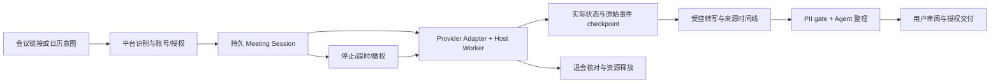

# Evidence ledger: Meeting participation gap audit

- Status: verifying
- Lane: deep
- Created: 2026-11-17
- Updated: 2026-11-18
- Related: ADR-0026, ADR-0070, ADR-0091, ADR-0198, ADR-0239, ADR-0242, ADR-0243, ADR-0246, ADR-0250; shared checkout on dev at 3fae43be64 when inspected

## Original request

> 我现在想实现类似飞书入会或者进入其他会议之类的功能，看看差什么功能，或者存在什么问题，并且对照业内的优秀实践

> Priority clarification: 两种都需要，先做 AI 参会

> Follow-up: 继续进行更多的研究

> Proposal request: 基于这些研究，整理一份完整的技术方案并落到仓库文档，优先飞书 AI 参会，再补本人入会和其他平台，把实现步骤、风险和验收标准写清楚。

## Assessment

**Cognia 当前具备身份、日历、Agent、调度、桌面控制和语音基础，但没有已接通的会议参会闭环。优先建议验证飞书官方应用机器人 + 会中事件路线，再补本人入会；其他平台分别按实际能力接入。** 这是一份审计和实施建议，本轮没有实现或修复产品功能。

本次区分三类能力：AI 作为可见参会者入会；替本人打开并进入会议；会后读取录制、逐字稿和纪要。日历 RSVP、打开链接、发 IM 消息、与 Cognia 语音聊天，均不能证明其中任一会议闭环已完成。平台提供内容流也不一定意味着存在可见参会者，例如 Zoom RTMS；产品须准确展示其模式。

检查范围为当前源码、实际本机 CLI help、离线函数探针、7 个相关 Jest suite 以及截至 **2026-11-17（Asia/Shanghai）** 的官方资料。仓库已有大量并发修改；本轮只新增本 ledger 和两个复现脚本，结果写入 `.cache/meeting-participation-audit-20261117/`。未进行真实入会、录音、发送、凭据变更或模型调用。

## Further research — 2026-11-18

User requested more research; this continues the same ledger rather than treating the first audit as a delivered implementation. Detailed findings are in [Feishu contracts and host design](../research/2026-11-18-feishu-meeting-contract-research.md) and [Zoom/Meet/Teams/Tencent access routes](../research/2026-11-18-meeting-provider-access-research.md).

- **Feishu content access is a bounded pull API.** Exact v1.0.98 source confirms page size and page-all cap; NDJSON is not a continuous subscription. The 7 CLI VC subscription keys are a different, user-only route (O9/O10).
- **Unattended recovery remains a route-changing unknown.** Join lacks a generic UUID/TTL field, and active lookup requires a named user to be present alongside the bot. Do not claim universal crash recovery from that lookup (O11, H3, Q3).
- **Ingress ownership needs work before adding another receiver.** Official same-app connection semantics plus the actual-parser probe establish a conditional drop risk. Four VC synthetic events currently stop before the normalized bus; real competing-client loss was not exercised (O12/O14, X6).
- **Reuse existing primitives within their scope.** Local transaction fencing, Integration publish/dedup/recovery and auth metadata exist; device-local leases do not guarantee multi-machine exclusion, nor does generic connection selection guarantee a bot principal (O13).
- **Provider choices are more precise.** Tencent has an official tmeet CLI for management/artifacts; Zoom supports self-built or officially documented managed RTMS, which is receive-only and has no participant. Google/third-party admission and Tencent entitlement statements need controlled target-account tests (O15, X8).
- **Product modes stay separate.** Granola-style system audio can help a person attending a meeting but cannot attend while absent; managed media can support interactive AI on documented platforms but does not establish Feishu/Tencent support. Native audio, bot presence, stream reading and speech output need separate capabilities.

This round used only public docs/source, static CLI metadata and synthetic parser checks. It did not rerun the 2026-11-17 Jest or microphone baseline; V2/V3 remain historical failed evidence, not fresh passes. Product code and account configuration were not changed. Research added no real subscriptions, joins, audio capture, messages or model calls.

## Technical proposal — 2026-11-18

The canonical [meeting participation proposal](../plans/2026-11-18-meeting-participation.md) is Proposed, not implemented. It defines Feishu supervised AI attendance first, recovery-gated unattended attendance next, then personal entry and provider-specific streams/artifacts. It includes 11 owned work packages, 26 acceptance criteria, data/auth/lifecycle contracts, rollback, risks and review decisions.

Fresh-context adversarial review found three real design gaps: account-partition storage could not enforce cross-account bot ownership; generated TS write handlers alone did not make paired Rust commands reachable; transcript commits could invalidate a stop request's revision. The proposal now requires a persistent Host-scoped content-free fence, complete paired protocol/Rust/ACL/TS routing, separate control/content revisions and stop against the latest authorized session generation. Limited re-review confirmed those corrections and the full-delete quarantine rule at document level. No product source was changed or feature acceptance claimed.

## Knowledge

| ID  | Statement                                                                                                                                                                                                                   | State        | Basis                                                                                                                 | Depends on |
| --- | --------------------------------------------------------------------------------------------------------------------------------------------------------------------------------------------------------------------------- | ------------ | --------------------------------------------------------------------------------------------------------------------- | ---------- |
| G1  | Audit AI participation first, retain personal entry, identify gaps/defects and compare current industry practices.                                                                                                          | Agreed       | User request and explicit priority reply, 2026-11-17                                                                  | -          |
| G2  | Write a complete repository technical proposal based on this research, with Feishu AI first, personal entry/additional platforms, implementation steps, risks and acceptance.                                               | Agreed       | Explicit user proposal request, 2026-11-18                                                                            | G1         |
| C1  | Assessment artifacts only; preserve concurrent edits. Real participation, capture, publication and product changes are outside this audit.                                                                                  | Verified     | Operations and task-owned paths recorded here, 2026-11-17                                                             | G1         |
| O1  | Installed lark-cli 1.0.98 exposes join, leave, active discovery, events, meeting messages and detail commands.                                                                                                              | Verified     | Actual --version and --help; capability-results.json, 2026-11-17; no tenant entitlement claim                         | -          |
| O2  | The certified built-in manifest has 43 commands, zero VC commands; six tested VC commands are rejected before process/auth execution.                                                                                       | Verified     | Actual capabilities.ts evaluated with process boundary disabled; capability-results.json, 2026-11-17                  | -          |
| O3  | Feishu Calendar grants only calendar/v4 paths and calendar scopes; auth supports both principals but does not grant meeting access.                                                                                         | Verified     | plugins/feishu-calendar/plugin.json, src/connection.ts; feishu-auth/plugin.json; offline probe, 2026-11-17            | -          |
| O4  | Existing live voice is microphone-to-model chat, with user/assistant turns; no checked-in meeting provider/participant orchestration was found.                                                                             | Observed     | Source inventory, capture.ts, reducer.ts, persist-turns.ts; independent reviewer, 2026-11-17                          | -          |
| O5  | Capture start/dispose and setDevice/dispose races violate cleanup; three synthetic interleavings reproduce two defects.                                                                                                     | Verified     | Actual source transpiled in memory, independent reproduction and root rerun; voice-lifecycle-results.json, 2026-11-17 | -          |
| O6  | Current provider routes differ: Zoom directs AI note-taking to RTMS; Meet media preview is discontinued; Teams discourages raw-media bots for AI; Tencent MCP lists management/artifact tools rather than live bot joining. | Verified     | Primary sources S2–S6, accessed 2026-11-17; documentation scope only                                                  | -          |
| O7  | Related Jest baseline has 232 passed and 5 failed tests; missing larkActingPerson test mock prevents the native CLI integration suite's setup.                                                                              | Verified     | jest-results.json; capabilities.integration.test.ts:9; host-auth.ts:180, 2026-11-17                                   | -          |
| O8  | Existing model-display capping replaces an oversized event page with a preview envelope lacking structured events and cursor.                                                                                               | Verified     | _helpers.ts:170–195 evaluated with synthetic 30,113-character page; capability-results.json, 2026-11-17               | -          |
| H1  | Enabling an existing calendar/chat connection alone gives supported AI meeting participation.                                                                                                                               | Invalidated  | O2/O3 and registry inspection refute this route in the audited implementation                                         | O2, O3     |
| H2  | Official Feishu bot/events plus a durable meeting session can provide the first increment without local media capture.                                                                                                      | Hypothesized | CLI contract supports the route; actual gray rollout and transcript quality remain untested                           | O1         |
| Q1  | Does the chosen Feishu tenant/application allow live participation and provide useful complete transcript events?                                                                                                           | Open         | No disposable meeting or selected tenant entitlement exercised                                                        | -          |
| Q2  | Which additional provider, deployment host and interactive speech scope should follow Feishu?                                                                                                                               | Open         | User selected AI-first and both flows, not these production trade-offs                                                | G1         |
| O9  | Official v1.0.98 source ac81f5056ab88f37d581d25916f3dab85abfca76 implements events as bounded GET pagination: max 100/page, --page-all max 200 pages, finite NDJSON output.                                                 | Verified     | Tagged upstream source plus installed static help, contract-source-index.json, 2026-11-18                             | -          |
| O10 | All 7 registered CLI VC subscription keys are user-only lifecycle/artifact events, separate from bot live transcript polling.                                                                                               | Verified     | Actual event list/schema and tagged events/vc/register.go, 2026-11-18; no live subscription                           | O9         |
| O11 | Join has no generic UUID/TTL field; message send has optional UUID. Bot active discovery requires a target user currently sharing the meeting.                                                                              | Verified     | Tagged join/send/active source and exact bundled references, 2026-11-18; server idempotency/retention unknown         | O9         |
| O12 | Feishu documents same-app long connections as randomly single-recipient, not broadcast; Cognia already owns a native Lark connection.                                                                                       | Verified     | Official long-connection guide and transport-long-conn.ts, 2026-11-18; no dual-client live test                       | -          |
| O13 | Existing SyncLease is device-local, and public connection selection lacks principalKind filtering; reusable brokers do not by themselves implement global meeting ownership or bot selection.                               | Verified     | lib/db/sync-leases.ts:4; plugin AuthConnections API and metadata; 2026-11-18 source inspection                        | -          |
| O14 | Four synthetic VC event types return null in actual parser/dispatcher and never reach normalized bus; ordinary native ACK is sent after emit without waiting for TS handling/persistence.                                   | Verified     | Independent failure hunt plus root rerun; conditional-routing-results.json; Rust ordering source-only, 2026-11-18     | -          |
| O15 | Official provider research adds Tencent tmeet management/artifacts, explicit receive-only Zoom RTMS and a managed RTMS route; Meet/Tencent admission or entitlement pages include material conflicts.                       | Verified     | Cross-provider research note with direct primary URLs, 2026-11-18; published contracts only                           | -          |
| H3  | Bot active lookup can enumerate every bot meeting and universally reconcile an unattended ambiguous join.                                                                                                                   | Invalidated  | O11 limits lookup to meetings containing the named user; other recovery paths remain unverified                       | O11        |
| Q3  | What readback can reconcile an unattended join before meeting.id was persisted, and what are transcript finality, cursor lifetime, quota and remote cleanup guarantees?                                                     | Open         | Tagged CLI contracts leave these unresolved; E1–E6 in Feishu research define the checks                               | O9, O11    |

## Problem frame

Determine current support and the smallest complete path to AI participation in Feishu, followed by personal meeting entry and additional providers (G1). Audit success is a source-backed gap list, reproducible defect evidence, primary-source comparison and acceptance obligations. Feature success requires actual admission, useful content, eventual leave and artifact readback. No such production outcome is claimed (C1, Q1).

## Complexity profile

| Dimension    | Rating  | Why / what would resolve it                                                                                                       |
| ------------ | ------- | --------------------------------------------------------------------------------------------------------------------------------- |
| scale        | high    | UI, provider adapter, credential broker, durable lifecycle, ingestion, transcript/artifact delivery, scheduler and execution host |
| technical    | unknown | Feishu tenant rollout and transcript fidelity need a real spike; raw audio and speech output vary by provider                     |
| coupling     | high    | Static export, Tauri process bridge, headless execution, personal identity, plugin grants and frozen browser profile              |
| requirement  | medium  | AI-first and personal entry agreed; interactive speech, next provider and unattended policy remain undecided                      |
| verification | high    | Offline probes cover contracts/races; admission, media, native/mobile permissions and remote teardown need real environments      |
| risk         | high    | Wrong-account participation, unauthorized disclosure, persistent microphone use and duplicate participants                        |

## Existing capability map

| 能力           | 当前可复用内容和证据                                                                                                                                                                                                           | 与参会目标的差距                                                                                                                                                |
| -------------- | ------------------------------------------------------------------------------------------------------------------------------------------------------------------------------------------------------------------------------ | --------------------------------------------------------------------------------------------------------------------------------------------------------------- |
| 飞书办公工具   | [六个注册 family](../../lib/skills/built-in/lark/index.ts#L19)，[CLI capability gate](../../lib/skills/built-in/lark/capabilities.ts#L5)                                                                                       | 没有 VC、Note、Minutes 工具；外部技能文件不会自动变成 Cognia 产品内可调用工具                                                                                   |
| 身份与凭据     | [auth-bridge](../../lib/auth-providers/feishu/cli/auth-bridge.ts#L143)、[acting-person admission](../../lib/auth-providers/feishu/cli/acting-identity.ts#L85)、[共享 auth provider](../../plugins/feishu-auth/plugin.json#L47) | 可复用账号固定、principal、authorization epoch；尚未验证会议 scopes、租户范围和会中撤权                                                                         |
| 日历           | [calendar actions/projection](../../plugins/feishu-calendar/src/index.ts#L89)、[同步](../../plugins/feishu-calendar/src/sync.ts#L84)                                                                                           | projection 的 app_link 是日程入口；尚无规范化 meeting reference、定时参会意图和会议状态关联。创建 schema 明确拒绝 vchat；不能因此声称平台绝不会自动产生会议链接 |
| 语音和 TTS     | [microphone capture](../../lib/voice/live/capture.ts#L115)、[语音持久化](../../lib/voice/live/persist-turns.ts#L50)                                                                                                            | 是用户/assistant 对话，不是多参会人内容源、会议机器人或向会议发送语音的媒体出口                                                                                 |
| 自动化与浏览器 | [通用 URL 请求](../../lib/browser/open-url-request.ts#L19)、[browser protocol](../../packages/companion-client/src/browser-agent-protocol.json)                                                                                | 可辅助打开页面/控件，但没有会议账号确认、等候室、入会完成回执、mic/camera 安全默认值或参会状态适配                                                              |
| 执行宿主       | [CLI process bridge](../../lib/auth-providers/feishu/cli/process.ts#L37)、[plugin runtime 声明](../../plugins/feishu-calendar/plugin.json#L42)                                                                                 | 内置 CLI 非 Tauri 直接拒绝；Calendar browser/mobile blocked、headless supported，Auth headless degraded。这些是声明与路径边界，不能代替真实 headless 会议验收   |

在生产 app、components、hooks、lib、packages、crates、plugins、sidecar 和 mobile 中搜索精确 meeting command、VC scope 及主要 provider 域名，未找到专用会议实现；另有独立 reviewer 检查调用路径。该结论限定在已检查源码，不排除用户安装的外部 MCP/技能能够在产品之外操作会议。

## Confirmed defects

以下是已有通用 live voice 的缺陷，并非已复现的会议录音事故。离线探针注入 synthetic MediaStream/AudioContext，不触碰真实设备。

| ID  | 级别 | 触发与实际结果                                                                                                                                | 根因、影响与修复方向                                                                                                                                                                                                                                                                                                                    |
| --- | ---- | --------------------------------------------------------------------------------------------------------------------------------------------- | --------------------------------------------------------------------------------------------------------------------------------------------------------------------------------------------------------------------------------------------------------------------------------------------------------------------------------------- |
| B1  | P1   | start 等待 getUserMedia 或 AudioWorklet.addModule 时 dispose；等待完成后 isRunningAfterDispose=true，trackStopCalls=0                         | [capture.ts:209](../../lib/voice/live/capture.ts#L209)、[221](../../lib/voice/live/capture.ts#L221)、[236](../../lib/voice/live/capture.ts#L236)、[285](../../lib/voice/live/capture.ts#L285) 在 await 后没有取消/代际复核，未把待初始化资源纳入 ownership。应使用取消代际、await 后复核、late resource cleanup，并验证 stop 后不可复活 |
| B2  | P1   | setDevice 等待新 stream 时 dispose；新流返回后抛出 Cannot read properties of null (reading 'createMediaStreamSource')，新 track stop 次数为 0 | [capture.ts:267](../../lib/voice/live/capture.ts#L267) 后访问已清空 context，replacement stream 无 finally cleanup。应校验 session/graph 代际并释放晚到流；并发换设备也需覆盖                                                                                                                                                           |

调用链使这些并发有实际入口：[controller.openMicrophone](../../lib/voice/live/controller.ts#L433) 在 capture.start 完成后才赋值 this.capture，而 [stop](../../lib/voice/live/controller.ts#L334) 只能 dispose 已赋值的对象。[dialog](../../components/chat/composer/live-voice-dialog.tsx#L302) 使用 preflight stream；[设备切换](../../components/chat/composer/live-voice-dialog.tsx#L487) 可以与 [endSession](../../components/chat/composer/live-voice-dialog.tsx#L220) 交错。因此 B1 的 delayed addModule 也覆盖生产 preflight 模式。真实设备指示灯、系统权限和残留传输未测，不能从 synthetic graph 推断已经发生远程泄露。

另外发现 **T1：验证缺陷（P2）**：[capabilities.integration.test.ts:9](../../lib/skills/built-in/lark/capabilities.integration.test.ts#L9) 将 host-auth 整体 mock 成只有 resolveLarkConnection，当前生产代码还调用 larkActingPerson。5 个用例均在 beforeAll 的 selectedAuth 中失败；[生产 export 实际存在](../../lib/auth-providers/feishu/host-auth.ts#L180)。这是当前集成测试失配，不能写成真实身份解析服务坏了。

## Missing capabilities and integration traps

这些条目是实施缺口或条件性风险，未当作已发生的产品故障计数。

| ID  | 优先级                 | 缺口与证据                                                                                                                                                                           | 完成条件                                                                                                                                                                             |
| --- | ---------------------- | ------------------------------------------------------------------------------------------------------------------------------------------------------------------------------------ | ------------------------------------------------------------------------------------------------------------------------------------------------------------------------------------ |
| F1  | 首期阻断               | [capabilities.ts](../../lib/skills/built-in/lark/capabilities.ts#L221) 拒绝 vc 命令；本机 CLI 六项 help 均存在                                                                       | 通过一个明确的产品扩展路径注册 typed join/leave/discover/events 工具，复用身份与授权；不绕过 gate 改用任意 shell                                                                     |
| F2  | 首期阻断               | Calendar 仅 calendar/v4 network grants 和 calendar scopes；live VC 有独立 scopes/灰度/安装/数据范围                                                                                  | 逐账号/租户能力检测、清晰的未开通/禁止/等候室状态；禁止自动切换个人/应用身份重试                                                                                                     |
| F3  | 首期阻断               | 无 meeting session 模型及独立 runtime owner                                                                                                                                          | 持久化 owner、tenant/account/principal、provider、meeting number/instance ID、授权 epoch、remote participant/stream ID、游标、最后成功阶段和截止时间；UI 观察实际状态                |
| F4  | 首期阻断               | 无会中事件 ingestion、checkpoint、dedup、断点续读和完整性标记                                                                                                                        | 原始事件先持久化、按 event ID 去重、成功处理后推进 cursor；处理重复/乱序/断连/撤权/分页/未知事件，并明确首次加入前和离会后的内容边界                                                 |
| F5  | 首期阻断               | 现有声音输入是麦克风；无会议媒体输入、会议语音输出、多人发言身份和时间线                                                                                                             | Feishu 首先验证 transcript_received；缺转写须显示原因与内容不完整。若目标要求原音或发言，单独验证 provider send/receive 能力。TTS 对电脑扬声器播放不能算向会议发言                   |
| F6  | 首期阻断               | [runLarkCli](../../lib/skills/built-in/lark/_helpers.ts#L205) 返回经过 24,000 字符 display cap 的结果；synthetic 大页丢失结构化 events/page_token。进程另有 1 MiB cap 和有限执行时长 | 会议 ingestion 使用原始分页数据、有界批次与背压，再给模型摘要；不可把 --page-all 的一次 CLI 输出或 ndjson 格式当常驻订阅                                                             |
| F7  | 首期阻断               | 会议内容、原始音频和发布没有专用权限/保留策略                                                                                                                                        | 区分入会、读取转写、录音、发言和发布授权；可见 AI 身份、支持主持人拒绝、数据区域/保留/删除/审计。文本进模型复用 PII gate；原音在转写前已出站时需独立媒体同意边界                     |
| F8  | 首期阻断               | 无 session-specific 幂等入会、远端状态核对、watchdog 和退会 reconciliation                                                                                                           | 超时先查远端；按租户、账号、会议实例与授权域去重；worker lease/fencing 防多宿主争抢。任务结束、用户停止和预先批准的自动退会政策须有确定语义                                          |
| F9  | 第二阶段               | 无统一 meeting ref parser 和本人入会前检查                                                                                                                                           | 校验受支持 URL/provider/meeting code，区分 number 与 instance ID。adapter 须设置并回读账号及 mic/camera 关闭状态；无法验证时仅提供 opened/guided 和手动 prejoin 检查；入会需真实回执 |
| F10 | 第二阶段               | 无日历参会意图、改期/取消/周期实例和一次性例外；vchat schema 被拒绝                                                                                                                  | 会前显式选择自动加入范围，变更时重算调度；canonical event→meeting 映射、避免多日历重复、时区和 DST 测试；保留用户逐次覆盖                                                            |
| F11 | 首期最小交付；后续扩展 | 无 meeting-linked artifacts 与发布闭环                                                                                                                                               | AI 首期必须持久化可用转写、来源时间线和摘要，并由用户读回；高级 Note/Minutes 同步、行动项发布和跨平台产物扩展后置，沿用 ACL/保留/删除及独立发布授权                                  |
| F12 | 后续平台               | 无 provider-specific adapter/capability matrix、会话观察面和成本控制                                                                                                                 | 分开声明 openHumanJoin / botPresence / transcript / receiveAudio / sendAudio / sharedContent；展示失败原因、lastEventAt、重连、并发和分钟预算，不以统一接口承诺所有能力              |

飞书 bundled reference 说明：机器人 join 使用应用身份；9 位 meeting number 与返回的长 meeting.id 不同；events 必须沿用发现/入会时的身份；机器人离会或会议结束后不能继续用会中接口。产物应切换到 VC detail→Note/Minutes；不能把没有转写、ACL 拒绝或尚未生成解释成空白会议。host skill 将该能力标记为灰度；CLI 命令存在只证明本机语法支持，Q1 仍未解决。

## Industry comparison

来源均为平台或产品自己发布的文档。以下选取具体可借鉴机制，不对厂商作整体质量排名；“对 Cognia 的建议”属于本次推论。

| 平台/产品       | 当前已核实的能力或约束                                                                                                                                                       | 对 Cognia 的建议                                                                                                               |
| --------------- | ---------------------------------------------------------------------------------------------------------------------------------------------------------------------------- | ------------------------------------------------------------------------------------------------------------------------------ |
| 飞书            | 官方 changelog 公开 app bot join/start、会控及可见 participant；本机 1.0.98 提供 events，包括 transcript_received 的 documented event contract；真实灰度/内容可用性未验 [S1] | 优先试官方 bot/events 路线。首次 spike 验证 admission、转写、撤权和 leave，而非先造本地 loopback 录音                          |
| Zoom            | Meeting SDK 首页明确 human use cases，AI notetaker 指向 RTMS；RTMS 获取 live audio/video/share/transcript，需应用 scopes 和 Developer Pack credits [S2–S3]                   | 本人入会可考虑客户端/Meeting SDK；AI 内容分析用 RTMS。它不等同可见 bot presence，也不能据此承诺向会议注入 AI 语音              |
| Google Meet     | Media API preview 已停止新增且不走 GA，现有端点计划 2027-01-15 关闭；REST 可获取会议产物，transcript entries 有 30 天可用期 [S4–S5]                                          | 禁止把新 AI 参会路线建立在该 preview 上；保留用户入会与授权产物导入，live 路线另做可行性/政策验证                              |
| Microsoft Teams | 官方不建议 AI agent 使用 raw real-time media bots，建议 Copilot Studio 或 Graph transcripts；application-hosted media 要 .NET/C#、Windows Server [S6]                        | 先评估 transcript/官方 agent 扩展；不要把现有 Rust/Tauri 语音层视为 Teams 媒体接入。组织者和管理员的外部 bot 管控也需验收 [S7] |
| 腾讯会议        | 官方 MCP 当前列出管理、成员、录制和纪要工具，并区分账号/灰度；清单没有实时机器人 join 或音频订阅 [S8]                                                                        | 可作为会前/会后集成候选；不能以 MCP 可用推断 AI 已能实时参会，也不能把 TRTC 房间机器人等同腾讯会议参会                         |
| Recall.ai       | bot 生命周期区分 joining、waiting、in-call-not-recording、recording、done/fatal；提供 waiting/denied/empty-call 退出政策及 calendar bot dedup [S9–S11]                       | 把请求受理、入会、有效采集与产物 ready 分开；持久状态、重投去重、自动退出和故障原因是核心功能                                  |
| Otter           | 自动加入可按会议/内部/外部/本人主持设置；自动分享另有 audience 设置；同 workspace 机器人去重仍受分享权限域影响 [S12–S14]                                                     | 分开自动入会与自动分享；每场可关闭、可显示实际 recorder。去重不能让另一账号或跨组织共享权限自动继承                            |

## Recommended sequence and acceptance

建议首期目标为 **飞书 AI 旁听/整理，以真实可见的应用机器人入会、取得可用转写并可靠退会为完整闭环**。先完成实测再决定是否加入会中语音互动。本人入会保持独立入口，额外平台逐项接入。该范围建议不构成替用户接受风险或作出最终交互范围决定。

1. **Feishu feasibility spike，预算最多 90 分钟和一场用户提供的可丢弃会议。** 前置：选定租户/应用和 host、能力开通、批准的测试范围。记录 bot join→等待/放行→至少两位 speaker 的转写或明确无转写→leave 回执→产物 ACL/readback。禁止在 403 后自动换身份或扩大范围。若灰度不可用、实时内容不满足目标或离会无法核对，停止此路线并记录，不用通用桌面录音掩盖失败。
2. **修复 B1/B2 并恢复 T1 集成基线。** 先加真正失败的交错测试，再实现取消代际与 ownership；controller/dialog 也覆盖待初始化 stop、换设备、重连、卸载。若首期只用 Feishu 服务器转写，不需要调用本地 microphone，但这两个缺陷仍应在启用会议音频/本人自动化语音前修复。
3. **接通一条产品扩展路线。** Feishu 首个增量可沿 ADR-0026 扩展已有 built-in family，复用 connector vendor contribution、typed schema、auth bridge 和 capability certification。若决定采用可安装 meeting integration，则沿 ADR-0246 使用共享 AuthConnection 与最小 VC 网络授权；同一动作保留一个 canonical adapter，不能同时造两套身份库/工具。新 meeting session 业务 owner 复用 module、scheduler、policy 和 artifacts 机制，复杂平台能力不堆进 chat/voice controller。
4. **持久 meeting session + bounded ingestion + 状态观察面。** provider adapter 按能力声明；host-owned worker 持有游标、lease、deadline、幂等 operation ID；UI 展示 connecting/waiting/admitted/reading/limited/reconnecting/leaving/ended/processing/ready/failed。无录音模式不出现 recording；未知 provider 状态保留 raw reason 并 fail closed。AI 首期还必须持久化转写及来源时间线，生成摘要，并完成用户读回；有内容缺口时显式标记。
5. **本人入会和日历自动加入。** 共用解析、账号确认和 provider capability。mic/camera 默认关闭和账号固定必须由 adapter 设置并回读验证；不能设置或回读时保持 opened/guided，引导用户手动检查 prejoin。取得可观测 admission 后才承诺自动入会。自动参会限定在用户事先配置的会议/时间/账号范围，停止按钮具有最高优先级。
6. **交付扩展和其他平台。** 最小转写、摘要、来源时间线和用户读回纳入第 4 步的 AI 首期验收；此后扩展 Note/Minutes 同步、行动项和对外发布，分别审阅/授权。Zoom 先 RTMS 内容接入评估，Meet/Teams/腾讯先依据官方实际开放面定范围；不承诺一次支持所有平台。



| 验收场景                   | 必须满足的可观察结果                                                                                                         |
| -------------------------- | ---------------------------------------------------------------------------------------------------------------------------- |
| 成功入会                   | provider 回执或 participant/event 证明在会；仅收到 join ACK 时 UI 仍为 joining                                               |
| 等候室、拒绝、密码、未开始 | 有明确状态与错误、停止/超时路径；不静默更换身份、不误报成功                                                                  |
| 账号/权限                  | 两租户同名会、user/bot 切换、token 刷新/撤权/连接禁用时不跨身份、不继续采集                                                  |
| 内容完整性                 | 多页、重复/乱序事件、游标失效、断网恢复和服务限流后可核对缺口；无转写或晚加入清楚标记                                        |
| 幂等与恢复                 | 连点、超时后重试、两 worker、host 重启/休眠不产生多重入会；失去 lease 的 worker 不再操作                                     |
| 停止与媒体                 | 任意初始化/换设备 await 前后停止；所有 late stream 被 stop，provider participant/stream 最终结束；离会未确认保持待核对       |
| 内容安全与交付             | 会议里的“忽略规则/发到群”只是不可信内容；跨模型/导出/分享各走授权；引用可追到真实 speaker/time/source                        |
| 宿主和客户端               | 桌面关闭、always-on host 重启、browser/mobile 配对断开行为有证据；导出静态 UI 不承担 webhook/长驻媒体服务                    |
| 本人入会                   | adapter 设置并回读正确账号和 mic/camera 关闭；不能设置/回读时仅 opened/guided + 手动 prejoin 检查；waiting/admitted 另需证据 |

## Risks

| ID  | Risk (impact)                                                                                                        | Severity | Source                                                                               | Claim                                                                                         | Refuted by                                                                                           |
| --- | -------------------------------------------------------------------------------------------------------------------- | -------- | ------------------------------------------------------------------------------------ | --------------------------------------------------------------------------------------------- | ---------------------------------------------------------------------------------------------------- |
| R1  | Wrong tenant or principal participates or reads content.                                                             | high     | ADR-0091, ADR-0243, ADR-0246; Feishu CLI identity contract                           | Account/principal/instance remain bound across the meeting lifecycle.                         | An event or leave operation silently uses another account or principal.                              |
| R2  | Request acknowledgment is reported as admission or complete content.                                                 | high     | Recall state contract; Feishu events contract                                        | Joining, waiting, admitted, capturing and artifacts-ready are distinct observations.          | Success UI appears while in a waiting room or without useful transcript.                             |
| R3  | Stop/recovery leaves microphone or participant alive or duplicates joins.                                            | high     | Fresh-context reviewer; STPA; Recall auto-leave                                      | Pending acquisition is fenced, owned resources close and retry reconciles remote state.       | A stream becomes live after stop or retry adds another participant.                                  |
| R4  | Transcript instructions or media are treated as authorization to execute/disclose.                                   | high     | Cognia risk catalog; ADR-0070, ADR-0198, ADR-0239; Otter audience controls           | Untrusted content cannot grant tool/publish rights and media egress has an explicit boundary. | Meeting content causes external sends or unapproved raw audio transmission.                          |
| R5  | Static UI or sleeping desktop is treated as a persistent service.                                                    | high     | Actual runtime declarations; static-export architecture                              | Each session has an explicit runtime owner and recovery/cleanup path.                         | Closing the renderer loses scheduled participation or cleanup.                                       |
| R6  | Provider use case is assumed from a similarly named SDK/MCP.                                                         | high     | Current Zoom, Google, Microsoft and Tencent documentation                            | Capabilities distinguish human entry, bot presence, media receive/send and artifacts.         | New implementation depends on retired Meet media preview or human SDK for AI note-taking.            |
| R7  | A competing same-app receiver absorbs/ACKs events without the consumer that needs their body.                        | high     | Feishu cluster delivery contract; independent actual-parser probe; native ACK source | One ingress owner durably routes IM/VC/callbacks before downstream success.                   | VC goes to current IM-only route or IM goes to a separate daemon without reliable forwarding.        |
| R8  | An unattended join succeeds remotely but loses its local identity record; revoked credentials prevent later cleanup. | high     | Tagged join/active/leave contract; STPA crash-window analysis                        | Ambiguous remote effects remain visible and have a proven reconciliation/cleanup path.        | User is absent, active lookup cannot find the bot, and automatic retry/leave is claimed safe anyway. |

## Verification obligations

| ID  | Risk                           | Method                                                                                                                             | Independence   | Evidence                                                                                                                                                                                                                                | Coverage                                                                                  | Status  |
| --- | ------------------------------ | ---------------------------------------------------------------------------------------------------------------------------------- | -------------- | --------------------------------------------------------------------------------------------------------------------------------------------------------------------------------------------------------------------------------------- | ----------------------------------------------------------------------------------------- | ------- |
| V1  | R1, R2, R6                     | Actual CLI help, capability functions and source inventory.                                                                        | tool           | capability probe exit 0; 43 certified commands, zero VC, six VC gate rejections, zero authenticated process calls                                                                                                                       | Checked-out boundary and local CLI syntax; no entitlement or live provider claim          | passed  |
| V2  | R3                             | Delayed acquisition/worklet/device-switch disposal must leave stopped streams and no revived graph.                                | tool           | Three actual-source synthetic interleavings reproduce B1/B2; safety invariant fails although reproduction command exits 0                                                                                                               | Unit-level cleanup; caller reachability reviewed separately; real device effects excluded | failed  |
| V3  | R1, R3, R4, R5                 | Related repository Jest suites.                                                                                                    | tool           | 7 suites: 6 passed, 1 failed; 232 passed, 5 failed; jest-results.json; T1 missing mock export                                                                                                                                           | Existing auth/capability/calendar/voice tests; races are missing from baseline coverage   | failed  |
| V4  | R2, R4, R6                     | Current primary-source comparison and fresh-context failure hunt.                                                                  | fresh-reviewer | Independent source reviewer supplied B1/B2 and boundary findings; S1–S14 checked by root on 2026-11-17                                                                                                                                  | Published provider/product contracts and independent source review, not deployed behavior | passed  |
| V5  | R1, R2, R3, R4, R5, R6, R7, R8 | Real Feishu admission/events/revocation/leave/artifacts and native/browser/mobile acceptance matrix.                               | real-env       | Not run: no implemented participant flow or selected disposable meeting/tenant entitlement in this audit                                                                                                                                | Real service, audio, shell and unattended recovery remain unverified                      | blocked |
| V6  | R3, R6                         | Reproducible artifact syntax/format/lint and ledger consistency.                                                                   | tool           | Both scripts execute and pass node --check; scoped ESLint has 0 findings; Prettier passes; 28 local links valid; ledger final check has 0 errors and 1 retained technical-unknown warning                                               | Documentation and offline probes only; technical uncertainty carried in X1                | passed  |
| V7  | R1, R2, R6, R8                 | Verify exact-tag CLI contracts, static event catalog/schema and Cognia reuse boundaries.                                           | tool           | Source snapshots/hashes at .cache/meeting-research-20261118/contract-source-index.json; actual local catalog has 7 user-only VC keys                                                                                                    | Syntax, source and metadata; no server entitlement, transcript quality or orphan recovery | passed  |
| V8  | R7                             | Exercise actual parser and extracted dispatcher with VC synthetic input and IM positive control; inspect native ACK source.        | tool           | Root rerun of routing-probes.mjs exit 0; 4 VC events have zero normalized bus emissions; IM control emits                                                                                                                               | Confirms unsupported VC routing; actual competing-client loss and wire ACK not exercised  | passed  |
| V9  | R6                             | Independently investigate current Zoom/Meet/Teams/Tencent routes and contradictory publications.                                   | fresh-reviewer | docs/research/2026-11-18-meeting-provider-access-research.md; primary source citations and route matrix                                                                                                                                 | Public current contracts, not target-account admission or end-to-end service acceptance   | passed  |
| V10 | R3, R6, R7                     | Validate new research/probe formatting, syntax, scoped lint, local links, source freshness and ledger consistency.                 | tool           | Routing probe and node --check exit 0; scoped ESLint has 0 findings; 47 local links valid; source hashes unchanged; Prettier and ledger final checks recorded below                                                                     | Task-owned artifacts only; provider uncertainty remains                                   | passed  |
| V11 | R3, R6, R7, R8                 | Validate proposal formatting, local source links, goal/acceptance/work-package references, scripts, diagrams and source freshness. | tool           | Prettier passes; 82 local links across four artifacts resolve; 26 A IDs, 11 WPs, 6 goals and 6 decisions are present; 19 referenced scripts exist; 9 probed source hashes unchanged; 3 Mermaid diagrams rendered and visually inspected | Documentation and synthetic baseline only; no product/native/provider acceptance          | passed  |
| V12 | R7, R8                         | Fresh-context review of meeting ownership, action authority, paired reachability and cancellation contracts.                       | fresh-reviewer | Three actionable design gaps corrected; limited re-review confirmed the Host fence, complete transport path, latest-generation stop and delete quarantine corrections                                                                   | Review of Proposed design, not implementation or human approval                           | passed  |

## Decisions

| ID  | Date       | Decision                                                                                                                                                                                               | Action   | Based on                   | Reversal trigger                                                                                     |
| --- | ---------- | ------------------------------------------------------------------------------------------------------------------------------------------------------------------------------------------------------ | -------- | -------------------------- | ---------------------------------------------------------------------------------------------------- |
| D1  | 2026-11-17 | Audit both flows with AI-first priority; H1 is ruled out by capability and grant evidence.                                                                                                             | diagnose | G1, C1, O1, O2, O3, O4     | A reachable existing participant implementation is located.                                          |
| D2  | 2026-11-17 | Recommend a bounded official Feishu bot/events spike before committing the production media route.                                                                                                     | spike    | G1, O1, O2, O6             | Tenant capability is unavailable or content/cleanup cannot satisfy acceptance.                       |
| D3  | 2026-11-17 | Carry B1/B2 and failed integration baseline explicitly; do not report feature completion or native acceptance.                                                                                         | diagnose | C1, O5, O7                 | Source repair and relevant independent/real-environment acceptance pass.                             |
| D4  | 2026-11-18 | Reopen recovery design: H3 is ruled out. Prioritize unattended ambiguous-join and post-revocation cleanup experiments before automatic multi-meeting attendance.                                       | spike    | G1, O9, O11                | A provider contract and real test establish a reliable lookup/idempotency/remote lifetime mechanism. |
| D5  | 2026-11-18 | Keep live transcript polling distinct from subscriptions; avoid an additional same-app event daemon until a single durable routing owner is demonstrated.                                              | diagnose | O10, O12, O14              | Supported fan-out or isolated application configuration is verified without losing IM/VC events.     |
| D6  | 2026-11-18 | Treat desktop CLI as a supervised spike route; assess host-owned brokered integration for unattended execution. Separate provider-native, managed stream/bot and local capture product modes.          | diagnose | G1, O13, O15               | The chosen hosting and interaction goals make another verified route smaller and complete.           |
| D7  | 2026-11-18 | Record a Proposed implementation design with explicit runtime/plugin ownership, Host-scoped fencing, complete paired routing, stop authority, phases and release gates; retain real-provider unknowns. | diagnose | G2, O9, O11, O13, O14, O15 | Current owning contracts change or provider experiments invalidate a design prerequisite.            |

## Residual risks

| ID  | Residual                                                                                                                | From           | Why still open                                                                                          | Next action                                                                                           | Status |
| --- | ----------------------------------------------------------------------------------------------------------------------- | -------------- | ------------------------------------------------------------------------------------------------------- | ----------------------------------------------------------------------------------------------------- | ------ |
| X1  | Tenant access, transcript fidelity, real cleanup and all-shell behavior remain unknown.                                 | V5, H2, M2     | No implemented meeting flow, disposable meeting or target host exercised                                | Run approved real-provider spike and acceptance matrix before claiming support                        | open   |
| X2  | Existing mic cleanup defects B1/B2 remain unfixed.                                                                      | V2, R3         | User requested assessment; product repair is separate                                                   | Add failing interleaving tests and repair ownership/cancellation before audio-based participation     | open   |
| X3  | Related native CLI integration tests and standard package-run dependency preparation are not green.                     | V3             | Missing test mock export; initial pnpm postinstall rejected source-resolving agent-config-types exports | Repair test fixture and package export/build ownership, then rerun standard path                      | open   |
| X4  | Artifact consistency checks completed.                                                                                  | V6             | Syntax, scoped lint/format, source hashes and local links checked                                       | Preserve the technical-unknown warning until the provider spike resolves X1                           | closed |
| X5  | Interactive speech, additional provider order and persistent hosting/data policies are not selected.                    | R4, R5, R6     | These trade-offs go beyond the user's AI-first priority selection                                       | Resolve during implementation proposal; do not treat recommendations as accepted policy               | open   |
| X6  | True same-app receiver coexistence and durable ACK/fan-out remain unverified.                                           | R7, V5, V8     | Synthetic route test proves the missing path, not live loss                                             | Test unified ingress with both IM/card and VC unique markers before adding subscription receiver      | open   |
| X7  | Unattended ambiguous join and remote cleanup have no verified universal reconciliation path.                            | R8, V5, H3, Q3 | Named-user active lookup is insufficient; no provider join UUID/TTL guarantee established               | Run E2/E6; keep join-unknown or leave-unconfirmed visible and do not silently retry across identities | open   |
| X8  | Alternative providers have current policy/entitlement conflicts; managed services do not remove admission requirements. | R6, V9         | Only public contracts checked; no target account/vendor setup                                           | Validate selected provider route and tenant; distinguish managed RTMS from participant bot offerings  | open   |
| X9  | Continuation artifact checks completed.                                                                                 | V10            | Scoped syntax/lint/format, 47 local links, source hashes and ledger checked                             | Keep technical-unknown warning and real-provider residuals open until experiments run                 | closed |

## Outcome

| ID  | Signal                                                                                                                                                    | How / when measured                                                                    | Result                                                                                                                                      | Status  |
| --- | --------------------------------------------------------------------------------------------------------------------------------------------------------- | -------------------------------------------------------------------------------------- | ------------------------------------------------------------------------------------------------------------------------------------------- | ------- |
| M1  | Reviewable gap assessment distinguishes primitives, defects, missing features and unknowns.                                                               | Actual-source probes, independent failure hunt, primary research and evidence artifact | Assessment delivered with 2 reproduced product defects, 1 integration-test defect and 12 capability/integration gaps                        | met     |
| M2  | Cognia participates as an AI and completes the user's meeting workflow.                                                                                   | Actual admission/content/leave/artifact round trip after implementation                | Not implemented or measured by this audit; carried in X1                                                                                    | pending |
| M3  | Further research changes implementation decisions with exact contracts and bounded next experiments.                                                      | 2026-11-18 tagged-source research, independent provider comparison and routing probe   | Delivered two source-backed research notes; distinguished pull/push/media, orphan recovery, ingress ownership and provider/buy alternatives | met     |
| M4  | Complete repository proposal defines implementation, risks, phases, acceptance and rollback for Feishu AI first, then personal entry and other providers. | Proposed document plus V11/V12 review and artifact checks, 2026-11-18                  | Delivered docs/plans/2026-11-18-meeting-participation.md with 11 work packages and 26 acceptance criteria; real-provider gates remain open  | met     |

## Reproduction and validation record

New scripts belong here because they preserve an audit experiment against the current checkout, including source SHA-256, not a production module or permanent passing regression assertion. They intentionally report current unsupported boundaries/defects. Output stays in `.cache/`.

```sh
rtk proxy node docs/evidence/2026-11-17-meeting-participation-gap-audit.probes.mjs
rtk proxy node docs/evidence/2026-11-17-meeting-participation-gap-audit.voice-probes.mjs
rtk proxy pnpm --config.verify-deps-before-run=false test --runInBand --runTestsByPath lib/skills/built-in/lark/capabilities.test.ts lib/skills/built-in/lark/capabilities.integration.test.ts lib/auth-providers/feishu/cli/auth-bridge.test.ts lib/voice/live/capture.test.ts lib/voice/live/controller.test.ts lib/voice/live/session.test.ts plugins/feishu-calendar/src/api.test.ts --json --outputFile=.cache/meeting-participation-audit-20261117/jest-results.json
```

Environment: macOS arm64, Node v26.12.1, root TypeScript 6.0.3, lark-cli 1.0.98. Scripts resolve the root toolchain explicitly because `docs/` is a separate workspace. Capability evaluation disables process/auth dependencies; voice probes use synthetic streams and in-memory transpilation. No real-provider/model calls or coverage commands ran.

The first plain `pnpm test` attempt never reached Jest: pnpm's dependency preparation triggered postinstall, and build-sidecar-linked-packages refused `@cognia/agent-config-types/agent-capability-grant` / `agent-composition` resolving to source `.ts` rather than compiled node exports. The second command disabled only pnpm's automatic dependency-install precheck for that invocation and ran the repository's same scripts/test/jest.mjs entry point. No hook, test assertion or project gate was bypassed or modified. That run ended exit 1 with T1; it is not a passing test claim. No repository-wide lint/typecheck/build or native/UI smoke ran for this documentation-only audit.

CodeGraph exploration was attempted but this checkout has no index, so inspection used rg and owning source. Context7 returned its monthly quota error; current provider claims were instead checked against the primary pages below. Neither limitation blocks the source/doc assessment.

## Continuation verification — 2026-11-18

The new routing probe was independently rerun after formatting: exit 0, four VC synthetic envelopes stop before the normalized bus, and the supported IM positive control reaches it. This establishes the current missing routing path, not live competing-client loss. Scoped ESLint and node syntax checks pass; 47 local file links resolve and all probed product source hashes remain unchanged. Prettier and ledger final checks pass with the retained technical-unknown warning. No product tests, real meetings, subscriptions, audio or model calls were added in this continuation. The two research notes preserve primary links and explicit unknowns; prior Jest/microphone outcomes remain dated 2026-11-17.

## Proposal verification — 2026-11-18

The capability, voice-lifecycle and routing probes were rerun while drafting the proposal; outputs and source hashes are in `.cache/meeting-research-20261118/proposal-*-baseline.log`. They confirm the scoped audit baseline, not repaired behavior. The related Jest suite was not rerun. Proposal artifact checks are recorded under `.cache/meeting-research-20261118/proposal/`: 82 local links across four artifacts resolve, 26 acceptance IDs and 11 work packages are present, and referenced package scripts exist. Three Mermaid diagrams were rendered with the installed Mermaid and a fresh headless Chrome process, then visually inspected. The independent design review and limited follow-up found the documented corrections sufficient at proposal level. Prettier and ledger final validation pass; the technical-unknown warning remains intentional. No repository-wide product tests/build, live meeting, native device flow or model call was executed for this docs-only delivery.

## Sources

All accessed 2026-11-17. Feishu CLI syntax/event details additionally use installed CLI 1.0.98 `--help` and `lark-cli skills read lark-meeting/references/lark-vc-agent-meeting-join.md` / `lark-vc-meeting-events.md`. Host reference [lark-vc-agent SKILL.md](/Users/bytedance/.agents/skills/lark-vc-agent/SKILL.md) marks the feature gray-gated; this is not proof about a particular tenant.

- S1: [Feishu official changelog — app-bot live-meeting controls](https://open.feishu.cn/changelog).
- S2: [Zoom Meeting SDK — current human-use policy](https://developers.zoom.us/docs/meeting-sdk/).
- S3: [Zoom RTMS getting started](https://developers.zoom.us/docs/rtms/meetings/getting-started/), [media data](https://developers.zoom.us/docs/rtms/meetings/media/).
- S4: [Google Meet overview — Media API preview shutdown](https://developers.google.com/workspace/meet).
- S5: [Google Meet artifacts](https://developers.google.com/workspace/meet/api/guides/artifacts), [authorization](https://developers.google.com/workspace/meet/api/guides/authenticate-authorize).
- S6: [Microsoft real-time media — AI alternatives and infrastructure](https://learn.microsoft.com/en-us/microsoftteams/platform/bots/calls-and-meetings/real-time-media-concepts).
- S7: [Teams external bot visibility and controls](https://learn.microsoft.com/en-us/microsoftteams/join-verification-check).
- S8: [Tencent Meeting official MCP documentation](https://meeting.tencent.com/support/articles/14/index.html).
- S9: [Recall bot status-change contract](https://docs.recall.ai/docs/bot-status-change-events).
- S10: [Recall automatic leaving](https://docs.recall.ai/docs/automatic-leaving-behavior).
- S11: [Recall scheduling/deduplication](https://docs.recall.ai/docs/scheduling-guide).
- S12: [Otter auto-join policies](https://help.otter.ai/hc/en-us/articles/13674910923671-Automatically-add-Otter-Notetaker-to-your-meetings).
- S13: [Otter auto-share audiences](https://help.otter.ai/hc/en-us/articles/20424842990999-Manage-auto-share-settings).
- S14: [Otter workspace deduplication and limitations](https://help.otter.ai/hc/en-us/articles/22769249550103-Otter-Notetaker-Deduplication).
