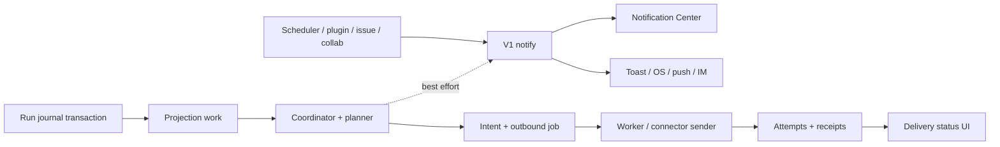

# Notification system gap audit / 通知系统缺口审计

- Status: verifying
- Lane: standard
- Created: 2026-11-17
- Updated: 2026-11-22
- Related: ADR-0042, ADR-0190, ADR-0207; source HEAD 532674905e2e6edf5410bdda06afe82dab2eec82 plus concurrent working-tree changes

<!--
Edit by hand; keep the table shapes, because `ledger.mjs check` parses them.
Status: exploring | building | verifying | closed
Lane:   standard | deep
IDs are unique across the whole file. Depends-on / Risk / From cells take
comma-separated IDs. Use "-" for an empty cell.
-->

## Original request

> 帮我分析一下现在的通知系统的缺口，看看差什么功能，或者存在什么问题，并且对照业内的优秀实践

Follow-up: 做一次对抗性审查。

2026-11-22 follow-up

> 帮我分析一下现在对通知系统的支持情况，看看差什么功能，或者存在什么问题，并且对照业内的优秀实践，检查之前的发现的缺口是否已经修复

## Knowledge

<!--
Prefix → kind: O observation · H hypothesis · G goal/outcome · C constraint
· A assumption · Q open question.
State (O/H/A/C): Observed | Hypothesized | Verified | Contested | Unknown | Invalidated
State (G):       Proposed | Agreed | Revised
State (Q):       Open | Answered
Basis: where it comes from + scope + date, e.g. "sidecar log 2026-10-21, macOS only".
-->

| ID  | Statement                                                                                                                                                 | State        | Basis                                                                                                                                             | Depends on     |
| --- | --------------------------------------------------------------------------------------------------------------------------------------------------------- | ------------ | ------------------------------------------------------------------------------------------------------------------------------------------------- | -------------- |
| O1  | Two accepted ADRs define a unified center and durable external delivery.                                                                                  | Observed     | ADR-0042 and ADR-0190, checked-out source, 2026-11-17.                                                                                            | -              |
| H1  | Remaining gaps are substantially integration, lifecycle and failure handling around existing infrastructure.                                              | Verified     | Three bounded read-only reviewers; existing suites and isolated counterexamples below, 2026-11-17.                                                | O1, O2, O3     |
| G1  | Identify current notification defects and missing capabilities, compare authoritative industry practices, and prioritize next work.                       | Agreed       | Explicit user request, 2026-11-17.                                                                                                                | -              |
| C1  | This is an audit; preserve concurrent changes and avoid real external sends or product changes.                                                           | Verified     | User requested analysis; shared working tree observed, 2026-11-17.                                                                                | G1             |
| O2  | Existing selected notification suites pass despite reproducible failure-path defects.                                                                     | Verified     | 21 suites / 372 tests; policy, real-Dexie and lifecycle counterexamples below; 2026-11-17, macOS headless.                                        | -              |
| O3  | The canonical center, V1 fan-out and V2 durable external delivery enforce different guarantees.                                                           | Verified     | notify.ts fan-out precedes persistence; coordinator catches center failure; planner and V1 routing differ; checked source and probes, 2026-11-17. | -              |
| O4  | Industry references distinguish notification delivery, engagement, user preferences and recovery.                                                         | Verified     | Slack, Linear, Knock, Apple and AWS primary pages fetched on 2026-11-17; links below.                                                             | -              |
| Q1  | Should quiet hours defer all channels, and which critical notifications may override them?                                                                | Open         | V1 and V2 counterexamples; product policy requires an explicit decision in future implementation.                                                 | O3             |
| A1  | A disposed collaboration pull can reach a newly selected account's sink in the actual application.                                                        | Hypothesized | Lifecycle probe proves late hand-over; default sink resolves runtime/global DB, but encrypted real-account switching has not been exercised.      | O3             |
| G2  | Adversarially challenge the audit and identify omitted notification failures.                                                                             | Agreed       | User follow-up: 做一次对抗性审查, 2026-11-17.                                                                                                     | G1             |
| O5  | Real permission wrappers preserve history on bridge rejection, and UI retry/archive workarounds refute stronger first-pass claims.                        | Verified     | Owning wrapper and RTL/store probes; F01/F20/F21 corrected; 2026-11-17.                                                                           | -              |
| O6  | Settings scope/source mismatch and missing connector execution admission prevent intended external delivery.                                              | Verified     | Real Dexie resolver/coordinator and real outbound runner probes, 2026-11-17; no real provider.                                                    | -              |
| O7  | A personal-marked run synthetic title reaches webhook HTTP request despite the real personal gate withholding its actual payload for an unknown audience. | Verified     | Egress probe and independent second-cycle source review; actual sink mocked, 2026-11-17.                                                          | -              |
| G3  | Recheck all 34 historical items and assess present support against official industry documentation.                                                       | Agreed       | Explicit follow-up on 2026-11-22.                                                                                                                 | G1, G2         |
| O8  | Recent scheduler and workflow work extends notification coverage while the historical counterexamples persist.                                            | Verified     | Local dev at 86c188cba4, source delta and selected suites plus historical probes, 2026-11-22. Workflow Host push registration is source evidence. | O2, O5, O6, O7 |
| O9  | Remote ingress loses three valid source tags and replays interrupt again. Inbound critical push can also request a second interruption.                   | Verified     | Three isolated cases using the real ingest adapters and routing core, synthetic inputs and fake channels, 2026-11-22.                             | O3             |
| G4  | Independently challenge historical closure and new remote or push findings, and provide a complete issue list.                                            | Agreed       | User follow-up on 2026-11-22.                                                                                                                     | G3             |
| O10 | Single-lane sequence filtering protects ordinary reconnect. WS plus RTC can still dispatch the same publication to the notification adapter twice.        | Verified     | Actual Companion and RTC receive paths with injected carriers. transport-probes.mjs, 2026-11-22.                                                  | O9             |
| O11 | A real webhook intent passes the pre-claim target check, waits for credentials, and still reaches the fake HTTP boundary after target disable.            | Verified     | Dexie-backed delivery probe with a deterministic keyring barrier, 2026-11-22.                                                                     | O8             |

## Problem frame

Audit the checked-out notification system from event production through policy, persistence, external delivery, presentation and user action. Distinguish implemented capabilities, confirmed counterexamples, source-backed gaps, intentional exclusions and unverified native/provider behavior (G1). Produce a reproducible, prioritized report and current primary-source comparisons. Product fixes and real account sends are outside this audit (C1).

<!-- One paragraph: the problem we are choosing to solve now, the outcome that
would show it is solved, and what is explicitly out of frame. Cite IDs. -->

## Complexity profile

<!-- Rating: low | medium | high | unknown. "unknown" is a valid answer; say what
would resolve it. Never sum these into a score. -->

| Dimension    | Rating | Why / what would resolve it                                                              |
| ------------ | ------ | ---------------------------------------------------------------------------------------- |
| scale        | high   | Center, durable delivery, collaboration sync, producers and three shells.                |
| technical    | medium | Existing TypeScript/Dexie and Rust code; fault paths require isolated checks.            |
| coupling     | high   | Preferences, account scope, run journal, connector queue and native providers.           |
| requirement  | low    | Analysis and comparison requested; implementation is excluded.                           |
| verification | high   | Headless checks are available; native OS/provider delivery requires separate acceptance. |
| risk         | medium | Audit is reversible; inaccurate delivery/privacy claims could misprioritize fixes.       |

## Risks

<!-- ID prefix R. Severity: low | medium | high. Source: how the risk was found (catalog,
ADR-NNNN, git history, lens:STRIDE, reviewer, incident memory, …). Claim: the
property the design promises. Refuted by: the observation that would prove the
claim false. -->

| ID  | Risk (impact)                                                                                     | Severity | Source                                                                             | Claim                                                                                                       | Refuted by                                                                     |
| --- | ------------------------------------------------------------------------------------------------- | -------- | ---------------------------------------------------------------------------------- | ----------------------------------------------------------------------------------------------------------- | ------------------------------------------------------------------------------ |
| R1  | Dropped or duplicate notifications obscure blocked/completed work.                                | high     | ADR-0042, ADR-0190; failure-injection lens.                                        | Recorded work produces recoverable, idempotent delivery.                                                    | A committed event is lost, duplicated or incorrectly acknowledged.             |
| R2  | Privacy or preference boundaries fail across devices and external targets.                        | high     | ADR-0190; risk catalog; Apple notification guidelines.                             | Scope, consent and channel controls are enforced at actual sends.                                           | Disabled/revoked or wrong-scope content still reaches an interruptive channel. |
| R3  | UI promises functionality that is unavailable or cannot be recovered.                             | medium   | ADR-0042; Linear and Slack primary documentation.                                  | Permission, triage and delivery states describe working user flows.                                         | An exposed control does nothing or hides actionable records.                   |
| R4  | Mock seams or missing runtime context turn audit claims into false positives or inflated impacts. | high     | Fresh-context reviewers; actual production wrapper, UI and runner counterexamples. | Each audit assertion is scoped to the strongest evidence and real owning path.                              | A production safeguard or supported workaround refutes an absolute assertion.  |
| R5  | V2 webhook egress bypasses personal-data disclosure authority.                                    | high     | ADR-0243; independent egress review.                                               | A personal-marked payload may leave only after the Host proves the target audience and required disclosure. | A withheld payload still reaches the outgoing HTTP request without disclosure. |

## Verification obligations

<!-- ID prefix V. Risk: the R id(s) this obligation discharges.
Independence: self | subagent | fresh-reviewer | tool | other-model | human | real-env
Status: planned | passed | failed | blocked | waived
Evidence: command + result excerpt, commit, or artifact path — not "should pass".
Coverage: which conditions the evidence covers (and which it does not). -->

| ID  | Risk               | Method                                                                                                                 | Independence   | Evidence                                                                                                                                                                | Coverage                                                                                                                      | Status  |
| --- | ------------------ | ---------------------------------------------------------------------------------------------------------------------- | -------------- | ----------------------------------------------------------------------------------------------------------------------------------------------------------------------- | ----------------------------------------------------------------------------------------------------------------------------- | ------- |
| V1  | R1, R2             | Trace producers, runtime installation, policy and durable delivery with bounded read-only reviewers.                   | fresh-reviewer | Three separate read-only reviews: delivery, UI/platform and policy/producers; findings F01–F25 below with owning source links.                                          | Checked-out source; no live provider sends.                                                                                   | passed  |
| V2  | R1, R2, R3         | Run relevant existing Jest suites and isolated counterexample probes.                                                  | tool           | Existing 21 suites / 372 tests passed; 13 policy cases, 9 Dexie cases and 1 lifecycle case reproduced the stated counterexamples. Exact commands and limitations below. | Headless behavior and injected boundaries; no coverage run; probe success means a defect or policy difference was reproduced. | passed  |
| V3  | R3                 | Fetch and compare current primary documentation.                                                                       | tool           | Read official Slack, Linear, Knock, Apple, Android and AWS pages on 2026-11-17; source-linked comparison below.                                                         | Product and architecture comparison; no vendor ranking.                                                                       | passed  |
| V4  | R1, R2, R3         | Real native/provider acceptance scope assessment.                                                                      | self           | Identified unrun native click, denied permission, locked-device push, real-account switch and real-provider recovery checks in X1/X3.                                   | Assessment only; native/provider end-to-end acceptance is not established.                                                    | passed  |
| V5  | R4                 | Fresh-context adversarial review of findings, real producer/adapter/runner/UI checks, and explicit reconciliation.     | fresh-reviewer | Three independent scopes plus one bounded second-cycle review of new egress probes; nine finding rows narrowed or reclassified.                                         | Read-only repository review; second-cycle reviewer received artifacts and contract only.                                      | passed  |
| V6  | R1, R2, R3, R4, R5 | Run additional adversarial probes with real personal guard, runner, Dexie and UI.                                      | tool           | Five suites with 12 assertions passed across runs; worker lifecycle script exit 0. Commands and boundary limitations below.                                             | No native or real-provider send; synthetic title/HTTP request seam, not full document/body leakage.                           | passed  |
| V7  | R1, R2, R3, R4, R5 | Replay original counterexamples and inspect changed production call paths for all 34 historical items.                 | tool           | 29 normal suites / 698 tests and 39 audit scenarios passed. Item-by-item evidence and commands in the 2026-11-22 follow-up.                                             | Source, fake-indexeddb, React DOM, deterministic clocks and injected channel I/O.                                             | passed  |
| V8  | R3                 | Refresh primary industry sources and compare observable behaviors.                                                     | tool           | Official GitHub, Linear, Slack, Apple, Android, Knock and AWS pages checked on 2026-11-22 and cited in the follow-up.                                                   | Product and architecture practices documented by their owners.                                                                | passed  |
| V9  | R1, R2, R3, R5     | Verify dispatch and navigation in native shells, real paired Hosts, distinct real accounts and provider sandboxes.     | real-env       | No device, real-account or provider dispatch exercised in this follow-up.                                                                                               | Headless checks stop at the application or mocked transport boundary.                                                         | blocked |
| V10 | R1, R2, R3, R4, R5 | Give the artifact and owning contracts to three independent reviewers and reconcile against current source and probes. | fresh-reviewer | Delivery and account, remote and push, desktop and mobile triage reviews. Corrections and source links in the adversarial appendix.                                     | Three same-model bounded reviews. User chose to continue without an external model.                                           | passed  |
| V11 | R1, R2, R3, R4, R5 | Rerun historical probes and exercise omitted transport and race boundaries.                                            | tool           | 47 audit scenes including the isolated real WS and RTC receivers, real Dexie target revocation and real producer or wrapper probes.                                     | Injected carriers, keyring, HTTP and native adapter. No device or provider acceptance.                                        | passed  |

## Decisions

<!-- ID prefix D. Based on: only the IDs this decision ASSUMES still hold (if one is
later Invalidated, the decision reopens). Name ruled-out hypotheses in the
Decision text, not here.
Action: implement | spike | diagnose | experiment | harden | escalate | scope-down | stop | ship
Reversal trigger: the new evidence that would reopen this decision. -->

| ID  | Date       | Decision                                                                                                                                                           | Action   | Based on           | Reversal trigger                                                                                    |
| --- | ---------- | ------------------------------------------------------------------------------------------------------------------------------------------------------------------ | -------- | ------------------ | --------------------------------------------------------------------------------------------------- |
| D1  | 2026-11-17 | Diagnose current behavior before proposing additional features.                                                                                                    | diagnose | G1, C1, O1         | Discovery shows scope belongs to a different subsystem.                                             |
| D2  | 2026-11-17 | Prioritize persistence, ownership fencing, revocation and evidence recovery before expanding delivery providers.                                                   | diagnose | O1, O2, O3, O4     | A real-environment check refutes a counterexample or product intent changes.                        |
| D3  | 2026-11-17 | Re-enter risk discovery, correct overstatements, prioritize egress authority and actual delivery reachability, then stop after bounded independent reconciliation. | diagnose | G2, C1, O5, O6, O7 | A faithful end-to-end check refutes the new route or guard counterexamples.                         |
| D4  | 2026-11-22 | Reuse this ledger, retest owner paths first and prioritize send authorization, account fences and recoverability before UX and channel expansion.                  | diagnose | G3, C1, O8, O9     | A current owner-path regression test or controlled two-account or device run disproves a finding.   |
| D5  | 2026-11-22 | Retain zero confirmed complete closures. Reduce the scope of receiver and test claims and record the uncovered product paths.                                      | diagnose | G4, O8, O10, O11   | A verified owner-path fix changes an item or a controlled end-to-end run refutes an uncovered path. |

## Residual risks

<!-- ID prefix X. From: the R / V / H / M ids this residual comes from.
What is still not known or not verified after this round. No invented
percentages. Status: open | accepted | closed. "accepted" needs the user. -->

| ID  | Residual                                                                                                                           | From       | Why still open                                                                                   | Next action                                                                                                | Status |
| --- | ---------------------------------------------------------------------------------------------------------------------------------- | ---------- | ------------------------------------------------------------------------------------------------ | ---------------------------------------------------------------------------------------------------------- | ------ |
| X1  | Native OS, mobile locked/background delivery and real-provider behavior remain unverified.                                         | R1, R2, R3 | This audit used source and headless tests; it did not send real notifications.                   | Run platform/provider matrix in an authorized acceptance task.                                             | open   |
| X2  | Confirmed defects remain in product code.                                                                                          | V2         | Scope is analysis; no product fix was requested or implemented.                                  | Implement prioritized increments with corrected behavioral acceptance tests.                               | open   |
| X3  | Real-account privacy impact of late collaboration hand-over is not yet demonstrated.                                               | A1         | Only injected sink/account generation was exercised.                                             | Reproduce under two test accounts and add an account-generation fence.                                     | open   |
| X4  | Quiet-hours and critical-bypass product semantics need a decision.                                                                 | Q1         | Both pipelines currently encode different policies.                                              | Define per-category policy and user controls before unifying the implementations.                          | open   |
| X5  | Newly confirmed unchecked egress, unreachable delivery routes and account/lifecycle state defects remain unfixed.                  | R5, V6     | This task reviews and corrects evidence; product source is unchanged.                            | Fix authorization/provenance and route wiring with real acceptance before expanding channels.              | open   |
| X6  | Field behavior of follow-up findings and new workflow wake-up remains unmeasured.                                                  | V9         | Synthetic input, mocked output, and no native, account or provider sandbox acceptance.           | Run the native tap, locked-device push, restart, replay and two-account matrix after engineering fixes.    | open   |
| X7  | Actual WAN dual-lane presentation, Host switch or replay recovery, native reopening and account-scoped delivery remain unmeasured. | V9         | Current tests cover handler and transport seams, but lack real paired Hosts and OS presentation. | Validate both physical Hosts, both accounts, and APNs, FCM and HMS on real devices with synthetic content. | open   |

## Outcome

<!-- ID prefix M. Signals that the ORIGINAL problem improved (validation, not verification).
Status: pending | met | not-met | not-measurable -->

| ID  | Signal                                                                                                    | How / when measured                                                                                               | Result                                                                                                                       | Status |
| --- | --------------------------------------------------------------------------------------------------------- | ----------------------------------------------------------------------------------------------------------------- | ---------------------------------------------------------------------------------------------------------------------------- | ------ |
| M1  | A prioritized, source-linked report distinguishes defects, gaps, exclusions and unknowns.                 | Source review, counterexamples and primary-source comparison on 2026-11-17.                                       | Report below covers current capabilities, 25 grouped findings, feature gaps, repair order and acceptance limits.             | met    |
| M2  | Adversarial review changes unsupported conclusions and identifies missed owning-path defects.             | Fresh-context reviews and additional probes on 2026-11-17.                                                        | Nine original rows corrected or narrowed; new A01–A09 record defects and a source-backed scaling risk.                       | met    |
| M3  | A dated, item-by-item assessment shows which historical gaps were closed and what to prioritize next.     | Compare the baseline and local dev, replay probes, review current owning paths and primary sources on 2026-11-22. | 34 historical items accounted for, zero closure confirmed, three additional boundary cases reproduced.                       | met    |
| M4  | A fresh adversarial review reconciles every historical item and supplies a full list with evidence scope. | Three read-only reviews, owner-path reconciliation and reruns on 2026-11-22.                                      | Zero historical closures confirmed, three prior findings refined, nine new findings and remaining field coverage documented. | met    |

## Audit conclusion / 审计结论

**当前通知系统已有较完整的模块设计，但端到端接线、授权边界和恢复闭环仍有实质缺口。** 对抗审查补充了设置 scope/source 不匹配、connector execution admission 缺失，以及 webhook personal-sink 绕过；不能把“模块存在”解释为能力已交付。 现有能力包括统一中心、持久历史、未见/已见/已读/归档状态、去重、稍后提醒、免打扰、来源偏好、跨端桥接，以及面向外发的 target/subscription、intent/attempt、worker/reconciler。继续沿用这些模块即可推进修复。

最值得优先处理的是：先落盘再通知；失去所有权必须整体回滚；取消/撤销必须影响实际发送队列；已处理回执不能阻塞后续任务；失败不能让中心记录永久消失。其次是把已经暴露的设置、摘要、点击导航、状态刷新和手机归档做成可用闭环。

审计日期：**2026-11-17（Asia/Shanghai）**。结论针对当前 checkout，仓库有大量并行改动；本任务只新增本报告和审计探针，未修改产品代码、未提交。CodeGraph 无本地索引，本次使用精确文本检索、源码调用链和可重复探针。

### 当前实现边界

**对抗审查修订：**首轮“模块存在，因此架构已完整”的概括过强。下方原始 F01–F25 已修订，另见文末 A01–A09。当前最高优先级是 webhook 的 personal-data 授权边界，以及设置订阅/connector 实际不可交付的问题。

| 链路                               | 已有能力                                                         | 本次确认的保证边界                                                       |
| ---------------------------------- | ---------------------------------------------------------------- | ------------------------------------------------------------------------ |
| 常规 producer → V1 `notify()`      | 中心记录、偏好、toast/OS/push/IM、coalesce、retention            | 仍先 fan-out 后持久化；大部分常规来源未接入 V2 外发订阅                  |
| Run journal → V2 coordinator       | durable projection work、策略规划、intent/outbound job、回执恢复 | 事务 fencing、取消、订阅撤销、扫描公平性存在反例；中心写入仍 best-effort |
| Collaboration server → client pull | per-recipient seq、read cursor、首次静默导入、已读回传           | 服务端通知发生在业务提交之后；客户端 in-flight pull 无 disposal fence    |
| Desktop / mobile / remote          | 桌面通知、手机本地通知、push token 注册、远端事件订阅            | 点击、权限入口与 triage 不完全对等；实机/provider 尚未验收               |



图描述组件关系；`V1` 的实际顺序是先执行 `L`，再写入 `C`，见 F01。

### 已确认的实现问题与风险

证据标签：**动态复现**＝真实 owning module 在隔离环境中得到反例；**源码确认**＝调用链直接成立，未跑真实 OS/UI；**边界风险**＝部分机制已复现，但真实损害仍需验收。P1 表示建议优先修复的正确性/隐私/可靠性问题，P2 表示后续功能闭环问题；不是已发生事故的严重等级。

| ID / 优先级             | 问题及用户影响                                                                                                        | 证据、复现与修复方向                                                                                                                                                                                                                                                                                                                                                                                                                                                                                                         |
| ----------------------- | --------------------------------------------------------------------------------------------------------------------- | ---------------------------------------------------------------------------------------------------------------------------------------------------------------------------------------------------------------------------------------------------------------------------------------------------------------------------------------------------------------------------------------------------------------------------------------------------------------------------------------------------------------------------- |
| F01 / P1                | **常规通知先外发后落盘，存在中途退出或写入失败窗口。** 首轮“权限桥异常使生产历史丢失”的推断撤回。                     | **动态顺序确认；权限影响已纠正**：core 注入 throwing checker 会跳过落盘，但真实 Tauri/Capacitor wrapper 已捕获 bridge 异常；新探针得到中心 1 行、push 1 次。见 [notify.ts:212](../../lib/notifications/notify.ts#L212)、[notification.ts:12](../../lib/tauri/notification.ts#L12)、[_shared.ts:49](../../lib/capacitor/_shared.ts#L49)。先持久化仍建议优先修，但未做真实 crash-window 测试。                                                                                                                                 |
| F02 / P1                | **过期 worker 即使 CAS 失败，也会提交发送任务。** 失去 generation/lease 后仍有外发副作用，统计却显示没有提交。        | **真实 Dexie 动态复现**：`processedEvents=0,intentsCommitted=0`，数据库却有 1 intent、1 job。[coordinator.ts:360](../../lib/notifications/delivery/coordinator.ts#L360)。先检查所有权；事务内 CAS 失败必须中止事务。                                                                                                                                                                                                                                                                                                         |
| F03 / P1                | **V2 中心写入失败没有恢复闭环。** 外发可以完成、cursor 继续前进，中心却永远缺少这条通知。                             | **真实 Dexie 动态复现**：注入中心失败后 `processedEvents=1`；下一轮仍只有一次中心尝试、0 中心记录。[coordinator.ts:241](../../lib/notifications/delivery/coordinator.ts#L241)。中心投影需要独立可恢复工作，或成为提交的一部分。                                                                                                                                                                                                                                                                                              |
| F04 / P2 API            | **取消 API 仅改变 intent，不取消对应 job；当前影响是潜在控制缺口。** 优先级调整为 P2/API，尚未找到 UI caller。        | **真实 Dexie 结构反例成立，实际发送影响收紧**：pending job 不变，模拟 late receipt 被忽略。但真实 connector runner 因缺少 execution admission 会 withheld 原 payload（见 A02），不能称为已证明“取消后仍发送原内容”。[api.ts:437](../../lib/notifications/api.ts#L437)、[receipts.ts:104](../../lib/notifications/delivery/receipts.ts#L104)。修 admission 时必须同时修撤销与 late-evidence。                                                                                                                                 |
| F05 / P1                | **删除订阅后，已排队 webhook 仍可外发。** 发送前只重验 target，没有重验 subscription。                                | **真实 Dexie 动态复现，HTTP mock**：删除 subscription 后仍调用 sendHttp 1 次，intent=`accepted`。[webhook-sender.ts:73](../../lib/notifications/delivery/webhook-sender.ts#L73)、[notification-subscriptions.ts:139](../../lib/db/notification-subscriptions.ts#L139)。发送时重验订阅版本、状态及 route/disclosure，并撤销待发任务。                                                                                                                                                                                         |
| F06 / P1                | **回执扫描可能长期卡在前 128 条已处理任务。** 后续任务即使真实发送成功，中心仍显示排队中。                            | **真实 Dexie 动态复现**：两轮均 `scanned=128,projected=0`，第 129 条仍 queued。[receipts.ts:184](../../lib/notifications/delivery/receipts.ts#L184)。需要未投影索引或持久扫描游标；该饿死至少持续到前排 job 被其他机制清理。                                                                                                                                                                                                                                                                                                 |
| F07 / P1                | **开关订阅会清掉高级规则、类别过滤、配额。** 用户只想关闭后重新开启，却丢失 deny/digest 等配置。                      | **真实 Dexie 动态复现**：完全复用 UI toggle 传参后 rules 从 1 变 0，categories/maxIntents/template 消失。[notification-delivery-panel.tsx:167](../../components/settings/notifications/notification-delivery-panel.tsx#L167)、[notification-subscriptions.ts:56](../../lib/db/notification-subscriptions.ts#L56)。toggle 应只 patch enabled，或完整保留其余字段。                                                                                                                                                            |
| F08 / P1                | **目标时区被 host 时区覆盖。** 目标设备午夜仍被打扰，或白天被错误延迟。                                               | **动态复现**：15:00 UTC / Tokyo 00:00 返回 notified；23:00 UTC / Tokyo 08:00 返回 deferred。[context.ts:35](../../lib/notifications/policy/context.ts#L35)、[planner.ts:269](../../lib/notifications/policy/planner.ts#L269)、[worker.ts:98](../../lib/notifications/delivery/worker.ts#L98)。明确 profile/target/host 时区优先级并在真实入口传递。                                                                                                                                                                          |
| F09 / P1 待实机确认影响 | **旧账号 pull 在 dispose 后仍交付内容。** 若 sink 已切到新账号，会产生跨账号写入/展示风险。                           | **生命周期边界动态复现**：延迟 A 的 list 请求，dispose 后切换注入 sink 到 B，仍收到 A 的标题。真实账号数据库泄露尚未演示。[notifications-sync.ts:625](../../lib/collab/notifications-sync.ts#L625)、[notifications-sync.ts:640](../../lib/collab/notifications-sync.ts#L640)、[notifications-sync.ts:934](../../lib/collab/notifications-sync.ts#L934)；默认 sink 在 [notifications-sync.ts:456](../../lib/collab/notifications-sync.ts#L456) 动态调用 runtime。需要 account/connection generation fence，不能只移除监听器。 |
| F10 / P2                | **每次协调批次只推进一个 event，且没有找到已接线的事件 wake。** 积压依靠下一次周期 sweep。                            | **真实 Dexie 动态复现**：两 event 得到 cursor=1、desired=2；[notification-projection-work.ts:225](../../lib/db/notification-projection-work.ts#L225) 清空 lease。[worker.ts:130](../../lib/notifications/delivery/worker.ts#L130) 只有 startup tick 和每轮完成后等待默认 30 秒的 timer。首轮“仍可能有其他 wake”撤回；运行时间、挂起和 runtime 重启会影响实际延迟，未测延迟分布。                                                                                                                                             |
| F11 / P2                | **尚未接线的 connector retry API 没有恢复真实 job。** 首轮“用户点击重试后又失败”的 UI 描述撤回。                      | **真实 Dexie 动态复现**：直接调用 API 后 job 仍 deadlettered，receipt sweep 又把 intent 改成 failed。[api.ts:422](../../lib/notifications/api.ts#L422)、[webhook-sender.ts:44](../../lib/notifications/delivery/webhook-sender.ts#L44)。生产搜索仅找到定义，未找到 UI caller。接线前需按通道实现真正的 job retry，并区分 unknown 的人工重发。                                                                                                                                                                                |
| F12 / P2                | **摘要能力没有打通：不同事实不共桶，到期也不生成摘要发送。** 配置 aggregate 后外发可能只进入未 flush 的成员表。       | **动态复现**：同 run/category/day 的不同 factKey 产生不同 bucket；真实 Dexie 两轮 reconcile 后 timer=fired、member 未 flush、0 intents。[planner.ts:348](../../lib/notifications/policy/planner.ts#L348)、[reconciler.ts:168](../../lib/notifications/delivery/reconciler.ts#L168)。[flushDigestBucket/completeDigestFlush](../../lib/notifications/policy/aggregation.ts#L104) 仅定义/测试，没有生产 consumer。需要共同分桶、渲染、目标与订阅关联、durable flush/receipt。                                                  |
| F13 / P1 策略合约       | **deny-first 实际依赖规则顺序。** `[aggregate,deny]` 返回 digest，deny 不再执行。                                     | **动态复现**。[planner.ts:208](../../lib/notifications/policy/planner.ts#L208) 与 [subscription.ts:19](../../packages/plugin-contract/src/types/notifications/subscription.ts#L19) 的合约不符。先完成 deny 阶段再做 schedule/aggregate；当前只证明 planner 违约，没有演示真实数据外泄。                                                                                                                                                                                                                                      |
| F14 / P2                | **并发相同 dedupeKey 仍创建两条通知并重复打扰。** 查重与写入之间没有原子保证。                                        | **动态复现，内存 DB seam**：`Promise.all` 后 rowCount=2；[notify.ts:122](../../lib/notifications/notify.ts#L122)、[notify.ts:265](../../lib/notifications/notify.ts#L265)。用事务/串行化及稳定身份约束处理竞争；不能只缩短 await 窗口。                                                                                                                                                                                                                                                                                      |
| F15 / P2                | **“新活动唤醒”开关无效。** 关闭后，同 dedupeKey 的通知仍清掉 snooze；不同 key 同 group 的唤醒又未接线。               | **动态复现 + 引用检查**：[dedup.ts:83](../../lib/notifications/dedup.ts#L83) 无条件清 snooze；[snooze.ts:32](../../lib/notifications/snooze.ts#L32) 的偏好 helper 没有生产调用。将偏好判断放到实际 bump/group 活动路径。                                                                                                                                                                                                                                                                                                     |
| F16 / P2 API 合约       | **`silent`、`validUntil`、`operationKey` 没有在 V1 核心兑现。** 静默仍打扰，过期仍外发，相同 operationKey 仍重复。    | **3 个动态反例**。[类型合约](../../packages/plugin-contract/src/types/notifications/index.ts#L174)、[notify.ts:193](../../lib/notifications/notify.ts#L193)。这些字段目前有公开合约，但 `emitNotification()` 未找到生产 caller，不能据此声称常用生产流已普遍触发。                                                                                                                                                                                                                                                           |
| F17 / P2                | **sound/badge 设置没有兑现。** 声音开关不改变发声请求，站内 badge 开关不影响铃铛计数。                                | **源码确认**：[settings:258](../../components/settings/notifications/notifications-section.tsx#L258)、[notification-bell.tsx:20](../../components/notifications/notification-bell.tsx#L20)、[runtime.ts:91](../../lib/notifications/runtime.ts#L91)。`appBadge` 是另一设置，已有独立实现；没有实机测量“仍发声”。                                                                                                                                                                                                             |
| F18 / P2                | **普通远程 push 的后台 tap 和桌面 OS 通知缺少完整目标导航。** 站内通知、本地手机通知及部分特殊 push 已有路由。        | **源码确认**：[companion-boot-provider.tsx:703](../../components/providers/companion-boot-provider.tsx#L703) 处理 sessionId/run-approval，却未处理普通 href；[runtime.ts:91](../../lib/notifications/runtime.ts#L91) 的 Tauri 分支不传 href。站内 [center:135](../../components/notifications/notification-center.tsx#L135) 与手机本地 tap 已路由；尚未做原生点击验证。                                                                                                                                                      |
| F19 / P2                | **投递状态 badge 不是实时的。** 面板保持打开时 queued→accepted/failed 不更新，首次无 intents 则一直不出现。           | **源码确认**：[notification-delivery-badge.tsx:73](../../components/notifications/notification-delivery-badge.tsx#L73) 只按 logicalKey 查询一次。接 live query/事件，并覆盖挂载后发生的状态变化。                                                                                                                                                                                                                                                                                                                            |
| F20 / P2                | **动作失败仍变已读，缺少 pending、可见错误和专门重试提示。** 原动作按钮保留，用户可以再次点击。                       | **真实 UI 反例纠正绝对表述**：失败后按钮仍 enabled，第二次点击 handler 累计执行两次。[notification-item.tsx:267](../../components/notifications/notification-item.tsx#L267)。错误仅日志仍成立：[action-registry.ts:36](../../lib/notifications/action-registry.ts#L36)。Plan/Workflow/Harness 已注册 handler；handler 缺失是故障注入场景，不能概括生产初始化普遍缺失。                                                                                                                                                       |
| F21 / P2                | **桌面归档无法直接分页访问最初 100 条之外的记录，来源筛选也在截断后执行。** 首轮“第101条无法恢复/删除”撤回。          | **真实 UI 对照**：恢复/删除较新记录会 reloadDone，原第101条随后进入窗口；确认 Clear All 会清掉全部101条。[notification-center.tsx:124](../../components/notifications/notification-center.tsx#L124)、[center:167](../../components/notifications/notification-center.tsx#L167)、[notifications.ts:125](../../lib/db/notifications.ts#L125)。仍应增加数据库 cursor/source-filter 分页，避免必须先处理较新记录。                                                                                                               |
| F22 / P2                | **手机缺少归档恢复、来源筛选、seen 状态推进。** archive 后在该页面无法找回；只浏览不会像桌面一样清除 ambient unseen。 | **源码确认**：[notification-feed-mobile.tsx:21](../../components/mobile/notifications/notification-feed-mobile.tsx#L21)、[use-notifications.ts:23](../../hooks/notifications/use-notifications.ts#L23)。复用现有 triage 动作，并提供筛选重置和 archived 入口。                                                                                                                                                                                                                                                               |
| F23 / P2                | **手机通用 Settings 的权限入口误用 Tauri-only adapter；浏览器则应呈现为不支持 OS 通道。**                             | **源码确认**：[use-notification-permission.ts:9](../../hooks/notifications/use-notification-permission.ts#L9)、[notification.ts:12](../../lib/tauri/notification.ts#L12)。手机独立 CTA 已有 request、Open Settings、resume 重查和 runtime cache invalidation；该问题不意味着手机授权整体不可用，也不意味着 browser 必须支持原生通知。                                                                                                                                                                                        |
| F24 / P2                | **snooze 到期没有主动唤醒。** 一直停留页面时，时间到了仍不回到 feed/badge，需用户刷新/重开。                          | **源码确认**：[store:178](../../stores/notifications/notification-store.ts#L178) 从内存移除；[hook:19](../../hooks/notifications/use-notifications.ts#L19) 只 hydrate；[center:110](../../components/notifications/notification-center.tsx#L110)、[mobile:24](../../components/mobile/notifications/notification-feed-mobile.tsx#L24) 依赖挂载/手工刷新。加入可恢复到期调度及 snoozed 管理页。                                                                                                                               |
| F25 / 产品取舍          | **协作服务端通知采用业务提交后的 best-effort，这是待确认的产品取舍。** 不作为已确认 correctness defect 定级。         | **源码确认设计语义**：[notifications.rs:11](../../crates/cognia-collab-server/src/notifications.rs#L11)、[notifications.rs:681](../../crates/cognia-collab-server/src/notifications.rs#L681)。已有成员权限检查、排除自身/重复收件人、业务幂等键与持久化 read 回传重试。只有可靠触达被明确要求时，才需要 outbox 补偿。                                                                                                                                                                                                        |

### 需要补齐的产品能力

以下是能力差距或产品策略选择，不全部等同于 bug。建议来自上述证据和行业对照，未测量用户价值或生产丢失率。

| 能力                  | 当前差距                                                                                                      | 建议验收标准                                                                                                           |
| --------------------- | ------------------------------------------------------------------------------------------------------------- | ---------------------------------------------------------------------------------------------------------------------- |
| 统一的通知策略        | V1 critical 强制 toast/OS、绕过 DND；V2 critical 不绕过。V1 安静时段静默后不补发，V2 外发有 deferred。        | 每个类别明确立即/静默/延后/摘要、critical 例外权限；相同事实走不同通道时结果可以解释。                                 |
| 全来源 durable policy | 常用 site/issue/plugin/collab producer 仍调用 V1；non-journal `emitNotification()` 仅找到定义，没有生产调用。 | 建立 producer→category→channel→durability 矩阵；订阅界面明确哪些来源可用，先接入关键来源。                             |
| Snoozed/待发管理      | 当前中心无完整 snoozed 列表；摘要/延后与中心行的关系不清晰。                                                  | 可查看/取消/改期，能回答“为什么现在没通知、何时会通知”。                                                               |
| 跨端处理闭环          | collaboration 有 read sync；普通本地/remote/push 仍是各自中心记录，OS 点击不统一回写 notificationId。         | 同一逻辑事实有稳定跨端身份；按需同步 read/done、撤销过期展示，避免已处理后继续提醒。                                   |
| 通知检索与批处理      | 当前主要是来源过滤、mark-all、archive-all；缺少完整历史检索、未读/严重度/项目组合筛选。                       | 可按内容和实体检索、批量 triage、键盘操作；手机支持同样的核心处理动作。                                                |
| 用户可解释的投递诊断  | 已有 intent/attempt 和 run tab，但 badge 不实时；可用性、失败原因、恢复操作分散。                             | 展示 provider 接受/未知/失败与用户已读的区别；有失败原因、attempt 时间线、真实 retry/cancel 和安全 test notification。 |
| 有条件的补充通道      | Email/SMS/ntfy/Apprise、浏览器后台 Web Push 不在当前主能力内；ADR-0190 明确排除部分 provider。                | 按离线任务、重要审批等实际场景决定；先验证现有 push/IM 的可靠性，再评估未读后的升级/回退。                             |

来源实例：[sites producer](../../lib/sites/notify.ts#L268)、[issue producer](../../lib/issues/notify.ts#L208)、[plugin bridge](../../lib/notifications/plugin-bridge.ts#L37)、[collab input](../../lib/collab/notifications-sync.ts#L375)、[V2 API](../../lib/notifications/api.ts#L105)。

### 行业实践对照与 Sources

以下只比较官方文档中明确提供的机制，不把其他产品的全部功能都视为 Cognia 必须照搬的要求。资料读取日期均为 2026-11-17。

| 参照                                                                                                                                                                                                                | 官方实践                                                                                                          | Cognia 当前状态及可借鉴点                                                                                                      |
| ------------------------------------------------------------------------------------------------------------------------------------------------------------------------------------------------------------------- | ----------------------------------------------------------------------------------------------------------------- | ------------------------------------------------------------------------------------------------------------------------------ |
| [Slack Notifications](https://slack.com/help/articles/201355156-Configure-your-Slack-notifications)                                                                                                                 | 支持来源例外、通知时段，以及按桌面活动状态配置手机提醒时机。                                                      | 已有 focus-aware 和 WebSocket 在线 push 抑制；缺少统一可配置的跨设备延迟策略。可先定义在线/活跃/正在查看目标的不同含义。       |
| [Linear Inbox](https://linear.app/docs/inbox)                                                                                                                                                                       | 提供 snooze、快速检索、键盘 triage 和 priority inbox。                                                            | 已有 snooze/归档/双层 badge；应补主动到期唤醒、手机恢复和历史查询闭环。                                                        |
| [Linear Notifications](https://linear.app/docs/notifications)                                                                                                                                                       | 按通道配置通知类型；邮件摘要根据紧急程度延后，并考虑 inbox 是否已读。官方也明确限制新 browser push subscription。 | 通知中心可以持续保留事实，打扰按策略减少；浏览器后台能力应作为明确产品边界，而非通用“落后”判据。                               |
| [Knock Preferences](https://docs.knock.app/preferences/overview)                                                                                                                                                    | 按通道、类别、workflow 组合偏好，允许资源级条件。                                                                 | 已有全局/来源偏好与 V2 订阅，但执行不统一；优先修设置兑现、规则保留和发送时撤销重验。                                          |
| [Knock Message statuses](https://docs.knock.app/send-notifications/message-statuses)                                                                                                                                | 区分 provider 接受、实际可验证的 delivered 和用户 seen/read；状态追踪受通道能力限制。                             | 保留 accepted/unknown 语义；应让 UI 实时反映证据，避免把 provider 接受展示成用户已读或确定到达设备。                           |
| [Knock Delivery](https://docs.knock.app/send-notifications/delivering-notifications) / [Step conditions](https://docs.knock.app/designing-workflows/step-conditions)                                                | 可重试错误采用退避与 jitter，失败可诊断；后续通道可取决于前面是否已读。                                           | 已有 attempt/unknown/reconciler，继续补公平扫描、真实人工 retry 与按未读升级；unknown 的重发应明确重复风险，不能盲目自动重试。 |
| [Apple Notifications](https://developer.apple.com/design/human-interface-guidelines/notifications) / [Managing notifications](https://developer.apple.com/design/human-interface-guidelines/managing-notifications) | 权限、隐私、及时且可理解的信息，以及尊重用户 Focus/通知管理。                                                     | 已有上下文 CTA 与 generic push 文案，值得保留；应修权限入口分叉、点击目标与 critical 策略，并实机验证锁屏行为。                |
| [Android notification channels](https://developer.android.com/develop/ui/compose/notifications/channels)                                                                                                            | 通道分类承载打扰程度，最终控制权在用户。                                                                          | 原生 category/importance、系统设置跳转和 app 级偏好的一致性应进入设备验收矩阵；本次没有证明所有原生通道配置正确。              |
| [AWS transactional outbox](https://docs.aws.amazon.com/prescriptive-guidance/latest/cloud-design-patterns/transactional-outbox.html)                                                                                | 业务事实与待发布事件在同一事务记录，消费端处理重复。                                                              | journal projection 已采用相近结构；应修 CAS 与中心恢复，并评估协作通知的业务提交后丢失窗口。                                   |

### 推荐修复顺序与验收

| 增量                | 范围                                            | 必须观察到的结果                                                                                                                                           |
| ------------------- | ----------------------------------------------- | ---------------------------------------------------------------------------------------------------------------------------------------------------------- |
| 1. 可靠性与授权边界 | F01–F07、F09、F13                               | 任何权限/平台失败都保留中心事实；失去所有权产生 0 发送写入；取消和订阅撤销阻止尚未发送任务；第 129 条回执可推进；切账号后旧任务不再写入；toggle 不丢规则。 |
| 2. 调度与策略       | F08、F10–F16、F24                               | 一批多 event 能推进；真正 retry；摘要到期产生可追踪外发；并发不重复；snooze/quiet-hours/expiry/silent 按明确策略执行。                                     |
| 3. 用户处理闭环     | F17–F23                                         | 设置改变行为；手机/桌面点击到目标；状态实时变化；动作失败可见且可恢复；归档第 101 条仍可访问；手机能恢复归档。                                             |
| 4. 覆盖与扩展       | F25、跨端 read、检索、解释性诊断和按需 provider | 关键 producer 纳入稳定语义；离线/重启/后台/多设备场景通过真实验收，再按需求扩展通道。                                                                      |

### 验证记录与复现方法

从仓库根目录运行。没有运行 coverage；没有为这次分析运行全仓 build/typecheck/lint，也没有修改产品源码。

本次未找到可复用的通知专项 evidence ledger，因此新建本文件；独立 probe/config 文件用于复现事务与生命周期反例，避免改动产品模块或把缺陷断言加入正常测试套件。新增审计脚本的 scoped ESLint（`--max-warnings=0`）通过；首轮报告的 64 个本地源码链接曾检查存在且行号在文件范围内；ledger `--final` 检查为 0 errors / 0 warnings。

现有 baseline，两个批次合计 **21 suites / 372 tests passed**：

```bash
pnpm --config.verify-deps-before-run=false test --runInBand --runTestsByPath \
  lib/notifications/notify.test.ts lib/notifications/runtime.test.ts \
  lib/notifications/api.test.ts lib/notifications/policy/planner.test.ts \
  lib/notifications/delivery/coordinator.test.ts \
  lib/notifications/delivery/receipts.test.ts \
  lib/notifications/delivery/reconciler.test.ts \
  lib/notifications/delivery/webhook-sender.test.ts \
  lib/collab/notifications-sync.test.ts lib/db/notifications.test.ts

pnpm --config.verify-deps-before-run=false test --runInBand --runTestsByPath \
  components/notifications/notification-center.test.tsx \
  components/notifications/notification-bell.test.tsx \
  components/notifications/notification-delivery-badge.test.tsx \
  components/mobile/notifications/notification-feed-mobile.test.tsx \
  hooks/notifications/use-notification-permission.test.ts \
  lib/tauri/notification.test.ts \
  components/providers/companion-boot-provider.test.tsx \
  stores/notifications/notification-store.test.ts \
  lib/notifications/snooze.test.ts lib/notifications/dedup.test.ts \
  lib/notifications/policy/context.test.ts
```

原始结果分别为 **10 suites / 193 tests** 和 **11 suites / 179 tests**。notify 的故障注入测试输出预期 channel-failed 日志；CompanionBootProvider 测试有 `act(...)` warning，测试仍通过。它们不构成原生/provider 验收。

审计探针共 **23 个场景**：13 个 policy/core、9 个 real-Dexie、1 个 lifecycle。**探针通过表示成功复现报告中的缺陷、合约反例或策略差异，不能解释为产品行为验收通过。** `.delivery-probes.ts` 特意不使用普通 test 文件名，只有专用 config 才会收集，避免把“断言缺陷存在”的探针混进日常回归套件。

```bash
node docs/evidence/2026-11-17-notification-system-gap-audit.policy-probes.mjs
node docs/evidence/2026-11-17-notification-system-gap-audit.lifecycle-probes.mjs
pnpm --config.verify-deps-before-run=false test \
  --config docs/reports/2026-11-17-notification-system-gap-audit/2026-11-17-notification-system-gap-audit.jest.config.ts \
  --runInBand --runTestsByPath \
  docs/reports/2026-11-17-notification-system-gap-audit/2026-11-17-notification-system-gap-audit.delivery-probes.ts
```

Policy 探针转译真实模块，scope/ID/personal-context merge 等非目标依赖和通道 I/O 使用 stub；Dexie 探针使用真实仓库 fixture/事务，HTTP 为 mock；lifecycle 只证明旧 pull 仍到达注入 sink，不证明真实账号数据已泄露。源码确认的 UI 问题没有在真实 browser/native 中复现。

执行环境问题：最初直接 `pnpm test` 触发自动依赖安装，在现有 `@cognia/agent-config-types` node export/postinstall 阶段失败；采用 `verify-deps-before-run=false` 后，仓库原有 Jest 入口成功运行。该 flag 跳过依赖自动校验，不绕过测试或 Git hooks。

### 保留的能力与未验收边界

- 普通 companion push 使用 generic title/body、metadata-only payload，Host 也校验 app-relative href；本次没有证明该链路泄露完整正文。[command_services.rs:352](../../crates/cognia-companion-rpc/src/command_services.rs#L352)
- inbound push 与 local tap 的 href 校验弱于 Host/remote listener，建议统一 validator；正常 Host producer 已过滤危险 href，因此本次不声称演示了外部 URL 攻击或 XSS。[inbound-push.ts:48](../../lib/notifications/inbound-push.ts#L48)、[companion-boot-provider.tsx:688](../../components/providers/companion-boot-provider.tsx#L688)、[remote-subscription.ts:104](../../lib/notifications/remote-subscription.ts#L104)
- 手机独立 CTA、被拒绝后的 Open Settings、token 注册/轮换、前台避免重复 toast，以及 collaboration read sync 均已有实现；不应列为完全缺失。
- 未运行 macOS/Windows/Linux 桌面点击，iOS/Android 锁屏/后台/权限恢复，真实 APNs/FCM/HMS/Feishu 发送、断网/重启、多设备已读、真实双账号切换。后续需使用专用测试账号和测试 target 做矩阵验收。
- 本次完成的是分析交付，所有产品修复仍待实施，残余风险未替用户接受。

## Adversarial review / 对抗性审查（2026-11-17）

审查对象既包括当前通知实现，也包括首轮报告的论证质量。按 `doubt-driven` 执行：把 finding artifact 与 contract 单独交给三个不继承会话历史的 reviewer，分别挑战投递路径、UI/平台、覆盖与 runtime wiring；随后对新增 webhook 隐私反例做了一次有界独立复核。没有修改产品源码、没有真实外发。用户明确选择“仅完成本轮仓内审查”，未调用外部跨模型 CLI。

### 对原报告的更正

| Finding | 分类                                           | 更正结果                                                                                                                                                                   |
| ------- | ---------------------------------------------- | -------------------------------------------------------------------------------------------------------------------------------------------------------------------------- |
| F01     | Valid + actionable：生产上下文遗漏             | 保留先外发后落盘的窗口；撤回“真实权限桥异常导致历史丢失”。真实 wrapper 捕获异常，新增测试仍有中心1行、push1次。原 throwing-checker 探针仅证明 core DI 边界缺口。           |
| F04     | Valid + actionable：影响夸大                   | intent/job 取消不一致真实存在，但 API 尚无 UI caller，且当前真实 connector runner 会因 A02 阻止原 payload。降为潜在 API 控制问题，不能据模拟 sent 回执断言已证明继续外发。 |
| F10     | Valid + actionable：把注释当接线               | 撤回“可能有额外 wake”。当前 driver 是 startup tick，加每轮结束后默认30秒等待；没有找到生产 wake subscriber。                                                               |
| F11     | Valid + actionable：用户路径不存在             | direct retry API 缺陷成立；“点击重试”未找到生产接线，改为待接线 operator API 缺口。                                                                                        |
| F18     | Contract misread：标题范围过宽                 | 缺口限定普通远程 push 后台 tap 与桌面 OS；站内点击、手机本地通知和 session/run-approval 特殊路由已经存在。                                                                 |
| F20     | Valid + actionable：漏掉已有重试动作           | 已读后原按钮仍可再次点击；撤回“完全不能重试”。缺少的是 pending、可见失败和专门恢复提示。handler 缺失是故障场景，Plan/Workflow/Harness 正常初始化已有注册。                 |
| F21     | Valid + actionable：把分页受限说成永久不可访问 | 第101条不能直接分页访问，但处理较新记录会使它进入窗口；确认 Clear All 清整表。准确问题是历史分页和截断后过滤。                                                             |
| F23     | Contract misread：混合平台能力边界             | 手机 generic Settings adapter 错配仍成立；浏览器应明确不支持 OS 通道，不能暗示 browser API 是已经承诺的能力。                                                              |
| F25     | Valid trade-off：有意 best-effort              | 不再当作已确认 P2 correctness defect。可靠触达成为明确需求后再决定 outbox；保留已有权限、幂等、收件人去重和持久 read 重试能力。                                            |

对其余原结论未找到足以推翻核心机制的反例，不代表全部完成 native/provider 验收。未把第一轮所有 injected fault 都计成生产 bug，也没有用测试全绿替代用户流程验证。

### 新增的实质发现

| ID / 优先级              | 问题、证据与边界                                                                                                                                                                                                                                                                                                                                                                                                                                                                                                                                                                                                                                                                                                                                                                                                                                                                 | 建议下一步                                                                                                                                                                                                                                     |
| ------------------------ | -------------------------------------------------------------------------------------------------------------------------------------------------------------------------------------------------------------------------------------------------------------------------------------------------------------------------------------------------------------------------------------------------------------------------------------------------------------------------------------------------------------------------------------------------------------------------------------------------------------------------------------------------------------------------------------------------------------------------------------------------------------------------------------------------------------------------------------------------------------------------------- | ---------------------------------------------------------------------------------------------------------------------------------------------------------------------------------------------------------------------------------------------- |
| A01 / P1 授权边界        | **V2 webhook 没有执行 personal-sink 判定。** 真实 personal-marked run 产生的实际 intent payload，对 `unknown` 受众调用真实 guard 返回 `withhold`，但 coordinator→webhook→HTTP request 仍带出 synthetic private title。prepare 只做 consent/subscription/PII 扫描：[coordinator.ts:283](../../lib/notifications/delivery/coordinator.ts#L283)、[webhook-sender.ts:263](../../lib/notifications/delivery/webhook-sender.ts#L263)、[feishu-webhook.ts:204](../../lib/notifications/delivery/feishu-webhook.ts#L204)。真实 HTTP wrapper 与 Rust 网络层没有 source/run personal 判定：[commands.ts:497](../../lib/connectors/tauri/commands.ts#L497)、[commands.rs:322](../../crates/cognia-connectors/src/commands.rs#L322)、[http_client.rs:205](../../crates/cognia-net/src/http_client.rs#L205)。**证明范围是合成标题到请求边界，没有真实泄露、完整个人正文或 Feishu 接收验收。** | 按 [ADR-0243:150](../../docs/content/docs/en/adr/0243-a-run-acts-for-someone-and-says-who.md#L150) 保留来源 taint 与身份，按真实受众执行 personal gate，并在 send 前重验。普通 proactive consent/PII-clean 不等于个人对精确内容的 disclosure。 |
| A02 / P1 交付失效        | **governed connector 直接写 job，没有正常 enqueue 的 execution admission。** [governed.ts:299](../../lib/notifications/delivery/governed.ts#L299) 绕过 [outbound-jobs.ts:358](../../lib/db/outbound-jobs.ts#L358) 的 `startJobExecutionRun`。真实 runner 在 [outbound-runner.ts:1543](../../lib/connectors/outbound-runner.ts#L1543) 要求精确 job run，因此普通和取消两种探针都 `deadlettered/personal_withheld`，原通知 payload 未到 fake adapter。                                                                                                                                                                                                                                                                                                                                                                                                                             | 复用正常 admission/授权流程，同时保留真实源 run 的 personal provenance。不能移除 guard 或补空身份来“恢复发送”；修通此路前要同时修 F04 撤销和来源授权。                                                                                         |
| A03 / P1 订阅失效        | **Settings 的 account-scope 订阅查不到 workspace run。** UI [panel:98](../../components/settings/notifications/notification-delivery-panel.tsx#L98) 解析无 workspace scope；journal [execution-runs.ts:725](../../lib/db/execution-runs.ts#L725) 按 projectId 建 work；查询 [subscriptions.ts:93](../../lib/db/notification-subscriptions.ts#L93) 精确匹配。真实 Dexie probe：指向该 run 的订阅得到 not-subscribed、0 intents、cursor 已推进；account-scope 对照 notified。                                                                                                                                                                                                                                                                                                                                                                                                      | 明确账号规则对子 workspace 的继承语义，正确解析目标 run scope；测试 Settings→workspace run 完整流程，不能简单扩大到任意 scope 前缀。                                                                                                           |
| A04 / P2 订阅失效        | **Settings source 选项与 V2 fact source 不兼容。** UI [panel:425](../../components/settings/notifications/notification-delivery-panel.tsx#L425) 使用 V1 source 集合，V2 [facts.ts:178](../../lib/notifications/delivery/facts.ts#L178) 固定 `source:run`。独立于 workspace 的真实 Dexie 反例中，scheduler 订阅对 scheduled run 仍不匹配；只改事实 source 的对照 notified。                                                                                                                                                                                                                                                                                                                                                                                                                                                                                                       | 统一跨管线 source/category 模型，或准确标注可用来源；增加真实 UI 选项到 producer 的契约测试。                                                                                                                                                  |
| A05 / P1 生命周期边界    | **worker stop 后仍可进入新的 reconcile/webhook lane。** [worker.ts:94](../../lib/notifications/delivery/worker.ts#L94) 只在最初检查 stopped，await 后 [worker.ts:100](../../lib/notifications/delivery/worker.ts#L100) 直接启动两 lane；stop 只清 timer。真实 worker + 注入异步 prefs/lane seam：stop 后得到两次 lane 调用；teardown 确实调用 stop：[install-runtime.ts:513](../../lib/connectors/bootstrap/install-connector-runtime.ts#L513)。未证明真实跨账号发送。                                                                                                                                                                                                                                                                                                                                                                                                           | 每个 await 后及实际 send 前加入 runtime/account/lease generation fence；stop 应阻止尚未开始的副作用，并定义已开始发送如何记证据。                                                                                                              |
| A06 / P1 账号状态边界    | **通知 singleton 没有随账号切换 reset。** 真实 Bell/hook/store 在 A hydrate 后，将 backing repository 切成空 B 并 remount，仍显示旧 unread count，items 仍是 A，且未查询 B。[notification-store.ts:78](../../stores/notifications/notification-store.ts#L78)、[use-notifications.ts:19](../../hooks/notifications/use-notifications.ts#L19)；真实账号本地清理清单不包含通知：[account-store.ts:2186](../../stores/account/account-store.ts#L2186)。未运行完整原生账号切换。                                                                                                                                                                                                                                                                                                                                                                                                      | store 按 namespace/account 分区或切换时 reset hydrated/items/count/filter，并给异步 hydrate/动作加 generation fence。补双账号完整流程验证标题展示及跨账号操作影响。                                                                            |
| A07 / P2 重复发送        | **同一目的地的两个 target alias 没有合并。** 两 target 的 fingerprint 和 endpoint ref 相同，coordinator 仍按 targetId 构造不同 operationKey：[coordinator.ts:382](../../lib/notifications/delivery/coordinator.ts#L382)。真实 Dexie→sender probe 对同一 endpoint 产生2次 HTTP request。                                                                                                                                                                                                                                                                                                                                                                                                                                                                                                                                                                                          | 以 scope+canonical destination 建立 delivery slot，定义多订阅/profile 冲突如何合并；不能只依靠 targetId 幂等。未实测 Feishu 收到两条。                                                                                                         |
| A08 / P2 不确定结果重发  | **模糊 2xx 响应可能被当成可重试的内部错误。** `HTTP200/body=null` 在 [feishu-webhook.ts:246](../../lib/notifications/delivery/feishu-webhook.ts#L246) 解析后访问属性抛错，sender [webhook-sender.ts:103](../../lib/notifications/delivery/webhook-sender.ts#L103) 归为 internal-error 并自动重发。probe 得到第1次 queued、2次 HTTP request。                                                                                                                                                                                                                                                                                                                                                                                                                                                                                                                                     | 校验响应 envelope；请求已开始后的无法判定结果进入 unknown，避免按“发送前内部错误”盲重试。仅证明故障响应边界，不声称正常 Feishu code=0 会重复。                                                                                                 |
| A09 / 扩展性风险，未定量 | **“bounded sweep”不代表扫描有界。** [notification-projection-work.ts:267](../../lib/db/notification-projection-work.ts#L267) 对整张 work 表 filter/toArray，reconciler 才 slice；历史 done 行仍参与扫描。没有测得生产延迟或内存数据。                                                                                                                                                                                                                                                                                                                                                                                                                                                                                                                                                                                                                                            | 用状态/时间索引与真正分页限制扫描，加入历史规模实验后再判断优先级，避免把源码复杂度直接当已发生性能事故。                                                                                                                                      |

### 修订后的处理次序

1. **先守住 A01 webhook personal 边界。** 在保留 guard 的前提下修 A02 execution admission；同时补 F04/F05 撤销，避免修通交付后暴露潜在未授权发送。
2. **修 A03/A04 的真实设置路径**，再处理 F02/F03/F06 与 F10 的 fencing、中心恢复、回执推进及调度，确保规则能被找到且事件可追踪。
3. **修 A05/A06 生命周期与账号隔离**，再补摘要、去重、点击、动作反馈与历史分页；A09 做规模验证后排期。

### 本轮复现记录

新增 **5 suites / 12 个 Jest 场景**，加 **1 个 worker lifecycle 脚本**。其中有些是用来推翻首轮绝对表述的保护性对照，有些复现新缺陷；都不是“产品全部验收通过”。继承第一轮未运行 native/provider/真实账号验收的边界，没有运行 coverage。

```bash
pnpm --config.verify-deps-before-run=false test \
  --config docs/reports/2026-11-17-notification-system-gap-audit/2026-11-17-notification-system-gap-audit.adversarial.jest.config.ts \
  --runInBand
node docs/evidence/2026-11-17-notification-system-gap-audit.worker-probes.mjs
```

脚本分为 egress（3）、routing（2）、permission（1）、real runner（2）、真实 UI/store（4）。HTTP 与平台 adapter 为 fake；PII、personal guard、Dexie、runner 授权判定和 UI 操作保留真实模块。worker 脚本用注入 lane 记录边界，未操作真实账号/网络。

首次将 UI probe 从 `.cache/` 移入 docs 后，docs 的 `next-intl` 包解析与 owning app 不同，3项标签查询失败；改用 owning app setup 的真实英文标签后，同样的行为断言全部通过。该失败与修正属于 harness 适配，未更改产品逻辑或削弱断言。

停止条件：原始 artifact 已完成一次三路独立挑战；新增最高风险 egress 反例完成一次独立复核并收紧证明范围。对已确认源码缺口继续重复审阅不会改变下一步“按上述边界修复与验收”的决定，因此本轮停止，不开展产品修改。

审计产物边界：可执行 TS/TSX probes 与 Jest config 存放在 `docs/reports/2026-11-17-notification-system-gap-audit/`（docs workspace 已排除此目录），避免污染 docs 的 `@/*` alias/typecheck；ledger 与独立 MJS 取证脚本保留在 `docs/evidence/`。

## 2026-11-22 复核

同日[对抗性复核](#2026-11-22-对抗性复核)补充了三项 N 系列发现的适用边界、已有保护和后续发现。

本轮基线为本地 `dev` 的 `86c188cba482f7f99cd232675c28bcacb48739f6` 与当前工作树。上次审计基线 `532674905e2e6edf5410bdda06afe82dab2eec82` 是其祖先。结论适用于这份 checkout。**历史 34 项中，确认修复 0 项。F25 仍是产品取舍，A09 仍是未定量的扩展性风险。** 近期提交改善了定时任务和工作流的部分通知，三条主链路的可靠性、授权和账号边界仍有原探针反例。

### 现在能用什么

| 链路                   | 当前能力和边界                                                                                                                                                                                                                              | 对应实现                                                                                                                                                                                                                                                                                               |
| ---------------------- | ------------------------------------------------------------------------------------------------------------------------------------------------------------------------------------------------------------------------------------------- | ------------------------------------------------------------------------------------------------------------------------------------------------------------------------------------------------------------------------------------------------------------------------------------------------------ |
| 站内中心和常规 V1 通知 | 本机持久历史、分级、两级铃铛、按来源静音和工作区偏好、短窗合并、稍后提醒、桌面归档及恢复。常规生产者覆盖 Scheduler、运行、会话、插件、连接器、Issue、Sites 和协作等。浏览器共享站内能力，桌面可请求 OS 通知，手机有本地通知及独立权限入口。 | [ADR-0042](../content/docs/en/adr/0042-unified-notification-center.md)、[V1 运行时](../../lib/notifications/runtime.ts)、[手机入口](../../app/me/notifications/page.tsx)                                                                                                                               |
| Host → 已配对端        | Host 可以广播远端事件，离线手机可收到配置好的原生 push。普通中心 push 使用通用提示文案和元数据，前台事件和离线 push 是两条入口。工作流阻塞等待人工填写时已有单独的 IDs-only 唤醒事件。                                                      | [远端订阅](../../lib/notifications/remote-subscription.ts)、[Host push payload](../../crates/cognia-companion-rpc/src/command_services.rs#L315)、[人工输入事件](../../lib/workflow/runtime/human-input-notify.ts#L60)、[Host push 触发器](../../crates/cognia-companion-bus/src/push_triggers.rs#L184) |
| 协作通知               | Issue 分配、声明式提及、审批和邀请有服务端逐收件人记录，按游标拉取，首次导入静默回填，可回传已读。该同步范围是协作事件，普通中心通知仍是各客户端各自记录。                                                                                  | [ADR-0207](../content/docs/en/adr/0207-a-collaboration-event-reaches-people-who-are-not-in-the-room.md)、[客户端同步](../../lib/collab/notifications-sync.ts)、[服务端投递](../../crates/cognia-collab-server/src/notifications.rs#L668)                                                               |
| V2 外发                | 运行日志在事务内写投影任务，Host worker 处理投递意图、飞书 Webhook 或 Connector 队列、回执、延迟定时器。设置可配置目标和订阅，中心与 Run 详情可查部分状态。进程内可写 intent 并不保证已经授权、发送、抵达或被人读到。                       | [ADR-0190](../content/docs/en/adr/0190-notifications-leave-the-app-as-durable-work.md)、[运行时接线](../../lib/connectors/bootstrap/install-connector-runtime.ts#L925)、[Run 投递页签](../../components/agent-runs/run-notifications-tab.tsx#L74)                                                      |

#### 近期变化

- `554a88e5f0` 改善 headless 周期任务通知。两次完成可共享一条本机中心行（`count=2`），分别向配对端发布，每次发生中的 toast/push 合为一次发布。对应回归测试已通过。修复提交里测试名的 `F19` 来自 **Scheduler** 审计，本审计 F19 是中心投递状态不刷新。 [运行时](../../lib/notifications/runtime.ts#L147)、[回归测试](../../lib/notifications/runtime.test.ts#L372)
- `8ce8648bbb` 把工作流等待人工输入接至 Host push 触发器。已跑前端 producer 测试并核对 Rust 触发器与测试源码。手机锁屏是否收到、点击是否直达表单仍需验收。普通 push tap 的现有路由只处理 session 和 run approval。 [生产者](../../lib/workflow/runtime/human-input-notify.ts#L60)、[Rust 注册](../../crates/cognia-companion-bus/src/push_triggers.rs#L201)、[手机点击分发](../../components/providers/companion-boot-provider.tsx#L704)
- `86c89b8c6b` 加强 Connector runner 的 adapter 所有权检查和退出等待。A02 的 job 准入反例仍通过真实 runner 复现，A05 的 Notification worker 在 stop 后仍启动两个子流程。 [Connector bootstrap](../../lib/connectors/bootstrap/install-connector-runtime.ts#L519)、[Notification worker](../../lib/notifications/delivery/worker.ts#L93)

### 历史发现逐项复验

“复现”代表探针再次看到历史反例。“源码仍在”代表 owning path 仍具有该行为。原报告已撤回或收紧的影响范围沿用。

| ID  | 2026-11-22 判定      | 当前证据                                                                                                                                                                                                                                                                     |
| --- | -------------------- | ---------------------------------------------------------------------------------------------------------------------------------------------------------------------------------------------------------------------------------------------------------------------------- |
| F01 | 复现                 | V1 顺序仍是 toast → OS → push → 落盘。真实权限 wrapper 吞掉桥接异常的保护性对照仍通过。应用进程中断窗口未做实机实验。 [notify](../../lib/notifications/notify.ts#L212)                                                                                                       |
| F02 | 复现                 | 旧 generation 的 cursor CAS 未提交进度，实际留下 intent 和 job。 [事务](../../lib/notifications/delivery/coordinator.ts#L345)                                                                                                                                                |
| F03 | 复现                 | 中心写入失败后游标推进，下一轮不会补建该中心行。 [中心投影](../../lib/notifications/delivery/coordinator.ts#L240)                                                                                                                                                            |
| F04 | 复现                 | cancel API 仅改 intent，pending job 保留，晚到回执不记；没有生产 UI caller，真实 runner 测试仍挡住原内容。 [API](../../lib/notifications/api.ts#L437)、[回执](../../lib/notifications/delivery/receipts.ts#L104)                                                             |
| F05 | 复现                 | 删除订阅后仍向 HTTP mock 发出一次请求并记作 accepted。target 版本检查仍有效。 [Webhook sender](../../lib/notifications/delivery/webhook-sender.ts#L73)                                                                                                                       |
| F06 | 复现                 | 连续两轮各扫描 128 条、投影 0 条，第 129 条仍为 queued。 [回执扫表](../../lib/notifications/delivery/receipts.ts#L174)                                                                                                                                                       |
| F07 | 复现                 | 关闭再开启会丢失 rules、categories、maxIntents 和 template 等已有配置。 [开关](../../components/settings/notifications/notification-delivery-panel.tsx#L167)                                                                                                                 |
| F08 | 复现                 | Tokyo 00:00 错误放行，08:00 错误延迟。worker 构造的 context 仍盖过目标时区。 [worker](../../lib/notifications/delivery/worker.ts#L97)、[planner](../../lib/notifications/policy/planner.ts#L269)                                                                             |
| F09 | 复现，账号影响待实机 | dispose 后 A 的延迟拉取仍到达模拟 B sink。没有真实双账号写入或展示证据。 [同步](../../lib/collab/notifications-sync.ts#L625)                                                                                                                                                 |
| F10 | 复现                 | 两条 event 的 work 本轮只推进一条。运行时仍是启动扫描加 30 秒周期，未找到 enqueue 唤醒接线。 [worker](../../lib/notifications/delivery/worker.ts#L130)                                                                                                                       |
| F11 | 复现                 | retry 把 intent 改回 queued，Connector job 仍 deadlettered，回执又把 intent 改回失败。该 API 没有生产 UI caller。 [API](../../lib/notifications/api.ts#L422)                                                                                                                 |
| F12 | 复现                 | 不同事实不共桶，digest 到期没有创建可发送摘要。 [规划](../../lib/notifications/policy/planner.ts)、[定时器](../../lib/notifications/delivery/reconciler.ts)                                                                                                                  |
| F13 | 复现                 | `[aggregate, deny]` 仍得到 digest。 [策略规划](../../lib/notifications/policy/planner.ts)                                                                                                                                                                                    |
| F14 | 复现                 | 并发同 dedupeKey 产生两行。 [查重后再写](../../lib/notifications/notify.ts#L117)                                                                                                                                                                                             |
| F15 | 复现和源码           | 同 key bump 仍清掉 snooze，即使关闭活动唤醒。不同 key 的同组唤醒 helper 仍没有生产 caller。 [合并](../../lib/notifications/dedup.ts)、[唤醒 helper](../../lib/notifications/snooze.ts#L29)                                                                                   |
| F16 | 复现                 | `silent` 仍打扰，已过 `validUntil` 仍 fan-out，相同 `operationKey` 仍两行两次 toast。 [V1 核心](../../lib/notifications/notify.ts#L172)                                                                                                                                      |
| F17 | 源码仍在             | sound 和站内铃铛 badge 开关仍缺运行时接线。另有已接线的 `appBadge` 控制 Dock 或浏览器标题计数。 [开关](../../components/settings/notifications/notifications-section.tsx#L258)、[App badge](../../hooks/desktop/use-app-badge.ts#L69)                                        |
| F18 | 源码仍在，点击待实机 | 普通手机 push 的 `href` 入中心，原生 tap handler 不使用它；桌面 OS 点击缺统一导航接线。手机本地通知、session、run approval 有各自路由。 [手机 provider](../../components/providers/companion-boot-provider.tsx#L687)、[桌面 adapter](../../lib/tauri/notification.ts#L39)    |
| F19 | 源码仍在             | 中心 badge 按 logicalKey 单次读取，开启面板期间不会跟踪 queued → accepted 等变化，未知结果被聚合进失败。 [投递 badge](../../components/notifications/notification-delivery-badge.tsx#L56)                                                                                    |
| F20 | 复现                 | 操作失败后仍会变已读，缺 pending 和可见错误。原按钮仍可再次点击。 [桌面面板](../../components/notifications/notification-center.tsx)、[手机版](../../components/mobile/notifications/notification-feed-mobile.tsx)                                                           |
| F21 | 复现和源码           | 桌面档案仍固定取 100 行，再做来源过滤。恢复较新的一行会让第 101 行进入下一次读取，确认后的全部清理也覆盖窗口外记录。 [归档查询](../../components/notifications/notification-center.tsx#L125)                                                                                 |
| F22 | 源码仍在             | 手机 feed 有稍后提醒、归档动作和全部已读，但没有查看或恢复归档、来源筛选和浏览时 seen 推进。 [手机 feed](../../components/mobile/notifications/notification-feed-mobile.tsx)                                                                                                 |
| F23 | 源码仍在             | 通用设置权限 hook 仍走 Tauri-only adapter。手机 `/me/notifications` 有原生权限 CTA，浏览器 adapter 返回 denied。 [通用 hook](../../hooks/notifications/use-notification-permission.ts#L9)、[手机 CTA](../../components/mobile/notifications/notification-permission-cta.tsx) |
| F24 | 源码仍在             | snooze 后把行移出 store，没有到期主动恢复或重新计数的计时器，重开或刷新会重新查询。 [store](../../stores/notifications/notification-store.ts#L178)、[hook](../../hooks/notifications/use-notifications.ts)                                                                   |
| F25 | 产品取舍             | 协作服务先提交业务再写通知，后者失败只记录日志。当前仍符合 best-effort 的实现。 [分配入口](../../crates/cognia-collab-server/src/api.rs#L2315)、[错误处理](../../crates/cognia-collab-server/src/notifications.rs#L697)                                                      |
| A01 | 复现                 | 真实 personal guard 对未知受众返回 withhold，同一 synthetic title 到达模拟 HTTP 请求边界。真实数据泄露、完整正文转移和飞书接收未验证。 [送出边界](../../lib/notifications/delivery/webhook-sender.ts#L99)                                                                    |
| A02 | 复现                 | governed job 缺运行准入，无论是否取消，真实 runner 给出 `deadlettered/personal_withheld`，原 payload 未到 fake adapter。 [governed enqueue](../../lib/notifications/delivery/governed.ts#L299)                                                                               |
| A03 | 复现                 | Settings 创建的 account-scope 订阅匹配不到 workspace run，产生零 intents；account-scope 对照仍匹配。 [设置](../../components/settings/notifications/notification-delivery-panel.tsx#L98)、[订阅查询](../../lib/db/notification-subscriptions.ts#L93)                         |
| A04 | 复现                 | 选 scheduler source 订阅时，定时运行事实仍标成 `run`，没有匹配。 [事实分类](../../lib/notifications/delivery/facts.ts#L178)                                                                                                                                                  |
| A05 | 复现，账号影响待实机 | prefs await 尚未返回时 stop，之后仍调用 reconcile 与 Webhook 两个注入流程。 [worker](../../lib/notifications/delivery/worker.ts#L93)                                                                                                                                         |
| A06 | 复现，账号影响待实机 | React DOM 中更换 repository 并重挂 Bell，仍显示 A 的计数，未读取空 B。 [store](../../stores/notifications/notification-store.ts#L78)、[hook](../../hooks/notifications/use-notifications.ts#L19)                                                                             |
| A07 | 复现                 | 两个 target ID 共用 fingerprint 与端点，模拟 HTTP 边界出现两次请求。 [operation key](../../lib/notifications/delivery/coordinator.ts#L382)                                                                                                                                   |
| A08 | 复现                 | HTTP 200 + JSON `null` 被归为内部故障并自动再次请求，第一次结果实际不明。 [响应解析](../../lib/notifications/delivery/feishu-webhook.ts#L236)、[重试判定](../../lib/notifications/delivery/webhook-sender.ts#L115)                                                           |
| A09 | 源码仍在，未定量     | work 表先 filter/toArray，之后才限制处理批次。生产数据库规模、延迟与内存未测。 [工作查询](../../lib/db/notification-projection-work.ts#L263)                                                                                                                                 |

### 本轮新增发现

| ID       | 问题和复现结果                                                                                                                                                     | 证据边界                                                                                                                                                                                                                     |
| -------- | ------------------------------------------------------------------------------------------------------------------------------------------------------------------ | ---------------------------------------------------------------------------------------------------------------------------------------------------------------------------------------------------------------------------- |
| N01 / P2 | 远端 ingest 的来源白名单缺 `issue`、`site`、`collab`。本地提交同类事件时每种来源静音都只落盘；向远端 ingest 输入同样的来源时，三类都被归为 `system` 并请求 toast。 | 真实 ingester 与 V1 路由，通道和 transport 隔离。 [白名单](../../lib/notifications/remote-subscription.ts#L33)、[回退](../../lib/notifications/remote-subscription.ts#L90)                                                   |
| N02 / P2 | 同一 Host 帧三次输入触发三次 toast。短窗内重放会在原行重新标成 unseen，超过 45 秒则新建一行。稳定的合并键不足以提供幂等。                                          | 人工提交可重复帧，未测真实 Host 重连的重放频率。该风险与 headless 周期任务按发生次数发布属于不同语义。 [接收端合并键](../../lib/notifications/remote-subscription.ts#L107)、[短窗策略](../../lib/notifications/dedup.ts#L15) |
| N03 / P2 | 进入中心的 inbound critical push 指定 `channels: ["center"]`，V1 的 critical 分支重新加回 toast 和 OS，探针看到两路 dispatch 请求后落盘。                          | 合成前台 push 和 fake adapter。手机系统是否已呈现、第二个 alert 是否实际出现仍取决于实机和权限。 [push adapter](../../lib/notifications/inbound-push.ts#L39)、[critical 分支](../../lib/notifications/routing.ts#L62)        |

### 行业对照及修复优先级

| 优先级                    | 行业参照                                                                                                                                                                                                                                                                                                                                                                                                                                               | Cognia 建议验收                                                                                                                                                                                |
| ------------------------- | ------------------------------------------------------------------------------------------------------------------------------------------------------------------------------------------------------------------------------------------------------------------------------------------------------------------------------------------------------------------------------------------------------------------------------------------------------ | ---------------------------------------------------------------------------------------------------------------------------------------------------------------------------------------------- |
| 1. 发送授权与账号生命周期 | Knock 按类别、工作流和渠道兑现订阅偏好。Apple 把中断等级与用户的 Focus/通知控制联系起来，并要求谨慎处理可被看到的内容。 [Knock Preferences](https://docs.knock.app/preferences/overview)、[Apple Managing notifications](https://developer.apple.com/design/human-interface-guidelines/managing-notifications)                                                                                                                                         | 在最后一次 I/O 前验证账号、执行准入、收件人、订阅、内容披露；对新旧账号、未知受众、撤销和 runtime teardown 做负向验证，断言禁止的发送尝试为零。明确 critical 的配置及例外。                    |
| 2. 持久投递与自助诊断     | AWS 建议在同一事务记录事实与待发布事件，由消费端处理重复。Knock 区分 provider 接受、真正送达、已见和已读，并给失败重试留证。 [AWS Transactional outbox](https://docs.aws.amazon.com/prescriptive-guidance/latest/cloud-design-patterns/transactional-outbox.html)、[Knock Message statuses](https://docs.knock.app/send-notifications/message-statuses)、[Knock Delivery](https://docs.knock.app/send-notifications/delivering-notifications)          | 过期 lease 无副作用；中心故障后可恢复；回执越过第 128 行；失败可按原因做实际 retry/cancel；unknown 单独显示并有明确的重复发送策略。用稳定 occurrence ID 防重放，同时保留真正的下一次周期发生。 |
| 3. 设置兑现与跨端打扰控制 | Slack 支持按桌面活跃程度选择手机提醒时机。Android 提供分类渠道并让用户控制其重要性。Linear 的未读摘要可按紧急程度延后。 [Slack Notifications](https://slack.com/help/articles/201355156-Configure-your-Slack-notifications)、[Android Notification channels](https://developer.android.com/develop/ui/compose/notifications/channels)、[Linear Notifications](https://linear.app/docs/notifications)                                                   | 跟踪 producer → scope/source → policy → channel 的实际覆盖。修设置保存、工作区订阅、安静时段、声响和 badge。批次到期能生成摘要。OS/手机点击直达稳定目标并可回写处理状态。                      |
| 4. 站内处理               | GitHub 把读、完成、保存和取消订阅分开，支持原因和资源筛选。Linear 支持按实体/类型搜索、键盘处理、snooze 到期返回收件箱。 [GitHub Inbox filters](https://docs.github.com/en/subscriptions-and-notifications/reference/inbox-filters)、[GitHub Notification triage](https://docs.github.com/en/subscriptions-and-notifications/how-tos/viewing-and-triaging-notifications/triaging-a-single-notification)、[Linear Inbox](https://linear.app/docs/inbox) | 归档分页、手机归档恢复、到期可见且可改期、按来源和项目检索、选中批处理、动作失败明确可重试。协作以外的通知按稳定身份同步已读或已处理。                                                         |

Email、SMS、额外 provider 和浏览器后台 Web Push 属于按场景评估的扩展。APNs、FCM、HMS 与飞书的现有通道优先完成授予权限、锁屏、前后台切换、断网重启、点击导航和重复投递的验收。自检发送与按未读升级适合在实际投递状态和用户策略能解释后再纳入。

### 本轮证据与边界

- 复跑原来的两批 Jest 文件合计 **21 suites / 373 tests**。另外用同一 `pnpm --config.verify-deps-before-run=false test --runInBand --runTestsByPath` 入口执行 8 个文件，共 **325 tests**。文件为 `lib/notifications/{remote-subscription,inbound-push}.test.ts`、`lib/workflow/runtime/human-input-notify.test.ts`、`lib/push/push-notifications.test.ts`、`lib/scheduler/notification-integration.test.ts`、`lib/capacitor/local-notifications.test.ts`、`lib/connectors/outbound-runner.test.ts` 和 `lib/connectors/bootstrap/install-connector-runtime.test.ts`。
- 复跑本账本前述两个专用 Jest config，结果 **1 suite / 9 scenes** 与 **5 suites / 12 scenes**。三个独立 MJS 脚本分别报告 **16 个 policy/core 场景、1 个协作生命周期场景、1 个 worker 生命周期场景**。总计 39 个审计场景，包含缺陷复现、保护性对照和本轮的 3 个新增探针。 [policy/core probes](./2026-11-17-notification-system-gap-audit.policy-probes.mjs)
- 本轮运行环境为 macOS，使用 Jest 的 Node/jsdom、fake-indexeddb、注入的 transport/channel 边界与固定时间。未跑原生设备、真实 provider、双账号或浏览器 E2E，也未跑 Rust suite、全仓构建或覆盖率。变更只包含此账本及审计探针。

## 2026-11-22 对抗性复核

以同一 `dev` 基线 `86c188cba4` 对照源码和既有保护。三路独立审查分别覆盖外发与账号、远端与 push、桌面与手机处理。**34 项历史记录中仍无确认完整关闭项。** F01–F24、A01–A08 的原始反例或功能缺口仍有证据，F25 是产品取舍，A09 是未定量的扩展性风险。局部保护和已有工作流改善应保留，且不把同一根因的多个观察当作彼此独立的故障。

### 历史结论的修正

| ID                                | 原结论应采用的范围                                                                                                                                                                                                                                                                                                                                                                           | 复核证据                                                                                                                                                                                                                                                                                                                                                        |
| --------------------------------- | -------------------------------------------------------------------------------------------------------------------------------------------------------------------------------------------------------------------------------------------------------------------------------------------------------------------------------------------------------------------------------------------- | --------------------------------------------------------------------------------------------------------------------------------------------------------------------------------------------------------------------------------------------------------------------------------------------------------------------------------------------------------------- |
| F01                               | 真实权限 wrapper 的保护仍成立。发送先于落盘的顺序仍在，未测真实崩溃窗口。                                                                                                                                                                                                                                                                                                                    | [权限适配器](../../lib/tauri/notification.ts#L12)、[核心顺序](../../lib/notifications/notify.ts#L212)                                                                                                                                                                                                                                                           |
| F04、F11、A02                     | API 可改变 intent，但底层 Connector job 保持 pending/deadlettered。真实 runner 反例未送出原 payload，某些消息型路由可另发通用安全提示。两个 operator API 仍无生产 UI 入口。                                                                                                                                                                                                                  | [操作 API](../../lib/notifications/api.ts#L411)、[runner 准入与安全提示](../../lib/connectors/outbound-runner.ts#L1625)                                                                                                                                                                                                                                         |
| F05、A01                          | target 在 claim **之前**已禁用时可阻止发送。删除订阅仍不阻止旧 intent，claim 后的关闭另见 N07。手动 V2 API 和中心投影已有 personal guard，原反例仍适用于 Run Journal → V2 Webhook 分支。                                                                                                                                                                                                     | [手动 API guard](../../lib/notifications/api.ts#L233)、[Run Journal 分支](../../lib/notifications/delivery/coordinator.ts#L276)、[发送检查](../../lib/notifications/delivery/webhook-sender.ts#L73)                                                                                                                                                             |
| F06、F10、A09                     | F06 已有对超时 `sending` 的独立恢复分支，无法救本例的 `queued` 第 129 条。F10 的一条限制指游标推进，第二条可能已经持久化投递任务，与 F02 的失败 CAS 有关。A09 还包括每次协调先查完整 run 事件再按游标过滤。                                                                                                                                                                                  | [恢复分支](../../lib/notifications/delivery/reconciler.ts#L103)、[事件扫描与提交](../../lib/notifications/delivery/coordinator.ts#L115)                                                                                                                                                                                                                         |
| F07、F08、A03、A04                | F07 动态只测一次按 UI 参数禁用，配置在禁用当下丢失。F08 动态证据止于 context/planner，worker 接线以源码确认。A03 用 Settings 的真实 scope 解析与等价参数，未走浏览器点击。A04 的动态例子是 scheduler，设置枚举整体缺 `run`，而中心投影另有正确来源映射。                                                                                                                                     | [设置](../../components/settings/notifications/notification-delivery-panel.tsx#L98)、[worker](../../lib/notifications/delivery/worker.ts#L93)、[来源映射](../../lib/notifications/emit-center.ts#L25)                                                                                                                                                           |
| F09、A05、A06                     | 旧请求到达 B 标记的 sink、stop 后仍进入两个 lane、旧 store 在换 repository 后仍显示均可复现。真实 worker 的 Webhook、回执及 stale-send 扫描也缺传入的 scope/账号代际保护。真实账号隔离、写入和外发仍待验收，不能由注入 sink 代替。                                                                                                                                                           | [协作 pull](../../lib/collab/notifications-sync.ts#L625)、[worker](../../lib/notifications/delivery/worker.ts#L100)、[回执与 stale sweep](../../lib/notifications/delivery/reconciler.ts#L95)、[store hydrate](../../stores/notifications/notification-store.ts#L85)                                                                                            |
| F13、F15、F16                     | `[defer, deny]` 也绕过 deny，而且可生成未来可发送的 intent。F15 的动态证据是纯合并函数，正常调用路径由源码核对，周期任务可跨越 45 秒持续合并。F16 的三个结果只适用于 V1 核心，V2 已有 planner 级过期判断、intent 操作键唯一约束。                                                                                                                                                            | [planner](../../lib/notifications/policy/planner.ts#L208)、[周期任务](../../lib/scheduler/notification-integration.ts#L147)、[V2 过期判断](../../lib/notifications/policy/planner.ts#L106)                                                                                                                                                                      |
| F17、F18、F20、F21、F22、F23、F24 | 独立 `appBadge` 已控制应用图标或网页标题，和站内铃铛分开。run approval、session 和本地通知有特定 tap 路由。F20 在桌面有动态证据，手机为源码，原按钮可重按。F21 底层支持先过滤再 limit，桌面归档 UI 未传过滤参数且仍限制首批 100 条。F22 手机可继承共享的来源筛选却无独立清除入口。F23 专用手机权限入口已接原生 adapter。F24 可刷新恢复，工作流节点直接写 Dexie 时还可绕过当前 store 的更新。 | [图标 badge](../../hooks/desktop/use-app-badge.ts#L90)、[push tap](../../components/providers/companion-boot-provider.tsx#L704)、[归档](../../components/notifications/notification-center.tsx#L125)、[手机权限](../../components/mobile/notifications/notification-permission-cta.tsx#L71)、[工作流更新](../../lib/workflow/nodes/notifications/index.ts#L183) |
| F19、F25                          | Run 投递页签已存在，中心 badge 仍是快照。Run Journal 的外发提交也没有持久化完整的未选路由原因，结果摘要 cursor 可前进但没有从它生成通知。协作 pull 能补拉已持久化的行，不能重建持久化失败的业务通知。                                                                                                                                                                                        | [中心 badge](../../components/notifications/notification-delivery-badge.tsx#L70)、[结果摘要](../../lib/notifications/delivery/coordinator.ts#L162)、[协作持久化错误](../../crates/cognia-collab-server/src/notifications.rs#L705)                                                                                                                               |

### N01–N03 复核

| ID  | 审查后判定                                 | 生产边界与证据                                                                                                                                                                                                                                                                                                                                                                                                                                                                                                                                                                                                                                                  |
| --- | ------------------------------------------ | --------------------------------------------------------------------------------------------------------------------------------------------------------------------------------------------------------------------------------------------------------------------------------------------------------------------------------------------------------------------------------------------------------------------------------------------------------------------------------------------------------------------------------------------------------------------------------------------------------------------------------------------------------------- |
| N01 | **接收端缺陷成立，生产覆盖收窄**           | 三类合法 source 都通过 Rust RPC 的格式检查，却在接收端变成 `system`，原静音规则不匹配。Headless Issue 有可达的非 IM 发布路径。Sites 目前没有 Headless watcher，协作分支还受未知受众 personal guard 约束，三类生产发生范围不同。原生 push 使用完整枚举。另有接收端固定请求 toast/OS，覆盖来源或全局渠道选择，且帧缺工作区和定向标记。 [Headless Issue](../../lib/headless/runtimes/issue-tracker.ts#L27)、[Issue 路由](../../lib/issues/notify.ts#L205)、[Host 来源校验](../../crates/cognia-companion-rpc/src/rpc/data_sync.rs#L380)、[接收端](../../lib/notifications/remote-subscription.ts#L90)、[原生来源映射](../../lib/notifications/inbound-push.ts#L31) |
| N02 | **双通道复现，普通重连说法收窄**           | 普通 WS 重连带游标，WS 和 RTC 都会丢弃自己已收的序号。通过真实类注入假载体，同一序号发两次 WS 仅一次 ingress，再经 RTC 仍多一次 ingress。旧探针单独验证 ingress 重复会再次打扰或跨窗双写。Headless 的真实下一次周期发生可同 `record.id`、不同 event seq，要求用 occurrence 身份区别于重放。真实 WAN 状态和设备上的发生率未测。 [WS cursor](../../lib/tauri/transport-companion.ts#L2736)、[RTC cursor](../../lib/tauri/transport-rtc.ts#L2638)、[独立双通道探针](./2026-11-17-notification-system-gap-audit.transport-probes.mjs)                                                                                                                               |
| N03 | **额外 dispatch 成立，实际系统横幅待验收** | 桌面 workflow 配额错误确实请求 `critical` push，Host 保留级别。手机前台收到和 tap 回调都可进 V1，critical 再打开 toast 和 OS。已有假通道输出为 toast、OS、persist。前台是否先有原生呈现受 provider 和权限影响，HMS 前台直接交给 JS，普通 Headless 远端发布会把 critical 映射为 error。 [关键生产者](../../lib/workflow/apps/alert-service.ts#L45)、[Host push](../../crates/cognia-companion-rpc/src/command_services.rs#L318)、[tap 回调](../../lib/push/push-notifications.ts#L397)、[V1 强制路由](../../lib/notifications/routing.ts#L62)                                                                                                                    |

### 新增问题 N04–N12

| ID  | 问题                                                                                                                                                                                | 证据与范围                                                                                                                                                                                                                                                                                                                                                                |
| --- | ----------------------------------------------------------------------------------------------------------------------------------------------------------------------------------- | ------------------------------------------------------------------------------------------------------------------------------------------------------------------------------------------------------------------------------------------------------------------------------------------------------------------------------------------------------------------------- |
| N04 | **跨 Host 去重键没有真实 Host 身份。** 桌面切换两个传输后，近时同 ID 的通知会覆盖、合并为一条，已读行再次变未读。                                                                   | 真实 listener 安装与 V1 核心、两个注入传输。只证明同 ID 情况，未测独立生产 ID 的碰撞率。 [Host key](../../lib/notifications/remote-subscription.ts#L160)                                                                                                                                                                                                                  |
| N05 | **Headless 多字节通知可能被 Rust RPC 拒绝。** 发布端按 UTF-16 字符单元截断，接收端按 UTF-8 字节限长。                                                                               | 真实 TS publisher 发出 54 个汉字标题、667 个汉字正文，分别为 162、2,001 字节。Rust 门限为 160、2,000，拒绝结论来自 owning validator。 [TS 截断](../../lib/notifications/runtime.ts#L154)、[Rust 校验](../../crates/cognia-companion-rpc/src/rpc/data_sync.rs#L346)                                                                                                        |
| N06 | **Tauri 发送失败可被记录成已投递。** native send 抛出后 wrapper 吞掉错误，记录仍带 `deliveredVia: ["center", "os"]`。                                                               | actual wrapper + notify core，注入同步 native 失败。未测具体系统错误率。 [Tauri wrapper](../../lib/tauri/notification.ts#L43)、[投递记账](../../lib/notifications/notify.ts#L220)                                                                                                                                                                                         |
| N07 | **Webhook 目标关闭与实际发送间有竞态。** 普通的 claim 前关闭成功取消。若已 claim 后等待凭据，此时禁用目标，释放等待后仍调用 HTTP 并记为 accepted。                                  | 真实 Dexie、sender、两个对照时序，HTTP 和 keyring 隔离。 [目标检查和 claim](../../lib/notifications/delivery/webhook-sender.ts#L73)、[凭据等待和 HTTP](../../lib/notifications/delivery/feishu-webhook.ts#L162)                                                                                                                                                           |
| N08 | **同一批次可超出 `maxIntentsPerFact`。** 上限 1、两目标、无既有 intents 时产生两个 `notified`。                                                                                     | planner 动态结果，当前批次不计入配额，提交路径没有第二次额度检查。属于启用该字段的订阅。 [目标循环](../../lib/notifications/policy/planner.ts#L139)、[配额](../../lib/notifications/policy/planner.ts#L253)                                                                                                                                                               |
| N09 | **`origin-reply` Webhook 未验证原会话。** 普通事实被拒，缺来源会话证据的审批事实仍 `notified`。                                                                                     | planner 动态反例及 Webhook prepare 的相同判断。设置只创建 `proactive`，涉及 API 或已存的 origin-reply 配置。 [同意契约](../../packages/plugin-contract/src/types/notifications/target.ts#L76)、[prepare](../../lib/notifications/delivery/webhook-sender.ts#L240)                                                                                                         |
| N10 | **持久化插件通知动作可能随进程重启失效。** 记录保留动作，运行时 dispatcher 中只在发出时注册该 ID 对应的内存回调。                                                                   | 源码与注册生命周期。一般动作可重复点击的结论仍成立。 [插件桥](../../lib/notifications/plugin-bridge.ts#L28)、[命令注册表](../../lib/notifications/action-registry.ts#L18)                                                                                                                                                                                                 |
| N11 | **Companion 更换 transport 时远端通知监听未重绑。** 进程 transport 从 A 换到 B 后，注入事件仍仅在 A listener 上可见。                                                               | 动态验收 listener 边界。普通已登录的配对切换只换 transport，不重载根应用。首配若 listener 尚未挂载，或启动本来就在同一 transport 上，可避开该窗口。 [单次挂载](../../components/providers/initializers/remote-notification-initializer.tsx#L14)、[替换 transport](../../lib/tauri/transport-instance.ts#L85)、[Host 激活](../../lib/companion/host-orchestration.ts#L389) |
| N12 | **普通远端通知超出事件回放窗口后无通知中心补拉入口。** 有游标的短断线可重放。事件总线是有界内存缓冲，普通首次订阅默认只收新帧，通用 resync 拉取同步表，没有找到中心记录的权威补拉。 | 源码链路。范围是 Headless 普通 remote 通知中心补齐；协作有独立持久游标，原生专用 push 也另有路径。 [有限缓冲与订阅](../../crates/cognia-companion-bus/src/event_bus.rs#L425)、[重同步](../../components/providers/companion-boot-provider.tsx#L535)、[同步注册表](../../crates/cognia-companion-bus/src/sync_registry.rs)                                                 |

### 仍需做的验收

- 相同通知分别经 WS、RTC、provider tap 及冷启动进入同一 client，观察实际展示次数、只读入一次和点击回写。另测在初始已配对、配对后重选 Host、长离线超过回放窗口或 Host 重启时的通知可恢复性。
- 双账号切换前暂停 collab pull、notification hydrate、V2 claim 与 keyring，切换后恢复，验证旧账号行、计数、游标与实际发送均不能落到新账号。对 plan → prepare 之间修改订阅 deny 规则和目标披露上限，进一步验证旧渲染不会借新版本通过。
- 原生验收分别覆盖 APNs、FCM、HMS 的前台、后台、tap 与冷启动，以及桌面权限变更和 OS tap。Connector 恢复准入时同时验证原运行的权限来源、实际撤销与投递任务自身不会再次进入通知订阅。

本轮按前述两个专用 Jest config 复跑，delivery **1 套 / 10 项**、adversarial **5 套 / 14 项**。Policy/core **20 项**，另有 real WS/RTC、协作 lifecycle、worker lifecycle 各 **1 项**，共 **47 个审计场景**。常规通知/连接器相关回归 **29 套 / 698 项**。使用模拟载体、fake-indexeddb、注入 keyring 与 HTTP/native adapter，没有真实账号、设备或供应商调用。用户选择继续仓库内审查。此轮改动只在账本和审计探针。
