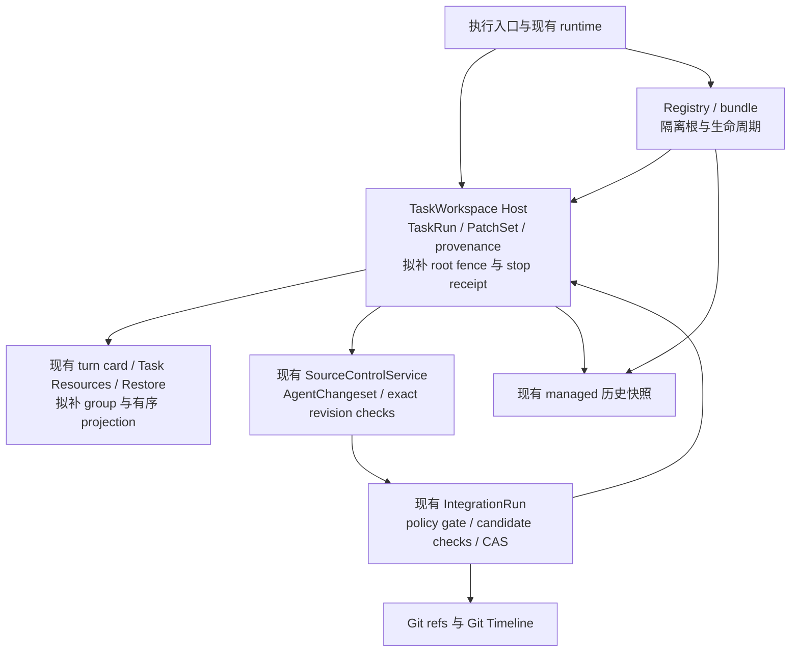
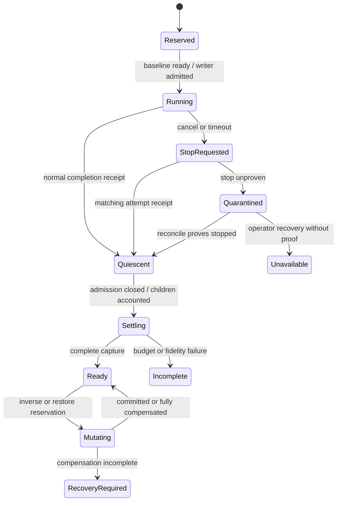
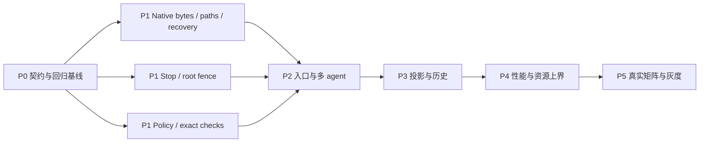

# 先修复变更安全链，再贯通 turn diff、AgentChangeset 与历史

> **已被取代（2026-11-11）。** 实施以[变更链：先止血，再放行并发，再修投影与历史](2026-11-11-change-lifecycle-stopgap-and-history.md)为准，并发模型见 ADR-0255。本文只保留作审计项来源和全量映射的对照；其中的角色分工、排期、W02 根预留、W03a grant 迁移、旧数据与灰度部分不再执行。

日期：2026-11-10（Asia/Shanghai）。状态：**Superseded**（原为 Proposed / 待评审，未实施）。深度：Heavy。负责人：Change Lifecycle Lead（角色，待项目分配具体人员）。

## 摘要：收敛契约，不新增一套变更平台

保留现有 `TaskRun/PatchSet`、`AgentChangeset/IntegrationRun`、Registry 和各类历史的职责，补齐执行停止、文件事务、修订验证、身份关联和投影一致性。优先关闭六个 P1：F01、F02、F03、F17、CF01、CF02；通过后才扩大入口和恢复能力。多 agent 默认使用隔离执行根，共享根必须注册参与者并由一个 capture owner 汇总停止证明。历史页面复用现有 Host ledger 和 Git 查询，不能靠本机消息索引独立决定可恢复性。方案按 P0–P5 交付，每阶段都有回归、退出门槛和故障收敛措施；日期与性能目标须由基线和人员配置确认。

本方案由[缺口审计](../reports/2026-11-10-turn-diff-gap-audit.md)、[对抗性复核](../reports/2026-11-10-turn-diff-adversarial-review.md)和[联合审计](../reports/2026-11-10-turn-diff-cross-feature-audit.md)推导。**没有授权修改产品代码、迁移用户数据或发布**；本文件交付可评审、可拆任务的实施设计。

## 1. 成功标准覆盖安全、入口、历史和资源上界

| 要求                           | 实施后的可验收结果                                                                                                                                    | 主要工作包    |
| ------------------------------ | ----------------------------------------------------------------------------------------------------------------------------------------------------- | ------------- |
| RQ1 优先解决 P1                | 六个 P1 均有当前源码的 RED→GREEN 回归；失败时保留原文件、停止证据与未完成恢复信息；缺检查或错修订不能发布                                             | W01–W04       |
| RQ2 复用现有能力               | capture/inverse 仍归 TaskWorkspace；交付仍归 SCM/Integration；历史读现有权威，没有第二套 capture、merge queue、版本库或检查引擎                       | W00–W09       |
| RQ3 各种 agent 与环境诚实支持  | builtin、SDK、external、Scheduler、Goal、Squad、Best-of-N、Harness 按实际 filesystem authority 和 stop 能力登记；看不到执行文件系统时明确 unavailable | W02、W05、W09 |
| RQ4 多 agent / 多根一致性      | 同一 physical root 不被两个独立 writer/capture 占有；bundle 逻辑别名去重；单仓 CAS、跨仓部分完成可恢复且不冒充原子发布                                | W02、W05、W06 |
| RQ5 历史可定位、可恢复、可解释 | 先定位原 Host、root、run/turn group，再预检；loading/missing/expired/conflict 与 empty 区分；历史快照、消息回退、Git restore 不混用                   | W06–W07       |
| RQ6 性能有上界且不靠静默截断   | capture/watch/diff/query 有独立预算、取消与诊断；消息关联从重复扫描改为批量；超限输出不完整原因并关闭不安全 inverse                                   | W08           |
| RQ7 可迁移、可回滚、可运营     | 旧快照保留只读，未知 fidelity 不伪造；Host/client 服从现有精确版本配对；有冷恢复、故障注入、真实环境和灰度门槛                                        | W00、W09      |

不在本轮建设范围：自动将每个普通 chat turn 变成 changeset；新建通用“Workspace History”后端；跨仓 Git 原子提交；用 LLM 补历史作者；给所有外部 agent 宣称 SDK rewind；把 Artifact/Canvas/Memory 的版本改成文件快照。F16 的实时 Codex diff 只在核心闭环后评估为提示数据。

## 2. 当前证据足以定改造方向，尚不足以宣称真实环境验收

基线为 `3cf253e34822fb9db76b003e6df6aa8ec8f66529` 加共享工作树未提交源码；实施开始前重新记录相关文件哈希。下列“已确认”指当前源码/探针边界，不代表已在所有 provider、设备和操作系统上复现。

| 证据状态            | 当前结论                                                                                                                        | 对方案的约束                                                                           |
| ------------------- | ------------------------------------------------------------------------------------------------------------------------------- | -------------------------------------------------------------------------------------- |
| Confirmed           | turn-focused 保留 17 项：4 P1、12 P2、1 P3；另有 CF01–CF05 共 2 P1、3 P2                                                        | 沿用编号；F07 正常 mobile Host 切换已撤回，不能重新计入缺陷                            |
| Confirmed           | F01 提取的六段当前 native 函数在写入失败时丢失原文件；F17 的 clean Git 文件物理字节可不同于 HEAD                                | 文件原样恢复不能只依赖 Git status/HEAD；现有写入事务要先修                             |
| Confirmed，边界受控 | CF01/02 实际 TS + fake Host/sandbox；CF03/04 actual modules + controlled database/patch ports；CF05 源码路径                    | 需要补真实 native gate、发布与并发回归，不能把 fake published 当实际 Git 发布          |
| Confirmed           | 新增跨功能检查 32 suites / 407 tests passed、零 skipped                                                                         | 是审计回归基线，不是改造后验收；旧 18-suite 结果仍为 634 passed / 1 failed / 1 skipped |
| Confirmed           | 现有 Task Resources 有 Host-backed fallback；Git immutable query cache、commit-graph maintenance 和 integration recovery 已存在 | 扩展读取和身份关联，复用缓存/恢复，不以“完全缺失”为理由重建                            |
| Inferred            | 停止、mutation fence、精确 revision/policy 是各入口的共同前置条件                                                               | 安全契约先落 Host/runtime，再扩展 UI 与入口                                            |
| Open                | 当前完整 native 构建、真实晚到写入、双 Host 保留历史、OS/设备、production RSS/latency                                           | W09 列为单独验收；UNKNOWN-revision helper 只保留历史支持证据                           |

F03 只限 non-Git/fallback walk 与 include descendants 的路径转换，不推广为普通 Git 路径都错。F06 限 builtin-provider Plugin/Bot `agent.turn` 与 scheduled Goal；Plugin Agent SDK `run`、external-provider central runner 已有下层 capture owner。历史冷恢复“选最早 task”的猜测已被 service 排序反证。

## 3. 四类权威继续分工，UI 只组合可核验的关系

**复用现有 owner，统一的是身份、前置条件和事件顺序。** 下图实线表示现有所有权方向；括号中的 fence、receipt、revision 和 group 是本方案拟补齐的契约，不表示已实现。

| 模型/能力             | 权威及操作粒度                                                                       | 继续复用的实现                                                                                                                                                                                    | 本轮补齐                                             |
| --------------------- | ------------------------------------------------------------------------------------ | ------------------------------------------------------------------------------------------------------------------------------------------------------------------------------------------------- | ---------------------------------------------------- |
| TaskRun / PatchSet    | 单次 execution、physical root、before/after、hunk/file inverse                       | [service.rs](../../crates/cognia-task-workspace/src/service.rs)、[ledger.rs](../../crates/cognia-task-workspace/src/ledger.rs)、[snapshot.rs](../../crates/cognia-task-workspace/src/snapshot.rs) | 物理 fidelity、事务、停止、fence、run linkage        |
| AgentChangeset        | managed GitWorktree 累计 base/head、pinned ref、head-bound gates                     | [changeset.rs](../../crates/cognia-task-workspace/src/changeset.rs)、[review](../../lib/scm/review/review-changeset.ts)                                                                           | 策略义务、exact revision lease、稳定 target          |
| IntegrationRun        | 一仓一 target 的候选构建、检查、CAS、恢复、整体 rollback                             | [integration.rs](../../crates/cognia-task-workspace/src/integration.rs)、[orchestrator](../../lib/scm/integration/orchestrator.ts)                                                                | policy/check 身份、已有 root locks 与新 fence 的协调 |
| Registry / bundle     | 执行根归属、托管 checkout、archive/pins、跨根编排                                    | [client.ts](../../lib/task-workspace/client.ts)、[coordinator](../../lib/squads/workspace/integrate-team-run.ts)                                                                                  | physical-root 去重、reservation、partial recovery    |
| provenance / adoption | Host provenance 是事实；Dexie adoption 是可重建本机投影                              | [provenance.rs](../../crates/cognia-task-workspace/src/provenance.rs)、[outcome.ts](../../lib/code-adoption/outcome.ts)                                                                           | 单调 revision、事务、reconcile、Unknown 保留         |
| 历史入口              | Git、Task Resources、managed snapshot、RestorePoint、SDK checkpoint 分别查询其 owner | [联合审计能力表](../reports/2026-11-10-turn-diff-cross-feature-audit.md)                                                                                                                          | session/bundle 导航、origin、预检和失效通知          |

`PatchSet Applied`、`Integration Published`、`snapshot restored` 和 `chat branched` 是独立事实。发布到 target ref 不自动把所有 turn 标成 Accepted；Undo 不改写过去的 commit/作者。changeset 最新 run metadata 不代表累计内容全由最后一轮生成。Artifact/Canvas/A2UI/Harness 内容版本与 Project archive、Memory history 保持其原语义。

### 3.1 身份必须携带 authority，路径和同名 runId 不能作为 join key

下列字段描述**拟扩展的契约**，实现时优先扩展现有 DTO/descriptor，不建立平行协议。

| 身份             | 最少绑定内容                                                                                            | 验证位置                                                       |
| ---------------- | ------------------------------------------------------------------------------------------------------- | -------------------------------------------------------------- |
| Authority        | 原 Host 的稳定标识、账号/授权 scope、现有 transport origin 引用                                         | 调用前路由 + Host 当前授权；origin 只是定位，不能授权          |
| Physical root    | authority + canonical executionRoot；managed workspace identity；Git 场景另有 canonical commonDir       | Host canonicalization、symlink/confinement、Registry ownership |
| Turn group       | sessionId、existing bundleTurnId（有则复用）、native TaskRun IDs、user/closing/intermediate message IDs | 原 Host 的 TaskWorkspace/provenance；Dexie 只索引              |
| Executor attempt | runtime run/attempt、owner epoch、participant set、stop/admission receipt                               | 执行 owner；chat 数值 runId 与 native string runId 显式映射    |
| Delivery target  | repository identity、完整 target ref、run base SHA、expectedOldSha                                      | dispatch 固化 + Integration CAS；显式 retarget 生成新版本      |
| Check identity   | head/candidate SHA、policy target SHA/digest、required profiles、批准命令/config identity、attempt      | 现有 acceptance 运行器 + native gate 验证                      |

同一 authority 下 symlink 别名、父子目录重叠和多个 bundle logical roots 指向同一目录必须冲突/合并；不同 Host 的相同路径不相等。root generation/epoch 防止路径复用后旧 receipt 获得新目录权利。native 已有 `bind_assistant_message`，先接通 closing message 的生产调用，再扩展 group/range 关联；不再依赖“每个 assistant message 都应有独立 run row”的假设。

## 4. 六个 P1 分三条修复线，退出条件缺一不可

### 4.1 W01：在现有 ledger 中建立可恢复文件事务与真实基线

**先 staging，后发布；每个被移动的原件都必须有可恢复记录。** 改造 `ledger.rs::commit_plans/write_entry`，使用现有 provenance mutation intent/恢复机制扩展逐 entry 的持久状态，不新增另一套通用 journal 服务。复用 `cognia-core::fs_atomic` 的同目录临时文件、sync、权限和故障测试经验，但该 helper 是设置文件的单文件 mtime CAS，不直接承担多文件、symlink/delete 事务。现有 revision-patch 的 publish/unwind 同样需要核对失败窗口，不能原样复制。

具体顺序：

1. 在 common root reservation 下预检全部 entry：原路径编码、资源种类、原始内容 hash/mode/link target、冲突、容量与同目录 staging 可写性。预先 pin before/after blobs，保留本次 operation id。
2. 在目标所在文件系统 staging 新文件/链接；设置应保留的 mode，flush 文件并按平台保证同步目录。删除 entry 也先准备可还原原件。任何 staging 失败不得删除原路径。
3. 持久化 intent 及每项 planned/staged 状态后，将原件 rename 到受控 backup；**原件移动成功立即记入可回滚集合**，再 rename staged 到目标。状态必须覆盖当前失败项，不能只覆盖前面成功项。
4. 全项成功后提交 ledger/provenance 结果并同步；再清理 backup/staging 和释放临时 pins。SQLite 与 filesystem 不是同一原子事务，重启按 intent + 实际路径/hash 协调，不能靠一次 SQL commit 假装完成。
5. 任一发布失败按逆序补偿；补偿失败进入 `RecoveryRequired`（拟议状态/错误），记录未恢复 entry，保留 backup/blobs/reservation，展示恢复路径。禁止忽略 rollback error、清空 intent 或直接继续下一轮。

单 run Apply/Undo 当前没有客户端 request operationId 幂等契约，provenance 内部去重与 Integration op_log 不能直接替代。本轮在**既有 mutation intent/store 与 command descriptor**上新增 request-scoped key、operation fingerprint、expected patch revision 和可查询结果：同 scope/key + 相同参数只返回已持久化 outcome；同 key 不同参数拒绝。响应丢失后先按 key reconcile，禁止再写一次；旧 key 即使随后已 Undo 也返回原 Apply receipt，不能重放 Apply。记录过期后返回 operation-expired/需重新预检，不能当从未请求。key scope 包含 authority/account/实际 target、run/patch 与操作种类，不能由另一个 Host/root 复用。W01 的事务 commit 同步持久结果，W02 提供查询/恢复与 reservation；projection 的 revision 由此权威结果产生。

单文件原子替换不能使多文件对外瞬时原子。保障是 Cognia 内部排他、可恢复和结果诚实；任意用户外部进程仍可能修改磁盘。发布前再次检查原路径及 hash，拒绝 symlink escape；无法消除的平台 TOCTOU 必须用适合平台的安全文件句柄/目录约束，并保留冲突而非覆盖未知新内容。

历史 snapshot restore 的 `clear_worktree_contents` + materialize 也必须改为同一可恢复 replacement plan，涵盖被删除但目标 snapshot 不再包含的文件、创建的目录和种类替换；仅加 busy/root fence 不能避免重建一半失败。Bundle 补偿引用父/子 operation id 并复用该事务，不嵌套另一次不可恢复清空。该接入随 W01/W02 安全基础交付，不能等新历史 UI 完成后再修。

**F03 路径：** POSIX literal `\` 不能转换成 `/`。将 native 原生路径到 ledger key 的编码集中在现有 snapshot/ledger 边界，保持可逆、带格式版本；Windows 分隔符、UNC、drive/case、Unicode、non-UTF-8 文件名须分别处理。无法无损表达的路径标为 unsupported/incomplete，不做 lossy key，也不允许据此 inverse。普通 Git path 的现有正确流程保留。

**F17/F04 基线：** begin/settle 对实际 materialized 文件读取并校验 raw bytes；只有 raw Git blob hash 与 HEAD oid 相同才复用 Git object 存储，否则保存物理 blob。Git status 用于候选提示，不能证明 assume-unchanged、skip-worktree、过滤器/CRLF 下的字节相等。managed WorkingState overlay 必须包含物理不一致部分；新 GitRef checkout 在 checkout 完成后采 baseline。sparse 未物化项、submodule、LFS/working-tree-encoding 等能力按实际可见性标注 complete/unsupported，不能静默 clean；不擅自改用户 index flags，也不在 Undo 执行用户 smudge filter 来“猜”历史字节。

P1 安全最小版本可对尚不能证明 raw/path fidelity 的 operation 拒绝自动 inverse/restore，并保留可读 diff 与原因；完整捕获优化放 W08。legacy before bytes/路径已丢失的记录无法凭当前配置回填。

### 4.2 W02：停止证明与 root reservation 共用 Host owner

**cancel requested、调用 Promise reject、超时及 signal drain 都不是 executor stopped。** 扩展现有 execution owner / TaskWorkspace lifecycle，不在每个 UI 各自补一个 busy boolean。普通 capture owner 与 worker 都必须满足证明，不能只把 `requires_executor_stop_confirmation` 置 true 后保留 `owns_capture` 旁路。

上图为**拟议内部状态/transition contract**，不要求把所有名称直接加入现有公共 enum；公共状态可以映射，但不能丢失 quarantine/recovery 的持久信息。

停止契约复用 `onExecutorStarted` 的独立 completion observer、现有 external/worker lifecycle 和 [ADR0244](../content/docs/en/adr/0244-a-remote-run-has-stopped-only-when-its-worker-says-so.md)：receipt 绑定 attempt/epoch、capture owner、根和参与者，拒绝迟到旧 attempt。长驻 chat session 正常结束需“本轮 admission 已关闭 + 所有本轮写入参与者已 quiescent”的证明，不能强行把 `session_disposed` 当每轮正常完成。不能提供此证明的 adapter 选择明确 dispose/recreate 或暂不提供 reversible capture；这是能力降级，不是超时后假成功。

ADR0244 当前 StopProof 范围包含 Bash/jobs/PTY/Claude CLI 的既定边界，不自动覆盖所有 MCP/hooks/LSP、远程进程树或 Windows 子进程。按实际 writer capability 注册；不能证明停止的 writer 保持 quarantine，不执行 settle 为 Ready、不开放 Undo/历史 restore、不开始复用该物理根的新 writer。可从明确隔离的新根开始新任务，但不能把未知 writer 搬到 source root。

Quarantined→Quiescent 仅接受原 attempt 可独立核验的真实停止/无未归属写入证据；人工确认清理并不补造过去证据，沿现有 `confirm_executor_stopped` 的 no-patch Failed 恢复语义进入 unavailable。never-started 也须由 admission 原子拒绝的记录证明，不能把没收到 start callback 当作从未执行。

**reservation 规则：**

- 复用 capture-admission/canonical-root/已有 cold-snapshot locking，扩成同一 Host 服务内的 durable root reservation；同一共享 volume 多进程采用一致的 OS/process lock 与 owner epoch。Store mutex 仅保护短数据库状态，不持有跨 `await`、遍历、压缩、Git diff 或进程等待。
- writer 生命周期占有的是实际 `executionRoot`。managed provisioning/capture 对 `sourceRoot` 只持有短暂读取/物化 reservation，不能把所有隔离 agent 都锁在同一 sourceRoot 整个运行期。
- begin、settle、Apply、Undo、snapshot clear/materialize、archive/restore、实际触碰 checkout 的 publish/rollback 共用该边界；Git ref CAS/Integration process lock 继续保留，不被 root reservation 替代。
- 多根先 canonicalize、合并别名/检测祖先重叠，再按稳定 authority/root 顺序一次取得所需 reservation。锁顺序固定为 root reservation → integration/repo/ref lock → 短 store transaction；不得反向等待。迁移既有 integration 锁路径时新增死锁与取消测试。
- 独立 agents 使用独立 managed roots。确需共享同一物理 turn 的 child 必须由 parent owner 显式注册 participant/sublease、一个 baseline/capture owner、父级等待全部 child stop。相同 sessionId/parentRunId 不是通行证；未注册 writer 拒绝 admission。

**reservation 按实际读写目标取得，不能一律锁 executionRoot。** sourceRoot 的短读取 reservation 只描述 managed provisioning，不豁免 Apply/Undo 对 source 的写入。

| 操作                                                                          | 实际 physical target 与 reservation                                                                                                                               |
| ----------------------------------------------------------------------------- | ----------------------------------------------------------------------------------------------------------------------------------------------------------------- |
| begin/执行/settle                                                             | actual executionRoot；Observed Local 中常与 task.workspace_root 相同；运行 writer 的 reservation 交接给 settle，不提前释放                                        |
| managed provisioning / WorkingState source capture                            | sourceRoot 的短 read reservation + 新 executionRoot 的 provision reservation；可控读写都参与同一 admission，不能与 source mutation 重叠                           |
| single Apply/force-apply/Undo                                                 | 当前实现实际写 `task.workspace_root`，即 source workspace；目标必须取 mutation reservation，即使 patch 来源 executionRoot 不同。保留原内容/selection precondition |
| bundle Apply/retry/Undo/compensation                                          | 对所有实际 source mutation roots 去重并一次 reserve；子 operation 消费父 reservation，不递归重取锁                                                                |
| managed snapshot restore / archive restore                                    | 被清空/替换的 executionRoot；archive source 只读与目标写入分别登记；replacement/recovery 始终保留目标 reservation                                                 |
| SDK rewind / Git file restore / checkout / checkout-mutating publish/rollback | 由 owner 申报实际将改变的工作目录；与 source/execution 相等或祖先重叠即冲突；仅 ref 更新另受现有 ref CAS/locks                                                    |
| verification lease / mutation recovery                                        | exact-checkout 目录及实际待恢复路径；停止/恢复未确认不得释放；不能因关联 task 已终止而绕过                                                                        |

例如 agent A 在 sourceRoot 上 Observed Local 运行时，agent B 的 managed PatchSet Apply 到同一 sourceRoot 必须被拒绝/排队；B 独立 executionRoot 仍可继续计算。不能以不同 task/session 身份放行。

修复入口包括 generic builtin executeAgentTurn、Scheduler chat、Best-of-N builtin、`run-and-capture` timeout 与 external manager timeout。保留已有正确的 external ordinary cancel 等待 `run.execution` 路径。Host snapshot restore 的“先检查 busy、后解锁 clear/materialize”窗口也由 reservation 关闭；UI busy/确认后二次检查只是交互优化。

### 4.3 W03/W04：检查必须绑定策略、修订和执行配置

**沿用现有 acceptance 引擎和 native eligibility，修复其输入与证据。** CF01 不能只改 IntegrateDialog；CF02 不能仅在可变目录执行前比较一次 HEAD。

W03 扩展现有 gate 元数据，拟议 `GateEnvelope` 包含：changeset id/version/headSha，repository/targetRef/expectedOldSha，按此 target SHA 读取的 policy digest，stored + policy requiredChecks 并集，以及 profile 的批准命令 hash/config identity。Host prepare/rebuild/publish 验证同一 envelope；配置/命令变化必须使同 profileId 的旧通过结果失效。target policy 含义沿用现有 SCM policy/schema 与安全配置边界；native 只补同契约约束适配，不重建评审引擎。

权威取得方式采用**native 最小策略约束适配 + 现有 acceptance 引擎的 Host evidence port**。native 在固定 target SHA 读取 `.cognia/workspace.json` 的 review block，以现有 [strict TS parser](../../lib/scm/review/review-policy.ts) 的共同 fixtures/closed-world schema 校验 requiredChecks、protected/humanApproval 等约束；不重建 review-agent 或 acceptance 引擎。malformed/duplicate/unknown fields 与 TS 同样拒绝，missing 才使用既有默认值。renderer/plugin 传来的 requiredChecks 只能增加要求，不能删 native policy 义务。

当前 [acceptance profiles DEFAULT_HOST](../../lib/router-fusion/verify/acceptance-profiles.ts) 读取 Zustand/Dexie project/settings，批准记录在 [TrustedWorkspace](../../lib/project-environment/workspace-config-trust.ts)，**不是已有可直接调用的 native/headless 受信服务**。因此 W03 包含以下必要的 authority 迁移，不将其藏成一个未定义 port：

1. 以 TaskWorkspace 现有 SQLite/store 为交付 gate grant 的持久 owner，保存原 authority/account/repository、批准的 profile command/config hash、授权 scope、版本与撤销时间；不建立通用 trust server。现有 UI trust/approval 流程通过同一 Host command boundary 显式创建/撤销 grant，Dexie 保留 UI projection；旧 browser approval 不自动升级成远程 Host grant，需要在对应 Host 重新确认。无 grant 的 headless 默认拒绝执行/发布。
2. 把现有 acceptance pipeline 的 profile resolution、approved command execution/report collection 通过注入 host ports 绑定上述 grant、verification lease 和 attempt；Host 授权并观察实际 sandbox/executor 结果、保留 report digest/来源，再签发内部 evidence receipt。仅 caller 自报的 `passed`、headSha、commandHash 或一个 caller 也拿得到的随机 token 不构成执行证明。不新增模型调用，不执行未批准命令。
3. public `changeset_record_review/check`、`integration_record_check` 仍可保存诊断，但 gate 只采纳 Host owner 验证的 attempt/lease/context receipt；客户端不能自填 `requiresHumanApproval=false` 降低 native policy/risk/内建 protected-path 要求。人类批准经现有 approval ceremony 绑定当前 head/context 与授权 actor，不能以任意 approver 字符串代替。review model 输出沿现有端口保留，但不能自行解除人类义务。
4. W00 先用 bounded native/headless spike 验证 grant→实际 executor→receipt→record→publish 拒绝/允许的整条路径，确定注入点与 schema ownership；该 spike 不创建新执行引擎。不能落到受信 Host owner 的平台保持 review-only，不降级信任 renderer。W03a 交付 grants/evidence boundary，W03b 才开启统一 policy gate，二者同属 P1，不能先扩大自动发布。

顺序是固定 `expectedOldSha` → 读取该 SHA 的 policy → 解析批准配置并固定命令身份 → review/check → candidate build/check → publish CAS。target_moved 后按新 target SHA 重新解析，重建 candidate；清空 candidate checks，并对 policy/config 改变影响的 head review/check/approval 失效、重新征得所需批准。changeset recapture/head/version/dependency 改变同样使相应 envelope 过期。review approve 不绕过 required check 失败。

W04 把 [Best-of-N checks](../../lib/best-of-n/checks.ts) 的 managed `GitRef(headSha)` acquisition 范式提炼到**现有 SCM runtime 的检查端口**。原子读取并 pin changeset head/ref/version 后取得 lease，fresh checkout 的实际 root 交给现有 `code-acceptance-host`；报告绑定 lease/attempt、SHA、profile command/config identity。检查可写入临时 checkout，不能影响原 executionRoot；“commit 不变”不等于目录永远只读。当前修改 dirty/inherited workingState 不能冒充 pinned bytes。

lease 从 acquisition 到 check executor 确认停止、报告持久化后才 archive/release；abort/超时而停止未确认时隔离 lease，不能 finally 立即回收。changeset 同时 recapture/abandon、changeRef 移动或 retention 都要有 pin/CAS 保护。对于 dirty checkout、敏感内容、私有 index、Git LFS/filter 网络和 sandbox 仍执行现有权限/egress 规则，不为验证绕过它们。

多个 profile 不能共享前一 profile 已修改的源码并继续都标 exact-head。默认每个 profile 从同一固定 SHA 的独立/重置且核验过的 lease 开始；可复用 dependency cache，但 cache 不能覆盖 tracked source 或批准命令。profile 的输入修订、输出 artifacts 与下一 profile 的环境依赖显式区分，并用“第一个 check 修改文件、第二个 check 检查原始失败内容”的回归证明隔离。

候选检查继续在 integration 自有 candidate checkout 执行。Squad/Best-of-N 已主动并集策略的保护保留；通用 runtime、手动 integration、Harness 共享新契约。整仓 rollback 沿 ADR0227 的既定语义处理，本方案不暗改成逐 item inverse，也不把其明确决策误报为缺陷。

### 4.4 六项 P1 的明确退出门槛

| 缺口 | 必须先失败后通过的行为回归                                                                                                                       | 当前完整运行所需证据                                                                      |
| ---- | ------------------------------------------------------------------------------------------------------------------------------------------------ | ----------------------------------------------------------------------------------------- |
| F01  | 单/双文件在 staging、rename、chmod、fsync、补偿及进程 crash 各点失败；原件保持或明确 RecoveryRequired；重启可完成恢复                            | 当前 crate 的 fault-injection + public-service integration；保留 hash/mode/link 断言      |
| F02  | cancel/timeout 后故意晚写；收到匹配 stop receipt 前不得 Ready/inverse/复用根；同 Host capture owner 不能旁路；旧 epoch 拒绝                      | 当前 native + TS lifecycle 联测；真实 executor 验收另属 W09                               |
| F03  | POSIX literal backslash 与 slash alias 同时存在，include descendants 不能误撤另一文件；不支持编码明确拒绝                                        | 当前 snapshot→settle→Undo 实际 native 路径；Windows/非 UTF-8 分类单列                     |
| F17  | clean CRLF、clean/smudge、mode/link、过滤后原始字节 capture→change→Undo 原样相等；失败不得删原件                                                 | 原生真实 Git fixtures；LFS/encoding 未覆盖时明确 capability                               |
| CF01 | policy-only failed/missing check + approved review，手动/API/Squad/Best-of-N/Harness prepare/publish 均拒绝；target policy/config 变化使证据过期 | 真 native gate + 临时仓 candidate/CAS 发布正反对照                                        |
| CF02 | pinned broken、live fixed 的检查必须失败；检查 root 为新 lease；并发 recapture、取消晚停、cleanup failure 不误标 SHA                             | 实际 acceptance executor + managed GitRef/native checkout；没有 fake sandbox 替代最终验收 |

## 5. W05 将所有 agent 入口接到同一 lifecycle，不增加新执行器

**支持依据是 filesystem authority、before-write admission 和 stop 能力，不能依据 agent 名字。** begin 必须在第一条可写工具/进程之前完成；没有该边界的 post-write 事件只能显示 hint/unavailable。

| 入口/环境                                                | 复用 owner                                                     | 本轮动作与降级                                                                                              |
| -------------------------------------------------------- | -------------------------------------------------------------- | ----------------------------------------------------------------------------------------------------------- |
| builtin chat、generic executeAgentTurn                   | 现有 agent execution service / TaskWorkspace tracker           | 接通 independent stop observer、group、root reservation；工具 writer 注册                                   |
| Claude/provider SDK chat                                 | run-and-capture / provider handle / checkpoint                 | 处理 interrupt 超时、late callbacks、turn quiescence；checkpoint 仍按 provider 能力显示                     |
| Plugin Agent SDK `run`、external-provider agent API      | 已有 executeAgentTurn 或 central runner                        | 保留已有 lower capture owner，避免双 begin；向上透出 group/coverage                                         |
| builtin-provider Plugin/Bot `agent.turn`、scheduled Goal | 当前 direct/builtin 入口 + 现有 execution service              | 转接既有 owner，回归 F06；不能直接套 UI hook 或创建第二 capture                                             |
| Scheduler chat/external                                  | Scheduler executor + existing external runner                  | 等待停止；补 Scheduler signal 传播；按 endpoint/placement 判 authority                                      |
| Best-of-N                                                | existing per-candidate acquisition/execution/check/publication | 保留已传 signal；补 builtin stop，external authority；候选独立 roots                                        |
| Squad                                                    | existing workspace coordinator / Integration queue             | dispatch 固定每仓 base/targetRef/SHA；target=base 不读 reconcile 时 currentBranch；新建 branch 也从冻结 SHA |
| Harness / workflow / headless                            | existing accepted execution/runtime ports                      | 复用 admission/check gate；核实调用链，不因无聊天消息而丢 history linkage                                   |
| Tauri local、headless Host + web、Capacitor paired Host  | 同一个 headless kernel 和 command descriptors                  | 统一行为/错误，origin 留存；static export 不增加 Next.js server                                             |
| remote sandbox、SSH、A2A、第三方 endpoint                | 实际执行文件系统的 owner                                       | 能在原 Host/worker before-write capture 且证明 stop 才 tracked；只看见本机镜像目录不算                      |
| non-Git / Observed Local / borrowed root                 | TaskWorkspace existing modes                                   | 明示观察/Apply 范围，changeset GitWorktree-only；不能自动重建 Observed Local snapshot                       |

CF05 的 retarget 是显式操作：展示原/new repo/ref/base、重新校验权限和策略、增加 target version 并使旧 gates/candidate 过期。已有跨 root provider_changed holds、dependency order、same-repo 校验继续生效。

多 agent 同 root 的无法归因变化保持 `Unknown`；不由最终消息或最后一个 agent 抢全部作者。跨仓 bundle 先全根 preflight/reserve，但发布仍一仓一个 IntegrationRun：维护已有 coordinator 的每根结果、可重试状态和补偿记录。第一仓已 Published、第二仓失败必须显示 partial，不把重试变成重复发布；复用 operation id/CAS/op_log，逐仓核验 outcome 后继续。

## 6. W06/W07 让投影与历史可重建，避免本机索引成为恢复权威

### 6.1 统一 single/bundle 操作后的投影入口

在现有 `client.ts` 的 single/bundle Apply/retry/Undo wrappers 接同一 reconciliation 入口，按**每个 physical run 的最终 authoritative patch outcome**更新。包括部分成功、补偿、重试和 unavailability，不将 bundle 的总状态映射成所有 roots Accepted。

Host PatchSet/operation 增加拟议单调 `stateRevision`，绑定 run/patch identity；W01/W02 新增的 request 幂等契约使重试返回相同结果/revision，不能误称 single Apply/Undo 已有此能力。Dexie 在同一 transaction 中合并各 root projection，并拒绝比已存 revision 旧的结果。**transaction 只解决丢更新，revision 才解决迟到 Apply 覆盖 Undo。** 不具备 revision 的旧事件触发重新读取最新 Host 状态，不能按客户端接收顺序“发明”版本。

持久权威在 Host；client reconciliation 失败/断线时结果标 projection pending，重连或页面进入按原 authority 拉取增量/当前结果补齐。事件只携带低敏 id/revision/状态，复用现有 changesLedger/event channel；card effect 订阅该失效通知，避免只等 Dexie row/remount。禁止把 projection failure 当文件 Apply 失败而自动再发一次 mutation。

### 6.2 turn group 和 Host 历史填补 F12/F18

tracker 把 `[user, assistant-tool, assistant-final]` 关联到一个 turn group / run family；closing binding 用已有 native API 持久化，intermediate/range 是拟扩展 metadata。Restore 先解析 group、去重 roots/runs、检查原 Host 可用性与保留证据，再生成完整计划。不能对每条 assistant 独立要求 row，也不能遇到 missing row 就静默跳过。

读取先批量取本机 session rows，然后通过现有 Host task/run index 的拟扩展 session/group 查询分页回填。以本轮实际数据为准兼容旧 closing-only rows，不进行作者推断。10k 本机 retention 不再决定 Host 有无历史，但未知旧 Host 如果没有 retained binding，系统也不能凭空发现；显示 missing authority 并允许用户重新连接已知 Host。授权只在原 authority 下检查，不能把相同 runId 发送给当前任意 Host。

### 6.3 复用历史入口，补导航、状态与操作预检

| 入口                        | 拟补齐的行为                                                                                                          | 不改变的恢复对象                                                             |
| --------------------------- | --------------------------------------------------------------------------------------------------------------------- | ---------------------------------------------------------------------------- |
| turn card / mobile Changes  | ledger 事件失效、idle 后新 runs 刷新、loading/missing/expired/conflict 展示；origin-aware 读取                        | 所选 run/root 的 PatchSet；不是自动 changeset                                |
| RestorePoint                | 显式 transcript sessionId；group 去重；确认后重新预检并取得 Host reservation；展示聊天/文件/checkpoint 三种独立结果   | 会话分支与文件 inverse 分开执行/报告，不声称跨系统原子                       |
| Task Resources              | 扩展现有 task/run picker 为 session tasks + bundle physical roots；Host cursor 分页与 origin 保留；empty 前等加载完成 | retained run/resource/event metadata；不伪造每个 watcher event 的版本        |
| managed 历史快照            | 历史 run 选择、全根预检、source/preview/root 信息；clear/materialize 期间保持 reservation                             | 重建 managed execution root，非 source branch；多根失败显示 partial/recovery |
| Git Timeline / file history | 复用 query cache、commit graph；file history 增加现有查询端分页/续取，展示 immutable commit                           | Git commit 内容，不承诺物理原样或未提交历史                                  |
| SDK checkpoint              | provider dry-run/capability；操作后通知 Git/resource/changeset eligibility 失效；Host 可观察写入者也受 reservation    | provider handle 可恢复内容，不能替代 ledger 或跨 provider rewind             |

消息 split panes 不使用 activeSessionId 猜当前 transcript。所有变更路径通过现有 event/invalidation channel 通知 reads；dirty executionRoot 变化不直接废弃已 pin 的 changeset head，但 UI 必须区分“已评审 pinned revision”与“当前 execution root”，重新 capture 才产生新 head 并清 gates。

需要补真实验证而非先判缺陷：retained Host TaskResources/history helper parity、双 Host 祖先 lifetime、checkpoint 引发的缓存失效、snapshot 与新 begin 交错。本轮不能复活已撤回 F07 正常 mobile switch 结论。

## 7. W08 先测工作量，再规定可解释的预算和延迟门槛

**现有容量限制不等于 end-to-end 预算。** Replica 的 8 MiB/file、32 MiB 总量、5000 entries，decoded cache 64 MiB、storage 1 GiB 是各自现有边界，不能不经评估套成普通 capture 的最终产品限制。

| 方向                   | 复用与改造                                                                                                               | 硬性验收方法                                                                                                 |
| ---------------------- | ------------------------------------------------------------------------------------------------------------------------ | ------------------------------------------------------------------------------------------------------------ |
| capture / raw fidelity | 现有 Git/blob store；stream/hash materialized bytes；按目录/文件候选组织；每阶段取消检查；把 I/O/压缩移出全局 store lock | instrument files/bytes/time/peak RSS/lock wait；预算前即停止 admission 或报告 incomplete，不用 HEAD 猜原字节 |
| native diff / storage  | 现有 patch blobs、Git diff；按需/lazy hunks、并发上界；维护可校验 blob quota accounting，减少逐 blob 全表 SUM            | 验证大 text/binary、quota 边界、重启 accounting 校验；不为了快丢 hunk/metadata                               |
| watcher                | 现有 watcher/ignore；bounded channel + 合并路径；先裁剪目录再 inventory；批量 Git ignore                                 | 超限转一次受预算的 rescan，记录 coverage gap；退出不等待无界 backlog；取消延迟可量化                         |
| session correlation    | 复用 session index，单次/分页读 rows 构造 map，batch group/run 查询；保留现有 >40 rows virtualization                    | 固定数据下扫描/查询次数 O(M+N)，不是每条消息重扫 N；缺失/中间消息回归                                        |
| history / rendering    | 复用 Git immutable cache（现有 256 entries/32 MiB）和 commit graph，Task Resources/event cursor 与有界并发               | 首屏/续页分开测；过期缓存不得授予 mutation；origin/revision 是 query key                                     |

P0 建基准，W08 才收紧默认阈值。基准至少涵盖 1k/10k/100k entries、大文件/二进制、1k/10k messages、1/4/16 个隔离执行根、bundle 别名、冷/暖缓存、断线/取消和低磁盘；超大 fixture 可独立离线跑，不能掺进每次 unit suite。每种报告机器/OS/filesystem、fixture hash、当前 binary/source id、P50/P95、work counters、RSS 和取消耗时。

现有 synthetic Dexie 50/100/200 查询触发 2500/10000/40000 predicates，约 69.44/303.28/1752.32 ms；仅用于识别重复工作，**不是 browser SLO**。本方案建议验收：固定 200-message fixture 的行扫描从 40000 降至不超过单次数据量 + 分页常数；首次 batch 后不再逐 message 发 Host 请求；相同 fixture 在相同硬件下 P95、RSS、取消延迟不劣于 P0，目标值由测量后评审。capture bytes/entries、watch backlog、diff time、max concurrency 必须有有限默认值；其具体数值是 Q4 的批准内容，超限用户能选择缩小范围/隔离 workspace/明确重试，不能得到伪完整可撤销记录。

新增 metrics 复用现有日志/追踪，不记录文件正文、原始命令、秘密或无限 path 标签。建议低基数 counters：stop_unproven、recovery_required、fidelity_incomplete、stale_gate_rejected、projection_reconciled、capture_budget_exceeded、watch_rescan；traces 使用已有 request/run/operation id 关联。只有权威 stop-unproven / recovery-required 状态转换才隔离对应根并提供人工恢复入口，counter 仅观察该状态。stale gate、预算超限与 fidelity incomplete 是 scoped refusal/diagnosis，不因计数 >0 就 quarantine 健康根；性能阈值越界触发降并发/预算诊断，不自动删除证据。

## 8. 兼容、权限和迁移必须先于扩大 mutation 权限

### 8.1 存储和协议保持同一个真源

- native SQLite：在现有 store migration 中添加必要的 fidelity/path format、reservation/owner epoch、mutation journal/revision/gate 元数据。可选列先兼容读旧记录；枚举/DTO 变更需同步 schema、serde、生成 manifest 与所有 transports。新格式记录明确 version，旧记录缺省为 unknown，不默认为 safe。
- Dexie：优先复用现有 session index 和可重建 row，optional projection/group 字段不一定需要 index/schema 变化；不以加 compound index 作为 F15 前提。若实测必须改 schema，读取实施时的 `CURRENT_SCHEMA`、协调 version，遵守 frozen v240 与 `storageLayout` reset 策略；本方案不预留版本号，也不承诺旧式 `.upgrade()` 全量回填。
- Companion：复用现有 [command descriptors](../../lib/tauri/command-descriptors.ts) 与 [ADR0175](../content/docs/en/adr/0175-the-rpc-face-has-one-grammar-one-error-and-one-version.md)。当前 `whoami` contractVersion 不匹配会拒绝整套 dispatch；新增公共 contract 后按现有生成链协调更新 Host/web/mobile。不能声称旧 Host + 新 client 仍可远程只读，除非另外设计并批准兼容层。本方案保持 exact-version fail-closed；本机已有缓存可只读并标过期。
- 传输目标、operation/capability/risk/approval/idempotency/pagination/longRunning/error schema 继续在同一 descriptor/manifest 管理。Tauri、headless RPC、web/mobile 不各写一份规则；Rust library 不隐式依赖 Tauri、sidecar 使用实际未编译 TS 路径。

### 8.2 旧数据只做可证明的恢复，不伪造 fidelity

legacy diff/changeset/review/history 尽量保持可读；缺物理 before bytes、lossy path、旧 stop 证据或未知 coverage 的记录标 unverified。只有 retained evidence 足以证明实际历史基线时才开放对应 inverse；有 blob 不等于 blob 是物理原件。旧 snapshot 可以保留导出/对照，不能靠当前 HEAD、配置或磁盘重构不存在的过去。新 reservation/gate/revision 从明确 upgrade boundary 启用；新旧投影可以重建，但不改写未知 provenance。

Task/Patch retention、Registry archive pins、changeset refs/Integration records、provenance versions、Dexie 10k 分别维护。mutation recovery、quarantine、verification leases、active run 和尚未 reconcile 的必要证据延长 pin；reconciled 后再按各 owner 现有 retention 释放。不能为了统一历史把多个 store TTL 强制合并，或删 pin 来满足 quota。

### 8.3 权限与隐私复用原有 gate

所有根和 retained Host 查询重新校验当前授权、confinement/protected paths、sensitive history、sandbox 和 egress；UI projection 不授予写权限。新的 history/group/report 只传必要 metadata，文件正文沿现有权限路径读取。复用 PII redaction gate；本方案没有新增模型调用的理由，不把 capture 内容自动发给 reviewer/model。Plugin/Bot 入口的能力上限不因接入统一 capture 被扩大。

authority/account/workspace 是所有 read cache、projection 和后台任务的 scope；切换账号/撤销 Host grant 时取消对应后台读取并使 UI 缓存不可再授权操作。用户删除 workspace/account 数据时沿现有 data-governance 删除链清理其 projection/group/新 metadata；仍需恢复的 intent/pins 按既有显式保留/导出流程处理，不能在别的账号下继续可见。backup/export/import 同步包含格式版本与必要恢复记录；import 不带入原 Host 的有效授权或活跃 owner token，先只读/隔离并重新验证 fidelity、authority、pins 和 recovery 状态。

snapshot restore、SDK rewind、Git checkout、integration rollback 等操作的审批/风险 ceremony 复用现有策略。确认后状态可能变化，所以 Host reservation + revision/hash precondition 是最终裁决。未知操作 outcome 先 reconcile，不盲目重试可能已成功的 Apply/Publish。

公共 command 继续返回有名字段的 object DTO（包括 operation id、per-root outcome/revision、typed error/recovery context），不用 Rust tuple 隐式序列化数组。新增字段在 schema/serde/TS fixtures 中逐项验证；长运行操作沿现有 polling/event/reconcile 模式，不把 detached 任务生命周期交给组件卸载。

恢复与拒绝 UI 的说明、aria labels、toasts 进入 en/zh-CN split i18n；dialog 支持键盘、focus return 与读屏状态播报，partial outcome 列出每根可重试/需恢复状态。mobile paired 与 standalone 分开展示：无 Host/不支持环境不出现可执行 mutation 承诺。W07 的 UI 验收包含这些可访问性与 iOS/Android 差异。

### 8.4 回滚的是可选入口和流量，不回滚已修复的安全约束

若新投影/历史 UI 出错，禁用其新入口，仍可从现有 Task Resources/Integration history 读取。若预算配置回归，可回退配置至已验证值；如果物理证明缺失仍保持拒绝。新开关如需增加，明确由哪个现有配置 owner 管理，**不是宣称已有 taskWorkspace 总开关**。

文件事务失败保留 recovery intent/backups；新 gate 或 stop/fence 故障暂停相关 mutation/新 writer admission，以 forward fix 恢复。不能把有新格式/活跃 reservation 的 volume 交给不认识这些约束的旧 Host binary，旧程序不会自动尊重新增 min-version 字段。必须降 binary 时先停止 writer、处理/导出恢复记录，并在隔离环境从验证过的旧格式备份恢复；不能在共享新格式数据库上直接降级。所有灰度收敛措施都保留安全修复。

## 9. 六阶段实施，以验收结果决定前进而不是按日历放行

以下工时是**低置信度排期估算**：基于 3 条可并行工程线（Native、Runtime、SCM）和共享 Frontend/QA 支持，含联调、不含外部 provider/设备排队；不是当前性能数据或交付承诺。首轮 P0 后重估。预计 5–8 个工作周；P1 安全链约占前 2–3 周，若 native/平台故障暴露则顺延，不越过 gate。

图中 P1 三线可并行，但共享 `service.rs`、DTO/schema/manifest 的改动由 W00 契约负责人串行协调；性能 instrumentation/fixture 可从 P0 开始，不能等 P4 才发现不可行。为 P1 修复所必需的 raw-byte 预算、原生 test seams 与 UI 拒绝原因随 P1 交付。

| 阶段                      | 范围与产出                                                                                                                                  | 依赖与退出门槛                                                                                         | 故障收敛                                                                     |
| ------------------------- | ------------------------------------------------------------------------------------------------------------------------------------------- | ------------------------------------------------------------------------------------------------------ | ---------------------------------------------------------------------------- |
| P0，2–3 工程日            | W00：冻结术语/contract、当前 source/binary 哈希、RED reproductions、现有 baseline failures、资源基准；给 unsafe legacy inverse 设计明确拒绝 | 六 P1 regression oracle 可运行；所有新增字段/command owner 唯一；不把旧 passing suite 当新证明         | 只做隔离 fixture/安全拒绝；保留原数据，不开始迁移/扩大入口                   |
| P1，8–12 工程日关键路径   | W01 bytes/path/事务；W02 stop/fence；W03/W04 policy + exact revision；必要 origin/receipt/schema 基础                                       | 六项 P1 全部 native/runtime/SCM gate 通过，恢复/取消/并发拒绝路径通过；独立审查无未处置 P1             | 暂停相关 mutation/共享根 admission；保留 recovery/pins；不降旧安全逻辑       |
| P2，4–6 工程日            | W05 入口覆盖、authority、Squad frozen target、child participant/bundle 去重                                                                 | 支持矩阵每行都有 tracked/observed/unavailable 的实测或明确能力拒绝；无双 capture；target switch 正反例 | 暂关新接入口，沿既有 owner/不支持状态返回                                    |
| P3，5–7 工程日            | W06 有序 projection；W07 group/Host history、Restore、session/bundle 导航                                                                   | CF03/04、F08–F12/F18 回归；旧/新 rows、跨 session、双 Host、partial bundle 和 offline 对照正确         | 暂关新导航/自动 reconcile 批次，保留 Host 权威结果和旧只读入口               |
| P4，4–6 工程日            | W08 capture/watch/diff/query budgets 与基准；file history 续页；F16 是否进入需独立决策                                                      | 工作量上界、取消、内存、锁等待达成 P0 后批准的阈值；超限不暴露 unsafe inverse                          | 回退可调预算/并发；保留 incomplete/fidelity gate；不回退到无界队列           |
| P5，3–5 工程日 + 外部排队 | W09 当前 native/provider/OS/dual-host/device 验收，迁移/冷恢复/灰度、更新 ADR/docs                                                          | 确定 rollout subset 的实际矩阵通过；不支持单元明确展示；所有 P1关闭，P2 有处置 owner                   | 按 root/入口暂停新流量，reconcile pending outcomes；新格式 Host 安全约束常驻 |

### 9.1 工作包必须能独立指派，但共享文件不能同时重写

| 包                              | 唯一责任角色                    | 首要文件/模块                                                                                                                                                                                         | 前置依赖                                                 | 独立验证 / 产物                                                                                        |
| ------------------------------- | ------------------------------- | ----------------------------------------------------------------------------------------------------------------------------------------------------------------------------------------------------- | -------------------------------------------------------- | ------------------------------------------------------------------------------------------------------ |
| W00 契约/基线                   | Change Lifecycle Lead           | 本方案、evidence、现有 DTO/schema/command manifest 的变更清单                                                                                                                                         | 无                                                       | RQ/F/CF trace、source hashes、baseline 与跨线变更顺序                                                  |
| W01 native transaction/fidelity | Native Storage Maintainer       | `crates/cognia-task-workspace/src/{ledger,snapshot,store,provenance,service}.rs`；参考 core fs_atomic                                                                                                 | W00                                                      | F01/F03/F17 + F04 边界，crash/fault 恢复，legacy proof gate                                            |
| W02 stop/root lifecycle         | Runtime Lifecycle Maintainer    | agent execution service/executor、run-and-capture、external manager、Scheduler；native service 与 runtime ports                                                                                       | W00；和 W01 共享 schema/锁次序先对齐                     | F02/F09、snapshot TOCTOU、same-owner bypass、late child stop、cross-process lock                       |
| W03 policy gate                 | SCM Gate Maintainer             | W03a authority-local grants/evidence ports，W03b strict native policy adapter；`lib/scm/{runtime,types,review}`、existing acceptance/trust ports、native changeset/integration/store、IntegrateDialog | W00 受信路径 spike；与 W02/W04 的 stop/lease 契约一致    | CF01：手动/API 与自动入口统一；policy/config/target 变化拒绝旧证据；伪造 record/approver 不能满足 gate |
| W04 revision checks             | SCM Verification Maintainer     | Best-of-N checks 范式、SCM runtime、现有 code-acceptance-host / acquisition                                                                                                                           | W00；lease cleanup 使用 W02 stop；gate 接 W03            | CF02：真正 checkout/executor + recapture/abandon/pin/cleanup                                           |
| W05 adapters/target             | Agent Integration Maintainer    | Plugin/Bot/Goal、Scheduler、Best-of-N、Squad coordinator、existing SDK/runner ports                                                                                                                   | W01–W04 安全退出                                         | F05/F06/CF05、authority placement、single capture、多根 partial                                        |
| W06 projection                  | Adoption Maintainer             | `lib/code-adoption/outcome.ts`、`lib/task-workspace/client.ts`、tracker、card subscriptions                                                                                                           | W01/W02 的 authoritative revision；入口 expansion 等 W05 | CF03/04 的两个交错 oracle；事务+单调版本；离线补偿                                                     |
| W07 history/read model          | Workspace History Maintainer    | TaskResources、RestorePoint、session-execution-workspace、mobile Changes、message linkage/client queries                                                                                              | W02 fence、W06 group/projection 契约                     | F08–F12/F18、Host fallback/分页、历史类型与 partial 展示                                               |
| W08 performance                 | Performance Maintainer          | snapshot/watch/ledger、blob quota、chat turn lookup、existing Git query/cache                                                                                                                         | P0 基线；W01 raw fidelity/W07 queries                    | F13–F15；固定 fixture 工作量、RSS、P95/取消/锁等待；预算评审                                           |
| W09 acceptance/rollout          | Release Verification Maintainer | relevant native/TS/E2E fixtures、dual-host、协议生成、ADR/docs                                                                                                                                        | W01–W08 已核验；F16 可延期                               | 真实矩阵、upgrade/restart/recovery、灰度证据包与安全收敛演练                                           |

不为每包创建新服务/新顶层模块。若现有模块确实无法容纳单一职责，PR 必须解释依赖方向与 why-new-file；新增 source 按仓库规则携带 co-located tests。实现前读取相应 ADR 与当前 AGENTS，不复制本方案中的版本/行号当永久常量。

### 9.2 全量缺口映射，避免安全修复后遗漏 P2

| 审计项                                | 处理                                                                      | 包/阶段                     |
| ------------------------------------- | ------------------------------------------------------------------------- | --------------------------- |
| F01 原件删除/补偿遗漏                 | staging + 可恢复 mutation intent + recovery-required                      | W01 / P1                    |
| F02 stop 前 settle                    | attempt-bound receipt + Host root reservation，堵 same-owner bypass       | W02 / P1                    |
| F03 fallback 路径别名                 | 可逆 native 路径编码与 legacy fidelity gate                               | W01 / P1                    |
| F04 index flags/submodule 盲区        | materialized raw proof；unsupported/incomplete 明示                       | W01 最小安全 / P1，W08 优化 |
| F05 external authority/placement      | 复用 actual worker owner；拒绝假本地 tracked；Scheduler signal            | W05 / P2                    |
| F06 特定 builtin 入口未 capture       | 路由既有 execution owner；保留已有下层覆盖                                | W05 / P2                    |
| F07 已撤回                            | 不作为待修故障；仅保留 origin hardening 与真实双 Host 验收义务            | W07/W09                     |
| F08 mobile idle 不发现新 run          | 订阅 ledger invalidation + 有界刷新                                       | W07 / P3                    |
| F09 Undo/Restore busy race            | Host reservation；确认后二次预检                                          | W02 / P1，W07 UI / P3       |
| F10 transcript session 身份           | 显式 session/group/origin，拒绝 activeSession 猜测                        | W07 / P3                    |
| F11 空 store 误报 empty               | loading/unknown/unavailable 分离                                          | W07 / P3                    |
| F12 10k 本机相关性与历史              | 批量 local + Host session/group backfill；已知 authority 留存             | W07 / P3                    |
| F13 capture/锁/存储预算               | streaming、阶段预算、短 store lock、accounting                            | W01 P1 必要上界，W08 / P4   |
| F14 watcher 无界工作                  | bounded coalescing、目录预裁剪、批量 ignore、预算 rescan                  | W08 / P4                    |
| F15 查询重复/串行 RPC                 | batch map、group 去重、分页和有界并发                                     | W07/W08 / P3–P4             |
| F16 Codex 原生 diff hint              | 可选通用临时 hint event；run/session reset、size cap；不成为 inverse 权威 | 延后；W09 评估后单独立项    |
| F17 Git canonical/raw 不同            | raw baseline、仅相等才复用 object、legacy gate                            | W01 / P1                    |
| F18 多 assistant correlation          | durable turn group，缺失先查 Host 后完整预检                              | W06/W07 / P3                |
| CF01 policy-only 要求丢失             | trusted policy envelope + native prepare/publish gate                     | W03 / P1                    |
| CF02 mutable root 冒充 revision       | managed GitRef lease + pin + actual executor proof                        | W04 / P1                    |
| CF03 Bundle 漏 projection             | single/bundle 共用 authoritative reconcile                                | W06 / P3                    |
| CF04 投影丢更新/乱序                  | Dexie transaction + Host 单调 revision，不盲重发 mutation                 | W06 / P3                    |
| CF05 target=base 漂移                 | dispatch 冻结 repo/ref/base；显式 retarget 失效旧 gates                   | W05 / P2                    |
| 历史/Host/API/restore/checkpoint 边界 | 导航、origin parity、fence、invalidations；先复现再定缺陷                 | W02/W07/W09                 |

## 10. 验证按所有权分层，真实环境是单独门槛

实施每包先加入行为失败用例，确认失败原因，再修复并运行对应测试。下面是**实施时应执行的命令与证据计划**，不是本次文档工作已通过这些门槛。

| 层                      | 使用当前仓库入口                                                                                                                                                                         | 证明范围                                                                                         |
| ----------------------- | ---------------------------------------------------------------------------------------------------------------------------------------------------------------------------------------- | ------------------------------------------------------------------------------------------------ |
| native storage          | `cargo test -p cognia-task-workspace`；需要过滤时每次只传一个 test filter；`cargo test -p cognia-core fs_atomic`                                                                         | 原件、bytes/path、gate、locking、recovery；需 controlled failpoints + 重启子进程                 |
| TS owner suites         | `pnpm test -- --runInBand --runTestsByPath <具体 co-located test paths>`                                                                                                                 | lifecycle、policy/revision resolver、projection、history/status；fake ports 不能替代 native 交付 |
| sidecar/runtime         | `pnpm sidecar:test`、`pnpm sidecar:typecheck`；实际改动 package 的既有 tests                                                                                                             | 独立 executor stop、实际未编译 TS import 和调用链                                                |
| contract / architecture | `pnpm companion-api:gen` 后 check/lint；`pnpm audit:command-parity`、`pnpm audit:invoke-arg-parity`、`pnpm audit:host-parity`、`pnpm audit:rpc-semantic-parity`；相关 architecture gates | 生成链/参数/schema/desktop-headless 语义相同；不证明进程真的停                                   |
| main app                | `pnpm typecheck`、`pnpm lint`、`pnpm lint:static-export`、`pnpm build`                                                                                                                   | 类型/静态导出；TSX strings 用 split i18n，运行 build/build:check/lint:i18n                       |
| E2E                     | `pnpm test:e2e:dual-host:web-headless`、`:desktop`、`:harness`；按 package.json 实际完整命令执行                                                                                         | 实际 Host、持久 volume、UI 操作与重启；desktop 依当前 PLAYWRIGHT_TAURI 条件                      |
| docs/review             | scoped formatter、local links、ledger check；涉及 docs UI 再跑 `pnpm docs:build`                                                                                                         | 本方案结构与 source anchors、ADR/docs 一致性                                                     |

coverage 不属于本轮默认本地验收；CI 既有阈值保持，不能弱化断言、刷新 baseline 掩盖新增问题。既有 mobile fixture failed/skipped、全仓 baseline failures 单列，修复对应语义后重跑，不能删除它们获得 green。

真实矩阵至少选出 rollout subset 覆盖：macOS/APFS + Linux/实际 headless filesystem + Windows/NTFS 的适用场景；builtin + Claude/SDK + Codex/external CLI 各一条；Scheduler/Squad/Best-of-N/Harness 的真实控制路径；local/managed/non-Git/paired remote；两 Host 相同 path/run 标签、切换/重连/权限撤销；web 与至少一个 Capacitor 真设备路径。不能获得的组合保留 unsupported/unverified，限制 rollout subset，不以 mocks 替代。

对抗场景：ENOSPC/EACCES/rename/fsync/kill、原件同时变更、symlink/祖先别名、CRLF/filter/index flags、child late write、stop receipt 丢失/旧 epoch、shared root 两进程、bundle compensation failure、check target_moved/config_changed、recapture/abandon、Host disconnect after commit before response、projection delayed Apply after Undo、10k prune/cold restore、snapshot clear 与 begin 交错、retention/backup 恢复、旧 client mismatch。每项记录 source/binary/fixture identity、操作序列、期望状态和实际磁盘/ref/hash，不只截一个 toast。

## 11. 备选方案已有取舍，剩余选择不阻塞本方案交付

| 方案                                           | 取舍                                                                                                               |
| ---------------------------------------------- | ------------------------------------------------------------------------------------------------------------------ |
| 新建统一 ChangeLedger/WorkspaceHistory service | 拒绝：重复 TaskWorkspace、SCM/Integration、Registry 和 provenance，迁移风险高；本方案组合 read-side、统一 contract |
| 所有 turn 自动生成 changeset                   | 本轮不采纳：non-Git 与 observed 模式不适用，累计交付与 per-turn inverse 语义不同；后续显式产品决策                 |
| 只修 UI busy / requiredChecks 参数             | 拒绝：其他 caller/超时/多进程可绕过；Host owner 和 native gate 必须裁决                                            |
| 每轮完整复制整个目录                           | 不作为默认：保真简单但容量/时延高；选择物理 hash + blob/object reuse + 明确预算，必要时拒绝                        |
| Git status clean 即安全 / Undo 时运行 filter   | 拒绝：无法证明历史 raw bytes，可能引入副作用；保留物理证据                                                         |
| 先优化再修 fidelity/stop                       | 拒绝：会加速错误 capture/恢复；instrumentation 可并行，安全 exit gate 不能后置                                     |

评审问题的推荐值是设计默认建议，**未由用户批准成为实施/产品承诺**。实现授权后由相应角色记录决策及具体 owner；常规实现选择按本方案推荐推进，只有改变产品授权/支持边界的取舍才需用户另行决定。

| ID  | 决策、选项与推荐                                                                                                                                                                                            | 决策责任角色                    | 时点                                 |
| --- | ----------------------------------------------------------------------------------------------------------------------------------------------------------------------------------------------------------- | ------------------------------- | ------------------------------------ |
| Q1  | legacy unknown inverse：推荐只读/导出 + 保留原因；仅有明确 fidelity proof 的记录开放对应操作。另一选项是人工风险流程，不能自动判 safe                                                                       | Native Storage Maintainer       | P0 contract freeze 前                |
| Q2  | 无 turn quiescence 的长驻 adapter：推荐 dispose/recreate 或 unavailable reversible capture；不能超时直接 settle                                                                                             | Runtime Lifecycle Maintainer    | P1 adapter contract 前               |
| Q3  | policy/evidence 可信边界：推荐最小 strict native policy adapter + existing acceptance Host ports + authority-local grants；拒绝 renderer 自报。确认 grant/人类授权迁移及 head/candidate/configHash 失效范围 | SCM Gate Maintainer             | W00 bounded spike / W03 RED tests 前 |
| Q4  | capture/watch/diff/query 默认阈值：推荐 P0 fixtures 实测后按环境 profile 审批；不直接套 replica caps                                                                                                        | Performance Maintainer          | W08 默认开启前                       |
| Q5  | 共享根：推荐独立 agents 隔离；仅显式 parent participants 共享，不开放任意同 session 并发                                                                                                                    | Change Lifecycle Lead           | W02 admission contract 前            |
| Q6  | 普通 chat 显式 capture/recapture UI 与 F16 realtime hint：推荐本轮延期；先完成可读/可撤/可交付契约                                                                                                          | Product Owner                   | P3 范围评审                          |
| Q7  | 首轮真实 rollout subset 与旧 Host 配对：推荐协调版本发布 + exact-version fail-closed，按已验平台开放                                                                                                        | Release Verification Maintainer | P5 前                                |

## 12. 评审记录、后续责任与证据

| 评审                                    | 状态               | 结论/处置                                                                                    |
| --------------------------------------- | ------------------ | -------------------------------------------------------------------------------------------- |
| 前序审计与对抗性复核                    | 已完成，见三份报告 | 保留 17 F + 5 CF；F07 撤回及各证明边界纳入本方案                                             |
| Native safety / lifecycle 方案专项      | 已完成并纳入       | snapshot replacement 事务、same-owner stop、source/execution 根区分、legacy fidelity         |
| SCM policy / revision / target 方案专项 | 已完成并纳入       | native policy/evidence 边界、profile 隔离、pin/retarget、原 gate 复用                        |
| 新鲜 draft 对抗性审查                   | 已完成并修订       | 5 项实质方案意见（2 P1、3 P2）均纳入；bounded re-review 无剩余实质阻塞。未做跨模型或产品验收 |
| 产品/实施排期与上线评审                 | 待实施授权后开展   | 不将本文件等同于授权实施或生产放行                                                           |

以下 DDL 是**拟议评审准备目标**，不是已承诺开发排期；未启动实施时按角色保留，不虚构人员姓名。

| TODO                                            | 单一 owner/角色                 | 拟议 DDL（Asia/Shanghai） | 完成定义                                             |
| ----------------------------------------------- | ------------------------------- | ------------------------- | ---------------------------------------------------- |
| 确认 Q1–Q5 和 contract ownership                | Change Lifecycle Lead           | 2026-11-13                | 记录决策及 W00 的变更顺序                            |
| 给六 P1 建当前源码 RED/native fault fixtures    | Release Verification Maintainer | 2026-11-16                | source/binary hashes、正确失败原因、独立 replay      |
| 复测预算基线并提出 profile 默认值               | Performance Maintainer          | 2026-11-17                | 同硬件 fixture、RSS/work/latency/cancel 报告         |
| 确认真实 Host/OS/provider/device rollout subset | Release Verification Maintainer | 2026-11-17                | 各组合 owner、可用资源、unsupported 边界             |
| 对齐 clone/multi-repo 与 Agentic Delivery 计划  | Change Lifecycle Lead           | 2026-11-13                | 共用 acquisition/ports，禁止两个执行/检查/历史 owner |

与[clone acquisition / multi-repo 计划](2026-11-08-clone-acquisition-and-multi-repo.md)共用现有 acquisition/cancel/budget 基础，但 capture/diff 仍有自己的阶段预算；与[Agentic Delivery plugin 计划](2026-11-10-agentic-delivery-plugin.md)对齐为该 plugin 消费修复后的核心 ports，不让 plugin 重建执行、停止、publication 或 history authority。两份都是计划，其 proposed 段不能当作当前实现。

来源（仓内源码是实现事实的优先依据）：

- [evidence ledger](../evidence/2026-10-29-turn-diff-completion.md)、[turn audit](../reports/2026-11-10-turn-diff-gap-audit.md)、[adversarial review](../reports/2026-11-10-turn-diff-adversarial-review.md)、[cross-feature audit](../reports/2026-11-10-turn-diff-cross-feature-audit.md)。缓存 replay/身份见各报告；本方案不重复宣称真实环境通过。
- [ADR0086 Task Workspace](../content/docs/en/adr/0086-task-scoped-resource-workspaces.md)、[ADR0111 Registry/bundle](../content/docs/en/adr/0111-managed-workspace-registry-and-bundle.md)、[ADR0227 integration owner](../content/docs/en/adr/0227-agent-changes-integrate-through-one-host-queue.md)、[ADR0244 StopProof](../content/docs/en/adr/0244-a-remote-run-has-stopped-only-when-its-worker-says-so.md)、[ADR0250 headless kernel](../content/docs/en/adr/0250-the-runtime-is-a-headless-kernel-the-desktop-embeds.md)。ADR proposed 与当前源码不一致时按源码核对，不复活已删除开关。
- [ADR0196 Rust/Tauri boundary](../content/docs/en/adr/0196-a-library-crate-links-tauri-only-when-asked.md)、[ADR0197 sidecar imports](../content/docs/en/adr/0197-the-sidecar-runs-its-typescript-unbuilt.md)、[ADR0070 risk ceremony](../content/docs/en/adr/0070-risk-ceremony-policy-layer.md)、[schema](../../lib/db/schema.ts)、[fs_atomic](../../crates/cognia-core/src/fs_atomic.rs)。

文档验证与独立审查结果在同一 evidence ledger 的 G6/V20/V21/M6 记录；产品修复与真实验收继续保持未完成。
