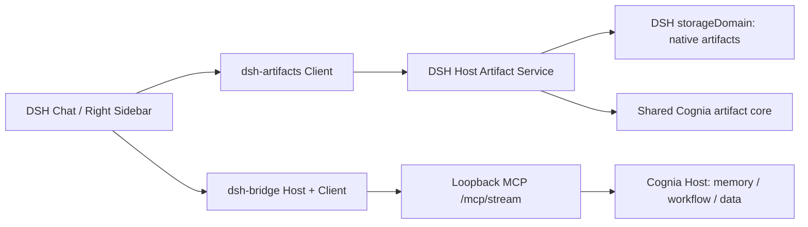
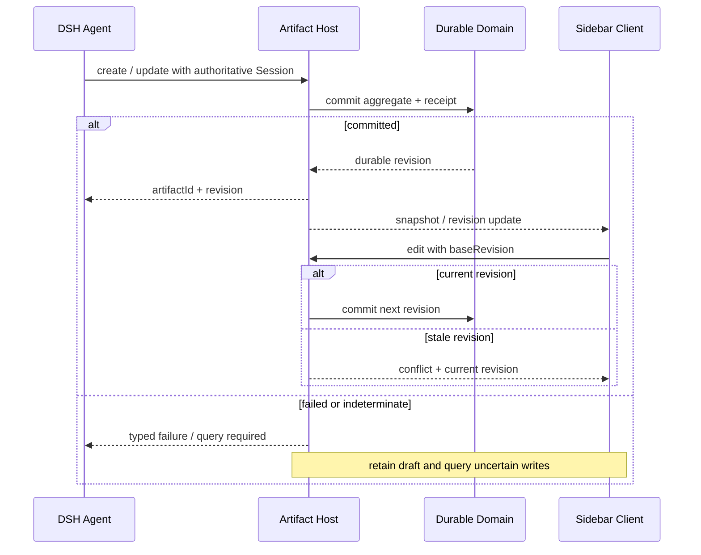

# Cognia 能力以原生插件和 Host Bridge 两种方式进入 DeepSeek Harness

| 项目         | 内容                                                                                                             |
| ------------ | ---------------------------------------------------------------------------------------------------------------- |
| 状态         | 供评审的落地方案；插件实现尚未开始                                                                               |
| 日期         | 2026-11-11，Asia/Shanghai                                                                                        |
| 作者         | Codex                                                                                                            |
| 深度         | Heavy：插件分发、Host/Client UI、持久化、外部协议、权限与跨产品运行                                              |
| 用户要求     | 结合现有代码全面梳理适合做成 DeepSeek Harness 插件的能力，包括 UI、拆分和实施优先级                              |
| 本地证据基线 | `ec1748470e52abb242c8798a97b27e0012a6ab47` 加当前工作区；存在大量并发修改，本文不将这些修改视为已发布能力        |
| 研究范围     | 模块清单、公共包、External Bridge、Artifacts/Canvas、Office 插件、上下文贡献与 DSH 官方扩展契约                  |
| 交付范围     | 本文与[逐模块清单](../reports/2026-11-11-dsh-plugin-capability-inventory.md)；没有产品代码变更、提交、发布或部署 |
| 评审角色     | 产品负责人、Artifacts 负责人、插件/分发负责人、Host/安全负责人、DSH 适配负责人、QA                               |

建议先交付两个可单独安装的产品：**无需启动 Cognia 的 `Cognia Artifacts for DSH`**，以及**连接现有 Cognia 数据和执行能力的 `Cognia Bridge for DSH`**。前者负责产物的创建、预览、编辑、审查、版本和导出；后者先开放记忆读取与已发布工作流，再逐步扩展。共享能力复用现有包，DSH 适配层负责服务注册、会话身份、工具、资源和 UI 生命周期。

这两个产品可以独立使用。原生产物由 DSH Host 持有；Bridge 调用的数据继续由 Cognia Host 持有。第一版不建立两个产品之间的隐式双向同步。DSH 继续拥有主 Agent 循环、会话、模型、审批和布局；Cognia 为具体任务提供增量能力。

## 1. 目标是复用完整能力，验收必须包含数据和交互闭环

| 要求              | 用户可观察的结果                                                        | 验收         |
| ----------------- | ----------------------------------------------------------------------- | ------------ |
| REQ-01 能力梳理   | 每个已登记 feature owner 都有分类、接入方式和优先级                     | AC-01        |
| REQ-02 UI 插件化  | DSH 右侧出现产物标签，聊天结果可以打开指定产物                          | AC-02、AC-03 |
| REQ-03 可独立运行 | 原生产物插件在 Cognia 未启动时完成创建、编辑、保存与恢复                | AC-02、AC-04 |
| REQ-04 复用代码   | Cognia 和 DSH 消费同一份产物契约/校验与已抽取的视图；业务规则不维护两份 | AC-05        |
| REQ-05 安全连接   | Bridge 仅访问所选 Cognia Host 的授权能力，撤销立即生效                  | AC-06、AC-07 |
| REQ-06 分阶段交付 | 每个工作包有依赖、唯一负责角色、检查与退出条件                          | AC-08        |

本轮不迁移整个 Cognia 应用，不改变主应用静态导出方式，不替换 DSH 主循环，不让 DSH 自动安装或执行全部 Cognia 插件。移动端可查看 DSH Web UI，不等于获得 Cognia 的 Capacitor 原生能力。跨 Host 自动同步、完整 IDE、全部模型提供方、完整工作流编辑器与 React/Jupyter 执行分别后置。

## 2. 当前模块化已经提供复用起点，尚未构成可发布的 DSH 插件

### 2.1 清单覆盖 140 个 feature owner，并区分“登记”与“可移植”

2026-11-11 的文件扫描得到：33 个 `lib/**/module.ts`、9 个 `components/**/module.ui.ts`、56 个 `packages/*/package.json`、81 个 `plugins/*/plugin.json`。过渡 ownership 表还登记 107 个没有独立 manifest 的模块：合计 140 个 feature owner，另有 kernel/foundation/shell 分类。本方案把这 140 项归入 22 个能力族；清单数量不代表功能通过真实环境验收。

证据来自 [manifest 契约](../../lib/modules/manifest-types.ts)、[host registry](../../lib/modules/registry.ts)、[UI registry](../../components/modules/registry.ts)、[ownership 表](../../scripts/gates/module-ownership.json) 和[workspace 配置](../../pnpm-workspace.yaml)。`a2ui-core`、`feishu-protocol` 在 workspace 中有显式排除，56 是包文件数量。manifest 的工具/上下文贡献不是 Cordis 插件清单，不能机械转译其字段。

逐项归类见[能力清单](../reports/2026-11-11-dsh-plugin-capability-inventory.md)。实现级核对集中在本文列出的入口；长尾项属于清单级判断，实施前仍需做该能力的调用链与真实运行核验。

### 2.2 已有的可复用核心可显著减少搬迁量

| 现有代码                                                                                                       | 已确认的边界                                       | 仍由应用或新适配器承担                                |
| -------------------------------------------------------------------------------------------------------------- | -------------------------------------------------- | ----------------------------------------------------- |
| [`@cognia/memory`](../../packages/memory/README.md)                                                            | 抽取、整合、混合检索、衰减、读取上下文采用依赖注入 | 数据库、治理、命名空间、LLM/embedding、生命周期、授权 |
| [`@cognia/rag`](../../packages/rag/package.json)、[`@cognia/vector`](../../packages/vector/package.json)       | 检索算法、向量接口已有独立包                       | 具体索引、数据源授权、后端与凭据                      |
| [`@cognia/document`](../../packages/document/README.md)                                                        | 统一文档解析结果、正文范围和结构，重解析器按需加载 | 文件读取、上传、缓存、下载与后台任务                  |
| [`@cognia/ocr`](../../packages/ocr/README.md)                                                                  | `ExtractDeps` 注入缓存、提供方、凭据和平台能力     | Apple Vision/MLKit 等原生绑定不随核心包自动获得       |
| [`@cognia/a2ui-core`](../../packages/a2ui-core/src/index.ts)                                                   | 数据模型、组件树、计算、解析、消息分段             | React 渲染器、用户动作、业务工具和持久化              |
| [`provider-routing`](../../packages/provider-routing/src/index.ts)、`router-fusion`、`eval-core`、`web-search` | 已有独立入口可选用                                 | DSH 模型/预算/执行事件的语义适配                      |
| `content-safety`、`redact`、`network-guard`、`logging`、`agent-trace`                                          | 可复用的检查、脱敏、网络策略和观测组件             | 调用方必须在实际数据出口接线                          |

这里多数包仍为 `private: true`，一些只提供源码导出或 standalone typecheck。独立包目录不是 npm 可安装性证明。第一版插件必须打包所需私有核心，保留第三方许可清单，且在没有 monorepo alias/workspace symlink 的临时目录安装验证；公开发包由单独的版本与许可证检查决定。

### 2.3 Artifacts 的主要成本在宿主耦合，而非注册标签页

[`ArtifactDock`](../../components/artifacts/artifact-dock.tsx) 当前把产物与会话表面装入 Context Workbench，依赖聊天、项目、布局和 Store。[`ArtifactPanelContent`](../../components/artifacts/artifact-panel-content.tsx) 使用 `next/dynamic`、`next-intl`、Monaco、选择到聊天及版本面板。[`artifact-store`](../../stores/artifact/artifact-store.ts) 与 [Dexie bridge](../../lib/artifacts/dexie-bridge.ts) 负责工作副本、持久化、账户切换和版本。

本次扫描中，artifact manifest 声明 25 个依赖；Dock、PanelContent、Store 分别为 705、666、2846 行。这些是范围提示，不是工期预测。先抽出稳定契约和少量视图，避免把完整 Workbench 及其依赖图带入 DSH。

当前 [runtime adapter](../../components/artifacts/runtime-adapters.ts) 定义 9 类产物：code、document、svg、html、react、mermaid、chart、math、jupyter；导出支持随类型变化，React 截图需要已挂载预览。[模块工具](../../lib/artifacts/agent-tools.ts) 有 5 个 artifact 和 4 个 canvas 工具；创建结果中的真实 ID 才能形成[聊天产物卡](../../lib/artifacts/tool-part.ts)。这些工具走 Cognia 的 module/plugin-tool relay，**未在 External Bridge 中直接注册为 artifact/canvas MCP 工具**。

### 2.4 External Bridge 可复用，但不能视为统一远程功能总线

[`server.ts`](../../lib/external-bridge/mcp-server/server.ts) 已注册记忆、Issue、用量、浏览器、工作区、编排和工作流工具。[权限映射](../../lib/external-bridge/types.ts) 和 [permission gate](../../lib/external-bridge/permission-gate.ts) 保留 scope 检查；[Rust listener](../../crates/cognia-mcp-server/src/lib.rs) 提供 loopback `/mcp/stream`，并绑定每客户端凭据、身份和 scope。

已有路径的重要限制：

- `rag_search` 的[实际实现](../../lib/external-bridge/handlers/rag.ts) 是 Wiki/Twin 的本地 BM25 管线，不能宣传成完整 Knowledge Base 的向量检索/渐进阅读 API。后者依赖[会话捕获的阅读权限](../../lib/knowledge-base/runtime/session-reader.ts)。
- 部分[编排 handler](../../lib/external-bridge/handlers/orchestration.ts) 需要 Cognia renderer/orchestration proxy；无 proxy 时返回 desktop-required。不能因 Rust crate 无 Tauri 依赖就承诺所有工具均可在任意 headless Host 运行。
- `plugin_tool_invoke` 只调用已登记插件工具，仍执行插件权限和所有权检查；它不是任意 module 工具出口，也不能替代 browser 专用门禁。
- 公共 MCP 工具注册和每次调用的授权是两个问题。当前静态注册集合并不会自动按客户端 scope 收窄全部 `tools/list`，Bridge 发布前需补受控的可见性投影。
- [`standalone-entry`](../../lib/external-bridge/mcp-server/standalone-entry.ts) 的 settings/snapshot 模式不等价于完整实时 Cognia Host。`/internal/_rpc/*` service plane 也不能直接当插件公共 API。
- [`@cognia/agent`](../../packages/agent/src/index.ts) 是 Agent runtime 客户端，不是所有 memory/artifact/workflow/Companion API 的通用替身。
- 当前 [`mcpCaller`](../../lib/memory/api/caller.ts) 将记忆调用统一为 `mcp:bridge`；[workflow handler](../../lib/external-bridge/handlers/workflow.ts) 从活动账户读取 accountId。Rust 的 clientId/scopes 尚不能自动形成固定账户/workspace 的可信绑定；WP3a 必须补贯通，不能只裁剪工具列表。

## 3. DSH 提供了宿主、资源和 UI 扩展点，也已有大量预览功能

以下是 2026-11-11 查阅的官方 master 文档契约，实施时必须锁定 npm release、源码 revision 和 bundle digest。Cognia 的 [managed runtime](../../packages/agent-dsh/runtime/package.json) 固定在 `0.2.1-rc.2`；不能把 master 接口直接当该版本已验证能力。现有 `agent-dsh` 是 Cognia 驱动 DSH 的反向集成，不承担本方案的插件分发。

| 扩展面            | 官方入口                                                  | 本方案用途                                      |
| ----------------- | --------------------------------------------------------- | ----------------------------------------------- |
| Host 工具         | `ctx.tools.register` 与规范执行管线                       | 创建、读取、修改产物；保留取消、权限和 PTC 语义 |
| 插件持久化        | `ctx.storageDomain` / `defineDomain`                      | DSH 原生产物数据；不从业务包直接使用 backend    |
| Host → Client RPC | `TypertRemoteService`、`@Remote`                          | 窄化的 list/read/edit/watch；身份校验留在 Host  |
| Client 发布       | `./client` export + `dsh.client`                          | 安装后由官方 client module loader 加载 UI       |
| 资源订阅          | `ctx.resources.register`、`useResource`                   | 先快照再更新的产物投影；资源关闭时释放订阅      |
| 右侧标签          | `ctx.sidebarRightTabs.register`、`sidebar.right.pane.tab` | 产物列表、预览、版本等自己的 tab kind           |
| 打开产物          | `ctx.sidebarRight.openTab/openResource`                   | 从工具结果卡、产物列表定位资源                  |
| 聊天工具卡        | `tool.call.toolview` keyed slot                           | 显示已创建/待审查/失败，并打开真实产物 ID       |
| 连接型 MCP        | `ctx.mcpManager.register`                                 | 连接 Cognia `/mcp/stream`，随插件卸载撤销连接   |

依据：[工具 cookbook](https://github.com/deepseek-ai/deepseek-harness/blob/master/docs/cookbook/adding-a-tool.md)、[storage-domain](https://github.com/deepseek-ai/deepseek-harness/blob/master/packages/storage/storage-domain/README.md)、[Remote API](https://github.com/deepseek-ai/deepseek-harness/blob/master/docs/cookbook/adding-a-remote-api.md)、[client 发布](https://github.com/deepseek-ai/deepseek-harness/blob/master/docs/cookbook/adding-a-settings-card.md)、[resources](https://github.com/deepseek-ai/deepseek-harness/blob/master/packages/client/resources/README.md)、[sidebar-right](https://github.com/deepseek-ai/deepseek-harness/blob/master/packages/client/ui-sidebar-right/README.md)、[MCP manager](https://github.com/deepseek-ai/deepseek-harness/blob/master/packages/mcp/mcp-manager/README.md)。以上是接口依据，不是本项目的运行结果。

DSH 的 [documentpreview](https://github.com/deepseek-ai/deepseek-harness/blob/master/packages/client/ui-sidebar-documentpreview/README.md) 已支持文件预览、HTML/PDF、只读表格以及 Office 转换预览。Cognia 的增量应是结构化编辑、审查、版本和可靠导出；不要为所有 `*.md`、`*.html`、`*.xlsx` 注册最高优先级处理器并覆盖 DSH 原有体验。使用专属 `kind`、资源类型及明确的“用 Cognia 打开”动作。

## 4. 22 个能力族采用不同包装方式，优先级由增量价值和耦合共同决定

P0 是技术验证/发布前置；P1 是第一个独立产品；P2 在公共契约通过后推进；P3/P4 是有明确需求再扩展。下表是建议，不代表实施授权。

| 能力族                    | 现有代码依据                                                                         | 推荐包装与 UI                                    | 顺序与主要缺口                                              |
| ------------------------- | ------------------------------------------------------------------------------------ | ------------------------------------------------ | ----------------------------------------------------------- |
| F00 Host Bridge           | `lib/external-bridge`、`crates/cognia-mcp-server`                                    | 单独连接插件、连接状态与授权范围 UI              | P0 验证；P2 发布，先修工具可见性与 egress                   |
| F01 Artifacts/Canvas/审查 | `lib/artifacts`、`components/artifacts`、`lib/canvas`、annotations/review            | 原生工具 + 产物侧栏；Canvas 后续扩展             | **P1 首选**，先去除 Store/Next/布局耦合                     |
| F02 Office/文档           | `plugins/cognia-{documents,office,presentations,pdf,visualize}`、`packages/document` | 模型/编解码复用，工具卡 + 编辑标签 + 导出        | P2 文档/可视化，P3 表格/PPT/PDF 深编辑；重写 SDK 适配       |
| F03 A2UI/应用             | `packages/a2ui-core`、`lib/a2ui`、`lib/sites`                                        | 原生交互表面/独立 main panel                     | P3，动作权限和状态回传不能只移植渲染器                      |
| F04 记忆                  | `packages/memory`、`lib/memory/api`                                                  | 先 Bridge 搜索/列表 + 来源面板；原生数据源可后选 | P2 只读，P3 受控写/自动召回；默认不自动学习                 |
| F05 知识库/Wiki/Twin      | `knowledge-base`、`project-knowledge`、`rag`、`twin`、`wiki`、vector                 | 检索/来源阅读侧栏；独立文档检索插件              | P2 Wiki/Twin 显式检索，P3 完整 KB；身份提示后置             |
| F06 OCR                   | `packages/ocr`、`plugins/ocr`                                                        | 原生工具 + 原图/正文/页码面板                    | P2，与文档插件共享解析；原生 provider 需能力探测            |
| F07 Research/Radar        | `plugins/deep-research`、`lib/radar`、`packages/web-search`                          | 研究工具/来源侧栏，可选 Host 委托                | P3，复用 DSH 循环，记录来源和任务边界                       |
| F08 Workflow/Playbooks    | `lib/workflow/api`、`publish`、Bridge lifecycle tools                                | Bridge 已发布部署 + 运行侧栏                     | P2 runner；P3 审批/编辑/发布；不复制整个 engine             |
| F09 Issues/Delivery       | `lib/issues`、`lib/bot`、`project-coordinator`、`plugins/github-delivery`            | Bridge 任务板/详情/交付证据                      | P3，既有 delivery 方案仍是草案，不当现成功能                |
| F10 连接器/云文档         | connectors、inbox、lark-docs/google-docs、Feishu/GitHub 插件                         | Host 保留 OAuth/连接；插件提供读写工具与 UI      | P3，外发逐次授权、发送状态与重试由原 owner 管               |
| F11 浏览器/Computer Use   | browser、browser-companion、automation、selection-toolbar                            | 增量工具 + 截图/执行回放；原生能力经 Cognia Host | P3；先复用 DSH 已有浏览器/操作能力，明确机器位置            |
| F12 编码工作台            | editor、lsp、git、source-control、terminal、codeserver                               | 差异/诊断/采纳面板；需要时连接 Host              | P3/P4；不整体迁移 IDE、终端与文件系统                       |
| F13 文件与共享            | filespace、files-library、share、sftp/webdav                                         | 产物资源入口、受控导出/共享 UI                   | P3；DSH 文件走 DSH；跨 Host 文件单独授权                    |
| F14 Agent/Squad/Harness   | agent-builder、squads、agent-*、best-of-n、harness                                   | 显式委托工具 + 子运行/比较结果 UI                | P3/P4；防止 DSH→Cognia→DSH 回路、双预算和重复计费           |
| F15 任务/目标/后台工作    | tasks、goal、background-tasks、jobs                                                  | 查看 Cognia 任务，或显式把任务交给它             | P3/P4；不能同时让两个调度器拥有同一任务                     |
| F16 用量/评测/诊断/路由   | Bridge usage tools、agent-trace、eval-core、provider-routing/router-fusion           | P2 Cognia 用量只读；P3 评测；P4 选择性路由       | DSH 原生花费不能自动计入 Cognia 台账；不替换 DSH 模型选择   |
| F17 媒体/语音             | media、speech、audio/images、packages/tts                                            | 附件工具、播放器、生成结果标签                   | P3；浏览器播放/录音与原生采集分开验收                       |
| F18 Skills/提示/创作治理  | slash-commands、skills 内容、skill-recorder、creator                                 | 内容包先行，命令/录制工具另适配                  | P2 可移植内容，P3/P4 录制/治理；说明文件不等于已具备工具    |
| F19 外观/Pet              | appearance/theme/icons、pet/glance/island                                            | 可选主题/浮层/宠物插件                           | P4；映射 DSH token，Tauri 窗口/托盘不能直接注册             |
| F20 插件与外部服务生态    | plugin-sdk、plugin-ui、external-services、mcp-apps                                   | 按工具/资源/UI 契约逐项适配                      | P4；Cognia 插件不是 DSH 插件，暂不构建兼容全部 SDK 的运行时 |
| F21 Host/产品基础设施     | account-sync、collab、fleet、host-*、updates、tray 等                                | 留在 Cognia Host，确有运维需求才做专用 UI        | 不整体迁移；账户、密钥、同步、原生升级不能靠 UI 注册获得    |

纯算法/内容适合直接包装，需现有个人数据或长期执行的能力适合 Bridge；涉及 kernel/账户/安全机制的部分继续留在原 owner。具体模块归属不是对“可单独安装”的承诺。

## 5. 初期只有两个安装包，共享代码按真实消费边界抽取

以下目录/包名均为**拟新增**。采用已有 `packages/*` workspace；不放进 `plugins/*`，因为那里由 Cognia 的 `plugin.json`/SDK loader 消费，不能混淆两套插件格式。现有 `packages/agent-dsh` 继续承担反向集成。

| 拟新增位置               | 职责与必要性                                                                                           | 明确禁止的依赖                                                           |
| ------------------------ | ------------------------------------------------------------------------------------------------------ | ------------------------------------------------------------------------ |
| `packages/artifacts`     | 从已有 artifact 类型/校验/图表契约/版本操作抽纯核心；现有 `lib/artifacts` 仍有应用 alias 和 Store 依赖 | Next、React、Zustand、Dexie、Cordis、Tauri                               |
| `packages/artifact-ui`   | 小型展示/审查组件及 renderer 接口；Cognia 和 DSH 两个实际消费者                                        | Next 路由、Cognia 全局 Store、Cognia 发送管线、全局 CSS 重置             |
| `packages/dsh-artifacts` | 可安装 Cordis Host + `./client`；工具、存储、Remote、资源、tabs、工具卡                                | `@/`、Cognia renderer、内嵌第二份 React                                  |
| `packages/dsh-bridge`    | 可安装 Host 连接器 + `./client`；MCP、受控查询、状态面板                                               | service-plane 全权 token、浏览器端 Cognia bearer、私自管理 Cognia 数据库 |

不先创建通用 `dsh-kit` 或统一 UI 大包。两个适配器出现经过验证的重复连接/错误映射后再抽共享模块。Office 的模型和编解码先从原插件内部按需抽取，形成第二个消费者后才成为独立共享包；可安装的 Office、OCR、Knowledge 插件随后独立 version。

共享 UI 接受普通数据和动作回调，由宿主注入主题、翻译、文件操作和导航。Cognia 用 `next-intl` 适配；DSH 用其 i18n/slot 注入适配；源语言资源保持同一语义键，分别生成目标资源。Monaco、PDF/Office parser 和图形运行时按需加载。先共享 leaf renderer/审查视图，不要求一次抽走整个 Dock。

所有 DSH 包声明官方 `dsh.client`、`./client` export 和依赖顺序，Host 入口保持裸 package specifier；带 `/host` 的 mount 不假定会被 client module loader 识别。副作用注册及反注册纳入 Cordis effect；工具卡单独接 `tool.call.toolview`，不能以 Host 的 `presentResult` 代替 Web UI 接线。

**外部包构建也是 WP0 的交付物。** 官方 `./client` 是 lazy-CJS factory，不是任意 ESM bundle；源码中的 `clientBundle` preset 未作为可直接依赖的 npm 包发布。WP0 应将固定上游 revision 的 factory 打包规范实现为本仓 `scripts/dsh/` 下可重建的配置，明确 React/Cordis/DSH externals、CSS、lazy chunks、Worker 与静态资源路径，并保留引用来源和许可证。

自定义 Remote 同时需要生成并导出 `./typert`、`./remote` 的 descriptors/codecs；插件 Client 自行以受生命周期管理的 `ctx.remote.$mount()` 安装其 contribution，不能依赖内置 api-remotes 自动枚举第三方服务。WP0 必须锁定实际可用的 Typert 生成工具及执行顺序，并在临时目录从源码 build→pack→install→调用自定义 Remote→卸载全部通过。若生成链只在上游 checkout 可用，应先以固定revision的构建工具解决；无法独立重建则判定 WP0 失败，不把填好 manifest 当作安装完成。依据：[client 构建规范](https://github.com/deepseek-ai/deepseek-harness/blob/master/docs/cookbook/adding-a-settings-card.md)、[Remote 生成/消费](https://github.com/deepseek-ai/deepseek-harness/blob/master/docs/cookbook/adding-a-remote-api.md)、[内置 remote assembly](https://github.com/deepseek-ai/deepseek-harness/blob/master/packages/api/remotes/src/client/index.ts)。

## 6. 两条数据路径分别只有一个持久化 owner

原生产物不依赖 Cognia 进程；Bridge 不复制 Cognia 权威数据库。浏览器通过 DSH 的认证 Remote 到达 Host，只有 DSH Host 持有 Cognia 连接凭据。

### 6.1 会话与资源身份由 Host 绑定

- 原生身份元组为 `(DSH installation/profile, authenticated principal, sessionId, artifactId)`；profile 路径不是授权本身。工具使用执行上下文里的 Session，Remote 使用 Gateway 解析后的 Session，再检查资源归属，拒绝把模型提供的 ID 当权限。
- 使用拟新增资源类型 `dsh-resource://cognia-artifact/<opaque-id>` 和专属 tab kind；地址只是定位，读取、watch 和写入都校验绑定。工具 namespace 与 Bridge 的 `mcp__cognia__*` 分开。
- Bridge 绑定固定 Cognia client/Host/账户及可选 workspace；DSH session 到 workspace 的映射由用户配置与 Host 校验建立。未绑定时不能凭 `projectId/agentId` 参数扩大记忆或知识读取范围。
- 切换会话保留各自面板，后台会话完成创建只加提醒，不抢占前台。删除会话后的产物保留/删除按插件保留策略执行；分叉默认不共享可写身份，显式复制才创建新 ID。

### 6.2 第一版持久化采用单产物聚合提交，不能假设 KV 有多表事务

DSH storage-domain 文档承诺写入持久化后返回和有序通知，但未提供本文可依赖的通用多表事务或跨进程 push。拟使用一条 artifact aggregate 保存当前 revision、有限版本、待审查提案、tombstone 和 mutation receipt，索引只是可重建投影。`domain/changed` 转为 Remote watch，再供 Client resource 更新；日志写入只保存产物 ID/revision/结果，不保存全部文件内容。

domain 打开时会加载完整数据，JSON backend 还可能重写整个 domain，故版本数量上限不足以控制开销。aggregate、session 和 profile 都执行第9节的序列化字节配额；proposal、receipt、tombstone 也计入。P1 编辑过程只保留草稿，显式 Save/Apply 才提交，不逐键保存全量历史。保留策略最多20版本且受字节上限限制；可清理的是策略允许的旧已确认版本，当前正文、待审查提案和未核对的提交结果不能被静默截断。

持有该 domain 的唯一 Host service 让所有 prepare/mutation 经过同一 domain 级串行入口，按队列中的最新状态检查总字节配额和 revision，再提交一条 aggregate；配额计数可由全部记录重建，不另依赖一次跨表事务。第二个 Host 进程不得同时打开同一可写数据目录，启动锁和 backend 不支持时明确拒绝，不以最后写入覆盖解决。create 的 ID 从经认证的 session 与稳定 mutation identity 派生；查重和写入在同一串行操作内完成。receipt 与内容一起 durable commit，再返回 success。重启后重新读取 aggregate，不能仅凭内存 receipt 判断完成。

prepare 在目标 aggregate 内持久化本次操作的 `reservedBytes`，按规范序列化后的最坏正向增长计算，包含正文、保留历史、proposal、receipt 和元数据；session/profile准入计入已存字节与所有未消费reservation。检查与该单条记录的put处于同一service队列任务。commit在同一入口核对实际增长不超过reservation，原子转换成内容/receipt并释放reservation；超额必须重新准入，不能借backend自身write queue假定应用检查已原子化。reject/确定到期在该aggregate中释放reservation；崩溃重启从记录重建计数；unknown-state先关闭/重开核对，不能先释放再重试。接近共享上限时，对不同artifact的并发操作也只能在总预算内成功。

| 拟定接口/事件             | 输入与结果                                                             | 语义                                                     |
| ------------------------- | ---------------------------------------------------------------------- | -------------------------------------------------------- |
| `artifact.create`         | 受限类型/title/content；返回 `{artifactId, revision, resourceAddress}` | Host 赋予归属；重复 mutation 重放同一结果                |
| `artifact.read/list`      | Session + ID 或分页 cursor                                             | 最小必要投影；正文分页，不因 UI 需要全部回传模型         |
| `artifact.propose/apply`  | `baseRevision`、mutation identity、内容/操作                           | revision 冲突拒绝覆盖；review-on 时先保存提案            |
| `artifact.review`         | proposal ID、baseRevision、选定 hunks                                  | 人工动作受当前版本检查；审批通过才产生 applied revision  |
| `artifact.delete/restore` | expected revision、明确动作                                            | 删除保留 tombstone/必要 receipt；restore 产生新 revision |
| `artifact.watch`          | Session、artifact ID、最后 revision                                    | 首帧快照，后续投影；缺口重新取快照，AbortSignal 结束     |

另设三项 operation 接口，由工具包装层或 Client 调用，不增加模型需自行管理的底层工具：`prepare` 在目标 aggregate 里持久化绑定 session、请求 hash、artifact epoch、operationId 与 `notAfter` 的服务端签发 token；`status(token)` 返回 prepared/committed/rejected/unknown/expired 及已提交的最小结果；`ack(token)` 表示消费者已保存结果，可压缩 receipt，但不能授权重复执行。create 的 prepare 只建不可见的 provisional aggregate，业务提交时才进入产物列表。操作 token 只证明去重身份，读取/执行仍需原会话权限。

以上是拟定语义名称，不是已存在的 DSH/Cognia API。mutation identity 与规范化请求 hash 绑定；相同 identity 不同输入返回冲突。稳定工具调用 identity 能否从实际 DSH 执行上下文获取在 WP0 核验；不可获取时由包装层先 prepare 并在调用日志中保留 token，再开始业务 mutation。

Host 成功发送响应不等于收到 ack。丢响应后先 status，再 ack；prepared 的操作可在有效期内提交，committed 只重放原结果。backend unknown-state 时暂停该 domain 并重开核对，不能把 missing receipt 当未执行。token 的签发 epoch/期限由 Host 校验：过期后即使receipt已清理也返回 expired，绝不重新执行。每个 aggregate 保留epoch/expiry证据，删除产物后必要tombstone继续存在。客户端消失时，确定的终态receipt在硬到期后可清理；未核对的未知提交必须先完成存储核对。配额满时拒绝新prepare，提供清理过期项或人工结束该产物epoch的动作；结束epoch先核对存储并永久废止旧token。UI 仍保留本地编辑草稿，不能为了脱困自动换operationId重放旧写入。

### 6.3 工具结果和 UI 更新是两条独立的成功条件

工具成功意味着数据已提交；面板自动打开失败不回滚内容，也不使模型再次创建。Client 根据真实 result ID 形成卡片，历史回放只渲染与打开已有资源，不再次执行写入。面板关闭只取消视图订阅，不能把“关闭侧栏”当成“删除产物”或“停止工作流”。

数据提交、模型可见结果、资源刷新和人工编辑分别验收，避免出现“有工具没面板”或“面板显示已保存但未持久化”。

## 7. Artifacts 按类型渐进交付，保留完整编辑和审查语义

| 阶段    | 类型与能力                                                                          | 选择理由与边界                                                                                  |
| ------- | ----------------------------------------------------------------------------------- | ----------------------------------------------------------------------------------------------- |
| P0 验证 | 一个 chart 或 Mermaid；真实 Host 工具 → persist → result card → tab → reload        | 用完整闭环证伪可移植性，不能用纯静态截图通过                                                    |
| P1 首发 | code、document、chart、mermaid、math；列表、预览/源码、编辑、版本、审查、原文件导出 | 先做不需执行模型生成 JS 的类型，图表复用现有校验                                                |
| P1b     | 静态 HTML/SVG；PNG/PDF export 按实际 renderer/capture 能力逐项启用                  | 安全策略、字体/资源加载、跨源截图分别验证                                                       |
| P2      | DOCX / 可视化结构化模型；后续按需求 XLSX/PPTX/PDF                                   | 复用现有插件 model/codec；不以普通 JSON 文本冒充文档预览                                        |
| P3      | Canvas、A2UI 交互页；按明确需求考虑 React/Jupyter                                   | React 需要资源/CSP/runtime/capture，Jupyter 需要 kernel/execution；前置不满足则明确 unavailable |

HTML/SVG 预览采用独立 CSP/sandbox；静态模式禁执行和外部连接，脚本模式仅在后续独立授权功能开放。不组合 `allow-scripts` 与 `allow-same-origin` 来解决展示问题。重用 Cognia 导出前需重新核对它的 same-origin 重渲染路径；iframe 安全不是搬一个 `sandbox` 字符串即可继承。

P1 的版本比较、人工接受/拒绝和撤销均保留 base revision；选区修改只向 DSH composer 发送用户选择的上下文。空、加载、权限不足、连接失败、已删除、版本冲突、待审查和不支持类型有明确 UI；不支持的 Office/plugin model 保留原始导出和说明。窄屏跟随 DSH 的 fullscreen 行为，支持键盘开关、焦点恢复、屏幕阅读器名称与 reduced motion。

## 8. Bridge 先做少量能力，权限、可见性和数据出站各自校验

### 8.1 连接路径先限定同机，再评估远程 Host

P0/P2 使用同机 loopback、独立 DSH client credential 和固定 Cognia Host。地址必须是显式配置的合法 endpoint，不能由模型传入；token 放 DSH Host credential provider，配置里只存 `${credential:REF}`。Browser Client 不直连 Cognia、不接收 bearer。Cognia 原有客户端凭据到期/撤销路径继续生效。

WP3a 新增的服务端 client binding 至少含 `clientId/accountId/allowedWorkspaces/allowedMemoryNamespaces/policyEpoch`。它在认证 owner 创建并通过 Rust→sidecar→Host proxy 的可信通道传递；用户请求的过滤字段和 `_meta` 不能创建或放宽绑定。memory 构造该客户端的可信caller并与既有transport/principalGrants取交集；workflow/KB读取绑定账户的数据句柄，不能在操作中改读当前活动账户。旧客户端路径保持现有行为，新DSH exposure profile未建立绑定时拒绝激活。

账户切换、凭据撤销或policyEpoch变动使旧绑定失效，关闭相关MCP会话及缓存/订阅；重连必须重新证明绑定。已提交的旧账户操作留在旧账户记录中，未提交操作在commit前再次检查绑定；撤销后的结果不能借已打开的stream泄回客户端。验收使用两个拥有相同scope但不同namespace的client，以及调用过程中切换活动账户的场景。

远程 Cognia Host 不在首发承诺中：当前公共 MCP listener 是 loopback。未来远程接入必须经已有认证/配对边界形成受限公开能力，不能修改绑定地址后暴露 `/internal/_rpc/*` 或给插件 service credential。

### 8.2 发布前补齐按客户端能力投影，避免全量工具泄入模型上下文

`mcpManager.register` 本身没有本文可以依赖的工具 allowlist 字段，不能凭空配置 `allowedTools`。WP3 在 Cognia 现有 MCP owner 增加客户端有效 scope 到 `tools/list` 的投影：保持旧客户端兼容，仅为显式启用的 DSH exposure profile 裁剪工具；读取 scope 取客户端授予与当前全局策略的交集，每次调用仍重新校验。Cognia 的只读 memory client 不能展示或调用 browser/shell/plugin-send 工具。

grant 撤销与工具变化沿已有 session 关闭/发现刷新机制生效。无法确认工具收回或已撤销请求停止时，连接进入 blocked，停止新调用并显示原因。UI 只隐藏按钮不能充当授权实现；工具名、参数或 `_meta` 不能扩大 Host 绑定的权限。

### 8.3 依次开放记忆读取、Workflow runner，再开放治理后的写入

| 子能力             | 第一阶段                                          | 后续必须补的契约                                                                                                      |
| ------------------ | ------------------------------------------------- | --------------------------------------------------------------------------------------------------------------------- |
| Memory             | `memory_search/list` 显式调用，来源/范围可查看    | 每轮召回经 DSH pre-step 适配；预算、超时、取消、污染标记与 PII；写入需 scope 和稳定 operationId                       |
| Workflow           | 列出已发布不可变部署、开始、status/events、cancel | UI 显示等待人工状态；首版需要审批时打开 Cognia 原决策界面；DSH 内批准必须另有受限 API，不能复用 service/internal 路径 |
| Wiki/Twin          | 已有 corpus 的显式检索和引用                      | 原文回传的 egress 策略；完整 KB 需新增授权 reader API                                                                 |
| Usage              | 明确标为 Cognia 运行的用量和健康数据              | 融合 DSH 花费需要去重 run identity、单位/币种与账本契约                                                               |
| Issues/连接器/委托 | 后续明确 opt-in                                   | 状态转换、外发、可取消委托、幂等和终态回执                                                                            |

不把一个 MCP call timeout 当作 workflow 已取消。已有运行保留 Cognia runId、部署 revision 和最后 event cursor；网络断开后查询状态再决定是否重试。创建运行若无可验证幂等契约，超时显示“结果未确认”，禁止自动再建一次。人可以停用插件连接，但已开始的运行按其明确的 detach/cancel 选择处理，不能伪报已停止。

### 8.4 PII 与不可信内容在真正出口处理

自动记忆/知识注入必须复用 `@cognia/redact`/`content-safety` 并记录来源和 token budget。当前 [`rag_search`](../../lib/external-bridge/handlers/rag.ts) 对 Twin 有返回原文的路径，不能假定 Bridge 输出已全部脱敏；WP3 应在固定客户端 exposure profile 的出站投影处理，再到 DSH。禁止只改 `output.render` 的显示文本而把原文留在 canonical value 供 PTC 或 UI 读取。

外部记忆/文件/连接器文本作为资料而非系统指令。自动学习默认关闭；如后续启用，明确人工同意、污染分类、provenance 与撤回，禁止把网页/工具输出无标记地沉淀为行为规则。用户直接查看资料与发送给模型是两个动作，预览可显示的原文不自动进入模型。

## 9. 容量、失败与兼容性都有明确边界

以下数值为拟定起始上限/验收目标，**不是实测性能**；WP0 记录固定机器、DSH 版本和样本后再调整。

| 项目             | 初始预算/规则                                                                                                        | 超限或失败                                                                          |
| ---------------- | -------------------------------------------------------------------------------------------------------------------- | ----------------------------------------------------------------------------------- |
| 原生产物内容     | 单 revision UTF-8 ≤ 1 MiB；标题 ≤ 200 字符                                                                           | Host 拒绝，保留草稿；大二进制走后续附件能力                                         |
| 历史与数量       | 每产物最多20版本且aggregate总计≤4 MiB；session总计≤8 MiB且≤100个live artifacts；profile内本插件全部domain数据≤32 MiB | 字节与数量取更严格者；包含proposal/receipt/tombstone，不能静默截断当前正文          |
| mutation receipt | token硬期限7天；每aggregate receipt≤256 KiB、proposal≤1 MiB；profile最多1000项receipt                                | prepare前预留空间；终态到期可清理，unknown先重开核对；旧token由epoch/期限拒绝       |
| 存储与冷启动     | 以JSON backend填满32 MiB配额后测冷启动、RSS和保存；目标额外Host RSS≤160 MiB、1 MiB内容Save p95≤1 s                   | 均为待实测目标；不达标则降低首发配额或改为经认证的backend，不能仅优化UI掩盖Host成本 |
| 首屏             | 标准样本的侧栏可交互 p95 ≤ 500 ms（暖启动）                                                                          | 超标定位解析/资源/视图；重 parser 留在 lazy chunk                                   |
| 自动召回         | 起始总预算 1500 tokens、deadline 1000 ms，可关闭                                                                     | 失败跳过补充上下文并报告，不阻塞用户消息                                            |
| 资源更新         | 每 artifact coalesce；有界队列，客户端慢则重发最新快照                                                               | 不无限缓存编辑事件，不丢写入结果                                                    |
| 原生 mutation    | 业务超时 10 s；abort 在 commit 前生效                                                                                | commit 已发生则返回/查询 receipt，不以 abort 回滚已提交数据                         |
| 长 workflow      | 返回运行 handle，分页取 events                                                                                       | 不占用无限期 MCP 同步请求                                                           |

Profile/Host 版本、插件 wire/schema、artifact schema 分别版本化；未知 major 拒绝启用，未知 renderer 保留只读/raw export。DSH 预览版升级只进入单独的兼容测试通道；不修改 Cognia `agent-dsh` 的锁定 runtime 来迁就新插件。

升级前备份插件 domain；迁移采用新版本 staging、副本验证和原子激活，不要求首次安装迁移 Cognia Dexie。降级无法读取新 schema 时阻止旧写入并提供导出，不能让旧版本覆盖新数据。禁用/卸载移除工具、资源和 UI，保留数据及普通格式导出；删除数据是另一个明确动作。

记录 `plugin.activate`、`artifact.mutation`、`artifact.conflict`、`resource.resync`、`bridge.auth_denied`、`bridge.connection`、`egress.blocked` 与 latency。维度只用 bounded capability/result/version；session/artifact ID 进入受控日志，不作为指标 label；正文、token 和凭据不入日志。现有 `logging`/`agent-trace` 能承担时复用，不新建指标平台。

## 10. 工作包先打通一个真实 UI 闭环，再扩展可连接能力

| 工作包                      | 唯一负责角色     | 依赖                   | 具体交付与验证                                                                                                                                                                                | 退出/回滚条件                                                       |
| --------------------------- | ---------------- | ---------------------- | --------------------------------------------------------------------------------------------------------------------------------------------------------------------------------------------- | ------------------------------------------------------------------- |
| WP0 契约与安装验证          | DSH 适配负责人   | 方案评审               | 锁定npm release/revision/digest；交付仓外可重建fixture，含lazy-CJS factory、资源、Typert生成及client mount；验证工具/PTC、domain满配额成本、Remote、tab、卸载/reload；输出截图与命令          | 任一seam/发行包/构建链不成立则停止WP1，记录证伪结果并选择受支持版本 |
| WP1 产物纯核心              | Artifacts 负责人 | WP0                    | `packages/artifacts`；复用 chart contract/类型/版本操作；Cognia 现有入口改消费同一核心；同输入得到相同校验结果                                                                                | Cognia 行为回归则保留旧入口并回退 adapter，不能保留两套长期规则     |
| WP2a 独立 Host              | DSH 适配负责人   | WP1                    | aggregate、Session authority、domain级准入与持久化reservation、字节配额、operation prepare/status/ack/expiry、revision、Remote/watch；丢响应/GC/unknown-state重启恢复；Cognia未启动完成持久化 | 写入不原子/跨会话可读/配额失控即禁用mutation并保留导出              |
| WP2b 产物 UI 首发           | UI 负责人        | WP2a                   | 共享 leaf UI、DSH tabs/resource/result card；P1 五类型、编辑/审查/版本/raw export；英文/中文；Web+Desktop 实测                                                                                | UI 未注册/结果重放会写入/恢复丢失即不发布；可单独卸载 UI 保留数据   |
| WP2c 安全预览与输出         | Artifacts 负责人 | WP2b                   | 静态 HTML/SVG、逐类型 PNG/PDF；资源与 capture 权限测试、字体/导出校验                                                                                                                         | 任一类型失败则该导出能力明确关闭，不把格式写入 capability list      |
| WP3a Bridge 基础与数据出口  | Host/安全负责人  | WP0；可独立于WP1–2开发 | 可信client/account/namespace绑定贯通Rust与各handler；账户切换/撤销epoch；tool discovery过滤、effective scope和canonical egress                                                                | 跨账户/namespace越权、原文泄入不允许出口、token进入Client即停止发布 |
| WP3b 记忆与 Workflow runner | Bridge 负责人    | WP3a                   | 可安装 `dsh-bridge`；记忆显式读、工作流运行侧栏、重连/取消/待人工状态；不要求原生产物包                                                                                                       | 运行重复/取消假终态/范围混淆即关相关能力；已有run可在Cognia接管     |
| WP4 文档/OCR/可视化         | 文档插件负责人   | WP2、视需要WP3         | 优先 DOCX/visualize/OCR；现有 model/codec/tests 共用；编辑→校验→真实格式导出                                                                                                                  | 不支持特性有损导出须明确选择；无假格式文件                          |
| WP5 需求驱动扩展            | 对应能力 owner   | 前面相关WP             | A2UI、KB、Issues、连接器、Squad等独立小包，逐项契约与验收                                                                                                                                     | 没有新增用户任务或实测增量价值则不启动                              |

最先执行的是 WP0，而不是创建十几个空插件目录。WP0 可以包含一次只读 Cognia memory handshake，验证 Bridge 的连接路径；产品首发仍以 Artifacts 为主。WP3a 与 WP1/2 技术依赖独立，但这只是工作分解，不要求本次创建并行实现任务。

暂不承诺人日：25 个 artifact 模块依赖中实际需要搬迁的部分、DSH 发行版差异、共享 UI 的样式和 Office fidelity 是主要未知。WP0/WP1 完成后，由 owner 按实际更改文件、用例和兼容矩阵估算；不能把上述清单数量直接换算工期。

## 11. 验收既检查 Cognia 回归，也检查安装后的真实 DSH

| 验收              | 检查方法与通过条件                                                                                                                                                                                                                                                                      |
| ----------------- | --------------------------------------------------------------------------------------------------------------------------------------------------------------------------------------------------------------------------------------------------------------------------------------- |
| AC-01 清单完整    | 重新扫描 manifest + ownership；140 个 owner 恰好分类一次；81 个插件 manifest 单列，包括示例/fixture，不冒充生产能力                                                                                                                                                                     |
| AC-02 真正独立    | 关闭 Cognia，临时 DSH profile 安装打包产物；Agent 创建、结果卡打开、编辑保存、重启恢复；有浏览器截图/日志                                                                                                                                                                               |
| AC-03 UI/会话正确 | A/B 会话、后台完成、切换/关闭/重新打开、删除、历史回放；ID 不串，回放不重复执行，焦点/窄屏/i18n正确                                                                                                                                                                                     |
| AC-04 数据正确    | 同mutation只写一次、不同内容冲突、双编辑revision冲突；提交后丢响应→status/ack；客户端消失、epoch/到期GC后重试拒绝；不同artifact并发提交不能突破session/profile共享配额，reservation在拒绝/到期/重启后正确核对；满字节配额的冷启动/RSS/Save、ENOSPC/崩溃/unknown-state、进程锁、重装恢复 |
| AC-05 共享可用    | Cognia 原路径与 DSH 共用核心；无 `@/`/Next/Tauri 进入可移植包；临时目录 packed install/typecheck；原应用 static export 回归                                                                                                                                                             |
| AC-06 授权正确    | memory-only client无browser/shell工具；相同scope不同namespace客户端隔离；伪造Session/projectId/agentId/meta/资源地址失败；活动账户切换中调用仍不能访问新账户；撤销后stream/操作失效                                                                                                     |
| AC-07 出站正确    | 人工植入 PII 与指令样本文档；native/PTC、MCP canonical value、pre-step 都执行实际策略；原文不能藏在meta或日志绕过                                                                                                                                                                       |
| AC-08 可交付      | 每WP的 unit/integration/真实DSH证据可定位；错误路径可复现；未支持平台/能力明确标出；禁用与回滚通过                                                                                                                                                                                      |

实现后使用项目实际入口：`pnpm test -- --runInBand --runTestsByPath <changed-tests>`、`pnpm typecheck`、`pnpm lint`、`pnpm audit:modules`、`pnpm lint:static-export`、相关 packed-install 检查。UI 使用 Playwright，并增加独立 DSH Web/发行包项目；现有 Cognia Playwright 流程不能证明 DSH 插件能安装。涉及 split i18n 时执行 `pnpm i18n:build`、`pnpm i18n:build:check`、`pnpm lint:i18n`。是否跑全应用 build 由共享包影响决定；合并前执行对应真实 gate。未请求本地 coverage，本方案不运行覆盖率命令。

新建 DSH E2E runner/script 名称在 WP0 决定并加入 package scripts；本文不把尚不存在的脚本写成可执行命令。新 source 按 repo 要求配 co-located Jest tests；Rust bridge 改动补 owning crate tests。真实模型、DSH Desktop 和 native Host 不能由 mock 结果替代。

兼容矩阵至少覆盖：锁定 DSH Web + macOS Apple Silicon Desktop（初始目标）；无 Cognia 的原生模式；同机 Cognia Desktop Bridge；Cognia headless 按工具逐项验证。Linux/Windows、远程 Host、移动浏览器各有独立状态，不因 Web 成功宣称全平台通过。包里不含 native bindings 的功能可进一步扩展矩阵。

## 12. 待决策项、评审记录和当前证据边界

| 决策            | 选项                                        | 推荐与后果                                                             |
| --------------- | ------------------------------------------- | ---------------------------------------------------------------------- |
| Q1 第一产品     | 独立 Artifacts / 全量 Bridge / 全应用兼容层 | 独立 Artifacts；先证明无需Cognia进程的UI增量，Bridge作为第二个安装包   |
| Q2 第一批类型   | 五种非脚本类型 / 一次九类全开               | 五种先发，静态HTML/SVG紧随；React/Jupyter明确后置                      |
| Q3 记忆权威来源 | Cognia / DSH独立新库 / 自动双向同步         | Bridge沿用Cognia；原生memory后续显式选模式，不自动同步                 |
| Q4 第一连接拓扑 | 同机loopback / 远程Host                     | 同机；远程必须补受限公开协议，不使用service plane凭据                  |
| Q5 发布形式     | 插件内打包私有core / 立即公开全部包         | 先打包必须核心并隔离React/Cordis singleton；只公开经过pack测试的产品包 |
| Q6 MVP平台      | DSH Web+macOS / 所有系统与手机              | 先Web+macOS，按真实验收逐步扩大                                        |

这些是实现启动前的评审决策，本文给出默认推荐以便完整评审，不将用户要求写方案解释为已批准实现或发布。

| 评审                   | 状态                | 记录                                                                                                              |
| ---------------------- | ------------------- | ----------------------------------------------------------------------------------------------------------------- |
| 当前实现与官方契约核对 | 已完成文档级核对    | 本地源文件、包清单与官方文档；未运行插件                                                                          |
| 结构、路径与清单一致性 | 已通过本轮文档检查  | 140个feature owner恰好分类一次、81个插件条目；267个本地链接目标存在；Prettier通过；2张Mermaid已实际渲染并目视检查 |
| 独立反证审查           | 已完成3轮文档级检查 | 4项初审缺口及1项配额并发缺口均已修订；末轮未发现剩余实质矛盾；用户选择本轮不追加跨模型审查                        |
| 产品/平台/发布决策     | 待评审              | Q1–Q6；无部署批准                                                                                                 |

### 反证审查修订记录

| 发现                                         | 分类         | 已落实的方案修正                                                       | 对应验证        |
| -------------------------------------------- | ------------ | ---------------------------------------------------------------------- | --------------- |
| client scope不能证明固定账户/namespace       | 有效且可行动 | §2.4/§8.1补可信绑定、handler贯通、账户切换与撤销epoch                  | WP3a、AC-06     |
| 版本数量上限允许累计过大并放大内存/写入      | 有效且可行动 | §6.2/§9增加aggregate/session/profile字节配额、显式保存和满配额成本检查 | WP0/WP2a、AC-04 |
| 外部client bundle/Remote不因manifest自动可用 | 有效且可行动 | §5明确lazy-CJS factory、Typert生成、插件自行mount及仓外重建            | WP0、AC-02/05   |
| receipt没有状态、确认、过期判定接口          | 有效且可行动 | §6.2增加prepare/status/ack、epoch/到期证据、unknown-state核对与GC      | WP2a、AC-04     |
| 不同artifact会竞争同一总配额                 | 有效且可行动 | §6.2增加domain级串行准入、持久化reservation及恢复计数                  | WP2a、AC-04     |

审查对象是方案的可实现性与书面契约，不是尚未实现插件的测试结果。没有将发现扩大为本轮产品修复。

| 评审动作                                  | 唯一负责角色    | 建议 DDL（未排期承诺） |
| ----------------------------------------- | --------------- | ---------------------- |
| 确认 Q1/Q2/Q6 与实际首发用户任务          | 产品负责人      | 2026-11-13             |
| 确认 Q3/Q4 及 Bridge 逐工具 Host 支持表   | Host/安全负责人 | 2026-11-13             |
| 确认 Q5、npm namespace、许可证与打包检查  | 插件/分发负责人 | 2026-11-13             |
| 给出 WP0 的锁版、试验记录和可执行检查入口 | DSH 适配负责人  | 2026-11-16             |

当前完成的是能力盘点和实施设计。没有声称任何拟新增插件已可安装、跨平台可用、性能达标或已完成 DSH UI 联调；文档检查不构成生产功能验证。

### 证据与相关方案

- [ADR-0250：可嵌入的 headless kernel 与 module contributions](../content/docs/en/adr/0250-the-runtime-is-a-headless-kernel-the-desktop-embeds.md)、[tools contributions](2026-11-07-tools-contributions.md)、[context contributions](2026-11-07-context-contributions.md)：复用现有模块边界，避免新内核分支。
- [ADR-0158：Artifacts/Canvas](../content/docs/en/adr/0158-artifacts-and-canvas.md)、[ADR-0214：Dock](../content/docs/en/adr/0214-the-chat-dock-is-a-tabbed-browser-that-remembers-each-task.md)：产物生命周期与现有UI行为。
- [ADR-0069：Memory外部接口](../content/docs/en/adr/0069-long-term-memory-external-api-surfaces.md)、[ADR-0008：External Bridge](../content/docs/en/adr/0008-external-bridge.md)、[ADR-0203：workspace工具](../content/docs/en/adr/0203-external-bridge-workspace-tools.md)：已有API与授权；以当前handler为准。
- [ADR-0120：DSH反向集成](../content/docs/en/adr/0120-deepseek-harness-managed-runtime.md)、[agent-dsh README](../../packages/agent-dsh/README.md)：当前锁定runtime和本方案的职责区分。
- [Agentic Delivery草案](2026-11-10-agentic-delivery-plugin.md)：可作为后续业务插件依赖，尚非已实现DSH能力。
- 上游文档blob快照（GitHub connector返回，2026-11-11）：resources `57a50209a23e01db7c35f8d4793f5aa82e04971a`；storage-domain `9d7d177bab362ab964ae88936174ce28a0400928`；documentpreview `6453a874e8cf7e3bce8d6e232673629d1099b04a`；mcp-client `d91f5d1b9dec20164df6e899d7dd5a99492de3aa`；tool cookbook `f13c9f169fff17b424fda9f1090a7e95211d65cb`。这些是单文件blob，不冒充一次完整发行版或同一commit的运行验收。
