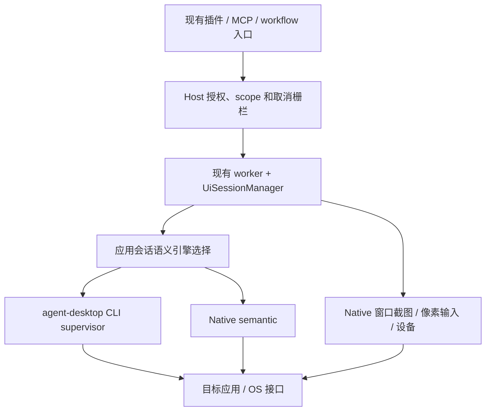
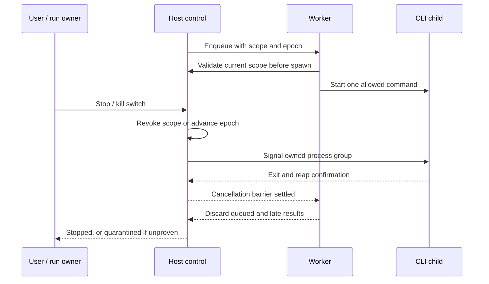

# 让 agent-desktop 成为可切换的本机应用会话引擎

| 项目        | 内容                                                                                                       |
| ----------- | ---------------------------------------------------------------------------------------------------------- |
| 状态        | 已开始实施；2026-11-13 按用户要求暂缓验证，当前不构成发布验收                                              |
| 作者 / 日期 | Codex / 2026-11-12，Asia/Shanghai                                                                          |
| 深度        | Heavy：Host 授权、原生进程、取消、持久化配置、插件契约、跨平台发布                                         |
| 来源        | 本次对话的集成调研、2026-11-02 对抗性审查，以及“给出完整的方案”的请求                                      |
| 当前源码    | 调研时 HEAD `6c373e50441a2b8dd0c98fd458996fffbdb6b26d`，`dev`；工作区另有 545 项并发改动，本方案未修改它们 |
| 候选上游    | `vercel-labs/agent-desktop` `v1.2.0`，revision `2b0a7334fc111730454b726e6800aa41cdafc093`                  |
| 关联        | ADR-0020、ADR-0153、ADR-0196、ADR-0234；[后台窗口方案](2026-11-03-background-window-automation.md)         |
| 评审角色    | Automation maintainer、Desktop runtime maintainer、Plugin/SDK maintainer、Desktop QA、Security reviewer    |
| 交付边界    | 本文交付方案和验收约束；实施需要独立变更，不包含安装、授权桌面控制、提交、发布或切换当前环境               |
| 新文档理由  | 既有后台窗口方案讨论输入资格，本方案讨论第三方执行引擎、版本和切换；二者约束不同，独立保存并互相引用       |

**推荐把 agent-desktop 接在现有应用会话层，作为可选择的语义观察与操作引擎；Native 保持默认。** 首版固定 `v1.2.0` 源码，并维护最小的 Cognia binding patch，由 Host 监督该构建的原生 CLI 子进程。原生截图、像素输入、输入释放和设备能力继续由 Cognia 原生层负责，路由在操作开始前确定。原版发行二进制只用于只读评估，不能直接成为生产语义写后端。

切换首版重启应用后生效。生产写操作必须先通过取消栅栏、精确窗口绑定和投递结果契约三道验收。现有模型工具名和 `ElementHandle` 公开结构保持兼容，不向模型直接注册上游整套 MCP 工具。

这是引擎集成方案，不是“更快、更可靠”的结论；收益由同机、同任务的 Native / agent-desktop 对照实验决定。Q1–Q4 给出建议决策，所有尚未取得的运行证据均作为发布门槛。

> 实施进度（2026-11-13）：用户随后明确要求“继续，先跳过验证，就正常实现”。P0 补丁、Host 执行栅栏、会话适配、重启配置/UI 和可选预览打包入口已在源码中接通；验证、签名包验收与性能资格仍保留为待办。具体落点、动作子集和限制见 [集成说明](../../integrations/agent-desktop/README.md)。这项调整允许继续编写后续阶段代码，不等同于 P0 或发布门槛已经通过。

## 1. 成功标准是可控切换和真实收益

现有 Cognia 已经具备跨平台自动化和应用会话；增加一个也使用 AX/UIA/AT-SPI 的依赖，不会自动改善任务成功率。接入的目标是复用上游的树投影、元素 refs、严格重解析和语义动作，同时维持 Cognia 的 Host 授权、停止和目标所有权。

| 目标          | 当前基线                                                  | 提议验收标准                                                           | 证据                                  |
| ------------- | --------------------------------------------------------- | ---------------------------------------------------------------------- | ------------------------------------- |
| G1 可选择引擎 | 启动工厂按 OS 固定构造 Native backend                     | 同一构建可选择 Native / agent-desktop，本机应用会话按实际生效值执行    | 配置往返、重启、运行 trace            |
| G2 停止可判定 | worker FIFO 没有最终取消代际检查                          | 撤销后不再准入/启动新操作；在途执行者停止并完成清理后才报告 stopped    | 队列屏障、进程退出、真实应用 sentinel |
| G3 目标不串台 | app-session 有窗口和 revision；旧直接输入入口不全携带绑定 | 两应用、同应用双窗口、PID/窗口复用、焦点变化时均不误投递               | target / spectator 状态与屏幕证据     |
| G4 不重复动作 | 有一次 turn token 和本地 IPC replay admission             | 每个调用至多启动一次 mutation；丢回复、超时、取消后不自动重放          | 计数器 fixture、requestId ledger      |
| G5 收益可证实 | 没有同任务对照数据                                        | 安全门槛全部通过，且至少一个预先选定工作负载有成功率或延迟收益         | 每组至少 30 次配对样本及失败分类      |
| G6 回滚可操作 | 没有引擎配置                                              | 改回 Native 并重启后使用新 binding，不继承旧 refs、授权或 pending 操作 | 降级/升级/异常启动矩阵                |

首期交付范围是 macOS 13+、Apple Silicon 的 Tauri 桌面本机应用会话。Intel macOS、Windows、Linux 逐个平台资格验证后开放；上游声称支持不等于 Cognia 已验收。网页和 Electron 的 DOM 操作沿用已有浏览器能力边界；Docker、managed desktop、远程目标不改路由。

不在本期承诺的能力包括运行中热切换、通用后台键盘/拖拽、锁屏控制、上游原始坐标输入、通用程序启动、通知/剪贴板管理。现有原生能力继续由明确的 Native 路由提供，不能把缺失能力伪装成上游支持。

## 2. 2026-11-12 的事实已经不同于上一轮审查

以下事实来自当前源码和固定版本的一手来源。Confirmed 表示源码/元数据已读取；不代表执行过工具或通过真实桌面验收。

| 状态      | 当前事实                                                                                                                                                                                                                                                                                         | 设计影响                                                         |
| --------- | ------------------------------------------------------------------------------------------------------------------------------------------------------------------------------------------------------------------------------------------------------------------------------------------------ | ---------------------------------------------------------------- |
| Confirmed | [backend.rs](../../crates/cognia-automation/src/automation/backend.rs) 的 `AutomationBackend` 还承担截图、物理输入、选择、事件与窗口操作                                                                                                                                                         | 不直接将整个 trait 换成上游 CLI，避免扩大到所有消费者            |
| Confirmed | [worker.rs](../../crates/cognia-automation/src/automation/worker.rs) 使用容量 64 的单 worker FIFO，持有 `UiSessionManager`                                                                                                                                                                       | 复用会话所有者；取消控制必须绕开这个 FIFO                        |
| Confirmed | [session.rs](../../crates/cognia-automation/src/automation/session.rs) 已有 lineage、revision、一次 turn token、surface 和 fingerprint                                                                                                                                                           | 保留模型契约，新增 engine binding 只存 Host 私有记录             |
| Confirmed | [kill_switch.rs](../../crates/cognia-automation/src/automation/kill_switch.rs) 清 gate、授权和录制状态，但不撤销 worker 请求                                                                                                                                                                     | 这是既有安全前置缺口，新增引擎上线前必须补齐                     |
| Confirmed | [automation_proxy.rs](../../crates/cognia-mcp-server/src/automation_proxy.rs) 长期持有 `AutomationHandle` clone                                                                                                                                                                                  | 禁止用替换单个 handle 的方式实现首版热切换                       |
| Confirmed | semantic 错误中的 `BackendError/Internal` 已被 worker 保守标为可能投递                                                                                                                                                                                                                           | 不再声称它们必然被当作未投递；完整 disposition 仍需要 typed 契约 |
| Confirmed | [插件](../../plugins/computer-use/src/index.ts) 注册 9 个模型工具，包括 get_app_state、perform_action、zoom 和 OCR 工具                                                                                                                                                                          | 工具名不扩散；引擎能力通过现有状态/说明进入模型上下文            |
| Confirmed | [上游 v1.2.0 main](https://github.com/vercel-labs/agent-desktop/blob/v1.2.0/src/main.rs) 已没有原持久 command host 路由，并有 [command_host_absent 测试](https://github.com/vercel-labs/agent-desktop/blob/v1.2.0/src/tests/command_host_absent.rs)                                              | v1.0.2 的持久 helper 结论不沿用到候选版本；仍验收所有子进程退出  |
| Confirmed | [上游 MCP](https://github.com/vercel-labs/agent-desktop/blob/v1.2.0/src/mcp/call.rs) 每个工具调用启动 CLI 子进程；[取消实现](https://github.com/vercel-labs/agent-desktop/blob/v1.2.0/src/mcp/calls.rs) 先 TERM、3 秒后 kill                                                                     | MCP 不是一个直接复用 native adapter 的常驻快速通道               |
| Confirmed | 上游 JSON 是 [2.6](https://github.com/vercel-labs/agent-desktop/blob/v1.2.0/docs/json-output.md)，[stdin 文本](https://github.com/vercel-labs/agent-desktop/blob/v1.2.0/src/cli_args/stdin.rs) 限制 128 KiB                                                                                      | 固定 parser；文本走 stdin，不进入 argv、日志或任务中心           |
| Confirmed | [C ABI 7](https://github.com/vercel-labs/agent-desktop/blob/v1.2.0/apps/docs/content/docs/ffi/index.mdx) 禁用两个 exact-ref API；[native-handle execute](https://github.com/vercel-labs/agent-desktop/blob/v1.2.0/crates/ffi/src/actions/execute.rs) 绕过 strict re-identification/actionability | FFI exact 类型不能作为已经满足安全语义的依据                     |
| Confirmed | [macOS token 实现](https://github.com/vercel-labs/agent-desktop/blob/v1.2.0/crates/macos/src/tree/resolve/retained.rs) 动态加载私有 AX remote-token symbols                                                                                                                                      | 纳入 OS 资格和发布渠道审查；不可用时不降级为按名字猜测           |
| Open      | 真实安装包、TCC 归属、同机延迟、后台应用自激活、Windows/Linux 停止语义                                                                                                                                                                                                                           | 属于 P0/P2/P4 验收门槛；本文没有虚构完成证据                     |

另一个已核验的源码缺口是：[token resolver](https://github.com/vercel-labs/agent-desktop/blob/v1.2.0/crates/macos/src/tree/resolve/retained_resolve.rs) 检查 PID/role/native ID；[token 快路](https://github.com/vercel-labs/agent-desktop/blob/v1.2.0/crates/core/src/refs/resolve_saved_ref.rs) 直接返回 strict handle，而 [ActionRequest](https://github.com/vercel-labs/agent-desktop/blob/v1.2.0/crates/core/src/actions/action_request.rs) 只有 expected_process。同元素 token 不能证明当前仍属于 source window；生产写需下述明确的 final-window patch。

Context7 本次查询返回配额耗尽，因此版本结论采用上游固定 tag 的官方源码；没有用其他库的文档替代。

## 3. 选择受监督 CLI，MCP 和 FFI 保留为有条件替代

| 方案                                   | 收益                                                      | 必须承担的成本                                                                     | 决策                                           |
| -------------------------------------- | --------------------------------------------------------- | ---------------------------------------------------------------------------------- | ---------------------------------------------- |
| Native 继续作为唯一引擎                | 无新依赖，现有能力完整                                    | 无法验证上游元素和投影机制的收益                                                   | 保持默认和回滚路径                             |
| Host 监督固定 CLI                      | 严格 refs、显式窗口、完整 JSON、stdin；可隔离 native hang | 每次启动开销、序列化、磁盘 refs、包签名/TCC                                        | 首版候选；必须通过进程与收益验收               |
| 直接暴露上游 MCP 给模型                | 配置少，可独立试用                                        | 绕开现有 Host 工具合同；包含任意 launch；全局 headed/session flags；仍逐调用 spawn | 不用于 Cognia 产品接入                         |
| Host 内部通过上游 MCP 调用             | 能复用 MCP client                                         | 比 CLI 多一层 server 与取消映射；正文参数和工具清单更宽                            | 后续只有共享生命周期或测量收益时再选           |
| Host 进程内加载 C library              | 减少进程启动开销                                          | ABI、内存/线程约束、native hang 影响 Host；ABI 7 的 ref 限制                       | 不作为首版                                     |
| 自有 helper 加载 C library / Rust core | 隔离 native hang，可精确封装                              | 新 helper 协议、打包、未稳定 Rust API 或 FFI 安全链                                | CLI 收益成立但启动开销阻塞目标时的下一阶段方案 |

选择 CLI 的依据是当前安全操作语义和故障隔离，而不是把“C library 有 exact API”误读为等同于完整 snapshot/ref 路径。首版不引入独立 provider marketplace 或新的通用 automation framework。

这里的生产 CLI 指 `v1.2.0 + cognia-bound-window-v1` 源构建，不是未经修改的 release binary。从责任范围判断，维护这一窄补丁预期小于重写完整驱动，但尚无人日估算；若团队不接受补丁维护，则只保留隔离环境中的只读实验，Native 继续作为唯一可写引擎。不能通过降低窗口所有权要求来省掉补丁。

## 4. 引擎位于会话 seam，原生 OS backend 继续拥有设备



图 1：所有操作先经过同一 Host 权限和取消边界，引擎选择只替换本机应用会话中的观察/语义路径。

在现有 worker 内扩展会话执行 seam，不替换所有 `AutomationHandle`，也不将上游 refs 直接交给 AX/UIA backend。新增内部 `SessionEngine` 由启动配置构造，只有 `native` 和 `agentDesktop` 两个封闭变体。`AutomationBackend` 保持原生 OS 所有者。

建议新增 `automation/agent_desktop/{mod.rs,process.rs,protocol.rs}`，分别拥有会话适配、子进程生命周期、固定协议转换；这些责任不能放入 AX/UIA 实现，也不应塞进已有大型 worker 文件。每个 Rust 源文件包含本地 unit tests。配置优先扩展现有 `persist.rs`，取消与投递契约优先扩展 `worker.rs`、`session.rs`、`backend.rs`；不另建第二套会话或权限数据库。

| 路径                                                      | 首版所有者                          | 规则                                                           |
| --------------------------------------------------------- | ----------------------------------- | -------------------------------------------------------------- |
| 本机 canonical get_app_state/query/expand/semantic action | 启动时选定 SessionEngine            | 一个 session 的 engine 不变                                    |
| 窗口身份、截图、缩放、zoom、redaction、OCR                | 现有 Native + worker                | 不使用上游带窗口阴影且原点未证明的截图作为像素坐标基准         |
| 像素点击、键盘、拖拽、held inputs、窗口/事件/选择能力     | Native                              | 使用 Host 保存的 Native binding，不能接收上游 ElementRef       |
| 旧 granular / serialized Action 入口                      | Native，受统一 admission fence 保护 | 没有 Host scope 的模型 mutation 拒绝；不能因新引擎选择自动放宽 |
| Docker / managed / remote target                          | 现有 cua_route / registry           | 先解析 target，再选择本机引擎；远程失败不能落到 local          |
| 网页与 Electron DOM                                       | 现有浏览器路径                      | 不自动打开 CDP，不替换 agent-safe-v1，也不自动重启用户应用     |

## 5. Host 保存身份链，模型只得到原有句柄

### 5.1 scope 和 engine binding 必须由 Host 创建

以下为拟议内部类型，不是已实现 API。字段意义是契约；不得把客户端字符串视为授权凭据。

```text
ExecutionScope = authenticated principal + runId + runGeneration
                 + automationEpoch + absoluteDeadline
EngineBinding = bootId + engineId + binaryDigest + protocolVersion
                + principal + scopeId + runGeneration
                + sessionId + lineageId + targetGeneration
BoundWindow = platform window id + process id + process generation
              + native capture identity + geometry generation
ElementBinding = EngineBinding + BoundWindow + revision
                 + upstream snapshotId + qualifiedRef
                 + action capabilities + NativeObservation
```

`NativeObservation` 存储原生窗口根、截图 surface 与实际 input focus；它与上游投影树分别保存。根节点、ElementRef 和窗口 ID 不通过强制转换跨 provider 使用。

canonical mutation 必须具备有效的 Host scope。chat 的 turnKey 只是查找 Host 注册记录的索引；注册、generation 和撤销权属于已认证的执行运行时。外部 MCP 由认证连接/调用归属产生 scope，workflow 由 run 所有者产生，Inspector 由本地人类交互产生短期 scope。无法提供运行归属的旧模型调用返回明确错误，不创建隐式永久 scope。

Host 在 chat send/run admission、workflow begin 或 MCP invocation admission 时先登记 scope，再向执行者发送工具能力；启动失败立即撤销。Host 同时维护 chat session → active run generation 的映射，工具调用通过认证通道附带不可预测的 scope token；模型输入的 turnKey/sessionId 本身不能创建、续期或恢复 scope。新的 stop/late approval 携带 expected generation，只作用于该次运行；旧 session-only interrupt 的兼容语义是撤销 Host 接收该请求时已登记的 runs，不延伸到随后新建的 run。该接线与取消端同时交付，不能只实现 revoke 而遗漏 begin。

具体接入现有 `begin_pending_run` / `ActiveRunToken`：pending admission 与 scope 分配使用同一个 session admission guard，在首次 await（包括 sidecar spawn）之前登记 `(bootId, sessionId, native token_id, scopeId, runGeneration)`。stop 在同一 guard 下推进 session cancel epoch，并为所有 pending/active scopes 写入撤销 tombstone；没有激活的 pending send 同样被取消。`write_pending_run_command` 在激活和写入前复核 scope，已撤销/缺失 token 返回取消，不能因为新 sidecar ready 而重新激活。

sidecar process generation 在真正写入对应进程时附加到记录，`options.turnId`、executorId、commandId 是核对/关联信息，不能替代 native token_id。工具 callback 与完成事件携带 scope token 和对应 process generation，Host 从已登记的 invocation 关联 `turnKey`，不按“最新同名 session”反查。旧进程 cleanup 可以保留未撤销的 pending sends，但不得保留或复活被 tombstone 的 scope；晚到的旧 result/stop/approval 不能撤销或启用新 generation。

session 状态按 `(principal, scopeId, runGeneration, sessionId)` 分区。相同 app/sessionId 进入新 run 时必须旋转 lineage、清掉旧 turn tokens、continuations 和 upstream snapshot 绑定；只读展示历史可保留，不能恢复 actionable handles。现有 fingerprint-refetch 只允许同一 scope/engine/boot 的兼容 revision，不得跨这些边界寻找“相似控件”。

### 5.2 观察必须证明同一进程、窗口和截图

1. Native 根据 `AppLocator` 解析进程及 generation，选择确切窗口；同应用多窗口需要显式 `windowId` selector。为 `GetAppStateOptions` 增加可选、Host 校验的窗口选择字段，并同步 zod/SDK schema。
2. adapter 用固定版本的 macOS window-id 转换器映射上游窗口 ID。转换器只接受该版本已核验的格式，并以 process generation、原生窗口 ID 双向核对；不能只凭标题、bounds 或 app 名匹配。
3. CLI `snapshot` 显式传入 app 和 window ID，启用 bounds。Host 保存完整 qualified ref；不使用 latest-snapshot pointer。
4. Native 捕获同一窗口截图。前后重读窗口身份、bounds、display 和 scale；窗口变动或无法证明对应关系则拒绝发布 revision，允许在同一 deadline 内重新观察一次。
5. 返回原有 UiStateRevision；上游 `complete:false`、truncation、`identity_unproven` 转成显式观察/操作资格。静态文本可以显示，但无有效 ref 的节点不发 actionable handle。

首版 agentDesktop session 只观察已经运行的应用，`allowLaunch:true` 在调用 Native resolve_application 之前拒绝；启动应用继续使用已有、单独授权的显式 Native 路径，不能由只读观察命令隐式启动任意程序。

树和截图不是 OS 原子事务。上述检查保证已知身份/几何一致，不宣称 UI 内容同一瞬间；点击前仍重新解析 refs，像素动作仍使用原生最终校验。

### 5.2.1 生产 CLI 必须增加 owning-window 投递校验

已知的 retained-token 快路可以接受同一对象在同进程不同窗口之间移动，不能仅靠 Host 启动前比对来修复。最小 binding patch 在上游 core 的 ref action 请求中携带从私有 RefStore 读取的 expected source-window identity，并在 macOS adapter 最后一个原生投递边界读取目标控件当前 owning AXWindow，核验它与该窗口及 process generation 一致；menu/sheet 等 surface 必须证明与同一授权窗口的归属链，否则首版拒绝。

校验必须覆盖每个可能改变 UI 的机制，包括 preparatory scroll/menu 操作以及最终 AXPress/AXValue，而不是只在 snapshot、resolver 或 Host 中执行一次。操作开始前失败返回 not_delivered；若已有准备动作被投递，保留 upstream 的 uncertain/unverified disposition，不能伪报未投递。窗口改变、控件被 reparent 或归属读取失败一律拒绝后续写入。像现有 Native 路径一样，这提供原生发送边界的重验证，不宣称能冻结应用内部的任意并发变更。

补丁另为 version/probe 输出增加 `cognia-bound-window-v1` capability profile，并保证继承的 supervisor mutation-lease FD 存活至执行进程退出。Host 只有验证该 profile、源码/补丁/产物 digest 和目标平台资格后才开放语义写；没有 profile 的原版 binary 只能读取。补丁单独保存在 `integrations/agent-desktop/patches/`，构建从固定 upstream revision 应用，CI 检查 patch clean-apply、上游 host-platform tests 和 reparent regression；不在模型路径动态打补丁，也不自动跟随 main。

兼容构建同时移除上游启动时全局清理 legacy command hosts 的副作用；Cognia 只能清理由自己 journal/进程身份证明拥有的执行者。原版 release 的只读对照也只在没有其他执行者的一次性环境运行，不能把命令名为 status/version 当作已经证明无系统副作用。

query/expand 优先复用 Host 保存的观测树和 continuation。向上游 root drill 会改变该 snapshot 内的 refs 时，Host 原子发布新 revision 并使受影响旧 handles 失效；不把原地变更当成旧 revision 未变化。每个 binding 保存其 snapshot 命名空间，不跨用户/run 共用。

### 5.3 每个动作在发送前选择且只选择一个执行者

| 动作 / target                                  | agentDesktop 首版路由                            | 拒绝条件                                                         |
| ---------------------------------------------- | ------------------------------------------------ | ---------------------------------------------------------------- |
| Element 单击 / SetValue / 合格 semantic Scroll | upstream qualified ref + strict headless command | ref 不具备操作、identity 未证明、后台资格不足、窗口变化          |
| SecondaryAction                                | 只允许当前模型契约已暴露并具有精确映射的动作     | 不拼接任意 command；未映射名称拒绝                               |
| TypeText / PressKey / Drag / 多击 / Focus      | Native，首版要求 Native/pixel target             | upstream Element target 不直接转成原生控件；先重新观察并明确目标 |
| Pixel action                                   | Native screenshot surface + NativeObservation    | 截图旧、焦点/窗口变化、被遮挡、控制权撤销                        |
| legacy Element action                          | 只接受 Native provenance                         | 上游 token 即使字符串格式类似，也不得进原生 resolver             |

`Auto` 只在发送前根据明确 capability 选择路径。upstream 已开始执行后，无论 unsupported、timeout 或 JSON 错误，均不得再换 Native 重发。由于首版不自动将上游 Element 转成 Native target，instruction pack 必须告诉模型何时重新取截图并使用 Pixel target；这项能力差异须在 UI 与工具说明中可见。

`SelectText {start,end}` 在 agentDesktop Element target 上首版明确 unsupported；不能误映射为上游选择菜单项的 `select`。Native engine 的原有 text pattern 能力单独保留。对上游 Element target，Semantic/Auto 只允许已映射的语义动作，Pixel strategy 拒绝；对 Pixel target，Pixel/Auto 只允许具备原生资格的 Click/Drag/Scroll/TypeText/PressKey/Focus，Semantic strategy、SetValue/SelectText/SecondaryAction 拒绝。左键单击 count=1 是基本语义映射；右键、多击等组合只有独立 profile 资格才开放。`UiAction` 的每个变体及其 target/strategy 在 Rust 封闭 match 中显式分类，新增变体必须让路由测试失败，不能使用默认转发。

Native `Capabilities.operations` 继续表达设备/旧 API 能力，不能据此推导 selected session 能力。给 UiStateRevision 增加可选 `sessionCapabilities`，按 engine、target kind、strategy 以及节点可执行动作输出允许矩阵和拒绝原因；工具说明消费该矩阵，Host 在投递时再次执行同一判定。旧客户端缺少字段仍受 Host 拒绝，不能通过自报 capability 扩权。

严格后台运行沿用后台窗口方案的 `backgroundOnly` admission：语义调用也可能使应用自行激活，只有通过应用/版本/动作资格的组合才能宣称后台可用。首版不为该依赖开启通用后台承诺，不自动添加 `--headed` 或 `--force`。

## 6. 投递状态必须成为 typed contract

给 Native 和 upstream 共用的内部执行结果增加 `delivery`、`retry`、`mechanism`、`verificationScope`、`targetEvidence` 和 `errorCode`。普通错误分类不能决定是否可以重试。Native 未提供证据时使用 Unknown，不伪造未投递。

| 内部 delivery                               | 原公开 ActionStatus 投影              | 可自动重发 mutation？        |
| ------------------------------------------- | ------------------------------------- | ---------------------------- |
| not_delivered，且属于 policy/admission 拒绝 | Refused                               | 否；由调用者重新决策         |
| not_delivered，其他确定未发送失败           | NotDelivered                          | 否；先重新观察并取得新 token |
| delivered_verified                          | Delivered，附具体验证范围             | 否                           |
| delivered_unverified                        | Unknown，保留“已发送但效果未证实”证据 | 否                           |
| delivery_uncertain / unknown                | Unknown                               | 否                           |

为 ActionResult 增加可选 `delivery` 详情，保留既有 status 字段的保守投影。所有本地 Native、remote 和 upstream 结果适配器都更新；旧客户端忽略新字段仍不会把 Unknown 当作可重试。将“动作返回成功”“控件状态符合预期”“应用业务已经持久化”分别表示；树发生变化不能单独证明目标动作完成。

沿用一次 turn token 和 [InvocationHistory](../../crates/cognia-automation/src/automation/invocation.rs)。requestId 在启动子进程前登记，同一 ID 再来只拒绝重复，不能成为第二次执行。进程已启动却缺少有效 envelope、stdout 超限或丢回复时均记 Unknown；错误消息不能提供可执行的恢复命令。

只对只读 transient 失败允许一次有界重试；所有步骤共享原绝对 deadline。upstream `error.disposition.retry=safe` 只是必要证据，不自动授权 Cognia 重复 mutation。

## 7. 取消是独立控制通道，stopped 需要执行者确认



图 2：停止通知不经过被观察或输入阻塞的 worker 队列，只有回收和清理得到确认才发出终态。

1. `AutomationHandle` 的所有 clone 共用 `Arc<ExecutionFence>`，保存 automation epoch、run generations、active process owners 和 health。撤销是原子状态变更，不依赖 worker 接收消息。
2. 在 gate 前、consent 后、worker 出队、spawn 临界区以及每个原生输入步骤校验 scope。spawn 与撤销共享短临界区：撤销后不能再创建有效子进程；已经创建的 Child 在撤销处理器可见。不持有 parking_lot guard 跨 await。
3. kill switch 先推进 epoch，再拒绝新调用并取消所有 owned scopes。普通 stop 只撤销对应 run，不能影响其他 run。迟到批准、结果和 restart 均携带旧 generation，因此失效。
4. 已登记且在撤销前成功 spawn 的操作属于在途操作。取消发起后、执行者退出前，它仍可能发出输入；因此这段时间只显示 stopping。原版 CLI 没有逐次 AX 调用的 Host handshake，本方案不承诺撤销瞬间阻止其后每次 OS 调用。只有 scope 后续请求全部失效、在途执行者退出并完成输入清理后才报告 stopped；已接受的事件或应用异步事务仍可能产生业务效果，stopped 不代表目标应用状态冻结。已启动操作停止时结果保守为 Unknown，此后先重新观察，不自动恢复剩余动作。
5. 运行状态为 `ready → running → stopping → stopped`；回收、输入释放或 native API 边界无法证明时进入 `quarantined`。stopping/quarantined 都拒绝新 mutation；stopped 之后必须显式创建新 scope。
6. Native held-input guard 增加 fence 检查，并在中止后释放已按下的键/按钮。已进入不可中断 OS API 的调用只能等待其有界 deadline；无界调用必须先修复。不能终止 Rust worker thread 来冒充已完成清理。
7. CLI TERM 宽限 500 ms，随后 KILL；总回收预算 2 s，均为提议目标。超预算则 quarantine，不能显示“已停止”。实测证明能更快或需要调整后再改变预算。

接线入口：扩展 `SidecarHost` 的 Host lifecycle port，在 chat send admission 登记 scope，并由 `claude_interrupt_impl_with_id` 在发送 sidecar interrupt 前撤销对应 generation；Tauri host 实现调用 AutomationState，headless host 显式报告没有本机桌面能力。sidecar crash/disconnect、session close、workflow cancel 和外部 MCP 连接终止也撤销其 scope。`cognia-sidecar` 不直接依赖 `cognia-automation`，通过 Host port 避免循环依赖。

legacy 直接输入也经过相同 fence。仅修 canonical perform_action 不满足 G2/G3。Native 队列阻塞无法完成清理时，保留 quarantine，用户可以查看原因并重启；禁止在旧 worker 未退出时另起可写 worker。

## 8. 子进程、包和本地数据都由 Host 明确拥有

| 边界              | 首版约束                                                                                                                                                                                                     |
| ----------------- | ------------------------------------------------------------------------------------------------------------------------------------------------------------------------------------------------------------ |
| executable        | 从固定源码 revision 应用已审阅 binding patch，核验源码/补丁/产物 digest；运行时只用 app resource 中已验证绝对路径，不走 PATH/npm/npx                                                                         |
| allowlist         | version/status、受绑定的 list/snapshot/find/get/is、精确 ref 单击/set-value/合格 scroll 与已有 secondary action 映射；不提供通用 argv、launch、close-app、batch、CDP、剪贴板、通知、raw pointer、held inputs |
| invocation        | 无 shell，参数数组；文本用 `--stdin`，UTF-8、无 NUL、最多 128 KiB；不把文本写入 Job Center command、历史或环境变量                                                                                           |
| process ownership | 每个执行独立进程组；Child/PGID/pid-generation 在 runtime owner 中登记；退出/取消均 wait/reap；进程组清理包括已知辅助进程，不按名字杀同用户的其他进程                                                         |
| environment       | env allowlist，保留必要 GUI/TCC/locale 与私有 runtime root；去掉用户 AGENT_DESKTOP_*、trace/debug、DYLD 注入等影响路由的变量，再显式写入 Host 值                                                             |
| stdout/stderr     | stdout 上限 8 MiB、stderr 上限 64 KiB，双管同时 drain；超限终止并按是否启动给出投递不确定性；正文不进入普通日志                                                                                              |
| session data      | app data 下 `automation/runtime/<bootId>/<scopeId>/`，私有目录；一 scope 一 namespace，不采用默认全局 home，不允许客户端传路径                                                                               |
| retention         | 默认不开 trace/screenshot artifacts；scope 关闭且进程回收后清除 refs，异常残留启动时清理，最长 24 h；清理不跟随 symlink                                                                                      |
| concurrency       | 复用 worker 的 64 项队列并增加每 scope 8 项上限；全局最多一个 Cognia desktop mutation，跨 Cognia Host 进程用用户级锁协调；不尝试锁住用户物理输入                                                             |
| acquisition       | 运行时不自动下载/更新，不自动申请 TCC。权限不足展示缺失项；用户按正常产品流程授权后重新 probe                                                                                                                |

Host crash 的恢复不能只依赖内存 owner 或 Rust Drop。首版 Unix mutation lease 使用会随 fork/exec 继承、不会在 Host 死亡时立即释放的锁 FD；同一锁由 Native 和 CLI mutation 共用。将该 FD 的专用 duplicate 显式交给 CLI，验证候选 binary 与允许的辅助进程不会提前关闭它。Windows 后续使用带 kill-on-close 的受控 Job Object，并独立验收。普通 stdout/stderr pipe 和父进程 PID 均不能替代这个执行存活证明。

spawn 前原子持久化不含 UI 正文的 operation journal（requestId、scope generation、bootId、executable digest、prepared 状态），spawn 后补充 PID/process-birth identity、PGID 和 started；落盘失败不启动 mutation。启动窗口中 Host 崩溃但 child 身份尚未写全时，继承 lease 仍阻止新 Host 启动 mutation。journal 不是授权来源，重启一律撤销旧 scopes。

新 Host 启动先取得同一用户级 lease 并核对前 boot journal：锁仍被持有或无法确认旧 executor 已退出时保持 recovering/quarantined，不启动 Native 或 CLI mutation。只在 PID generation、executable 和 ownership 都匹配时才信号清理；记录不完整、PID/PGID 已复用或无法证明归属时不杀进程，等待有界上游 deadline/lease 释放并让用户看到未完成恢复。回收和 journal 收敛后才创建新的可写 scope。若候选 CLI 不能可靠继承 lease，P0 判定该 transport 不合格，采用有 parent-death guardian 的自有 helper 另行评审，不能在原方案中省略这一层。

启动锁采用非阻塞 try-lock 和有界状态轮询；recovering 不能阻塞设置页、退出或 kill-switch 控制通道。

process.rs 可以复用 [cognia-jobs supervisor](../../crates/cognia-jobs/src/supervisor.rs) 已证明的进程组/回收机制，但不能直接调用持久化 shell-job 接口来保存 UI 文本。先检查是否能提取窄的生命周期 primitive；没有第二个真实复用点时，在 automation 内实现有测试的专用 owner，不引入新的通用作业框架。

发布 pinfile 建议位于 `integrations/agent-desktop.json`，记录 repository、tag、revision、patchDigest、integrationProfile、允许的 envelopeVersion、源码归档与最终平台产物摘要。生产包从固定源码应用补丁构建，不能把未打补丁的发行资产重命名后启用写能力。实施构建入口增加 source-fetch/clean-apply/host-platform build/测试/签名 staging，所有产物摘要由真实构建生成，不在本文填造值。

只读对照资产是 `agent-desktop-v1.2.0-aarch64-apple-darwin.tar.gz`，GitHub 提供摘要 `219813428bb1ad8decae172faed05c5964a2415170df402e2786ccfa6452ba82`，压缩大小 2,230,641 bytes。该摘要仅来自 [发行元数据](https://github.com/vercel-labs/agent-desktop/releases/tag/v1.2.0)，P0 下载时必须独立计算核验；它不代表 Cognia patched binary 的大小或摘要。本文没有下载、构建或执行。

签名/公证时按最终 app bundle 验证 native executable 和所需 helper，保留 Apache-2.0 LICENSE/NOTICE。macOS 私有 AX token symbols 是发布渠道与 OS 兼容风险；不得将缺失 token 的匹配降级为按文本猜测。自动清理上游 legacy host 的行为也需要测试：候选包不能终止其他安装实例的进程。

初始预算为：version/status 3 s，完整 snapshot 最多 30 s，mutation 最多 10 s，worker 等待最多 2 s，停止回收最多 2 s；均是提议上限而非测量值。queue、consent、CLI 和 post-read 共享外层绝对 deadline，不能逐阶段重置；consent 最长等待取配置值与“外层剩余时间减动作/清理预留”中的较小值。不足以安全执行的预算在投递前拒绝。stdout/RSS/磁盘实际值在 P0 记录；没有完成该观测就不扩大并发或缓存上限。

## 9. 配置单独持久化，首版只支持重启生效

不要把引擎字段塞进 `AutomationSettings` 的现有 bulk-save：旧客户端 round-trip 可能丢掉未知字段，kill switch 的 enabled 保存也不应修改引擎选择。

在同一 Host automation data 目录增加独立、原子写入的 `session-engine.json`，schemaVersion=1，内容拥有 `desiredEngine`、revision 和 schemaVersion；缺失文件默认 native。preview 资格是发布 profile 的只读事实，不由模型或该配置打开。损坏/未知值保留原文件并显示 configError，本机会话 fail closed，不能静默更换所选引擎。

新增三个封闭的 internal/client.local 命令：`automation_session_engine_get`、`automation_session_engine_set`、`automation_session_engine_probe`，resource 使用 `automation.session_engine`，分别采用闭集动词 get/set/probe。set 使用 expectedRevision CAS，只保存下一次启动的 desiredEngine，不能修改 gate.enabled、permission 或 scope。probe 只读取版本、权限和 profile，不发输入、不打开授权弹窗。命令加入 Companion catalog、Rust/TS 生成物、Tauri 注册和最窄 ACL；首版不为它们添加 http/websocket/webrtc 写权限。

状态响应为对象，包含 desiredEngine、effectiveEngine、needsRestart、health、binaryVersion、profile 和 reasonCode。health 取 ready/missing/unsupportedPlatform/permissionRequired/incompatible/configError/recovering/quarantined。后端不返回任意可执行路径或 UI 内容给设置页。

设置页复用 `AutomationSettingsProvider` 周边和 `BehaviorCard` 的现有布局，增加“本机应用会话引擎”选择及实际生效值；文案明确截图和物理输入仍由 Native 执行。保存后显示“重启后生效”，不会隐式停止运行或自动重启。没有候选资格的平台展示 disabled 原因，保留 Native 可选项。配置持久化失败不展示保存成功。

切换步骤：读状态 → CAS 保存 desiredEngine → 当前会话继续使用 immutable binding → 用户重启 → 启动构造新 engine、bootId 和 lineage → probe 成功后允许新 session。选择 agentDesktop 却不可用时该会话入口显示 unavailable；恢复方法是改回 Native 再重启，不在动作执行期间自动降级。

纯 Web/Capacitor 不启动本机 CLI；paired/remote 路由维持目标 Host 的能力语义，首版 UI 不提供远端引擎切换。旧客户端可继续使用既有工具；缺少新 capability 表示 unknown，并由 Host 执行拒绝/约束，不通过客户端判断授权。

## 10. 隐私、观测和运维都围绕执行事实

本方案不新增 LLM 或云请求。tree、截图、错误 details 均来自不可信且可能敏感的桌面内容；只经既有工具结果和 PII 边界送入模型。upstream 节点中的文字不能改变 executable、flags、target、scope 或 permission。

| 事件/指标                  | 有界维度                                                   | 提议门槛与动作                                |
| -------------------------- | ---------------------------------------------------------- | --------------------------------------------- |
| automation.engine_probe    | engine、version、platform、reasonCode                      | 版本/digest 不符立即不可用                    |
| automation.action_terminal | engine、actionKind、delivery、mechanism、verificationScope | Unknown 保留证据，禁止自动重放                |
| automation.cancel_barrier  | engine、reason、settled/quarantined                        | 2 s 未回收则 quarantine；UI 保持未完成停止    |
| automation.target_refused  | reasonCode、actionKind                                     | target mismatch 只拒绝，不换 app/窗口         |
| automation.queue           | engine、queue-full/cancelled/deadline                      | 达到上限拒绝，不能无限缓冲                    |
| duration / spawn / bytes   | engine、operationClass、platform                           | P0 分别记录冷/热启动、P50/P95、输出大小和 RSS |

requestId、sessionId、windowId、refs 是审计关联字段，不是 metric label；应用标题、文字和 raw JSON 不进普通日志。复用现有 audit ring，必要时新增 typed evidence，而非双写一套上游 trace。诊断导出需要用户主动选择、遵守现有保留与脱敏规则。

运维恢复顺序：确认 scope 已撤销 → 检查进程是否全部回收 → 未证明则维持 quarantine → 改回 Native desiredEngine → 重启后 probe → 新建会话。不能在 quarantine 中通过“重试”按钮重发原动作。

## 11. 失败与版本差异都有明确结果

| 触发                                 | 系统行为                                                        | 恢复                                            |
| ------------------------------------ | --------------------------------------------------------------- | ----------------------------------------------- |
| binary 缺失/摘要错/envelope 非 2.6   | probe incompatible，不启动 mutation                             | 安装修复后的 Cognia 包，或选 Native 重启        |
| snapshot partial / identity_unproven | 显示部分树，操作资格逐节点保守判断                              | 缩小观察范围、重新观察；不假设缺失节点不存在    |
| STALE_REF / AMBIGUOUS_TARGET         | 返回 typed 未投递/不确定事实，不自动选第一项                    | 新 revision、新 token，必要时由用户选窗口       |
| consent 后 stop / scope close        | generation 不符，拒绝 enqueue/spawn                             | 新 run 必须重新取得授权                         |
| 超时、退出无 JSON、stdout 溢出       | 未启动为 NotDelivered，已启动为 Unknown；回收子进程             | 先观察效果，原调用不重放                        |
| 上游窗口和 Native 截图无法映射       | 不发布可写 revision                                             | Native 会话独立重建，不能拼接旧截图/refs        |
| 应用自行激活                         | backgroundOnly 下撤销该资格，停止后续动作                       | 报告已发生干扰；显式选择允许前台模式            |
| GUI 登录会话/TCC 不可用              | permissionRequired/unavailable                                  | 用户修复系统条件，重新 probe                    |
| 旧客户端发送未知 engine token        | provenance 不符，Host 拒绝                                      | 重新获取状态和句柄                              |
| downgrade 回旧 Cognia                | 独立配置不影响原 AutomationSettings；原运行的 refs 已随重启失效 | 回到旧版 Native 语义，不迁移授权或 pending 操作 |

## 12. 验收先证明边界，再判断是否值得启用

以下是实施时要运行的检查，不是本次已经跑过的测试。每条测试应先在可复现旧行为/错误适配上失败，再验证修复；不能用仅验证 mock 调用次数替代桌面投递证据。

| ID  | Given / When                                                                                    | Then / 必需证据                                                                                              |
| --- | ----------------------------------------------------------------------------------------------- | ------------------------------------------------------------------------------------------------------------ |
| A1  | 两个已授权 run，对其中一个 stop                                                                 | 仅该 run 的 queued、active、late approval 被撤销；另一个 run 不串 scope                                      |
| A2  | 用屏障阻塞 observation，另一个 mutation 已入队；此时 kill                                       | 释放屏障后 mutation 仍不启动；OS sentinel 没有变化                                                           |
| A3  | spawn 与 revoke 并发，循环注入所有交错                                                          | child 要么未创建，要么已被 owner 登记并回收；没有未登记执行者                                                |
| A4  | 模拟已执行但丢回复/timeout/坏 JSON                                                              | 业务计数最多增加一次；无 Native fallback、无新 token 偷渡重放                                                |
| A5  | A/B 双应用、同 app 双窗口、窗口关闭重建/PID 复用；snapshot 后将同一 AX 对象 reparent 到另一窗口 | final-window guard 拒绝向新窗口投递；保留 preparatory mutation 的 partial-delivery 事实；不命中 spectator    |
| A6  | 观察后移动窗口、跨屏、缩放/DPI/hotplug、遮挡                                                    | stale geometry 拒绝，截图/zoom/坐标保持同一 native space                                                     |
| A7  | 上游 Element handle 送到 Native、旧 boot/run 的 handle 重用                                     | provenance/generation 校验失败，不进行字符串猜测                                                             |
| A8  | 现有 MCP 连接、pending consent、workflow 仍存活时改配置                                         | 当前 binding 不变；重启后只使用新 engine，没有双 worker                                                      |
| A9  | 修改整份旧 AutomationSettings、执行 kill switch、旧 UI 保存                                     | 独立 engine 配置和 desiredEngine 不丢失，权限仍由原 gate 决定                                                |
| A10 | 含中文、emoji、换行、引号和 shell 字符的文本                                                    | stdin 原样写入，无 shell、argv 或日志泄漏；NUL/超限发送前拒绝                                                |
| A11 | Native held inputs 执行中停止/异常                                                              | 已按下输入有释放证据；不能证明清理则 quarantine                                                              |
| A12 | CLI 生成辅助进程、父进程退出、stop 超时；Host 在 spawn 前后各窗口被 SIGKILL 后立刻重启          | 所有可证明 owned children 被收集；旧 executor 未收敛前新 Host 不发 mutation；不终止其他应用或复用 PID 的进程 |
| A13 | menu/sheet/popup、重复标签、partial tree                                                        | exact surface 和资格正确；不能匹配则安全拒绝                                                                 |
| A14 | 现有 9 个工具以及 direct workflow/MCP/Inspector 路径                                            | Native 回归不退化；selected engine 的受支持/不支持行为和说明一致                                             |
| A15 | artifact digest、签名、TCC 属主、缺失权限、重装                                                 | packaged app 可用，不能用 Terminal 授权替代桌面包验收                                                        |
| A16 | 远程连接断开、managed generation 过期                                                           | 不发生任何 local CLI 或 Native mutation                                                                      |

测试分层与当前入口：

- Rust：`cargo test -p cognia-automation`；有 sidecar lifecycle port 变更时加 `cargo test -p cognia-sidecar`；MCP scope 变更加 `cargo test -p cognia-mcp-server`。跨 crate/架构检查遵循实际 Rust gates，不把 Jest 当作 Rust 验收。
- TS：`pnpm test --runInBand` 加明确的受影响共置测试路径；`pnpm typecheck`、`pnpm lint`、`pnpm lint:static-export`。这些是实施后的 gate；本次文档改动不运行全仓测试。
- 契约：改 catalog/schema 后跑 `pnpm companion-api:gen`、`pnpm companion-api:check`；核对新命令注册和 ACL、旧工具 schema、Native/remote 输出投影。
- UI/i18n：两种语言的 split sources，跑 `pnpm i18n:build`、`pnpm i18n:build:check`、`pnpm lint:i18n`；使用 `pnpm test:e2e --project=chromium` 加将来新增的 engine-settings spec，验证保存、错误和重启状态。
- Native：macOS 走当前可用的 Tauri 原生诊断/自动化 harness 和一次性 target/spectator fixtures。现有 `pnpm test:e2e:tauri` 的 Playwright 项目是 Windows opt-in，不能拿它声称完成 macOS 输入验收。
- 生产包：`pnpm build` 验证 static export，真实签名包执行 A15；只在 `pnpm tauri build` 环境具备时执行并如实记录结果。
- 后续文档：实现后更新英/中文 subsystem 和发布说明；仅 MD 方案不需要完整 Fumadocs build。覆盖率按 AGENTS 本地 opt-in 规则，不为本方案运行覆盖率。

性能实验固定 app 版本、初始状态、硬件/OS、显示设置、动作序列和模型条件。先运行确定性 observer/action 回放，再运行相同模型任务。测试至少含小型原生表单、密集 Electron/IDE 树、多窗口/菜单三组，每引擎每组至少 30 次随机交错配对；单独报告冷启动和稳定样本、成功率、拒绝原因、P50/P95、总任务时间、输出字节和 RSS。

收益 gate 的提议值：无任何 wrong-target、duplicate 或 stopped 后新启动 mutation；成功率不得显著劣于 Native。至少一组的任务成功率有可重复改善，或总耗时 P95 改善至少 15%；其余关键组 P95 回退不超过 20%。样本不够判定时扩大样本，不能拿 30 次“零事故”证明总体安全。15%/20% 是待 Q4 批准的产品取舍，不是实测数值。

## 13. 五阶段交付，每阶段都能单独停止或回滚

| 阶段              | 产物与唯一负责角色                                                                                                                   | 依赖                 | 退出条件                                                 | 中止/回滚                                                              |
| ----------------- | ------------------------------------------------------------------------------------------------------------------------------------ | -------------------- | -------------------------------------------------------- | ---------------------------------------------------------------------- |
| P0 资格与兼容构建 | Native maintainer：固定源码与最小 binding patch、digest、final-window/lease profile、命令 allowlist、TCC/私有符号与隔离 fixture 基线 | Q1/Q2                | patched candidate 的 A5/A12 先通过，再做 CLI/Native 对照 | 不改生产路由；没有合格 patch 的原版仅允许只读实验                      |
| P1 公共安全契约   | Automation maintainer：scope/fence、typed delivery、旧直接入口、Host lifecycle 接线和 in-file tests                                  | P0 可行性            | A1–A4、A7、A11、A16 通过；Native 回归通过                | 保留 Native 路由；新引擎 disabled                                      |
| P2 会话适配       | Automation maintainer：snapshot/projection、私有 bindings、子进程 owner、精确语义映射                                                | P1                   | A5–A7、A10、A12–A14 通过，未知输出保守映射               | 发布 profile 禁用该 engine，原 scope 终止                              |
| P3 配置与 UI      | Desktop runtime maintainer：独立 CAS 配置、internal commands、状态、i18n、重启生效和旧客户端兼容                                     | P2                   | A8/A9、UI E2E、schema/gates 通过                         | desiredEngine 改 Native 并重启；不回滚权限文件                         |
| P4 包与有限开放   | Release maintainer：签名/公证/许可证、平台 profile、实测收益和回滚演练                                                               | P3 + Desktop QA 验收 | A15 和 Q4 指标通过；仅合格平台 preview opt-in            | profile 不再开放新 scopes；已有 scopes 撤销并清理，Native 在重启后恢复 |

Windows/Linux/Intel macOS 资格开放分别建立独立矩阵，不能随 Apple Silicon 一次发布自动解锁。全量替换默认值不在这五阶段内；需要单独的收益和回滚决策。任何 wrong-target、重复 mutation、未停止却报告 stopped 都是立即中止条件，不等待达到某个错误率。

## 14. 实施落点与不可混入的额外改造

| 模块                                                                      | 要变更的责任                                                              | 验证                                              |
| ------------------------------------------------------------------------- | ------------------------------------------------------------------------- | ------------------------------------------------- |
| automation/worker.rs、session.rs、backend.rs                              | bound observation、engine provenance、typed outcome、fence 与显式动作路由 | Rust 共置测试、A1–A7/A11                          |
| automation/agent_desktop/                                                 | allowlisted CLI、JSON 2.6、stdin、进程回收、版本 profile                  | parser fixture + fake executable + native fixture |
| commands.rs、dispatcher.rs、kill_switch.rs、invocation.rs                 | trusted scopes、consent 后复核、replay、不经 FIFO 的撤销                  | 所有入口回归                                      |
| cognia-sidecar host/commands + Tauri/headless Host 实现                   | interrupt/crash/session-close lifecycle port，不跨层依赖 domain crate     | interrupt 早于新 mutation，headless 明确不支持    |
| cognia-mcp-server automation_proxy + workflow 入口                        | 将认证连接/run 生命周期绑定 scope                                         | close/cancel 的并发回归                           |
| persist.rs、startup/automation.rs                                         | 独立配置、有效引擎不可变、启动构造、异常状态                              | CAS/损坏/重启测试                                 |
| plugin-contract automation schemas/types、plugin-sdk 和 computer-use 插件 | 可选窗口选择、能力和 delivery 的兼容字段、模型说明                        | schema parity / plugin tools 测试                 |
| Settings automation、split i18n                                           | desired/effective/health/needsRestart、可访问状态                         | 共置 RTL + browser inspection                     |
| integrations、构建 staging、Tauri config/ACL                              | 固定资产、窄命令、签名资源、generated catalog                             | checksum、注册、静态导出、安装包                  |

不重写现有 AX/UIA collector，不迁移 Dexie，不增加云端服务，不将本机会话配置同步到其他设备，不把此工作与通用后台驱动或浏览器能力扩展捆绑。确有必要修改公开字段时，先通过兼容性测试和 Host enforce，再更新消费方。

## 15. 决策、风险和评审记录

| 决策              | 选项                                             | 推荐与影响                                                                             |
| ----------------- | ------------------------------------------------ | -------------------------------------------------------------------------------------- |
| Q1 语义范围       | 替换整个 AutomationBackend / 会话 seam 接入      | 推荐会话 seam；Native 设备与旧消费者维持明确所有权                                     |
| Q2 首版 transport | patched CLI / 原版只读 / MCP / FFI / 自有 helper | 推荐固定 v1.2.0 + cognia-bound-window-v1；不接受补丁维护则维持只读评估和 Native 写路径 |
| Q3 切换语义       | 热切换 / 应用重启后生效                          | 推荐重启生效；移除多 worker 和旧 handle 撤销的额外复杂度                               |
| Q4 发布门槛       | 仅 API 可调用 / 安全矩阵加收益门槛               | 推荐 A1–A16 + 性能提议 gate；15%/20% 可经产品评审调整，安全项不可降低                  |

主要残余风险是 macOS private-symbol 兼容与发布渠道、真实 TCC 属主、应用自激活、不可中断 native 调用、进程清理边界和 CLI 性能。它们均有对应阶段/验收，不以 TODO 替代生产行为；任何资格缺失都使该 profile 不可发布。

| 评审               | 日期       | 结论与边界                                                                                           |
| ------------------ | ---------- | ---------------------------------------------------------------------------------------------------- |
| 前序单模型对抗审查 | 2026-11-02 | 发现停止、目标、热切换和结果契约缺口；其中旧持久 helper 事实只适用于当时版本                         |
| 本轮源码/版本复核  | 2026-11-12 | 复核当前 Host seam 与 v1.2.0；未运行上游 executable 或取得原生运行证据                               |
| 本轮方案对抗审查   | 2026-11-12 | 两轮单模型只读审查完成；首轮发现的边界已修订，第二轮未发现新的实质设计矛盾；不代表运行验收或产品批准 |

以下 DDL 是建议评审检查点，不是已分配人员或实现工期承诺；实施阶段按依赖 gate 推进。

- [ ] Q1–Q3 方案决策记录 — Owner: Automation maintainer · DDL: 2026-11-13。
- [ ] Q4 指标及 macOS 发布渠道资格决定 — Owner: Release maintainer · DDL: 2026-11-16。
- [ ] P0 实验任务与一次性 target/spectator fixture 清单 — Owner: Desktop QA · DDL: 2026-11-16。

## 16. 来源与本次文档验证

源码链接是调研入口，实施时以当时 owning source 为准，不依赖行号或旧工作区差异。

- [当前 native 工厂](../../crates/cognia-automation/src/automation/mod.rs)、[worker](../../crates/cognia-automation/src/automation/worker.rs)、[session](../../crates/cognia-automation/src/automation/session.rs)、[dispatcher](../../crates/cognia-automation/src/automation/dispatcher.rs)、[persist](../../crates/cognia-automation/src/automation/persist.rs)。
- [Tauri startup](../../src-tauri/src/startup/automation.rs)、[SidecarHost](../../crates/cognia-sidecar/src/host.rs)、[interrupt](../../crates/cognia-sidecar/src/commands.rs)、[Companion catalog](../../protocol/companion-commands.json)、[verb vocabulary](../../protocol/companion-verbs.json)。
- [前序原生证据](../evidence/2026-10-28-desktop-automation-parity-audit.md)、[后台窗口方案](2026-11-03-background-window-automation.md)、[ADR-0234](../content/docs/en/adr/0234-a-remote-desktop-is-a-provider-binding-brokered-by-the-host.md)。
- [上游固定 release](https://github.com/vercel-labs/agent-desktop/releases/tag/v1.2.0)、[snapshot 实现](https://github.com/vercel-labs/agent-desktop/blob/v1.2.0/crates/core/src/commands/snapshot.rs)、[MCP guide](https://github.com/vercel-labs/agent-desktop/blob/v1.2.0/apps/docs/content/docs/guides/mcp.mdx)、[FFI API](https://github.com/vercel-labs/agent-desktop/blob/v1.2.0/apps/docs/content/docs/ffi/api.mdx)。

本次已执行：单文件 Prettier 格式检查；19 个不同的本地链接存在性检查；2 幅 Mermaid 图实际渲染并检查可读性；两轮单模型只读对抗审查。验证产物保存在 `.cache/agent-desktop-plan-20261112/`。实施测试、真实 OS 操作、安装包与性能验收均未执行，文档通过检查不等于运行行为已经通过。
