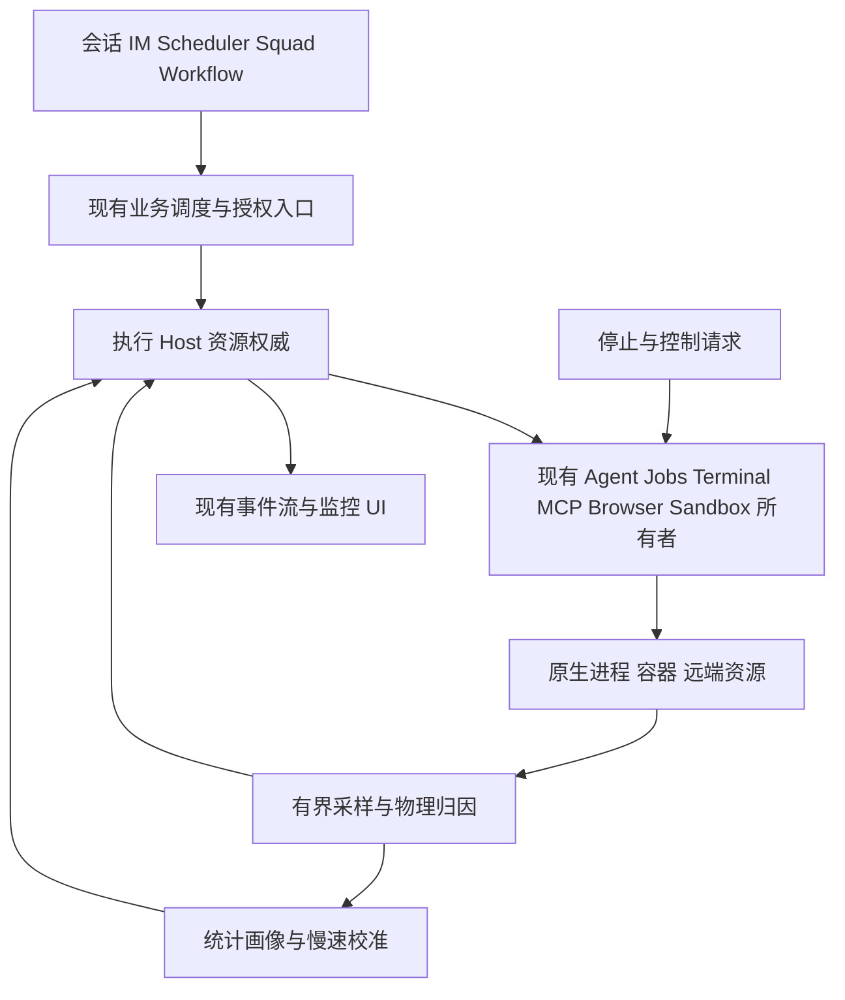

# Cognia 多会话、多用户资源管理与自适应并发：最终实施计划

最新实现校验：**2026-11-13，HEAD `6c373e5044` 加当前未提交改动**。可观测性与索引有部分进展；M0 的关键缺陷仍能复现，M2/M4/M5 的资源控制闭环未找到实现。完整对照、实跑结果和证据边界见 §19。下方 `09939f6415` 保留为原设计基点，不代表本次校验只查看了旧提交。

| 项目           | 内容                                                                                                                                                                      |
| -------------- | ------------------------------------------------------------------------------------------------------------------------------------------------------------------------- |
| 状态           | Proposed；本轮交付设计，不代表已授权或完成产品实现                                                                                                                        |
| 日期 / 作者    | 2026-11-12，Asia/Shanghai；Codex                                                                                                                                          |
| 深度           | Heavy：Host、原生执行、TypeScript、MCP、持久化、多用户和跨平台                                                                                                            |
| 范围           | 单人多会话，以及多人共享一个执行 Host；同时覆盖 Agent 派生的工具、服务与数据负载                                                                                          |
| 源码基点       | `09939f6415`，共享且有未提交改动的工作树；实施时重新定位符号和核对差异                                                                                                    |
| 依据           | [并发评估与对抗审查](../evidence/2026-11-11-multi-session-user-concurrency-assessment.md)，以及用户提供的《Cognia 多 Agent 资源管理与单机吞吐优化：完整技术设计方案》v1.0 |
| 参考资料指纹   | 用户附件 1511 行；SHA-256 `6227c0361eaecbfd4f0d12ae4ab3e6fb0c2a88003895455eda3816cb05144a16`                                                                              |
| 权限与外部影响 | 不新增默认模型调用；不发布文档、不安装 Gateway、不启动真实负载、不更改现有授权和隔离边界                                                                                  |

## 1. 结论：复用现有执行所有者，补齐 Host 资源控制闭环

采用用户资料中的统一资源控制平面、租约、兼容性判定、按需启动、物理与逻辑双账本。资源管理在实际执行 Host 内运行，业务调度器保留各自的依赖、触发、重叠和恢复规则。多个 person-brain 共享同一个 Host 总预算。

实施顺序为：**生命周期修复 → 资源计量 → 固定预算与用户公平 → 安全复用和懒加载 → 自适应 → 统计学习 → 按证据扩展资源池与安全挂起**。

先实现可解释的控制，不承诺机器能支持多少用户或性能提升比例。单机容量、Agent 占用比例和实际吞吐均须由同构对照实验给出。已有控制路径探针证明的是具体缺陷和局部机制，不是 native/provider 容量验收。

首个可用闭环不依赖浏览器池、通用 LSP 多路复用、无状态 Worker 或第三方 Gateway。完整范围保留在后续明确工作包中，每包有依赖和验收。

## 2. 对参考资料的采纳、修正与边界

| 资料建议                                    | 最终处理                                                                           | 原因与代价                                                                                                                |
| ------------------------------------------- | ---------------------------------------------------------------------------------- | ------------------------------------------------------------------------------------------------------------------------- |
| Agent Resource Fabric                       | 采纳其控制平面语义，产品暂称资源管理                                               | 避免先引入品牌、新服务和多套注册中心；现有执行器继续拥有真实进程                                                          |
| Scope / Mode / Lifecycle 三维分离           | 采纳；`auto` 是请求偏好，解析后实例模式必须明确                                    | 用户允许共享的范围是上限；适配器和 Host 安全策略决定实际复用                                                              |
| 一次创建多个 resource-* crates、SDK、九组表 | 收敛为一个可复用的纯 Rust 核心、Host 装配和必要存储；使用现有 companion 客户端契约 | 当前缺的是跨执行器准入和租约协调，不缺独立的 jobs、进程监管、MCP 和沙箱所有者                                             |
| P0 观测 → P1 MCP → P2 调度                  | 改为先修所有权、计量、固定准入，再扩大复用                                         | 错误释放和停止会使预算、学习和共享计数失真                                                                                |
| WFQ + aging                                 | 第一版选按用户加权 DRR；同来源优先级内 aging；有界 backfill                        | 实现和成本解释更直接；DRR 只解决启动机会，实际占用还需配额与硬边界                                                        |
| 所有命令统一重任务调度                      | Cognia 可控入口逐步覆盖；黑盒外部 CLI 先按进程/沙箱整体治理                        | 无法声称能逐条截获第三方 CLI 内部的任意编译或子进程                                                                       |
| 单独开发 Output Store                       | 扩展现有 jobs 输出、artifact 和流订阅                                              | jobs 已有有界内存环、磁盘轮换和截断标记，不重建另一套日志事实源                                                           |
| MCP 2026-07-28 无协议会话                   | 官方规范确认；本仓迁移单独立项                                                     | 当前依赖 `@modelcontextprotocol/sdk ^1.32.1`，本地已安装 SDK 最高声明 `2025-11-25`；原生 HTTP 服务仍使用 `Mcp-Session-Id` |
| Native 默认、容器可选                       | 仅适用于当前策略允许的本地可信执行                                                 | 多用户服务器既有强制沙箱、网络和工作区策略保持生效；后端不可用时不降级到裸进程                                            |
| Worker 池、逻辑挂起、复杂快照               | 安全检查点挂起列入后期；内存快照另行评估                                           | 外部 Agent 恢复依赖其能力；不能把流、PTY 和任意内存对象宣称可恢复                                                         |
| 示例 TTL、内存比例和并发值                  | 作为试验候选，写入版本化策略后验证                                                 | 附件的 8 vCPU / 16 GiB、12/4/2 并发等不是本仓容量数据或生产默认值                                                         |

## 3. 当前事实与设计约束分开记录

**已确认**：Broker 默认 16、person-brain 常驻默认 8、external manager 默认 10，作用域各异。Broker 有调用者权重、Provider 限制和目录槽；当前存在排队顺序例外、续轮豁免以及审查中复现的所有权漏洞。详见原证据账本 F1–F14。

**本轮补充核对**：`lib/mcp/runtime-gateway.ts` 已有按 scope/server/fingerprint 缓存连接 Promise、连接并发默认 4、能力缓存、重试和熔断。`cognia-jobs` 已有监督器、SQLite、Host 安装入口和有界输出。`workspace-runtime` 已有浏览器 session/context 与控制租约；task-workspace 已有端口租约。

**推断**：Agent 常驻及其派生工作可能显著增加负载；未取得实际运行 trace，不能给出占比。Host 统一控制可修复各进程独立预算的缺口，其收益需要实验。

以下约束始终成立：

- 身份、权限、工作区、网络和凭证边界由现有 Host 授权链裁决；客户端声明和资源画像不能提高权限。
- 权限收回、租约过期、连接断开、UI idle 都不单独证明执行已经停止。
- 进程级预算、Provider 请求额度、回合额度和空闲常驻内存分别计算。
- 物理占用只计算一次；共享分摊不能变成重复的物理消耗。
- 未采样、未知归属和未确认停止必须显式可见，不能按零消耗处理。
- 仅能控制有所有权证明的 Cognia 资源；用户浏览器、其他 CLI 和外部进程不自动接管。
- [ADR-0248](../content/docs/en/adr/0248-a-person-is-never-queued-behind-automated-work.md)、[ADR-0244](../content/docs/en/adr/0244-a-remote-run-has-stopped-only-when-its-worker-says-so.md)、[ADR-0255](../content/docs/en/adr/0255-runs-that-share-a-directory-keep-their-diffs-and-lose-undo.md) 均仍标记 Proposed。本方案采用其相关方向，不能把它们写成已实现能力。
- 目录共享与资源准入分离：保持当前模式，配合 ADR-0255 的重叠/Undo 计划；需要独占的恢复操作仍校验物理目录相交关系。资源改造不新增所有 coding turn 的全局目录串行化。
- 主应用继续静态导出；采样和准入运行在实际 Host，浏览器 UI 只展示和发送授权请求。

## 4. 控制平面统一，实际执行和数据通路保留原所有者

架构关系如下；每个执行 Host 拥有一份准入权威，远端工作由远端 Host 记账。

| 层 / 责任角色            | 扩展位置                                                                                                                 | 所有权与运行时接入                                                                                                                                              |
| ------------------------ | ------------------------------------------------------------------------------------------------------------------------ | --------------------------------------------------------------------------------------------------------------------------------------------------------------- |
| 纯准入核心 / Resource    | 拟新增 `crates/cognia-resource`，列为 foundation                                                                         | 仅类型、预算、状态转换和确定性选队；无 Tauri、进程驱动、业务授权或全局单例。现有 jobs 不能拥有其他执行器，generic core 不承载此领域，故增加一个边界清晰的 crate |
| Host 权威 / Host         | 拟新增 `crates/cognia-companion/src/resource/`；复用 companion RPC/contract                                              | 单一 actor 串行提交预留、租约和 epoch；持久化与执行端口注入；server/Tauri 各在现有启动入口安装一次，并 awaited teardown                                         |
| JS Broker / Runtime      | `lib/execution/{broker,chat-lease}.ts`、person-agent runner、运行时初始化                                                | 保留业务可见租约；真正执行经 Host 准入。独立浏览器保留局部轻量模式，明确不能提供跨进程总量保证                                                                  |
| 执行监督 / Executor      | `cognia-jobs`、`cognia-external-agent`、`cognia-terminal`、`cognia-sandbox-pool`                                         | 各自负责 start/inspect/drain/stop；适配准入端口，不创建第二个通用进程监督器                                                                                     |
| 采样归因 / Observability | `src-tauri/src/perf/process.rs`、process registry、`lib/perf/node-host.ts`；共享采样通过既有 observability/Host 端口接入 | desktop 和 server 均装配采样；容器/远端由对应后端提供。进程 registry 保留聚合投影职责，不成为进程所有者                                                         |
| MCP / MCP                | `lib/mcp/{runtime-gateway,transport,policy}.ts`、sidecar MCP、原生 HTTP 服务                                             | 统一资源申请和授权投影；保留 inbound server 与 outbound client 的不同作用域                                                                                     |
| 环境资源 / Workspace     | `workspace-runtime`、`cognia-local-browser`、task-workspace ports                                                        | 复用 browser/controller lease、端口和持久工作区；扩展引用管理和限额                                                                                             |
| 展示 / UI                | execution monitor、现有 performance/MCP 设置与 operations                                                                | 优先扩展现有页面：运行/空闲/排队、来源、归属、瓶颈原因、停止确认与资源回收证据                                                                                  |

公共 wire 字段加入现有 companion/执行契约并执行跨语言生成和语义检查，不新增独立 resource SDK。新 crate 和依赖必须通过 `scripts/gates/rust-architecture.json` 层级检查；source 文件实施时配套 co-located tests。

## 5. 三维资源策略与租约契约

三个维度独立：共享范围 scope、实例使用模式 dedicated/pooled/multiplexed、生命周期 on-demand/warm/persistent/ephemeral。scope 是结构化授权关系，不把 Tenant/User/Project 简化成可任意向上放宽的枚举层级。首版禁止跨租户共享；跨用户共享后期需逐请求身份能力及独立验收。

Host 从认证上下文解析 tenant/person/requester，验证 session/run 的归属。调用者只提供已获授权的资源引用、请求幂等键、父分配引用、截止时间和需求提示；origin、共享域、有效 limits 由可信入口和 Host 生成。

| 对象              | 必要字段 / 语义                                                                                            |
| ----------------- | ---------------------------------------------------------------------------------------------------------- |
| ResourceSpec 引用 | 原定义 ID/revision、kind、backend、scope/mode/lifecycle、能力声明、兼容性摘要；MCP 等定义仍由现有存储持有  |
| Instance          | instanceId、Host 身份、generation、后端 handle/启动身份、期望/观测状态、容量与活动调用数                   |
| Allocation        | rootRun/attempt、父引用、用户、资源向量、预留/观测关联、策略版本、停止状态                                 |
| AccessLease       | 独立 leaseId、instance generation、授权 scope/revision、请求者、有效期、操作能力；与 MCP 协议 session 不同 |
| Observation       | 时间/序列、计量域、observed bytes/CPU/I/O/PIDs、可信程度、资源身份和停止证据；缺失字段为 unknown           |
| Policy / Profile  | hard envelope 与自动调整范围；平台/运行时/工作类型画像、样本量、失败/删失标记、版本和有效期                |

兼容性 Key 包含 kind/backend、可执行文件或镜像版本、规范化非秘密配置、权限/网络/挂载域、凭证主体和版本、不变快照或工作树身份及必要能力。凭证只用不透明引用/版本，禁止明文或可猜测低熵 secret 的直接 hash。每次候选筛选仍复核 scope 和授权。

外部接口语义：Acquire/CancelAcquire、Renew、Release、Inspect、Drain/Stop、Observe/Subscribe。受保护 IPC 或现有授权 RPC；端点凭证绑定请求者、资源、generation 和 scope。Release/Renew 幂等且校验 generation，旧租约不能释放新实例。

错误分为 denied、capacity_exhausted、dependency_capacity_conflict、queued、deadline_exceeded、stale_generation、backend_unavailable、stop_unconfirmed、telemetry_unavailable，返回明确 reason；不泄露其他用户队列或凭证。

## 6. 并发、启动、停止和恢复遵守同一套所有权规则

### 6.1 启动合并只共享初始化，每个调用者独立授权

流程为授权 → 查找兼容实例 → 原子预留实例调用容量和必要资源 → EnsureStarted → 复核健康/代次/策略 → 创建独立 AccessLease。共享 key 的初始化采用 singleflight；dedicated 实例不合并成共享实例，pool 容量不足时有界创建下一实例。

一个等待者取消只移除自己的申请；所有等待者取消时才请求取消未使用的启动。无法中止的启动继续记账，完成后进入有界空闲或停止。每次 acquire 都复核已变化的权限；不能把第一个调用者的 Lease Promise 返回给其他人。

安装/镜像拉取使用现有解析缓存和安装锁，并限制同时启动数。安装不等于就绪；状态必须在 deadline 内进入 Ready 或明确 Failed。退避只针对可安全重试的准备/启动，不重放可能已产生副作用的工具操作。

### 6.2 三类状态不能混用

- 申请：queued → reserved → starting → admitted；取消、超时或失败释放已确认未被消费的预留。
- 实例：starting → ready → active → warm-idle → draining → exited；失败可进入冷却，状态不明则保留 unknown 和相应占用。
- 停止：stop_requested → stopped 或 stop_unconfirmed。Stopped 需要该后端、实例和 attempt 的证明。

Stop/Cancel 不获取工作额度，使用独立可达的控制路径；停止请求受既有身份和速率限制。回合结束释放活跃回合额度，保留 warm 实例的常驻账目。实例停止先拒绝新租约、排空已进入操作、请求正常结束，再按现有 policy 升级终止并核对实际资源。

租约 TTL 到期终止新访问，启动 reconcile；只有真实退出/组为空/容器已停止等对应证明才释放常驻占用。远端仅在已验证 self-fencing 能力及期限满足时接受 expiry proof。macOS 进程组不能证明逃逸进程已被包含；不把未知后代标成已清理。Windows 在 Job Object 接入验收前标注能力缺口。

### 6.3 根分配稳定，续轮和子任务明确交接

Provider fallback 迁移子额度，根分配保持；真实并行流独立计数。续轮须引用有效 root/attempt，不能因 sessionId 相同自动得到无界资源。父任务等待子任务时通过显式让出/交接可释放的执行额度解决死锁，父进程常驻内存仍保留；嵌套深度、fan-out 和新增实例有界。

同步派生增加依赖感知准入：先计算祖先不可释放向量、已占用的其他分配与子任务最低需求。已声明的同步子任务空间纳入根任务的 delegation envelope，在父任务准入时一起预留；动态子任务未有预留时只允许非阻塞 try-acquire，当前不能满足就返回 `dependency_capacity_conflict`，不持有父资源无限排队。调用方可在已支持时顺序执行/检查点挂起后再申请，或明确向用户报告容量冲突，不能自动重放有副作用的工作。

业务运行许可、Host 执行槽、Provider 请求槽分别列入等待关系。父阶段结束先释放不再使用的 Provider 槽，再让出支持交接的业务运行许可和 Host 执行槽；保留常驻内存和确实不可释放的状态。子阶段按业务 ready → Host 向量 → 实际调用槽获取。业务引擎不能让出或转交许可时，动态同步派生同样即时失败；只有已得到完整子预算/许可的子任务才能进入父任务的同步等待。M2 对 broker、Squad、workflow、scheduler 逐个实现并测试该交接，不以释放 turn slot 推定内存或其他许可已释放。

Member runner 增加关闭代次/申请取消，closeAll 同时处理排队和活动任务，等待 teardown。manager 注册上限覆盖 in-flight 注册，在 await 前原子预留并 finally 回滚。Brain 淘汰先 drain 其资源；对失联 brain 的后端实际资源由 Host reconcile，不能依靠已消失的 JS idle timer。

### 6.4 Host 崩溃和重启先核对，不盲目重放

Host epoch 与 instance generation 持久化；恢复时先关闭新准入，加载控制记录并向现有所有者/后端核验 PID+启动身份、容器 ID、Host 标记与运行代次。可证明归属的存活资源计入总账，状态未知的资源保守保留；不凭 PID 杀进程，不接管其他 Host/用户资源。

现有 jobs 的启动路径必须同步调整：`host::install` 调用 `reconcile_on_boot`，当前 store 会把全部 running 行直接改为 interrupted 并清空 PID，没有核验进程是否退出。M0 保留旧实例身份/启动证据并将未核验旧执行置为 unconfirmed，不能提前触发 terminal completion、monitor 通知或副作用重试。M2 引入统一 boot barrier：先加载所有执行器的存活候选，再核验和记账，最后才恢复 monitor 并开放 jobs/Agent/terminal 等入口。确认旧回合 interrupted 后，其仍存活或未知的进程必须另有有效资源记录，不能据此释放预算或删除身份。

恢复完整后才开放准入。旧请求 epoch 被拒绝。已知未启动的申请可按原幂等键重新排队；可能已写文件、发送请求或产生外部副作用的任务进入现有恢复流程，不自动再执行。重连不等于重试。

## 7. 双账本和多资源准入避免漏算、重复扣减

物理账本按实际计量域记录 Host/VM/cgroup/容器和共享实例；父子层级只选择互不重叠的计量根汇总。逻辑账本记录每个用户/Run 的独占占用、共享引用、活跃额度和分摊；共享 MCP 的物理内存只出现一次。

每个计量域 d 的可用空间 `A_d` 来自 OS 可用内存、该域及祖先有效 limit 的剩余额度、配置预算三者的有效约束，单位统一 bytes。Linux cgroup.current 与物理 RSS 不是可直接相加的同一指标；macOS 压缩/共享内存按采样能力说明。PSS 用于诊断归因，RSS 和不能获取 PSS 的估计不冒充精确物理总量。

预留在互不重叠的物理 reservation root 上计算：每个共享实例仅一份 root，其 `estimatedEnvelope` 包含一次基础常驻预算及所有已承诺调用增量。对已采样 root j，未来增量预留 `U_j = max(0, estimatedEnvelope_j - observedRoot_j)`；尚未在采样中被确认的启动预留保持全额。准入检查各相关域 `A_d - safety_d - sum(U_j) >= candidateIncremental_d`，并检查 CPU、PID、启动槽、实例和 Provider 容量。父子分配转移必须原子更新，不能再次预留已经覆盖的同一进程内存。

物理观测抵扣遵守守恒：同一 domain/epoch/采样批次内，一份观测只能抵扣一次，抵扣合计不能超过该 root 已被域总量确认包含的真实消费。`A_d` 与 root 归因必须使用可关联的一批观测；不能证明一致、采样过期或偏移超过测量预算时不增加抵扣，保留保守预留。聚合样本不拆给多个调用分别冲销。例：基础 1 GiB，两个调用各预留增量 2 GiB，实例实测 2 GiB，则 root envelope=5 GiB，未来预留仍为 3 GiB；不能把两份增量预留都清零。逻辑分摊变化不改变物理预留。

启动预留转为观测消耗必须有资源身份和采样序列的关联；存在采样延迟时保持保守预留，不能凭时间推测已记账。共享实例的新租约只预留增加的容量和内存，新增实例另计完整增量。实测超过预估时保留真实消耗，暂停进一步扩张并提高画像。

P95 估计用于准入效率，**不是内存硬保证**。硬限额只能由具备能力的后端执行；不能保证宿主机其他非托管负载不会引起 OOM。遥测失效、过期或预算未知时退回经过验证的固定保守上限，不自动增加容量。

CPU 用有效 quota/可用计算份额而非机器标称核心数；Provider 等待仍占内存。本地模型须计入其实际执行主机的内存/显存域。支持不了的硬限制在能力投影中标出。

## 8. 调度采用来源优先、用户 DRR 与有界资源填补

业务调度器继续决定任务是否 ready。Host 待执行队列按可信 origin 分为 person/derived；工作类型是独立属性 light/compute/browser/network/persistent/startup，不能把“网络任务”错误地视为都来自交互。

选择顺序：过滤失效权限/已取消/过期请求 → 按 origin 优先 → 用户加权 DRR → 用户内 session/run FIFO 与 aging → 检查资源可行性 → 有界 backfill → 原子预留和派发。derived 子任务继承 derived；入口遗漏 origin 默认 derived。

初版同权用户有相同 quantum；任务 cost 使用有上下限的工作类型成本，后续由有置信度的资源画像校准。derived 工作在总回合槽不少于 2 时最多占 N−1，保留一槽给 person；其他资源硬约束照常执行。person 请求也计入用户和 Host 额度，不能保证资源已被占满时立即启动。

不向新到达请求开放绕过既有 ready 队列的 fast path。backfill 有扫描与越过次数上限；久等且可在硬边界内运行的大任务开始积累预留，防止持续被小任务抢走。超过最大可执行 envelope 的任务直接说明原因，不能永远排队。连续交互饱和下后台任务可能等待，aging 不跨越 origin 带；队列期限和明确延期状态承担可见性。

DRR 衡量启动机会，CPU 时间和长期常驻公平由用户资源上限承担。队列按用户和 Host 双重有界，并有 deadline、去重、取消与退避提示。准入前不占用 Provider 请求槽；同 Host 的资源向量一起原子预留，远端 Provider gate 独立有界等待，超时撤销未使用的分配，避免长期持有多个互等额度。

黑盒外部 Agent 首版按整体进程/沙箱 envelope 准入，并记录覆盖级别 `whole-runtime`；能拦截 Cognia 工具入口的记录 `tool-level`。两类数据分开报告。Provider gateway 保持最终上游限制；修复其取消等待计数的 source-only 风险前，不声称排队完全可靠。

## 9. 资源优化按真实所有者逐类接入

| 类型                     | 交付策略                                                                                                       | 必须验证的边界                                                                                                                              |
| ------------------------ | -------------------------------------------------------------------------------------------------------------- | ------------------------------------------------------------------------------------------------------------------------------------------- |
| MCP                      | 在现有 scope/fingerprint 连接缓存上补齐 Host 实例/调用租约；未知服务 dedicated，先支持同用户同凭证域的验证服务 | singleflight 只合并启动；旧协议 request ID、通知、取消、roots/sampling/elicitation 分流；OAuth 主体、credential revision 和工具权限分别校验 |
| 工具发现                 | 复用能力缓存，授权过滤后按需暴露；工具调用才启动可懒加载的服务                                                 | 没有有效元数据时允许连接时启动；元数据须绑定版本/权限并失效，不能伪造第三方 tools/list                                                      |
| 外部 Agent MCP           | 通过现有受支持配置/relay 能力接入托管端点                                                                      | 不修改第三方内部循环；不支持动态配置或回调隔离的客户端保持专用实例并展示覆盖缺口                                                            |
| 浏览器                   | 扩展 workspace-runtime；先限制 session/page/启动和 idle，再验证同用户、同信任域进程池                          | session 独立 Context；用户真实 Chrome 不回收；Context 不作为跨租户安全边界；遵守 companion `agent-safe-v1` 能力冻结规则                     |
| LSP / watcher / index    | 复用现有扫描与索引所有者；只读索引按内容 generation 共享                                                       | commit 不能代表未提交内容；LSP 未验证多客户端文档版本/取消/通知语义时 dedicated；不同 worktree 的可变状态隔离                               |
| Dev server               | 用 jobs、workspace-runtime 和既有 ports lease 组合工作树服务租约                                               | Key 绑定工作树、命令、环境和权限；普通 HMR 内容变化不每次重启，影响启动的配置变化才 drain/restart；人工 persistent 服务保留                 |
| Build / test             | 可控工具入口分类并准入；外部 CLI 全 envelope；允许列表内确定性只读任务才去重                                   | 输入快照、工具链、flags、env、依赖齐全；测试可能写快照或调用网络，不能按命令名推定无副作用                                                  |
| 缓存 / worktree          | 保留托管 worktree 能力；共享下载和可验证不可变缓存                                                             | 不把不同 worktree 的 target/node_modules 合成同一可写目录；原子发布、配额、版本失效和租户 ACL；sccache 先实验再选用                         |
| Hook / plugin / terminal | 现有启动与监督端口接入归因和限制                                                                               | 交互 PTY、长期 dev 服务和 detached job 保留独立生命周期；共享服务不能随某个 session 结束被误杀                                              |
| 输出 / context           | 扩展 jobs ring、artifact、终端 scrollback 与 cursor 订阅                                                       | 协调内存、磁盘和消费速率；关键生命周期/审批事件不丢；轮换、截断、过期、落盘失败显式报告；不承诺永久保留全部输出                             |
| Sandbox                  | 复用既有 backend 能力与 admitted limits；只有无授权/凭证的干净基础实例可预热                                   | 租用后绑定用户，不把使用过的有状态沙箱跨用户回池；已用实例未能证明重建/清理则销毁；工作区文件与临时执行层分离                               |

Native Process、现有 Docker/远端沙箱为首批适配。Gateway 与运行后端接口分离；agentgateway、ToolHive、Podman 或其他新后端按 capability contract 后续评估，不成为首个闭环依赖。只开放实际已验证的后端，不把候选名称显示成已支持。

## 10. 自适应先进入影子模式，再启用快降慢升

状态为 normal/pressure/critical，决策由同一 Host 权威输出。Linux 可用 PSI、cgroup events/current/peak/throttling；macOS 用可获得的内存压力、CPU、进程统计和交互延迟；Windows 后端能力通过 probe 声明。缺少 PSI 不伪造为 zero。

| 状态     | 新准入                                | 常驻与运行中工作                                                                          |
| -------- | ------------------------------------- | ----------------------------------------------------------------------------------------- |
| Normal   | 在固定 envelope 内按需分配            | 按预算和恢复成本保留少量热实例                                                            |
| Pressure | 先减少重任务和启动并发                | 停预热、回收可恢复 idle；保持正在运行写入工作的既有控制规则                               |
| Critical | 拒绝/延期低优先级新工作，保护控制通道 | 加速安全 idle 回收；仅对声明可 checkpoint 的任务请求暂停；其他任务依据既有超时/硬限额处理 |

初始实验参数：采样约 1 秒、准入控制窗口约 5 秒、连续健康至少 30 秒才恢复一个额度。CPU/内存阈值和 headroom 由 M1 基线确定，写入固定版本后再比较，不能测试后放宽失败门槛。低样本延迟窗口只报告 unknown，不用伪 P95 驱动扩容。

资源和上游错误分域响应：Provider 429 不自动缩减整台 Host 的 CPU 容量；客户端渲染压力只影响 UI 更新策略。所有并发调整在 operator/user hard envelope 内；缩限不撤销已承诺额度，阻止新准入直至回落。控制器只调新准入，idle residency 使用更长 cooldown，避免两个反馈环互相震荡。

## 11. 自学习使用有界统计画像，自动调整不改变权限

画像 key 为有效硬件/配额、OS/backend、运行时/镜像版本、工作类型和有限大小桶；不以 prompt、原始路径或每个用户内容建立高基数标签。记录增量峰值、idle footprint、CPU/I/O、时长、冷启动/恢复成本、失败和置信度。

纳入 OOM、启动失败、被取消和未完成样本的删失信息，避免只学习成功任务后低估成本。样本不足用保守默认；允许自动调小并发/缩短 warm，降低预留或扩大容量必须满足置信门槛、稳定窗口和 hard envelope，先影子比较再小步生效。

M5 固定初版保留策略：每 Host 最多 256 个活跃画像 key，原始采样聚合后最多保留 7 天，画像 30 天未使用失效，旧版本按有界 LRU 清理；这些是存储预算候选，M1 先验证开销。重大版本/硬件变化立即降权，不继承旧的“安全容量”。

高影响策略继续走现有 `run-retrospective` / `run-learning-materializer` 审阅机制。统计学习本身不新增 LLM、embedding 或云调用；既有内容发送继续无条件经过 PII gate。

## 12. 持久化、配置和兼容性采取增量迁移

Host 使用本地 SQLite 的资源控制存储，复用既有连接/迁移模式但不借用其他业务表作为事实源。首版只增加控制平面需要的四类记录：instance intent/identity、allocation 与 lease/attempt、revisioned policy、统计 profile。已有 MCP 定义、jobs、工具输出、会话和审计存储继续拥有原数据，避免复制为九组平行业务表。

各表采用有版本的前向兼容迁移；schema 单写者、事务和 journal 边界在 M1 固化。先写 reservation/启动 intent，再调用后端，成功绑定真实身份后 commit；每一步用 requestId 和 epoch reconcile。不得在持有 parking_lot guard 时 await；不依靠单个 SQLite 事务跨越实际进程启动。

补齐 launch intent 到真实进程的关联：Host 在调用执行器前持久化不可复用的 launchToken，执行器 start/inspect 必须接收它并支持按 token 幂等查询。容器使用启动时写入的受保护 label/确定实例引用；native owner 在用户命令开始执行前记录 token、PID+启动身份和进程组，必要时先启动等待 commit 的受控 launcher，身份持久化后才放行实际命令。当前 jobs 内部生成 id、spawn 后才写 journal 的顺序必须改造，不能仅给 Host 增加 intent 表。崩溃后先按 token 查询实际实例再绑定；不支持 token discover/commit 的后端明确标注恢复能力不足，保留 unknown 占用、禁止自动重试，不凭超时推断“尚未启动”。

策略包括 Host hard envelope、person 权重/上限、origin 预留、队列 cap/deadline、kind 的 lifecycle/limits、受验证能力、遥测/画像保留。配置由现有设置/Host policy owner 持有；前端只读投影，operator 上限不能被普通用户提高。附件中的 YAML 不直接视为 Cognia 配置语法。

配置变化对新分配生效；已用资源保持其原安全域，权限撤销立即阻止新操作并执行既有取消链。共享策略收紧时不原地修改活跃实例身份，使用 drain 和新 generation 迁移。

协商 `resource-admission-v1` 能力，所有字段新增采用默认安全语义；旧客户端的启动由 Host 原入口补齐身份/origin/预算。启用强制准入的 Host 不允许旧路径绕过，无法重建必要身份时明确拒绝。未升级 Host 上客户端展示“局部控制”，不能伪装为全局已治理。

MCP 2026 协议迁移单独协商和测试，不随资源控制更新 SDK。平台矩阵：Linux headless 与 macOS Tauri 是首批真实验收；Windows Job Object、Capacitor 真机和独立浏览器的限制分别报告，不能由前两者测试推定通过。

## 13. 可观测性与产品呈现直接回答占用来源和排队原因

提供 Host 总览、用户/会话资源树、服务实例与 idle/warm、瓶颈与建议四种投影，优先放入已有 performance、execution monitor 和 MCP operations。显示 dedicated/shared/unattributed、测量时间/覆盖级别、queued reason 和 stop_unconfirmed；不凭少量数据生成精确 ETA。

指标包括 active/resident/starting counts、queue wait、interactive TTFT、工具耗时、吞吐/成功率、实际内存/未观测预留、OOM/PSI、复用率、冷启动、停止确认耗时、丢失输出与观测开销。指标标签只用有限的 kind/backend/workload/reason；用户明细通过授权查询呈现，不把原始 person/session ID 放进无界全局 time-series。

事件用 cursor 增量订阅，提供有界队列与快照恢复；高频采样和 UI 更新合并，不对每次排队变更重建整个历史快照。自动建议提供依据和可执行动作，不能自动更改安全域。新增 UI 文案/ARIA 双语 i18n，监控 UI 不暴露同 Host 其他用户的私有资源。

## 14. 交付拆为可独立验证的工作包

责任角色代表模块所有权，不是假设存在额外工程团队。每个包由一个实施会话承担，测试与文档随包交付；共享核心串行修改，独立 adapter 可在明确文件所有权下并行。

| 包                     | 唯一责任角色  | 依赖                       | 交付及验收                                                                                                                                | 失败 / 回退                                                |
| ---------------------- | ------------- | -------------------------- | ----------------------------------------------------------------------------------------------------------------------------------------- | ---------------------------------------------------------- |
| M0 所有权修复          | Runtime       | 无                         | fallback/Stop/queued teardown/atomic registration 的失败行为先落测试再修；native 复核 brain 淘汰、monitor cancel、gateway waiter 取消风险 | 每项独立提交；未知停止保留占用；不启用新调优               |
| M1 计量与基线          | Observability | M0 的身份/退出语义         | 对齐 Host、brain、Agent、工具、容器及未知占用；建立固定数据集、机器指纹、SLO 和基线报告；记录全部执行路径覆盖                             | 关闭新增高频采样，保留生命周期事件；遥测失败用固定限额     |
| M2 固定准入            | Host          | M0 + M1                    | 核心/Host authority/wire/store/boot 接入；共享总预算、用户 DRR、队列上限、stop 旁路、crash reconcile；desktop/server 各一套真实混跑       | 切到固定保守策略；强制准入保持，旧记录保留只读             |
| M3 MCP 与输出          | MCP           | M2                         | 独立 lease、startup singleflight、限启动、同用户验证服务复用、懒发现/懒启动；复用 jobs/artifact 输出预算；外部 CLI 覆盖报告               | 停止新增共享，drain 后改 dedicated；输出按旧能力兼容读取   |
| M4 自适应              | Host          | M1 + M2，M3 提供复用数据   | normal/pressure/critical 影子与受控启用；CPU/内存/Provider 分域；idle 与 active 分开；故障注入不振荡                                      | 一个策略开关回到 M2 固定 envelope，保留已承诺分配          |
| M5 统计学习            | Resource      | M4                         | 有界持久画像、置信度/失效、失败样本和版本化调参；相同 trace 对照固定/自适应/学习三组                                                      | 禁用画像生效，回到 M4 固定画像；旧画像忽略而不破坏运行记录 |
| M6a Browser / Dev 服务 | Workspace     | M2 + M3                    | 先现有实例计量/idle，再同域池与 Context；worktree 服务、端口复用；真实状态/凭证隔离测试                                                   | dedicated，新租约停止池化，排空旧实例；不动用户浏览器      |
| M6b Index / 缓存       | Workspace     | M1 + M2                    | 内容 generation、只读索引和不可变缓存；LSP 仅经能力验证后共享；测重复计算和磁盘成本                                                       | 失效缓存并回到独立实例；不共享可写构建目录                 |
| M7 安全挂起            | Runtime       | M0 + M2 + M5，恢复能力清单 | 原生 runtime 在已证明的检查点释放 Worker，恢复审批/工具意图/事件游标不重复副作用；外部 runtime 只用其已支持 resume                        | 不卸载无恢复证明的状态；保持 bounded warm/明确容量提示     |

首个可用闭环的边界为 M0–M3；平台自适应和学习需求由 M4–M5 完成；资料中的完整环境优化与轻量 Worker 由 M6–M7 完成，不在首包中暗示已支持。

## 15. 验收用真实混合负载，正确性和性能分别设门槛

| 场景                                           | 验证合同                                                                                           |
| ---------------------------------------------- | -------------------------------------------------------------------------------------------------- |
| 单人 1/4/8/16/32 会话，活跃与 idle 分开        | 常驻预算受限；多次创建/关闭不产生持续不可回收增长；逻辑会话不强制启动重服务                        |
| 多用户 1/2/4/8，加一个噪声用户                 | 同 Host 总额不能按 person-brain 倍增；同权且可运行的用户有轮转机会；隔离违规为 0                   |
| 同 key 8 个并发 Acquire、部分/全部取消         | singleton-compatible 只初始化一次，每人独立 lease；pool/dedicated 满足各自容量；无超卖和旧代次释放 |
| 不同凭证、权限、workspace、协议版本            | 不错误共享；撤销立即影响新操作；旧协议回调/通知不串用户                                            |
| 混合聊天、4 个编译、浏览器、索引、Provider 429 | 可控入口和黑盒整体 envelope 分别验证；队列和资源约束真实生效；各压力域响应正确                     |
| fallback、延迟停止、closeAll、brain 淘汰       | 旧申请不复活；正常证明后的资源回收；未确认停止不虚报；目录共享/Undo 规则保持独立                   |
| Host 在预留/启动/绑定/释放边界崩溃             | 无错误重试副作用、PID 误杀、双重分配或丢失存活实例计量                                             |
| 低内存、遥测中断、磁盘满、输出洪峰             | 及时背压；控制请求可达；输出缺口明确；不能因监控开销扩大故障                                       |
| 24 小时循环与版本/配额变化                     | 进程、控制表、画像和日志保持有界；旧画像失效；无持续泄漏或调节振荡                                 |

补充四组必须先建立的行为/故障用例：共享 root 的多租约抵扣守恒与采样错序；backend 已创建但 Host 未收到 handle 的崩溃；jobs boot 在真实存活进程和 monitor 存在时不提前结算；3 GiB 预算下保留 2 GiB 的父任务派生 2 GiB 子任务，以及多个父任务竞争、业务许可无法让出的情况。最后一组必须明确即时容量冲突或已预留交接，不以等待超时冒充解决死锁。

不可协商门槛：错误身份/代次操作和跨用户隔离违规为 0；受管理且支持证明的故障测试中，最终未解释的孤儿为 0；所有启动最终明确 Ready/Failed/Cancelled/Unknown，不能永远 Starting。unsupported proof 保留显式缺口，不能拿计时器充当通过。

性能比较在相同机器、版本、数据、缓存条件和任务成功标准下进行固定保守策略、固定新策略、自适应、学习四组，冷/热分别测，固定顺序随机化并至少重复 5 次。Provider 用固定 fixture 隔离控制开销，再用真实 Provider 单独确认端到端行为，不混合成一种容量证据。

候选非回退门槛：相对 M1 基线交互 P95 增幅不超过 10%、成功率下降不超过 1 个百分点、空载观测 CPU 平均不超过一个逻辑核的 1%、观测附加内存不超过有效内存的 2%。这些是拟议验收预算，M1 在看到优化结果前锁定绝对 SLO、测量方法和置信区间。吞吐改善以成功任务/时间报告；未显示改善则不宣称优化成立，并保留只提高正确性的部分。

标准受控负载中目标无 Host OOM，并分别报告容器 OOM、外部干扰和未治理路径；不把概率准入包装成任意输入下的 OOM 保证。会话密度必须附交互 SLO 和成功率；复用率分母仅为符合共享条件的申请。

实施时的最小检查：受影响的 co-located Jest/Rust tests、原执行器集成测试、companion/wire parity、`pnpm audit:rust-architecture`、相关 headless registry 检查。共享变化增加两用户故障注入；UI 增加真实 Tauri/浏览器路径、i18n 与静态导出检查。按包运行 `pnpm lint`、`pnpm typecheck`、必要 build/Playwright；workspace-runtime 使用其现有 `pnpm --filter @cognia/workspace-runtime test`。本轮不运行覆盖率；CI 的既有 changed-file gate 不降低。

以上为未来验收要求。本轮只检查方案、链接、格式和依据，不把历史单测或设计审查写成这些 native/性能测试已通过。

## 16. 发布、回退和明确延期的能力

发布顺序：修复并记录旧行为 → 影子计量 → 单机固定强制准入 → 小范围安全复用 → 自适应影子 → 启用自适应 → 学习影子/小步生效 → 逐类资源池。回退单位是策略版本和 adapter，不撤销已应用的所有权修复。

出现错误身份共享、旧 epoch 访问、重复副作用或未解释预算超卖时，立即停新增共享/扩容，保留停止通道并退回固定策略。性能非回退门槛超出则禁用该优化。不能通过关闭 Host 强制准入、绕过沙箱或删除活跃记录实现“回退”。schema 初期只追加，关闭功能后旧二进制不应操作仍存活的新协议实例；版本回退须先 drain/reconcile 再切换。

延期：Kubernetes 控制器、DRF、通用进程内存快照、任意第三方 stdio 多路复用、跨租户实例共享、多 Host 全局事务/调度、新容器运行时、自动重写外部 Agent 循环。现有远端执行继续通过其原授权端口和目标 Host 管理；延期不影响本机闭环。

## 17. 决策记录、待测参数与复核记录

| ID  | 最终计划采用的选择                                        | 替代方案与取舍                                                        |
| --- | --------------------------------------------------------- | --------------------------------------------------------------------- |
| Q1  | 一个 Host 资源权威，现有执行器保留控制权                  | 每 brain 独立扩容不能约束单机总量；独立微服务增加单机成本             |
| Q2  | DRR + 来源优先 + 多资源准入，先固定再自适应               | WFQ 也可行但需更强成本/时长估计；DRF 后期在多维公平成为实测问题时引入 |
| Q3  | 同用户验证服务先复用，未知 dedicated                      | 广泛共享更省实例但协议和身份风险尚无证明                              |
| Q4  | 统计画像自动调整在硬边界内，高影响变更走已有审阅          | 不增加 LLM 调度器、模型训练或新的内容外发                             |
| Q5  | Linux headless/macOS Tauri 首批验收；其他平台明确能力等级 | 单一 API 不代表所有平台已有同等限制和停止证明                         |

M1 必须决定的实验参数由 Observability 责任角色在 M2 实施前交付：目标机器与有效配额、代表数据/工作负载、绝对交互 SLO、用户权重/队列预算、headroom、采样成本和后端能力清单。没有这些数据时维持保守固定配置；不虚构机器容量或日历工期。

| 日期       | 审查                                | 状态                                                                              |
| ---------- | ----------------------------------- | --------------------------------------------------------------------------------- |
| 2026-11-12 | 用户资料 1–17 节与既有审查逐项对照  | 已完成；完整采纳/调整映射见 §2 与 §9–§14                                          |
| 2026-11-12 | 源码所有者、MCP 协议和版本边界核对  | 已完成；见 §18                                                                    |
| 2026-11-12 | 新上下文租约、计量与调度反例审查    | 首轮 4 项有效问题均修订；第二轮定向回查未发现进一步实质问题；跨模型按用户选择跳过 |
| 2026-11-12 | 产品实现与 native/provider 容量验收 | 未执行，不属于本轮交付                                                            |

| 复核项                           | 分类                               | 方案修订与验收                                                                                                       |
| -------------------------------- | ---------------------------------- | -------------------------------------------------------------------------------------------------------------------- |
| PR1 共享聚合样本重复冲销预留     | Valid + actionable                 | §7 改为非重叠 reservation root，基线一次计入、同批次观测抵扣守恒；加入 1+2+2 GiB 反例                                |
| PR2 spawn 到持久身份之间崩溃     | Valid + actionable                 | §12 增加预持久 launchToken、可查询/幂等 start、native 命令前身份记录与 commit；不支持的后端保留 unknown 且禁自动重试 |
| PR3 jobs boot 清除身份并提前结算 | Valid + actionable，当前源码已核对 | §6.4 明确修改 jobs boot，保留 unconfirmed 与身份，monitor 在统一 barrier 后恢复；M0/M2 纳入验收                      |
| PR4 父常驻占用导致子任务不可行   | Valid + actionable                 | §6.3 增加 delegation envelope、不可释放向量计算、动态同步 try-acquire 和业务许可交接；不能交接就即时明确失败         |

## 18. 来源与证据边界

仓库依据：

- [并发与对抗审查账本](../evidence/2026-11-11-multi-session-user-concurrency-assessment.md)及其 [14 项有界探针](../evidence/2026-11-11-multi-session-user-concurrency-assessment.probes.mjs)。历史结果不作为新设计验收。
- [Broker](../../lib/execution/broker.ts)、[chat lease](../../lib/execution/chat-lease.ts)、[member runner](../../lib/headless/person-agent/runner.ts)、[external manager](../../lib/ai/agent/external/manager.ts)。
- [MCP runtime gateway](../../lib/mcp/runtime-gateway.ts)、[MCP 原生 HTTP](../../crates/cognia-mcp-server/src/streamable_http.rs)、[依赖版本](../../package.json)。
- [Jobs owner](../../crates/cognia-jobs/src/lib.rs)、[limits](../../crates/cognia-jobs/src/limits.rs)、[output](../../crates/cognia-jobs/src/output.rs)、[Host 安装](../../crates/cognia-jobs/src/host.rs)、[store boot reconcile](../../crates/cognia-jobs/src/store.rs)、[supervisor spawn](../../crates/cognia-jobs/src/supervisor.rs)。
- [Process registry](../../src-tauri/src/process_registry/mod.rs)、[desktop sampler](../../src-tauri/src/perf/process.rs)、[Node sampler](../../lib/perf/node-host.ts)、[headless performance wiring](../../lib/headless/runtimes/performance-runtime.ts)。
- [Browser service](../../services/workspace-runtime/src/browser-service.mjs)、[browser control lease](../../services/workspace-runtime/src/lease.mjs)、[workspace ports](../../crates/cognia-task-workspace/src/ports.rs)、[sandbox admission](../../crates/cognia-sandbox-pool/src/admission.rs)。
- [变更链并发计划](2026-11-11-change-lifecycle-stopgap-and-history.md)、[Rust 层级约束](../../scripts/gates/rust-architecture.json)、[run learning materializer](../../lib/execution/run-learning-materializer.ts)。

官方资料（2026-11-12 核对）：

- [MCP 2026-07-28 Streamable HTTP](https://modelcontextprotocol.io/specification/2026-07-28/basic/transports/streamable-http)：协议会话移除及旧版本兼容；不代表服务应用状态消失。
- [MCP TypeScript SDK 1.32.1 server 文档](https://github.com/modelcontextprotocol/typescript-sdk/blob/1.32.1/docs/server.md)：旧版本 stateful/stateless 模式；同时检查本机已安装 SDK 的 types.js，最高版本为 2025-11-25。
- [Linux cgroup v2](https://docs.kernel.org/admin-guide/cgroup-v2.html)：层级约束与 memory/current/high/max 等接口；宿主机/容器可用权限仍须现场 probe。
- [Linux PSI](https://docs.kernel.org/accounting/psi.html)：资源争用停顿指标；各平台不能假定同样可用。
- [Playwright Context isolation](https://playwright.dev/docs/browser-contexts)：浏览状态隔离能力；本方案不将其解释为多租户强隔离证明。

附件提及的个别 Issue、Gateway 特性、云沙箱快照和 sccache 不作为本计划正确性前提；对应后端/缓存被选入工作包时，再固定版本并补官方依据及实际契约测试。

## 19. 最新实现校验：观测有所补齐，统一资源控制尚未落地

2026-11-13 在 `6c373e5044` 加共享工作树未提交内容上核对；只更新本计划和原证据账本，不修改产品实现。对照原设计基点检查已修改模块、相关调用链和执行器；未仅以拟议目录不存在判定缺失。48 个关键源码文件在本轮验证前后 hash 一致，HEAD 未变。原有真实模型、native 多人混跑和容量验收边界保持未验证。

| 工作包                 | 当前实现状态                   | 本次依据与仍缺内容                                                                                                                                                             |
| ---------------------- | ------------------------------ | ------------------------------------------------------------------------------------------------------------------------------------------------------------------------------ |
| M0 所有权修复          | 未完成，关键控制路径缺陷仍复现 | 默认连接阈值 10 被并发注册到 16；queued turn 在 abort/closeAll 返回后启动；fallback 丢失共享 permit；optimistic idle 提前释放槽。jobs boot 仍无退出证明清 PID；后者仅源码核对  |
| M1 计量与基线          | 部分实现                       | 新增 run/trace 与加密 capture 显式关联，UI 已接入；Node 事件循环采样随 lease 启停，健康延迟使用实测样本数。仍是共享区间观测，缺完整 Agent/容器账、未归因总量对齐和固定负载基线 |
| M2 固定准入            | 计划能力未实现                 | 仍是每 JS realm Broker、独立各域 limits 和现有 sandbox policy；未找到 Host 统一 CPU/RAM 预留、用户 DRR、resource-admission-v1、根分配/launchToken 恢复或等价接入               |
| M3 MCP 与输出          | 既有基础存在，计划增强未完成   | scope/server/fingerprint 连接缓存及 jobs ring/磁盘轮换仍在；未找到跨执行器资源租约、共享 root 物理记账、独立调用 lease/fencing 或完整覆盖报告                                  |
| M4 自适应              | 计划能力未实现                 | Broker.setLimit 仍无本范围生产控制调用者；没有压力状态驱动准入与 idle 回收。Node 采样按需开关属于观测生命周期，不是容量反馈                                                    |
| M5 统计学习            | 计划能力未实现                 | Provider health/routing 与审批式 retrospective 保留；没有平台/工作类型容量画像到预算调整的持久闭环。health store 仍为非持久内存状态                                            |
| M6a Browser / Dev 服务 | 既有基础存在，计划增强未完成   | 浏览器 context/controller lease、端口租约仍在；相关所有者相对设计基点无此计划的池化改动，未证明按用户/Host 资源预算管理和兼容 dev 服务复用                                     |
| M6b Index / 缓存       | 部分实现                       | 内容 hash、同步/缓存路径检查、LSP 根与能力解析有修补；已有按需、进程内两线程提取池。尚无跨 person-brain 统一预算、通用 Workspace Index Manager 或受验证的跨会话 LSP 复用       |
| M7 安全挂起            | 计划能力未实现                 | 未找到声明的安全检查点卸载/恢复与 delegation envelope 接入；现有 session 持久化/外部 resume 不等于无损 Worker 卸载                                                             |

### 19.1 本轮真正增加的基础是可观测性和索引正确性

`lib/perf/execution-correlation.ts` 使用 canonical run/span 身份创建显式关联；`RunDetailPane → perfDashboardHref → PerformanceDashboard → PerfCapturesTab → capture-controller` 已存在实际消费链。其注释明确指出时间重叠不能证明资源所有权，因此不能把 capture 内共享进程 CPU/RSS 直接算给单个 Agent。

`lib/perf/node-host.ts` 在采样 lease 存在时才启用 event-loop observer；但输出仍只有 own PID、`systemMemory: null`、`managed: []`，headless runtime 仍为 `hosts: ["brain"]`。`packages/agent-trace/src/accounting.ts` 解决 token/USD span 测量所有权和去重，不是物理内存预留账本。泛 Host/phone placement 仍投影 `activeUnits: 0 / maxUnits: Infinity`。

索引测试覆盖真实本地 SQLite 跨 service instance 持久化、懒提取池与 LSP 配置/根/权限边界；它们没有证明完整开发环境资源池或单机吞吐提升。

### 19.2 缺陷复现和现有测试全绿是两个不同结论

重新执行原 14 项 provider-free 控制路径探针，读取当前生产 broker/runner/slot-key/chat-lease 以及 AST 提取的完整 manager 方法和默认配置，外部 I/O 仍注入。全部观测复现，包括：

- manager 阈值 10，并发 fulfilled=16、rejected=0；0 个活跃回合时，10 个 idle 连接导致第 11 会话被拒绝。
- abort 返回 false，closeAll 后仍有 1 个排队请求；释放容量后 streamStarts=1，并再次出现 live agent。
- cap=1 的 fallback 后 permits=0、slotHolder=null，另一个同槽会话获准，running=2。
- watcher 收到 optimistic idle 后释放槽，另一会话获准；当前 controller 仍在第 7611 行置 idle，再于第 7628 行调度 abort。实际 native 写入重叠未测试。
- 1024 个申请仍被接受为 16 running / 1008 queued，未出现队列长度拒绝。

目录共享和别名案例仍是准入行为观测，不单独证明文件损坏，也不推翻 §3 的共享目录策略。8 个独立 Broker 的聚合数字只是合成控制对象，不是可支持 128 个真实 Agent 的容量数据。

| 实跑检查                 | 结果                           | 覆盖边界                                                                             |
| ------------------------ | ------------------------------ | ------------------------------------------------------------------------------------ |
| 5 个生命周期 Jest suites | 125 passed                     | 现有 broker/chat-lease/slot/session-lock/person runner 测试；不消除上面的反例        |
| 5 个观测 Jest suites     | 39 passed                      | execution-correlation、capture-controller、node-host、health store、trace accounting |
| 3 个 sidecar 测试文件    | 40 passed、1 skipped、0 failed | index-service、lazy-resolver、LSP resolver；Bun worker 实测在当前 Node runner 下跳过 |
| 原 14 项控制路径探针     | 14 个 case 的断言通过          | 其中包含预期坏行为；无真实 Agent、模型请求或 Host 进程                               |
| 源码漂移检查             | 48 文件无变化，HEAD 未变       | 只覆盖记录的核心文件，不代表整个共享工作树静止                                       |

命令和输出保存在 `.cache/multi-session-user-concurrency/2026-11-13/`：`probes.json`、`probes.log`、`lifecycle-tests.log`、`observability-tests.log`、`index-lsp-tests.log` 和 `manifest-before.json`。原 2026-11-11 输出未覆盖；本轮只将探针输出位置复制改到新日期目录。

### 19.3 下一步仍从 M0 开始，再完成 M1 的资源归因

保留已接入的观测与索引能力，避免重做；优先补 M0 的失败行为回归与修复，然后把 M1 的共享 interval 数据补成有计量域、资源所有者和未知项的物理总账。具备这些条件后再接 M2 固定 Host 准入，M4/M5 仍不能提前启用自动扩容。

本轮没有 native Rust/真实 Tauri、生产 Provider、多用户服务器混跑或 24 小时资源实验；没有运行全量 lint/typecheck/build/coverage。以上测试是限定校验，不是整个工作包已通过验收或系统容量已确认。
