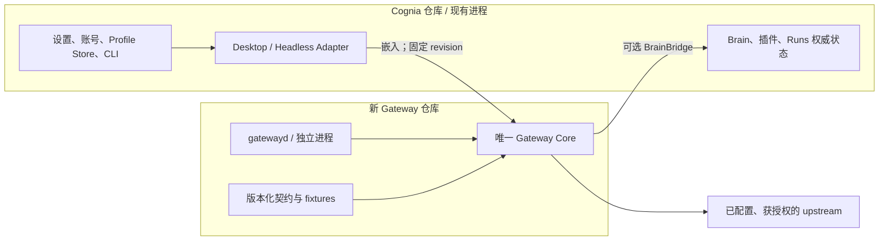
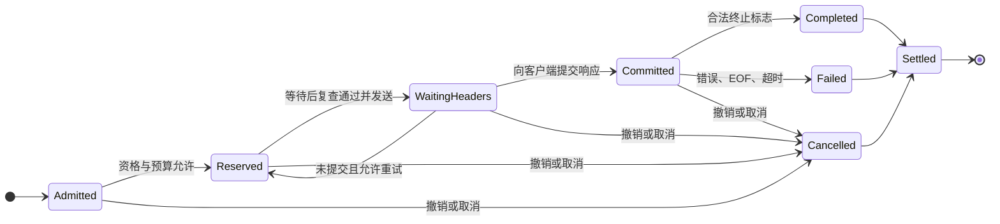
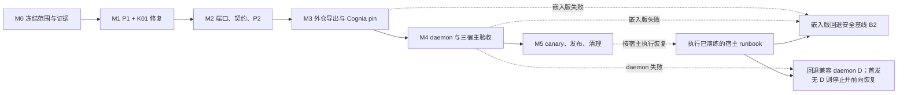

# Gateway 拆仓落地方案：先修复并解耦，再迁移同一核心与独立宿主

| 字段        | 内容                                                                                                                                                                                                                                                                                                            |
| ----------- | --------------------------------------------------------------------------------------------------------------------------------------------------------------------------------------------------------------------------------------------------------------------------------------------------------------- |
| 状态        | Proposed；方案交付，尚未批准实施；所有 WP 均未据此开始                                                                                                                                                                                                                                                          |
| 作者 / 日期 | Codex / 2026-11-14，Asia/Shanghai                                                                                                                                                                                                                                                                               |
| 用户目标    | 明确新仓与 Cognia 职责、依赖解耦、迁移顺序、验收标准，并纳入前轮 P1 修复                                                                                                                                                                                                                                        |
| 深度 / 范围 | Heavy；Rust、CLI、TS 契约、桌面/headless 适配、存储、跨仓 CI、独立 daemon                                                                                                                                                                                                                                       |
| 建议仓库    | `cognia-labs/cognia-gateway`；名称与可见性待 Q1 确认，不表示仓库已创建                                                                                                                                                                                                                                          |
| 实施基线    | M0 冻结实际源码与依赖；共享工作区，不能只用 HEAD 代表未提交文件                                                                                                                                                                                                                                                 |
| 评审角色    | Gateway Maintainer、Cognia Integration Maintainer、Security Reviewer、QA/Release Owner                                                                                                                                                                                                                          |
| 输入        | [对抗性审查](../evidence/2026-11-14-gateway-external-cli-adversarial-review.md)、[隔离构建评估](../research/2026-11-14-gateway-repository-extraction-assessment.md)                                                                                                                                             |
| 相关 ADR    | [0043](../content/docs/en/adr/0043-llm-provider-execution.md)、[0090](../content/docs/en/adr/0090-unified-agent-execution-and-gateway-compatibility.md)、[0163](../content/docs/en/adr/0163-provider-operation-contract.md)、[0196](../content/docs/en/adr/0196-a-library-crate-links-tauri-only-when-asked.md) |

> **执行摘要**
>
> - 新仓拥有一个可嵌入 Rust Gateway 核心、版本化契约及独立 `gatewayd`；Cognia 保留 UI、账号、vault、Profile Store、Brain 和宿主适配。
> - 先在现仓修复 8 个 P1 和 Codex 自动票据权限阻断，再闭合影响路由/生命周期的 P2；通过基线 B 后才迁移实现所有权。
> - 通过注入存储、网络、隐私与观测能力，移除核心对 5 个 Cognia 本地基础 crate 的直接依赖，避免复制共享全局状态。
> - Cognia 固定 Git revision 消费唯一核心；桌面/headless 保持嵌入式运行，独立 daemon 复用同一实现。首次迁移保持现有 Cognia 数据格式和 API 路径。
> - 发布必须同时满足干净 checkout、两仓契约、三宿主故障测试、真实客户端和回退验证；不能以迁移目录、关闭功能或模拟 `/v1/models` 成功替代验收。

## 1. 目标是两仓独立交付，同时保持一个实现 owner

现有 Gateway 已是默认不启用 Tauri 的 Rust 库，但配置、密钥、网络策略与部分高级执行仍依赖 Cognia。隔离实验已经证明库可以构建，也证明测试和消费端集成仍有实际阻碍。应迁移一个通过验证的模块，而非在新仓重新实现代理。

| 目标                             | 可验证结果                                                                            | 验收 ID  |
| -------------------------------- | ------------------------------------------------------------------------------------- | -------- |
| G1 新仓独立构建与维护            | 无 Cognia checkout、外部 symlink、workspace path dependency，core/daemon/契约均可测试 | A01、A02 |
| G2 Cognia 使用外仓唯一实现       | 五个直接 Cargo 消费者来源一致；旧核心不再被编译；desktop/headless 可运行              | A03、A04 |
| G3 外部 CLI 的路由和凭据边界可靠 | 8 个 P1、K01 以及迁移相关 P2 进入生产回归测试                                         | A05–A09  |
| G4 用户状态和安全策略保持        | 配置、Key、额度、账号隔离不丢；撤销、重启、续期有明确语义                             | A10、A11 |
| G5 独立产品可操作                | 不启动 Cognia 即可配置 upstream、管理 Key、启动/停止并运行 Claude/Codex               | A12      |
| G6 可升级、追踪和安全回退        | 不可变 pin、版本兼容、P1 已修复的回退产物与三宿主证据                                 | A13–A15  |

范围包括现有模型入口、路由/轮转、协议转换、流、冷却/重试、并发、Key、ticket/lease 和媒体代理能力。Cognia 的 Runs/虚拟模型/ledger/隐私插件仍须保持现有适配行为；独立 daemon 可以明确报告这些需要 Brain 的能力未配置，不能假称完整实现。

首版不增加分布式调度、跨实例共享额度、云端管理 SaaS、订阅登录服务、Marketplace、运行时下载最新核心或全新管理网页。不把独立 daemon 的运行引入 Cognia desktop 的必经路径，不迁移 Cognia 的 Dexie/SQLite 全库，不为拆仓改变 provider/account/model 标识。

## 2. 当前证据支持拆分，但不支持直接复制依赖闭包后上线

本轮重新读取 Cargo metadata 和关键源码：5 个直接本地生产依赖；本地生产闭包合计 7 个 crate；5 个直接 Cargo 消费者分别为 `cognia-next`、`cognia-agent-state`、`cognia-companion`、`cognia-companion-rpc`、`cognia-server`。Gateway 只有 lib/test/bench target，没有 bin。前轮 16 个审查源码哈希本轮未变化，8 个 P1 未因本方案自动得到修复。

| 事实 / 推断                                                          | 状态      | 证据与适用范围                                                                                                                |
| -------------------------------------------------------------------- | --------- | ----------------------------------------------------------------------------------------------------------------------------- |
| 默认 feature 不需要 Tauri；`GatewayHost` 有 desktop/headless Adapter | Confirmed | [manifest](../../crates/cognia-gateway/Cargo.toml)、[host](../../crates/cognia-gateway/src/host.rs)                           |
| 独立 7-crate workspace 的 `cargo check --lib --offline` 通过         | Confirmed | [实验记录](../../.cache/diagnostics/2026-11-14-gateway-extraction/validation.json)；macOS Apple Silicon，未证明运行与其他平台 |
| 隔离 `--tests` 无法编译                                              | Confirmed | 依赖两个应用 TS `include_str!`；[日志](../../.cache/diagnostics/2026-11-14-gateway-extraction/isolated-tests.log)             |
| 同时消费两份 path 基础库会 lockfile collision                        | Confirmed | 本地消费者实验；未实际接入外仓 Git dependency                                                                                 |
| 两份来源的 secrets/net/instrument 可能分裂全局状态                   | Inferred  | 当前 singleton 实现；不能把改成 Git source 当作已消除该风险                                                                   |
| 单实例可持续吞吐、跨平台发行和真实供应商矩阵                         | Open      | 必须在实施中产生证据，本文只设验收预算                                                                                        |

`.cache` 是本地调查证据，不是新仓 CI 输入。M0 将有价值的探针转为正式测试及经过审查的无敏感 fixture，并记录对应生产模块；不复制本机缓存目录作为“已验证基线”。

## 3. 新仓拥有模型执行模块，Cognia 拥有产品和身份适配

| 行为 / 数据                                         | 唯一实现 owner                       | Cognia 责任                                                                 | 独立 daemon 责任                                          |
| --------------------------------------------------- | ------------------------------------ | --------------------------------------------------------------------------- | --------------------------------------------------------- |
| HTTP 协议、IR、SSE、媒体代理、模型能力校验          | 新仓 core                            | 接入同一 core                                                               | 接入同一 core                                             |
| alias、key 轮转、重试、冷却、并发、lease 规则       | 新仓 core                            | 发布配置和撤销信号                                                          | 发布配置和撤销信号                                        |
| Key/ticket 认证授权、预算和状态转换规则             | 新仓 core                            | 提供可信账号/成员上下文                                                     | 提供本实例 principal；不冒充 Cognia 组织身份              |
| Key/凭据/用量持久化后端                             | 各宿主 Adapter                       | 复用原 vault/secret-store 与路径                                            | 自有数据目录、主密钥与存储                                |
| Profile Store、订阅账号、定价与目录投影             | Cognia                               | 继续拥有；生成规范 snapshot                                                 | 自己的 config loader；无隐式订阅账号读取                  |
| Tauri commands、Companion RPC、CLI bridge           | Cognia                               | 保留入口名、注册、ACL、认证                                                 | 不暴露 Cognia 管理面；独立管理通道                        |
| `cognia-agent x`、进程监督、隔离 home、配置恢复收据 | Cognia                               | 保留并修复 F01–F03、K01 等                                                  | 初版不复制第二个 `x` 启动器                               |
| Claude/Codex 纯连接参数与配置片段规则               | 新仓 core 的纯 `client_profile` 模块 | 高层 manager 调用 builder，再把普通 JSON/TOML patch 交给 `cognia-agents` IO | 文档/管理 CLI 输出同一份参数，实际启动仍由用户的 CLI 完成 |
| UI、i18n、引导、设置和日志展示                      | Cognia                               | 保留，适配新契约                                                            | 初版使用 CLI 和结构化日志                                 |
| Brain、Runs、Router Fusion、插件、搜索/视觉补偿     | Cognia 的实现；新仓拥有 bridge 契约  | 保留现有权威状态与实现                                                      | 未配置时按 capability 明确拒绝相关功能                    |
| 契约、兼容 vectors、协议回归 fixture                | 新仓                                 | 固定版本消费并测试 Adapter                                                  | 使用同一版本                                              |

原 `client_connections.rs` 不能直接搬到外仓：它依赖 `GatewayState` 私有字段、配置路径、账号代际及 `cognia-agents` IO。迁移为 Cognia 的 ClientConnectionManager，显式获得 Key issuer、authority stamp 和配置目录；不开放 core 的 `inner`。纯 profile builder 有 Cognia 高层 manager 和 daemon 两个消费者，因此值得统一；文件操作和进程能力不进入通用 core。依赖方向保持为 manager→Gateway builder、manager→agents IO；平台层 `cognia-agents` 不新增 Gateway 依赖，直接消费者仍为当前五个。manager/builder 拆分必须在 WP4 完成，不能等到 WP5 接口冻结之后才移出反向依赖。

图 1：两种宿主复用唯一 core；进程、身份、存储和 Brain 的信任范围仍由宿主控制。

建议目录为 `crates/cognia-gateway`、`crates/gatewayd`、`contracts/`、`packages/gateway-contracts/`、`tests/`、`docs/`。只新增两个 Rust crate；契约导出工具先作为 core 的 example/dev tooling，不为每个内部模块创建 crate。独立 Rust 构建不运行 pnpm；TS 契约产物预生成、可校验。

## 4. 解耦以移除反向依赖为目标，不复制六个基础 crate

| 当前依赖 / 用途                             | 目标落点与方法                                                                                 | 验证                                                          |
| ------------------------------------------- | ---------------------------------------------------------------------------------------------- | ------------------------------------------------------------- |
| `cognia-agents`：客户端路径与配置 IO        | 高层 ClientConnectionManager 调用纯 builder 后向 agents IO 传普通 patch；平台层无 Gateway 依赖 | 双向 dependency tree 均无反向边；备份/并发修改/恢复回归通过   |
| `cognia-core`：atomic file IO               | Cognia 沿用；daemon 的宿主存储实现自行负责原子性；core 不直接写宿主路径                        | core 无 core/problem；中断写入及路径测试分别在宿主执行        |
| `cognia-secrets`：Key、credential、成员账本 | `KeyStore`、现有 `CredentialResolver`、`MemberUsageStore` 注入；Cognia sealed 实现留在现仓     | app 初始化的存储就是 Gateway 所用存储；无第二个 singleton     |
| `cognia-net`：client、proxy、入站规则、PII  | 网络 factory / OutboundPolicy 注入；core 的通用入站与协议校验自有实现和 fixture                | 现有 proxy/egress 的 runtime 修改真实影响 Gateway；无隐式直连 |
| `cognia-instrument`：计时与事件             | 复用 `GatewayHost` 事件，补观测 sink；Cognia sink 转入原 registry                              | 原 perf/日志可见；无第二份 registry；sink 不阻塞发送          |
| transitive `cognia-problem`                 | core 定义自有类型化错误；Cognia Adapter 转为现有 Problem/IPC 形状                              | Rust DTO 为 object；错误码和授权拒绝保持兼容                  |
| `tauri-host` 与 `commands.rs`               | command shells、TauriGatewayHost 移回 Cognia；新 core 不依赖 Tauri                             | 原 command 名/事件/ACL 和 `crate::gateway` 兼容 facade 验证   |

**验收要求：新 core 和 `gatewayd` 对上述 Cognia crate 的生产依赖为零；不是通过换名、Git 副本、optional 默认启用或动态加载把依赖藏起来。** Cognia 自己仍可依赖这些基础库。

复用现有 `CredentialResolver`、`TicketMetaStore`、`MemberUsageStore`、`BrainBridge` 与 `GatewayHost` 的现有行为；将后者的观测和决策用途分开，仅补尚未覆盖的端口，不设计一个掌管所有权限的巨大 Host trait。下表是拟新增/收紧的 Interface 契约，名称不是已实现 API。

| Interface                         | 输入 / 输出与权威                                                              | 生命周期、失败和约束                                                                            |
| --------------------------------- | ------------------------------------------------------------------------------ | ----------------------------------------------------------------------------------------------- |
| `KeyStore`                        | load/save 经 core 验证的 Key metadata 与密钥材料；core 决定授权/额度，宿主落盘 | 版本化单写者、原子持久化；不得用旧快照覆盖新 quota；失败不能复活已撤销 Key                      |
| `CredentialResolver`              | 可信 snapshot 的 credential ref → 临时认证材料、opaque identity/generation     | 最终发送前解析；不可用为 typed error；不得从其他 provider 借 Key；撤销通知清理相关状态          |
| `UpstreamClientFactory`           | 已验证 target + 宿主 egress policy revision → 可取消 HTTP client               | Cognia 复用现有 proxy 路由；daemon 自有明确配置；不缓存过期路由或在失败时直连                   |
| `OutboundPolicy`                  | 协议化请求、authority、用途 → allow/transform/refuse                           | 每次实际发送前执行；任何插件变换后复查；required policy 不可用时零 upstream 请求                |
| `TelemetrySink`（兼容原观测事件） | 脱敏事件、有限标签与测量值 → 接收结果                                          | 不携带 prompt/secret；普通观测有界 best effort；必需 ledger 另走同步 bridge，不能靠日志代替授权 |
| 现有 store/bridge                 | ticket metadata、用量或显式 Brain command → 版本化结果                         | 保留预算原子性、范围校验、超时和幂等；权威数据不从 UI cache 或未认证请求推断                    |

现有 `GatewayHost` 还承载 `gateway://decide` 的 live decision，含 `promptText`，不能全部当作普通观测迁移。拆为上述无 prompt 的 `TelemetrySink` 与受信、类型化的 `LiveDecisionPort`：后者保留 owner/authority generation、deadline、取消与 allow/deny 语义，prompt 仅进入获授权的本地决策通道，不写日志或普通事件 sink。legacy engine 的配置路径须保持原决策行为；V2 本地默认不额外调用未配置的决策器。R-I01 覆盖 legacy/V2、allow/deny、超时/取消、无跨 owner prompt 及日志脱敏，并映射 A11/WP4。

端口构造必须在启动 listener 前完成；异步 IO 不得持有 `parking_lot` guard。core 负责在停止时等待所属任务；每个 request/queue/stream 的许可与 reservation 均有 Drop/cancellation 归还路径。

## 5. 契约只有一个权威来源，并给旧 Cognia 留兼容窗口

新仓公开 Rust serde DTO 是跨宿主核心契约的权威；导出版本化 JSON Schema、TS 类型和有效/无效/权限 vectors。密钥材料与宿主内部状态不进入公开 DTO/schema。可沿用现仓已有的 `schemars` 工具体系，在 dev tooling 中生成；运行时语义校验和 vectors 仍是必需，生成 schema 不等于验证全部不变量。`types/gateway/index.ts` 改为重导出固定契约及 Cognia 专属 UI 类型，不继续手写镜像。

| 契约                                | Producer / Validator / Consumer                       | 版本与兼容规则                                                                                 |
| ----------------------------------- | ----------------------------------------------------- | ---------------------------------------------------------------------------------------------- |
| `GatewayConfig` / `RoutingSnapshot` | Cognia/daemon 编译 → core 校验 → immutable generation | snapshot policy V2 现有含义不变；未知必需能力拒绝；无效 reload 保留上一有效 generation         |
| ticket mint / lease / budget        | 可信控制面 → core → 推理入口                          | 默认拒绝未授予 operation；候选/selector/credential 权限冻结；续租不扩大权限、不重置预算        |
| `GatewayCapabilities`               | core + Adapter 实际能力 → CLI/UI                      | 新增只读、鉴权后的能力查询；旧客户端保持现有路径；不能仅凭 `/healthz` 声明 inference 已验收    |
| event / error / usage               | core → Cognia sink / daemon                           | 保留现有客户端可解析的错误/SSE；新增规范诊断不泄漏 upstream 原文；附 contract/core fingerprint |
| BrainBridge                         | core → Cognia Brain                                   | command/envelope 及权限 vectors 随契约分发；Brain 权威不搬入 core；不支持时明确 unavailable    |
| 客户端 profile                      | 纯 builder → Cognia writer / 独立文档                 | Claude family/helper、Codex Responses 和最小授权模型集合一致；不生成管理凭据                   |

header policy 的 canonical fixture 从现 `packages/provider-types/fixtures/header-policy-cases.json` 归入新仓 `contracts/fixtures/header-policy-cases.json`，由固定版本契约包导出；Cognia 原路径仅保留生成镜像或在测试准备时从同 pin staging。两边检查内容/hash 一致并执行自己的行为断言，禁止维护两份手改规范；Rust 不再读取另一仓或应用 TS 文件。Brain command/envelope vectors 同样由契约 owner 分发。WP5 移动 fixture 与读取路径，同时保留原 Rust/TS 正反向断言，并故意改坏镜像证明 gate 失败。

建议初始外仓 core 版本为 `0.2.0`，contract major=1；这是协调 Rust Interface 变化的建议版本，不代表已发布。Cognia HTTP/IPC wire 和现有存储格式保持兼容。每次修改 Interface/翻译/路由实现都改变源码 pin 和 build fingerprint，不能只依赖原来长期不变的 `gatewayCrateVersion=0.1.0` 判断认证证据是否过期。

新增拟定 pin 文件 `integrations/cognia-gateway.json`，包含 `repository`、40-hex `revision`、`crateVersion`、`contractVersion`、`contractSha256`、`embeddedStateFormatVersion`。Cargo 的 `git+rev`、pnpm 的契约来源、两个 lockfile、runtime-version/staleness 元数据和 CI checkout 必须一致。具体 SHA/digest 只能由真实产物产生，方案不填写假值。

兼容窗口从 M3 开始，到 M5 完成后至少两个 Cognia 发布版本；不按“日期到了”自动删除兼容代码：

| 组合                         | 要求                                                                        |
| ---------------------------- | --------------------------------------------------------------------------- |
| 旧 Cognia + 原内置核心 B     | 继续可用，B 必须已修复 P1；不强制升级到 daemon                              |
| 新 Cognia + 固定外仓 core R1 | 必须通过全部宿主与状态兼容测试                                              |
| 新 Cognia + 上一个已验证 pin | 在声明兼容窗口内可重建/回退，不能指向未修复 P1 的历史版本                   |
| contract major 不匹配        | 启动/配置提交前明确拒绝，不猜字段、不回退为任意 provider                    |
| 外部 Claude/Codex 旧配置     | 基本 URL/model/key 规则不变；错误提示区分 listener、scope、model 和协议问题 |

## 6. 运行语义必须覆盖撤销、错误和半完成状态

### 6.1 发送流程保证配置、凭据和权限属于同一 target

1. 鉴权并捕获 authority stamp、request ID、snapshot generation；只有宿主能构造成员身份。
2. 提取完整能力需求，包括 Responses schema、strict tools、vision、streaming；在预算计数前过滤不兼容/停用候选。
3. 按 alias 策略选择 provider，再在其真正成为 attempt 时预留 credential；未使用 fallback 不推进 key cursor。
4. 校验 ticket/lease/授权原因，并以 cancellation-safe guard 等待 slot、额度与 required ledger；任何异步等待都可能使先前快照失效。
5. 在等待结束后的 dispatch barrier 重查 authority、ticket/Key 状态、credential generation、egress/policy revision，解析同一 target 的凭据并执行 OutboundPolicy。策略异步变换后再次核对 stamp，才准许发送；在途撤销传播取消。connect deadline、header deadline、stream idle deadline 分开管理。
6. 仅在尚未向客户端提交 status/headers/body 时重试；已提交后的错误使用当前 inbound 协议终止，绝不伪造成功或再次请求其他账号。
7. 按 request/attempt ID 幂等结算、记录用量，释放所有 queue/slot/stream 状态；记录每次已发送 attempt，避免把失败支出算成未发送。

图 2：只有合法完成标志通向 Completed；Committed 后没有回到 Reserved 的重试边。

R-I02 必须把请求停在 queue/ledger await 期间，再分别切换账号、撤销 ticket/Key、轮换 credential 或更新拒绝策略；释放等待后 upstream 命中为 0，所有 reservation/slot 被释放。另有未变更 stamp 的成功对照；不能仅检查入队时权限。该测试归 WP4/A11，并在三宿主复验。

### 6.2 统一身份、冷却和取消不变量

调度身份至少区分 owner scope、deployment、credential/account ID、credential generation、transport revision；source provider 名称用于展示，不再充当另一套冷却命名空间。临时 task ID 变化不能绕过原账号冷却，凭据 generation 变化也不能继承错误的旧账号状态。

- 冷却覆盖单 Key 与池 Key；permanent 不被迟到 temporary 覆盖，临时窗口单调取更晚值。
- `allowAuthFailover=false` 对当前及后续请求都有效；认证失败 lease 进入 blocked-auth，只有授权变更/新 credential generation/显式恢复可解除。429 等允许的 transient failover 保持既定语义。
- queue waiting count 与许可均使用 cancellation-safe guard；热更新在同一 gate 调整 admission，不创建额外独立容量。已有 holder 可完成，但超过新 cap 时不得再接受新 holder。
- request cancellation、ticket revoke/expiry、account switch、daemon stop、client disconnect 都必须传播到 upstream；正在阻塞获取 slot 或响应头的 future 也在范围内。
- 硬额度、权限和数据策略不能因 Brain/存储故障降级为 unlimited。可选 ledger 的既有 bypass 语义须显式标记；required ledger 不允许绕过。

拟新增 `responseHeaderTimeoutSecs`，默认建议 30 秒，独立于 connect timeout 和 stream idle timeout；旧配置缺字段时用固定兼容默认。重试总上限仍受候选预算及总 backoff budget 双重限制；为测试使用短 deadline，不能缩短生产长生成的全程时限来掩盖 F04。

### 6.3 长时间运行和 issuer 重启采用不同恢复方式

复用现有普通 `renew`：在原 issuer 内延长**同一个 ticket secret** 的有效期，保留冻结候选、预算已用额、在途预留和授权指纹；仍受 `issued_at + 24h` 硬上限约束，不借拆仓开放 Host-only 的 person watchdog 延期能力。管理响应区分 effective expiry 与 hard expiry；建议在硬上限前 15 分钟提醒，到安全 turn 边界重新授权并取得新 ticket、重启/native resume，承接同一逻辑任务的已用预算。不能生成新 secret 后假设运行中 CLI 的环境会自动更新。launcher/宿主在 expiry 前检查权限并续租，退出时撤销；续租失败应在到期前明确提示。

issuer 重启后，未持久化的 ticket secret 不应复活。受管任务暂停/重建票据后通过既有 native resume 路径恢复；裸 `x` 客户端给出原 profile 的重新启动指引，无法取得 native session ID 时不伪造自动恢复。对 H02 使用短 TTL 验证正常续期、拒绝续期、重启，并用 fake clock 跨过 24h 验证普通 renew 不越过硬上限、新 ticket 不清零逻辑预算。重启前的未知在途用量按 §9 结算，不把“暂停”当作额度已安全保存。

## 7. 八项 P1 与 Codex 权限阻断全部是迁出前置门槛

下表沿用审查编号，测试 ID 是拟落地的行为合同，不是已存在或已通过的测试。先将复现改为断言正确行为的正式失败测试，确认因目标缺陷失败，再修复并运行同宿主集成检查。不得仅让探针继续“成功复现错误”就标成修复通过。

| 缺口                                    | 首次修复 owner / 现有模块                               | 明确修复方案                                                                                                                   | 必需回归与通过标准                                                                                                              | 阶段 |
| --------------------------------------- | ------------------------------------------------------- | ------------------------------------------------------------------------------------------------------------------------------ | ------------------------------------------------------------------------------------------------------------------------------- | ---- |
| F01 管理令牌进入外部进程                | CLI Maintainer；`cli/src/x/agent-launcher.ts`           | runtime essential allowlist + 已验证的额外环境集合；管理、provider auth 和 routing 变量不可覆盖；同时检查 Windows 必需运行变量 | R-C01：在隔离子进程放入合成管理/认证/路由 sentinel，子进程和工具均读不到；PATH/终端/正常工具仍可用                              | M1   |
| F02 Key 与 endpoint 来自不同 provider   | CLI Maintainer；`x-command.ts`                          | 从一个 resolved provider 单元取得 protocol、endpoint、credential ref；允许选 B 时必须连 B；缺失项不得拼接                      | R-C02：A 有 URL 无 Key，B 有自己的 URL/Key；只允许明确失败或 B→B，禁止 B-Key→A；fixture 上游捕获实际认证头                      | M1   |
| F03 指定 Gateway 故障后绕行             | CLI Maintainer；`gateway-connect.ts`                    | 显式 URL/配置/env 目标 probe 失败即停止；默认发现 fallback 单独建模为显式 provider policy，不吞掉目标来源                      | R-C03：显式目标超时/非 200/TLS 错误，其他 upstream 命中 0；可选 fallback 仅去授权 provider，执行同等必需隐私策略                | M1   |
| F04 等响应头无限挂起                    | Protocol Maintainer；`server.rs`                        | 增加独立 header deadline，覆盖 `send().await`；到期按尚未提交的候选预算切换，取消旧请求                                        | R-P01：上游接受连接但无 headers，短 deadline 内尝试健康 backup；所有 slot 归还；客户端已提交后绝不再切换                        | M1   |
| F05 错误/截断流被标成功                 | Protocol Maintainer；`translate/stream.rs`、`server.rs` | 显式区分完成、失败和 EOF；先判终态再输出 trailer；Anthropic/Responses error 不得被忽略                                         | R-P02：partial+EOF、error、idle、socket reset 都没有成功终帧；正确终态只出现一次；失败不写 completed history，已知 usage 仍结算 | M1   |
| F06 并行工具写入已关闭 block            | Protocol Maintainer；`translate/stream.rs`              | OpenAI→Anthropic 的并行工具按调用收集参数，合法 finish 后按首次出现顺序输出完整工具 block；不再交错写已关闭 index              | R-P03：2/8 个并行工具，随机分片/交错/多字节 JSON；每 block start→delta→stop 一次，参数和 ID 保真；不完整参数只能失败            | M1   |
| F07 Gemini Responses 二次编码           | Protocol Maintainer；`server.rs`                        | 用内部 typed stream-format 标记已生成 Responses 的结果；外层不再二次编码，不能信任 upstream 自带伪造标记                       | R-P04：Gemini→Responses HTTP 及真实 Codex 工具流程保留文本/工具/usage；完整流没有 response.failed，单次 framing                 | M1   |
| F08 禁止 auth failover 仅作用于一次请求 | Routing Maintainer；`execute.rs`、`lease.rs`            | lease 记录 blocked-auth 原因与 credential generation；禁止授权在跨请求时丢失；恢复必须重新授权/更换 generation                 | R-L01：false 时 200(A)→401(A) 后连续请求均不触达 B；true 与新 generation 的恢复分别有正向对照；429 transient 不误伤             | M1   |
| K01 Codex 自动票据缺 `responses`        | CLI Maintainer；`ticketRequestFor`、bridge minter       | Codex 显式申请最小 models/responses scope；Claude 和默认 legacy ticket 保持原拒绝范围                                          | R-C04：真实 minter→Gateway→已安装 Codex 完成工具往返；默认/Claude ticket 对 Responses 仍 403，embeddings 不被附带放行           | M1   |

F06 的工具参数缓冲有界：默认最多使用现有 16 MiB 请求级限制作为单个 response 的总工具参数上限，并纳入 per-request 并发内存预算；超过上限输出协议错误并释放资源，不截断成成功 JSON。真实 workload 的内存验收见 A14；如需更小默认须有兼容样本证据，不在拆仓时静默降低。

### 7.1 十二项 P2 和两项源码风险同样有归属，不能在迁移中遗失

| 编号                                | owner / 拟回归 ID                     | 完成标准                                                                                                                           | 最晚门槛 |
| ----------------------------------- | ------------------------------------- | ---------------------------------------------------------------------------------------------------------------------------------- | -------- |
| F09 双层轮询相位锁定                | Routing Maintainer / R-L02            | 2 provider × 2 Key、8 次 ordinary-key 成功请求，各 Key=2；未发送 fallback 不计一次 credential reservation；sticky 模式另验冻结规则 | M2       |
| F10 单 Key 不看冷却                 | Routing Maintainer / R-L03            | 单/多 Key 同样过滤 429 与 permanent；budget=1 时健康候选能接替冷却首选；全冷却 503+Retry-After                                     | M2       |
| F11 source/task ID 不一致           | Routing Maintainer / R-L04            | 本地 manual task 的完整 HTTP/managed-task 流程验证共同 credential identity；换 task ID 不复活 key                                  | M2       |
| F12 strict/schema 过滤缺失          | Routing Maintainer / R-L05            | Chat strict、Responses text.format、namespace 内 strict 等在选取前过滤；兼容 fallback 被实际调用                                   | M2       |
| F13 迟到 429 覆盖 401               | Routing Maintainer / R-L06            | 并发 HTTP 顺序交错后 permanent 保留；较短临时窗口不缩短较长窗口                                                                    | M2       |
| F14 fallback 使 native 请求失效     | Protocol Maintainer / R-P05           | native document/hosted tool/原生 reasoning 请求在增加异协议 fallback 后仍先走兼容 native；只有真正尝试转换才检查其损失             | M2       |
| F15 并行工具历史拆错 turn           | Protocol Maintainer / R-P06           | 同 turn 多个 calls 合成一个 assistant turn，结果逐 ID 关联；真实客户端至少完成两轮并行工具                                         | M2       |
| F16 cancelled waiter 泄漏           | Routing Maintainer / R-L07            | 取消/撤销/到期 ≥10000 次，waiting 与 permits 回基线；繁忙后新 waiter 能在释放 slot 时成功                                          | M2       |
| F17 cap 热更新突破上限              | Routing Maintainer / R-L08            | 2→1 时旧 holder 完成前不再 admission；增加/减小/旧请求并发读取均不产生额外 gate                                                    | M2       |
| F18 issuer/listener 错配            | CLI Maintainer / R-C05                | 本地 bridge 与目标远端不匹配时不发送 local ticket；正确同 issuer、显式远端 Key 有正向路径                                          | M2       |
| F19 base path 丢失/重复             | CLI Maintainer / R-C06                | 根路径、已有 `/v1`、租户前缀、尾斜线的 models/Responses/Messages 实际路径正确；URL query 按明确规则保留                            | M2       |
| F20 remembered alias 被替换         | CLI Maintainer / R-C07                | 企业 alias 在 TTY/非 TTY 重启保持；不存在时明确错误/选模，不能自动改成旧默认                                                       | M2       |
| H01 helper/review/subagent 越权模型 | Client Integration Maintainer / R-C08 | 新旧 Claude/Codex 配置的主/辅助/子 Agent 请求均在 scoped key/ticket 集合内；无 helper 时有授权 fallback；旧覆盖被明确迁移或拒绝    | M4       |
| H02 ticket 到期无续租               | Client Integration Maintainer / R-C09 | 短 TTL 续期不换 secret、不清预算；拒绝/重启有恢复路径；fake clock 跨 24h 不越硬上限，新 ticket 承接逻辑预算                        | M4       |

## 8. 存储、隐私和管理面随宿主隔离，Cognia 数据不做首迁

### 8.1 Embedded 继续使用旧 owner 和格式，standalone 使用独立数据目录

| 数据                            | Embedded 迁移                                                                   | Standalone 方案                                                                                | 回退约束                                                                               |
| ------------------------------- | ------------------------------------------------------------------------------- | ---------------------------------------------------------------------------------------------- | -------------------------------------------------------------------------------------- |
| Gateway config                  | 保留原路径/已有字段；新 header timeout 有默认；core store port 不重命名安装目录 | 自有 `config.json`，schemaVersion=1，credential 仅为引用                                       | embeddedStateFormat 不变；旧字段往返不丢；有破坏变更则停止 M3                          |
| API Keys / upstream secrets     | 原 vault/secret-store service、账号隔离、reveal 行为不变；Adapter 调用原初始化  | 独立 master key env/file + daemon 自有 SQLite store；secret 字段 AEAD 加密，主密钥不进 DB/日志 | 不自动复制 Cognia vault；master key 缺失/解密失败停止启动，不能生成新 Key 顶替         |
| quota / usage / ticket metadata | 保留原账本和 owner；已用/预留不归零                                             | SQLite transaction、request/settlement ID 幂等、metadata schema=1；ticket secret 只在内存      | 恢复后的已落盘用量不减少；legacy 周期 flush 的既有 crash-loss 范围须记录，不夸称零损失 |
| in-flight / leases / cooldown   | 同一 core 实例拥有；authority change 主动取消                                   | 同一 daemon 实例拥有；退出时 drain/cancel                                                      | 不迁移活跃 socket；重启后的 secret/lease 恢复必须按 §6.3，不冒充原请求仍存活           |
| 客户端配置与恢复收据            | Cognia manager 保留文件、备份、revision 和撤销恢复流程                          | 初版文档/profile builder 配置原生客户端；无自动读取/改写用户全局配置                           | 不覆盖并发外部修改；恢复失败不能宣称原凭据已撤销/文件已还原                            |

daemon SQLite 是新增宿主的数据，不替换 Cognia DB。至少存 schema metadata、加密 Key/credential、Key metadata 与用量、ticket metadata；写入带单调 revision 和 settlement ID，拒绝过期全量快照覆盖。复用成熟 AEAD 库和操作系统 CSPRNG，不自创加密；每条 secret 使用独立 nonce，master-key 文件在 Unix 为 0600，Windows 使用当前用户 ACL。所有 DB/密钥 IO 在 blocking worker 完成，readiness 在 listener bind 前确认。数据库 schema、加密格式和 dump/restore 的测试是 WP8 交付物。

首迁不需要 Dexie bump 或 Profile Store backfill；如果实施因目标字段确实需要改 schema，应另立受控迁移并重做回退评审，不能把 schema 变化藏进搬仓 PR。

### 8.2 管理权限与推理凭据保持分离

- 推理 listener 默认 loopback，继续保留 Host/Origin/allowlist/Key 等检查；LAN/反向代理是显式部署配置，不能因拆仓默认扩大。
- `gatewayd` 的配置、Key CRUD、ticket 管理使用独立本机控制通道：Unix socket（0600）或 Windows named pipe（当前用户 ACL）。远端管理初版不开放。推理 Key 不获得管理能力。
- 新命令集合为拟新增的 `gatewayd init/config validate/serve/status/keys create|revoke/probe`；`probe` 可能计费，必须是显式执行，不自动作为健康检查。模型使用文档覆盖 Claude/Codex 的 base URL、alias、Key 和 Responses 要求。
- Key create 只向调用者显示一次秘密；常规状态只展示指纹。管理 token、master key、provider key、proxy 密码不进 Agent 环境、模型参数、URL或错误日志。
- upstream URL 只能来自获授权 snapshot；credential/ref/transport 要绑定同一 target。动态任务、重定向、媒体 URL 与 proxy 路由继续经过宿主 egress 校验，不能借接口注入任意网络访问。

### 8.3 隐私能力显式声明，必需策略不可降级

core 在每次发送和扩展变换后调用 OutboundPolicy。Cognia Adapter 沿用原 PII 检查与 Brain mask/interceptor 实现；standalone 提供可检查文本的阻断策略与共享规则 vectors，不把没有 Brain 的环境宣称为已支持完整 mask/插件补偿。现有 `off/mask` 的 embedded 默认不在拆仓中被静默更改；standalone 的策略在初始化配置中明确设置，ticket 的强制检查不能被普通 Key 的 off 设置覆盖。

日志不保存 prompt、图片/音频二进制、原始错误 body 或 secret；真实客户端验收只用合成内容。普通日志、指标故障不会绕过必需安全策略；必需策略不可用时上游命中必须为 0。

## 9. 分阶段切换一个构建产物，回退到已修复的基线

图 3：回退按宿主选择已验证产物；首次 daemon 发行没有历史 D，不能用嵌入式 B2 冒充其回退目标。

| 阶段                  | 进入条件与主要动作                                                                    | 退出证据                                                                                            | 中止与回退                                                                       |
| --------------------- | ------------------------------------------------------------------------------------- | --------------------------------------------------------------------------------------------------- | -------------------------------------------------------------------------------- |
| M0 范围与证据冻结     | 映射角色、平台和仓库决策；记录实际文件 hash/未提交状态；探针转正式测试                | findings→test→WP 一一对应；可信 source manifest、基线日志与依赖图                                   | 证据漂移先复查，不覆盖并行改动                                                   |
| M1 安全基线           | 现仓完成 §7 的 8 P1 + K01，独立 bugfix PR；保留现有功能                               | 正式红/绿测试、实际 launcher/HTTP 证据；生成可重建安全产物 B1                                       | 任一 P1 未闭合禁止外仓切换；修复本身可独立交付                                   |
| M2 模块闭合           | 在现仓注入端口、保留 facade，完成 F09–F20 和 contract/vectors                         | core 无 5 个基础依赖；tests 不读取应用 TS；desktop/headless 与 in-memory ports conformance；生成 B2 | 接口失败回到 B1 的已修复实现；真实三宿主验收留在 M4                              |
| M3 外仓候选与消费     | 将 B2 的实现/fixtures 导入新仓，记录 ORIGIN 与差异；Cognia 五个消费者原子切到同一 pin | 干净外仓 build/test；Cognia 无旧 crate 仍可构建；Rust/TS/lockfile/contract fingerprints 一致        | rollback pin/构建产物到 B2；数据格式不变；不下载任意 latest                      |
| M4 独立产品与完整回归 | 补 daemon、存储/控制面/文档；三宿主执行完整矩阵、H01/H02 和真实客户端                 | A01–A15 可审计证据；平台/版本/fixture/实供应商结果分别记录                                          | embedded 回 B2；daemon 回兼容 D，首发无 D 则停止并前向恢复；不得声称所有宿主通过 |
| M5 canary 与 cleanup  | 固定候选 RC，安全 canary，验证各宿主回退/恢复；发布不可变 release                     | canary、abort 演练、双仓 release manifest、维护责任和支持窗口                                       | 触发阈值停止扩量，按宿主 runbook 恢复；安全缺陷停止入口，不能用旧漏洞版本恢复    |

新仓首次导入建议采用经过审查的 snapshot import，保留 `ORIGIN.md`、原 commit/tree hash、文件清单与许可来源；不重写已发布的 Cognia 历史。迁移差异仅允许路径、manifest、适配拆分和明确列出的修复；未知差异必须逐项复核。

M3 同一 PR 更新根 workspace、五个 Cargo manifests、TS 契约引用、lockfiles、`scripts/gates/rust-architecture.json`、构建和测试路径、runtime-version gate、conformance staleness 和文档。Tauri commands/ACL、Companion dispatch、headless startup 的 owner 不改变；facade 保留现有调用名。计划新增 `check-cognia-gateway` pin/contract gate，借鉴现有 services gate；未来文件/脚本在 §12 列明，不冒称已经存在。

不同时运行两套 Gateway 处理真实模型请求，不做付费双发 shadow。CI 的 deterministic replay 对比 B2 与 RC；canary 中一个进程实例/产物只链接一个 core，嵌入版不使用 runtime 远程更新开关。构建切换采用可重建 artifact/pin，旧源码从当前 workspace 删除后仍可从历史 B2 重建。

回退目标必须按宿主记录：embedded 使用已修复的 B2；daemon 使用同一状态格式下上一个已验证产物 D。第一次 standalone 发行没有 D，采用停止服务、保留数据/主密钥、修复后前向恢复；若产品要求首发也可回退，必须在发行前额外认证一个支持相同 schema 的 D，不能假定 B2 含有 daemon。该选择在 Q6 评审，A13 分宿主演练。

受控交接步骤：冻结配置写入 → 停止新 admission → 最多等待建议 30 秒 drain → 取消剩余请求 → 幂等结算并确认持久化 → 停止旧 listener → 启动相应兼容产物/执行前向恢复 → 校验 store revision、quota、Key、authority → reissue 受管 ticket 并验证 synthetic turn。当前 ticket reservation 在内存中，不能写“保留 hold”就认为重启后仍在。对已经发送但 usage 未知的 attempt，重启前按 `max(已知用量, reserved)` 保守计入同一逻辑任务的持久化 spent；只有证明未发送的 reservation 才可释放。以 request/settlement ID 保证重复取消/重试 flush 不重复扣费，成功 flush/checkpoint 是交接的硬门槛；失败时停止交接并保持入口关闭，不切换新 issuer 重新发预算。

R-I03 覆盖“已发送且未知 usage→取消→持久化失败/重试→重启或回退→remint”，确认可用预算没有恢复、重复结算不多扣、未发送预留可释放；测试归 WP4/A10/A13。不能并发绑定同一端口、恢复失效 secret 或把取消的 turn 标为成功。安全撤销不因回退而撤销；不兼容数据格式阻止自动回退。突然崩溃仍按 §8.1 记录既有持久化边界，不能把受控交接保证夸称为任意崩溃零损失。

建议 canary 门槛为至少 24 小时、≥1000 个本地 fixture 请求，加每个声明客户端/宿主组合的真实基础任务；这是拟定验收窗口，不是已观测 SLO。任何凭据泄露、越权切换、重复执行或成功终态错误立即 abort；新增受控场景错误率 >0，或连续 3 个五分钟窗口超出 A14 延迟/内存预算，停止扩量。数量不足保持 canary，不按时间自动宣布通过。

## 10. 验收要同时证明独立性、行为正确和宿主保持兼容

所有 A 项都必须有产物来源、平台、客户端版本、命令/场景、真实结果和限制。`pass` 不能从旧日志、探测 ACK、类型检查或模拟客户端推断。必需项未通过时保持 blocked，不以减少矩阵或禁用功能变为通过。

| 验收                 | Given / When / Then 与必须保留的证据                                                                                                                                                       | 最晚阶段           |
| -------------------- | ------------------------------------------------------------------------------------------------------------------------------------------------------------------------------------------ | ------------------ |
| A01 新仓独立         | fresh clone，仅本仓和已锁定公开依赖；core/daemon 构建及测试成功；无 Cognia path、symlink、Node alias、Tauri 默认依赖；离线缓存命中后也能重建                                               | M3 core；M4 daemon |
| A02 契约独立         | Rust/JSON Schema/TS 与 golden vectors 完全一致；未知必需能力/非法输入失败；tests 不读取另一仓源码；更改 fixture 后双方错误场景均能被捕捉                                                   | M3                 |
| A03 Cognia 唯一实现  | 全部 5 个 Cargo 消费者和契约包使用同 pin；旧 Gateway 目录不存在仍能 build；依赖树无两份 Gateway/基础 singleton；伪造 SHA/schema/hash 均被 CI 拒绝                                          | M3                 |
| A04 三宿主与产品入口 | desktop、headless、daemon 各自真实启动 listener；UI/IPC/Companion/CLI 入口真实可达；Web/Capacitor static export 不带 Node/Rust listener；原 command、ACL、账号权限保持                     | M4                 |
| A05 凭据与选址       | R-C01–R-C06 的负向测试实际 upstream 命中 0，正向测试只到获授权地址；管理凭据不进入子进程；目标 issuer/Key/credential/URL 保持关联                                                          | M1/M2，M4 复验     |
| A06 协议与工具       | R-P01–R-P06 在三宿主 corpus 通过；合法完成标志唯一；错误不成功；native+fallback 不缩小 native 能力；2/8 工具、随机切片、多字节、EOF/错误/idle 均验证                                       | M2，M4 复验        |
| A07 路由与冷却       | R-L01–R-L06 通过；ordinary-key 轮询 10000 次差≤1；75/25 权重 100000 次份额误差≤2pp；两层轮转、单 Key、task ID、全冷却、最少在途选择有真实命中证据                                          | M2                 |
| A08 并发与取消       | R-L07/R-L08；≥10000 次取消/撤销/到期、holder cap 热更新；最终 queue/slots/任务数回基线；网关停止后无残留 upstream 和 detached task                                                         | M2，M4 复验        |
| A09 实际客户端       | 已安装 Claude Code 与 Codex 分别完成生成、读取测试文件、工具修改、执行测试、继续一轮/恢复；至少两工具并行；记录实际 adapter/CLI/model/协议版本；真实 provider 与 loopback fixture 分开报告 | M4                 |
| A10 状态与故障恢复   | 从真实旧格式 fixture 升级/重启/回退；Key/model allowlist、used quota、owner、receipt 保持；中断写入/存储锁定/部分迁移不丢原数据、不重新生成凭据                                            | M3/M4              |
| A11 authority 与票据 | R-I01/R-I02、account switch/成员撤销/Key撤销/TTL/issuer restart 的在途及后续请求正确结束；H01/H02 含 24h 硬上限；续租不扩权/清预算；跨 owner/issuer 或等待后已撤销请求上游为 0             | M4                 |
| A12 daemon 可操作    | 干净数据目录 init→validate→Key create→serve→status→撤销→restart→stop；无 Cognia 进程/vault；独立管理权限检查、主密钥缺失失败和真实客户端文档可复现                                         | M4                 |
| A13 版本与回退       | 新旧 pin/contract/旧客户端按 §5；embedded B2↔RC、daemon D↔RC 或首发 forward recovery 分开演练；R-I03 未知 usage 持久化后 remint 不释放预算，flush 失败阻止交接；撤销不回滚、无双发         | M4/M5              |
| A14 性能与资源       | 同平台/硬件/配置/fixture，B2 与 RC 各 3 次独立测量；p95 代理额外延迟不超过 `max(B2×1.10, B2+2ms)`，稳态 RSS 不超过 B2×1.15；取消压力后对象数有界                                           | M4                 |
| A15 发行与运维       | 支持矩阵内的独立 binary/image、来源与 checksum、SBOM/依赖清单、日志/指标、canary/abort/恢复 runbook 和维护 owner 完备；真实部署状态不能由 build 推断                                       | M5                 |

A07 的数字是既有算法测试形状和拟定扩展门槛，不是实供应商吞吐量。A14 的预算是建议发布保护线，尚未测量；M0 固定 benchmark workload/硬件后评审，调整须记录原因和新旧数据，不可为过门槛单方面降低要求。并行工具缓冲、存储 transaction 和跨仓集成均计入资源对照。

A14 的 embedded 对照为 B2；daemon 首发没有历史 D 时，以同平台 B2 的固定 core harness 作性能/资源对照，另记录 daemon 的绝对资源值，明确进程和持久化差异。后续 daemon 版本与已验证 D 对照。不把缺少历史 daemon 产物当成性能验收已通过；workload 与允许的宿主开销须在 Q5 固定。

### 10.1 协议、宿主和平台的覆盖不能互相代替

| 维度            | 首版必需范围                                                                                     | 限制与证据                                                                               |
| --------------- | ------------------------------------------------------------------------------------------------ | ---------------------------------------------------------------------------------------- |
| 推理协议        | Anthropic Messages、OpenAI Chat、Responses、Google/Gemini；现有 Ollama/native/media 入口兼容检查 | 真实 CLI 重点 Messages/Responses；其余 fixture 或原生客户端验证，不能只测文字 happy path |
| 路由模式        | direct provider/model、alias priority/RR/weighted、auto、API-key pool、ticket sticky/failover    | 明确 ordinary-key 动态策略与冻结 ticket 的不同；不承诺跨实例调度                         |
| 宿主            | Cognia Tauri、Cognia headless、standalone daemon                                                 | 同 core corpus + 各自 storage/network/authority Adapter 场景                             |
| daemon 首发平台 | 建议 macOS arm64、Linux amd64/arm64；Linux container 同版本产物                                  | Q3 待评审；Windows daemon 暂不发行不等于可跳过 Cognia Windows embedded 回归              |
| Cognia 产品平台 | 现有 desktop 支持平台、headless、Web static export、Capacitor prepare/paired 接入                | 原本没有本机 listener 的 Web/mobile 不因拆仓增加一套服务端运行时                         |
| 客户端版本      | 产品固定版本 + 候选升级版本；各记录 SHA/版本和 conformance fingerprint                           | SDK/CLI/core/contract 任一改变使对应认证证据过期，不套用旧“认证”标签                     |

真实 provider 测试是独立 opt-in lane，使用合成仓库与受控 credentials，预算和执行权限由 QA/Release Owner 在 M4 前登记。方案编写不授权或发起模型调用。不得把 fixture 的工具往返标记为真实 provider 验收，也不得双发用户任务比较实现。

### 10.2 现有命令与拟新增检查分开列出

下面是实施验证入口，**不是本方案已执行的结果**。新增测试/脚本必须先落地再纳入 CI，不将未来命令写成当前可用工具。

| 工作目录 / 时点                    | 命令或入口                                                                                                                                                                  | 证明范围                                                                             |
| ---------------------------------- | --------------------------------------------------------------------------------------------------------------------------------------------------------------------------- | ------------------------------------------------------------------------------------ |
| 当前 Cognia，M1/M2                 | `pnpm test -- --runInBand --runTestsByPath cli/src/x/agent-launcher.test.ts cli/src/x/gateway-connect.test.ts cli/src/x/codex-config.test.ts cli/src/cli/x-command.test.ts` | Launcher 正式回归；需补 fixture/真实子进程场景，不只 mock 返回值                     |
| 当前 Cognia / 新仓，分别在迁出前后 | `cargo test -p cognia-gateway --lib`、`cargo test -p cognia-gateway --test inference_http`                                                                                  | owning Rust 测试与 socket 协议；迁出后在新仓运行                                     |
| Cognia consumer                    | `cargo check -p cognia-next`、`cargo check -p cognia-server`；对应 Integration tests                                                                                        | 桌面/headless 编译，不替代实际启动和 store/network 行为                              |
| Cognia TS / UI                     | `pnpm typecheck`、`pnpm lint`、`pnpm lint:static-export`、`pnpm build`、`pnpm audit:rust-architecture`                                                                      | 类型、零 warning lint、静态导出、构建和层次约束                                      |
| Cognia E2E                         | `pnpm test:e2e tests/e2e/agents/external-agent-support.spec.ts`；新增 Gateway 接入/恢复场景                                                                                 | 现有 spec 为入口；新增场景须分别使用 browser fixture 与真实 Tauri/headless，标明模式 |
| 涉及 i18n                          | `pnpm i18n:build`、`pnpm i18n:build:check`、`pnpm lint:i18n`                                                                                                                | split source 双语键、新增硬编码人工复查；不刷新 baseline 隐藏问题                    |
| 新仓 / 拟新增 runner               | `cargo test -p gatewayd`、`cargo build --release -p gatewayd`；独立启动/存储/信号 harness                                                                                   | 自身可交付；首版不宣称已有这些 target                                                |
| 两仓 / 拟新增 gate                 | pin/contract/source/duplicate-singleton checks；deterministic corpus replay；release manifest 校验                                                                          | 必须故意破坏 pin/hash/feature/source 来证明 gate 会失败                              |
| 新仓 benchmark                     | 迁移后的 `gateway_e2e` + 规定 workload                                                                                                                                      | A14；修复原 benchmark 路径假设，保留原始样本和环境                                   |

遵守 Cognia co-located test、Jest 入口、Tauri 注册/ACL 与 static-export 规则。局部 task 不自动运行 coverage；已有 CI changed-file coverage gate 不降低。新增 UI 字符串走 split i18n，生成文件不手改。范围外既有失败保留原诊断和 owner；未通过的必需发布检查不能登记为 pass。

## 11. 观测与运行手册必须能识别错误去向、卡住和错误完成

建议的规范信号由 core 输出，Adapter 映射到原日志/指标系统；名称为拟定，落地时做版本化 alias，避免原看板断裂。

| 信号                                                                       | 标签 / 有界性                                                                                      | 触发阈值与操作                                                                                              |
| -------------------------------------------------------------------------- | -------------------------------------------------------------------------------------------------- | ----------------------------------------------------------------------------------------------------------- |
| `gateway_requests_total` / `gateway_attempts_total`                        | protocol、route kind、bounded provider alias、outcome；不以 key/session/request ID 做 metric label | 任一 unauthorized dispatch、wrong-target、success-after-error 为安全事件；立即停相关入口，撤销暴露凭据      |
| `gateway_upstream_header_wait_ms` / timeout counter                        | protocol/provider；记录 deadline 与 retry 次数                                                     | 连续 3 个五分钟窗口 timeout 占比 >1%，检查 upstream/egress；允许的备用可用但未命中则告警                    |
| `gateway_queue_waiters` / `gateway_slots_inflight` / cancellation releases | gate kind、匿名聚合；不暴露 credential identity                                                    | 所有测试请求结束后仍非 0 立即失败；生产超过 2×deadline 无释放则 dump 脱敏状态并停止扩量                     |
| `gateway_stream_terminal_total`                                            | completed/failed/cancelled/truncated                                                               | truncated 被标 completed 或重复终态计数必须为 0；任何一次 abort                                             |
| `gateway_credential_blocked_total` / route distribution                    | blocked reason、provider、pool aggregate                                                           | permanent 被临时状态复活为 0；RR/weighted 偏差按 A07 fixture，实请求偏差只触发诊断不盲目换账号              |
| `gateway_config_reload_total` / active generation                          | accepted/rejected、contract/build fingerprint                                                      | invalid reload 不替换有效配置；contract major 不匹配拒绝启动/更新；记录操作者可理解的错误                   |
| store/ledger settlement failures                                           | store kind、error class                                                                            | 必需存储失败停止新有额度风险的 admission；禁止把 Key/预算状态重置为空；按备份/forward recovery runbook 恢复 |

trace 可带 opaque request/attempt ID 和经授权的 owner scope，日志不得带 prompt/secret/原始认证错误。daemon 默认建议本地日志轮转 7 天或 100 MiB（先到者），指标不自动外发；Cognia 保留现有 retention owner，不借拆仓改变用户策略。`/healthz` 只报告存活；ready/status 检查契约、配置与必要依赖，不自动计费。release manifest 记录 core SHA、contract digest、state format、OS/arch、SDK/CLI 认证版本、测试矩阵与回退产物。

## 12. 工作包有单一 owner，迁移窗口只有一个写入源

角色是执行责任，不是已分配人员；Project Owner 在 M0 映射到具体人。阶段按依赖和退出证据推进，不编造未经团队确认的人日或上线日。

| WP                          | 单一 owner / 可交付物                                                                                             | 依赖                        | 独立验证 / 回退                                                               |
| --------------------------- | ----------------------------------------------------------------------------------------------------------------- | --------------------------- | ----------------------------------------------------------------------------- |
| WP0 范围与可信基线          | Project Owner；Q1–Q6、角色映射、source manifest、迁移路径清单、预算/平台计划                                      | 无                          | 全部目标→A、F/K/H→R→WP 可追溯；未确认前不创建/发布外仓                        |
| WP1 CLI 安全与 K01          | CLI Maintainer；F01–F03/K01 正式测试与最小修复                                                                    | WP0                         | R-C01–R-C04、实际子进程；独立 bugfix，可先发布不等搬仓                        |
| WP2 流/超时修复             | Protocol Maintainer；F04–F07、F14/F15，唯一 framing 与终态                                                        | WP0                         | R-P01–R-P06；不得通过删除异协议能力来关闭问题                                 |
| WP3 路由/冷却/并发修复      | Routing Maintainer；F08–F13/F16/F17                                                                               | WP0                         | R-L01–R-L08，受控交错、实际 HTTP 与资源归还；保留旧语义的正向对照             |
| WP4 宿主端口与 facade       | Rust Integration Maintainer；§4 ports、manager/builder 拆分、telemetry/live decision、持久化交接和 Cognia Adapter | WP1–WP3                     | 双宿主/in-memory corpus、R-I01–R-I03；零反向依赖；冻结接口前完成 manager 拆分 |
| WP5 契约与测试搬迁          | Contract Maintainer；公开 Rust DTO、schema/TS、canonical header/Brain fixtures、替换 TS 源码窥探测试              | WP4 的 Interface 冻结       | fresh clone tests、fixture hash/parity/非法数据测试；禁止直接删除旧断言       |
| WP6 外仓导入与发行候选      | Gateway Maintainer；新仓、ORIGIN、独立 CI、固定 RC、license/release metadata                                      | WP4/WP5/WP9a，M1/M2 全门槛  | 没有 Cognia clone 可 build/test；暂不全量发布；撤销 RC 消费即可               |
| WP7 Cognia 固定版本消费     | Cognia Integration Maintainer；5 manifests、workspace、TS、locks、gates、startup/ACL、旧目录清理                  | WP6 RC                      | A03/A04/A10/A13；一个构建产物只有一个 core；回退到 B2                         |
| WP8 daemon 宿主与持久化     | Daemon Maintainer；runner、config、SQLite/主密钥、控制 socket、信号与文档                                         | WP5；可与 WP6/WP7 开发并行  | A01/A10/A12，故障 IO、权限、restart、无 Cognia 环境；不修改 Cognia vault      |
| WP9a CLI 配置兼容修复       | CLI Maintainer；F18–F20，issuer/URL/alias 完整行为回归                                                            | WP1                         | R-C05–R-C07；M2 前完成，不依赖外仓发布或 daemon                               |
| WP9b 客户端票据与恢复       | Client Integration Maintainer；H01/H02，main/helper/subagent、续租/硬上限/重启                                    | WP4/WP5；最终验收需 WP7/WP8 | R-C08/R-C09，M4 真实客户端与三个宿主；不以 models probe 代替                  |
| WP10 跨仓契约与平台 CI      | QA Owner；测试矩阵、破坏性 gate 自测、conformance staleness、静态导出、支持平台                                   | WP6–WP8、WP9a/WP9b          | A01–A15 证据；付费 lane 单独 opt-in；未跑平台标 unverified                    |
| WP11 canary、回退与最终清理 | Release Owner；不可变版本、运行手册、abort 演练、维护/漏洞修复规则                                                | WP10                        | 实际 24h/样本门槛与回退证据；窗口期后才删除 compatibility facade              |

迁移文件清单至少包含：

- 新仓 owning source：现 `crates/cognia-gateway` 中的通用 core、tests/bench/fixtures；移出 Tauri shells、Cognia client connection IO 和 sealed backend。共享纯 profile builder 只维护一份。
- Cognia Rust：根 `Cargo.toml`/lock、五个直接消费者 manifest、`src-tauri` command/event 注册及 facade、`cognia-companion-rpc` Adapter、`cognia-server` startup、`cognia-agent-state` 投影。
- Cognia TS/CLI：`types/gateway/index.ts`、`lib/gateway/*`、`lib/tauri/gateway.ts`、`cli/src/x/*`、`cli/src/cli/x-command.ts`、各 agent package 的 gateway projector；只改受契约影响的调用点，不全面重构 Agent 系统。
- 构建/治理：`integrations/cognia-gateway.json`、拟新增 `.github/actions/checkout-cognia-gateway` 和 `scripts/gates/check-cognia-gateway.mjs`（名称为计划）、runtime-version gate、`PINNED_RUNTIME_VERSIONS`、Rust layer map、CI path filters、benchmark/fixture 路径、双语运维文档。

M2 结束后到 M3 切换期间，只有指定 Gateway Maintainer 可向基线合入核心改动；安全修复必须同步重新生成 RC/pin/证据，不能在两边分别补同一个 bug。新仓成为 owner 后所有核心修复先落新仓，再更新 Cognia pin；Cognia 的 launcher/Adapter 修复继续落本仓。跨仓 PR 用同一 migration ID 关联，不能只合一半破坏消费。

## 13. 方案选择、风险与待评审事项均显式记录

### 13.1 推荐两宿主同核心，其他选项不作为首迁

| 方案                                      | 收益                                       | 代价 / 排除原因                                                | 决定                             |
| ----------------------------------------- | ------------------------------------------ | -------------------------------------------------------------- | -------------------------------- |
| 只复制 Gateway+6 依赖                     | 原型最快                                   | 已复现 package collision；共享全局状态、测试路径和控制面仍耦合 | 仅调查实验，不落为最终架构       |
| 新仓 core+daemon，Cognia Adapter 嵌入同库 | 独立交付、一次修复多宿主、保持本地生命周期 | 必须先做 ports/contract 和双仓版本治理                         | 推荐                             |
| Cognia 全部改连远端 daemon                | 进程隔离                                   | 增加必需服务、权限/断连/安装/恢复变化，远超搬仓目标            | 首迁不采用                       |
| 全部 Brain/UI/插件一起迁走                | 产品边界统一                               | 把 Cognia 大部分运行时复制成第二套，权威和状态迁移成本过高     | 不采用                           |
| 直接发布 crates.io/latest 自动升级        | 接入看似简单                               | 当前 `publish=false`、接口尚收紧；自动版本漂移破坏认证/回退    | 首版 Git SHA pin；后续发布另评审 |

### 13.2 高风险都有中止条件和责任 owner

| 风险                           | 检测 / 中止条件                                       | 缓解 / owner                                                        |
| ------------------------------ | ----------------------------------------------------- | ------------------------------------------------------------------- |
| 两份 singleton 或重复 core     | dependency provenance gate、实际 proxy/store 测试失败 | ports + 唯一来源；Rust Integration Maintainer                       |
| 迁移掩盖 P1 或借降级过关       | F/K/R 映射缺失、关闭协议、弱化断言                    | M1 前置、review diff 与生产行为；Security Reviewer                  |
| 双仓契约漂移与旧证据复用       | pin/hash/ABI/certification 不一致                     | 唯一生成来源 + RC manifest；Contract Maintainer                     |
| 状态丢失、quota 清零、Key 复活 | 数据往返/中断写入/回退演练失败                        | 首迁 embedded 格式不变、备份、幂等存储；Rust Integration Maintainer |
| 旧 CLI helper / 续租不兼容     | 真客户端版本矩阵失败                                  | 冻结版本、H01/H02、明确恢复提示；Client Integration Maintainer      |
| 缓冲或新存储损害资源预算       | A14 超标、取消后不回基线                              | 有界缓冲/队列、profiling、停止扩量；Gateway Maintainer              |
| 共享工作区或未提交修复被搬漏   | source manifest 与迁移差异不一致                      | 独立 worktree、按路径提交、保持他人改动；Project Owner              |

### 13.3 决策默认建议已给出，不把实现缺口藏进“待定”

- **Q1 仓库归属与可见性。** 选项：独立 `cognia-labs/cognia-gateway` / 并入 services；推荐独立仓，先 restricted review，完成安全门槛后按 owner 决定公开。原因：可嵌入库与协议演进不同于纯部署服务。Owner：Project Owner；建议评审 DDL：2026-11-16。
- **Q2 发行和 pin。** 选项：Git SHA / crates.io；推荐首版 Git SHA + 同 revision 契约包，不变 release artifact。继承当前 AGPL 元数据作为来源，实际许可/公开发行由 repository owner 审查，不擅自重许可。Owner：Release Owner；建议 DDL：2026-11-16。
- **Q3 平台。** 选项：macOS+Linux 首发 / 包含 Windows daemon；推荐前者，同时保持 Cognia Windows embedded 回归。支持矩阵是发布声明，不是用缺平台环境自动减少现有产品支持。Owner：QA Owner；建议 DDL：2026-11-16。
- **Q4 初版能力与安全默认。** 推荐 core 保持现有入口/配置语义；daemon 的 Brain 扩展须显式配置，独立管理仅本机，隐私能力按 §8.3 声明。任何改变默认/缩小功能需单独可见决策。Owner：Gateway Maintainer；建议 DDL：2026-11-16。
- **Q5 团队排期与资源预算。** 确认角色映射、M0 workload/hardware、A14/24h canary 门槛和真实 provider 的受控验收预算。推荐先按阶段退出条件排期，再承诺 ISO 日期；本文不编造人日。Owner：Project Owner；建议 DDL：2026-11-17。
- **Q6 standalone 首发恢复策略。** 选项：首发仅支持停止后 forward recovery / 预先认证一个同 schema 的 D；推荐前者并在首版 runbook 明示，后续每版保留上一个已验证 D。若首发必须支持二进制回退，增加 D 的认证工作和 A13 演练，不复用不存在 daemon 的 B2。Owner：Release Owner；建议 DDL：2026-11-17。

这些 DDL 是方案建议的评审日期，不是已获承诺的实施/上线日期。未完成的 Q 不影响本次方案完整性，但会阻止相应不可逆实施或发行步骤。

### 13.4 评审与 TODO

| Reviewer / 角色      | 当前结论                                     | 日期       | 条件                                                                                          |
| -------------------- | -------------------------------------------- | ---------- | --------------------------------------------------------------------------------------------- |
| 作者自检             | 已完成结构和源码核对；文档校验结果随交付记录 | 2026-11-14 | 不能代表人类批准或实现验收                                                                    |
| 独立安全审查         | 提出 6 项有效缺口，作者逐项修订              | 2026-11-14 | 持久化交接、分宿主回退、M2 退出门槛、24h 续租、live decision、等待后权限复查；未执行实现验收  |
| 独立交付审查         | 提出 3 项有效缺口，作者逐项修订              | 2026-11-14 | manager 拆分顺序、agents 依赖方向、canonical fixture 所有权；不代表 reviewer 已复审或人类批准 |
| 跨模型复核           | 用户选择无需额外复核，完成文档               | 2026-11-14 | 未调用外部模型；不阻塞方案交付                                                                |
| 技术/安全/发布负责人 | Pending                                      | 尚未评审   | Q1–Q6 与各阶段 gate；没有代签 Approved                                                        |

- [ ] Q1–Q4/Q6 的默认建议进入实施评审记录 — Owner：Project Owner · 建议 DDL：Q1–Q4 为 2026-11-16，Q6 为 2026-11-17。
- [ ] WP 映射到具体负责人、确认平台/benchmark/provider 验收资源和承诺日期 — Owner：Project Owner · 建议 DDL：2026-11-17。
- [ ] 对照 F/K/H 的源文件 hash 重新冻结 M0，并把本机探针转入正式测试 — Owner：QA Owner · 建议 DDL：2026-11-18；若开工日期变化，在 M0 重排，不把过期日期当完成。

本次仅文档验证：Prettier、相对链接、目标/缺口/验收编号完整性与工作包依赖无环检查通过；3 个 Mermaid 图已渲染并检查可读性；前轮 16 个审查源文件 hash 未变化。检查材料位于本地 `.cache/diagnostics/2026-11-14-gateway-plan/`，不是 CI 输入或实现验收证据；未运行产品测试、未发起真实 provider 调用。

## Sources / 证据

- [本轮对抗性审查](../evidence/2026-11-14-gateway-external-cli-adversarial-review.md)：F01–F20、H01/H02 触发与证据等级；本方案未将局部函数探针升级为生产验收。
- [拆仓评估](../research/2026-11-14-gateway-repository-extraction-assessment.md)、[隔离实验记录](../../.cache/diagnostics/2026-11-14-gateway-extraction/validation.json)：7-crate 构建、tests 与 consumer collision 的实际结果。
- [Gateway manifest](../../crates/cognia-gateway/Cargo.toml)、[GatewayHost](../../crates/cognia-gateway/src/host.rs)、[BrainBridge](../../crates/cognia-gateway/src/brain_bridge.rs)、[runtime bridge](../../lib/gateway/runtime-bridge.ts)、[snapshot publisher](../../lib/gateway/snapshot-publisher.ts)、[Profile Store projection](../../crates/cognia-agent-state/src/provider_profiles/mod.rs)：当前 owning source。
- [CLI launcher](../../cli/src/x/agent-launcher.ts)、[gateway connect](../../cli/src/x/gateway-connect.ts)、[ticket request](../../cli/src/cli/x-command.ts)、[client config IO](../../crates/cognia-agents/src/gateway_config.rs)：客户端修复和留仓职责依据。
- [现有 services pin](../../integrations/cognia-services.json)、[services gate](../../scripts/gates/check-cognia-services.mjs)、[runtime-version gate](../../scripts/gates/check-runtime-versions.mjs)、[Rust layer map](../../scripts/gates/rust-architecture.json)：跨仓集成机制的复用依据。
- [插件拆仓计划](2026-10-30-plugins-repository-extraction.md)、[网关模型统一计划](2026-10-20-subagent-model-catalog-gateway-unification.md)：本仓结构参考，不将其历史状态或计数当作本轮事实。

本轮实际交付只有方案文档及其检查材料。生产修复、正式测试落地、外仓创建、依赖切换、发布和真实供应商验收都属于之后获授权的实施工作。
