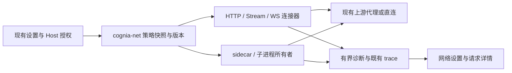
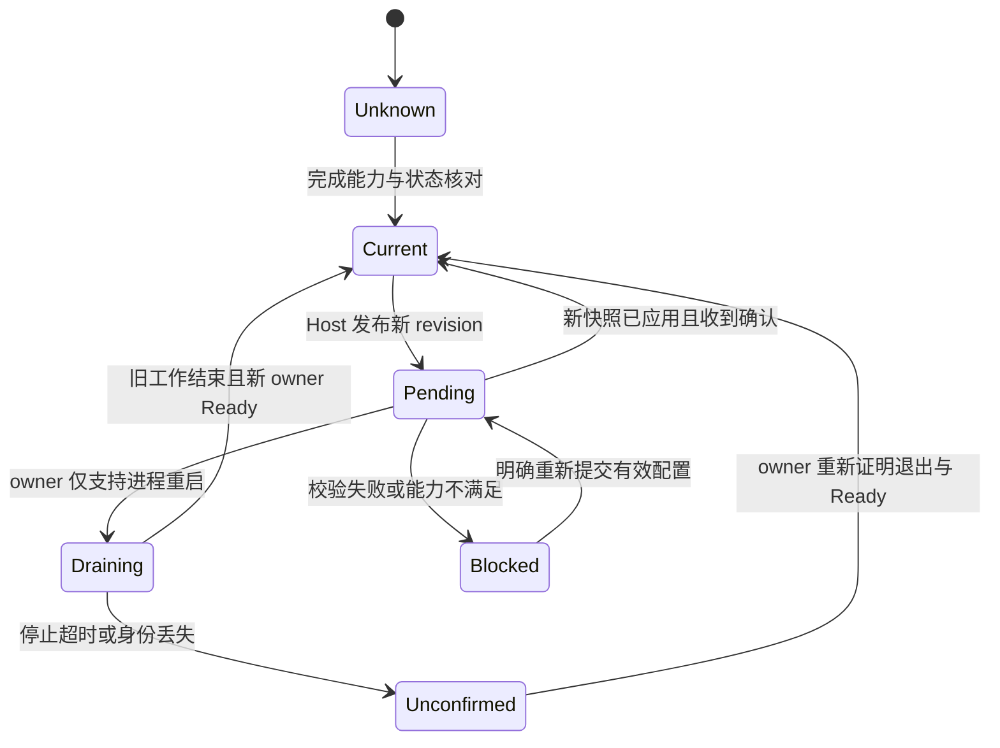
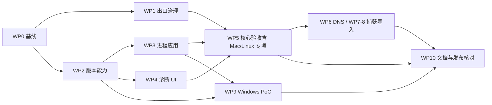

# Cognia 跨平台网络出口、代理诊断与可选外部适配：完整实施计划

| 项目         | 内容                                                                                                                                                                                              |
| ------------ | ------------------------------------------------------------------------------------------------------------------------------------------------------------------------------------------------- |
| 状态         | 部分实施（2026-11-15）：WP1 完成，WP2/WP3/WP4 按 §0 的收窄范围实施；其余工作包按 §0 记录为暂缓或不做                                                                                              |
| 日期 / 作者  | 2026-11-14，Asia/Shanghai；Codex                                                                                                                                                                  |
| 修订         | 2026-11-15：补充 macOS/Linux/移动端专项与平台候选；原事实/审计基线保留为 2026-11-14                                                                                                               |
| 平台核查基点 | 2026-11-15，HEAD 45b57790de7f6c1192d444a66c596d35e6a60b52；仅核对本次涉及的源文件，未重做全仓审计                                                                                                 |
| 深度         | Heavy：共享 TypeScript 契约、Rust/Tauri、sidecar、UI、隐私、跨平台与外部进程                                                                                                                      |
| 推荐路线     | 保留 Cognia 网络层；先补出口治理、生效状态和诊断，补齐 macOS/Linux 专项，再按门槛扩展 DNS/捕获与外部适配                                                                                          |
| 源码基点     | 当前工作树 HEAD `33ca2bcd5f1102deb21a5031a8ab793eda5335d0`；存在并发改动，实施前重新核对符号与差异                                                                                                |
| 分析依据     | [集成评估](../research/2026-11-14-proxylane-integration-assessment.md)                                                                                                                            |
| 相关文档     | [沙箱出口设计](2026-10-17-sandbox-egress-enforcement-design.md)、ADR-0028/0118/0182/0196；ADR-0250 仍为 Proposed，只作为方向背景                                                                  |
| 责任角色     | Network：native 策略；Runtime：sidecar/进程；Frontend：UI/TS adapter；Privacy：捕获与数据；QA：跨层验收；Windows：外部工具适配；Mac：macOS 受管进程/NE 可行性；Linux：namespace/bridge 与平台验收 |
| 时间口径     | 角色代表责任边界，不假设已有对应人员；工作日为低置信规划估算，非排期承诺                                                                                                                          |
| 外部影响     | 本次不安装、运行、打包 ProxyLane，不注入进程、不安装 CA、不发布文档、不新增真实模型调用                                                                                                           |

## 0. 2026-11-15 实施复核：哪些采纳、哪些收窄、哪些不做

对照当前源码逐项核对后的结论。下文 §1–§19 保留为原始提案；与本节冲突处以本节为准。

### 0.1 已实施

| 工作包 | 实际交付                                                                                                                                                                                                                                                                                                                                                                                       | 位置                                                                                                                         |
| ------ | ---------------------------------------------------------------------------------------------------------------------------------------------------------------------------------------------------------------------------------------------------------------------------------------------------------------------------------------------------------------------------------------------- | ---------------------------------------------------------------------------------------------------------------------------- |
| WP1    | 19 处发现（不是 18 处，`keyless-credentials.ts` 是新增的）逐项处置：6 处是门禁误报，1 处是代码问题，其余为有依据的窄例外。门禁本身有两个缺陷：Rust 文件沿用 TS 的字符串清空器，`'static` 生命周期被当成字符串开头，一直清空到下一个撇号——既造成误报，也**隐藏了 2 处真实出口**；`#[cfg(test)]` 只识别内联 `mod`，不识别测试函数。另外，TS 中注入的 `fetch` 参数/局部变量被误判为全局 `fetch`。 | `scripts/gates/check-network-egress.mjs`（Rust 词法器、`#[cfg(test)]` 项、TS 绑定解析）、allowlist 新增 `pinned-public` 理由 |
| WP1    | `qq_upload` 为了携带请求而 `reqwest::Client::new()`，实际发送用的是 `send_pinned_public_upload` 内部按策略构建的客户端；改为直接传入已构建的 `Request`。                                                                                                                                                                                                                                       | `crates/cognia-net/src/guarded_http.rs`、`crates/cognia-connectors/src/qq_upload.rs`                                         |
| WP2    | 策略 revision：同一把锁里保存状态与 revision；只有状态真正变化才推进（凭据变化也推进，但 revision 不含凭据）；对外是 `<host epoch>-<n>` 不透明字符串。`proxy_get_active` 增加 `revision` 与 `applications`。                                                                                                                                                                                   | `crates/cognia-net/src/proxy_config/mod.rs`、`src-tauri/src/proxy_config/commands.rs`                                        |
| WP3    | 进程所有者登记（RAII `OwnerRegistration`）；sidecar 以启动时读取的 revision 登记。`proxy_apply` 发布后在后台：sidecar 没有进行中的任务（含已接纳未投递的发送、未结束的后台进程）则停止，下次请求按当前策略启动；否则保留并标为 `restart-pending`。空闲检查与代际隔离在激活待处理运行的同一把 `stdin` 锁下完成。                                                                                | `crates/cognia-net/src/proxy_config/application.rs`、`crates/cognia-sidecar/src/supervisor.rs`                               |
| WP4    | 设置 → 网络 → 通用 顶部显示策略状态与 Agent 运行时是否仍在旧策略上；忙碌时提供需确认的显式重启（复用既有 `claude_restart_sidecar`）。双语 i18n。                                                                                                                                                                                                                                               | `components/settings/network/proxy-application-status.tsx`                                                                   |
| 清理   | 删除仅被自身测试引用的渲染端路由推导：`getCurrentProxyUrl`/`isProxyEnabled`/`getProxyConfig`/`shouldBypassProxy`/`formatProxiedUrl`、无调用方的盲重试 `createRetryableProxyFetch`/`retryableProxyFetch`（与“不隐式重放业务请求”相悖）、`buildProxyUrl`/`proxyEnvVars`/`formatProxyAuthority`、`stores/system` 旧桶与 `useProxyStore`/`getActiveProxyUrl` 旧投影。                              | `lib/network/`、`stores/network-proxy/`                                                                                      |

### 0.2 相对原提案的收窄与修正

- **不在下一次发送时重启 sidecar（原 §6 “fence 新准入”）。** 渲染端收到旧进程的 `sidecar_exited` 会把所有 streaming 会话判为失败（`hooks/chat/claude-chat-events.ts`），在发送路径上替换进程会让触发它的那一轮直接失败。改为在 `proxy_apply` 之后（后台执行，不拖慢保存）、且仅在没有进行中的任务时停止；两轮之间保持打开的会话不算忙碌，与其他配置重启一致；忙碌时保留并显式提示。忙碌结束后不自动重试——那一刻用户的下一条/排队消息可能正好在发出，同样会撞上 `sidecar_exited`。
- **不做 `proxy_apply_v2`、CAS、requestId 幂等缓存（原 §5.2）。** 唯一写入方是主窗口的设置保存，`proxy_apply` 已由 `APPLY_LOCK` 串行化，渲染端也按 payload 去重；没有多写者冲突的证据。revision 已能回答“这是哪一版策略”。出现多写者（如远端 Host 管理）时再引入。
- **不做 4096 条的请求诊断缓冲（原 §7）。** 没有消费方和故障证据；先交付“策略在哪里生效”这一个确有缺口的事实。逐请求阶段诊断应在现有 trace 上按具体排障需求再加。
- **`task_lease` 的 `.no_proxy()` 保留为 `pinned-public` 例外**，并记录残余风险：强制正向代理环境下远端任务会失败关闭，而不是直连未校验地址。要支持需要可流式的 checked-IP 隧道，`pinned_http` 目前只有缓冲实现。

### 0.3 暂缓或不做（需要新的证据才重开）

| 工作包            | 结论 | 理由                                                                                                                  |
| ----------------- | ---- | --------------------------------------------------------------------------------------------------------------------- |
| WP6 DoH           | 暂缓 | 原文进入条件（故障证据）未满足；已有 socks5h、checked-IP 与 MCP guard 的解析位置未见故障报告                          |
| WP7/WP8 捕获/导入 | 暂缓 | 无明确排障场景与留存/访问主体；已有 model-request shadow 与 eval 加密 fixture 足以覆盖回放                            |
| WP9 ProxyLane     | 不做 | 原文前提（某个第三方工具无法用显式代理/env/launcher 覆盖）没有任何具体实例                                            |
| WP11–WP13 平台    | 暂缓 | Seatbelt launcher 产品化、NE 可行性需要具体受管 CLI 需求与 Apple 分发评估，不属于本轮缺陷修复                         |
| 其他进程所有者    | 待办 | 插件 Node 运行时、jobs 也在启动时固化 `child_network_env()`，目前只登记了 sidecar；登记它们需先确定各自的安全替换时机 |

### 0.4 验证与残余

- 通过：`node --test scripts/gates/check-network-egress.test.mjs`（30）；`pnpm audit:network-egress`（101 处、72 条例外全部对应）；`cargo test -p cognia-net --lib` 新增 6 项、`cargo test -p cognia-sidecar --lib` 新增 5 项（全套 132 项通过）；相关 5 个 Jest 套件；`pnpm lint:i18n`；改动文件 eslint/prettier。
- 未能运行：`cargo test -p cognia-next --lib proxy_config`——当前共享工作树里 `cognia-automation` 的他人未提交改动导致桌面 crate 无法编译；`src-tauri` 改动仅经阅读审查。真实桌面 smoke（保存代理后观察 sidecar 替换与设置页状态）未做。
- 既有隐患（本次未改）：`note_exit` 清空 `child`/`stdin`/登记时不核对进程代际；若旧进程的 reader 在新进程发布后才读到 EOF（例如残留后代仍占着 stdout 管道），会把新进程的槽位清掉。`restart_sidecar_for_config` 早已如此，本次的空闲替换只在用户改代理时触发一次，且 stop 会等待进程组退出，触发窗口很小。
- 既有失败（与本次无关）：`cognia-net` 的 `oauth_exchange_refuses_every_redirect_without_contacting_target`（`http_client::admit_host` 的共享 127.0.0.1 限流在并行测试下触发）；`cognia-sidecar` 的 `langfuse::legacy_host_secret_cannot_be_bound_to_a_renderer_destination`。

## 1. 先交付 Cognia 自身可验证的代理闭环

实施主线为：**出口清单与缺陷修复 → 策略版本与能力契约 → 长活进程生效管理 → 请求诊断与 UI → 跨平台发布验收**。macOS/Linux 专项纳入核心；可选分支为 DNS/DoH、加密捕获/离线导入、各平台外部捕获及 Windows ProxyLane PoC；这些分支分别设进入条件，不成为核心修复的依赖。

用户应能回答四个问题：这次请求由哪个 Host 和 transport 发出；使用哪一版代理策略；失败发生在哪一阶段；修改配置后哪些连接/进程仍保留旧策略。进程启动成功、设置保存成功和端到端出口验证是不同事实。

不新增另一套全局网络管理器、日志数据库或模型事件总线。复用 `cognia-net`、现有 Tauri/Companion 入口、sidecar supervisor、network 设置页、trace 和 eval 资产。ProxyLane 不替代沙箱、CSP/CORS、PII gate 或操作授权。

## 2. 现状与未知项必须分开

| 事实 / 判断                                                                     | 证据状态                                                          | 本计划处理                                                   |
| ------------------------------------------------------------------------------- | ----------------------------------------------------------------- | ------------------------------------------------------------ |
| 已有 Off/Manual/Auto、HTTP/HTTPS/SOCKS5、bypass、keyring、Uninitialized/Blocked | 已确认：`proxy_config/mod.rs`、`commands.rs`                      | 延伸既有契约，保持现有默认值                                 |
| 已有 buffered HTTP、ACK 背压 streaming、WS 隧道与 native 命令注册               | 已确认：`lib/network/`、`src-tauri/src/proxy_config/`             | 复用入口，不用 Hook 替代                                     |
| native 新请求读取策略；sidecar 启动时注入代理，fetch interceptor 安装一次       | 已确认：`managed_client`、`supervisor.rs`、`fetch-interceptor.ts` | 定义每种 transport 的版本应用方式                            |
| 所有活跃 sidecar 在设置变化后都错误或都正确                                     | 未确认                                                            | WP0/WP3 做运行时实验，禁止由局部源码泛化                     |
| 当前网络出口门禁仍报告 18 处、涉及 15 个文件                                    | 本轮重新运行已确认，exit 1                                        | 每处记录修复/窄例外/进一步验证，不能直接当作 18 个泄漏       |
| 所有推理调用都走同一个 fetch                                                    | 不成立的概括                                                      | 主聊天 Host、feature factory、SIWC、Twin、外部协议分别入清单 |
| ProxyLane 自动化启动与 Hook exports 存在                                        | 上游源码已确认                                                    | 仅证明 PoC 接入点存在，不证明稳定 SDK/实机兼容               |
| 性能收益、Windows 注入覆盖、DoH 收益                                            | 未确认                                                            | 先固定实验和预算，再测量；不预写提升百分比                   |

上一轮 7 套件、131 项 Jest 通过是既有分析证据，本轮只重新运行出口审计；没有把历史测试结果写成本轮重跑。

## 3. 目标直接对应验收编号

| 目标                  | 交付行为                                                           | 对应验收 |
| --------------------- | ------------------------------------------------------------------ | -------- |
| G1 出口归属明确       | 核心调用链及全部门禁发现有 owner、transport、策略来源和例外依据    | A01–A03  |
| G2 配置生效可验证     | 每 Host 的策略有版本；请求固定快照；长活进程报告 pending/旧代/未知 | A04–A09  |
| G3 诊断可解释且不泄密 | 有界元数据包含阶段、路由证据和错误；未知耗时不伪造为 0             | A10–A14  |
| G4 保留平台与安全边界 | browser/mobile/pinned/内网模型/沙箱使用明确能力；无静默安全降级    | A15–A18  |
| G5 DNS 可演进         | 首先标明已有解析模式；可选 DoH 保留目标校验、IP 固定和失败语义     | A19–A22  |
| G6 捕获按隐私契约工作 | 独立 opt-in、脱敏、加密、配额、删除；与模型回放区分                | A23–A25  |
| G7 外部适配不夸大覆盖 | 各平台受管进程/外部实验证明作用范围和所有权，失败可终止实验分支    | A26–A37  |

核心发布必须通过 G1–G4，以及 macOS/Linux 专项的 A30–A31、A34、A36–A37。A32/A33/A35 仅对应选定的平台实验。G5 的现状标识属于核心；其 DoH 扩展，以及 G6/G7 的新能力分别按已选分支验收。没有开启的分支明确显示未交付，不以核心发布代替。

本计划不实现系统级 VPN/TUN、内核防火墙、任意进程强制出口、通用 HTTP/3/WebTransport 栈、默认 MITM、默认正文抓包、自动上传流量分析、默认 SSH/多跳代理或跨用户共享代理凭据。它们不属于当前需求的必需解法。

## 4. 路由只有一个权威，诊断沿用既有数据通路

图中新增的是状态与诊断，不是第二条绕过授权的网络出口。



| 责任                       | 扩展位置                                                                              | 实际消费者 / 接线                                                  |
| -------------------------- | ------------------------------------------------------------------------------------- | ------------------------------------------------------------------ |
| 代理策略、版本、路由与能力 | `crates/cognia-net/src/proxy_config/`、`guarded_http.rs`、`pinned_http.rs`            | native HTTP/WS、服务端初始化、sidecar spawn                        |
| 共享契约                   | `packages/plugin-contract/src/types/network/proxy.ts`，必要的现有 sidecar wire        | `types/network/proxy.ts` 继续 re-export；生成/一致性检查按现有方式 |
| 桌面命令与 stream 观察     | `src-tauri/src/proxy_config/{commands,stream}.rs`                                     | `src-tauri/src/lib.rs` 注册、ACL、TS invoke                        |
| 长活进程应用               | `crates/cognia-sidecar/src/supervisor.rs`、现有 external-agent/launcher owner         | 使用现有 restart/stop/ready 生命周期，禁止独立旁路 supervisor      |
| Node/Bun 请求              | `sidecar/src/platform/net/{fetch-interceptor,egress-guard}.ts`                        | agent-host 引导、provider/MCP/OAuth dispatcher                     |
| 状态投影与 UI              | `stores/network-proxy/`、`lib/network/`、`components/settings/network/`               | main window/实际 Host；现有 General/Detection/Test/IP 与请求详情   |
| 观测与捕获                 | `packages/agent-trace/`、现有日志/trace、`lib/ai/replay/`、`cli/src/eval/replay/`     | 不新增平行模型事件流；正文用加密资产引用                           |
| 出口门禁与验收             | `scripts/gates/check-network-egress.mjs`、co-located tests、Playwright/native fixture | CI 与本地同入口，另做真实网络/设备验收                             |

首批不增加新 crate。纯状态逻辑放在现有 `proxy_config`；若拆分文件，是为了隔离版本状态、诊断缓冲或 resolver 的独立职责，并在对应 PR 说明为何不能继续扩展原文件。新增网络 E2E fixture 的理由是现有 UI mock 不能证明实际出口，不能以截图测试代替。

## 5. 策略版本和能力采用兼容的增量契约

以下字段与命令名是拟议契约，尚未实现；WP2 固化类型、序列化和错误枚举后，后续包依赖该版本。

### 5.1 同一 Host 内发布一份不含歧义的快照

- native authority 持有 `hostEpoch` 与递增 revision。对外 revision 是 opaque string，避免 JS number 精度和跨重启比较错误。
- revision 不是凭据 hash，不包含 username/password。凭据版本变化必须使 revision 变化，但凭据内容不进入 IPC、metric 或日志。
- 一个请求在 admission/连接建立前捕获完整不可变快照；route、DNS、安全校验和诊断用同一快照，不分别读取“最新”配置。
- 保留 `current()` 等旧入口的兼容 facade；受管入口迁移到快照读取，不能让 facade 悄悄跳过初始化/Blocked。
- credential hydration 在可 await 的阶段完成；发布锁只提交内存状态、revision 和通知，不持有 `parking_lot` guard 跨 await。
- 配置与 process.env 无法成为跨进程事务。受管 spawn 必须使用明确的快照/env；ambient env 只是兼容镜像，不作为完成证据。
- 完全相同的有效配置和凭据重复 apply 不推进 revision；重复失败状态也不造成无界事件。旧命令仍可修改策略，但必须进入同一串行发布入口。
- 配置无效或 keyring 不可读时继续进入 Blocked，阻止新受管请求和新业务准入；不保留“偷偷使用旧配置”的 fallback。

### 5.2 保留旧命令，严格语义通过新能力协商

| 接口                  | 计划变化                                                               | 兼容规则                                                        |
| --------------------- | ---------------------------------------------------------------------- | --------------------------------------------------------------- |
| `proxy_apply`         | 返回形状继续为旧协议；内部进入同一 authority                           | 旧客户端仍可用，不承诺 CAS 或全局迁移                           |
| `proxy_get_active`    | 增加可选 revision、capability、application summary                     | 旧字段保留；缺字段表示 unknown，不默认全支持                    |
| 拟议 `proxy_apply_v2` | 输入 requestId、expectedRevision、配置、applyMode；返回 object receipt | 仅在 `policyApplyVersion: 2` 时调用；旧 Host 不忽略严格选项     |
| 应用状态查询/订阅     | 复用既有 Host RPC/event 体系；若新增命令，按注册/ACL/生成清单完整接线  | 快照 + 单调 cursor；丢事件后重取，不能只信 renderer-local event |

`applyMode` 首版只定义 `new-work` 与 `stop-and-apply`。后者是用户/管理员明确选择的动作，沿现有取消链停止当前受管工作，再报告停止确认；不把网络设置页一次普通保存变成隐式强杀。

v2 receipt 包含 requestId、hostEpoch、revision、runtimeState、applicationStatus 和有权限可见的 pending owner 摘要。它不返回 ProxyConfig 的 native credential URL。expectedRevision 不符返回 `policy_conflict`，刷新后由用户重新提交，不自动覆盖。

同一 requestId 在 Host 生命周期内按有界缓存去重，建议保留最近 256 条/10 分钟。payload 不同但 requestId 相同返回冲突；超过幂等窗口的客户端必须重新查询，不假设旧请求没生效。跨 Host 重启的请求只能重新核对状态。

### 5.3 能力按 transport 声明，不用一个布尔值覆盖全部

每个 transport 的声明至少包括 protocol、streaming、WebSocket、DNS 模式、private-target enforcement、更新方式、捕获级别和证据时间。更新方式枚举为 `per-request`、`reconnect`、`process-restart`、`external`、`unknown`。

新能力缺失时只禁用依赖该能力的新动作；已有基础代理保持既有契约。涉及 required DNS、安全策略或严格生命周期的请求缺能力必须拒绝，不能降级为普通 fetch。TS/Rust 同名字段、单位、unknown 语义必须有一致性 fixture。

不新增 per-session 代理设置。当前 Host 全局策略与控制窗口/管理员权限保持原归属；多用户诊断只允许查看已有授权范围内的记录，不能由任一 session 修改全 Host 路由。

### 5.4 错误和超时不能引发隐式重放

新增错误复用现有 typed ProxyError 形状，TS/Rust 在同一契约版本中枚举；下列小写 code 是拟议 wire 名，旧接口保留其已有错误兼容映射。

| code                             | 含义                                                 | 恢复方式                                      |
| -------------------------------- | ---------------------------------------------------- | --------------------------------------------- |
| policy_conflict                  | expectedRevision 已过期或相同 requestId 对应不同输入 | 重新读取状态后显式提交；不自动覆盖            |
| capability_required              | 对方不能表达本次严格策略                             | 升级对方或明确退出可选能力，不自动降级        |
| policy_pending                   | owner 仍在 drain/restart，尚不能接受新业务           | 订阅/查询状态，可由用户取消排队               |
| owner_stop_unconfirmed           | 停止超时或身份无法验证                               | 禁止释放所有权/裸启动；检查实际进程后恢复     |
| resolver_failed                  | 解析失败、证书/响应不合法或耗尽总预算                | 返回原错误域，不本地 DNS fallback             |
| capture_rejected / capture_limit | 脱敏、加密、配额或访问校验失败                       | 停止捕获并报告；不保存原文、不改变合法转发    |
| import_invalid                   | 目录/格式/大小/版本不满足                            | 清理本次未提交资产；不修改用户输入            |
| external_adapter_unverified      | 只确认启动，不能证明接管范围                         | 展示 launched-unverified；不返回 proxied 成功 |

配置命令的客户端等待候选预算为 10 秒；超时/断开不证明 Host 没有提交。客户端保留原 requestId，通过状态/receipt 查询恢复，不用新 ID 自动再提交。发布完成后取消 UI 等待不能撤销已发布策略，回退必须是新的显式 apply。业务请求不因诊断、策略通知或探针失败自动重放；网络 retry 继续遵循原调用方的幂等与预算。

## 6. 配置应用以请求和进程生命周期为准

策略已发布和所有旧业务已结束分开报告，避免用一个 applied 状态隐藏旧代流量。



| 场景                           | 首版规则                                                    | 必须展示 / 验证                                        |
| ------------------------------ | ----------------------------------------------------------- | ------------------------------------------------------ |
| 新 native HTTP 请求            | 使用新 revision；旧 client 不被误复用                       | 请求与 route 绑定同一 revision                         |
| 已有 SSE/WS/下载               | 不透明迁移；原连接保持其快照直到结束                        | 旧 revision、连接仍活跃；重连使用当前配置              |
| idle sidecar                   | fence 新准入，用现有配置重启入口启动新代                    | 原进程退出与新 Ready 后才 current                      |
| busy sidecar                   | 默认 drain：拒绝该旧代新的业务准入；已有 run 允许按原代完成 | run 内黑盒后续请求也可能用旧代，不能声称逐请求已切换   |
| 用户选择 stop-and-apply        | 现有取消、退出确认、重启；停止超时为 unconfirmed            | 未确认停止时不启动替代业务、不展示全部生效             |
| embedded browser               | 沿现有重建/re-navigation 行为扩展状态                       | capability 与旧页面/后台复用状态                       |
| sandbox network-off / 权限撤销 | 独立遵从现有强制策略；需停止时使用其所有者                  | 代理 Off 表示直连，与 sandbox network-off 禁网严格区分 |
| Host 重启 / 远端断开           | 新 epoch，旧应用状态 unknown；重新协商                      | 不能由旧 UI 缓存复活“已生效”                           |
| 多次快速保存                   | 最新有效 revision 为新准入目标；不重启每个中间版本          | 重启中再次变更要重核快照与身份，旧 Ready 不确认新代    |

设置无效导致 Blocked 时，新受管请求拒绝；既存连接是否结束按其既有授权和显式停止动作处理并明确显示，不能声称 Blocked 已使所有 socket 消失。安全权限撤销则走已有撤销/取消链，不受普通 drain 宽限覆盖。

sidecar 在 idle 判断、fence、重启与新准入之间必须有同一 owner 的原子状态转换；不能先检查 idle 再异步重启而让另一个 send 插入。重启合并目标为 latest revision，自动配置重启与异常崩溃预算分开；失败不转直连、不无限重试。每个 generation 的任务、channel 与 dispatcher 由原 owner await teardown。

## 7. 诊断先采元数据，并明确证据强度

核心诊断不发送额外网络请求，也不采集 request/response body。

| 字段组 | 拟议内容                                                                      | 边界                                                          |
| ------ | ----------------------------------------------------------------------------- | ------------------------------------------------------------- |
| 归属   | opaque requestId、hostEpoch、revision、现有 trace/run/session 引用、transport | server 以认证上下文核对归属；客户端填写的 ID 不能扩大可见范围 |
| 路由   | direct/proxy/blocked/unknown、bypass reason、经过清理的 endpoint、DNS 模式    | endpoint 只保留必要 host/port；无 userinfo/query/凭据         |
| 证据   | planned / connector-established / probe-observed / unknown                    | 连接到代理只证明连接器；探针出口 IP 只证明该探针              |
| 阶段   | admission、resolve、proxy-connect、TLS、headers、body、close                  | backend 无法测量则省略或 unknown，不填 0                      |
| 终态   | completed / cancelled / failed / truncated / unconfirmed，errorCode           | 已有流式错误与取消语义不改变                                  |
| 计量   | durationMs、bytesIn/Out、观察时间                                             | 单位明确；不用系统网卡字节冒充某个 session 的消耗             |

诊断记录使用现有 trace/日志所有权，内存投影仅作有界最近记录。建议初版 cap 为 4096 条，每条不超过 2 KiB，整套内存诊断预算不超过 16 MiB；15 分钟失效，磁盘持续记录默认关闭。超额时丢弃/聚合低优先级诊断并累计 dropped count，不等待 UI、不拖慢代理和 stream ACK。安全审计/配置状态与高频 request telemetry 分开预算。

metric 仅使用固定 transport/stage/result/errorCode 标签；run/session/URL/域名不用作全局无界 time-series 标签。详情以有权限的 trace 引用查询。事件幂等 key 为 requestId+generation+sequence，乱序/重复投递不重复记账；订阅断开后用快照恢复。

复用现有 General/Detection/Test/IP 页，补充生效范围、待重启 owner、请求阶段和失败建议；远端显示实际执行 Host。loading/empty/blocked/unsupported/stale/offline/stop-unconfirmed 均有状态，操作保持键盘可达与焦点反馈。所有新文案/ARIA 使用 split en/zh-CN i18n，不新增 Next.js server route。

## 8. DNS 先解释现有行为，再选择性增加 DoH

### 8.1 核心交付只增加可解释的 resolver 契约

现有 system lookup、socks5h、checked-IP tunnel 和 MCP guarded dispatcher 全部入清单。每个入口声明“谁解析、谁校验、最终连接是否固定 IP、是否允许私网”，并通过受控 fixture 验证。不能为了统一显示把 public-only 与本地模型的合法私网访问合并。

特别核查 MCP 的自定义 Undici Agent 与进程代理 dispatcher 的组合。用代理命中计数、socket peer、DNS 调用计数证明实际 route，避免仅断言 setGlobalDispatcher 被调用。

### 8.2 DoH 分支的进入条件和完整行为

进入条件：核心里程碑通过；至少有受控 fixture 或真实用户复现证明现有解析是故障来源；评审选择启用 WP6。没有需求证据时，明确关闭此分支，保留解析模式诊断。

实施时在 `cognia-net` 现有解析/连接路径增加 opt-in DoH，不增加独立本地 DNS 服务，不重写应用自有 DoH/DoT，不接管 UDP/53。第一版只承诺 A/AAAA，不暗示通用 DNS relay。

- HTTPS URL、bootstrap IP、端口/长度必须在 Host 边界校验；不接受 userinfo/fragment。resolver 基础设施只能由有权修改 Host 网络策略的主体指定，不能从模型参数导入；私网 bootstrap 需要明确的既有私网访问授权，也不因此放行业务私网目标。默认不跟随重定向，证书按服务域名验证，不为 bootstrap 关闭 TLS 校验。
- 业务 DoH 与后续业务连接使用同一已选代理快照；proxy endpoint bootstrap 是独立步骤，显示其解析策略。直连/bypass/internal 请求保持明确的原策略。
- public-only 请求对 DoH 全部地址做 private/reserved 检查，再通过 checked-IP tunnel 建连；不把域名交代理二次解析。代理不支持 IP CONNECT 则拒绝。
- DoH 失败返回明确错误，不能落回系统 DNS 或其他路由。无答案/错误按响应区分，不伪造为网络成功。
- cache key 包含 Host epoch、授权域、代理 revision、resolver 配置、qname/qtype；A/AAAA、不同账户/授权域不串用。TTL 只缩短，建议上限 3600 秒；0 不缓存；无效/截断/错误响应不缓存。
- singleflight 的 waiter 可独立取消；最后一个 waiter 退出后取消共享操作。整体 deadline 包含排队、代理、TLS 与读取，不因重试重新开始计时。
- 初始候选限额：最多 32 个进行中查询、128 个 waiter、1024 cache 条目和 8 MiB 双重上限；单响应 64 KiB、总 deadline 15 秒。WP6 开发前冻结参数并用失败/负载实验校验，不能测后放宽门槛。
- 单个 bootstrap 失败可以在同一总预算内换 IP；没有向其他 provider、resolver 或直连路径的隐式 retry。

DoH 首版明确采用当前 Host 运行期 opt-in，由 v2 apply 的可选 runtimeResolver 输入提供，不写入旧 networkProxy JSON。作用范围是当前 Host、命中该配置的受管请求；不是会话私有代理。UI 明确提示重启后实验结束、需重新开启，不承诺跨重启强制 DoH。这样不需要为一个诊断分支迁移持久配置权威，也避免旧客户端覆盖未知字段。退出当前实验必须通过明确的 v2 操作并产生新 revision，不能由解析失败触发。

运行期 resolver 生效期间，无法表达 requiredResolverVersion 的旧 apply 写入返回 capability_required，不能清除当前 resolver；Host 重启后该运行期策略结束。旧 Host 不理解该能力时，新客户端拒绝启用。若后续要求跨重启的强制 DoH，需要另行设计 Host 持久策略权威、全部写入口和降级限制；仅给 renderer JSON 加字段不能提供该保证，本计划不把它当作已解决的兼容性。

## 9. 捕获和离线导入按独立隐私分支交付

进入条件：核心元数据诊断可用；明确排障/回放场景、访问主体和留存策略；WP7 完成隐私评审。通用原始网络抓包与安装 CA 不在此分支。

### 9.1 受限语义捕获复用现有 eval 资产

- 普通请求持续只记元数据。用户显式选择一次捕获会话和 scope，默认不跨 run、workspace 或账户继续。
- 只支持有明确 schema 的模型请求/响应语义；二进制、multipart、未知压缩和未知协议默认只给元数据。不得为抓正文把 SSE 缓冲为完整响应。
- 丢弃 Authorization、Proxy-Authorization、Cookie、Set-Cookie、API key、敏感 URL 参数、env 等；对输入和输出都做 PII/secret 扫描。扫描失败停止捕获并显示原因，不能保存原文等待后处理。
- payload 在进入持久层前加密，沿现有 eval crypto/asset store；trace 仅保存 digest/reference。现有调用前 PII gate 仍独立执行，捕获失败不能替代或绕过它。
- 候选 quota：每方向最多 1 MiB、每捕获会话总量 64 MiB（含索引、密文和元数据）、最多 15 分钟；全 Host 叠加既有存储配额。超限停止新捕获并标注 truncated，合法转发继续。
- 默认留存 24 小时，允许用户提前删除；沿既有资产 owner 完成索引和密文删除。登出/账号切换停止捕获并清除内存明文；未解锁密钥时拒绝读取。
- 记录摘要不足以保证确定性回放；只有符合 ADR-0118 的请求 digest、actor/tape 和完整行为才标记 runtime replay。HTTP 离线查看不能写成重放请求。

### 9.2 ProxyLane 录制导入必须有受限解析

此项是 WP8，可在 WP7 后独立选择；不影响核心和 Windows launcher。

输入是用户选择的录制目录，Host 验证真实路径归属、symlink/reparse point、相对路径和文件数量/大小。首版候选限制为 1000 个文件、总读取 64 MiB、单 metadata 文件 1 MiB；拒绝路径逃逸和绝对 payload 引用。流式解析，超预算显式失败，不加载任意 HTML/脚本/压缩包。

转换后仍进入 WP7 的脱敏、加密和 scope。默认导入元数据，原始 body 单独选择；不会自动送给任何模型。即便用户另行要求模型分析，也必须先走既有 outbound PII gate。未知格式版本/不完整记录保留 unknown/truncated，不补造缺失请求；失败清除本次尚未提交的资产，原始输入不修改。

## 10. 平台专属路径分别交付，ProxyLane 只用于 Windows PoC

进入条件：有一个可复现的第三方工具场景，证明现有显式代理/env/launcher 无法覆盖；该工具本身在当前授权和网络策略下允许运行。WP0 要先做这个对照，不能为验证 Hook 而改变 network-off/allowlist。

PoC 固定源代码/发布包版本和架构，用户自备安装，不默认下载、自启、注入 Cognia 或安装 CA。只从现有 process owner 启动经过确认的可执行路径；argv 数组传参，验证 profile 名、工作目录和目标 executable，避免 shell 拼接。凭据不放在 argv，不从 Cognia keyring 导出到 ProxyLane INI/分享码。

上游 `--auto --profile ... --run ...` 可能把请求转给已有实例。PoC 必须证明实际 broker、profile 与子进程归属；不能从 launcher 退出码推断进程已接管，也不能停止用户原先的 ProxyLane/浏览器实例。优先使用独立、可确认所有权的 portable 测试目录与测试 profile；正式 profile 不自动复制秘密。

| 状态                      | 判断依据                               | UI / 后续动作                        |
| ------------------------- | -------------------------------------- | ------------------------------------ |
| unavailable / unsupported | 平台、架构、版本、权限或入口不满足     | 明确拒绝，不转成裸启动               |
| launched-unverified       | 仅确认启动或命令转发成功               | 说明尚未验证代理；不显示全流量已接管 |
| verified-scope            | 固定目标、进程身份和受控出口探针均通过 | 仅描述此次已验证范围与时间           |
| failed / stop-unconfirmed | 启动、握手、归属、探针、停止任一项失败 | 停止新业务；保留精确原因和可恢复操作 |

为避免双层代理，在受控外部进程范围选择一个路由 owner。选择 ProxyLane 的模式时只为这次受管启动准备明确 env，不全局关闭 Cognia 代理；如果已有 broker 无法保证该 env/profile 隔离，拒绝自动适配。PRC 端口不是普通 HTTP/SOCKS5 服务，不能加入 Cognia 自动检测列表冒充可用代理。

最低 PoC 矩阵：

- Windows x64：新启动/子进程、Unicode/空格参数、进程退出、取消、异常、已运行实例转发。
- Windows ARM64：单独实机验收，不能用交叉编译或 x64 仿真代替；浏览器专用 QUIC 策略缺失如实标注。
- 代理 A→B 双层链检测、本地代理回环、DNS/IPv6/UDP、已有连接、浏览器后台复用。
- 独立探针验证选定出口，断代理时行为、配置切换后的新/旧连接、Cognia/ProxyLane 任一方崩溃。
- 停止仅影响有所有权证明的进程树；共享外部实例不被误杀；原配置和 CA 信任不被自动修改。

PoC 出口：若无法稳定证明子进程身份、broker 隔离、取消/退出和路由作用范围，则关闭自动适配分支，交付明确结论和手动排障指南。这是有效的实验结论，不交付显示“已代理”的半成品。只有矩阵通过后，才单独评审正式插件/能力、签名、依赖许可证、升级与供应链；本计划不直接承诺整包内嵌。

### 10.1 跨平台范围：macOS 与 Linux 是专项交付，外部工具按用途选择

2026-11-15 补充：原计划对跨平台核心有覆盖，但独立展开的外部工具实验只有 Windows，macOS 与 Linux 的实施路径不够具体。以下区分“Cognia 自有请求”“受管进程的出口限制”和“第三方应用透明捕获”，不要求三者使用相同底层技术。

| 平台 / 场景                   | 推荐路线                                                   | 现有基础 / 候选                              | 首版边界                                                                           |
| ----------------------------- | ---------------------------------------------------------- | -------------------------------------------- | ---------------------------------------------------------------------------------- |
| macOS Cognia 自有 HTTP/流/WS  | 继续既有 Rust transport、keyring、策略 revision 与诊断     | cognia-net 与 Tauri bridge                   | 不依赖 Network Extension 或全局代理变更                                            |
| macOS Cognia 新启动的受管 CLI | 复用 Seatbelt 网络启动器，产品化其能力探测、归属和退出报告 | cognia-agent-proxy-launcher、agent-proxy.mjs | 只允许明确的 loopback HTTP(S) proxy 端口；不遵从代理的程序会失败，不会被自动重定向 |
| macOS 第三方应用透明抓包      | 优先实验用户自备 mitmproxy Local Capture                   | 官方支持按进程名/PID 选择；macOS 仅出站捕获  | 捕获/证书授权、scope 和退出恢复单独确认；不默认捕获整机                            |
| macOS 第三方应用单独走代理    | Proxifier for Mac 可作为用户自备的外部候选                 | 厂商 Mac 文档说明 TCP、应用规则、SOCKS/HTTPS | 不把 TCP 宣传成 UDP/QUIC；本次未验证自动化接口或具体系统版本兼容                   |
| macOS 原生透明代理            | 后期评估 NetworkExtension App/Transparent Proxy            | Apple provider API 与部署文档                | 先做 entitlement、签名、分发与生命周期可行性结论，不直接纳入主包                   |
| Linux Cognia/Host/受管 CLI    | 既有 transport + bwrap/netns + Unix proxy bridge           | cognia-exec-sandbox 与 filtering proxy       | namespace/bridge 不可用时拒绝，不降级为仅 env                                      |
| Linux 第三方应用抓包          | 可选 mitmproxy Local Capture                               | 官方当前列出 eBPF/root/kernel 等前提         | 不为抓包把容器改成 host network，也不扩大工作负载权限                              |
| Windows                       | 保持前述 ProxyLane 外部 PoC                                | 用户自备固定版本/profile                     | 不与 native sandbox 或 Cognia 代理双重争权                                         |
| Web/iOS/Android standalone    | 使用浏览器/OS 网络环境，只报告可观测能力                   | 既有 platform adapter                        | 不承诺接管其他应用或 OS 全局代理                                                   |
| 移动/浏览器 paired Host       | 复用实际执行 Host 的策略和诊断                             | Companion/Host 路由                          | 手机看到的是远端执行范围，不是本机已强制代理                                       |

2026-11-15 核对的主要来源：[mitmproxy 模式文档](https://docs.mitmproxy.org/stable/concepts/modes/)、[macOS 捕获实现说明](https://mitmproxy.org/posts/local-capture/macos/)、[Proxifier Mac 文档](https://www.proxifier.com/docs/mac-v3/)、[Apple provider 部署](https://developer.apple.com/documentation/technotes/tn3134-network-extension-provider-deployment)、[Apple Packet Tunnel 用途边界](https://developer.apple.com/documentation/technotes/tn3120-expected-use-cases-for-network-extension-packet-tunnel-providers)。这些说明工具或 API 的存在与文档范围，不是 Cognia 集成通过证明。

### 10.2 macOS 先把已有网络启动器接进产品流程

当前源码已提供 `crates/cognia-exec-sandbox/src/bin/cognia-agent-proxy-launcher.rs`。它使用 `launcher.rs::sandbox_exec_network_proxy_prefix` 生成 Seatbelt profile：保留普通本地权限，拒绝 network，仅允许指定 localhost TCP 端口。这是网络边界，不是完整文件系统沙箱，也不会把任意 socket 自动改写为 SOCKS/HTTP 请求。

`scripts/dev/agent-proxy.mjs` 已有 loopback HTTP/HTTPS endpoint 校验、CONNECT 预检、允许/禁止端口探针和参数转发；非 darwin 明确拒绝。产品化时复用 Rust binary 和 Host process owner，不在 release 中调用 pnpm 或开发脚本。无 launcher、无 sandbox-exec、探针失败都拒绝，不能回退成“设置环境变量就算已约束”。

WP11 的核心范围：

1. 通过现有 Host launcher/external-agent 入口接线，关联 hostEpoch、policy revision、run 与 PID+启动身份；沿既有取消/退出链管理。
2. 只对当前策略可明确映射为该 loopback HTTP(S) endpoint 的情况启用。远程 SOCKS/其他 endpoint 首版报告 unsupported；若需本地 relay，必须另在现有 filtering proxy 内按原授权策略实现和验收，不能临时绕过目标检查。
3. 将“代理协议预检成功”“允许端口可连”“直连被拒绝”“应用请求实际命中代理”分别记录；只通过前两项不显示代理已验证。
4. 无视 env 的 raw TCP/UDP/自行 DNS 客户端应明确失败；这不是透明兼容能力。不得为让它成功而放开任意网络。
5. 首期仅纳入能证明沙箱继承的新启动 CLI/子进程。经 LaunchServices、驻留 GUI、共享 daemon 或用户既有实例代理执行的请求不自动视为受管进程树；无法证明就拒绝该作用范围。
6. 保留现有 LD__/DYLD__ 环境过滤，不靠放开动态注入把 proxychains 一类机制变成默认安全路径（`crates/cognia-exec-sandbox/src/env.rs:80-89`）。
7. Apple Silicon 首批实机验证；若发布支持 Intel，则 Intel 原生另测，不能以 Rosetta 或交叉编译替代。确认宿主受支持系统版本，sandbox-exec 仅作为当前已有兼容路径，不假设其未来长期可用。

### 10.3 macOS 抓包优先外部工具，原生 Network Extension 后置

mitmproxy 官方已提供 macOS Local Capture，可按进程/PID 选择；实现说明描述 Swift Network Extension 与 Rust 接收流量。它更接近 ProxyLane 的透明观察用途，值得作为跨平台诊断候选。第一轮只验证一个隔离测试进程，不拦整机；解密需要目标信任其 CA 或其他明确兼容方式，证书固定/独立信任库不通过时如实报告，不修改应用安全设置强行兼容。

外部捕获与 Cognia 自有语义诊断仍分开：不因 mitmproxy 启动成功就声称录制受到了 Cognia PII gate 保护；原始流量留在用户选择的外部 scope，只有经过 WP7/8 的脱敏/加密/权限检查才能成为 Cognia 资产。命令只指向允许的 PID/进程范围，Cognia、代理基础设施和用户其他进程不默认纳入；工具退出/授权撤回后确认流量恢复和扩展状态。

Proxifier for Mac 是另一类候选：用于将选定应用的 TCP 连接送往代理。先作为外部手动配置与互操作测试，不把它当作开源依赖，也不据厂商一般说明推断稳定 CLI、UDP/QUIC 或 Cognia 自动控制能力。二者分别服务代理兼容和抓包排障，无需绑定采购、默认安装或共用配置秘密。

若后续需要 Cognia 原生透明接管，再开展 WP13：根据 Apple 的 NetworkExtension provider 用例选择 App/Transparent Proxy，验证 entitlement、Developer ID/App Store 分发、System Extension 生命周期、用户授权、升级卸载与 VPN/企业网络工具共存。Apple 的 TN3120 对选择性截获后改经代理的情形推荐 macOS Transparent Proxy，而不是滥用 Packet Tunnel。当前能否获得适合 Cognia 产品与分发方式的能力仍未确认，不能把 API 存在当作可发布资格。

WP13 首次交付是 go/no-go 研究结论、最小签名实验和独立范围预算；不承诺把 Swift extension 直接塞入 Tauri 主包。没有分发/签名/用户授权与退出恢复证据则保持 external-only，不要求用户关闭 SIP，不放开注入过滤，不自动安装扩展或 CA。

### 10.4 Linux 与移动端保留各自真实的网络边界

WP12 优先核查既有 Linux bwrap/netns、Unix proxy bridge、握手后放行和清理路径，补齐 capability 与 revision 投影。外部进程拒绝代理 env 时应在受控 namespace 内失败，不能为兼容改成共享宿主网络；Docker 保持既有 network=none/受控 bridge。

mitmproxy Linux Local Capture 官方当前要求较新内核并加载 eBPF 的特权，且列出容器与 WSL 限制。文档核查日为 2026-11-15，实验前重新检查准确版本。它只能成为用户显式选择的诊断实验；不能为启用捕获赋予 Cognia 工作负载 root、host network 或额外 capability。用户 namespace 被禁用、无 bwrap、容器内不可捕获等情况分别报告，不合并成“Linux 全支持”。

iOS/Android/Web 的任务是保持 standalone 与 paired Host 的执行位置、请求 transport 和可观测范围准确。首版不新建 VPN/MDM 管理或系统级逐应用接管，不从桌面 NE/provider 能力推断移动支持；将操作系统已有代理/VPN 当作外部网络条件，保留 pin、权限与本机/远端证据的区别。

### 10.5 平台实验共享能力契约，不共享虚假的成功状态

既有 capability/status 增加受限枚举：`explicit-transport`、`managed-process-restriction`、`external-capture`、`transparent-app-proxy`，并记录真实 backend、OS/架构、工具版本、验证时间、scope 与 owner。限制出口、成功代理、观察到请求和 HTTPS 解密各有独立证据，不压缩成一个 `proxyEnabled`。

同一受管请求只选择一个路由 owner；外部 VPN/TUN/代理规则造成的额外物理路径显示为 external/unknown，不能被 Cognia 逻辑路由覆盖。捕获 backend 不获得更高网络权限；换 backend 时停止并确认本次有所有权的实例，权限撤回与异常退出无直连/裸启动 fallback。

## 11. 工作包、依赖和独立验收

所有包先写失败行为测试或受控复现，再改实现；测试、文档和接线与所属包一起交付。角色有唯一 owner，跨层支持角色不拥有同一文件的并发写入。

| 包                            | 唯一 owner | 依赖                                   | 具体交付与验收                                                                                                          | 回退 / 退出                                                              | 初步净工作日 |
| ----------------------------- | ---------- | -------------------------------------- | ----------------------------------------------------------------------------------------------------------------------- | ------------------------------------------------------------------------ | ------------ |
| WP0 基线与入口清单            | Network    | 无                                     | 18 处 gate 发现逐项归属；列出主聊天/feature/MCP/OAuth/WS/browser/sidecar/CLI/远端路径；冻结 fixture、性能基线和异常场景 | 不改默认行为；无法复现标明 open                                          | 1–2          |
| WP1 出口治理                  | Network    | WP0                                    | 修复已证实的绕过/CSP 问题；合法 pinned/loopback/server 例外有依据；sidecar 与新文件纳入有效检查范围                     | 单点回退；不提高 baseline、不按目录放行                                  | 2–4          |
| WP2 版本与能力契约            | Network    | WP0；合入前 WP1                        | 快照、revision、v2 apply、幂等/CAS、status/capability；native/TS/Host 注册 ACL 和兼容 fixture                           | 关闭 v2 展示，旧命令保留，安全拒绝不撤回                                 | 3–5          |
| WP3 长活进程应用              | Runtime    | WP2                                    | idle fence、drain、配置重启合并、旧 Ready 拒绝、停止未确认；桌面与 headless 验证                                        | 停自动配置重启，转为显式 pending/restart；不谎报 current                 | 3–5          |
| WP4 请求诊断与 UI             | Frontend   | WP2；生命周期展示依赖 WP3              | 有界元数据、阶段/证据强度、既有页面投影、双语与可访问性；UI/native 真实请求验证                                         | 关闭新详情/采样，现有代理和测试页继续可用                                | 3–5          |
| WP5 核心跨平台发布            | QA         | WP1–WP4、WP11/12                       | A01–A18及核心平台项；static export、Tauri/Host、Node/Bun、移动/浏览器能力矩阵、泄密与开销检查                           | 未通过的平台不标可用；保留修复、禁用新能力                               | 3–5          |
| WP6 可选 DoH                  | Network    | WP5 + 故障证据 + DNS 决策              | A19–A22；resolver/缓存/取消/固定 IP/旧 Host 拒绝；现有 DNS 行为 off-path 不变                                           | 禁止新 DoH 配置；已有 required policy 进入 blocked，不能悄悄改系统 DNS   | 4–7          |
| WP7 可选加密捕获              | Privacy    | WP5 + 明确捕获场景                     | A23–A24；输入输出脱敏、加密资产、配额/删除/流式不变                                                                     | 禁止新捕获；已有资产按原权限可读/可删，流量转发继续                      | 4–6          |
| WP8 可选离线导入              | Privacy    | WP7 + 导入需求                         | A25；格式版本、受限解析、路径攻击、失败清理                                                                             | 关闭 importer；不删除或修改用户原始目录                                  | 2–4          |
| WP9 Windows PoC               | Windows    | WP0 的缺口证明；WP2/3 的 owner 语义    | A26–A29；固定版本、x64/ARM64 矩阵与独立出口证据                                                                         | 不达标关闭自动适配；交付手动指南                                         | 4–7          |
| WP10 文档与最终核对           | QA         | WP5 + 已选增强包                       | 更新 en/zh 网络子系统文档、运行手册、兼容表、证据与剩余限制；精简过渡路径                                               | 文档标明不可用能力；不把 Proposed 改成已交付                             | 1–2          |
| WP11 macOS 专项               | Mac        | WP0、WP2/3；核心接线不依赖外部抓包     | A30–A31；既有 Rust launcher 产品接线、探针、scope/revision、取消退出；A32 仅在选择外部捕获实验时执行                    | launcher/Seatbelt 失败拒绝；不扩成任意联网；外部抓包不通过则保留手动路径 | 3–5          |
| WP12 Linux 专项               | Linux      | WP1–WP3                                | A34、A36–A37；既有 namespace/bridge 与 Host/移动投影；A35 为可选 local capture 实验                                     | 缺隔离拒绝；不改容器网络或提升工作负载权限                               | 2–4          |
| WP13 macOS 原生透明代理可行性 | Mac        | WP11 + 具体透明接管缺口 + 独立实验决策 | A33；provider 选型、entitlement/签名/分发、最小隔离实验及 go/no-go                                                      | 不满足发布前提即 external-only；实现与发行另评审                         | 2–4          |

估算假设：实施者熟悉本仓，已有可用的本地代理 fixture 与 native 开发环境，不包含排队等 Windows/移动设备的日历时间。核心 WP0–WP5、WP10 加新增 WP11/12 约 **21–37 净工程日**；估算置信度低，WP0 根据实际缺陷、协议改动和基线重估。增强包单独计入，不把条件分支时间藏进核心承诺。

依赖关系保证外部 PoC 和可选增强不阻塞核心闭环；共享契约需先固定再安排独立工作。



该图按核心/实验分组展示；WP11/12 是 WP5 的平台前置，WP13 依赖 WP11 且仍为独立可选研究。WP9 图中依赖表示契约就绪，并不取消其前置的具体工具缺口证明。WP10 对未选分支记录 defer/unsupported，不无限等待不存在的设备或需求。

## 12. 受控实验与验收矩阵

网络 fixture 至少有直连 origin、HTTP CONNECT proxy、SOCKS5 proxy、TLS 自签/不可信服务、可切换 DNS、SSE/WS 服务和慢消费者。全部使用合成内容、隔离 credential 与 loopback/专用测试网络；不读取真实浏览历史或默认用户 profile。每个实验记录 commit、OS/架构、runtime、策略 revision、请求与 proxy 命中计数。

| 编号 | Given / When                                                                     | 必须证明                                                                  |
| ---- | -------------------------------------------------------------------------------- | ------------------------------------------------------------------------- |
| A01  | 全部门禁发现逐项处理后运行 gate                                                  | 0 未声明发现；所有例外有可核对理由；sidecar/新增源文件不因扫描范围遗漏    |
| A02  | 主聊天、feature、MCP/OAuth、媒体、CLI 各一条真实路径                             | transport/owner 与预期相符；不是只验证 factory 或 mock invoke             |
| A03  | 未初始化、invalid host、缺 keyring、代理拒绝                                     | 新业务拒绝，代理外 origin 无命中，无静默 direct                           |
| A04  | 同配置重复 apply、同 requestId 重试、旧 expectedRevision                         | 幂等、不重复重启、冲突不覆盖；凭据变化产生新 revision                     |
| A05  | 建连与配置并发，随后重定向                                                       | 单次请求使用一致快照；每跳授权；记录不混代                                |
| A06  | 快速 A→B→Off，已有 SSE/WS 与新 HTTP                                              | 旧连接保留原代且可见，新连接采用当前代；Off 是直连不是禁网                |
| A07  | idle/busy sidecar 改配置，同时并发新 send                                        | fence 无竞态，旧代不接新业务，active run 的范围如实报告                   |
| A08  | 重启中再保存、迟到 Ready、退出超时                                               | 不确认错代，不无限重启；stop-unconfirmed 不变成 stopped/current           |
| A09  | Host 重启、远端断开、二级窗口/低权限用户提交                                     | epoch 失效、重新协商、写权限不扩大；旧状态不复活                          |
| A10  | 诊断开启/关闭与不可测连接阶段                                                    | 业务行为相同；unknown 不写 0，不伪称已观察最终出口                        |
| A11  | 慢 UI、订阅断开、队列/内存满、重复事件                                           | 有界内存、可见 dropped/恢复；ACK 和转发不被诊断背压阻塞                   |
| A12  | 含 key/Cookie/query/env/内部路径的合成请求                                       | 日志、trace、UI、导出和 metrics 无 secret；正文默认不存在                 |
| A13  | 成功、超时、取消、TLS 错误、代理认证失败                                         | 结构化阶段与错误匹配，cancel 不误报网络失败，不重发业务请求               |
| A14  | UI 在 loading/empty/blocked/stale/offline/unsupported 下操作                     | 双语、键盘、焦点与恢复动作可用；截图来自实际目标 shell                    |
| A15  | Web/Capacitor standalone 与 paired Host                                          | 如实显示执行位置/能力；浏览器不假装控制 OS 代理                           |
| A16  | pinned companion、内网模型、public-only 请求                                     | 既有 pin/合法内网保留；public-only 拒绝 private/mixed/reserved            |
| A17  | sandbox off/allowlist，且设置外部 adapter 或坏代理                               | 隔离与准入不降级，禁止裸进程 fallback；代理 env 不等于 enforced           |
| A18  | Node/Bun 默认与自有 dispatcher、新旧客户端/Host 混用                             | route 与声明一致；严格新功能缺能力拒绝，基础旧命令兼容                    |
| A19  | DoH bootstrap/TLS/内容类型/错误/重定向异常                                       | 无证书旁路、无系统 DNS fallback、总 deadline 有界                         |
| A20  | DoH 得到私网/混合答案、目标重定向、代理拒绝 IP CONNECT                           | public-only 固定核验 IP，明确失败，不二次提交 hostname                    |
| A21  | 同 key 并发、取消一 waiter、取消全部、TTL=0/超限                                 | singleflight、取消隔离、正确失效和内存/并发限额                           |
| A22  | DoH 关闭或旧 Host 缺 required capability                                         | 原路径保持，required policy 不被静默忽略                                  |
| A23  | 捕获 opt-in/off、跨账号、未解锁、到期/删除                                       | 默认无正文，读写受限，密文落盘、引用和文件一致删除                        |
| A24  | 输出含 PII、脱敏失败、流式中断、达到容量                                         | 不保存原文；捕获显式失败/截断，合法业务流不被破坏                         |
| A25  | 导入路径逃逸、symlink/reparse、超大/坏 JSON/未知版本                             | 受限失败并清理本次资产，不修改原始目录，不自动模型上传                    |
| A26  | Windows user-installed 固定 binary/profile，复杂 argv                            | 无 shell 注入、无凭据 argv/日志、无隐式下载/CA/全局改动                   |
| A27  | 已有 broker、PID 复用、共享进程、取消/崩溃                                       | 进程身份与 owner 正确；不误杀，无裸启动降级                               |
| A28  | 远程代理/loopback 双层场景与 DNS/UDP/IPv6                                        | 真实路由与范围有证据；不把 PRC 当 forward proxy                           |
| A29  | x64/ARM64、浏览器后台复用和版本升级                                              | 各自设备证据；未知组合 unsupported；测试版本失效后重新验证                |
| A30  | macOS 受管 launcher：正确端口、错误端口、代理断开、子孙 exec、IPv4/IPv6          | 只允许核准 loopback 端口；直连 TCP/UDP/DNS 不泄出；探针与业务代理证据分开 |
| A31  | macOS env-insensitive 程序、缺 sandbox-exec/launcher、GUI/共享服务间接启动、取消 | 明确失败或 unsupported；不把限制出口当透明转发；不接管/误杀既有实例       |
| A32  | macOS 外部 Local Capture：选择 PID、撤回授权、CA 未信任/证书固定、退出           | scope 不扩到整机；解密未知如实报告；原始流量不自动成为安全资产或上传      |
| A33  | macOS 原生 NE 可行性：签名安装、权限拒绝、VPN 共存、崩溃/升级/卸载               | 分发资格与真实 lifecycle 有证据；否则 no-go，不关闭 SIP 或强行开启扩展    |
| A34  | Linux userns/bwrap/bridge 缺失、旧 Ready、worker/Host 崩溃、代理拒绝             | 无共享网络/仅 env fallback；旧握手不放行；任务与连接完整清理              |
| A35  | Linux local capture 的内核/权限/容器/WSL 条件不满足                              | 仅该诊断能力 unsupported；不提权工作负载、不改 host network 来通过测试    |
| A36  | iOS/Android/Web standalone 与 paired Host，网络/VPN 条件变化                     | 显示真正执行位置和能力；不把远端代理成功解释成本机系统接管                |
| A37  | Native proxy、外部捕获/规则代理/VPN 同时存在及 backend 切换                      | 单路由 owner；外部物理路径标 unknown；无双层代理误报、无误杀/裸启动       |

A02/A18 首先覆盖 WP0 的实际清单，不能用“每类一个成功请求”代替该类所有实际差异；新增路径都要有归属和相应失败场景。native 及 Windows 结果不能从 Jest 通过推断。

## 13. 性能、可靠性和观测预算先冻结再测量

下表是拟议验收预算，不是已测结果。WP0 在固定机器、相同 fixture/构建下先保存基线；测量不稳定或采样不足时报告 inconclusive，不生成虚假 P95。

| 项目             | 初始目标 / 实验                                                                                | 超限处理                                      |
| ---------------- | ---------------------------------------------------------------------------------------------- | --------------------------------------------- |
| 元数据诊断开销   | 1000 次受控短请求，warmup 后 P95 增量不超过 5% 或 2 ms 中较宽者；不新增外部请求                | 关闭高频采样，保留策略/错误状态，定位后再启用 |
| 流式首字节与吞吐 | 同一 100 MiB 合成流，至少 5 次成对对照；吞吐下降不超过 5%，TTFB 增量不超过 5% 或 5 ms 中较宽者 | 拒绝把正文缓冲/磁盘写置于业务关键路径         |
| 内存             | 核心诊断不超过 16 MiB；DNS/捕获另按各自硬 cap                                                  | 降采样/截断/停止捕获，不扩成无界队列          |
| 关闭与泄漏       | 100 次 apply/cancel/restart 周期后，无 fixture 业务 socket/任务残留；进程身份核对完成          | 不把 stop 超时当成功，阻止对应新准入          |
| 正确性           | 受控矩阵中 0 非预期直连、0 凭据/PII 落盘、0 错代 Ready、0 越权读取                             | 立即停止 rollout；按失败域阻断新动作并修复    |
| 稳定性           | 核心至少 2 小时合成混合请求 soak，含失败/取消/配置切换                                         | 只说明覆盖的负载，不据此宣称生产长稳或容量    |

这些预算应在实验前记录版本；若事实证明不合理，需说明原因、更新评审与基线再做新一轮实验，不能同一轮失败后无记录放宽。

沿用既有 telemetry exporter，不创建新默认云上报。建议事件名为 `network.policy.applied`、`network.policy.blocked`、`network.owner.pending`、`network.owner.ready`、`network.request.finished`、`network.capture.stopped`；新增名字需与现有同义事件合并，避免重复事实源。

报警/操作规则：出现任何安全不变量失败即停止该能力；owner pending 超过 30 秒在 UI 给出说明，drain 无强制完成 ETA；显式停止等待超过 10 秒进入 unconfirmed 并继续依据原 supervisor 的实际退出事件更新，不以 timeout 释放所有权。阈值是候选产品参数，WP3 冻结并测试。

## 14. 存储、兼容和回退不制造第二个事实源

核心 revision、应用状态和最近诊断只在实际 Host 的内存保存，重启生成新 epoch；不需要新增 Dexie 表或 backfill。既有 networkProxy 设置/keyring 继续为持久来源，诊断 UI 只读投影。

DoH 首版也是 Host 运行期状态，不修改持久 networkProxy schema，不新增数据库或 backfill。开启时依赖 v2 requiredResolverVersion；同一运行期中的旧写命令不能清除它。重启结束实验是已展示的产品契约，恢复运行前必须展示新的 resolver 状态，不能从旧 UI 缓存继续显示 DoH 已开启。跨重启强制 DNS 策略不在首版兼容承诺内。

捕获只扩展既有加密资产和受控引用，删除/导出/备份遵循该 owner；导出包带版本、脱敏说明和完整性标识，未知字段/格式按能力契约处理。默认不同步新诊断正文，跨设备访问仍走授权 Host。

| 新旧组合               | 行为                                                                               |
| ---------------------- | ---------------------------------------------------------------------------------- |
| 新 UI + 旧 Host        | 显示 capability unknown；基础代理保持；v2 CAS/DoH/捕获/进程管理不可用，不伪降级    |
| 旧 UI + 新 Host        | 旧命令和旧字段保持；同一 authority 生成 revision；不允许旧编辑丢弃 required 新语义 |
| 新 sidecar + 旧 Host   | 没有 revision 时明确 legacy/unknown，按旧基础行为运行，不声称完整应用管理          |
| 新 Host + 旧 sidecar   | 只按 process-restart/unknown 能力管理，不发送对方会忽略的严格控制命令              |
| 浏览器/移动 standalone | 保留自己的网络路由，展示受限能力；不导入 Node/Windows 库进静态 bundle              |
| paired/remote Host     | 由实际执行 Host 持有策略和数据；客户端本机设置不冒充远端已应用                     |

关闭新功能的运行时选项沿既有设置/Host capability 配置提供，默认关闭 DoH、正文捕获、导入和 ProxyLane adapter。各开关由 owner 校验，不把 `NEXT_PUBLIC_*` 当安全授权。

回退顺序：停新捕获/外部启动 → 关闭新诊断 UI/采样或 resolver 新准入 → 保留已证实的出口/权限修复 → drain/清理新 owner → 发布兼容版本。需要 required DoH 的配置回退到 blocked/显式重新配置，不能借 rollback 自动直连。已写密文可按原授权读取/删除；不删除用户 profile、录制源文件或根证书。

## 15. 验证入口和每包完成定义

下面是实施时的命令，不表示本次已运行。所有命令从仓库根目录执行，工具可用时通过 RTK；只对实际涉及层运行对应检查。

```text
pnpm audit:network-egress
pnpm audit:network-egress:test
pnpm audit:rust-architecture

pnpm test --runInBand --runTestsByPath <本包 co-located tests>
cargo test -p cognia-net --lib
cargo test -p cognia-exec-sandbox --bin cognia-agent-proxy-launcher
pnpm agent:proxy:test
cargo test -p cognia-sidecar --lib
cargo test -p cognia-next --lib proxy_config

pnpm sidecar:test
pnpm typecheck
pnpm lint
pnpm lint:static-export
pnpm build

pnpm i18n:build
pnpm i18n:build:check
pnpm lint:i18n

pnpm test:e2e -- <本包实际注册的 specs>
pnpm test:e2e:static -- <相应 specs>
pnpm test:e2e:tauri -- <相应 native specs>
pnpm test:e2e:web-headless
pnpm test:e2e:mobile
pnpm test:e2e:mobile:ios

pnpm --filter docs typecheck
pnpm docs:build
```

这些 Rust 包名和 package scripts 已核对；具体 feature/platform 与新 spec 路径在所属 WP 落地时固定。新增 E2E 必须接入现有 Playwright 项目/fixture，不能只写未被 discovery 的文件。UI 验收使用打包 static export 和真实 Tauri，不用 dev-only fetch 成功代替。Windows/移动真机与远端服务缺失时标注未验收，阻止对应能力推广。

本地不默认运行 coverage；保留项目现有 CI changed-file coverage 政策，不降低门槛。每个源文件带适当 co-located 单测；Rust 单测在所属文件/模块，集成 fixture 放原 owning crate 的 tests。实现 AI/cloud 捕获或发送变化时专门核对 PII gate，不能靠 transport 单测代替。

每包完成必须满足：行为测试先证明问题/契约 → 实现和所有调用方接线 → 窄测试通过 → 相关 type/lint/build/gates → native/E2E 实际路径 → diff/status 与并发工作边界检查 → 更新证据和双语文档。跨包契约未合入前不并行改同一文件；提交仅使用本包 pathspec，身份确认和分支规则遵守当前 AGENTS。

## 16. 发布顺序与停止条件

| 里程碑          | 进入条件                                | 退出 / 成功条件                                                          | 停止与回退                                           |
| --------------- | --------------------------------------- | ------------------------------------------------------------------------ | ---------------------------------------------------- |
| M0 基线冻结     | 本计划评审、实施资源就绪                | WP0 清单、fixture、预算、所有权与 open 决策落定                          | 证据不足保留 open，不凭假设改网络                    |
| M1 核心契约     | WP1/2 完成                              | gate 通过；旧协议、CAS、初始化阻断及快照一致性通过                       | 不启用新 UI/进程自动应用                             |
| M2 核心功能     | WP3/4 完成                              | 请求与 owner 状态闭环，元数据诊断有界且无 secret                         | 关闭新展示/自动重启，保留精确 pending 和已有安全修复 |
| M3 核心发布     | WP5/10 的核心项完成                     | 桌面与 headless、static export、声明的平台完成 A01–A18、核心平台项与预算 | 安全错误立即停止；其他错误按能力隔离，不扩大 rollout |
| M4 可选增强     | 各自进入条件和决策满足                  | WP6/7/8 各自验收，不互相冒充                                             | 各自开关/准入关闭，保留合法基础网络与资产            |
| M5 外部适配决定 | 所选 WP9/11–13 实验完成且有对应设备证据 | 正式能力评审通过或明确拒绝自动适配                                       | 维持外部手动排障，不内嵌半成品                       |

初始 rollout 仅开发/测试 Host 明确 opt-in，先观察再小范围开启核心状态与诊断。推广前至少完成固定 fixture、2 小时 soak 和设备矩阵。任何非预期 direct、权限越界、凭据泄漏、误杀共享进程都直接否决对应版本；不能用错误率平均值掩盖单次安全失败。

## 17. 风险与备选方案都有明确处理

| 风险 / 方案                            | 处理与推荐                                                         | 代价                                                         |
| -------------------------------------- | ------------------------------------------------------------------ | ------------------------------------------------------------ |
| 直接内嵌 ProxyLane                     | 不选为主线；Windows PoC 与主网络解耦                               | 少了立即获得通用进程 Hook 的便利，减少第二路由权威和发布维护 |
| 只改 UI，不验证出口                    | 不选；必须有 proxy 命中与连接证据                                  | fixture 与设备验收成本                                       |
| 所有进程立即热切换                     | 不承诺；快照 + drain/restart + stop-unconfirmed                    | 旧 run 可能继续原路由，需要明确产品提示                      |
| 为每个 session 新建代理配置/sidecar 池 | 首期不选；保留现有 Host 全局策略                                   | 不提供新的会话级路由粒度                                     |
| 用远端 DoH 统一所有请求                | 不选；按请求授权和 checked-IP 组合                                 | resolver/connector 能力矩阵更显式                            |
| 默认抓正文方便排障                     | 不选；元数据默认、语义捕获独立 opt-in                              | 部分问题需用户主动捕获复现                                   |
| 给全部 gate 发现加例外                 | 不选；逐项 source/runtime 证据                                     | 清单治理需要实际调查                                         |
| 无 Windows/移动设备                    | 不伪装已验证；仅该能力保持 unavailable                             | 不阻塞已验证平台的核心交付                                   |
| 上游升级/签名/接口变化                 | 固定版本，失效后重新验证；license 与依赖声明保留                   | 持续外部适配维护责任                                         |
| 并发仓库改动造成误归因                 | WP 开始/结束记录 HEAD 与自身 path diff，禁止全树 reset/stash/stage | 必要时独立工作区，保留他人修改                               |

## 18. 评审决定采用推荐默认值，不隐藏未决事项

以下是评审项，不是本次要求用户逐项确认的阻塞问题。核心计划按推荐值完整定义；选择其他值需要同步修改验收和工作量。

| 决策            | 选项                                       | 推荐                                                    | 影响                                   |
| --------------- | ------------------------------------------ | ------------------------------------------------------- | -------------------------------------- |
| Q1 产品目标     | Cognia 自身可验证网络 / 默认内嵌 ProxyLane | 前者                                                    | 决定主线与平台范围                     |
| Q2 普通配置保存 | new-work + drain / 强制停止所有 run        | new-work；显式提供 stop-and-apply                       | 旧连接与 busy sidecar 的 UX 和取消边界 |
| Q3 DNS          | 现状解释 / 同期强制全局 DoH / 后续 opt-in  | 核心先解释，WP6 按故障证据进入                          | 核心不被 resolver 新增阻塞             |
| Q4 录制         | 元数据 / 默认正文 / 独立语义捕获           | 元数据默认，WP7 独立 opt-in                             | 配额、隐私和资产管理                   |
| Q5 ProxyLane    | 不适配 / 外部受控 PoC / 直接 DLL           | 有具体缺口才外部 PoC                                    | 需要 Windows owner、设备和上游版本维护 |
| Q6 首批验收     | 用单测代表所有平台 / 分平台取证            | macOS Tauri + Linux headless 核心，Windows/移动各自证据 | 未验收平台不显示新增强能力可用         |

### 评审记录

| 日期       | 角色                   | 内容                                                                 | 结果                                              |
| ---------- | ---------------------- | -------------------------------------------------------------------- | ------------------------------------------------- |
| 2026-11-14 | Codex / 方案作者       | 根据当前实现与技术方案 checklist 完成静态自审                        | 本文件为 Proposed；独立实现评审和平台验收尚未进行 |
| 2026-11-14 | Network / 本轮工具核查 | 重新运行 audit:network-egress，核对 apply/status/script/package 名称 | 18 处未声明发现；需 WP1 处置，非本次新增实现缺陷  |

### 待办责任与拟定评审日期

日期仅为规划建议，不代表人员已接受任务，也未创建提醒或外部排期。实施启动日期未确定，WP 工程日以实际开工和环境到位重新安排。

| 待办                                                             | 唯一 owner | 建议 DDL（Asia/Shanghai） | 产物                                 |
| ---------------------------------------------------------------- | ---------- | ------------------------- | ------------------------------------ |
| T1 确认 Q1–Q6 的路线和实际实施 owner                             | 项目维护者 | 2026-11-17                | 评审决定与职责认领                   |
| T2 逐项复核 18 处发现、dispatcher 组合与进程应用实验             | Network    | 2026-11-18                | WP0 基线与 M0 checklist              |
| T3 确认 sidecar drain/stop-and-apply 与共享进程边界              | Runtime    | 2026-11-18                | 状态/竞态测试与错误合约评审          |
| T4 准备受控代理、DNS、SSE/WS、账号隔离和设备矩阵                 | QA         | 2026-11-19                | 实验 manifest、设备可用性与证据目录  |
| T5 明确捕获留存与加密资产复用、导入格式边界                      | Privacy    | 2026-11-20                | WP7/8 进入或 defer 决定              |
| T6 找到符合 WP9 前提的具体工具并确认 Windows 设备                | Windows    | 2026-11-20                | PoC 范围；缺前提则 defer，不阻塞核心 |
| T7 确认 macOS launcher 产品范围、Apple Silicon 与 Intel 验收条件 | Mac        | 2026-11-19                | WP11 核心与外部捕获实验分开认领      |
| T8 确认 Linux namespace/bridge 与容器/移动执行矩阵               | Linux      | 2026-11-20                | WP12 环境与能力证据                  |
| T9 决定是否开展 NE/provider 发行可行性研究                       | Mac        | 2026-11-20                | WP13 go/no-go 进入决定，不默认启用   |

## 19. 来源与本次计划验证

### WP0 要逐项处置的 2026-11-14 门禁基线

下列是 2026-11-14 命令报告的 18 处、15 个文件，2026-11-15 本次未重跑。位置是采样时的行号，实施时按符号重新定位。调查方向不是预判缺陷；尤其 no-proxy、移动资源读取和本地进程服务可能是合理的窄例外，需要实际依据与测试。

| 文件                                                  | 发现数 / 类型          | WP0 核查方向                                       |
| ----------------------------------------------------- | ---------------------- | -------------------------------------------------- |
| components/mobile/discover/twin-sources-panel.tsx:186 | 1 / fetch              | standalone/paired 与资源来源，是否需要平台 adapter |
| crates/cognia-companion/src/server.rs:1503            | 1 / no-proxy           | 已配对/控制链路的路由权威与例外依据                |
| crates/cognia-connectors/src/qq_upload.rs:248         | 1 / reqwest-client-new | 上传 transport、代理凭据与二进制请求保真           |
| crates/cognia-gateway/src/client_connections.rs:308   | 1 / no-proxy           | gateway 控制/业务链路的明确路由与授权              |
| crates/cognia-gateway/src/task_lease.rs:146           | 1 / no-proxy           | task lease 通道的原始目标和预期绕过范围            |
| crates/cognia-local-browser/src/client.rs:201         | 1 / no-proxy           | 本地浏览器控制连接是否为限定 loopback              |
| crates/cognia-server/src/org_admin.rs:69              | 1 / no-proxy           | server 环境代理与管理 endpoint 的职责              |
| crates/cognia-subscription/src/siwc/responses.rs:169  | 1 / no-proxy           | 订阅专用 transport 的策略和认证边界                |
| lib/ai/media/video-jobs/host.ts:41,43                 | 2 / fetch              | 实际执行 Host、任务轮询/流式与平台路由             |
| lib/capacitor/camera.ts:223                           | 1 / fetch              | blob/资源读取与外部网络的区别                      |
| lib/decisions/providers/decision-sdk.ts:36            | 1 / fetch              | SDK 注入 transport、调用方平台与 PII 边界          |
| lib/decisions/providers/decisions-http.ts:157         | 1 / fetch              | 决策 HTTP 出口与 native/Host 可达性                |
| lib/remote-desktop/native-stream.ts:211               | 1 / websocket          | 已授权远程 endpoint 与 managed WS 适用性           |
| lib/slash-commands/actions/video.ts:139               | 1 / fetch              | 命令执行所在平台与 media adapter 复用              |
| packages/agent-rovo/src/service-launcher.ts:25,32,116 | 3 / fetch              | 本地服务健康检查/引导与普通外部请求分流            |

实现来源以符号和所属文件为准，行号可能因共享工作树变化而移动：

- [现有集成评估与逐项证据](../research/2026-11-14-proxylane-integration-assessment.md)。
- [native 策略](../../crates/cognia-net/src/proxy_config/mod.rs)、[HTTP 与能力命令](../../src-tauri/src/proxy_config/commands.rs)、[流式桥](../../src-tauri/src/proxy_config/stream.rs)。
- [TS 代理桥](../../lib/network/proxy-fetch.ts)、[跨平台流](../../lib/network/platform-streaming-fetch.ts)、[共享类型](../../packages/plugin-contract/src/types/network/proxy.ts)。
- [sidecar supervisor](../../crates/cognia-sidecar/src/supervisor.rs)、[fetch interceptor](../../sidecar/src/platform/net/fetch-interceptor.ts)、[MCP socket guard](../../sidecar/src/platform/net/egress-guard.ts)。
- [public HTTP guard](../../crates/cognia-net/src/guarded_http.rs)、[checked-IP HTTP](../../crates/cognia-net/src/pinned_http.rs)、[沙箱 filtering proxy](../../crates/cognia-exec-sandbox/src/net_proxy.rs)。
- [现有模型请求摘要](../../lib/ai/replay/model-request-shadow.ts)、[录制代理](../../cli/src/eval/replay/recording-proxy.ts)、[真实 fixture 加密](../../cli/src/eval/replay/fixture-maintenance.ts)。
- [macOS 网络启动器](../../crates/cognia-exec-sandbox/src/bin/cognia-agent-proxy-launcher.rs)、[Seatbelt renderer](../../crates/cognia-exec-sandbox/src/launcher.rs)、[现有代理启动入口](../../scripts/dev/agent-proxy.mjs)、[Linux backend](../../crates/cognia-exec-sandbox/src/linux.rs)、[注入环境过滤](../../crates/cognia-exec-sandbox/src/env.rs)。
- [网络设置](../../components/settings/network/network-section.tsx)、[出口门禁](../../scripts/gates/check-network-egress.mjs)、[实际脚本](../../package.json)。
- ProxyLane 固定快照：[automation parser](https://github.com/threatexpert/ProxyLane/blob/d73d50b96b4fc3aed8ea342e6565f91841923e39/src/ProxyLane/AutomationOptions.cpp)、[PRC 注册要求](https://github.com/threatexpert/ProxyLane/blob/d73d50b96b4fc3aed8ea342e6565f91841923e39/src/ProxyLaneHook/PRCTcpServer.cpp#L187-L203)、[浏览器策略 Hook](https://github.com/threatexpert/ProxyLane/blob/d73d50b96b4fc3aed8ea342e6565f91841923e39/src/ProxyLaneHook/BrowserQuicPolicy.cpp)、[ARM64 状态](https://github.com/threatexpert/ProxyLane/blob/d73d50b96b4fc3aed8ea342e6565f91841923e39/docs/README_ARM64.md)。

2026-11-14 初版交付仅该计划文档，审计报告 18 处发现。2026-11-15 补充平台专项，核对源码与官方资料；未重跑全仓出口审计或设备测试。未修改门禁、baseline、代理配置或运行时代码。计划中的验收编号和预算是待执行目标，不是已通过结果。Prettier 检查通过，本地链接和 3 张 Mermaid 图已检查；初版核验为 11 个工作包、29 条验收，平台补充后为 14 个工作包、37 条验收场景。实现、native/设备验收与独立评审仍待各工作包执行。
