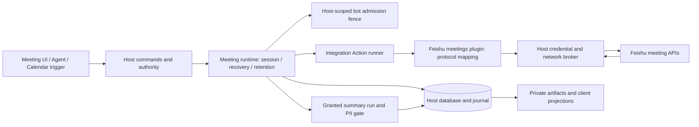
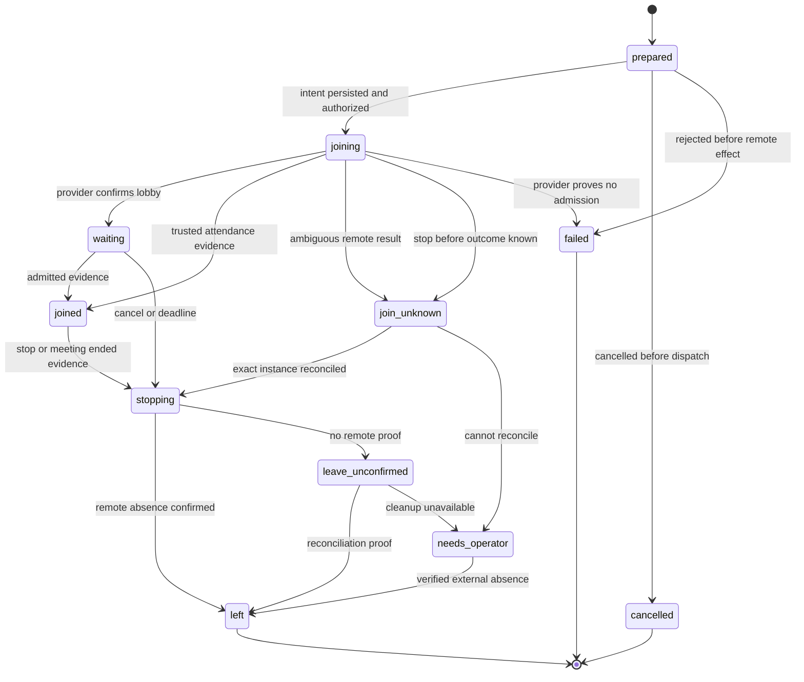
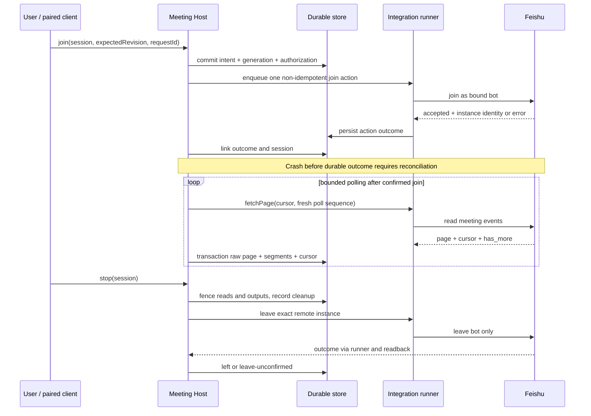

# 会议参与技术方案：先交付飞书 AI 参会闭环，再扩展本人入会与其他平台

- 状态：**Proposed / 待评审，尚未实现**；深度：Heavy。
- 日期：2026-11-18，Asia/Shanghai；负责人：Meeting DRI（角色，实施启动时指定唯一人员）。
- 需求：AI 参会与本人入会都需要，先做 AI；本方案覆盖实现步骤、风险、验收与回滚。
- 源码观察点：`2e6da23843` 加本地共享工作区，不能视作干净提交快照；实施前重查相关 owning source。
- 证据基线：[gap audit ledger](../evidence/2026-11-17-meeting-participation-gap-audit.md)、[飞书合同研究](../research/2026-11-18-feishu-meeting-contract-research.md)、[其他平台研究](../research/2026-11-18-meeting-provider-access-research.md)。本文件新增的类型、路径和默认值均为提议。

## 1. 推荐先做有监督的飞书文字参会，无人值守必须通过恢复门禁

**首期交付“用户明确授权 → 可见飞书应用机器人入会 → 拉取会中内容 → 持久转写 → 私有摘要 → 确认离会”的完整闭环。** Host 持有会话、执行权和恢复记录，新增飞书会议业务插件持有飞书协议，复用既有 Auth Connection、Integration Action、权限和网络代理。生产实现不依赖桌面 CLI，不新增 Next.js 服务端，不把日历授权扩大为会议授权。

飞书官方接口支持这一候选路线，但目标租户灰度、转写完整性、远端机器人基数和异常恢复尚未验证。特别是 join 没有已证实的幂等键或 TTL；指定用户的 active 查询只能发现其与机器人共同在场的会议。因此，**“收到 join 响应”与“能安全无人值守”是两项验收**。恢复机制不能成立时，只发布有监督试用，保留 `join-unknown` / `leave-unconfirmed`，阻止自动重试和新入会，不能宣布无人值守能力上线。[F1–F4]

按依赖顺序交付：P0 飞书真实合同实验；P1 有监督 AI 文字闭环；P2 经恢复验证后的定时无人值守；P3 本人入会；P4 Zoom 内容流、其他平台产物与获准的 AI 参会；P5 按需补充本人本地音频辅助及交互式 AI。本人入会和平台 adapter 可在 P1 稳定后并行开发，但不能占用首期发布门禁。

本方案待决策的是目标应用/租户与 Host、内容保留策略、无人值守恢复机制，以及后续平台顺序。下文给出推荐与负责人；它们不构成管理员或产品批准。当前没有真实入会、录音、发送、凭据变更或模型调用证据。

## 2. 现有能力是可复用基础，尚没有会议执行入口

### 2.1 证据支持的现状决定实现边界

| 当前事实                                                                                   | 证据与可信度                                                                                                                                           | 对设计的约束                                                                     |
| ------------------------------------------------------------------------------------------ | ------------------------------------------------------------------------------------------------------------------------------------------------------ | -------------------------------------------------------------------------------- |
| Lark 内置能力表 43 条、VC 为 0；6 个 VC 调用被前置拒绝                                     | 实际源码探针；本方案编写时重跑，见 ledger                                                                                                              | 不以放开通用 CLI 命令作为生产实现                                                |
| Calendar 插件只有 calendar/v4 路径与对应 scopes                                            | [manifest](../../plugins/feishu-calendar/plugin.json)、[connection](../../plugins/feishu-calendar/src/connection.ts)，Confirmed                        | 独立会议 consumer grant；日历只提供线索与触发源                                  |
| Feishu Auth 有 bot/user 两种 principal；通用 connection picker 没有 principalKind 过滤参数 | [auth plugin](../../plugins/feishu-auth/plugin.json)、[Auth API](../../packages/plugin-contract/src/lib/plugin/api/auth-api.ts)，Confirmed             | 明确选择 opaque connectionRef，校验 bot metadata 与 revision；不能取第一个登录态 |
| Integration Action 已有持久 job、权限、连接 revision、取消与输出 schema                    | [action runner](../../lib/integrations/action-runner.ts)、[contract](../../packages/plugin-contract/src/types/plugin/plugin-integration.ts)，Confirmed | 复用动作执行管线，会议只新增领域状态与协议映射                                   |
| SyncLease 是 device-local                                                                  | [lease](../../lib/db/sync-leases.ts)、[transaction fencing](../../lib/external-services/sync-lease.ts)，Confirmed                                      | 不能提供跨机器全局排他；首期固定唯一 Host，不自动跨 Host 接管                    |
| 4 类 VC synthetic envelope 无 normalized bus 事件；现有 IM positive control 可通过         | [实际 parser/dispatcher 探针](../evidence/2026-11-17-meeting-participation-gap-audit.routing-probes.mjs)，Confirmed                                    | 首期 polling；后续 push 需要独立 ingress 改造与 IM 回归                          |
| Rust 普通事件 emit 后 ACK，不等待 TS 持久化                                                | [native transport](../../crates/cognia-connectors/src/lark_ws.rs)，Confirmed                                                                           | 不能宣称目前已是 durable-before-ACK；未复现真实竞争丢事件                        |
| 现有 voice 为麦克风到模型，start/dispose、setDevice/dispose 有 2 个清理竞态                | [capture](../../lib/voice/live/capture.ts)、[复现](../evidence/2026-11-17-meeting-participation-gap-audit.voice-probes.mjs)，Confirmed                 | 本地音频路线启用前修复；服务端文字参会不需要麦克风                               |
| 相关 Jest 历史基线 7 suites：6 pass / 1 fail，232 pass / 5 fail                            | 2026-11-17 记录；缺 `larkActingPerson` mock export                                                                                                     | 不作为本方案新增失败，也不称当前测试全绿；实现时修复 fixture 并重跑              |

2026-11-18 的离线重跑覆盖能力、音频交错与 VC 路由探针，不是 Tauri/native 或 provider 验收。源码观察、合同推论、拟实现行为在本方案中分别标为 Confirmed、Inferred、Proposed；真实环境未知保持 Open。

### 2.2 四种产品模式必须分别显示和授权

| 模式                          | 用户期望与真实边界                                                                       | 首次交付                     |
| ----------------------------- | ---------------------------------------------------------------------------------------- | ---------------------------- |
| `participant-bot` / AI 参会者 | 以可见应用身份独立到场，接收获准内容；文字发送另授权                                     | 飞书 P1；无人值守 P2         |
| `personal-entry` / 本人入会   | 打开官方入口并指导本人完成账号、设备与主持人准入；外部客户端没有可靠回执时只显示“已打开” | P3                           |
| `content-stream` / 内容流     | 连接平台实时内容，可能没有额外参会者，也未必能发送音频                                   | Zoom RTMS P4                 |
| `artifact-import` / 会后产物  | 获权后读取逐字稿、录制元信息或纪要；不会证明 AI 曾在会中                                 | 飞书 P1/P2 补偿，其他平台 P4 |

本人系统音频采集是 `personal-entry` 的可选辅助能力，不是独立到场。AI 开口发言要求独立的 send-audio 合同、打断/回声处理和授权；本地 TTS 不构成会议音频注入。首期不自动分享摘要、不替用户承诺行动、不结束整场会议，不自动开启 mic/camera，不使用 CUA 绕过会议准入。

## 3. 目标、可见结果与验收一一对应

| 目标                      | 用户可见结果                                                      | 验收                  |
| ------------------------- | ----------------------------------------------------------------- | --------------------- |
| G1 飞书 AI 文字参会闭环   | 准确区分请求入会、已在会、内容状态、摘要及离会结果                | A01–A04、A08–A10、A18 |
| G2 多账号与外部动作有边界 | 准确显示 bot/user、应用、连接与执行 Host；不串租户、不越权发送    | A05、A06、A11、A12    |
| G3 崩溃与权限变化可恢复   | 未知远端结果可见，禁止重复入会；停止具有两端证据                  | A07、A13–A16          |
| G4 本人能进入目标会议     | 官方入口可用；状态不夸大；设备与账号由本人掌控                    | A19、A20              |
| G5 多平台复用而不虚报能力 | adapter 能力矩阵决定入口、模式和降级文案                          | A21、A22              |
| G6 能实际发布与维护       | desktop/headless 生命周期、paired clients、迁移、成本和回滚可验证 | A17、A23–A26          |

## 4. Host 统一管理会话，飞书业务插件只处理协议

### 4.1 模块边界沿用 granted connection 与现有 Integration Action

**选择新增 `meetings` 领域模块和 `feishu-meetings` 业务插件。** 现有 calendar、IM connector 和 voice 各有独立语义，均不适合持有会议会话状态。新模块提供跨 provider 的会话、内容、摘要、恢复与 UI；飞书业务逻辑遵循 [ADR-0246](../content/docs/en/adr/0246-a-business-plugin-reaches-a-service-through-a-granted-connection.md)，凭据始终留在 Host。模块装配沿用 [module manifest](../../lib/modules/manifest-types.ts) 的已有机制；[ADR-0250](../content/docs/en/adr/0250-the-runtime-is-a-headless-kernel-the-desktop-embeds.md) 整体仍标 Proposed，不把其全部迁移视作前置已完成。

图中唯一持有会议执行状态的组件是 Host runtime；插件的一次调用结束不等于远端会议结束。

| 所有者            | 拟新增或扩展的位置                                                                                                                                                  | 职责及复用理由                                                                                                              |
| ----------------- | ------------------------------------------------------------------------------------------------------------------------------------------------------------------- | --------------------------------------------------------------------------------------------------------------------------- |
| Meeting Core DRI  | 新增 `lib/meetings/`：contracts、runtime、recovery、transcript、host-commands、module manifest 与 host adapters                                                     | 现有模块没有会议领域 owner；纯 TS，不导入 React 或 UI store，不新增通用任务队列                                             |
| Integration DRI   | 扩展 [integration contract](../../packages/plugin-contract/src/types/plugin/plugin-integration.ts)、[registry](../../lib/integrations/registry.ts) 与 action runner | 增加可选 `meeting` descriptor v1，映射现有 actions；复用鉴权、action job、broker、取消与审计                                |
| Feishu Plugin DRI | 新增 `plugins/feishu-meetings/`；扩展打包/安装依赖声明                                                                                                              | 独立业务 consumer；依赖 Feishu auth service，不能复用 calendar grant 或复制 token                                           |
| Data DRI          | `lib/meetings/storage/` 与 [schema](../../lib/db/schema.ts)、治理/同步/清理注册                                                                                     | 持久领域数据；按当前数据库 helper/brain store 机制实现，避免第二份内容权威数据库；Host 无内容 fence 由 Runtime DRI 单独负责 |
| Meeting UI DRI    | 新增 `components/meetings/`、`hooks/meetings/`、`app/meetings/page.tsx` 与两种语言 split messages                                                                   | 现有会议专属页面不存在；使用现有 UI primitives，客户端页面兼容静态导出                                                      |
| Connector DRI     | 后续扩展 Lark transport、typed pre-IM dispatcher、统一 ingress                                                                                                      | 仅 P2 的 push 增强；不让 IM parser 接管会议业务，不另启同应用 CLI receiver                                                  |
| Audio DRI         | 后续扩展现有 `lib/voice/live/`，native system-audio 进入最低层 owning crate                                                                                         | 先修 B1/B2；macOS system-audio 独立授权和测试，不改成全窗口截图音轨                                                         |

新的 `meeting` descriptor 是声明性映射，不增加任意插件执行后门。包含 `contractVersion: 1`、`modes`、逐项 capability、输入身份要求，以及 `join / fetchPage / inspect / leave / sendText / fetchArtifact` 的 action ID（可缺省不支持项）。注册时校验 action 存在、risk、schema 与幂等声明；必需项缺失则对应模式不可用。未知 major 拒绝参会，既有非会议 integration 不受影响。provider 返回数据必须经过 Host schema 校验，不能由模型解析 pretty output。

Host 的 `MeetingProviderPort` 是内部适配接口，所有方法映射到 existing action jobs，**不能直接调用 handler 绕过 runner**。join/leave/sendText 属于 write；fetchPage/inspect/fetchArtifact 为 read。轮询每页创建新 read job，以 `session + generation + pollSequence + pageSequence` 作为本地请求标识；不能只用 cursor 做长期缓存键，否则相同 cursor 会返回旧页面。job 成功后才事务性落盘；read job 元数据短期回收，内容只保存在会议表。原 action runner 的输出展示截断不得介入这条结构化通道。

当前 runner 的 enqueue 规划主要针对 GitHub；其他 write 默认 `awaiting_approval`，raw HTTP 则按 unknown integration target 再规划，**尚不能直接执行会议 mandate 或自动 leave**。WP1 必须扩展 Host 内部 caller 为带可核验 `meetingSessionId/authorityRef/generation` 的 runtime 调用，并增加明确 meeting target（issuer/app/会议 occurrence，入会后绑定已验证 instance）及 review fingerprint；跨语言/SDK 枚举同步生成。前台 join 使用精确 human receipt，P2 join 使用限时 mandate；stop 使用已授予的该实例停止权，撤权后仅可按 Q3 stop-only authority 行使。两层 planner 共用同一精确目标并在 broker 出站前重验，不允许通用 `background-service`、unknown target 或插件声明“已批准”来跳过审核。若没有这一扩展，P1 write 仍需每次显式批准，P2 不可启用。

join 声明 `idempotency=none`、maxAttempts=1；本地 requestId 与 job 关联去重不改变该声明。sendText 在服务端去重期限实测前也不自动重发。leave 先 inspect，只有确认仍在会且停止权有效才新建一次 leave；响应未知先恢复状态，不由通用 retry 自动重复。GET 最多 5 次尝试，使用同一 runner 的重试调度，不叠加第二套 retry timer。建议 join/read/leave action timeout 分别 15/10/10 秒，属于客户端控制值；任何 timeout 都按远端结果 unknown 规则处理。

### 4.2 运行时装配必须证明“已加载、会启动、能清理”

`lib/meetings/module.ts` 声明 runtime、hostWriteCommands、导航/API 与拥有路径；由 `scripts/build/gen-module-registry.mjs` 生成既有 desktop/brain registries。不要只添加 initializer 或只注册而不启动。实验模块默认 dormant；开受控试用时明确调整受支持的 stage/enable 配置，验收检查 registry 和启动计数。

| 宿主                      | runtime 与数据权威                                                               | 明确支持边界                                                               |
| ------------------------- | -------------------------------------------------------------------------------- | -------------------------------------------------------------------------- |
| Tauri desktop             | 现有 owner WebView 的 desktop adapter，一个进程一个 owner；加入账号锁定/切换清理 | P1 人在场试用；睡眠、退出或主 WebView 不运行会停止执行，不能承诺常驻       |
| always-on/headless Host   | brain adapter 复用已解锁 partition、integration runtime 与 durable store         | P2 候选；须验证 Feishu auth/plugin/broker、持久化重启及目标 profile 能启动 |
| paired browser/mobile     | 向同一 Host 发命令并读脱敏 projection                                            | Host 离线则显示不可用；P1 不排队延迟重放 join/send，避免迟到进入错误会议   |
| standalone browser/mobile | 仅本人官方入口与已有产物查看能力                                                 | 不承载 bot client secret，不启动 AI attendance runtime                     |

核查 [headless registry](../../lib/headless/registry.ts)、[integration runtime](../../lib/headless/runtimes/integration-runtime.ts) 和生成入口的生命周期。brain person profile 如需启用，要同时加入现有 profile allowlist；禁止为满足“支持 headless”扩大所有用户 partition 的权限。teardown 幂等、可 await；StrictMode/HMR/第二窗口不重复 join。runtime disable 拒绝新任务，但 cleanup/reconciliation 仍可运行。

paired 命令不能只增加 TS manifest handler：[desktop write bridge](../../lib/companion/desktop-write-source.ts) 明确依赖 Rust 路由先放行。WP4 同步扩展 companion command contract/known-command catalog、[Rust data_sync 路由](../../crates/cognia-companion-rpc/src/rpc/data_sync.rs)、read projection 路由、Host tenant/partition/caller 注入与窄 capability/ACL，再进入生成的 module handler；brain 具有对等 handler。新 native reservation 命令亦采用 object 返回、显式注册、窄权限，无通用文件读写能力。source contract 变更由现有生成器生成，不直接编辑 generated 文件；以真实 paired create/stop/read 和拒权/离线场景证明可达。Rust 持久化逻辑放最低 owning crate，Tauri 只作注册/转发，不持锁跨 await。

## 5. v1 合同以稳定身份、明确状态和远端结果为核心

### 5.1 每个会话绑定一个执行者和一个远端实例

以下为 Proposed 语义合同，实施时使用现有类型命名/生成规则，不在本方案复制完整 SDK。

| 类型                   | 必需字段 / 不变量                                                                                                                                                                                                                                                  |
| ---------------------- | ------------------------------------------------------------------------------------------------------------------------------------------------------------------------------------------------------------------------------------------------------------------ |
| `MeetingRef`           | provider、integrationId、accountId、opaque connectionRef、connectionRevision、principalKind、issuer、number（字符串）、instanceId（得到后保存）；number 不能替代每场 instanceId                                                                                    |
| `MeetingSession`       | id、schemaVersion=1、controlRevision、contentRevision、ownerHostId、ownerAccountId、mode、generation、authorizationRef、providerDescriptorVersion、deadline、attendance/capture/artifact 状态、lastError、coverage；身份创建后不可换绑；分页只增加 contentRevision |
| `ProviderCapabilities` | joinParticipant、receiveTranscript、receiveAudio、sendText、sendAudio、inspectAttendance、fetchArtifact、personalEntry；各项独立且标 supported/unsupported/unverified，不用一个 supportsMeeting 布尔值                                                             |
| `MeetingPage`          | raw events、provider event ID/type/time、item IDs、nextCursor、hasMore、observedAt、rateLimit、schemaVersion；没有 finality 时保存 unknown，不能补 final=true                                                                                                      |
| `TranscriptSegment`    | sessionId、sourceEvent/item key、speakerId（可 unknown）、displayName、start/end（可 unknown）、text、provider revision（可 unknown）、receivedAt、provisional/final/unknown                                                                                       |
| `MeetingArtifact`      | sessionId、kind、source coverage/gaps、segment/source refs、model route/version、generatedAt、private access scope、revision；模型结论可溯源                                                                                                                       |

Host 解析 identity tuple，不让插件解析 opaque ref。选择 connection 后检查 bot principal、issuer、consumer grant、account binding 和 revision；字段不足时由 Host 内部 registry 补证，不能从 display name 或 app name 猜。**同应用共享机器人尚未证明按本地账号隔离**：首期每个目标 app/bot 配置一台指定 Host，最多一场活动会话；应用凭据不得分发给独立 Host。跨本地账号的远端实例不共享，第二请求拒绝，而不是把两份 ACL 合并。

账号数据库按 account/target 分区，`meetingSessions` 中的 guard 不能看见别的账号。WP4 新增 Host 级、无内容的 durable admission fence：在现有 Host security store 的 lowest-layer crate 扩展 reservation 存储/原子接口，保存 canonical bot identity digest、固定 allowedOwnerAccountId、ownerHostId、session/generation 与 unresolved 标记，不保存会议正文或 token。Host 从 connection registry 产生 identity digest，调用人不能自报 bot identity；在读取账号会话并出站之前原子 reserve，账号切换/重启/锁定不释放。只有已验证远端 absence/no-effect 才释放活动 reservation；owner account 的重新绑定必须人工核实旧实例。该存储不得随账号 DB 切换；不可用时拒绝 join。跨机器仍不构成全局锁，依赖凭据部署隔离，不能宣称可阻止另一台私自复制凭据的机器。

### 5.2 命令和 provider action 必须携带并发与授权上下文

| 边界                    | 输入与返回                                                                                         | 幂等、超时与校验                                                                                                                                            |
| ----------------------- | -------------------------------------------------------------------------------------------------- | ----------------------------------------------------------------------------------------------------------------------------------------------------------- |
| `meetings.create`       | exact target、mode、connectionRef、ownerHostId、requestId、deadline、授权选择 → sessionId/revision | Host 验证 scheme/domain/meeting number；默认不联网 join，重复 requestId 返回同一会话                                                                        |
| `meetings.join`         | sessionId、expectedRevision、requestId → durable operationId 与状态                                | 同一 revision 一次 join intent；先保存 intent 再出站；超时仅代表本地等待结束                                                                                |
| `meetings.stop`         | immutable sessionId、requestId、reason → operationId、localStopped、remoteOutcome                  | 高优先级；校验该 session 的当前停止权，幂等作用于最新 generation；不因 UI 的旧 content/control revision 拒绝停止；先 fence 再精确 leave，不映射 end-meeting |
| `meetings.sendText`     | sessionId、expectedRevision、requestId、exact text、target confirmation → receipt                  | P1 默认关闭；需额外 outbound authorization，UUID 只按已验证服务端期限使用                                                                                   |
| `meetings.reconcile`    | sessionId、requestId、受权 operator → 已核实状态/未知及下一动作                                    | 只读优先；手工补 instanceId 必须验证属于同一应用/会议，不接受任意 ID 后直接 leave                                                                           |
| `meetings.openPersonal` | provider、validated official URL、expiry、requestId → opened/guided/failed                         | 仅本人前台触发，不重用 AI identity；不持久重放带密码链接                                                                                                    |

paired write 经完整 companion transport 和 module hostWriteCommands 进入同一 handler；校验连接到的 Host、调用人/partition、资源 ACL、requestId。新增动作比较 expected controlRevision，分页不改变它；stop 不受旧 UI revision 阻挡。Agent/workflow 经既有 capability grant 与 [ADR-0239 outbound authority](../content/docs/en/adr/0239-an-outbound-action-is-authorized-by-the-request.md)；插件不能把调用伪装为 person。所有写入在发送前再次检验授权、generation、owner fence；结果到达后再次检验 connection revision/generation，丢弃撤权后的内容。**晚到 join/leave 的最小远端 identity/outcome 仍写入受限 cleanup journal**，不能因已 cancel/revoke 就丢掉唯一 instanceId；这不授予继续读内容或使用已撤销凭据的权限。

统一 typed errors：`unsupported-capability`、`tenant-not-enabled`、`needs-grant`、`principal-mismatch`、`host-unavailable`、`owner-conflict`、`revision-conflict`、`waiting-admission`、`rate-limited`、`cursor-expired`、`content-unavailable`、`join-unknown`、`leave-unconfirmed`、`storage-unavailable`。记录 provider code/request ID 供排障；UI 使用双语错误映射，不原样展示敏感 payload。

### 5.3 入会状态与内容、产物状态分开，不能用无内容判断已离会

状态机的终态依据远端证据；Host 崩溃、请求 abort、exit 0、麦克风停掉和静音都不能证明机器人离会。`waiting` 仅在 provider 确有 lobby 状态时使用，没有证据则继续 `joining` 并显示等待确认；`joined` 不允许仅由本地 POST 发出触发。

capture 独立为 `idle / catching-up / live / degraded / stopped`；artifact 独立为 `none / pending / generating / ready / partial / failed`。内容不可用保留在会状态，明确提示等待转写、需要主持人配置或权限；不得改用 user token、打开本地 mic 或发消息“测试”。结束证据触发停止；只有空页面则继续有界轮询直至 deadline。摘要含 capture 起止、晚加入/提前离会、未恢复区间、speaker unknown 和共享文档缺失。

### 5.4 每个外部副作用先写 intent，再按结果恢复

本地 requestId 防重复提交，不能变成 provider join 幂等承诺。先利用已持久 action outcome 修复“action 已存、session 未关联”窗口；action outcome 也未落盘的远端成功窗口，必须进入 `join-unknown`。明确无副作用的 provider 拒绝可终止；超时、连接断开、5xx 不自动重复 join。多个 readback 候选时不得猜选或批量踢出。

## 6. 轮询、停止和调度各有一位 owner

### 6.1 分页事务是恢复点，模型不接收原始无限事件流

初始建议为每场 5 秒 poll、最多 100 items/page、每轮最多 20 页和 5 秒处理预算；这些是 **Proposed 控制值，不是服务端 SLA**。P0 按实际配额调整。单 app 首期并发 1；计入 backfill/重试前，基础请求量为 `60 × N / pollSeconds` 每分钟。遵守服务端 Retry-After；无指示时 GET 指数退避 1/2/4/8/16/30 秒并加 jitter，5 分钟仍失败转 degraded、停止追赶并提示，保留可恢复 cursor。

每页在单事务提交 raw record、去重 key、segment projection、checkpoint 与 revision；写失败不推进 cursor。`has_more=true` 且 cursor 非空才继续同轮翻页；`has_more=false` 的非空 token 仍可作为下一次增量起点；`has_more=true` 且 token 空视为不完整协议响应，不循环猜测。达到本轮预算保持 pending backlog，不能把预算截断当作全部完成。[F3]

cursor 作为敏感 opaque value 加密存储；失效时先检查服务允许的重取范围，有依据才从已知边界重放并去重。无法恢复的区间写 `contentGap`，不清空数据库伪造完整。event ID 缺失时使用 session、type、source time、speaker/item ID 与 canonical payload hash 作为 best-effort key，并保存 `dedupConfidence`；不能宣称 exactly-once。provider 无可靠 segment ID/revision 时保留新增 observation，不能按“同 speaker + 起始时间”覆盖不同内容。

内部原始片段不默认 fan-out 到所有 workflow/Bot/Inbox。Meeting runtime 消费自己的投影；对外只发布获准的 `session.status.changed`、`artifact.ready` 等低频事件。摘要按用户手动或会后一次触发；每个 `(session, coverageRevision, policyVersion)` 一个 job，新增内容产生新 revision；不逐片调用 LLM。只对有效会话和被允许保留的内容生成，失败可重试摘要，不能重入会议获取“补充内容”。

### 6.2 停止必须分别报告本地停止和远端清理

| 触发                                  | 本地立即动作                                                         | 远端与用户反馈                                                                                    |
| ------------------------------------- | -------------------------------------------------------------------- | ------------------------------------------------------------------------------------------------- |
| 用户 stop / deadline                  | 增 generation；停止 poll、取消模型、拒绝新发送；保留 cleanup record  | 有权限则 leave 指定 bot instance；readback 确认，否则 leave-unconfirmed                           |
| app kill switch / module disable      | 禁止新 join；保留受限 cleanup runtime，不再处理内容                  | 活动 session 全部进入停止；不能直接卸载 handler 导致无法退会                                      |
| consumer grant 撤销                   | 先屏蔽后续内容、投影与模型；撤销其 read/write 使用权                 | 不保留隐形广泛权限；若用户此前明确授予 stop-only cleanup，则只允许该实例 leave，否则请求 operator |
| credential revoke / logout / app 卸载 | 先尝试受权 cleanup（若尚可调用），再完成撤销；失败仍允许用户立即撤销 | token 已无效时无权限可继续 leave，显示远端清理未确认；不偷偷恢复 token                            |
| Host crash / 网络中断                 | 重启加载 journal；本地 lease 到期只允许同 Host reconciliation        | 无跨 Host 自动 takeover；未知结果阻止该 app/bot 新 join，给出主持人移除入口                       |
| account lock / switch                 | teardown await 到有界截止，停止接收内容；关闭旧 partition            | 不能让退出账号无限等待网络；cleanup 未证实先落盘，解锁原账号后恢复；新账号不读取旧数据            |

首期 stop-only cleanup 是 **必须显式设计、默认未授予的新授权语义**，不能假装现有 consumer grant 已支持。Q3 决定其实现；若不采用，则撤权后的远端清理由主持人完成并保留状态。即使采用，token 被 provider 撤销、设备损坏和网络分区仍可能使 leave 不可执行；该事实不能被本地 kill switch 掩盖。

默认会话 deadline 建议 2 小时，延长需明确操作；P1 等待准入 5 分钟即请求停止。deadline 是本地清理触发器，**不是远端 TTL**。同一 app/bot 存在 join-unknown 或 leave-unconfirmed 时，拒绝新增自动会话；无人值守全局开关保持关闭直到 A13–A16 通过。若无法找到无人在场时可用的精确 readback，P2 不交付，转为有监督或会后产物方案。

### 6.3 定时参会复用 scheduler，但不把定时 job 当作远端会话

遵循 [ADR-0128](../content/docs/en/adr/0128-scheduler-host-neutral.md)：calendar 只提供 event/occurrence 与官方 meeting ref；scheduler 只提交 `meetings.create/join` 意图，Meeting runtime 持有整个生命周期。触发键为 `(scheduleId, providerOccurrenceId, mode)`，绑定固定 Host、bot connection、可用时间窗、最大持续时间和 mandate；重复 cron/重启不创建第二会话。

错过开始时间超过建议 10 分钟则 expired，先通知而非迟到自动入会。循环会议按 occurrence 区分，会议号复用不得复用旧 instanceId。取消/变更日程先 fence 旧 generation，再决定已在会实例的停止；不能只删除未来 timer。调度授权到期/撤销立即禁止新动作；person 按停止权限可打断自动工作。UI 需要常驻显示运行 Host、下一次会议和不可恢复会话。

## 7. 数据只在指定 Host 写入，迁移和删除不得恢复旧副作用

### 7.1 五类领域数据复用已有 action jobs

| 表（拟定逻辑名）            | 主键与关键索引                                                                                             | 内容、边界与权威                                                                                                      |
| --------------------------- | ---------------------------------------------------------------------------------------------------------- | --------------------------------------------------------------------------------------------------------------------- |
| `meetingSessions`           | id；`[ownerAccountId+updatedAt]`、`[ownerHostId+attendance]`、`[connectionRef+attendance]`、唯一 requestId | 状态/controlRevision/contentRevision/授权引用/coverage/instance；只控制本账号会话，不能替代 Host-scoped app/bot fence |
| `meetingOperations`         | operationId；唯一 `[sessionId+requestId]`、`[sessionId+status]`                                            | actionJobId、kind、generation、remoteOutcome、cleanup proof；不复制 token；intent 与 job 的创建/关联需可重入恢复      |
| `meetingSourceEvents`       | id；唯一 `[sessionId+dedupKey]`、`[sessionId+receivedAt]`                                                  | 加密 raw payload、cursor checkpoint、source hashes；cursor 与事件在同一提交边界                                       |
| `meetingTranscriptSegments` | id；`[sessionId+startTime]`、`[sessionId+sourceItemKey]`                                                   | provider 时间与接收时间分开；修订关联、不覆写未知身份；无正文入 telemetry                                             |
| `meetingArtifacts`          | id；唯一 `[sessionId+kind+coverageRevision]`、`[ownerAccountId+updatedAt]`                                 | 私有摘要、出处、partial 原因；分享、任务创建为独立动作                                                                |

checkpoint 可作为 session 的加密字段，与 source event/projection 同事务更新；不额外建立 cursor 数据权威。runtime 依赖 storage port，desktop 用现有 Dexie helpers，brain 使用当前 durable backend 的表注册/迁移/重启路径；**brain 未落盘验收前仅支持 desktop P1**。paired clients 只同步白名单 projection，不能同步 token、密码、raw pages、cursor、cleanup authority 或可执行 owner lease。

另有 §5.1 的 Host security-store reservation，只有无内容安全状态，是跨账号的 admission 权威，不进入 account DB/备份/客户端同步。采用 reserve → account intent → action job 的顺序；任何一步断机都保留 reservation。若尚未发起请求，可由持久 no-effect 证据释放；已可能发送则 inspect/人工核验，不凭 lease TTL 解锁。Host fence 的新增 schema 与账户五表分别迁移、分别测试，不能只靠 JS 内存 Map。

2026-11-18 观察 `CURRENT_SCHEMA_VERSION = 256`，不得预占 v257；实现当天重新读取并选择 next unused native version，保留已登记历史。新增表优先 additive，无历史会议状态 backfill；更新 CURRENT_SCHEMA、row type、CRUD、数据治理、brain snapshot/持久化、backup/export、清理与同步 allowlist，逐项测试。遵循 [DB conventions](../../lib/db/CONVENTIONS.md)，不得只改 Dexie 表而漏掉 headless store。以原有 calendar/IM 数据生成会议历史属于另行迁移，首期不做。

### 7.2 内容、审计和清理记录使用不同保留策略

Proposed 默认值：raw pages/read job payload 最长 24 小时；逐字稿 7 天；摘要 30 天；不含正文的操作审计 30 天。先检查现有 integration job retention 是否能按 action 隔离清理，WP1 补上会议 job 的 PII 回收，不能只清理新表。用户明确“保留副本”可将选中产物转为独立私有导出，必须有来源与授权说明；默认不创建 embeddings，不进入全局记忆。

action runner 当前会持久保存 `job.input/output`，不能把完整正文或会议密码留作普通 action 调试输出。WP1 为会议 actions 增加敏感 payload codec：密码作为短期 account-vault sealed input（job 只存 opaque ref），在已授权执行时解密；完成/失效立即删除。原始页/正文使用账号现有加密存储，job 中仅保存受 ACL 保护的加密 payload ref 或脱敏 outcome；由受控 runtime 解密消费。codec 必须覆盖 Host/brain、schema 校验、取消/撤权、审计与导出路径；写加密引用失败不得把 plaintext 作为 fallback。直接调用 HTTP broker 的 PII gate 保持无条件，不能以密文字段为借口绕过对实际出站正文的检查。

disconnect/revoke 删除在线派生数据、索引与缓存，遵循 ADR-0246；用户明确保存的独立副本单独显示和管理。删除会话先停止与记录 remote cleanup，再级联删除正文、摘要、source page、action result、RAG/搜索引用；留最小 tombstone 防 cursor/job 恢复旧内容。因离会未确认而保留的 record 仅含必要 opaque instance/connection references、状态与时间，不含会议正文；解决后按审计期限删。用户要求全部清除时仍允许删除本地 account record，但须明确远端清理证据随之丢失，不能显示远端已退出。**Host fence 不因账号表为空而释放**；若用户同时清除其 identity mapping，则停用该 app/bot 的参会配置，只有重新配置并出示远端 absence/人工移除证明才可启用，空数据库不是远端离会证据。

备份默认不导出密码/凭据、cursor、active lease 或 cleanup authority；正文导出需显式选择并受原有加密规则约束。恢复到旧版本、另一 Host 或旧备份时：全部非终态先标 recovery-required，只能 inspect/人工恢复；不自动 join/send，不恢复旧 consumer grant 或定时 mandate。回滚不降数据库 version，不删除新增表；旧客户端若不理解 row version 则只读或提示升级。

## 8. 权限按身份、内容和动作分层，会议文本始终是不可信输入

远端 scope、Host connection、consumer grant、调用 run/mandate、资源 ACL 是交集，任何一层失效都拒绝新动作。飞书 bot join/leave 的最小 scope 为 `vc:meeting.bot.join:write`；bot events 的目标租户可用范围需实测；user events 和订阅另需 user scopes。文字发送额外使用 `vc:meeting.message:write`。日历、IM、Docx 与会议权限互不替代。[F1–F6]

安装/授权页显示：所用应用、principal、会中可见名称、内容源、处理 Host、会后模型处理、保留期限及离会限制。P0 需管理员开通目标权限/数据范围并确认参会告知机制；生产入口要求用户具有会议授权，不能把读取邀请 URL 当作允许录制/转发。会议密码和含 token 的 URL 不进入日志、URL query telemetry 或模型 prompt。

转写、共享文档和参会者消息是数据，不授予工具或系统指令权限。摘要按 [ADR-0198](../content/docs/en/adr/0198-a-runs-capabilities-are-granted-not-patched.md) 创建受限 run：输入选定 session 的内容，禁止额外浏览/发消息工具；所有模型、embedding、重试和 provider fallback 都通过既有 PII gate。gate 拒绝时不出站、不换 provider 绕过；只保留本地可见失败和允许保留的原始内容。语音/托管服务若新增云处理，也必须独立声明数据方向与权限，不能因“不是 LLM”免于出站授权。

分享摘要、写任务、发会中消息均为新的外部副作用，精确绑定对象与正文授权。shared document 仅是线索：按相同 share_id 关联并单独验证 Docx/Drive ACL；无权限时不读取、不从其他账号补齐。speaker 显示名不得做权限身份；同名、匿名和改名均保留 source identity/unknown。

## 9. 本人入会先交付准确的官方入口，再考虑深度客户端集成

P3 的闭环是：选择会议 → 识别平台和官方 URL → 显示将以本人进入 → 用户前台打开客户端/浏览器 → 指导确认账号、mic/camera、主持人准入 → 保存可证明的状态。允许用户手动标记“已加入（本人确认）”，其 evidenceKind 与平台回调分开。`opened`、`guided`、`user-confirmed`、`provider-confirmed` 不相互冒充。

仅接受经 adapter 解析的官方 HTTPS/deep-link scheme，拒绝 `file/javascript/data`、任意命令、未知重定向和伪造域名。跳转/客户端缺失时提供浏览器入口、复制会议号与可见错误；不自动安装、不执行任意 shell。权限以选定 meeting ref 和新鲜 foreground intent 为限，链接过期后重新确认，不能 background replay。

首期外部客户端由本人设置设备，Cognia 不宣称能可靠读取外部 mute/camera 状态。需要内嵌时再对飞书/腾讯 Meeting SDK、Zoom Meeting SDK、Teams ACS 分别取得准确身份/部署许可与 callback 合同，新增独立验收，不把一个 deep link 适配为通用 joined 回执。

UI 按 preparing/waiting/joined/degraded/stopping/unknown/offline/empty/partial 提供明确状态与恢复动作；停止按钮保持键盘可达，状态变化用适当 aria-live 通知但不逐片朗读转写。授权对话框管理焦点与返回焦点；图标不能是唯一状态信号，转写支持 speaker/time 的可访问列表。所有文案、aria labels、toast 和错误都进入 en/zh-CN split messages。mobile 验收分别记录 iOS/Android 与 paired/standalone，不能用桌面 responsive 截图代替系统 deep-link 实测。

P5 可选本地辅助：先修 B1/B2 并证明 stop、晚到 getUserMedia、worklet load、setDevice/账号切换均回收 track/node；再为 macOS Core Audio tap 增加系统音频 usage description、进程选择、独立 mic toggle、回声排除与明确录制提示。其他 OS 各自验证，不用“macOS 已测”宣称跨平台。若本人离会/采集目标关闭，内容处理停止；不自动改采其他应用。Granola 的设计启发是低摩擦本人辅助和可见告知，不能推出它可替用户无人到场或纯本地处理。[P5–P6]

## 10. 其他平台按实际契约扩展，不能统一成“机器人入会”按钮

| 推荐顺序        | 接入路线与实现变化                                                               | 发布前必须取得的证据                                                                                                                                          |
| --------------- | -------------------------------------------------------------------------------- | ------------------------------------------------------------------------------------------------------------------------------------------------------------- |
| P4a Zoom        | `content-stream`：RTMS 后端 adapter；自建或官方列出的托管 RTMS；本人另走官方链接 | app/host/admin 准入、Developer Pack/审核、stop/reconnect、授权撤销与成本；无 participant、receive-only，不承诺 AI 发声 [P1]                                   |
| P4b 腾讯会议    | 本人入口 + `tmeet`/REST 管理和会后产物；生产凭据仍受 Host broker 管理            | 官方 CLI 当前列 19 个管理/产物工具，不含 join/leave/raw audio；先验证账号 entitlement 与产物权限；live Bot 等明确 SDK/商务合同 [P4]                           |
| P4c Teams       | 优先 Graph transcripts/RSC 和本人入口；interactive AI 先核准官方 agent 路线      | tenant/admin、speaker/transcription policy、lobby；raw-media 技术上双向但官方不推荐 AI，且需 .NET/Azure Windows 独立 service，不能塞进 Tauri/Next bundle [P3] |
| P4d Google Meet | 官方 URI + REST 会后产物；需要可见 AI 时独立评估获准的服务商                     | Media API 2027-01-15 关闭，不作为新依赖；目标 tenant 的 Bot 准入实测；平台 host-control 与服务商说明冲突未消除 [P2]                                           |

平台顺序是 Proposed（Q5），未以市场宣传替代产品需求。共用 session、authority、journal、artifact 和 UI；adapter 独立部署媒体 workers 时，仅向 Host 报受验签事件、状态与 stream session refs，凭据在服务的受信边界，不能让浏览器持有 secret。新增 inbound endpoint 位于独立 Host/service，不位于 static-export `app/api`。

购买媒体/Bot 服务可降低运维，但不消除平台准入、等待室、可见提示、撤权、数据地域或恢复问题。服务商官方支持列表没有证明飞书/腾讯可用，就不能作为这两者首期 fallback。Zoom 的“托管 RTMS”与通用 participant bot 是不同产品模式。语音输出另验证平台允许性、音轨/视频限制、延迟、打断与去重；这些未通过时 capability 保持 unsupported/unverified。[P1, P7]

### 10.1 对比方案与选择理由

| 方案                                    | 价值与代价                                                                     | 决策                                              |
| --------------------------------------- | ------------------------------------------------------------------------------ | ------------------------------------------------- |
| 放开全部 Lark VC CLI，Agent 自行轮询    | spike 快；桌面限定、结构化内容可能被 model-display cap 截断，缺会话/恢复 owner | 只作 P0 人工可控实验，不做生产 owner              |
| 给 Calendar 或 IM connector 直接加 join | 少一个入口；混淆授权、事件与状态，跨平台复用差                                 | 不采用，保留 calendar trigger 和统一 ingress seam |
| Host 通用会议模块 + 飞书业务插件        | 需要窄 descriptor 和领域数据；复用安全/执行管线，可清楚划分生命周期            | **推荐**                                          |
| 直接采购通用 Meeting Bot                | 快速覆盖部分平台；额外成本/供应商数据流，不能解决未支持的平台与政策            | P4 按平台采购评估，不替代飞书 P0                  |
| 直接接本地系统音频                      | 适合本人辅助；依赖用户在场、OS 授权，不是独立 AI 到场                          | P5 可选产品能力                                   |

## 11. 观测和资源预算必须能解释“在会但没内容”

以下为 Proposed 试用预算，P0/P1 采样后由 Product DRI 与 SRE 确认；不把控制值当成当前实测性能或厂商保证。

| 指标 / 预算                                                              | 采样与告警                                                        | 操作                                                             |
| ------------------------------------------------------------------------ | ----------------------------------------------------------------- | ---------------------------------------------------------------- |
| 单 app/bot 活动会话 1，单场最长 2h，lobby 5min                           | admission guard 与 deadline scan；观察 waiting/active 分钟        | 达限拒绝/请求停止，未清理前不扩并发                              |
| 本地 stop fence p95 ≤ 2s；远端停止确认健康网络 p95 ≤ 30s                 | intent、fence、leave request、proof 分段计时；至少 20 次受控样本  | 超 30s leave-unconfirmed，不宣称已离会；不排除未知样本美化成功率 |
| provider 事件产生到持久化 p95 ≤ 15s（仅有可靠 source time 样本）         | 同时报 source-time 缺失率、clock skew、receive-to-commit          | 超阈值分析 poll/backlog/配额；source 时间不可用不伪造端到端延迟  |
| scripted transcript 唯一短语 recall ≥ 95%，speaker 可识别样本 ≥ 95% 正确 | P0 两人脚本至少 40 条唯一短语，另列 overlapping/unknown/late-join | 不达标降为不完整试用或改产物路线；不是通用 ASR 准确率承诺        |
| backlog 年龄 > 60s / read error 连续 5min                                | queue age、page count、cursor age、429、commit failure            | degraded 与 gap 通知；降频/停读，不无界堆积                      |
| 单会 raw payload 上限建议 50MiB；待处理 page 上限 20                     | 计实际 bytes/items，action job payload 同计                       | 先持久化/背压；达上限停止采集并标 partial，不能静默裁正文        |
| summary 每 coverageRevision 最多一次自动触发                             | run ledger、tokens/cost、PII gate decisions                       | 达预算仅提供逐字稿/手动重试；默认不加新模型调用                  |

metrics labels 限 provider、mode、hostKind、operation、outcome、稳定 errorClass；sessionId、meeting number、tenant、speaker、正文、URL 不作 labels。结构化审计用 opaque session/operation ID、actor/authority ref、connection revision、时间、remoteOutcome 和 provider request ID；敏感 identity 仅在受控排障页面按 ACL 解析。日志脱敏，正文/密码/token 永不写普通日志。

拟定 metric 名称：`meeting_admission_total`、`meeting_active_sessions`、`meeting_remote_unknown_total`、`meeting_stop_fence_seconds`、`meeting_leave_confirmation_seconds`、`meeting_event_persist_seconds`、`meeting_backlog_age_seconds`、`meeting_gap_total`、`meeting_payload_bytes`、`meeting_summary_cost`。trace spans 覆盖 `meeting.command/action/page.commit/summary/cleanup`，通过审计 ID 关联，不附正文。SRE DRI 持有 dashboard/alert/runbook；WP4 必须交付，不留为发布后的运维待办。运行时/插件代码只在模块启用时 lazy-load；每场最多一个 100-item page 在内存处理，新增 UI bundle/启动时间和 50MiB 上限时的峰值内存由 WP5/WP4 实测留档，基线未知不宣称零开销。

仪表盘至少显示：请求→准入→首段→持久化→摘要→离会漏斗，join-unknown/leave-unconfirmed 数量与年龄，内容覆盖与 gap，Host uptime、backlog、429、重复/修订、摘要失败、active/等待/有效内容分钟数与成本。任何 unknown > 0 当日提示并禁用该 bot 新自动会话。成本按 provider API/active minutes/STT/model/storage/network 分列；飞书配额和价格仍 Open，不假定免费或无限。

## 12. 验收分离离线正确性、真实平台与宿主证据

以下均为 **待实施的验收标准**，不是本方案编写时已经通过的测试。

| ID  | 验收与通过条件                                                                                                                                                                                   | 证据 / 主要 owner                                                | 阶段                         |
| --- | ------------------------------------------------------------------------------------------------------------------------------------------------------------------------------------------------ | ---------------------------------------------------------------- | ---------------------------- |
| A01 | 目标飞书 bot 在一次性会议被正确识别、放行；join/roster/instance 对齐；拒绝场景不虚报 joined                                                                                                      | provider trace + roster 截图/回执，QA                            | P0/P1                        |
| A02 | 两人脚本含同名 speaker、中英混合、交叠、修订、静音、晚加入；40 条唯一短语按 §11 统计，缺失与 unknown 可见                                                                                        | 脱敏脚本/转写对照与延迟数据，QA                                  | P0/P1                        |
| A03 | page 重复/乱序、100 条边界、has_more/token 四组合、预算截断、cursor expiry、DB 失败均不错误推进；可检测 gap                                                                                      | co-located integration/storage tests，Core                       | P1                           |
| A04 | 摘要/待办引用 segment/time/source，含覆盖与 partial 原因；不存在的 speaker/决定不作为已证实事实                                                                                                  | 预置事实集 + 人工抽查，Product                                   | P1                           |
| A05 | bot/user、两账号、两 issuer、同 app 不同 requester、stale revision 全部拒绝不匹配；无 token 暴露                                                                                                 | auth/action boundary tests，Security                             | P1                           |
| A06 | 未授权 join/send/share/任务写入不会产生网络请求；person/run/mandate 不可由插件伪造                                                                                                               | broker 捕获 + authority tests，Security                          | P1/P2                        |
| A07 | action outcome 已存而 session 未更新能恢复；POST 成功但 outcome 未存标 join-unknown，绝不自动重发                                                                                                | crash injection at both windows，Core                            | P1                           |
| A08 | 没转写/无分享文档权限时准确降级；不自动切 user/mic/provider、不循环发送测试消息                                                                                                                  | fixture + 一次真实权限不足，QA                                   | P1                           |
| A09 | 用户打开私有转写/摘要能读回、跳转出处；删除后搜索/缓存/action payload 无残留                                                                                                                     | real UI + storage assertions，UI/Data                            | P1                           |
| A10 | P1 完整真实会议从授权到入会/内容/私有摘要/离会；留可读报告，任何一步失败不标全程成功                                                                                                             | Tauri real flow，QA                                              | P1                           |
| A11 | 会议正文中的 prompt injection 不触发工具；模型/embedding/重试/fallback 经过 PII gate，阻断样本零出站                                                                                             | redaction/execution integration tests，Security                  | P1                           |
| A12 | revoke 后晚到 page/模型结果丢弃；derive/cache/index 按策略删除，保留副本独立显式管理                                                                                                             | lifecycle/delete tests，Data                                     | P1                           |
| A13 | 本人不入会时注入远端 join 成功后崩溃；必须发现**同一** bot instance 并安全清理；无可行机制则 P2 fail                                                                                             | real provider recovery experiment E2，Core/QA                    | P2 门禁                      |
| A14 | offline、SIGKILL、sleep/restart、leave 响应丢失、撤权前后均分别记录本地停止与远端结果；stop 与 page commit/旧 UI revision 并发也会 fence，晚到 instanceId 仍可清理；满足 stop 预算，未知保持可见 | fault matrix + remote proof，QA                                  | P1/P2                        |
| A15 | 两窗口/两 local accounts、账号全删/切换/重启后均不能绕过 Host fence；两 Host 由凭据部署隔离，Host loss 无静默接管，手工 handoff 先证明旧远端结束                                                 | durable fence + deployment/conflict tests，Runtime               | P1 本机 / P2 Host handoff    |
| A16 | 恢复旧备份/断连重启/过期 mandate/取消 recurring occurrence 不重新 join/send；超时只补偿读取                                                                                                      | scheduler + backup fault tests，Core/Data                        | P2                           |
| A17 | desktop/brain start、cancel、teardown、account switch 单 owner；headless 无 UI 仍能读写/重启；真实 paired 经 Rust transport create/stop/read，拒权/离线无 fallback write                         | host-specific integration + dual-host E2E，Runtime               | P1 desktop/paired / P2 brain |
| A18 | 开关关闭仍可清理；plugin upgrade/uninstall 先 quiesce active sessions，未确认状态阻止误报完成                                                                                                    | kill-switch/upgrade tests，Runtime                               | P1                           |
| A19 | 飞书本人入口覆盖正常打开、客户端缺失、密码、lobby、错误账号、过期链接；无 callback 只显示 opened/guided                                                                                          | macOS 与 browser/mobile 目标矩阵，UI/QA                          | P3                           |
| A20 | 非法 scheme/domain/redirect 不执行；取消不打开 mic/camera；user-confirmed 与 provider-confirmed 分开                                                                                             | parser tests + real UI，UI                                       | P3                           |
| A21 | Zoom 无 participant/receive-only，Meet 不依赖关闭的 Media API，Teams/Tencent 显示实际可用 capability；不支持不触发动作                                                                           | adapter contract + UI tests，Provider                            | P4                           |
| A22 | 每个平台各有真实准入/内容/停止/产物或本人入口报告；服务商 ACK 不等于 admitted                                                                                                                    | target-tenant smoke，Provider/QA                                 | P4                           |
| A23 | 新旧 DB、brain restart、账户切换、清理、导出/恢复、旧客户端只读都可验证；禁止 schema downgrade                                                                                                   | migration/retention tests，Data                                  | P1/P2                        |
| A24 | route 导出、i18n/可访问性、module registry/插件产物可达；paired known-command/Rust route/窄 ACL/可信 caller 与 TS handler 完整，unknown 命令拒绝；UI 无 runtime Next server 依赖                 | build + static export + wiring/command parity review，UI/Runtime | 各阶段                       |
| A25 | 如启用 push，同应用 IM/VC/card 唯一标记均经单 ingress；持久化失败不成功 ACK；断机重放去重                                                                                                        | wire-level E5 + IM/card regression，Connector                    | P2 可选增强                  |
| A26 | 如启用本地音频/AI speech，B1/B2 回归、设备切换/断权零泄漏；分别验证真实系统音频/会议注入、回声与打断                                                                                             | native device/provider matrix，Audio                             | P5                           |

P0 真实实验完整采用研究的 E1–E8：优先 E1 租户/内容、E2 孤儿恢复、E3 转写语义、E4 分页/恢复、E6 停止撤权；E5 仅在 push 启用前，E7 本人/音频在对应阶段，E8 产物闭环在 P1。只允许已授权的一次性会议与测试账号；记录 app/tenant/Host、binary/source identity、时间、scopes、错误码与脱敏原始回执，不记录凭据。

实施验证命令从根 `package.json` 取值：`pnpm test -- --runInBand <changed co-located suites>`、`pnpm typecheck`、`pnpm lint`、`pnpm build`、`pnpm lint:static-export`；module/数据/契约改动追加 `pnpm audit:modules`、`pnpm audit:data-governance`、`pnpm plugin:contract:check`、`pnpm author-types:check`。paired/native 边界追加 `pnpm companion-api:check`、`pnpm audit:command-parity`、`pnpm audit:rust-architecture`；插件/API/网络边界追加 `pnpm plugin:api-matrix:check`、`pnpm plugin:author-imports`、`pnpm audit:network-egress`。i18n 变更执行 `pnpm i18n:build`、`pnpm i18n:build:check`、`pnpm lint:i18n`，不直接编辑生成 JSON。E2E 经 `pnpm test:e2e` 运行针对 spec；参考现有 [integration hub](../../tests/e2e/integrations-hub.spec.ts) 和 [Tauri ingress](../../tests/e2e/tauri/integration-ingress.spec.ts)，新增 meetings 行为用例。覆盖率仅按明确请求运行，不把 docs-only 验证升级为全仓覆盖率任务。

新改源文件按仓库规则配 co-located tests；测试失败先定位实际行为，不弱化断言。共享工作区既有失败按路径与 fixed baseline 单列。mock、schema gate、静态 export、provider/真实 native 和业务验收各有报告，不能互相替代。

## 13. 风险按释放条件治理，无法证明的能力保持关闭

| 风险                                                  | 严重度 / 当前证据                           | 缓解与退出条件                                                            | owner / 触发动作                                  |
| ----------------------------------------------------- | ------------------------------------------- | ------------------------------------------------------------------------- | ------------------------------------------------- |
| R1 目标租户未开放 bot/content 或内容不完整            | 高 / Open                                   | P0 E1/E3；失败停 participant 路线或明确试用限制                           | Feishu DRI / 不启用 P1 公开入口                   |
| R2 join 远端成功但本地未提交，无法枚举 bot            | 严重 / 合同限制已确认，事故未复现           | A07/A13；单 Host/app、unknown 隔离；不承诺 exactly-once join              | Core / P2 阻断                                    |
| R3 revoke/断网后远端仍在会，无远端 TTL                | 严重 / Inferred                             | A14、stop-only 明示授权、主持人移除 runbook；全撤权后无调用能力需如实提示 | Security/Runtime / 关闭新 join，保留 cleanup 状态 |
| R4 同 app 多主机、多 requester 共享远端 bot           | 高 / 基数与权限 Open                        | app/Host 部署隔离；拒绝共享与自动 takeover，验证手工 handoff              | Runtime / 容量扩展阻断                            |
| R5 第二 receiver 竞争及当前 VC null parser/非持久 ACK | 高 / 路由缺口 Confirmed，真实 loss 未测     | P1 不依赖 push；A25 单 ingress/durable ACK 与 IM/card 对照                | Connector / push 开关关闭                         |
| R6 会议正文、密码、派生数据泄漏或 prompt injection    | 严重 / 新路线风险                           | A05/A06/A11/A12、加密/最小 retention、无逐片模型调用                      | Security/Data / 拒绝出站并清理派生物              |
| R7 renderer 睡眠/退出、headless 插件或 DB 未持久      | 高 / 生命周期边界 Confirmed，目标 Host 未测 | desktop 仅有监督；A17/A23，脑端未过不支持无人值守                         | Runtime / P2 阻断                                 |
| R8 quota/backlog/费用或摘要延迟失控                   | 中高 / 配额 Open                            | §11 有界预算/背压，测实际有效分钟成本                                     | SRE / 降频、partial、暂停新会话                   |
| R9 平台政策/SDK关停、服务商准入不符                   | 高 / Meet 关闭等 Confirmed                  | P4 每平台新鲜官方合同与目标租户验收，adapter 单独开关                     | Provider / 关闭该模式保留产物                     |
| R10 语音资源竞态、设备或注入能力被误报                | 高 / B1/B2 Confirmed                        | A26；不阻塞无麦克风文字 P1，不提前开放 audio                              | Audio / P5 阻断                                   |
| R11 数据迁移/旧备份恢复导致重复副作用                 | 严重 / 新设计风险                           | A16/A23、append-only migration、恢复全非终态先隔离                        | Data / 停 runtime，保留数据不降版本               |
| R12 打开会议链接被误报真正入会                        | 中 / 外部 callback 边界 Confirmed           | A19/A20、证据种类与 UI 状态分开                                           | UI / 降为 opened/guided                           |

## 14. 工作包、依赖与分阶段发布可独立验收和回滚

### 14.1 唯一责任角色承担可交付工作包

一个工作包只有一位 accountable owner；协作人不替代责任人。角色到人员的映射是启动前 Q1，不在本文件虚构已分配工程师。

| WP                       | 唯一 owner        | 交付与依赖                                                                                                                                                                                                                           | 独立验证 / 回滚                                                                                           |
| ------------------------ | ----------------- | ------------------------------------------------------------------------------------------------------------------------------------------------------------------------------------------------------------------------------------ | --------------------------------------------------------------------------------------------------------- |
| WP0 合同与环境 spike     | Feishu DRI        | 选定 app/tenant/Host；E1–E4/E6，实测身份、基数、配额、raw schema、停止/孤儿恢复；无代码交付依赖                                                                                                                                      | 保存脱敏实验报告；失败关闭试用，不保留活动 bot                                                            |
| WP1 契约与动作治理       | Integration DRI   | WP0 合同；descriptor v1、action schemas/risk、meeting target 与两层 planner、Host runtime authority/stop-only contract、read job fresh keys、非幂等未知结果、敏感 payload codec/retention                                            | action registry/auth/cancel/unknown/PII tests、契约 gate；禁新动作映射，仍允许受权 cleanup                |
| WP2 会话与存储           | Core DRI          | WP1；五表、storage port、journal、state reducer、revision/fence、quota/backpressure、deadline；Data DRI 协作迁移                                                                                                                     | A03/A07/A12/A23；禁新写，兼容保留表，不降 schema                                                          |
| WP3 飞书业务插件         | Feishu Plugin DRI | WP0/WP1；bot 明确绑定、最小 net/scopes、join/events/inspect/leave、运行时兼容、打包依赖                                                                                                                                              | provider fixtures + 目标租户 E1/E4/E6；quiesce 后停插件，未知 cleanup 保留                                |
| WP4 生命周期与 Host 装配 | Runtime DRI       | WP2/WP3；desktop/brain adapters、registry、Host security-store durable admission fence、paired command contract/Rust routes/catalog/ACL/caller/projections、revoke/lock/kill switch、operator recovery、部署隔离和 dashboard/runbook | A14/A15/A17/A18/A24 与 Rust object/权限/持久化测试；关闭 admission 保留受权 stop/reconcile，不自动换 Host |
| WP5 私有转写/摘要与 UI   | Meeting UI DRI    | WP2/WP3；静态路由、授权/状态、source navigation、双语、PII gated summary、删除/保留                                                                                                                                                  | A04/A08–A12/A24、真实 Tauri UI；关闭模型/页面新操作，读已有私有产物                                       |
| WP6 无人值守与调度       | Core DRI          | WP0/WP4/WP5 且 Q2/Q3 已解决；mandate、occurrence keys、指定 Host、失约/过期和通知                                                                                                                                                    | A13–A17；关闭 schedules/admission，清理现有会话，保留记录                                                 |
| WP7 本人入会             | Meeting UI DRI    | P1 稳定与 provider link contracts；官方入口、状态证据、失败引导；不依赖音频                                                                                                                                                          | A19/A20/A24；禁目标 scheme/adapter，回退展示会议号                                                        |
| WP8 push 增强            | Connector DRI     | 仅需要 lifecycle/artifact push 时启动，依 WP4；pre-IM typed routing、durable ingress、ACK 回执协议                                                                                                                                   | A25，模拟持久化失败/重放与 wire trace；关闭 push 回 polling，保留 IM 原语义                               |
| WP9 平台扩展             | Provider DRI      | WP1/WP4/WP5，逐平台 Q5；优先 Zoom RTMS，其余 artifact/personal 模式                                                                                                                                                                  | A21/A22，每平台独立验收/开关/worker drain，不一起宣称支持                                                 |
| WP10 本地与交互音频      | Audio DRI         | 真实需求确认后，先 B1/B2 修复；再 native capture 或平台 send-audio，各有权限/部署合同                                                                                                                                                | A26；停音轨/worker/远端注入，保留文字/产物能力                                                            |

### 14.2 每阶段都有入口、出口与中止条件

| 阶段              | 入口与范围                                                  | 出口 / 禁止发布条件                                                                                       | 发布和回滚                                                                   |
| ----------------- | ----------------------------------------------------------- | --------------------------------------------------------------------------------------------------------- | ---------------------------------------------------------------------------- |
| P0 可行性         | Q1 提供 disposable meeting、bot grant 与测试 Host；执行 WP0 | 合同报告 + 可用文字路径 + 可清理测试 bot；内容/准入不可用则停止                                           | 仅实验配置，结束全部实例；不开放产品入口                                     |
| P1 有监督飞书试用 | WP1–WP5、desktop、单 app 单 Host 单会话；人为发起           | A01–A12、A14、A15 本机、A17 desktop/paired、A18、A23 desktop、A24；所有失败清单可见；无法可靠清理则不发布 | allowlist 内部试用 → 小范围；禁新 join、保留 cleanup，取消模型，保留只读产物 |
| P2 无人值守       | P1 稳定；WP6；brain durable/auth 实测；Q2/Q3 明确           | A13–A17、A23 brain 全过；无本人在场恢复失败则阻断，不用 P1 成功代替                                       | 先一台 Host 的少量指定会议；默认 off；任何 unknown 即暂停该 bot 新会话       |
| P3 本人入口       | P1 稳定，WP7，可与 WP6 独立推进                             | A19/A20/A24；真实 opened/confirmed 证据分开                                                               | provider 逐个开启，失败禁 adapter 不影响 AI cleanup                          |
| P4 其他平台       | Q5 和 WP9；每个 mode 单独申请/定价/数据边界                 | A21/A22，按平台 scope 通过，不承诺全矩阵                                                                  | Zoom RTMS→腾讯产物/入口→Teams/Meet获准能力；媒体 service 支持 drain/stop     |
| P5 音频增强       | Q6 与 WP10；先修复现有竞态                                  | A26 与目标 OS/provider 实测；技术可收音≠准许发音频                                                        | receive/send/local 分开旗标；关音轨不停止必要清理                            |

Proposed flags：`meetings.enabled`、`feishuParticipant`、`unattended`、`lifecyclePush`、`summary`、各 provider/mode、`localCapture`、`sendAudio`。默认新能力关闭，试用按 account/app/Host allowlist 开启。实际 flags 接入既有设置 owner，不造第二套远程配置服务；权限比 flags 更严格。app 级 emergency stop 由 Host 应用，不依赖页面存活。回滚只禁止 admission/采集/新外发，**不禁必要的 inspect/leave**；全凭据撤销时进入人工清理而非隐藏失败。

schema/additive changes与 plugin descriptor需分发布：先 Host 接受 v1 与关闭入口，再 plugin 部署并验最小链路，再开 allowlist。plugin 升级/卸载先 quiesce，有活动 session 时禁止直接销毁 cleanup handler；强制卸载需显示未清理实例。恢复部署不自动恢复旧 mandate。真实 credential revoke 始终允许，不能被“必须先退会”无限阻塞。

## 15. 待决策项有推荐，但不视作已获批准

| ID                                       | 选项与推荐                                                                                                                                        | 单一决策 owner / 建议 DDL | 未决影响                                    |
| ---------------------------------------- | ------------------------------------------------------------------------------------------------------------------------------------------------- | ------------------------- | ------------------------------------------- |
| Q1 目标 app/tenant、指定 Host 与责任人   | 推荐独立测试应用 + desktop P1，P2 切已验证 always-on Host；不要复制生产 IM app 凭据做并行 receiver                                                | Meeting DRI / 2026-11-20  | WP0 真环境实验不能开始；本方案仍可评审      |
| Q2 无人在场的 readback/远端寿命          | A provider 支持精确查回/幂等/远端到期；B 只做有监督与产物。推荐先验证 A，不成立采用 B                                                             | Feishu DRI / 2026-11-23   | A13 不过则 P2 不上线；不虚构 TTL            |
| Q3 stop-only cleanup 授权                | A 明示最小权限、仅已知 instance 的 leave；B 撤权即停全部调用，由主持人移除。推荐 A，但需新 Host contract/审计和安全评审；完整 token revoke 仍走 B | Security DRI / 2026-11-23 | 确定撤权 UX 与 cleanup 实现，不得隐形保权   |
| Q4 默认 retention、告知与摘要处理        | 推荐 raw 24h / transcript 7d / summary 30d，私有、默认无 embeddings，模型处理明确选择；也可零保留文字临时模式                                     | Product DRI / 2026-11-23  | P1 正式试用前决定；值仍为 proposed          |
| Q5 后续平台和购买边界                    | 推荐 Zoom RTMS 内容流优先，腾讯本人/产物随后，Teams/Meet按准入；自建/托管 RTMS 分成本评估                                                         | Product DRI / 2026-11-27  | 不影响飞书 P1；影响 WP9 顺序与服务部署      |
| Q6 AI 是否需要语音、本人是否需要本地录制 | 推荐先文字参会与本人入口；需要时独立立项 local audio / sendAudio，分别授权验收                                                                    | Product DRI / 2026-11-27  | WP10 默认不启动，不把未实现音频写成首期支持 |

以上为建议评审截止日期，不是已承诺上线日期；负责人指定后按依赖重排。未解决的问题必须在阶段入口显式阻断，不能在实施中以 TODO 绕过。

### 15.1 评审与待办记录

| 日期       | 评审角色                            | 范围                                                                               | 状态                                                     |
| ---------- | ----------------------------------- | ---------------------------------------------------------------------------------- | -------------------------------------------------------- |
| 2026-11-18 | Author / repository evidence        | 当前源码、官方合同与实现路径，形成此 Proposed 文档                                 | 文档审查，不代表产品实现或人工批准                       |
| 2026-11-18 | Fresh-context adversarial reviewer  | 跨账号 fence、paired 可达性、stop 与 page commit 竞态；另核实删除不释放 quarantine | 3 项方案缺口已修订并限定复核关闭；非实现验收、非人工批准 |
| 待安排     | Feishu tenant administrator         | bot 权限/灰度、测试会议与告知                                                      | Pending，Q1 owner 召集                                   |
| 待安排     | Security / Data / Runtime reviewers | cleanup authority、PII、保留/删除、单 Host 和存储恢复                              | Pending，Meeting DRI 召集                                |
| 待安排     | Product / QA                        | P1 范围、内容质量预算、后续平台优先级                                              | Pending，Meeting DRI 召集                                |

| TODO                               | 唯一 owner   | 建议 DDL   | 可检验交付                                                |
| ---------------------------------- | ------------ | ---------- | --------------------------------------------------------- |
| 指定人员与一次性 app/tenant/Host   | Meeting DRI  | 2026-11-20 | Q1 决策记录与受权测试环境，不保存 secrets 到文档          |
| 执行 WP0 并验证/否证无人值守恢复   | Feishu DRI   | 2026-11-23 | E1–E4/E6 脱敏报告，Q2 判定；不满足条件明确停 P2           |
| 确认撤权与 stop-only 授权合同      | Security DRI | 2026-11-23 | Q3 决策、权限 schema 与异常 UX 评审                       |
| 确认 retention/质量阈值和数据告知  | Product DRI  | 2026-11-23 | Q4、A02/A04 评价脚本与数据策略                            |
| 按 WP 拆分实施任务并记录实际 owner | Meeting DRI  | 2026-11-24 | WP1–WP7 依赖、A IDs、回滚 owner；只在 P0 可行后排产品发布 |
| 确认下一平台与音频范围             | Product DRI  | 2026-11-27 | Q5/Q6，WP9/WP10 独立范围与准入证据                        |

## 16. Sources 与证据有效范围

外部合同核验日期为 2026-11-18；平台能力、准入与价格在实施前再次核验。以下是精简索引，完整引用与实验设计见两份 research note；CLI source 固定到官方 v1.0.98 commit，不把 tag 名与本机二进制等同为供应链证明。

- F1：[Feishu bot join source](https://github.com/larksuite/cli/blob/ac81f5056ab88f37d581d25916f3dab85abfca76/shortcuts/vc/vc_meeting_join.go)；F2：[leave source](https://github.com/larksuite/cli/blob/ac81f5056ab88f37d581d25916f3dab85abfca76/shortcuts/vc/vc_meeting_leave.go)。
- F3：[events source / pagination](https://github.com/larksuite/cli/blob/ac81f5056ab88f37d581d25916f3dab85abfca76/shortcuts/vc/vc_meeting_events.go)；F4：[active visibility contract](https://github.com/larksuite/cli/blob/ac81f5056ab88f37d581d25916f3dab85abfca76/skills/lark-meeting/references/lark-vc-meeting-list-active.md)。
- F5：[VC event identities](https://github.com/larksuite/cli/blob/ac81f5056ab88f37d581d25916f3dab85abfca76/events/vc/register.go)；F6：[meeting text/reaction](https://github.com/larksuite/cli/blob/ac81f5056ab88f37d581d25916f3dab85abfca76/shortcuts/vc/vc_meeting_message_send.go)；F7：[Feishu long connection](https://open.feishu.cn/document/ukTMukTMukTM/uYDNxYjL2QTM24iN0EjN/event-subscription-configure-)。
- P1：[Zoom bot → RTMS blueprint](https://developers.zoom.us/blueprints/migrate-bot-to-rtms/)；P2：[Meet release notes / Media API closure](https://developers.google.com/workspace/meet/release-notes)。
- P3：[Teams raw-media intended use](https://learn.microsoft.com/en-us/microsoftteams/platform/bots/calls-and-meetings/real-time-media-concepts) 与 [hosting requirements](https://learn.microsoft.com/en-us/microsoftteams/platform/bots/calls-and-meetings/requirements-considerations-application-hosted-media-bots)。
- P4：[Tencent official CLI](https://cloud.tencent.com/document/product/1095/133827)；P5：[Granola privacy model](https://www.granola.ai/security)；P6：[Apple Core Audio tap](https://developer.apple.com/documentation/coreaudio/capturing-system-audio-with-core-audio-taps.md)。
- P7：[Recall media output contract](https://docs.recall.ai/docs/stream-media)；服务商说明只证明其自身契约，平台 admission 仍单独验证。
- 本地审计：[主 ledger](../evidence/2026-11-17-meeting-participation-gap-audit.md)、[飞书研究](../research/2026-11-18-feishu-meeting-contract-research.md)、[跨平台研究](../research/2026-11-18-meeting-provider-access-research.md)。本方案不关闭其中真实 provider、native、恢复与语音残余风险。
