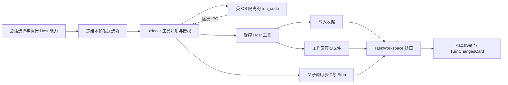

# Cognia Code Mode 与 TurnDiff 实施计划

| 项目     | 内容                                                                                                                                                                                                                                  |
| -------- | ------------------------------------------------------------------------------------------------------------------------------------------------------------------------------------------------------------------------------------- |
| 状态     | 待评审，基于 2026-11-19 `dev` 工作树与 HEAD `4906b6cbbd`                                                                                                                                                                              |
| 范围     | Cognia 内置 Agent 的会话工具呈现、sidecar、Host 进程生命周期、TaskWorkspace 与聊天 TurnDiff                                                                                                                                           |
| 评审角色 | Chat/Agent、Sidecar/Runtime、TaskWorkspace、Native QA、安全与隐私                                                                                                                                                                     |
| 依据     | [原生功能现状](../research/2026-11-19-cognia-code-mode-readiness.md) · [组件实测与 TurnDiff 核查](../evidence/2026-11-19-code-mode-components-and-turn-diff.md) · [外部参考](../research/2026-11-19-code-mode-external-references.md) |

**先交付 macOS 只读 `Both`，让模型用 `run_code` 做依赖查询，继续用现有直接写工具落盘，由 TaskWorkspace 生成这轮 TurnDiff。** 下一阶段才允许少量程序化写入，在受控工作区用 Host 写入收据记录确切来源。逐文件 Undo、外部 MCP 和其他执行端分别验收。首版保持 `Native` 默认，全程沿用当前权限、工作区和变更账本。 [ADR-0117](../content/docs/en/adr/0117-composed-agent-modes-and-creator.md) · [ADR-0255](../content/docs/en/adr/0255-runs-that-share-a-directory-keep-their-diffs-and-lose-undo.md)

## 1. 完整问题清单

`P0` 阻塞只读试点，`P1` 需在对应里程碑开放前完成，`P2` 在指标或扩展条件满足后实施。证据中的「复现」来自当前组件或前轮夹具，「源码」是当前实现核查，「待验」表示尚缺真实环境或效果数据。

### 模式、能力与工具契约

| 编号  | 优先级 | 问题及影响                                                                                                                                             | 证据                                                                                                                                                              | 工作包 |
| ----- | ------ | ------------------------------------------------------------------------------------------------------------------------------------------------------ | ----------------------------------------------------------------------------------------------------------------------------------------------------------------- | ------ |
| CM-01 | P0     | 正常发送没有消费 UI 已取得的沙箱能力，`Code` / `Both` 解析回 `Native`。                                                                                | 复现，[发送包装](../../lib/agent/composition/resolve-turn-composition-safely.ts#L41)                                                                              | W1     |
| CM-02 | P0     | 通用命令沙箱健康与 Code 专用 launcher 可用性分开。前端探测按进程缓存，picker 无法反映当前绑定 Host 或 sidecar 新代际。                                 | 源码，[探测](../../lib/ai/code-mode/sandbox-status.ts#L51) · [Code launcher](../../crates/cognia-sidecar/src/supervisor.rs#L115)                                  | W1     |
| CM-03 | P0     | UI 会列出不可用的 `Code` / `Both`，选择、解析摘要、实际注册结果可以不一致。                                                                            | 源码，[高级选项](../../components/agent/composition/composition-picker.tsx#L270)                                                                                  | W1     |
| CM-04 | P0     | 应用层 kill switch 未贯通 sidecar 注册、执行、既有会话工具缓存和在途调用。关掉入口后缺少可信撤回语义。                                                 | 源码，[开关](../../lib/ai/code-mode/availability.ts#L21) · [注册](../../sidecar/src/tools/builtin/run-code/index.ts#L106)                                         | W1、W3 |
| CM-05 | P0     | wrapper 与子工具受两道权限清单约束，只有子工具时可能丢掉入口，只有 wrapper 时会注册空 SDK。                                                            | 复现，[注册器](../../sidecar/src/tools/builtin/registry.ts#L190) · [组件实测 O2](../evidence/2026-11-19-code-mode-components-and-turn-diff.md#knowledge)          | W2     |
| CM-06 | P1     | Tool Search 可以推迟 `run_code`，测试过 `Code` 模式首步仅有 `ToolSearch`。把全部签名常驻还受 provider 工具数和目录体积约束。                           | 复现，[工具发现](../../sidecar/src/tools/adapters/ai-sdk-tool-search.ts#L162)                                                                                     | W2、W5 |
| CM-07 | P1     | `Code` 只替换 Cognia 内建工具表，Claude SDK 自带工具、外部 MCP 和插件工具各有入口。工具呈现与权限独立，界面若把它描述成全局只读会误导。                | 源码，[AI SDK MCP 合并](../../sidecar/src/runtimes/ai-sdk/index.ts#L1081) · [Claude SDK 工具表](../../sidecar/src/runtimes/claude-agent-sdk/tool-surface.ts#L140) | W2     |
| CM-08 | P1     | 同一缺失文件错误在 AI SDK 嵌套调用 reject，在 Claude Agent SDK 返回 `isError: true`。脚本语法失败被标成 `resource-exhausted`，影响模型恢复和失败统计。 | 复现，[组件实测 O4](../evidence/2026-11-19-code-mode-components-and-turn-diff.md#knowledge)                                                                       | W2     |
| CM-09 | P2     | SDK 只生成输入类型，返回值为 `Promise<unknown>`，目录缺少稳定结果契约。发送侧 digest 使用工具名及空 schema，无法标识实际签名和 Tool Search 激活集合。  | 源码，[声明](../../sidecar/src/tools/builtin/run-code/sdk-declaration.ts#L117) · [发送摘要](../../lib/agent/composition/resolve-turn-composition-safely.ts#L45)   | W2、W5 |

### 生命周期、限额、可观测性和平台

| 编号  | 优先级 | 问题及影响                                                                                                                                                                                   | 证据                                                                                                                                                                           | 工作包     |
| ----- | ------ | -------------------------------------------------------------------------------------------------------------------------------------------------------------------------------------------- | ------------------------------------------------------------------------------------------------------------------------------------------------------------------------------ | ---------- |
| CM-10 | P0     | `run_code` supervisor 没有收到回合 `AbortSignal`，脚本退出或超时后缺少对在途 Host 工具、审批、进程组及嵌套工具所开辅助进程的完整收尾。                                                       | 源码，[调用入口](../../sidecar/src/tools/builtin/run-code/index.ts#L51) · [ADR-0244](../content/docs/en/adr/0244-a-remote-run-has-stopped-only-when-its-worker-says-so.md#L66) | W3         |
| CM-11 | P1     | 1 MiB 上限只检查最终 `return`，日志、嵌套请求与结果缺统一累计和单条字节限额。64 次和 8 并发都按单段脚本计，Host 和会话的总量另需约束。                                                       | 源码，[预算](../../lib/ai/code-mode/limits.json) · [supervisor IPC](../../sidecar/src/tools/builtin/run-code/supervisor.ts#L426)                                               | W3         |
| CM-12 | P1     | 嵌套审批、结果复核和执行使用的 ID 未统一挂到外层 `run_code`，聊天无法展示每步的权限、耗时和终态。两种适配器的输出处理也分别实现。                                                            | 源码，[嵌套适配](../../sidecar/src/tools/adapters/ai-sdk.ts#L531) · [可复用 Trace](../../packages/agent-trace/src/chat-tool-spans.ts#L82)                                      | W2、W3     |
| CM-13 | P1     | 每 25 ms 同步采样 RSS 会阻塞 sidecar，连续脚本出现超时。原型异步化把最大观测事件循环延迟由 78 ms 降至 17 ms，在 1.5 秒测试预算下两组仍各有 7/8 超时，根因尚未收敛。                          | 复现与待验，[组件探针](../evidence/2026-11-19-code-mode-components-and-turn-diff.md#本机探针结果)                                                                              | W0、W3、W5 |
| CM-14 | P1     | 真实打包 Host 未验收。Rust 有 macOS 与 Linux Code launcher 路径。Linux `bwrap`/IPC/进程回收、CLI launcher、配对 Host 能力、Windows 缺后端需逐端处理，Web/Capacitor standalone 无本地执行器。 | 源码与待验，[平台分支](../../crates/cognia-sidecar/src/code_sandbox.rs#L84) · [CLI 入口](../../cli/src/runtime/bootstrap.ts#L181)                                              | W0、W8     |
| CM-15 | P2     | 全部 32 个只读工具在 `Both` 中增加约 3,148 个 `o200k_base` 声明 tokens。目录缩短的正确率、实际费用与节省模型请求的净收益未知。                                                               | 测量与待验，[目录对照](../evidence/2026-11-19-code-mode-components-and-turn-diff.md#本机探针结果)                                                                              | W5         |

### TurnDiff、写入归属与扩展

| 编号  | 优先级 | 问题及影响                                                                                                                                                    | 证据                                                                                                                                                                                                    | 工作包     |
| ----- | ------ | ------------------------------------------------------------------------------------------------------------------------------------------------------------- | ------------------------------------------------------------------------------------------------------------------------------------------------------------------------------------------------------- | ---------- |
| CM-16 | P1     | 当前已有净变更捕获，但 Code Mode 尚无正常发送的整链验收。需要证明 `Both` 中脚本只读，普通工具的写入会按实际 `runId` 归入正确消息，并保留轮次前的 dirty 内容。 | 源码与待验，[Chat capture](../../hooks/chat/agent-chat-send.ts#L3312) · [结算投影](../../lib/code-adoption/turn-tracker.ts#L325)                                                                        | W4         |
| CM-17 | P1     | 当前 Code 只读。已有 `file_pre_mutation` 面向 CLI `/rewind`，只提供写前字节。renderer 资源事件也只带路径和工具 ID，写工具尚未接入可信写后收据。               | 源码，[checkpoint](../../sidecar/src/tools/middleware/file-checkpoint.ts) · [路径线索](../../lib/task-workspace/tool-evidence.ts#L33) · [收据](../../crates/cognia-task-workspace/src/service.rs#L5208) | W6         |
| CM-18 | P1     | 现有收据匹配要求单个工具的前后哈希解释整个文件变更，Local 观察结算也未用这一匹配生成具体工具来源。同一文件多次调用、重命名及部分结果需要明确归属。            | 源码，[匹配](../../crates/cognia-task-workspace/src/provenance.rs#L476) · [Local 观察](../../crates/cognia-task-workspace/src/ledger.rs#L709)                                                           | W6、W7     |
| CM-19 | P1     | 同目录并发、人类和不受控工具的写入、停止未知及快照保真不足，会限制归属与 Undo。现有 `overlap` / `stop_unproven` 判定以 patch 为单位。                         | 源码，[PatchSet 结算](../../crates/cognia-task-workspace/src/service.rs#L4853) · [ADR-0255](../content/docs/en/adr/0255-runs-that-share-a-directory-keep-their-diffs-and-lose-undo.md#L62)              | W4、W6、W7 |
| CM-20 | P1     | 写入成功后收据持久化可能失败，文件系统与 SQLite 不能共享一个原子提交。取消、崩溃或部分写入后需要据实结算，防止盲重试和重复写。                                | 风险待验，[现有 provenance 状态](../../crates/cognia-task-workspace/src/provenance/capture.rs#L284)                                                                                                     | W6         |
| CM-21 | P2     | Codex 的 `turn/diff/updated` 当前写入 session metadata，完成的 `fileChange` 只是路径线索。轮次实时预览和可信的最终归属需各自消费正确来源。                    | 源码，[Codex 入口](../../packages/agent-codex/src/app-server-client.ts#L2665) · [文件事件](../../packages/agent-codex/src/app-server-client.ts#L3015)                                                   | W4、W7     |
| CM-22 | P2     | 历史 TurnChanges 卡片挂载会逐 run 查询原 Host patch。长会话可能产生集中 IPC，真实成本待测。                                                                   | 源码与待验，[卡片查询](../../components/chat/turn-changes-card.tsx#L130)                                                                                                                                | W5         |
| CM-23 | P2     | 外部 MCP 和插件目前不属于 `run_code` 目录。工具名、会话凭据、逐次授权、审批、取消、结果校验和错误保真仍需逐一接入，服务声明的 `readOnlyHint` 不足以决定权限。 | 源码与待验，[现有资格判断](../../sidecar/src/tools/builtin/run-code/eligibility.ts) · [MCP 结果审计 F15/F16](../evidence/2026-11-18-builtin-agent-runtime-long-run-audit.md)                            | W8         |

## 2. 实施路径与交付顺序

建议按下表独立合并工作包。各包以验收结果作为进入下一步的条件，日期与发版窗口由相应 owner 评审排定。

| 包                     | 负责角色                 | 依赖                        | 实施内容                                                                                                                                                                                                                                    | 独立验收                                                                                                                 |
| ---------------------- | ------------------------ | --------------------------- | ------------------------------------------------------------------------------------------------------------------------------------------------------------------------------------------------------------------------------------------- | ------------------------------------------------------------------------------------------------------------------------ |
| W0 基线                | Native QA                | —                           | 固定 revision、打包版本和模型夹具。录制普通会话发出的 composition、实际工具表、进程 `spawn`/`READY`/首个 IPC/结算/回收，再记录当前 TurnDiff 及 overlap 边界。                                                                               | Mac 打包环境重现降级；同根/独立根两条 capture 对照；给出可复跑的日志和夹具。                                             |
| W1 生效与撤回          | Chat/Host 接入           | W0                          | 建立当前执行 Host 的 Code 专用能力回报，复用命令及 ready 握手，接通 `useCodeSandboxPresentations`、`resolveTurnCompositionSafely`、发送 spec 与 sidecar。能力按绑定 Host 和代际刷新，批准的回合由 sidecar 在执行前复核。Host 有运行期开关。 | 正向选择贯通模型工具表；未探测、缺 launcher、Host 切换、旧版本、重启与撤回都能给出真实状态。                             |
| W2 工具面和结果        | Sidecar 工具适配         | W1 合同确定                 | 复用 `collectCogniaToolDefs`、`applyToolPresentation`、真实 schema 和逐次授权。禁止空 executor，保持 ToolSearch cap，统一两条适配器的结果、错误和脱敏。                                                                                     | 1 个与 32 个 eligible tools、只允许入口/只允许子工具、空目录、显式拒绝、按需发现、缺失文件、语法错误、部分结果均可断言。 |
| W3 Stop、限额和 Trace  | Sidecar Runtime          | W1 合同确定，可与 W2 并行   | 接入共享的会话进程记账和 `ToolSession`。组合回合取消与脚本截止。关闭准入，终止子进程，结清子调用与审批，按现有 proof 规则确认；补充限额和父子事件。                                                                                         | Stop、超时、撤权和 Host 退出后无新调用；尚未确认停止可见；跨会话资源隔离，输出通过现有 PII/内容安全 gate。               |
| W4 只读试点与 TurnDiff | Chat/Workspace 集成      | W1、W2、W3                  | 在实验会话提供 `Both`。保留普通编辑工具与 TaskWorkspace 的捕获和展示。接好实际执行 run、消息与原 Host，覆盖未绑定目录和捕获失败。                                                                                                           | 真实 Mac 打包版走“搜索→读依赖结果→直接编辑→打开本轮 diff”，可验证混合模式、dirty 基线、错 Host、取消与现有 Undo 行为。   |
| W5 性能与目录治理      | Agent 性能               | W0、W2、W3；真实效果依赖 W4 | 对照直接调用、直接调用加 Tool Search 和 `Both`。诊断 supervisor 的剩余延迟，试验较低开销采样、精简常驻目录、懒取历史 patch。记录实际模型工具表的有序摘要。                                                                                  | 给出 p50/p95、成功率、开销和最小有效目录；通过正确率、预算和稳定性条件再灰度。                                           |
| W6 受控写入及归属      | TaskWorkspace/Host 写入  | W4、W5、Q2                  | 先在 managed workspace 允许 `edit` / `apply_patch`，逐次执行原有权限。捕获 Host 真正写入的有序收据，版本校验与结算使用现有 TaskWorkspace，保留恢复与审计状态。                                                                              | 同一文件多改、新建、删除、重命名、部分失败和取消均有正确净变更，收据可定位具体子调用，异源写入不被冒领。                 |
| W7 细粒度展示与 Undo   | TaskWorkspace 历史与审阅 | W6、Q3                      | 复用 `TurnChangesCard`，验证临时进度和最终 PatchSet。按文件验证完整收据链、最终哈希、停止状态和冲突；只有确定安全的部分开放 Undo。                                                                                                          | 双 Agent、父子 Agent、编辑器、停止未知、同文件新改动及历史保留/回退矩阵全过。                                            |
| W8 外部工具与其他 Host | Runtime 集成             | W5、Q4；外部写入另行评审    | 先选一个 Host 明确授权的只读 MCP；插件工具单独验收。逐个验证 Linux、CLI、配对，独立决定 Windows 支持方案和外部 Agent 能力映射。                                                                                                             | 每个开放项都有实际 Host/版本、运行权限边界、取消和结果契约证据。旧端及 standalone 路径保持安全可用。                     |

复用现有进程组和 WP9 的按会话 spawn 归属，W3 提前实现 `run_code` 所需的公共路径；范围包含首版允许的嵌套工具启动的辅助进程。保持单一追踪协议。若某个辅助进程无法参加停止证明，试点应选择不依赖该进程的目录，或在结果里诚实返回未确认。 [共享进程组](../../sidecar/src/tools/state/process-group.ts#L57) · [ToolSession](../../sidecar/src/tools/session.ts#L113) · [既有 WP9](2026-10-31-mesh-stop-recovery-and-host-binding.md#wp9-按会话的进程记账m1a-之后)

## 3. 对齐运行身份，复用现有边界

| 边界            | 建议合同                                                                                                                                                                                                              | 所有者与故障处理                                                                                                                                                                                                                         |
| --------------- | --------------------------------------------------------------------------------------------------------------------------------------------------------------------------------------------------------------------- | ---------------------------------------------------------------------------------------------------------------------------------------------------------------------------------------------------------------------------------------- |
| Host → 会话选择 | Code 专用能力包括 `probing` / `available` / `unavailable`、后端类型、协商版本、Host 和 sidecar 代际、原因。最终发送固定本轮 `requested` 与 `effective`，以 Host 返回和当前工具权限为准。                              | Rust/Node Host 与 sidecar 联合确认可执行；UI 用同值控制禁用态和提示。能力缺失、断线或换代时重新探测。选了 `Code` 却无法执行时提示重选/明确回退，禁止静默给模型一套范围更宽的工具。同一已支持的 `Both` 可在明确提示后保留原本的直接工具。 |
| 执行身份与授权  | 由 Host/sidecar 建立 `sessionId`、`executionRunId`、`turnId`、`attemptId`、实际 Agent、工作区绑定、父 `run_code` ID。每个子调用分配独立 ID 与序号，携带实际解析的参数和取消信号。                                     | `applyToolPresentation` 与两种适配器读取同一批准范围。运行期重验工具清单、工作区、权限模式及 admission；改写后的参数再验。脚本的返回值、目录说明和权限提示均不能提升权限。                                                               |
| 嵌套结果        | v1 成功载荷保留可消费的数据和内容形态；两路错误统一有稳定的分类和 `retryable` / 已知影响字段。语法、工具业务失败、拒绝、取消、超时、内存及结果限额应可区分。                                                          | 延用工具 kernel 的失败元数据与结果复核。若返回结构需要不兼容变更，用显式 SDK 版本协商和回放隔离。保留旧记录的含义。                                                                                                                      |
| 脚本生命周期    | `pending → running → stopping → completed / failed / cancelled / stop_unconfirmed`。脚本返回、失联、预算、取消先关新请求，随后处理已入场请求、审批及子进程。`stop_unconfirmed` 允许呈现当前已观测结果，不能授予撤销。 | supervisor 与 `ToolSession` 绑定。回合 stop、租约撤销、launcher 退出、sidecar 重启都执行同样的退场约束。持用户批准的旧调用不能跨新代际复用。                                                                                             |
| 进程与字节预算  | 以现有 32 KiB 源码、30 秒墙钟、64 次子调用、同时 8 次、256 MiB 进程组、1 MiB 最终结果为初始参考。额外验证单条输入/输出、日志总量、每会话在途数与 Host 并发。                                                          | W3 为每个边界确定并测试实际限制。IPC 发送前计字节，接收端实施边界校验；超额走明确错误或兼容的分页/摘要。禁止截断 JSON 后继续当有效数据。集中采样或原生限制只有在同等防护和稳定性验证后替换。                                             |
| 文件写入回执    | Host 在执行真实写入的边界发 `ToolMutationReceipt`，按 run、ordinal 和规范路径去重，绑定子工具调用与父脚本。记录前后内容哈希、路径变化和确认状态，顺序以实际写入为准。                                                 | 目标限于授予的执行根。建立写前预期版本，处理重名、链接、rename、并发与部分错误。文件写成功但 receipt 失败时标记缺口，由结算事实补充记录；相同逻辑写入只有验证已有结果时才幂等返回。                                                      |
| 最终 TurnDiff   | Host 在停止证明允许的结算点，以 `workingState` / managed 基线和磁盘事实生成 `PatchSet`。TurnChanges 按原 Host、run、turn/messaging 身份展示。                                                                         | watcher、Codex upstream patch、工具自报路径可辅助预览。工具归属由证据链决定，结束前的预览会被最终结算替换。净变化只计算本轮保留的差异，二进制、权限位、rename 等沿用仓库现有表达及保真规则。                                             |

一条改动从受控写工具流入现有 TaskWorkspace，两份数据分别回答工具归属和本轮净变化。



### 数据、兼容和回退

- **只读试点沿用既有会话和 PatchSet 数据。** 无需 Dexie 迁移或历史回填。旧发送、旧 Host、旧客户端缺能力或事件字段，继续可读已有聊天和 diff。扩展 ready 或控制协议时验证 TS/Rust 编解码、Tauri 注册与最小 ACL。能力只有版本和身份匹配才可生效，不能以 renderer 标志替代 Host 检查。
- **写入阶段复用 WorkspaceStore 账本与保留策略。** 优先以已有 `ToolMutationReceipt`、`PatchSet` 与 canonical events 记录。需要新增持久哈希链列时做加法迁移，旧记录来源保持原判定，新记录未知或旧端不可识别时只开放查看。以账号/主体、Host、workspace root 和 run 作为数据访问边界；备份、导出和删除沿用现有 owner。历史来源待确认时保留原证据和有效范围。
- **两种独立的撤回。** Host 可撤回写能力，继续使用只读 `Both` 及标准审批的 Native 工具；也可撤回整个 Code 执行器，关闭新 admission 并按 W3 处理在途请求。已完成的文件写入由现有 `PatchSet` 审阅和回退。升级或回退不能把未知影响自动标成成功、未执行或可撤销。
- **平台按实际 Host 协商。** 首版仅 macOS 本机 sidecar 的 opt-in 会话。Linux 有后端路径，通过真实环境验证后再放行。CLI、配对和 mobile companion 需使用绑定执行 Host 的能力与结果。Windows 依赖受支持的执行隔离。Web/mobile standalone 继续使用其现有工具路径。外部 Agent 按适配器自身能力呈现。

## 4. 安全、可观测性及发布验收

### 信任边界与最小权限

- `node:vm` 只供语言上下文，进程隔离由 OS launcher 负责。子进程能力仅包含严格约束的 IPC 工具代理，最小环境、隔离 scratch、关闭直连网络和工作区直接读写。执行与恢复都要测 launcher、进程退出和隔离行为。
- Host 授权逐次生效。`Both` 中普通 Native 工具与 `run_code` 内嵌工具分别遵守既有规则。写入阶段只接显式批准的内建文件工具和注册根，使用解析后的规范路径、版本及必要时的同文件顺序控制。Shell、原生文件访问、通用网络和外部 MCP 写入不进入程序化写工具范围。
- 由 Host 核验账户、Agent、run、workspace 与批准，脚本和工具结果均视为输入。原文件字节、命令输出、日志、错误、审阅改写和脚本输出经过当前内容安全和 PII gate 后才可回模型。Trace 默认只记安全工具标识、状态、时间和字节数，原文历史沿用当前数据保留、导出和删除策略。

### 指标与退出条件

| 信号                                            | 分组与产出                                                                                                                  | 发布判定                                                                                                                                          |
| ----------------------------------------------- | --------------------------------------------------------------------------------------------------------------------------- | ------------------------------------------------------------------------------------------------------------------------------------------------- |
| 请求模式、实际模式、拒绝原因、ToolSearch 可见性 | Host 类型、launcher、引擎、模式、安全的原因枚举；禁止用会话或路径作指标标签。                                               | 启用的端覆盖 `Code/Both` 选择、旧端、禁用、狭窄工具表与换代，错误能力或未解释的降级阻塞灰度。                                                     |
| 执行时间和资源                                  | `spawn → READY → 首个 IPC → 工具/审批 → finalize → reap`，记录 p50/p95、超时率、在途数、IPC 字节、RSS 和事件循环延迟。      | W0 锁定基线，W5 同机、同 provider、同任务重复测。拿不到归因或出现不可接受的超时/其他会话退化时保留实验范围。                                      |
| 工具与变更证据                                  | Trace 关联父脚本和子调用，分别记录授权结果、错误、终态；TurnDiff 标记 capture 质量、确认来源、收据缺口和 Undo 拒绝原因。    | 越权、错误文件归属、Stop 后新入场、未知停止仍允许撤销、跨 Host 记录指向错误目标，任一出现即撤回对应能力。                                         |
| 用户任务收益                                    | 同输入比较直接调用、Tool Search、`Both`。同一正确性判定 统计成功任务、模型请求、实际工具次数、冷热缓存 tokens、费用与延迟。 | 简单任务保留 Native 路径，依赖聚合任务在正确率达标后才按净收益开放。公开推广的数值门槛在 W0/W5 数据评审中确定，避免使用外部基准给 Cognia 作承诺。 |

### 可执行验证矩阵

| 验收              | 最小关键场景                                                                                                                      | 验证入口                                                                                  |
| ----------------- | --------------------------------------------------------------------------------------------------------------------------------- | ----------------------------------------------------------------------------------------- |
| A1 模式与工具表   | 从实际聊天入口发送；有效/无效 launcher；受限授权、空目录、ToolSearch cap、换 Host、关闭后旧会话；保持 Native 兼容。               | 定向 Jest、sidecar adapter 测试、macOS 打包烟测。                                         |
| A2 行为与安全门禁 | 两引擎缺失文件、拒绝、参数改写、取消、语法错误、批量读、输出超额、并发、Host 撤权、进程和 IPC 回收；确认输出走当前 PII 路径。     | owning sidecar 集成测试、Rust launcher 测试、真机受控只读夹具。                           |
| A3 既有 TurnDiff  | dirty baseline、已跟踪/新建/删除/重命名、无净变化、不可捕获二进制/超限、消息绑定、多个根、取消收尾。普通写再读 diff/Review/Undo。 | `TurnChangesCard` / `turn-tracker` / workspace Jest，TaskWorkspace Rust，桌面工作区实测。 |
| A4 精确归属与恢复 | 同文件 `A→B→C`、同路径异源写、拒绝与取消、写完成后崩溃、收据重复、部分写成功、重启、未知停止、Undo 前文件再次变化。               | Rust/sidecar 集成，隔离工作区与双会话打包验收。验证展示和撤销各自的条件。                 |
| A5 真实质量与平台 | Anthropic SDK 和 AI SDK 各一条真实模型路线；macOS 首版和后续平台按 rollout 矩阵验。用只读查询或临时小型工程夹具。                 | 固定数据的 keyless replay、真实模型对照、每个 Host 的启动/审批/取消烟测。                 |

对有实现变更的工作包，先跑相应 owning 测试，再跑仓库门禁。以下均为后续实施的检查入口。

```sh
pnpm test --runInBand --runTestsByPath lib/agent/composition/resolve-turn-composition.test.ts lib/agent/composition/resolve-turn-composition-safely.test.ts hooks/agent/use-code-sandbox-presentations.test.ts components/agent/composition/composition-picker.test.tsx
node scripts/test/run-sidecar-tests.mjs sidecar/src/tools/middleware/presentation.test.ts sidecar/src/tools/builtin/run-code/supervisor.test.ts sidecar/src/tools/adapters/ai-sdk.test.ts sidecar/src/runtimes/claude-agent-sdk/tool-surface.test.ts
pnpm test --runInBand --runTestsByPath components/chat/turn-changes-card.test.tsx hooks/chat/use-turn-changes.test.ts lib/code-adoption/turn-tracker.test.ts lib/task-workspace/tool-evidence.test.ts
cargo test -p cognia-sidecar code_sandbox --lib
cargo test -p cognia-task-workspace turn_diff --lib
cargo test -p cognia-task-workspace provenance --lib
```

改 `.tsx` 文案用 `next-intl` 和中英文拆分源，覆盖探测中、不可用、拒绝、停止未知及只读历史，复用 `AxisSelect` 的键盘与读屏路径。用 `pnpm i18n:build`、`pnpm i18n:build:check`、`pnpm lint:i18n` 校验生成与新增键。交付跑 `pnpm lint`、`pnpm typecheck` 与 `pnpm lint:static-export`，按影响执行 `pnpm build` 和对应 Playwright 项目。有关 macOS 的 release 结论以本机打包运行取证。仓库的现有 Tauri Playwright project 有平台条件，不能替代 macOS smoke。 [仓库脚本](../../package.json) · [Playwright 配置](../../playwright.config.ts)

## 5. 里程碑、退路和评审决定

| 里程碑                    | 入场和验收                                                                                                | 退出方式                                                         |
| ------------------------- | --------------------------------------------------------------------------------------------------------- | ---------------------------------------------------------------- |
| M0 可验证基线             | W0 固定版本、端和重现路径。冻结公开性能门槛前先有真实 baseline。                                          | 保留研究与测试夹具，功能保持默认关闭。                           |
| M1 macOS 只读 `Both`      | W1–W4、A1–A3 完成。用户能查看本轮普通文件工具造成的净变更。两种路径都有脚本功能、限额、权限和 Stop 实证。 | Host 撤回 `run_code`，保留历史和原 Native 权限。                 |
| M2 受控写入与准确归属     | W5 给出试点证据，W6 与 A4 完成。先在显式授权的 managed workspace 展示逐文件归属，未知来源为只读。         | 撤回写能力，保留只读和已结算历史，必要时用现有冲突保护交互恢复。 |
| M3 逐文件 Undo 或扩大覆盖 | W7 和 W8 独立放行。Undo 依赖完整可信收据链和可证明的停止。MCP 和每个平台各自通过验证。                    | 独立撤回 Undo、连接或平台能力。缺证据的变更仍可查看。            |

| 决策                   | 推荐                                                   | 取舍与待确认项                                                                                                                         |
| ---------------------- | ------------------------------------------------------ | -------------------------------------------------------------------------------------------------------------------------------------- |
| Q1 首版呈现            | macOS opt-in `Both`，消费既有 ADR-0117 字段            | `Code` 独占需要先决定整个工具面语义；`Native` 继续作为默认和降级基线。                                                                 |
| Q2 谁执行程序化写入    | Host 内建 `edit` / `apply_patch`，先 managed workspace | 与既有授权和 PatchSet 接合成本最低。放开 Local 共写或通用 shell 会让来源和恢复需要额外治理。                                           |
| Q3 何时提供逐文件 Undo | 在可信链覆盖整个版本转换且冲突检查通过时独立开放       | 仅看到本轮 diff 时允许审阅。未来可以恢复部分可证实的文件，风险与研发成本均独立于首版体验。                                             |
| Q4 跨 MCP 和新宿主顺序 | 实测收益后先单个授权的只读 MCP，再逐端开放             | Vercel、Cloudflare 等执行器列为备选；更换前要证明同等权限、隔离、审计与生命周期。接 Anthropic/OpenAI provider PTC 需单独评估托管边界。 |

建议在 2026-11-20 完成首次分流评审。Chat/Agent owner 确认 Q1 和仓库入口，Native Runtime owner 确认 W3 与现有 WP9 的交付接口，TaskWorkspace owner 确认 Q2/Q3 及证据格式，Native QA owner 确认 W0 场景和打包环境。其余发版日期在上述依赖和验证成本确认后排定。

| 评审记录   | 状态                                                                                             |
| ---------- | ------------------------------------------------------------------------------------------------ |
| 现状与范围 | 已对照当前入口、sidecar、账本与两个研究记录。                                                    |
| 源码与证据 | 研究阶段完成 resolver、目录、错误与进程探针。真实打包 Host、未来写入和更细粒度 Undo 待对应验收。 |
| 实施审批   | 待评审 Q1–Q4。                                                                                   |

## 6. 2026-11-20 核查与修复进展

逐项按源码核查后，下表记录每项现状。「已修复」都有对应的单元或集成测试；真实打包 Host、真实模型和程序化写入仍按第 4 节验收。

| 编号  | 现状                                                                                                                                                                                                                                                 |
| ----- | ---------------------------------------------------------------------------------------------------------------------------------------------------------------------------------------------------------------------------------------------------- |
| CM-01 | 已修复。`resolveTurnCompositionSafely` 在选择解析为 `code` / `both` 时询问执行 Host，`native` 轮次不发请求。CLI 的 agent 定义没有可问的 Host，保持只给 `native`。                                                                                    |
| CM-02 | 已修复。能力改由 `claude_sidecar_status.codeSandbox` 回报：当前 sidecar 代际实际拿到的 launcher（或下次启动将拿到的），带 `generation` 与原因。删除渲染端推断的 `host-probe.ts`。选择器在 Host 切换、sidecar `ready` / `sidecar_exited` 后重新询问。 |
| CM-03 | 已修复。Code / Both 保留在列表中并禁用，写明原因（探测中、已关闭、无沙箱后端、临时目录不可用、Host 未报告、无 Host）。                                                                                                                               |
| CM-04 | 已修复关闭路径：Host 进程的 `COGNIA_CODE_MODE_KILL=1` 让此后启动的 sidecar 拿不到 launcher；工具呈现变化时多轮循环重启。运行中切换开关仍需重启 sidecar 才生效，见 Q5。                                                                               |
| CM-05 | 已修复。`run_code` 只在至少一个可编程子工具获准时注册；入口按拒绝清单和其包含的工具准入，不再被只列原生工具的允许清单丢掉。                                                                                                                          |
| CM-06 | 已修复。`run_code` 标记为常驻，Tool Search 不再把它推迟。                                                                                                                                                                                            |
| CM-07 | 文案已修正：Code 预设说明改为「代码 SDK 只读，其他工具仍按各自权限运行」。是否让 `code` 同时收起引擎自带、插件与 MCP 工具，仍待 Q1 决定。                                                                                                            |
| CM-08 | 已修复。两种引擎的嵌套失败都以带 `kind` / `retryable` 的 `ToolError` 拒绝；外层按阶段分类，语法错误为 `invalid-args`。                                                                                                                               |
| CM-09 | 属实，未动。需要 sidecar 回报实际工具表摘要，P2。                                                                                                                                                                                                    |
| CM-10 | 已修复。本轮中止信号取消程序；每次结束先关准入，再中止嵌套调用与审批等待、杀进程组、等 1 秒宽限，未确认时报告 `stopUnconfirmed`。进程组登记在会话前台进程组（`sidecar/src/tools/state/foreground-groups.ts`），纳入 Stop 收尾与停止证明。            |
| CM-11 | 已修复单段脚本内的限额：单次嵌套输入 64 KiB、结果 1 MiB，嵌套结果合计 8 MiB，单条日志 4 KiB、合计 64 KiB。会话级与 Host 级总量未定，见 Q6。                                                                                                          |
| CM-12 | 属实，未动。父子调用 ID 需要新的事件字段和聊天展示，见 Q7。                                                                                                                                                                                          |
| CM-13 | RSS 采样已改为异步、不重叠，不再阻塞 sidecar 事件循环。本机 supervisor 套件从约 26 秒降到约 5 秒且两次重跑无超时；批量短脚本超时的根因仍需打包环境分段测量。                                                                                         |
| CM-14 | 待验。平台与打包验收，非代码缺陷。                                                                                                                                                                                                                   |
| CM-15 | 待验。效果与成本测量。                                                                                                                                                                                                                               |
| CM-16 | 待验。整链实测。                                                                                                                                                                                                                                     |
| CM-17 | 当前设计范围外：Code 首版只读（ADR-0117），写入收据属 W6。                                                                                                                                                                                           |
| CM-18 | 同上，属 W6、W7。                                                                                                                                                                                                                                    |
| CM-19 | 按 ADR-0255 设计：重叠与停止未知时保留 diff、关闭 Undo。                                                                                                                                                                                             |
| CM-20 | 当前设计范围外，属 W6。                                                                                                                                                                                                                              |
| CM-21 | 属实，P2，属 W4、W7。                                                                                                                                                                                                                                |
| CM-22 | 待验。需真实长会话测 IPC 成本。                                                                                                                                                                                                                      |
| CM-23 | 按 ADR-0117 设计：可编程资格只来自第一方 `programmaticReadOnly`。                                                                                                                                                                                    |
