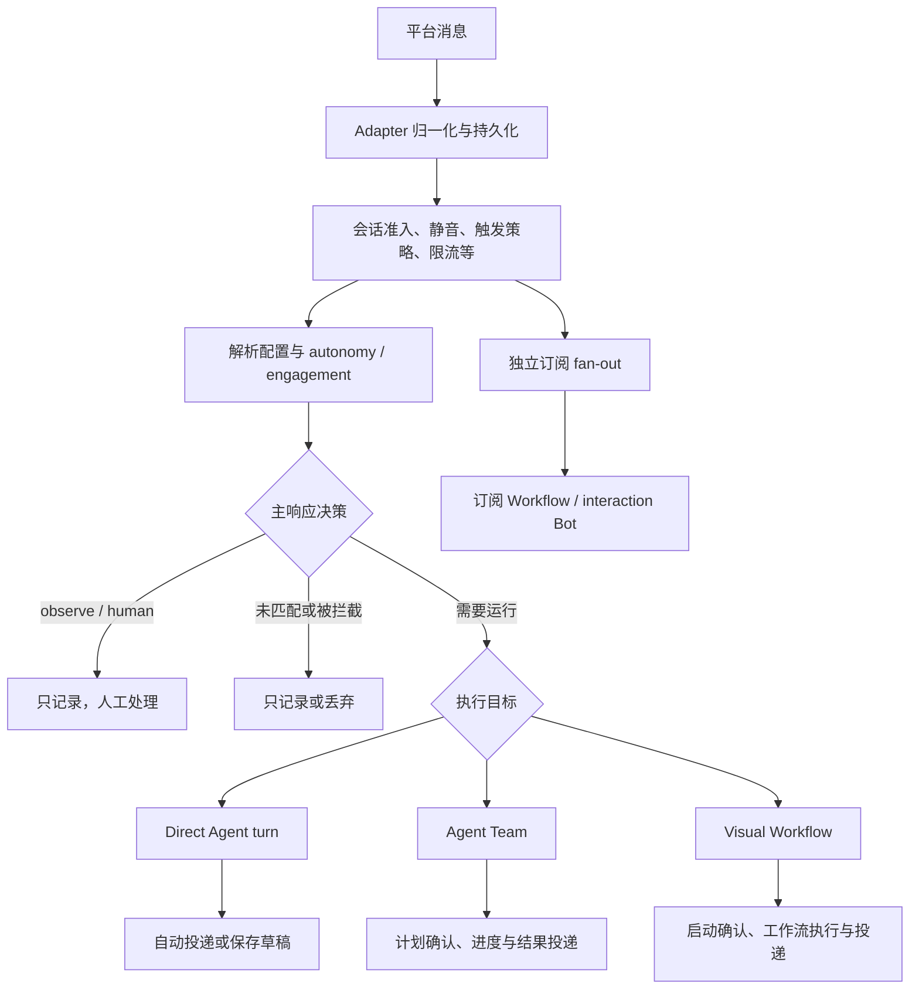

# Cognia 的 Bot 模式到底是什么

研究日期：2026-10-28（Asia/Shanghai）。依据当前工作区源码；工作区已有其他未提交改动。本文解释实现与边界，不代表所有平台、模型和设备已通过真实联调。

## 先建立一个可用的理解

目前并没有一套平铺的“所有 Bot 模式”。产品同时把**响应方式、执行目标、Agent 配置、后台运行管理、模型协作策略**叫作模式，其中至少三处使用 `delegate`，实际含义不同。

对于飞书、Telegram、Slack 等 IM Bot，最有用的理解是依次回答：

1. **这条消息要不要处理？** 群聊激活、触发规则、限流、静音等决定。
2. **由谁处理？** 单 Agent、Agent Team、Visual Workflow 三种目标。
3. **自主做到哪一步？** 自动处理、需要人工确认、只记录。
4. **如何跟踪工作？** 普通轮次，或提升成可交接和跟踪的 Delegation。
5. **在哪台机器处理？** 本地桌面或 headless brain；浏览器和手机通常是控制端。

这些可以组合。选了“助理”并不等于选了“单 Agent”；选了“委派”也不等于系统自动拆任务、自动组建多 Agent 团队。[S1][S2][S3]

| 产品中出现的概念                    | 它真正控制的事                                    | 当前主要实现                                    |
| ----------------------------------- | ------------------------------------------------- | ----------------------------------------------- |
| 助理 / 委派 / 草稿 / 静默           | IM 会话的响应行为预设                             | `lib/connectors/composition/im-mode-presets.ts` |
| Direct / Team / Workflow            | 谁执行这次 IM 请求                                | `effective-config.ts`、`runtime.ts`             |
| Standard、Minimal、Code、Creator 等 | Agent 的提示词、工具与组合配置                    | `lib/agent/composition/preset-catalog.ts`       |
| `/delegate`                         | 把已在进行的工作提升为可跟踪的 Delegation         | `lib/connectors/commands/delegate.ts`           |
| `/bots` 中安装的 Bot                | 把触发条件、执行器、凭据和策略绑定成自动化        | `lib/bot/`                                      |
| Router + Fusion 的 delegate         | 用 lead/worker/验收流程完成工作区任务并产出 patch | `lib/router-fusion/`、`packages/router-fusion/` |
| native / orchestrated delegation    | 描述子 Agent 与父执行的执行关系                   | `lib/ai/agent/execution/delegation-mode.ts`     |

## IM 会话真正有哪几种行为

当前 Inbox 和连接设置使用同一套四个命名预设。它们不是四个独立执行引擎，而是两个配置轴的快捷组合：[S1][S2]

| 预设             | `autonomy` | `engagement`      | 实际效果                                                             |
| ---------------- | ---------- | ----------------- | -------------------------------------------------------------------- |
| 助理 `assistant` | `act`      | 跟随执行目标      | 自动处理。单 Agent 通常在会话中；绑定 Team/Workflow 后仍按该目标运行 |
| 委派 `delegate`  | `act`      | 显式 `background` | 使用已有的 Team/Workflow 后台执行并回报；没有绑定目标时选项禁用      |
| 草稿 `draft`     | `suggest`  | 跟随执行目标      | 引入人工确认，但确认点因执行目标不同，见下表                         |
| 静默 `silent`    | `observe`  | `human`           | 主响应路径不调用 Agent，由人回答；仍记录已接纳的消息                 |

`custom` 是高级轴组合的显示结果，不是第五个可直接选中的预设；例如 `confirm`、`autopilot` 可出现为高级组合。旧枚举 `ConnectorMode = auto | manual | draft` 仍保留作兼容镜像。主要入站路由优先读取新的轴配置，所以搜到“三种模式”和 UI 的“四种模式”并不矛盾。[S1][S2][S4]

两个容易造成误解的细节：

- **“助理”和“委派”并不互斥地对应单 Agent / 多 Agent。** 助理不固定 `engagement`；绑定 Team 后它会派生为 `background`，再按轴反向投影时可显示为“委派”。切回助理会清掉显式 background，但保留 Team 绑定，因此仍可跑后台、chip 仍可能显示委派。仅切换行为预设不能回到单 Agent，还需改变执行目标。[S1][S2]
- **Direct 的 `background` 还没有一个独立的后台单 Agent 选择分支。** 预设层主动禁用 Direct 的“委派”；高级编辑器仍能表达 background，但 `runtime.ts` 的实际分支主要由 Team/Workflow 目标决定。不能据此承诺“单 Agent 委派引擎”已独立完成。预设文件里“单 Agent 不创建 ExecutionRun”的旧注释也已落后：当前 Direct 实际会创建 `kind: agent-turn` 的 ExecutionRun；缺的是该选项所表达的完整参与语义。[S1][S3]

### “草稿”对三个执行目标不是同一种行为

| 执行目标        | `suggest` 的实际确认点                     | 确认前做了什么                                         |
| --------------- | ------------------------------------------ | ------------------------------------------------------ |
| Direct 单 Agent | 生成回复后存入 `connectorDrafts`，由人发送 | 已调用模型生成回复；生成时 ask-tier 工具被拒绝         |
| Agent Team      | 设置 `requirePlanApprovalFloor: true`      | 团队准备计划，计划获批后执行；不是最终回复的发送前审核 |
| Visual Workflow | `holdWorkflowDispatchForApproval`          | 先持有启动请求，获批后才启动 Workflow                  |

所以 UI 的通用说明“写好回复，等你确认后再发”只精确描述 Direct。对 Team/Workflow，统一的是“人工确认”的意图，实现上的确认对象分别是计划与启动请求。[S3]

### “静默”不等于关闭所有自动化

主响应路由在 `observe` 或 `human` 时返回 `manual-store`，不跑回复轮次。但 ConnectorBus 的独立订阅 fan-out 条件是“没有被 policy blocker 拦截且 decision 不是 drop”，因此已接纳的静默会话消息仍可触发订阅的 Workflow 和 `interaction` Bot。要停止这类自动化，需要停掉相应订阅/触发器或使用适用的拦截配置。[S4][S5]

## 一条 IM 消息实际上怎么走

图中的 fan-out 仍受自己的触发条件及 bus 的 blocked/drop、防 Bot 循环检查约束，不是无条件执行。[S3][S4][S5]

配置也有多个维度的优先级，不宜用一句“会话覆盖默认值”概括全部：

- 行为轴通常由会话覆盖优先，其次 Adapter 轴默认，再由兼容 mode 和目标派生。如果会话显式设置旧 `mode`，会压过 Adapter 的轴默认，避免 `/mode manual` 后 Bot 仍回复。[S6]
- 旧 mode/角色的推荐值由 `resolveBinding` 处理：Adapter 默认 → Character 推荐 → 会话覆盖。[S7]
- 执行目标由 `resolveEffectiveRouting` 处理，会话、分配、调度规则和 Adapter 默认参与解析；存在 Team 时运行分支先于 Workflow。[S3][S6]
- 单 Agent 的 provider/model 可由会话覆盖、绑定 session、Adapter 默认依次提供；Team/Workflow 的模型标为 `target-managed`，由目标自行管理。[S6]

新建 Adapter 的表单通常写 `defaultMode: auto`。但它不等于“收到的一切都回复”：默认触发策略、群聊激活和平台收件能力还要放行。个人微信尤其只默认响应明确寻址，不自动回复其所有私信。默认 `mention_activates` 也仅对显式 thread 的延续生效，普通群仍每次要求寻址；还受平台是否已验证可接收未提及消息的限制。[S8]

## `/mode delegate` 和 `/delegate` 是两件事

前者修改该会话今后的响应配置；后者寻找当前已存在的 Agent turn / Team / Workflow 工作，将其通过 `acceptDelegation`、`adoptIntoDelegation` 纳入 Delegation 管理。`/delegate` 自己不启动新的执行引擎，没有可接管工作时会拒绝。[S9]

这解释了一个常见场景：切换到“委派”负责下一次消息如何运行；把一项已经在跑的工作提升成 Delegation，负责这项工作的持久跟踪、交接和控制。两个入口可以配合，但不是同一个开关。[S9]

## `/bots` 的 Bot 是另一层自动化

它的核心单位是 **Definition → Installation → Delivery → ExecutionRun**：Definition 描述做什么，Installation 绑定作用域/配置/凭据/策略，事件匹配后为每个 Installation 产生独立 Delivery，再由 Host 的 runner 领取执行。[S10][S11]

它提供六类触发器：`interaction`、`event`、`schedule`、`poll`、`derivedState`、`manual`；四个执行器：

| 执行器       | 复用的能力                                             |
| ------------ | ------------------------------------------------------ |
| `workflow`   | 执行已发布的 Workflow deployment，而非编辑中的草稿     |
| `squad`      | `startSquadRun`，支持计划审批和等待团队完成            |
| `agent-turn` | 有边界的一次 Agent turn，需要 Character 和有效工作目录 |
| `handler`    | 插件提供的代码，通过持久 step 组合动作、等待与审批     |

本地 Creator 定义不能使用 `handler`，因为数据库行本身没有可加载的代码模块；插件定义才可提供它。插件定义来自启用插件的 registry overlay，本地定义来自 `botDefinitions`，目录将二者合并。[S10][S11][S12]

当前仓库有实际源码的例子包括 Schedule digest、GitHub Comment Bot、GitHub Devin Bot、PagerDuty On-Call Responder，均使用 `handler`。这说明该层不是只有类型声明；但“仓库有定义”不等于用户机器已经安装、配置、绑定凭据并启用。PagerDuty 的事件 trigger 还明确默认未启用。[S13]

它不成为 IM 的第四种执行目标。`interaction` Bot 作为消息流观察者，与主回复路径并行触发，因此同一条消息既可以驱动当前回复 Agent，又可以触发独立 Bot 自动化。[S5]

Delivery runner 使用 lease、并发键、重试与 dead letter。等待人或事件时会 park，保留并发语义；已完成 step 记录输出，恢复时复用，避免简单重入重复完成的步骤。该语义与普通 IM turn 的恢复不同，不能把两套恢复机制混为一谈。[S11]

## 哪些端真的在跑

- 桌面通过 `BotRuntimeInitializer` 启动 runner，要求 `always-on` 且没有远程 Host 处于活动状态；有 Web Lock 避免一个 origin 内多 webview 重复 drain。headless brain 通过 runtime roster 注册同一类 runner。[S14]
- 普通 standalone 浏览器没有长期 Bot runner；配对后的浏览器/手机通过 Host 控制与查看。驱动远程 Host 的桌面也停掉本地 runner；同步镜像的 Delivery 和 Installation 还有执行/调度 fence。[S14][S15]
- IM Connector 的桌面与 brain 复用 `installConnectorRuntime`。Rust 负责接入服务、Webhook 验证、连接及 runtime lease 等基础设施，TS 负责行为解析和目标调度；不是 Rust 中另有一套“个人助手/委派”引擎。[S16]
- 安装状态 `enabled` 不是保证运行：还可能缺 definition/handler、被移动到另一 Host、没有工作目录，或执行所需配置不完整。源码中存在对应拒绝路径。[S10][S12][S14]

## 另外几组模式，应该单独理解

1. **聊天 Agent 预设。** 内置 Standard、Minimal、实验性的 Code、开发者可见的 Creator，以及领域预设；再合并自定义和启用插件贡献。旧 general/plan/build/workflow 映射到 Standard 加轴覆盖。`personal` 的“个人助手”文案只是 custom mode 分类的默认提示词，不能据此认定存在第五个 IM 响应模式。[S17]
2. **聊天编排。** 当前聊天选择支持 direct/team/verified-fresh-agent；`@mention` 子 Agent、`/workflow` 又有各自入口。与 IM 行为预设、Bot 安装是可组合关系。[S18]
3. **Router + Fusion。** 独立 opt-in，默认关闭，并要求主开关和对应 surface 显式开启。聊天 chip 有 auto/direct/cascade/panel；某些 Agent/Workflow 入口还支持 delegate。这里的 delegate 执行工作区 lead/worker/可选 reviewer/验收及 patch 流程，默认 `patch_only`，写回 workspace 还需审批。[S19]
4. **native / orchestrated delegation。** 是子执行关系的分类语汇。尤其 plugin agent SDK 的 dispatch 在调用后记录该分类用于 observability，不能看到名字就推断它会动态切换另一套引擎；该路径仍创建独立 top-level session。[S20]

## 现阶段最值得澄清的产品问题

这些是基于实现的解释与建议，不是本次已经修改的功能：

- 保留“响应方式”（自动 / 需确认 / 只记录）与“执行目标”（Agent / Team / Workflow）两个可解释的控制；把后台执行显示为目标与参与方式的结果。
- 对不同 target 显示准确的确认对象：发送回复、执行团队计划、启动工作流。
- 将 `/delegate` 描述成“将当前工作纳入持续跟踪与交接管理”，避免与“今后响应方式”使用同一句文案，也避免暗示该命令会改变执行方式。
- 将 `/bots` 明确标为“事件自动化”，并显示实际运行 Host；将 Router + Fusion 的 delegate 明确标为“工作区任务/补丁委派”。
- 修正文案及旧注释漂移，特别是 Direct 的 background 限制与“草稿”的目标差异。

## 验证范围

本次只新增研究文档，未改产品代码、未发送消息、未调用真实模型。已完成 focused Jest：

- Bot/IM 研究：7 suites、115 tests 通过，覆盖预设、兼容映射、路由、有效配置、bus 轴路由、Bot 目录及执行器表。
- 补充模式研究：4 suites、37 tests 通过，覆盖 `/delegate`、聊天编排可用性、执行关系分类与旧模式映射。
- 合计 **11 suites / 152 tests 全通过**。未执行真实 IM、桌面/手机、外部 Agent 或云端 Host E2E；因此本文不声称已验证实际安装状态和线上收发行为。

## Sources

- [S1 — IM 四预设及禁用条件](../../lib/connectors/composition/im-mode-presets.ts#L37)，[Inbox 入口](../../components/inbox/mode-switcher.tsx#L88)。
- [S2 — 旧 mode 与组合轴映射](../../lib/connectors/composition/mode-projection.ts#L35)。
- [S3 — IM 三目标实际分支](../../lib/connectors/runtime.ts#L1549)，[Team 确认](../../lib/connectors/runtime.ts#L1733)，[Workflow 确认](../../lib/connectors/runtime.ts#L1829)，[Direct 建立执行记录](../../lib/connectors/runtime.ts#L2145)，[Direct 保存草稿](../../lib/connectors/runtime.ts#L2723)。
- [S4 — 从组合轴路由](../../lib/connectors/mode-router.ts#L48)。
- [S5 — Connector fan-out](../../lib/connectors/bus.ts#L1330)，[Bot 作为观察者](../../lib/bot/sources/connector-inbound.ts#L1)。
- [S6 — 有效配置与优先级](../../lib/connectors/effective-config.ts#L84)，[轴覆盖规则](../../lib/connectors/effective-config.ts#L232)。
- [S7 — Adapter / Character / 会话绑定解析](../../lib/connectors/policy-resolve.ts#L54)。
- [S8 — 默认触发策略](../../packages/plugin-contract/src/types/connectors/policy.ts#L81)，[个人微信创建默认值](../../components/settings/connections/forms/wechat-personal-config.tsx#L143)，[群聊/线程准入](../../lib/connectors/conversation-admission.ts#L151)。
- [S9 — /delegate](../../lib/connectors/commands/delegate.ts#L1)。
- [S10 — Bot 表结构](../../lib/db/bot-types.ts#L1)，[目录合并](../../lib/bot/console/catalog.ts#L86)，[安装解析与可运行检查](../../lib/bot/installed-bot.ts#L118)。
- [S11 — Bot 运行](../../lib/bot/runtime/run.ts#L209)，[Delivery runner](../../lib/bot/runtime/delivery-runner.ts#L97)，[持久 step](../../lib/bot/runtime/step.ts#L1)。
- [S12 — 触发器与执行器契约](../../packages/plugin-contract/src/types/plugin/plugin-bot.ts#L136)，[执行器表](../../lib/bot/runtime/executors/index.ts#L16)，[Workflow](../../lib/bot/runtime/executors/workflow.ts#L1)，[Squad](../../lib/bot/runtime/executors/squad.ts#L1)，[Agent turn](../../lib/bot/runtime/executors/agent-turn.ts#L78)。
- [S13 — Schedule digest](../../plugins/cognia-scheduler-tools/src/bot.ts#L145)，[GitHub Comment Bot](../../plugins/github-comment-bot/src/index.ts#L15)，[GitHub Devin Bot](../../plugins/github-devin-bot/src/index.ts#L14)，[PagerDuty 定义](../../plugins/pagerduty/src/index.ts#L673)，[PagerDuty 注册](../../plugins/pagerduty/src/index.ts#L924)。
- [S14 — 桌面 Bot runner 启动](../../components/providers/initializers/bot-runtime-initializer.tsx#L38)，[brain 注册](../../lib/headless/runtimes/bots.ts#L23)，[运行端解析](../../lib/bot/console/runtime-reach.ts#L73)，[Host control route](../../lib/bot/control-writes/route.ts#L108)。
- [S15 — 镜像 Delivery fence](../../lib/db/bot-event-deliveries.ts#L65)，[镜像 Installation 调度 fence](../../lib/bot/schedule/reconcile-timed-triggers.ts#L150)。
- [S16 — Connector 桌面启动](../../components/connectors/connector-bus-provider.tsx#L1)，[共享 bootstrap](../../lib/connectors/bootstrap/install-connector-runtime.ts#L318)，[brain seams](../../lib/headless/runtimes/connector-runtime.ts#L1)，[Rust Webhook 验证](../../crates/cognia-connectors/src/axum_app.rs#L975)，[Rust 启动命令](../../crates/cognia-connectors/src/commands.rs#L146)。
- [S17 — Agent preset catalog](../../lib/agent/composition/preset-catalog.ts#L54)，[聚合目录](../../lib/agent/composition/app-preset-catalog.ts#L1)，[旧 mode 映射](../../lib/agent/composition/legacy-mode-mapping.ts#L33)，[personal 分类提示词](../../stores/agent/custom-mode-store/helpers.ts#L158)。
- [S18 — 聊天编排](../../lib/agent/composition/chat-orchestrations.ts#L40)。
- [S19 — Fusion 开关](../../packages/router-fusion/src/settings/switches.ts#L65)，[聊天 Fusion chip](../../stores/chat/fusion-mode-store.ts#L23)，[显式运行边界](../../lib/router-fusion/gate/explicit-run.ts#L66)。
- [S20 — 子执行分类](../../lib/ai/agent/execution/delegation-mode.ts#L1)，[plugin dispatch 中的分类记录](../../lib/plugin/agent-sdk/dispatch.ts#L378)。
