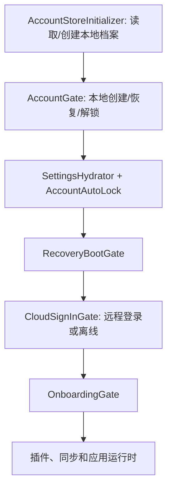

# 账户启动、远程身份与空闲锁定审计

日期：2026-10-30。范围：当前共享 working tree 的源码、既有测试和隔离故障注入。只做研究，没有修改账户实现、操作真实账号、读取用户密码或触发同步上传。

证据账本：[account startup lock lifecycle audit](../evidence/2026-10-30-account-startup-lock-lifecycle-audit.md)。研究脚本和日志保存在 `.cache/account-lifecycle-audit/`。

已按同日[对抗性复核](2026-10-30-account-adversarial-review.md)修订：F4 改列为明确存在的产品策略，F6 降为 P2，F7 降为 P3 并补充 store 合并保护；新增 F8。独立子审查因模型容量不足未完成，复核证据来自当前源码和加强后的可执行反例。

## 结论

账户体系确实存在需要优先修复的身份一致性和生命周期问题。用户指出的“两次账号流程”，在 production Browser 上成立；正常 Tauri 和 native Capacitor 已经自动创建本地加密档案，通常不要求用户手动注册本地账号。

更深的问题是：LocalProfile、远程 Person、登录 Session、同步 Space、设备自动解锁和 UI 锁定分别由不同模块决定，跨模块约束没有完整落地。已有测试能证明各模块当前的行为，却没有完整约束“登录失败后不能变成另一人”“退出后不能恢复凭证”“换人不能接管原数据”“旧锁定请求不能锁住新档案”。

用户已明确：“休眠”指离开一会儿后锁定、回来需要解锁。对应实现是 idle account lock，并非 OS sleep。

## 实际概念与启动顺序

| 概念                                  | 实际职责                                 | 当前拥有者                                         |
| ------------------------------------- | ---------------------------------------- | -------------------------------------------------- |
| LocalProfile，代码仍常称 LocalAccount | 本机数据分区、本地密码、内容密钥、数据库 | `stores/account/account-store.ts`、`lib/accounts/` |
| Person / User                         | 远程人的身份以及外部身份映射             | `lib/identity/`、`UserBindingRegistry`             |
| OIDC Session                          | 当前 issuer 的 access/refresh token      | `lib/logto/app-session.ts`、`session-store.ts`     |
| Sync Space                            | 某 issuer 下某 Person 的加密同步空间     | `lib/account-sync/sync-session.ts`                 |
| Device unlock                         | 本机是否从安全存储自动打开档案           | `lib/accounts/desktop-local-account.ts`            |
| Idle lock                             | 是否因无操作关闭本地数据访问和运行时     | `hooks/account/use-auto-lock-on-idle.ts`           |

ADR-0149 已明确区分 profile 和 account；用户界面仍有“创建本地账户”“Cognia 账号”两个连续概念。物理数据分区可以有必要，但不能据此推出用户必须完成两次注册。

当前组件顺序来自 `components/runtime/app-runtime.tsx:166–240`：



这也意味着空闲计时器先于远程登录和 onboarding 挂载。对于有非零超时的密码档案，停在远程登录流程中也可能触发本地锁定。这是静态可达性结论，未做真实 OAuth 过程中的计时验收。

| 环境                              | 首次本地步骤                                                             | 后续远程步骤                                             |
| --------------------------------- | ------------------------------------------------------------------------ | -------------------------------------------------------- |
| Browser production，普通应用入口  | 手动输入本地名称/密码，然后确认已保存本地 recovery key                   | 再按部署发现结果显示团队登录或官方登录；官方登录可选离线 |
| Tauri，正常配置，dev/prod         | 自动建立 device-managed LocalProfile；随机凭据保存在 native secret store | 生产版再决定远程登录；dev 通常跳过                       |
| Native Capacitor，正常配置        | 自动建立历史 `local_acct_a` namespace 的本地加密档案                     | 后续按部署/配对及远程 gate 决定                          |
| Browser development               | 可自动建立并打开 disposable dev profile                                  | 默认跳过 cloud gate                                      |
| 强制 `NEXT_PUBLIC_ACCOUNT_GATE=1` | 关闭自动档案/解锁便利路径，用于测试真实门禁                              | 不应据此判断正常发布版体验                               |

例外：公开分享链接有 guest 路径；callback、invite、pair、onboarding 对 cloud gate 有豁免，但这不代表它们全部绕过外层本地 gate。

源码依据：`account-store.ts:762–878`、`account-gate.tsx:186–250,301–379`、`cloud-sign-in-gate.tsx:195–208,314–420`。正常启动的本地状态仍需要先准备好，是当前实现依赖；这不等于必须先显示“本地账号注册”界面。

## 已复现的身份问题

以下 P1 表示建议优先修复，不代表已证明远端越权或实际数据泄露。

### F1 / P1：被拒绝的另一人登录仍能替换已保存 token

链路：`signInToLogto` 先保存 session（`lib/logto/app-session.ts:111–120`），`signInToOfficialAccount` 后调用身份绑定（`lib/identity/personal-sign-in.ts:110–122`）。绑定检测发现 profile 已属于 Alice 时会拒绝 Bob，但这条失败路径没有恢复原 session。

随后 `readCloudSessionState` 只判断绑定是否存在（`lib/identity/cloud-session.ts:134–159`），没有验证该绑定的 issuer/subject 与当前 token 一致。身份摘要又优先采用旧绑定，于是形成“显示 Alice，拿 Bob token”的混合状态。

隔离复现实际执行上述读取模块和 claims 解析函数，注入 Alice binding 与 Bob session，输出：

```text
cloudStatus=active
displayedUserId=usr_alice
displayedName=Alice
tokenSubject=usr_bob
syncUserIdWithoutBindingLookup=usr_bob
```

`officialSyncSession` 直接根据官方 token 的 subject 选择同步空间（`lib/account-sync/sync-session.ts:46–65`），不读取 profile binding。它检查了 token 之后不能变成另一个 subject，却没有检查最初选中的 subject 是否属于这份本地数据。

影响：UI、协作上下文和同步上下文可能对当前人给出不同答案。没有执行 enrollment、capture 或上传，不能声称 Alice 数据已经上传到 Bob 空间。

既有测试缺口：`cloud-session.test.ts` 覆盖匹配/缺失绑定，没有不匹配绑定；`personal-sign-in.test.ts` 检查拒绝错误，没有检查拒绝后保存的 session。

对抗复核进一步组合实际 `personal-sign-in` → `app-session` → `session-store` → `keyring` 和实际 `completeSignIn` → `bindSignedInIdentity` → `UserBindingRegistry`，只替换 issuer/native storage 等外部边界，确认“拒绝 Bob 后仍持久保存 Bob token”。原反例预先注入混合状态的证据缺口已补强；没有把这视作真实 provider 验收。

### F2 / P1：退出完成后，进行中的 refresh 可以重新写回 session

refresh 只与其他 refresh 串行（`lib/logto/app-session.ts:163–175`）。sign-out 没有参与同一锁，也没有递增让旧操作失效的 generation。

可复现顺序：refresh 发出 → sign-out 清理并返回 → 延迟 refresh 返回 → `app-session.ts:193` 保存新 session。实际输出：

```text
clearedAtLogoutReturn=true
sessionRestoredAfterLogout=true
```

退出清理位于 `app-session.ts:368–369`，无法阻止在它之后才到达的旧请求结果。此结论限于本地凭证恢复；真实 issuer 对 revoke 与已发出 refresh 的交错语义未验收。

同日加强反例还确认：旧 Alice refresh 在新 Bob session 已保存后成功返回，会覆盖 Bob 的 session。成功 refresh 的提交缺少新旧操作校验，风险不只发生在 logout。

### F3 / P1：退出删除所有者绑定，另一人可接管保留数据的 profile

Settings 的退出路径为 `components/account/manage/account-identity-tab.tsx:67–70` → `signOutFromLogto` → `completeSignOut`。后者在 `lib/identity/complete-sign-in.ts:103–104` 删除 binding；本地数据保留。

同一 profile 再登录 Bob，`UserBindingRegistry.bind` 找不到 Alice 的记录，就会接受 Bob。真实 registry 函数配合内存存储的复现：

```text
bobRefusedBeforeSignOut=true
bobAcceptedAfterSignOut=true
```

这是明确的契约冲突：[ADR-0215 §10](../content/docs/en/adr/0215-one-person-one-encrypted-sync-space-many-writable-hosts.md) 要求退出后保留数据及 outbox，只允许同一 Person 恢复；不同 Person 必须使用新 profile。旧实现把“退出会话”当作“解除数据所有者”。

当前登录调用链不检查本地数据是否非空。同步密钥按 profile/space 隔离，因此不能把这个缺陷直接等同于自动上传。后续若 Bob 明确完成自己的设备 enrollment，且远端日志为空，`lib/account-sync/data/join.ts:125–128` 会对已有本地数据选择 `seed`，也没有补上所有权检查。这是需要隔离端到端验证的后果。

### F8 / P1：原生凭据删除失败，退出仍报告已清除

`clearLogtoSession` 调用 `clearSecret(ref)` 时没有启用 strict 模式（`lib/logto/session-store.ts:137–140`）。Tauri 的非 strict delete 经 `lib/keyring/index.ts:46–52,118–124` 将 IPC 错误记为 warning 后返回成功。`signOutFromLogto` 随后无条件返回 `cleared: true`，Settings 继续 `completeSignOut` 删除 binding。

对抗反例执行实际 `app-session`、`session-store`、`keyring`、`completeSignOut`，仅注入 native delete 失败及 issuer 暂不可达，得到：

```text
reportedCleared=true
persistedSessionStillReadable=true
bindingDeleted=true
```

相同 fixture 以 `{ strict: true }` 调用删除会正常拒绝，说明当前退出路径没有使用已有错误传播能力。已证明 Tauri 失败分支；Mobile 和 Browser 也有吞掉删除错误的源码路径，但本轮未执行这些平台的删除故障实验。真实 issuer 若已成功撤销 token，仍存储 token 不等于它继续有效；本反例专门保留了 issuer 不可达条件。

## 空闲锁定行为与缺陷

当前默认值是 `lib/db/settings.ts:243` 的 `accountAutoLockMinutes: 0`。保留非零设置的档案会继续启用自动锁定；把默认值改成 0 不会自动改变既有保存值。没有读取用户正在使用的 settings，不能断言其本机具体配置。

开发构建默认不启用 idle lock，除非强制 account gate；自动打开的 device-managed/remembered profile 也跳过（hook 的 `78–96` 行）。这会让普通 dev 环境难以发现发布版密码档案的问题。

### F4 / 产品策略待决：任务是否被打断，取决于是否切回窗口

`onExpire` 在第一个空闲窗口到期时，如果有 `streaming` 或 `awaiting_approval`，会延期到第二个窗口（`hooks/account/use-auto-lock-on-idle.ts:137–153`）。

但 `focus` / `visibilitychange` 调用 `arm`，超过第一个窗口就直接 interrupt + lock（同文件 `124–132,160–171`），绕过了任务延期判断。

5 分钟设置的实际 probe：不切窗口，5 分钟时仍保留任务，最迟 10 分钟打断；在 5 分钟时切回窗口，马上打断并锁定。hook 的 `16–28` 行注释及既有测试已经明确记录这两套策略，因此不能仅凭两者不同判为实现 bug。它可以解释用户感到突兀的体验；是否统一，需要产品明确。

### F5 / P1：等待 interrupt 没有上限，可能一直不进入真正的 lock

`lockNow` 先 `Promise.allSettled(interruptSession(...))`，结束后才调用 store 的 `lock()`（同文件 `114–121`）。`allSettled` 能处理 rejection，无法处理永不 settle 的调用。

故障注入让 interrupt 不返回，虚拟时钟推进 30 分钟后，`lock()` 调用数仍为 0。这个缺口发生在 store 的 lock 之前，所以 store 内部加固无法弥补它。

生产路径也没有在这段调用上建立上限：`lib/claude/ipc.ts:325–334` → `TauriTransport.call` 的原始 `invoke` → `crates/cognia-sidecar/src/commands.rs:470–480` → `supervisor.rs:442–454` 的 stdin lock/write/flush。最后一段没有局部 timeout。未制造真实卡死 sidecar，实际发生频率未知。

范围修正：这里的无上限生产路径具体指 Tauri local transport。`CompanionTransport.call` 在 `lib/tauri/transport-companion.ts:1027–1043` 有自己的 timeout，不能把“可能无限等待”推广到所有远程连接。加强 probe 使用实际 store，确认 interrupt 不 settle 时尚未进入 store 的同步 crypto revoke。

### F6 / P2：旧档案的异步 interrupt 返回后会锁定新档案

`lockNow` 不捕获/检查 account id、`accountRevision` 或 effect 取消状态。A 开始 idle interrupt，用户切换到 B 后，旧 Promise 继续执行 `useAccountStore.getState().lock()`，锁的就是当时的 B。

probe 在 interrupt pending 时 rerender 为 B，再 resolve A 的 interrupt，记录得到 `lockedProfiles=[profile_B]`。effect cleanup 只取消 timer/listener，没有取消已经启动的异步链。

对抗复核替换原来的 fake store，组合实际 hook 和当前 `createAccountStore`，调用实际 `switchAccount` 成功打开 B，卸载旧 hook 后再交付 A 的 interrupt，B 仍变为 locked。当前 store 的 `authenticationGeneration` 和 `accountRevision` 保护不能撤销一个尚未进入 store 的旧 hook continuation。此项已确认可达，但证据是错误锁定/中断风险，不是已证明的数据损坏，故从 P1 降为 P2。

### F7 / P3：focus 和 visibility 可以重复发出 interrupt

到期后先发送 visible event，再发送 focus event，probe 记录同一个 session 被 interrupt 两次。hook 没有 pending 标记。当前 store 的 `pendingLock` 已合并同时到达的 lock；实际 hook/store 组合反例得到“两次 interrupt，一次 subscriptions teardown”。因此目前只能认定重复命令，不能声称已证明重复拆卸或数据损坏。此项从 P2 降为 P3；旧 continuation 错锁新档案仍由 F6 单独覆盖。

空闲锁定也不只是显示遮罩：AccountGate 收起 children，store 撤销内容 cipher、停止 subscriptions、拆除 plugin/subscription runtime、解除 native account context 并清空数据库选择；同步 engine 的组件 cleanup 会 `engine.stop()`。因此它与后台任务持续运行有直接耦合，不能将其视作纯 UI 休眠。

## 设计方向

1. **数据所有者与登录会话分离。** profile 持久保存所属 issuer/Person；退出仅结束 session 和当前授权。匿名档案首次绑定、导入已有本地数据、显式迁移所有者应有不同操作；跨 Person 默认使用另一份 profile。
2. **登录提交必须保持一致。** candidate token 先验证/校验 binding，再整体提交；失败时不能覆盖当前 session。异步结果按 profile 和 auth generation 校验。sync 与 cloud UI 使用同一个一致性判定。
3. **统一首次打开的用户流程。** 首屏提供“登录 Cognia”和“仅在此设备使用”；local profile 是底层数据/密钥容器。native 可以沿用自动容器。Browser 仍需解决本地 vault 密钥的持久化、恢复和离线访问，不能把密码硬编码或写 localStorage 来消除步骤。
4. **把自动打开与再次锁定拆为两个策略。** 当前“启动自动打开 ⇒ 不允许 idle/manual lock”是明确实现选择，不是必然结论。可以设计启动恢复、本次会话锁定和再次认证各自的边界，再统一所有入口的行为。
5. **统一空闲期限与后台任务政策。** timer、focus、visibility 使用同一判定。锁定先撤销数据访问权限，后台停止在有界预算内进行；旧 operation 无权影响新 profile。后台任务能否在 UI 锁定后继续，取决于它属于哪个执行主体、需要哪些密钥和授权，不能仅靠延长 timer。

这些是研究建议，没有实施。尤其 Browser 凭据恢复、默认超时和锁定期间后台执行的取舍，仍需方案阶段确定。

对抗复核补充：登录事务、同步身份校验与错误传播可以先修；“首屏登录优先”“记住设备但仍允许锁定”“锁定后后台继续”属于候选产品方案，尚未通过密钥恢复、授权隔离及三端运行时验收，不能当作已验证的修复设计。

## 验证与未覆盖范围

- 既有 focused suites：12 suites、370 tests 通过。
- 额外 auth/sync/runtime 边界 suites：6 suites、69 tests 通过。合计 18 个既有 suites、439 tests，未启用 coverage。
- idle probes：4 个断言当前异常行为的测试通过。它们是在 `.cache` 运行的研究样本，尚未加入正式 regression suite。
- identity repro：3 个隔离反例均由脚本成功断言。采用当前 TypeScript 函数体、内存存储与注入依赖；未做签名真实性、真实 OIDC 或云端权限验收。
- 初次 `pnpm test` 触发 pnpm 自动依赖安装，在已有 sidecar linked-package export-condition 检查失败。随后设置 `pnpm_config_verify_deps_before_run=false`，仍通过项目 `pnpm test` runner 使用已安装依赖完成以上验证；没有修复无关构建问题。
- cloud gate 测试有 React `act(...)` warning，测试退出码为 0。
- 研究期间存在并发源码修改；`source-sha256.txt` 记录关键模块快照。发现 account-store 锁定实现变更后单独重跑其测试，结果见 `current-account-store-tests.log`。
- 对抗复核：7 个既有 suites / 249 tests 通过；原 4 个 hook probes 与新增 3 个实际 store 组合 probes 合计 7 tests 通过；另有 3 个加强 source-module 反例成功断言。次数与初轮测试存在重叠，不相加为独立总量。
- 未执行 production static build、真实 Browser UI、Tauri/mobile smoke、真实 issuer 登录/退出、enrollment 或跨人同步上传。未进行全仓 lint/typecheck，任务只新增研究文档和隔离脚本。

不能据此认定用户当次锁屏的精确触发时间、当前保存超时，也不能把上述状态反例当作已发生的数据泄露。下一步的实现应先修复 F1/F2/F3/F5/F8，修复 F6 的错误锁定，再独立确定首启和锁定策略。
