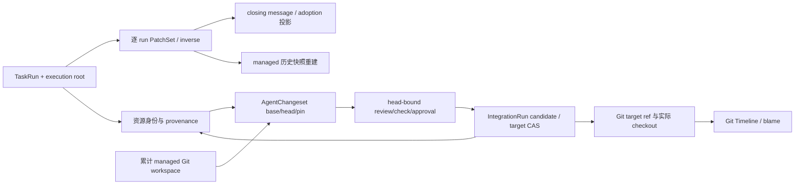

# Turn diff、AgentChangeset 与工作区历史的联合审计

日期：2026-11-10（Asia/Shanghai）。本轮是在[turn diff 审计](2026-11-10-turn-diff-gap-audit.md)及[对抗性复核](2026-11-10-turn-diff-adversarial-review.md)上的范围扩展，对应 ledger 的 G5：把已有 agent changeset、工作区历史和相关恢复/交付能力放在一起考虑。

## 结论

不能把 turn diff 作为独立产品重新建设。当前已有多套**职责不同**的记录和操作：逐次运行的 PatchSet、累计 Git AgentChangeset、IntegrationRun、Git/Task Resource history、managed 历史快照、SDK checkpoint、native provenance 和本机 adoption 投影。需要补的是身份关联、严格的代码修订验证、操作一致性与入口覆盖，而不是再建一套 capture/history/merge 服务。

联合检查新增五项明确缺口：**两项 P1（策略检查要求漏传、可变目录冒充 pinned revision）与三项 P2（Bundle adoption 漏投影、并发投影乱序/丢更新、Squad base 目标漂移）**。还有历史浏览、Host API 对齐、restore 并发等单列的源码边界/待验义务。此前17项 turn-focused 缺口不等于完整跨功能架构评审，本报告修正其修复范围和复用方向，不把两个清单简单相加成已实测故障数。

工作树 HEAD 为 `3cf253e34822fb9db76b003e6df6aa8ec8f66529` 加当前未提交源码。三个独立 sweep 分别审查 changeset/integration、历史入口、跨功能一致性；主会话核对调用链并重放探针。产品代码、主工作树 Git index、真实用户文件和 provider 均未修改/调用；临时 Git fixtures 仅在 cache 中创建。

## 现有能力与权威来源

| 产品能力与实际入口                                              | 记录单位和权威                                                                         | 能做什么                                                                                             | 不能混同的语义                                                                                          |
| --------------------------------------------------------------- | -------------------------------------------------------------------------------------- | ---------------------------------------------------------------------------------------------------- | ------------------------------------------------------------------------------------------------------- |
| Chat turn card、Review lastTurn                                 | Host 的 TaskRun/ResourceChange/PatchSet；本机 closing-message row 为入口投影           | 逐轮/逐根文件 diff，保留 applied selection 的文件/hunk Apply 与 inverse Undo                         | 一轮快照不是累计交付 commit；没有可信 provenance 时不能证明全部改动出自 agent                           |
| Source Control → Agent changes                                  | AgentChangeset：workspace、base/head SHA、pinned ref、review/check/approval/dependency | 累计 Git 交付物 review、批准、请求修改、交给 integration                                             | 不自动等于“本轮变化”；不能替代 non-Git 或 hunk-level PatchSet                                           |
| Agent changes → Integrate / integration history                 | IntegrationRun：targetRef、expectedOld/candidate/result SHA、items、op_log             | 组合候选、验证、CAS 发布、整个 integration rollback、恢复中断                                        | rollback 整个集成不是撤一轮/一个文件；一个 root 发布不是跨仓原子发布                                    |
| Source Control → Timeline / 文件菜单 → 查看文件历史             | Git commit/object graph                                                                | repo/file 历史、commit diff/blame、cherry-pick/revert/checkout；单文件 RestoreDialog 可选 commit-ish | Git 历史主要是已提交对象，不包含所有未提交编辑/agent turn；恢复 Git 内容与物理原样恢复不同              |
| Chat dock → Workspace → 当前任务 → 最终账本/时间线              | TaskWorkspace runs/resources/events/patches                                            | 所选 task 内 runs、source/preview/diff、Apply/Undo、事件分页、导出/pin                               | 事件时间线是 metadata；不是每次 watcher event 都有可恢复文件版本                                        |
| Session settings → Execution → 历史快照                         | ready TaskRuns 与 retained baseline/patch blobs                                        | 重建已有 managed execution root 的历史输出；拒绝 Observed Local 和 active 同任务 run                 | 是执行副本重建，不是消息分支、整个对话回退或原始 source 分支 rollback；bundle UI 不代表跨根原子 restore |
| 消息 → 恢复到这里                                               | message→turn row→原 Host/root/run 的 PatchSet                                          | 独立的会话编辑/分支/截断、逐轮文件 inverse、SDK checkpoint 选项                                      | 不可因聊天回退就推定文件和 Git ref 已回退；F18 的多 assistant correlation 仍需修复                      |
| SDK 文件 checkpoint                                             | provider execution handle 与 checkpoint/message ID                                     | dry-run preview 与实际 rewindFiles                                                                   | 需要对应 provider/运行句柄能力；不是通用 Host ledger，也不是所有 agent 都有                             |
| Workspace Manage → Archive/Unarchive                            | Project 元数据的 isArchived                                                            | 隐藏/恢复工作区条目，保留对话等数据                                                                  | 不是代码文件 snapshot、Git archive 或 managed 环境回收                                                  |
| Managed environment Archive/Restore                             | Registry、archive WorkspaceSnapshot、Host blobs                                        | 归档执行目录并按保留策略恢复；所有权/锁/pin/容量保护                                                 | 与 Project archive、TaskRun snapshot、changeset ref retention 都不同                                    |
| Settings → Memory → 回填本工作区的历史 / project_history_search | 历史聊天、tool-result index、project claims/source receipts                            | 只读检索、明确回填、展示知识来源                                                                     | 语义记忆不是磁盘状态或代码恢复点                                                                        |
| Artifact / Canvas / A2UI 版本历史、Harness 版本                 | 各自内容/配置模型版本                                                                  | 预览/比较/恢复内容或配置；A2UI 为有限 undo stack                                                     | 不能据此承诺工作树、branch、PatchSet 同时恢复；需经过真实 materialization/write 路径才涉及文件          |

主要入口源：[Task Resources](../../components/artifacts/workspace-mode/task-resources-panel.tsx)、[历史快照](../../components/chat/session-execution-workspace.tsx#L725)、[RestorePoint](../../components/chat/restore-point-dialog.tsx)、[Timeline](../../components/source-control/timeline-view.tsx)、[Project Archive](../../components/shell/workspace-manage-dialog.tsx#L143)、[Memory history](../../lib/memory/project-history-tool.ts)、[Artifact versions](../../components/artifacts/panel-version-history.tsx)、[Canvas versions](../../components/canvas/version-history-panel.tsx)、[A2UI versions](../../components/a2ui/workspace/version-history-panel.tsx)。

没有发现一个统一 literal 标签“Workspace History/工作区历史”；这不是没有该类能力。用户所说的历史须按上述实际入口与恢复对象解释。

## 不能丢掉的身份和状态边界



- **run 不只有一种。** Chat `runId:number`、native TaskRun `runId:string`、ExecutionRun/attempt/trace 的 ID 不应按同名直接 join。使用明确的 taskWorkspaceRunId、workspaceId、parent/attempt 和 origin。
- **路径不等于权威。** sourceRoot、executionRoot、repoCommonDir、logical root、target-ref stream 不是一回事。相同字符串路径在不同 Host/account 上也不能当同一资源。
- **AgentChangeset 可跨多轮累计。** `runId` 是最新上下文，不代表全部 line origins 来自最后一轮。native freeze 已复制 prior provenance 并显式 Unknown；不能为了补 UI 关联把累计内容全归因到最后回复。[changeset.rs:999](../../crates/cognia-task-workspace/src/changeset.rs#L999)
- **Accepted、Merged、Restored 不应合为一个布尔值。** local PatchSet Applied 与 target ref Published 是不同 stream。发布到结果 branch，并不表示本地 source patch 已应用；integration rollback 也不要求篡改历史 turn snapshot。应记录当前 working/ref 状态转换，同时保留历史事实。
- **哈希域不同。** Git OID、content SHA-256、blob_ref、patch revision、head-bound approval 分别有自己的语义；有相同 SHA 字符串标签不能证明运行目录确实是该修订。

模型源：[TaskWorkspace types](../../lib/task-workspace/types.ts)、[SCM types](../../lib/scm/types.ts#L81)、[native provenance](../../crates/cognia-task-workspace/src/provenance.rs#L190)。

## AgentChangeset 的现有生产者与保护

当前自动生产者包括 Squad merge-all、Best-of-N settled candidate、Harness Git acceptance；普通 chat turn settle 不自动调用 captureChangeset。`SourceControlService.snapshot` 和 Host capture 命令提供显式入口；Agent changes UI 主要操作已有记录，没有 capture/recapture 按钮。因此“有 turn diff 却没有 Agent changeset”可能符合当前产品边界，不能直接称捕获失败。

已有机制应复用：managed GitWorktree + 私有 index、敏感路径/历史拒绝、workingState overlay 扣除、pinned ref CAS 与元数据 version CAS、changed-head recapture 清除旧 gates、head-bound review/check/approval、same-repo/target 校验、dependency ordering/holds、integration worktree 所有权与进程锁、candidate checks、dirty target 拒绝、publish CAS、op_log/recovery/rollback。源：[changeset.rs](../../crates/cognia-task-workspace/src/changeset.rs)、[integration.rs](../../crates/cognia-task-workspace/src/integration.rs)、[lib/scm](../../lib/scm/service.ts)。

这些是实存的保护，不能因为 turn card 的展示或 metrics bug 就断言它们失效。跨仓发布仍是一仓一事务。ADR0227 的 proposed cross-root amendment 写着“未实现”，但当前 coordinator 已有跨 root holds，应以源码为准。Rollback 在目标前进后构造 revert 且不重新 acceptance，是该 ADR 的明确决策，本轮不将它误报为偶然遗漏。

## 联合检查的新缺口

### CF01 · P1 · 手动 integration 丢失 policy-only required checks

[reviewChangeset](../../lib/scm/review/review-changeset.ts#L167) 计算并运行 changeset 与 target policy 的 requiredChecks 并集，但未将 policy-only 要求持久化到 `AgentChangeset.requiredChecks`；check 失败也不直接改变 review approve verdict。手动 [IntegrateDialog:101](../../components/source-control/agent-changes/integrate-dialog.tsx#L101) 仅提交 stored requirements；native [candidate gate:1806](../../crates/cognia-task-workspace/src/integration.rs#L1806) 依据 request/stored requirements，而不会重新发现遗漏的 policy-only profile。

实际 TS policy/review/check/orchestrator、受控 Host/acceptance ports 的探针：policy 要求 `policy-required-unit`，check=failed、review=approve、storedRequirements=[]；manual-style integration 向 prepare/publish 均传 []，未执行 candidate acceptance。fake Host 返回 published；**没有实际执行 Rust publish**，native 缺失要求的影响是源码确认。

正常 Squad 自动 merge-all 显式带上 reviewed policy union；Best-of-N publication 也重验 current policy 并传递并集，不能把本问题推广为所有入口。修复应让策略义务成为受 Host 验证的同一 gate 契约，不依赖 UI 或调用者恰好记得补传。[integrate-team-run.ts:495](../../lib/squads/workspace/integrate-team-run.ts#L495)、[publication.ts:168](../../lib/best-of-n/publication.ts#L168)

### CF02 · P1 · 通用 changeset checks 把可变 executionRoot 标记为 pinned SHA

[changesetRootForRevision:218](../../lib/scm/review/review-changeset.ts#L218) 只比较请求 SHA，直接返回 capture 时的 executionRoot；没有验证当前 tree 或目录存在性。[runtime:99](../../lib/scm/runtime.ts#L99) 把它传到 acceptance。后续 turn、历史 snapshot restore 或 inherited workingState 可使该目录与 headSha 内容不同。

使用实际 TS resolver/acceptance host/report builder、真实临时 Git fixture、**假 sandbox executor**：pinned commit 的 state.txt=`broken`，live 目录为 `fixed`；executor 看到 fixed，报告却 passed 并标记 broken commit SHA。实际 sandbox/Host/provider 没有运行；探针证明 source boundary 信任错误，不冒充完整 gate 交付测试。

已有正确范式：[Best-of-N checks.ts:22](../../lib/best-of-n/checks.ts#L22) acquire 新 managed `GitRef(headSha)`，将检查 root 指向该新建 exact-revision lease，再归档。这个入口避免 CF02；通用 SCM、Squad/Harness 使用的通用 runtime 应复用同类 exact-revision checkout，而不是新增另一套检查引擎。

### CF03 · P2 · Bundle Apply/retry/Undo 漏掉 adoption 投影与 card 刷新

[client.ts:913](../../lib/task-workspace/client.ts#L913) 的 Bundle wrappers 只调用 changesLedger；single-run Apply/Undo 则调用 projectAdoptionOutcome。实际 TS module + 内存 Host/database ports 探针中，两根 patches 已 Applied→Reverted，row 全程 Pending、acceptedFiles=0、projectionCalls=0；single-root 正对照投影两次，Accepted→Reverted。

这不是 integration Merged 应等于 local Accepted 的语义争议，而是相同 apply/inverse 行为的两个入口投影不一致。[rollup](../../lib/code-adoption/metrics.ts#L60) 据本机 row 排除这些尚 Pending 的结果。Mounted card 的 patch effect 依赖 row.adoptionState、runs、patchEpoch，不订阅 ledger notification，所以还可能缓存 Apply 前/Undo 前状态，直到 remount/其他触发。native state guards 仍拒绝无效重复磁盘 Undo。

应从 Bundle 最终各 physical-run patch 状态更新投影，包括补偿/部分失败；保留 origin/database scope，并让 read-side 能从权威状态重建，而不是把 Bundle Active 一律当 Accepted。

### CF04 · P2 · adoption 整行读改写可丢 root 更新或让旧 Apply 覆盖 Undo

[outcome.ts:95](../../lib/code-adoption/outcome.ts#L95) 读取 row、修改一根、整行 put，没有 row transaction/CAS 或每 run revision 顺序保护。两个 controlled interleavings 已复现：

- 两根 Applied 投影同时读旧 row，最后 acceptedFiles=1，期望2。
- 实际 client wrapper 先完成 Host Apply 并取到 Applied patch，但延迟 projection；独立 Undo 完成并写入 Reverted 后，旧 Apply 投影恢复，最终 Host patch=Reverted、本机 file=Accepted。

这是合法 Apply→Undo 的异步投影乱序；没有使用 native 不允许的“Reverted 后原地重新 Apply”假设。组件局部 undoing 状态不能串行所有 surface/tab/caller。尚未驱动真实 native/UI 并发，不能推为重复磁盘写入。

修 CF03 时不能直接并行执行现有每根整行投影而引入此丢更新。需要事务与单 run 单调 revision，或从最新权威 patch 集进行可重放 reconciliation。

### CF05 · P2 · Squad target=base 在 reconcile 时读取当前 checkout 分支

[resolveTarget:253](../../lib/squads/workspace/integrate-team-run.ts#L253) 调用 currentBranch；production port 读取此刻 [scm.status(sourceRoot).branch](../../lib/scm/runtime.ts#L138)，没有传 frozen run base branch。任务开始在 A，用户在执行期间将 source checkout 切到 B 后，target=base 可能指向 B。CAS 保护 B 的 tip，无法保护“原运行 base branch”身份。

这是按 ADR0227 run-base 契约判定的源码级目标漂移；未切换/发布用户分支，也没有真实 Git publication 实验。应在 dispatch/capture 固化 target ref/commonDir/base identity，并明确展示与原目标不同的显式 retarget，而非让 current selection 隐式决定交付目标。

## 历史、恢复和跨环境边界：不混入上述已复现清单

| 边界                                       | 已确认的现状                                                                                                               | 验收/设计义务                                                                                                                                                     |
| ------------------------------------------ | -------------------------------------------------------------------------------------------------------------------------- | ----------------------------------------------------------------------------------------------------------------------------------------------------------------- |
| Task Resources 不是全会话/全 bundle 浏览器 | activeBySession 选一个 task，picker 列该 task runs；其他 physical roots 保留于 activeByRun，turn cards 是另一入口          | 用完整 bundle root/run family 和 session tasks 验证导航；不谎报“没有历史恢复”                                                                                     |
| 冷恢复候选曾被误判为最早 Local task        | Dock 已有 rehydrate；Host service.list_tasks 在 SQL 后按 createdAt 倒序排序                                                | 不能仅看 store ORDER BY rowid 推断最早项；保留一 task/多根覆盖限制，不计为已证选错历史                                                                            |
| retained Host/API 不对齐                   | TaskResources/历史快照省略 origin，部分 client helper 也没有该参数；turn card 的 getPatch/diff/Undo 已支持 original origin | Tauri backend、task store 与 dock lifetime 有保留旧 task 的源码路径；需真实祖先/transport 切换 probe，尚不宣称已证 wrong-host mutation；不复活已撤回的 mobile F07 |
| 历史 snapshot restore 与新 run 竞争        | native 先检查 Running/Settling，再释放 store lock后 clear/materialize，未共用 begin 的 root reservation                    | 当前 source 显示 TOCTOU 窗口；需 deterministic pause/fault 注入与真实 native 测试，不把顺序 restore 测试当并发证明                                                |
| restore/checkpoint 后其他视图状态          | restore 是 bare transport call，未像 Apply/Undo 发 ledger notification；SDK rewind 主要刷新 Git status                     | 不能据此篡改历史 PatchSet/changeset SHA；应验证 live working state、provenance、current pointers、卡片状态与 actual files 的 invalidation/reconciliation          |
| native exact-message lineage               | native bind_assistant_message 有严格检查，但生产 caller 未找到；closing-message binding 当前写 Dexie                       | 从 run/session/trace 可追溯不等于逐 assistant native 绑定；将它作为关联 wiring 缺口，不声称已有 UI 损坏复现                                                       |
| Git file history                           | 当前文件只取50，无 file Load More；repo history 有分页                                                                     | 这是浏览覆盖限制；不能把未显示的更早 commit 当不存在，也无需重建 Git history backend                                                                              |
| timeline 每事件恢复                        | ResourceEvent 为路径/时间/证据/seq/完整性 metadata，没有每事件 blob version                                                | 需要事件级恢复时必须新增真实 capture 义务，不能把现有 metadata 伪装为已保留 bytes                                                                                 |
| capture 与 active executor                 | 直接 AgentChangeset capture 未普遍要求 executorStopUnconfirmed/drained lease；常规 Best-of-N 先 settle                     | “运行中允许 partial draft snapshot”与“禁止未停 capture”属于产品策略；先定义再验，不能用 settled PatchSet 保护推断所有 Host capture 已 fenced                      |

## Retention 和性能也要按 owner 考虑

| Owner                      | 已有机制                                                                                                        | 本轮修复不应破坏/重复                                                                                              |
| -------------------------- | --------------------------------------------------------------------------------------------------------------- | ------------------------------------------------------------------------------------------------------------------ |
| Task/patch                 | 默认30天/1GiB，pin、运行中、待应用/冲突 patch 的保护                                                            | chat row 不等于永远有 inverse；source PatchSet retention 与 environment retention 分开                             |
| Changeset/integration      | SQLite 独立记录、pin/recovery、terminal refs 与 integration worktree maintenance                                | 不以 prunable TaskRun 的存在性判断累计交付身份；不自动删除仍需恢复的 ref/candidate                                 |
| Native provenance          | 资源 identity、root stream、版本/line-map、adoption 与 blob pins；文本版本默认32并有保护例外                    | 已有源关联与恢复 intent，应复用而非创建第二个文件版本数据库；不能说全部 provenance 永久保留完整 bytes              |
| Dexie metrics/message link | local-only newest10,000；独立账号 scope                                                                         | row prune 不删 Host patch；Host patch prune 不删 row。必须能显示 unavailable 并恢复关联，不拿它当唯一权威          |
| Git history/blame          | immutable cache：commonDir + resolved commit + path/options；256 entries/32MiB；source commit-graph maintenance | 不新增同功能缓存；这也不解决 turn-message lookup 的 O(M×N)、native ordinary capture/watcher 或 acceptance 目录成本 |
| Versions/memory            | Artifact/Canvas/A2UI 与 memory index 各有 retention/coverage                                                    | 先说明目标是文档/配置/知识还是磁盘；不要承诺跨模型全局原子恢复                                                     |

Git cache/maintenance 来源：[query_cache.rs:28](../../crates/cognia-git/src/query_cache.rs#L28)、[history.rs:66](../../crates/cognia-git/src/history.rs#L66)、[source maintenance](../../crates/cognia-git-mirror/src/lib.rs#L723)。原17项中的 capture/watcher budgets、history lookup 和物理 bytes 保真问题仍按原证据窗口保留，不能用 cache 或 head-bound 元数据标签推定已解决。

## 修复路线应调整为跨功能契约

1. **先验证确实是要发布的代码。** CF01 的 policy gate 与 CF02 的 exact-revision checkout 优先；复用现有 SCM Host port、native eligibility、Best-of-N GitRef snapshot 范式。与原 F01/F03/F17 的磁盘完整性、F02/F09 的 stop/root-mutation fence 一起处理。
2. **保留各模型职责，补显式关系。** 用 Host/account、workspace/root、TaskRun、changeset head、integration target/result、resource/version、closing message 建关系；不把 cumulative changeset 代替逐 turn patch，不把 Merged 与本地 Accepted 合并。
3. **所有写入口走相同投影/失效契约。** Bundle、single-root、history restore、checkpoint、integration publish/rollback 都要说明改变哪个 working/ref stream、发什么通知、如何读回最新权威状态。修 CF03/CF04 时同时考虑事务、版本和未知结果重试。
4. **历史入口复用并互相导航。** 保留 Timeline、Task Resources、历史快照、RestorePoint；以精确 scope 标注“恢复文件/执行副本/会话/分支/内容模型”。补 message↔run↔changeset↔integration links、multi-root family 与 retained origin，而非再做一个“通用历史”后台。
5. **最后做跨 owner 的容量/延迟预算。** 分开测 capture bytes/RSS、watcher queue、message lookup、Git cache miss/分页、changeset capture、pairwise merge-tree、exact-checkout provisioning、candidate checks、publish lock wait、restore/reconciliation。现有保护与缓存不能作为未测吞吐或 SLO 的替代。

## 验证与证据

本轮两批不重叠的 repository Jest：**24 suites/232 tests + 8 suites/175 tests，共32 suites/407 tests 全通过，无 skipped**。有既有 React act console warnings。它们没有覆盖全部新 seam 反例，不能据此报告 CF01–CF05 已修复。此前 ledger X9 的 mobile 旧测试失败也未由本轮修复；本轮通过数量不代表全仓通过。

```bash
rtk proxy pnpm test -- --runInBand lib/scm \
  hooks/scm/use-agent-changesets.test.ts components/source-control/agent-changes \
  components/source-control/timeline-view.test.tsx components/source-control/restore-dialog.test.tsx \
  lib/task-workspace/handoff.test.ts lib/code-adoption/outcome.test.ts

rtk proxy pnpm test -- --runInBand --runTestsByPath \
  lib/squads/workspace/integrate-team-run.test.ts lib/squads/workspace/registry-controller.test.ts \
  lib/best-of-n/checks.test.ts lib/best-of-n/publication.test.ts \
  components/artifacts/workspace-mode/task-resources-panel.test.tsx \
  components/artifacts/workspace-mode/dock-workspace.test.tsx \
  components/chat/session-execution-workspace.test.tsx components/chat/checkpoint-action.test.tsx

rtk proxy node .cache/turn-diff-cross-feature-2026-11-10/changesets/source-contract-probes.cjs
rtk proxy node .cache/turn-diff-cross-feature-2026-11-10/consistency/adoption-probes.cjs
```

两个 source-module probes 已由 reviewer 与主会话重放，exit0。其 transport/database/sandbox ports 受控；CF01 的 published 来自 fake Host，CF02 的 passed 来自实际 TS report + fake sandbox，CF03/CF04 的 Host patch 状态由 fixture 提供。没有把它们写成真实 Rust publish、隔离执行或磁盘回滚验收。CF05 与历史边界为源码确认/待验。

artifacts 位于 `.cache/turn-diff-cross-feature-2026-11-10/`：两批 tests JSON/log；changesets 的 notes/probe/results/source hashes；history inventory/source hashes；consistency findings/source-map/probe/results/source hashes。最终身份与链接检查及证据包另行保留。原 UI/agent/model/OS acceptance 仍需真实运行，本轮没有 full Cargo/app build、coverage、provider/device/Host mutation 或产品修复。
