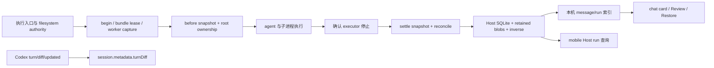

# Turn diff 实现、性能与兼容性审计

日期：2026-11-10（Asia/Shanghai）。对应 [evidence ledger](../evidence/2026-10-29-turn-diff-completion.md)，本轮目标为 G3。

## 结论与证据范围

当前已有贯通的、provider-neutral 的 Task Workspace capture → retained patch → chat/Review/Undo 链路，但不能据此宣称所有 agent、执行入口和环境都完整支持 turn diff。最优先的问题是失败写入后的文件完整性、executor 停止与快照结算的时序，以及路径身份。性能问题同时存在于 native capture/watcher、Host 读取和前端历史索引。

经[对抗性审查](2026-11-10-turn-diff-adversarial-review.md)后，保留 **17 项缺口：4 项 P1、12 项 P2、1 项 P3**。原 F07 的正常 Host 切换结论已撤回，不计入缺口总数；保留编号记录纠偏过程，新增 F17/F18。各项区分已复现行为、源码确认的缺口和产品边界；优先级不是线上发生率。

本轮还修正了 F03 的 capture 模式与 alias 前提、F06 的 provider/API 分类、F08 的 mounted 生命周期、F12 的 desktop Host fallback，并扩展 F09。旧版证据包以本修订与对抗性审查报告为准。

审计基线为 `08d9b4734051b23c0815eed95dd4327ed516b4d4` 加共享工作树的当前未提交改动。三个 fresh-context reviewer 分别检查 native、runtime、UI；主会话交叉核对、运行聚焦测试和探针。没有修改产品源码、用户数据、主工作树 Git index、系统配置或调用真实 provider；Git/RLIMIT 实验仅在新建 fixtures/子进程内改变状态。CodeGraph 无 index，已回退源码导航。

对抗性复核时 HEAD 为 `3a0cb885952c1a3323d3c11d19f974f2080be503`；最初16个被探针记录的源码 hashes 未变。新增调用链和探针另记当前源码身份，不能仅凭 HEAD 或 mtime 推断整个工作树或既有 native binary 的身份。

证据标签：

| 标签 | 含义                                                                                              |
| ---- | ------------------------------------------------------------------------------------------------- |
| E1   | 当前源码实际执行的隔离探针；transport、数据库或 UI primitive 边界可替换，限制逐项说明             |
| E2   | 当前 owning source 与调用链确认；尚未完成真实环境复现                                             |
| E3   | 已有本机 native rlib 的 public-service 支持实验；**rlib revision 未知，不能当作当前源码构建验收** |
| U    | 尚未验证的环境、故障或产品语义                                                                    |

2026-10-30 ledger 中的测试和修复仅为历史记录；原 `.cache/turn-diff-fix-2026-10-30/` 已不存在，未复用为本轮通过证据。

后续用户将 AgentChangeset、integration 和工作区历史纳入范围，新增[跨功能联合审计](2026-11-10-turn-diff-cross-feature-audit.md)。本报告17项只代表 turn-focused 清单；实际修复还必须复用现有 SCM/历史 owner，并优先校正 policy gate、exact-revision checks、Bundle 投影和历史操作的关联，不能直接据此前列表再建独立 changeset/history 后台。

## 当前实现模型



这里有四种不同能力，不能互相代替：捕获真实 filesystem 变化、证明变化归属、提供历史 diff 入口、按记录执行 inverse。工具事件与 provider 自报 diff 是提示，不能单独证明完整、可逆的磁盘状态。[ADR-0086](../content/docs/en/adr/0086-task-scoped-resource-workspaces.md) 与 [ADR-0111](../content/docs/en/adr/0111-managed-workspace-registry-and-bundle.md) 是现有契约。

已经存在的保护包括：Observed root 的祖先/后代重叠拒绝、worker 的 stop-unconfirmed quarantine、保留原 Host/account 的读取、partial apply 的 applied selection、三方合并冲突检查、二进制/模式/软链接处理、敏感资源权限、过期 async 结果丢弃。不能把过去修复过的多 hunk 丢失、additional-root provenance 丢失再次列为本轮新缺陷。

## 缺口清单

### F01 · P1 · Apply/Undo 写入失败可能删除当前文件

**E1 + E2。** [ledger.rs:1232](../../crates/cognia-task-workspace/src/ledger.rs#L1232) 的 `commit_plans` 只回滚此前成功的条目；[write_entry:1250](../../crates/cognia-task-workspace/src/ledger.rs#L1250) 先删除目标，再写 temp、chmod、rename。当前条目失败时原文件已经不在；先前条目的补偿错误也被忽略。

在隔离子进程中逐字提取当前函数，设置 `RLIMIT_FSIZE=1`、忽略 `SIGXFSZ`，结果为 `File too large (os error 27)` 且 `original_exists=false`。UUID 和辅助类型为 shim，关键写入函数体来自当前源码。没有写真实 workspace。

对抗性复核确认六个提取函数体与当前源码相同，独立编译重现单文件丢失；双文件变体还重现第一条成功写入在补偿失败时被删除，最终两个原目标均不存在。此结论限于 commit 替换阶段；blob quota 等前置拒绝或 remove 前失败不等于丢文件。保留 before blobs 可能支持显式/人工恢复。

失败 capture 被标记 Aborted 并释放 mutation pins；恢复查询不会自动恢复这个条目的磁盘 bytes。不能因为保留过 before blob 就称操作自动恢复。应先完成 staging 再替换、覆盖失败条目的补偿、记录补偿失败和中断恢复。验收需包括 write/chmod/rename/disk-full/进程中断，而非只测成功后的 Undo。

### F02 · P1 · 部分取消、timeout 路径没有等待 executor 停止就结算

**E2，延迟写入的完整链路实验待补。** [agent-execution-service.ts:365](../../lib/ai/agent/execution/agent-execution-service.ts#L365) 在 rail reject 后调用 `lease.abort()`；[agent-executor.ts:734](../../lib/ai/agent/agent-executor.ts#L734) 没有接入 `onExecutorStarted` 的独立 stop promise。[run-and-capture.ts:1146](../../lib/claude/run-and-capture.ts#L1146) timeout 仅异步 interrupt 后 reject，signal abort 也只有有限 drain。

Scheduler chat 的 [abortHandler:1135](../../lib/scheduler/executors/index.ts#L1135) 立即 resolve，之后 [1186](../../lib/scheduler/executors/index.ts#L1186) 结算。普通 native `begin_run` 未启用 worker 的强制 stop confirmation；[service.rs:4493](../../crates/cognia-task-workspace/src/service.rs#L4493) 的保护仅覆盖相应标记的 run。

因此“收到异常/取消”与“工具、shell 和所有子进程已停止”仍不等价，后续写入可能落在 snapshot 之后，root 提前可复用。应将 executor stop proof 贯通所有 capture owner；用可控 deferred executor 在取消之后继续一次写入验证，不能用立即 reject 的 mock 代替。

F02 的 owner 边界补充：Scheduler 会传 taskWorkspace envelope 并在 Host attach capture，但 attach 不是 stop proof。external Host 普通 cancel 会等 run.execution，不能用 builtin callback 缺失泛化；其 manager timeout 则不 await adapter cancel 就 reject（[manager.ts:2564](../../lib/ai/agent/external/manager.ts#L2564)），Host catch 结算，是另一条尚需延迟 executor 实验的 E2 路径。

### F03 · P1 · non-Git/fallback 捕获把 POSIX 反斜杠文件名变成另一个路径

**E2 + E3；当前完整 native 构建待补。** [snapshot.rs:217](../../crates/cognia-task-workspace/src/snapshot.rs#L217) 的 non-Git/fallback walk 把真实文件名中的反斜杠替换为 `/`；include descendants 同样受影响。例如在 macOS/Linux，含一个 U+005C 的 `literal\name.txt` 与 `literal/name.txt` 是不同文件。普通 Git-backed 主路径保留 ls-tree/status 的原路径，不能泛化为所有 POSIX/Git 捕获。generated metadata 有相同转换，但不进入 reversible source patch。

支持实验中，前者的改动被记录为后者；在 slash 路径放入匹配内容后，Undo 返回 Reverted、没有 conflict，却修改 slash 文件，真实 backslash 文件保持已修改状态。当前源码确认了路径别名逻辑；该 public-service 实验所用 rlib revision 未知，不能夸大成当前完整服务复现。

需要按平台序列化路径组件，或在不支持表示时拒绝发布 reversible patch，并检测规范化碰撞。验收应断言两个路径的逐字身份和无关文件不变。

关键前提：原探针在 settle **之后**创建 slash alias，并放入匹配修改后文件的内容，满足 current/base equality 检查。alias 不存在时，该 modified-file Undo 会 conflict（`resource was deleted after the task started`）；不同内容仍受 merge/conflict 保护。不能声称任意 alias 都会被覆盖。需补 non-Git/Git capture × absent/matching/differing alias 控制组。

### F04 · P2 · Git 优化捕获会把部分变化报告为干净

**E2 + E3。** [snapshot.rs:612](../../crates/cognia-task-workspace/src/snapshot.rs#L612) 用 `git status` 找需要读取的路径，再以 HEAD blob 作为其余路径的当前身份。`assume-unchanged`、部分 `skip-worktree` 状态下的实际修改可不出现在该集合。源码未另行验证这些已物化文件。支持实验两种 flag 均得到空 changes 和空 Applied/reversible patch。

此外，[499](../../crates/cognia-task-workspace/src/snapshot.rs#L499) 跳过 gitlink，overlay 跳过目录，所以父 root 对 dirty submodule 也可能得到空 patch。应验证特殊 index 状态，或显式发布 incomplete；submodule 要作为独立 root 捕获或标为未覆盖。不能通过修改用户 index flags 来掩盖问题。Git 的 flags 和 submodule 状态语义见本文 Sources。

正常 status-clean Git 的物理 bytes 与 HEAD 不同是独立完整性问题，见 F17，不能归结为这些 visibility flags。

### F05 · P2 · Scheduler/Best-of-N 的外部 agent 绕过 filesystem ownership 判断

**E2。** [scheduler:1414](../../lib/scheduler/executors/index.ts#L1414) 对配置的 external agent 先开本地 capture，[1427](../../lib/scheduler/executors/index.ts#L1427) 没有消费 placement 的远端目标结果，再执行并结算；未复用 `externalAgentWorkspaceCaptureSupport`，该执行调用也未传递 scheduler signal。[Best-of-N runtime:277](../../lib/best-of-n/runtime.ts#L277) 与 [external.ts:84](../../lib/best-of-n/external.ts#L84) 有相同的 authority 缺口。

A2A、显式 endpoint、remote placement 因此可能执行成功，却发布本地空 diff/无关 diff。应统一 capture admission 与 placement receipt；用远端-only 写入 fixture 证明本地不得标为 tracked。

### F06 · P2 · Plugin/Bot agent.turn API、scheduled Goal 的 builtin-provider 路径缺少 capture

**E2，仅限 builtin Claude Agent SDK / AI SDK provider。** [plugin agent-turn.ts:340](../../lib/plugin/api/agent-turn.ts#L340) 要求 absolute cwd，创建 workingDir session，之后 [609](../../lib/plugin/api/agent-turn.ts#L609) 调用 central runner。对 builtin provider，此入口与 resolver/runner 均未补建 Task Workspace 或 unavailable receipt；[goal-headless-runner.ts:336](../../lib/scheduler/executors/goal-headless-runner.ts#L336) 的 builtin 路径相同。

原“Plugin/Bot SDK”归类过宽：独立 [Plugin Agent SDK run.ts:203](../../lib/plugin/agent-sdk/run.ts#L203) 通过 executeAgentTurnFromRenderer，可取得 bundle capture。上述 agent.turn/Goal 选择 external provider 时，central runner 也会转入 [remote-run-service.ts:991](../../lib/ai/agent/external/runtimes/remote/remote-run-service.ts#L991)，在 execute 前 await openWorkspace 或记录 unavailable。叶子没有 begin，不能证明下层没有 owner。

应补齐 builtin API/Goal 的 capture/unavailable 契约，并按 provider 参数化真实调用链测试；不要再为已有 owner 的 SDK/external 路径建立双重 capture。

### F07 · 已撤回正常切换缺陷结论 · 孤立 hook 未绑定 origin 的加固项

原 hook-only 探针能在不卸载 hook、直接替换 mock transport 时混用 metadata/body，但遗漏真实路由祖先，不足以证明正常 Host 切换有该故障。

/remote-sessions 的 [surface contract](../../lib/runtime/surface-contract.ts#L61) 将 offline 标为 blocked，正常切换先发布 connecting；[SurfaceAvailabilityBoundary](../../components/runtime/surface-availability-boundary.tsx#L40) 替换 route child。复核实际 boundary + 实际 hook 的 controlled snapshot 实验：A online mount → B connecting unmount → B online 新 mount；相同 sessionId/runId 也重新读 B metadata，再读 B body。初审忽略了这项已有保护。

hook 自身未保留 origin 可作为未来 reuse/hot-swap 加固义务；若存在绕过 connecting/unmount 的生产入口应重验。当前未建立这种路径，不计为 P2 生产缺陷，也未声称真实配对设备切换验收。

### F08 · P2 · Mobile 持续停留 Changes 时不再发现新 turn

**E1 + E2。** 轮询条件是 [hasUnsettledRuns](../../components/mobile/remote-sessions/use-session-changes.ts#L143)；已有 runs 全 ready 或首次 untracked 时没有刷新源，taskIds 也只在初次加载枚举。

实际 hook 探针：初次为 `run:old` ready，随后 Host 增加 `run:new`，等待 1,650 ms 后没有额外 RPC，显示仍只有 old。应订阅运行/连接 revision 或提供有界刷新与手动重试；重连和新 workspace 也需重新枚举。

生命周期限定：F08 成立于 Changes tab **持续 mounted**；切到其他 tab 时 Radix TabsContent 卸载，重新打开 Changes 会重新读取，不能说只能退出整个会话刷新。

### F09 · P2 · 历史 Undo 缺少执行中校验，Restore 确认也未重查 busy

**E1 + E2。** [restore-point-dialog.tsx:171](../../components/chat/restore-point-dialog.tsx#L171) 的 handler 只检查 plan.kind，[385](../../components/chat/restore-point-dialog.tsx#L385) 确认动作未检查 busy/restoring。实际 React/jsdom 探针 idle 打开确认后切 busy，仍调用 `undoTaskWorkspace`。

native 历史 Apply/Undo 入口也没有复用 begin 的 root-admission fence，只有 service 实例内的 store mutex。因此需要提交时重新验证会话/根执行状态，并在 Host 建立 mutation 与 active execution 的互斥。已证明 UI busy 禁止条件失效；未证明 Host 三方合并的冲突保护失效。

另有无需 modal race 的入口：旧回复的 [TurnChangesCard canUndo:167](../../components/chat/turn-changes-card.tsx#L167)、button/handler 只检查 patch/undoing，没有订阅会话 busy。新 turn streaming 时旧回复仍可 mounted，因此可先打开历史 card Undo。此项为源码确认；尚未证明真实 Host 磁盘污染，不能把可发送 mutation 等同于绕过 conflict 检查。

### F10 · P2 · Split/side pane 的 fresh message 绑定到聚焦会话

**E1（声明级探针）+ E2。** [message-renderer.tsx:398](../../components/chat/message-renderer.tsx#L398) 使用 `metadata.sessionId ?? activeSessionId` 作为 branchSessionId，忽略旁边已有的 transcript context；[1240](../../components/chat/message-renderer.tsx#L1240) card 和 [1916](../../components/chat/message-renderer.tsx#L1916) Restore 都使用它。

fresh UIMessage 无 metadata.sessionId、实际 pane 为 B、聚焦 A 时，结果是 A。可导致 B 的 card 消失或按 A 规划 Restore。持久化消息通常补有 metadata，因此不能说所有消息都错误。应沿真实 transcript session 统一所有消息动作的身份解析，并补 split/aside 的行为测试。

### F11 · P2 · 长历史 preview 加载时，Restore 短暂报告无改动

**E1 + E2。** [chat-view.tsx:1375](../../components/chat/chat-view.tsx#L1375) 在 store messages 尚为空时显示独立 tail preview；Restore 只读取 [slice.messages:119](../../components/chat/restore-point-dialog.tsx#L119)，不等待 full-history readiness。

实际 React/jsdom 探针 `messages=[] + messagesLoading=true` 显示 `files.none`，没有读取任何 turn record。完整历史到达会重新规划，所以这是错误 clean 状态，不是已证明永久丢失。应保留 loading/unknown，等所显示 message 的完整历史可用后再判断。

### F12 · P2 · Chat card / turn picker 的 message→run 关联依赖本机 metric row

**E2，入口关联缺口。** [use-turn-changes.ts:21](../../hooks/chat/use-turn-changes.ts#L21) 与 [history picker](../../hooks/git/use-session-turn-reviews.ts#L95) 只查本机 codeAdoptionTurns；该表 local-only、保留最新10,000 rows。缺 row 的 card 隐藏，因此这些消息入口在 sync/prune 后没有 message→run 回填。

不能扩大为 desktop 完全无法发现历史：已有 [DockWorkspace:346](../../components/artifacts/workspace-mode/dock-workspace.tsx#L346) 直接枚举 Host tasks/runs；[TaskResourcesPanel:163](../../components/artifacts/workspace-mode/task-resources-panel.tsx#L163) 独立加载所选 run patch，adoption lookup 是可选的；run selector 可选旧 run。复核 effect-fragment 探针使用受控 Host/metric 数据，在 metric 缺失时仍执行了 run:old 的 retained-old.ts patch 读取；并非真实 Host 验收。

剩余问题是消息与历史 run 的精确关联/入口体验，应与 adoption retention 解耦，并复用已有 Host 查询，避免再建重复历史服务。

### F13 · P2 · Native capture/diff 的资源预算未覆盖普通 turn

**E2，尚无生产 RSS/latency 数据。** [capture_with_policy:98](../../crates/cognia-task-workspace/src/snapshot.rs#L98) 传 `None`，普通 dirty/non-Git 文件用全量 `fs::read` 并保留 blobs；8 MiB/file、32 MiB/total、5,000 entries 的预算只用于 replica。干净 Git 文件有 HEAD/blob 优化，不能概括为每轮全量读取所有文件。

[settle:4518](../../crates/cognia-task-workspace/src/service.rs#L4518) 在全 service store lock 下执行 capture、压缩、reconcile、patch 生成。[build_hunks:730](../../crates/cognia-task-workspace/src/ledger.rs#L730) 对需要文本 hunks 的非 binary、内容已变化文件生成正反两个 diff（相同内容/mode-only 会提前返回）；[unified_diff:834](../../crates/cognia-task-workspace/src/ledger.rs#L834) 使用无显式 timeout/cancel/output cap 的 `Command::output()`。慢 root 可阻塞其他 root 的读取与结算。

另有 [put_blob:790](../../crates/cognia-task-workspace/src/store.rs#L790) 每个新 blob 都 `SUM(stored_size)` 全表聚合；该累积成本需测量。存储容量、64 MiB decoded cache、事件/JSON 帧限制不等于峰值内存和计算时间限制。

应以流式/临时文件承载大 payload，定义普通 turn 的 bytes/files/time/cancel 预算；耗时计算移出 metadata lock，发布时保留 root/run/revision 检查。超预算必须是显式 incomplete/failed，不能伪装 clean。

### F14 · P2 · Watcher 的输出限制没有约束输入队列与工作量

**E2，尚未测量实际 event-storm RSS。** [watcher.rs:95](../../crates/cognia-task-workspace/src/watcher.rs#L95) 使用无界 channel；初次 inventory 递归访问随后才过滤的目录；[205](../../crates/cognia-task-workspace/src/watcher.rs#L205) 先收集整批事件，再检查 24 KiB path 输出预算。Git ignore 判断还会逐路径起子进程，overflow 触发 rescan。

应在入口 coalesce 并限界，保留一个 overflow sentinel；初次扫描剪枝 excluded 目录，批量/缓存 ignore，限制 resync 频率。验证下游阻塞时的队列上界与 watcher.stop join 时间，而非只测事件 DTO 小于上限。

### F15 · P2 · 历史查询为二次增长，Restore 还串行读 Host

**E1 + E2。** [persist.ts:103](../../lib/code-adoption/persist.ts#L103) 每次按 sessionId 拉取并 JS filter messageId，schema 没有 message correlation index。[loadRestoreTurns](../../components/chat/restore-point-dialog.tsx#L87) 对每个后续 assistant 逐个等待 row 与 patch，在所请求 message 的 correlation 均存在、能完成整条链时形成 `O(M×N)` row 检查与串行 RPC；M≈N 时为二次增长。missing row 会提前失败（F18），不保证每次 Restore 都发出全部 RPC；N 受当前10,000-row retention 限制。

实际 Dexie + fake-indexeddb + 当前 persist.ts 的测量：

| session rows | message lookups | predicate 检查次数 | 本次合成耗时 |
| -----------: | --------------: | -----------------: | -----------: |
|           50 |              50 |              2,500 |     69.44 ms |
|          100 |             100 |             10,000 |    303.28 ms |
|          200 |             200 |             40,000 |  1,752.32 ms |

独立工作量探针 1,000 turns 得到 1,000,000 次 predicate 检查。表中耗时包含内存 IndexedDB 实现和运行环境开销，**不能外推为真实 browser/device 延迟**；操作次数直接证明算法增长。更大实际 Dexie spike 在约 2.5 分钟后停止，未把未完成运行当作结果。

card mount 还会读每个 run 的完整 patch metadata，没有 summary-only 共享查询。MessageList 已有 virtualization（>40 rows，overscan 5），不能说整段历史的所有 card 同时挂载。仍需优化每次 mount 的扫描与重复 RPC，以及 correlation 完整时 Restore 的串行链；missing row 的提前失败和 retention 上界见上文。建议一次批量取得 message→run 映射、按 origin/run/revision 去重、有限并发与可取消的进度反馈；涉及 schema 时另走 migration。

### F16 · P3 · Codex 原生 turn diff 仍是 session metadata 末值

**E2，独立能力缺口。** [app-server-client.ts:2612](../../packages/agent-codex/src/app-server-client.ts#L2612) 将 `turn/diff/updated` 放入 `session.metadata.turnDiff`，没有发出通用 turn diff 事件。全仓该字段的检索只找到 handler 和测试，没有 Review consumer、按 turnId 的持久化或 reset。

因此不能宣称有 Codex 原生实时 turn-diff UI；多 turn/重连/多 agent 原生通知也不能通过这个 session 末值获得历史身份。现有 retained Task Workspace diff 不依赖它，不能把两条链混为同一个故障。若实现实时预览，应保留 hint 身份并在 settle 后关联权威 patch，避免建第二套 Undo ledger。

### F17 · P1 · status-clean Git 的 HEAD 表示被当作物理 baseline，Undo 不保真

**当前源码 E2 + 新鲜 Git bytes 实验；public-service 仍仅 E3。** [snapshot.rs:630](../../crates/cognia-task-workspace/src/snapshot.rs#L630) 对 clean tracked file 仅 lstat，使用 HEAD oid/size；[persist_patch_blobs:8093](../../crates/cognia-task-workspace/src/service.rs#L8093) 通过 raw git cat-file --batch 取得 before bytes。[Observed inverse:676](../../crates/cognia-task-workspace/src/ledger.rs#L676) 及 Undo 采用这些 retained bytes，未恢复 checkout transformation。

隔离 Git fixtures 中，core.autocrlf=true 的实际初始文件以 CRLF 结尾（hex `6265666f72650d0a`），HEAD 以 LF 结尾（`6265666f72650a`）；可逆 clean/smudge filter 下实际为 Wbefore（`576265666f72650a`），HEAD 为 Cbefore（`436265666f72650a`）。两者初始 status 均为空。既有未知 revision 的 public-service helper 在改写后 Undo 返回 Reverted/no conflicts，却分别留下 LF 和 Cbefore，不是原始磁盘 bytes。此实验不能升级为当前完整 native service 构建验收。

这比隐藏 index flags 更常规，触及物理 snapshot/inverse 的根本假设。应保留实际 working-tree bytes 或明确 profile 不保真；不能在 Undo 时盲目运行任意用户 filter 弥补。Git LFS、working-tree-encoding 是相关待测变体，未声称复现。验收要求 initially clean、capture→edit→Undo 后逐字节一致，并覆盖 managed 工作副本语义。

### F18 · P2 · 一轮多个 assistant message 会被 Restore 误判为缺追踪

**E1（当前函数/片段）+ E2。** [assistantMessagesAfter:47](../../lib/chat/restore-point.ts#L47) 收集所有后续 assistant IDs；[loadRestoreTurns:87](../../components/chat/restore-point-dialog.tsx#L87) 对任一 missing row 立即 throw。但 [turn-tracker:290](../../lib/code-adoption/turn-tracker.ts#L290) 只把一个 capture row 关联到 closing assistant；[Claude adapter:934](../../lib/claude/adapter.ts#L934) 允许工具迭代产生多个不同 assistant IDs。

有界实际函数/adapter append 片段探针得到 `[u, a-tool, a-final]`，closing=a-final，fixture 假定该 run 的 Host patch 可用，row 只关联 a-final；getTaskPatchSet 是受控 mock。Restore 首先查 a-tool，没有 row 就报 Turn change record is unavailable，尚未请求任何 patch；无需 prune 或换设备。探针替换了 adapter 内容 projection helpers/Host 边界，未运行真实 provider/UI 全链路。

需用 captured turn 的 message range/稳定 turn identity 规划 Restore，并按 root/run 去重。不能简单跳过所有 missing rows，否则真正未追踪的变化可能被误作可恢复；也不能给同一 run 的每条 assistant 直接重复 Undo。

## Agent 与执行入口支持矩阵

这里的“有 capture 链”表示当前源码存在 awaited owner，不等于真实 provider 通过验收。品牌名也不能证明 filesystem authority。

| 类别                                                                                               | 当前能力                                                                   | 主要限制                                                                            |
| -------------------------------------------------------------------------------------------------- | -------------------------------------------------------------------------- | ----------------------------------------------------------------------------------- |
| 内置 Claude Agent SDK / AI SDK 的 Desktop chat                                                     | Local 或 managed bundle 在执行前 acquire                                   | F02；真 provider/桌面 acceptance 未重跑                                             |
| Host-owned ACP stdio                                                                               | policy 允许 capture，共用 Host ledger                                      | 需要实际 cwd、子进程和 stop 行为符合契约                                            |
| Codex app-server / SiwC、Pi RPC、Aider、OpenClaude、Continue、DeepSeek Harness SDK、Codebuff stdio | policy 允许 capture                                                        | F02；native diff streaming 另见 F16                                                 |
| Cognia 启动的 OpenCode v1/v2、Crush、Rovo service                                                  | 有 owned process/autoSpawn 才允许                                          | 显式 endpoint 即使 loopback 也不代表同 filesystem                                   |
| A2A、remote ACP、network-service 显式 endpoint                                                     | policy 返回 remote-filesystem unavailable；known stdio 分支先被接受        | Scheduler/Best-of-N 另有 F05；不能把 stdio 的冗余 endpoint 字段一概当拒绝条件       |
| custom/插件贡献的未知 protocol                                                                     | unsupported-runtime                                                        | 使用已知 stdio protocol 的插件可复用已有 policy；不代表 plugin API 入口自动 capture |
| CLI run / SDK-RPC / REPL / TUI 手动 turn                                                           | worker before/after capture、拒绝 admission 后不执行、未知 stop quarantine | 需实际 CLI/helper artifact 与 provider 验收                                         |
| TUI autonomous notification                                                                        | 明确 unavailable；不伪造 post-write baseline                               | 完整捕获需要真正 awaited before-write hook                                          |
| CLI no-session / MicroVM                                                                           | 分别 persistence-disabled / remote-filesystem                              | 不提供完整历史 patch；仍有 root fence 探测                                          |
| Squads / Agent Team                                                                                | child dispatch 有独立 bundle/run/attempt，managed isolation                | 无法据此保证全部 executor 取消路径；见 multi-agent 矩阵                             |
| Best-of-N                                                                                          | 每 candidate 有 capture                                                    | F02、F05                                                                            |
| Scheduler chat/agent/skill/script                                                                  | 显式 capture owner                                                         | chat cancel F02；external F05                                                       |
| Plugin/Bot agent.turn API、scheduled Goal：builtin provider                                        | 可写路径缺 entry-owned capture/unavailable                                 | F06；不能推广到独立 Agent SDK 或 external provider                                  |
| Plugin Agent SDK / 上述 API 的 external provider                                                   | SDK 走 executeAgentTurn；external 走 Host remote-run capture owner         | 有 awaited begin/明确 unavailable；仍需实际 provider 与 F02 stop 验收               |

静态 preset registry 本次有 45 项，包含 `custom: null`；插件 overlay 可另加项。[presets.ts](../../lib/ai/agent/external/config/presets.ts) 与 [ecosystem-adapters.ts](../../lib/ai/agent/external/ecosystem-adapters.ts) 是当前来源。ACP 分组覆盖 Claude Code、Codex ACP、Cursor CLI、Gemini CLI、Copilot CLI、Kiro、Qwen、Droid、Devin、MiniMax、Kimi、Grok、Cline、Qoder、Goose、OpenCode ACP，以及 Auggie、Autohand、CodeBuddy、Command Code、Kilo、Mistral Vibe、MiMo、Hermes、oh-my-pi、Muse、Amp、ZCode、Antigravity 等配置。此列表表示 registry 与 protocol policy，不是逐品牌兼容性认证。

policy 直接见 [capture-support.ts](../../lib/task-workspace/capture-support.ts)。修改品牌/协议适配器后需重跑其真实执行验证，不能仅将名称加入 allowlist。

## 环境与数据形态矩阵

| 环境/形态                                                  | 源码边界或当前缺口                                                                  | 必须保留的验收                                                                         |
| ---------------------------------------------------------- | ----------------------------------------------------------------------------------- | -------------------------------------------------------------------------------------- |
| macOS Tauri、Local observed                                | 原地 before/after capture，已写入不再 forward apply                                 | F01/F02/F03；真实 UI 与实际 agent 未验收                                               |
| managed Git worktree / non-Git shadow                      | 隔离执行、retained forward/inverse                                                  | dirty baseline、setup、reuse、冲突、prune 不得删除 observed root                       |
| browser standalone / 未配对 Capacitor                      | 没有本地 native ledger authority                                                    | 必须显示 unavailable，不能用 Git/provider 提示当完整历史                               |
| browser/mobile 配对 Host                                   | Host 捕获；desktop 还已有 Task Resources Host 历史 fallback                         | F08/F12/F18；正常切换 boundary 会 unmount，F07 已撤回；实际配对验收待补                |
| headless Host / SSH Host                                   | ledger 与 executor 必须同 filesystem；external central owner 有 capture/unavailable | F05 的直接 manager 入口、F06 的 builtin API/Goal 仍需补齐                              |
| Docker / shared mount / PVC                                | 同一宿主路径名不证明同一 volume/mount                                               | 实际写入可见性、权限/UID、重启、volume 持久化、单/多 replica 锁                        |
| MicroVM / 非共享 sandbox / A2A                             | 外部 filesystem 不由本地 ledger 观察                                                | honest unavailable 或真正 Host-side capture，不能事后猜 baseline                       |
| Windows / Linux                                            | transport-neutral Rust 不等于平台语义验收                                           | F17 的 CRLF/filter 不限 Windows；其余大小写、drive/UNC、symlink、process tree 尚待实机 |
| binary / create/delete/rename / chmod / empty file         | 有现有 ledger 处理；非所有变化都有 text hunks                                       | body availability 与 metadata 变化分开，不显示伪 +0/-0                                 |
| symlink                                                    | 有路径 confinement；外逃 target 会拒绝 capture                                      | internal/external/dangling 与 target 被换；拒绝须可见                                  |
| ignored/generated/upload/sensitive                         | source/generated 分离、include 与权限策略                                           | upload/Unknown Undo scope 可见；ignored 不等于用户已同意无捕获                         |
| submodule / index flags / sparse checkout                  | F04                                                                                 | 捕获、独立 root 或 incomplete，不能统一称 clean                                        |
| clean Git + CRLF/clean-smudge                              | HEAD blob 不等于原始工作树 bytes，F17                                               | initially clean、修改、Undo 后逐字节验证；LFS/encoding 未测                            |
| POSIX 非 UTF-8 名字、hardlink、ACL/xattr、空目录、特殊文件 | 普通模型只表达 file/symlink；部分名字会跳过/有损，其他 fidelity 未建立              | 明确能力边界；checkpoint profile 的更广支持不等于普通 turn profile                     |
| ledger quota / disk-full / prune / pin                     | 有 retention 与 blob budget                                                         | F01/F13；空间不足前后、active/unapplied/pinned、metric 与 patch 生命周期错位           |

## Multi-agent、并发与生命周期矩阵

| 场景                                        | 已有保护                                                    | 缺口/下一步                                                                  |
| ------------------------------------------- | ----------------------------------------------------------- | ---------------------------------------------------------------------------- |
| 不同 isolated roots 并行 agent              | 独立 TaskRun/bundle，run/agent provenance                   | F13 共享 store/admission lock 仍可能串行阻塞；测并行吞吐与等待               |
| 同一或祖先/后代 Observed root               | admission 拒绝重叠，跨 service capture owner 有 OS lock     | F02 提前释放；历史 mutation 未复用 root admission，需 Host 互斥              |
| parent/child、retry/continuation、Best-of-N | 有 parent/run/attempt 及 bundle 生命周期                    | 真正停止所有 worker/后台 shell 后才能 settle，不能只等 assistant result      |
| agent 与用户/editor/外部进程交错写          | Unknown origin 保留，UI 展示 User/Unknown                   | exclusive Cognia lease 不会阻止外部 editor；root snapshot 不证明逐行作者身份 |
| 子 agent 自己创建 worktree/跨 cwd 写入      | 只保证已纳入 capture 的物理 root                            | 观察根之外必须显式加入 bundle 或标范围不完整                                 |
| 多根同 relative path                        | 当前记录保留 root/run，Review 可按 runs 查询                | 需继续测每根错误/冲突/取消、历史点击与 Undo 的精确 scope                     |
| EOF/crash/interrupt/timeout                 | worker stop quarantine 与显式 recovery                      | renderer 普通 capture F02；power-loss/进程树未实测                           |
| 老 turn Undo 与新 turn 并发                 | Restore 首按钮有 busy、Host 有三方合并；card 没有同等 gate  | F09；需覆盖每个 Undo surface 与 Host mutation/execution root fence           |
| 多 turn/多 root Restore 部分失败            | newest-first，遇 conflict 停止，报告已 undone 数并重查      | 跨 Host 原子 transaction 未实现；RPC throw 可丢已完成计数，需更明确恢复反馈  |
| Host/account 切换、相同 runId/路径          | desktop retained origin 与正常 mobile 切换 unmount 已有保护 | F07 仅保留孤立 hook 加固；未来跨 Host 聚合的 key 碰撞仍是潜在场景            |

最后一项的 card runId-only 匹配与 SnapshotReview root-only 索引已用合成输入暴露碰撞，但**未找到当前生产 writer 把跨 Host 相同身份聚合到同一 row**。本轮仅列为未来 contract 回归场景，没有计为额外线上缺陷。

## 验证结果与可重放证据

聚焦命令通过 repository `pnpm test` 入口运行，没有 coverage：

```bash
rtk proxy pnpm test -- --runInBand --runTestsByPath \
  lib/code-adoption/persist.test.ts lib/code-adoption/turn-tracker.test.ts \
  lib/task-workspace/capture-support.test.ts lib/task-workspace/run-lease.test.ts \
  lib/task-workspace/client.test.ts lib/task-workspace/host-turn.test.ts \
  lib/task-workspace/run-changes.test.ts lib/task-workspace/origin.test.ts \
  hooks/chat/use-turn-changes.test.ts hooks/git/use-session-turn-reviews.test.ts \
  components/chat/turn-changes-card.test.tsx components/chat/restore-point-dialog.test.tsx \
  lib/chat/restore-point.test.ts components/artifacts/workspace-mode/snapshot-review.test.tsx \
  lib/review/scope.test.ts components/mobile/remote-sessions/use-session-changes.test.ts \
  components/mobile/remote-sessions/session-changes-panel.test.tsx \
  packages/agent-codex/src/app-server-client.test.ts
```

结果：**18 suites 中 17 通过、1 失败；634 tests 通过、1 skipped、1 failed**。失败是 `use-session-changes.test.ts:215`，旧断言要求 zero-hunk file 不读 body，而当前 `projectPatchSetChanges` 允许从 retained text blobs 重建；该 fixture 本身有不同 before/after hashes。是当前测试与实现语义不一致，不能据此判定“文本重建应删除”，也不能报告全绿。断言未被修改。

另外两套 `capture-support.test.ts`、`agent-execution-service.test.ts` 共 **53 tests 通过，无 skipped**，与上面部分重叠，不能直接相加成唯一测试总量。service failure 测试没有延迟 stop proof，所以通过不反驳 F02。

本轮 artifacts：

- `.cache/turn-diff-audit-2026-11-10/focused-tests.{json,log}`：实际测试结果。
- `.cache/turn-diff-audit-2026-11-10/probe.cjs`、`probe-results.json`：实际 hook 的 Host/刷新探针、实际 Dexie 查询工作量及源码 hashes。
- `.cache/turn-diff-audit-2026-11-10/ui/{probes.cjs,results.json,findings.md}`：busy/history-preview/pane 及独立 query-work 探针。
- `.cache/turn-diff-audit-2026-11-10/native-review.md`：native 调用链、现有保护和资源边界。
- `.cache/turn-diff-native-audit/ledger-write-probe.rs`、`ledger-write-result.json`：当前关键函数提取实验。
- `.cache/turn-diff-native-audit/{identity-manifest.json,service-capture-results.json,backslash-undo-result.json}`：native source/rlib 身份与支持实验。

运行 `rtk proxy node .cache/turn-diff-audit-2026-11-10/probe.cjs` 和 `rtk proxy node .cache/turn-diff-audit-2026-11-10/ui/probes.cjs` 可重放 TS 探针；它们从 repository root 读取当前 source，结果必须对照 source hashes。cache 会被清理，报告内已经保留关键输入、观测、边界和精确源码位置。

native public-service 探针链接的 rlib SHA-256 为 `a58d31c0e2fdb2e777193c7598a20954aaa24b0dabcd3515919ff301ae954e21`。尝试让完整当前 snapshot source 复用已有 artifact 时遇到重复 `serde_core` trait 不兼容，未把它当产品失败；没有以 mtime 代替 source revision 证明。

没有运行完整 Cargo 重建、全仓 build/lint/typecheck、真实浏览器/已安装 Tauri、provider、配对 Host、设备、Linux/Windows 或 Docker/PVC 验收。本轮仅新增研究文档并更新 ledger，相关完整产品 gates 仍属于后续修复/acceptance。不能把本轮头部测试结果解读为生产交付。

## 建议的修复顺序与验收门槛

1. **文件完整性与执行互斥**：先 F01/F03/F17；再将 F02 stop proof 和 F09 mutation root fence 一起补齐。验收：故障写入不丢原文件，未知 stop 不发布 reversible patch/不释放执行根，Undo 不触碰别名路径与活跃 executor。
2. **统一入口契约**：以同一 capture owner/authority receipt 覆盖 F05/F06，处理 F04 incomplete。验收：每个 writable 入口都得到 tracked 或有原因的 unavailable；remote-only 写入不得成为 local clean。
3. **历史与身份完整性**：F08–F12/F18；保留 message/root/run/Host/account，loading 不等于 clean，复用现有 Host 历史并补消息关联。F07 不作为已证生产修复项。验收包含 split pane、reconnect、账号切换、metric prune、preview 与确认时 busy 变化。
4. **性能预算**：F13–F15。先录制 clean/dirty Git、non-Git、大 binary、many small text、event storm、并行 roots、长历史的 RSS/bytes/subprocess/queue/lock-wait/settle/RPC/cancel-to-stop，再按真实产品目标设预算；不能预设一个没有用户目标支持的统一毫秒阈值。
5. **实时 provider hint**：最后决定 F16 的实时预览价值；沿现有 authoritative ledger 关联，避免为某 agent 引入另一套 apply/undo。

真实环境 acceptance 应复用同一套语义断言，按 agent protocol × execution entry × filesystem authority × shell/OS × lifecycle failure 分层选例；不必穷举所有品牌的笛卡尔积，但每个协议 owner、每种不同 filesystem/stop 机制和所有已知缺陷都必须有反例测试。尚未执行的验收继续保留在 ledger，不能默认接受残余风险。

本报告已按对抗性复核纠偏；新增证据、逐项处置、180项聚焦测试结果及 replay 命令见[对抗性审查报告](2026-11-10-turn-diff-adversarial-review.md)。最初 native bundle 的 fault launcher/fixture/executable 身份不足已在新 manifest 中补充，旧 rlib revision 仍未知，未升级证据等级。

## Sources

- 本文的实现结论以各段链接的当前 owning source 和隔离探针为依据。
- [Git update-index 官方文档：assume-unchanged 与 skip-worktree](https://git-scm.com/docs/git-update-index)：前者允许 Git 省略工作树变化检查；后者主要服务 sparse checkout，二者不能混为相同语义。此文档支持 F04 的 Git 前提，Cognia 的遗漏结论仍来自当前 snapshot source。
- [Git status 官方文档：submodule 状态](https://git-scm.com/docs/git-status)：父仓库会报告 submodule 内容/HEAD 等状态；Cognia 跳过目录/gitlink 是自身 capture 策略，不能把结果空集视为已覆盖内部文件。
